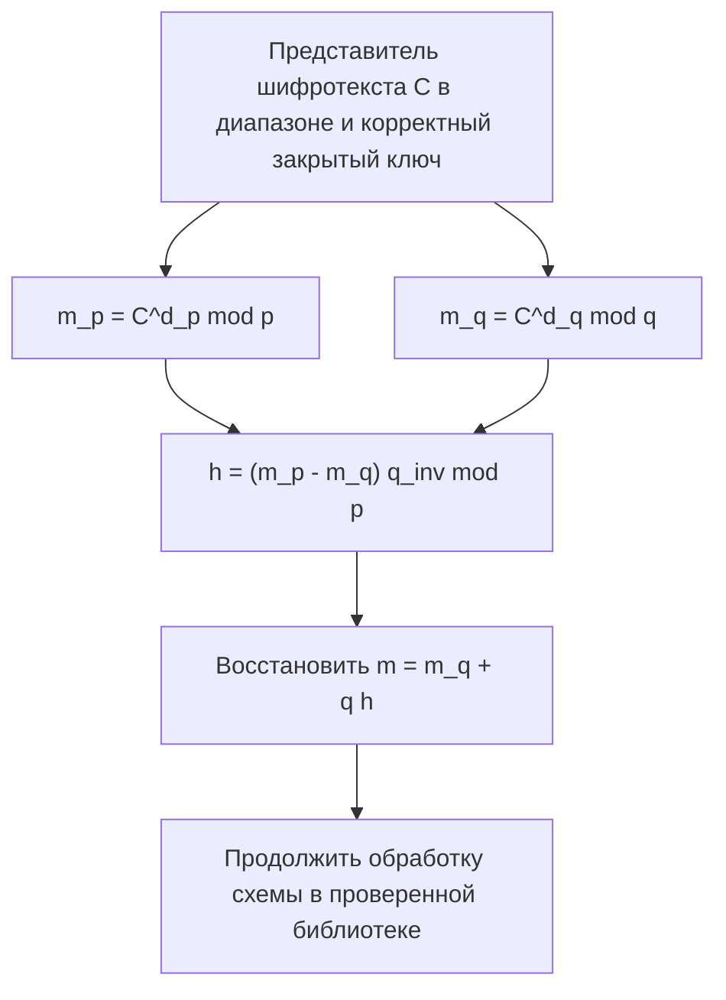

Китайская теорема об остатках (CRT) объединяет остатки по различным модулям в один класс вычетов. Она связывает целочисленные задачи, операции RSA с закрытым ключом, кольца и многочлены, а также параллельную арифметику остатков. Необходимо явно указывать условия на модули и диапазон восстановления и различать арифметическую корректность и криптографическую безопасность.

## 1. Задача Сунь-цзы и множество решений

Известный пример из «Сунь-цзы суаньцзин» требует найти число, дающее остаток 2 при делении на 3, остаток 3 при делении на 5 и остаток 2 при делении на 7. В [историческом исследовании воспроизведены задача и вычисление](https://sgmathsociety.org/smsmedley/Vol-30-1/The%20History%20of%20the%20Chinese%20Reminder%20Theorem%20%28Law%20Huang%20lng%29.pdf).

$$ x\equiv2\pmod3,\quad x\equiv3\pmod5,\quad x\equiv2\pmod7. $$

Наименьшее неотрицательное решение равно 23. Однако целочисленное решение не единственно: все решения имеют вид $x=23+105t$, где $t\in\mathbb Z$. Например, 128 тоже удовлетворяет условиям.

## 2. CRT для целых чисел: условия и единственность

Пусть $k\ge1$, а модули $m_i>1$ попарно взаимно просты: $\gcd(m_i,m_j)=1$ при $i\ne j$. Сами модули не обязаны быть простыми числами. Для любых целых остатков $a_i$ система

$$ x\equiv a_i\pmod{m_i}\quad(1\le i\le k) $$

имеет ровно одно решение по модулю $M=\prod_{i=1}^k m_i$. Следовательно, существует ровно один представитель с $0\le x<M$. Недостаточно, чтобы НОД всех модулей одновременно был равен 1: для 6, 10 и 15 общий НОД равен 1, но эти числа не попарно взаимно просты. [Доказательство целочисленного CRT](https://kconrad.math.uconn.edu/blurbs/ugradnumthy/crt.pdf) поясняет это различие.

Разность любых двух решений делится на каждый модуль. Из попарной взаимной простоты следует делимость на их произведение, что доказывает единственность. Следующая конструкция доказывает существование.

## 3. Построение с помощью обратных элементов и пример

Для каждого модуля расширенным алгоритмом Евклида находят мультипликативно обратный элемент, удовлетворяющий

$$ M_i=M/m_i,\quad M_i y_i\equiv1\pmod{m_i} $$

Взаимная простота гарантирует его существование. Приведение следующей суммы к диапазону модуля даёт решение:

$$ x=\left(\sum_{i=1}^k a_iM_iy_i\right)\bmod M. $$

По модулю $m_j$ слагаемые с $i\ne j$ обращаются в ноль, а оставшееся слагаемое сравнимо с $a_j$. Тем самым доказано существование.

В примере Сунь-цзы $M=105$, частичные произведения равны 35, 21 и 15, а соответствующие обратные элементы — 2, 1 и 1.

$$ 2\cdot35\cdot2+3\cdot21\cdot1+2\cdot15\cdot1=233,
\qquad233\bmod105=23. $$

Для модулей, которые не взаимно просты, существует отдельное обобщение. При двух модулях решение существует тогда и только тогда, когда их НОД делит разность остатков; решение единственно по модулю их наименьшего общего кратного. Например, модули 4 и 6 с остатками 1 и 3 дают 9 по модулю 12, а с остатками 0 и 1 решений нет. Следующий код не реализует это обобщение и принимает только попарно взаимно простые модули.

## 4. Реализация на Python с проверкой входных данных

Принимаются только значения встроенного типа `int`; `bool` и числа с плавающей точкой отклоняются. Оба входа должны быть конечными непустыми итерируемыми объектами одинаковой длины. Каждый модуль должен превышать 1, а модули должны быть попарно взаимно просты. Остатки могут быть отрицательными или превышать соответствующий модуль. Результат — наименьший неотрицательный представитель по модулю произведения. Исключение модуля 1 и пустой системы является договорённостью этого учебного API.

```python
from math import gcd, prod


def _extended_gcd(a, b):
    # Internal helper: integer a, positive integer b.
    old_r, r = a, b
    old_s, s = 1, 0
    old_t, t = 0, 1
    while r:
        quotient = old_r // r
        old_r, r = r, old_r - quotient * r
        old_s, s = s, old_s - quotient * s
        old_t, t = t, old_t - quotient * t
    return old_r, old_s, old_t


def mod_inverse(a, modulus):
    if type(a) is not int or type(modulus) is not int:
        raise TypeError("Arguments must be built-in integers")
    if modulus <= 1:
        raise ValueError("Modulus must exceed one")
    g, x, _ = _extended_gcd(a % modulus, modulus)
    if g != 1:
        raise ValueError("Inverse does not exist")
    return x % modulus


def chinese_remainder_theorem(residues, moduli):
    residues, moduli = tuple(residues), tuple(moduli)
    if not moduli or len(residues) != len(moduli):
        raise ValueError("Provide equally sized, nonempty inputs")
    if any(type(x) is not int for x in residues + moduli):
        raise TypeError("Residues and moduli must be built-in integers")
    if any(m <= 1 for m in moduli):
        raise ValueError("Every modulus must exceed one")
    for i, m in enumerate(moduli):
        if any(gcd(m, other) != 1 for other in moduli[:i]):
            raise ValueError("Moduli must be pairwise coprime")

    combined_modulus = prod(moduli)
    result = 0
    for a, m in zip(residues, moduli):
        partial = combined_modulus // m
        inverse = mod_inverse(partial, m)
        result = (result + (a % m) * partial * inverse) % combined_modulus
    return result


if __name__ == "__main__":
    residues = [2, 3, 2]
    moduli = [3, 5, 7]
    print("Sunzi solution:", chinese_remainder_theorem(residues, moduli))
    print("Combined modulus:", prod(moduli))
```

В Python 3.12 программа печатает `Sunzi solution: 23` и `Combined modulus: 105`. Входы разной длины не обрезаются молча; проверяются нулевые и отрицательные модули, типы и взаимная простота. Целые числа Python не ограничены фиксированной разрядностью, но затраты времени и памяти зависят от длины входа и размеров чисел. Это не криптографическая реализация с постоянным временем выполнения.

## 5. Что восстанавливает RSA-CRT

Предположим, что задан корректный ключ RSA с двумя простыми множителями. Используются различные нечётные простые числа $p,q$, $N=pq$, открытый показатель $e$ и закрытый показатель $d$, для которых $ed\equiv1\pmod{\lambda(N)}$, где $\lambda(N)=\operatorname{lcm}(p-1,q-1)$. Целочисленный представитель шифротекста удовлетворяет $0\le C<N$; прямая операция с закрытым ключом имеет вид $m=C^d\bmod N$.

Подготовим параметры CRT:

$$ d_p=d\bmod(p-1),\quad d_q=d\bmod(q-1),\quad q_{\mathrm{inv}}=q^{-1}\bmod p. $$

$$ m_p=C^{d_p}\bmod p,\quad m_q=C^{d_q}\bmod q. $$

$$ h=(m_p-m_q)q_{\mathrm{inv}}\bmod p,\qquad m=m_q+qh. $$

Полученный представитель имеет нужные остатки по обоим простым модулям и лежит в диапазоне исходного модуля. [Разделы 3.2 и 5.1.2 RFC 8017](https://www.rfc-editor.org/rfc/rfc8017.html) определяют это представление закрытого ключа и восстановление. Два показателя CRT сами по себе не заменяют весь закрытый ключ: множители и коэффициент также являются секретным ключевым материалом.



Диаграмма показывает лишь целочисленную арифметику и опускает кодирование сообщения и проверки схемы. Практическое шифрование и подписи используют разные схемы. Как объясняет [введение в RSA](https://kenji.blog/ru/p/rsa-encryption-math-explained-for-beginners/), проверенная библиотека должна выполнять обработку, соответствующую назначению.

## 6. Оценка скорости и границы реализации

Примечание 14.75 в [главе 14 HAC](https://cacr.uwaterloo.ca/hac/about/chap14.pdf) даёт оценку примерно четырёхкратного ускорения при следующих допущениях: простые множители имеют близкие размеры, используется классическое умножение с квадратичной стоимостью, число умножений пропорционально битовой длине показателя, а стоимость восстановления пренебрежимо мала. Другие алгоритмы умножения, параллельное выполнение, защитные меры и устройства изменяют это отношение. Это не результат измерения четырёхкратного ускорения кода из статьи.

Если один из отдельно вычисляемых остатков CRT искажён, непроверенный результат может раскрыть секретный множитель. [Работа об анализе сбоев RSA-CRT](https://courses.csail.mit.edu/6.857/2010/handouts/faults.pdf) объясняет условия. Правильная учебная арифметика не гарантирует ни защиты от сбоев, ни устойчивости к побочным каналам. Защитные меры, включая проверки с открытым ключом, должна выполнять библиотека, реализующая схему целиком.

## 7. Обобщение на кольца и идеалы

Пусть $R$ — коммутативное кольцо с единицей, и выбрано конечное число идеалов. Предположим, что для каждой пары различных идеалов выполняется $I_i+I_j=R$, то есть идеалы попарно взаимно просты. Естественный гомоморфизм

$$ \phi:R\longrightarrow\prod_{i=1}^k R/I_i,\qquad
\phi(r)=(r+I_1,\ldots,r+I_k) $$

сюръективен, а его ядро — пересечение идеалов. При этом условии пересечение совпадает с их произведением, поэтому:

$$ R/\left(\bigcap_{i=1}^k I_i\right)
\cong\prod_{i=1}^k R/I_i,\qquad
\bigcap_{i=1}^k I_i=\prod_{i=1}^k I_i. $$

[Китайская теорема об остатках в Stacks Project](https://stacks.math.columbia.edu/tag/00DT) содержит условия и доказательство. Попарно взаимно простые целочисленные модули — частный случай этого условия на идеалы.

## 8. Многочлены и интерполяция

Два многочлена над полем взаимно просты тогда и только тогда, когда их НОД является ненулевой константой. Недостаточно отсутствия общих корней в исходном поле. Например, над рациональными числами возьмём оба многочлена равными $x^2+1$. Ни у одного нет рационального корня, но их НОД — этот же многочлен второй степени. Для характеристики через общие корни нужно работать в алгебраическом замыкании.

Линейные множители для различных точек вычисления $\alpha_1,\ldots,\alpha_k$ попарно взаимно просты. Поэтому многочлен с заданными значениями единствен среди многочленов степени $<k$. Это связь с интерполяцией Лагранжа. Если разрешить более высокие степени, единственность исчезает. Вычисление значений и ограничения степени над конечными полями связаны и с кодами Рида–Соломона, но сам по себе CRT не гарантирует способность исправлять ошибки.

## 9. Система остаточных классов и диапазон восстановления

RNS представляет целые числа кортежем остатков по нескольким модулям и позволяет покомпонентно складывать и умножать. Здесь $x_i=X\bmod m_i$ и $y_i=Y\bmod m_i$. Для произведения модулей $M$:

$$ (X+Y)\bmod M\longleftrightarrow
((x_i+y_i)\bmod m_i)_{i=1}^k, $$

$$ (XY)\bmod M\longleftrightarrow
((x_iy_i)\bmod m_i)_{i=1}^k. $$

Переносы между каналами не нужны, но двоичная арифметика внутри каждого канала всё ещё может включать переносы. Восстановление даёт представителя по модулю произведения; оно не восстанавливает однозначно неограниченную целочисленную сумму или произведение за пределами этого диапазона. Сравнение, деление и перевод в обычное представление требуют дополнительной работы.

От классической задачи об остатках до криптографии, алгебры и параллельной арифметики CRT восстанавливает совместимые остатки при явно указанных условиях на модули и диапазоны. Различать эти диапазоны и применения необходимо для корректного использования теоремы.
