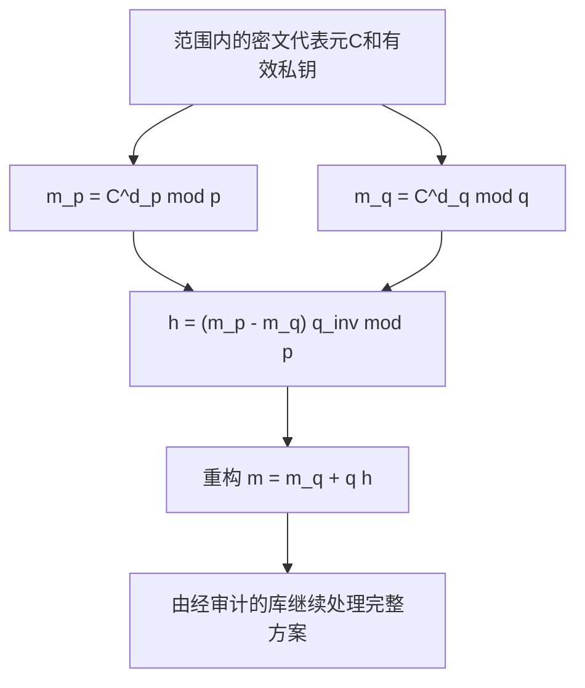

中国剩余定理（CRT）把不同模数下的余数合并为一个剩余类。它连接整数问题、RSA私钥运算、环与多项式，以及并行的剩余数运算。使用时必须说明模数的条件、重构范围，并区分算术正确性和密码安全性。

## 1. 孙子问题与解的范围

《孙子算经》中的著名例子要求一个数除以3余2、除以5余3、除以7余2。[相关历史研究论文重述了问题和计算方法](https://sgmathsociety.org/smsmedley/Vol-30-1/The%20History%20of%20the%20Chinese%20Reminder%20Theorem%20%28Law%20Huang%20lng%29.pdf)。

$$ x\equiv2\pmod3,\quad x\equiv3\pmod5,\quad x\equiv2\pmod7. $$

最小非负解是23，但整数解并不只有一个：全部解为 $x=23+105t$，其中 $t\in\mathbb Z$。例如，128也满足条件。

## 2. 整数CRT：条件与唯一性

这里取 $k\ge1$，各模数 $m_i>1$，并要求两两互素：当 $i\ne j$ 时，$\gcd(m_i,m_j)=1$。模数本身不必是素数。对任意整数余数 $a_i$，

$$ x\equiv a_i\pmod{m_i}\quad(1\le i\le k) $$

在模 $M=\prod_{i=1}^k m_i$ 意义下恰有一个解，也就是恰有一个满足 $0\le x<M$ 的代表元。仅要求所有模数的最大公约数为1是不够的：6、10、15的整体最大公约数为1，却不两两互素。[整数CRT的证明](https://kconrad.math.uconn.edu/blurbs/ugradnumthy/crt.pdf)说明了这一区别。

任意两个解之差都能被每个模数整除。两两互素使这个差能被模数的乘积整除，因此解在模乘积的意义下唯一。下面的构造证明存在性。

## 3. 用逆元构造解并实际计算

对每个模数，使用扩展欧几里得算法求出满足下式的逆元：

$$ M_i=M/m_i,\quad M_i y_i\equiv1\pmod{m_i} $$

互素条件保证逆元存在。把以下和约化到模数的范围内，就得到所需的解：

$$ x=\left(\sum_{i=1}^k a_iM_iy_i\right)\bmod M. $$

对某个模数 $m_j$ 取模时，$i\ne j$ 的项都消失，剩余的一项与 $a_j$ 同余。这就证明了解的存在性。

在孙子问题中，$M=105$，部分乘积为35、21、15，对应逆元为2、1、1。

$$ 2\cdot35\cdot2+3\cdot21\cdot1+2\cdot15\cdot1=233,
\qquad233\bmod105=23. $$

对于不互素的模数，还有另一种推广。两个模数的情形有解，当且仅当它们的最大公约数整除两余数之差；此时解在模最小公倍数的意义下唯一。例如，模数4、6和余数1、3给出模12的解9；余数0、1则无解。下面的代码不实现这种推广，只接受两两互素的模数。

## 4. 带输入检查的Python实现

只接受Python内置的 `int`，拒绝 `bool` 和浮点数。两组输入必须是长度相同、非空的有限可迭代对象。每个模数必须大于1，且模数两两互素。余数可以为负，也可以超过对应模数。返回值是模乘积下的最小非负代表元。不接受模数1和空方程组，是这个教学API明确规定的契约。

```python
from math import gcd, prod


def _extended_gcd(a, b):
    # Internal helper: integer a, positive integer b.
    old_r, r = a, b
    old_s, s = 1, 0
    old_t, t = 0, 1
    while r:
        quotient = old_r // r
        old_r, r = r, old_r - quotient * r
        old_s, s = s, old_s - quotient * s
        old_t, t = t, old_t - quotient * t
    return old_r, old_s, old_t


def mod_inverse(a, modulus):
    if type(a) is not int or type(modulus) is not int:
        raise TypeError("Arguments must be built-in integers")
    if modulus <= 1:
        raise ValueError("Modulus must exceed one")
    g, x, _ = _extended_gcd(a % modulus, modulus)
    if g != 1:
        raise ValueError("Inverse does not exist")
    return x % modulus


def chinese_remainder_theorem(residues, moduli):
    residues, moduli = tuple(residues), tuple(moduli)
    if not moduli or len(residues) != len(moduli):
        raise ValueError("Provide equally sized, nonempty inputs")
    if any(type(x) is not int for x in residues + moduli):
        raise TypeError("Residues and moduli must be built-in integers")
    if any(m <= 1 for m in moduli):
        raise ValueError("Every modulus must exceed one")
    for i, m in enumerate(moduli):
        if any(gcd(m, other) != 1 for other in moduli[:i]):
            raise ValueError("Moduli must be pairwise coprime")

    combined_modulus = prod(moduli)
    result = 0
    for a, m in zip(residues, moduli):
        partial = combined_modulus // m
        inverse = mod_inverse(partial, m)
        result = (result + (a % m) * partial * inverse) % combined_modulus
    return result


if __name__ == "__main__":
    residues = [2, 3, 2]
    moduli = [3, 5, 7]
    print("Sunzi solution:", chinese_remainder_theorem(residues, moduli))
    print("Combined modulus:", prod(moduli))
```

用Python 3.12运行会输出 `Sunzi solution: 23` 和 `Combined modulus: 105`。长度不匹配时不会静默截断；零或负模数、类型及互素条件都会被检查。Python整数避免了固定位宽溢出，但时间和内存仍取决于输入长度与整数大小。这不是常数时间的密码实现。

## 5. RSA-CRT重构的是什么

假设使用有效的双素数RSA密钥。取不同的奇素数 $p,q$，$N=pq$，公钥指数 $e$ 和私钥指数 $d$ 满足 $ed\equiv1\pmod{\lambda(N)}$，其中 $\lambda(N)=\operatorname{lcm}(p-1,q-1)$。密文代表元满足 $0\le C<N$，直接的私钥运算为 $m=C^d\bmod N$。

预先计算CRT参数：

$$ d_p=d\bmod(p-1),\quad d_q=d\bmod(q-1),\quad q_{\mathrm{inv}}=q^{-1}\bmod p. $$

$$ m_p=C^{d_p}\bmod p,\quad m_q=C^{d_q}\bmod q. $$

$$ h=(m_p-m_q)q_{\mathrm{inv}}\bmod p,\qquad m=m_q+qh. $$

得到的代表元在两个素数模数下都有正确余数，并落在原模数范围内。[RFC 8017第3.2和5.1.2节](https://www.rfc-editor.org/rfc/rfc8017.html)规定了这种私钥表示与重构方法。两个CRT指数不能单独代替整个私钥；素因数和重构系数同样是秘密密钥材料。



这是整数运算的示意图，省略了消息编码和方案验证。实际加密与签名采用不同方案。如[RSA入门文章](https://kenji.blog/zh-cn/p/rsa-encryption-math-explained-for-beginners/)所述，应由经过审计的库完成与用途相应的处理。

## 6. 速度估计与实现边界

[HAC第14章](https://cacr.uwaterloo.ca/hac/about/chap14.pdf)的Note 14.75给出了约四倍的估计，其前提包括两个素数大小相近、采用经典二次复杂度的乘法、乘法次数与指数位长成比例，以及重构开销可忽略。乘法算法、并行执行、安全防护和设备不同，比例也会变化。这不是本文代码实测提速四倍的结论。

如果单独计算的一个CRT余数发生错误，未经检查的输出可能泄露秘密素因数。[RSA-CRT故障分析论文](https://courses.csail.mit.edu/6.857/2010/handouts/faults.pdf)说明了相应条件。教学算术正确不代表实现具备故障防护或侧信道抵抗能力。包括使用公钥验证在内的防护，应由处理完整方案的库实现。

## 7. 推广到环与理想

对含幺交换环 $R$ 中的有限多个理想，假设它们两两满足 $I_i+I_j=R$，即理想两两互素。自然同态

$$ \phi:R\longrightarrow\prod_{i=1}^k R/I_i,\qquad
\phi(r)=(r+I_1,\ldots,r+I_k) $$

是满射，核为这些理想的交。在上述条件下，交等于理想的乘积，因此：

$$ R/\left(\bigcap_{i=1}^k I_i\right)
\cong\prod_{i=1}^k R/I_i,\qquad
\bigcap_{i=1}^k I_i=\prod_{i=1}^k I_i. $$

[Stacks Project的中国剩余定理](https://stacks.math.columbia.edu/tag/00DT)给出了条件和证明。整数模数两两互素，是这一理想条件的特殊情形。

## 8. 多项式与插值

域上多项式互素，是指最大公因式为非零常数。仅仅在原来的域中没有公共根还不够。例如，在有理数域上，让两个多项式都为 $x^2+1$。它们均无有理根，但最大公因式就是这个二次多项式。用公共根来刻画互素时，需要在代数闭包中考察。

不同求值点 $\alpha_1,\ldots,\alpha_k$ 对应的一次因子两两互素，所以在次数 $<k$ 的多项式中，具有指定求值结果的多项式唯一。这是与拉格朗日插值的联系。允许更高次数时，唯一性就不再成立。有限域上的求值和次数限制也与里德–所罗门码有关，但CRT本身不能给出纠错能力保证。

## 9. 剩余数系统与重构范围

RNS用不同模数下的余数表示整数，并允许按分量进行加法和乘法。这里令 $x_i=X\bmod m_i$，$y_i=Y\bmod m_i$。设模数的乘积为 $M$，则：

$$ (X+Y)\bmod M\longleftrightarrow
((x_i+y_i)\bmod m_i)_{i=1}^k, $$

$$ (XY)\bmod M\longleftrightarrow
((x_iy_i)\bmod m_i)_{i=1}^k. $$

通道之间无需传播进位，但每个通道内部的二进制运算仍可能产生进位。重构得到的是模乘积下的代表元；超出该范围的、不受限制的整数和或积，无法由这些余数唯一恢复。比较、除法以及转换回普通表示都需要额外工作。

从古典的余数问题到密码学、代数与并行运算，CRT都在给定模数和范围条件下重构相容的余数。理解这些范围与用途的区别，才能正确应用它。
