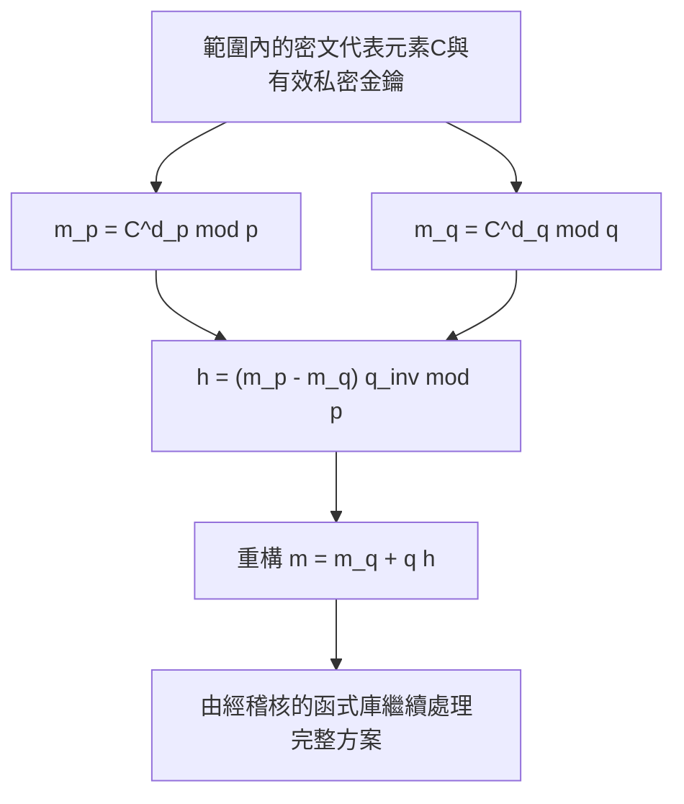

中國剩餘定理（CRT）把不同模數下的餘數合併為一個剩餘類。它連結整數問題、RSA私密金鑰運算、環與多項式，以及平行的剩餘數運算。使用時必須說明模數的條件、重構範圍，並區分算術正確性與密碼安全性。

## 1. 孫子問題與解的範圍

《孫子算經》中的著名例子要求一個數除以3餘2、除以5餘3、除以7餘2。[相關歷史研究論文重述了問題和計算方法](https://sgmathsociety.org/smsmedley/Vol-30-1/The%20History%20of%20the%20Chinese%20Reminder%20Theorem%20%28Law%20Huang%20lng%29.pdf)。

$$ x\equiv2\pmod3,\quad x\equiv3\pmod5,\quad x\equiv2\pmod7. $$

最小非負解是23，但整數解不只一個：全部解為 $x=23+105t$，其中 $t\in\mathbb Z$。例如，128也滿足條件。

## 2. 整數CRT：條件與唯一性

這裡取 $k\ge1$，各模數 $m_i>1$，並要求兩兩互質：當 $i\ne j$ 時，$\gcd(m_i,m_j)=1$。模數本身不必是質數。對任意整數餘數 $a_i$，

$$ x\equiv a_i\pmod{m_i}\quad(1\le i\le k) $$

在模 $M=\prod_{i=1}^k m_i$ 的意義下恰有一個解，也就是恰有一個滿足 $0\le x<M$ 的代表元素。只要求所有模數的最大公因數為1並不足夠：6、10、15的整體最大公因數為1，卻不兩兩互質。[整數CRT的證明](https://kconrad.math.uconn.edu/blurbs/ugradnumthy/crt.pdf)說明了這項區別。

任意兩個解之差都能被每個模數整除。兩兩互質使這個差能被模數的乘積整除，因此解在模乘積的意義下唯一。下面的構造證明存在性。

## 3. 用反元素構造解並實際計算

對每個模數，使用擴展歐幾里得演算法求出滿足下式的乘法反元素：

$$ M_i=M/m_i,\quad M_i y_i\equiv1\pmod{m_i} $$

互質條件保證反元素存在。把以下和約化到模數的範圍內，就得到所需的解：

$$ x=\left(\sum_{i=1}^k a_iM_iy_i\right)\bmod M. $$

對某個模數 $m_j$ 取模時，$i\ne j$ 的項都消失，剩下的一項與 $a_j$ 同餘。這就證明了解的存在性。

在孫子問題中，$M=105$，部分乘積為35、21、15，對應的反元素為2、1、1。

$$ 2\cdot35\cdot2+3\cdot21\cdot1+2\cdot15\cdot1=233,
\qquad233\bmod105=23. $$

對不互質的模數，還有另一種推廣。兩個模數的情形有解，若且唯若它們的最大公因數整除兩餘數之差；此時解在模最小公倍數的意義下唯一。例如，模數4、6與餘數1、3給出模12的解9；餘數0、1則無解。下面的程式不實作這項推廣，只接受兩兩互質的模數。

## 4. 具有輸入檢查的Python實作

只接受Python內建的 `int`，拒絕 `bool` 與浮點數。兩組輸入必須是長度相同、非空的有限可迭代物件。每個模數必須大於1，且模數兩兩互質。餘數可以為負，也可以超過對應模數。回傳值是模乘積下的最小非負代表元素。不接受模數1與空方程組，是這個教學API明確規定的契約。

```python
from math import gcd, prod


def _extended_gcd(a, b):
    # Internal helper: integer a, positive integer b.
    old_r, r = a, b
    old_s, s = 1, 0
    old_t, t = 0, 1
    while r:
        quotient = old_r // r
        old_r, r = r, old_r - quotient * r
        old_s, s = s, old_s - quotient * s
        old_t, t = t, old_t - quotient * t
    return old_r, old_s, old_t


def mod_inverse(a, modulus):
    if type(a) is not int or type(modulus) is not int:
        raise TypeError("Arguments must be built-in integers")
    if modulus <= 1:
        raise ValueError("Modulus must exceed one")
    g, x, _ = _extended_gcd(a % modulus, modulus)
    if g != 1:
        raise ValueError("Inverse does not exist")
    return x % modulus


def chinese_remainder_theorem(residues, moduli):
    residues, moduli = tuple(residues), tuple(moduli)
    if not moduli or len(residues) != len(moduli):
        raise ValueError("Provide equally sized, nonempty inputs")
    if any(type(x) is not int for x in residues + moduli):
        raise TypeError("Residues and moduli must be built-in integers")
    if any(m <= 1 for m in moduli):
        raise ValueError("Every modulus must exceed one")
    for i, m in enumerate(moduli):
        if any(gcd(m, other) != 1 for other in moduli[:i]):
            raise ValueError("Moduli must be pairwise coprime")

    combined_modulus = prod(moduli)
    result = 0
    for a, m in zip(residues, moduli):
        partial = combined_modulus // m
        inverse = mod_inverse(partial, m)
        result = (result + (a % m) * partial * inverse) % combined_modulus
    return result


if __name__ == "__main__":
    residues = [2, 3, 2]
    moduli = [3, 5, 7]
    print("Sunzi solution:", chinese_remainder_theorem(residues, moduli))
    print("Combined modulus:", prod(moduli))
```

使用Python 3.12執行會輸出 `Sunzi solution: 23` 與 `Combined modulus: 105`。長度不符時不會默默截斷；零或負模數、型別及互質條件都會檢查。Python整數避免了固定位元寬度溢位，但時間和記憶體仍取決於輸入長度與整數大小。這不是常數時間的密碼實作。

## 5. RSA-CRT重構的是什麼

假設使用有效的雙質數RSA金鑰。取相異奇質數 $p,q$，$N=pq$，公開指數 $e$ 與私密指數 $d$ 滿足 $ed\equiv1\pmod{\lambda(N)}$，其中 $\lambda(N)=\operatorname{lcm}(p-1,q-1)$。密文代表元素滿足 $0\le C<N$，直接的私密金鑰運算為 $m=C^d\bmod N$。

預先計算CRT參數：

$$ d_p=d\bmod(p-1),\quad d_q=d\bmod(q-1),\quad q_{\mathrm{inv}}=q^{-1}\bmod p. $$

$$ m_p=C^{d_p}\bmod p,\quad m_q=C^{d_q}\bmod q. $$

$$ h=(m_p-m_q)q_{\mathrm{inv}}\bmod p,\qquad m=m_q+qh. $$

得到的代表元素在兩個質數模數下都有正確餘數，並落在原模數範圍內。[RFC 8017第3.2與5.1.2節](https://www.rfc-editor.org/rfc/rfc8017.html)規定了這種私密金鑰表示與重構方法。兩個CRT指數不能單獨取代整個私密金鑰；質因數與重構係數同樣屬於秘密金鑰材料。



這是整數運算示意圖，省略了訊息編碼與方案驗證。實際加密與簽章採用不同方案。如[RSA入門文章](https://kenji.blog/zh-tw/p/rsa-encryption-math-explained-for-beginners/)所述，應由經過稽核的函式庫完成符合用途的處理。

## 6. 速度估計與實作邊界

[HAC第14章](https://cacr.uwaterloo.ca/hac/about/chap14.pdf)的Note 14.75給出了約四倍的估計，其前提包括兩個質數大小相近、採用傳統二次複雜度的乘法、乘法次數與指數位元長度成正比，以及重構成本可忽略。乘法演算法、平行執行、安全防護與裝置不同，比率也會改變。這並不是本文程式實測加速四倍的結論。

如果分別計算的一個CRT餘數發生錯誤，未經檢查的輸出可能洩漏秘密質因數。[RSA-CRT故障分析論文](https://courses.csail.mit.edu/6.857/2010/handouts/faults.pdf)說明了相應條件。教學算術正確不代表實作具備故障防護或旁通道抵抗能力。包括使用公開金鑰驗證在內的防護，應由處理完整方案的函式庫實作。

## 7. 推廣至環與理想

對含單位元素的交換環 $R$ 中有限多個理想，假設它們兩兩滿足 $I_i+I_j=R$，即理想兩兩互質。自然同態

$$ \phi:R\longrightarrow\prod_{i=1}^k R/I_i,\qquad
\phi(r)=(r+I_1,\ldots,r+I_k) $$

是滿射，核為這些理想的交集。在上述條件下，交集等於理想的乘積，因此：

$$ R/\left(\bigcap_{i=1}^k I_i\right)
\cong\prod_{i=1}^k R/I_i,\qquad
\bigcap_{i=1}^k I_i=\prod_{i=1}^k I_i. $$

[Stacks Project的中國剩餘定理](https://stacks.math.columbia.edu/tag/00DT)給出了條件與證明。整數模數兩兩互質，是這項理想條件的特殊情形。

## 8. 多項式與插值

體上多項式互質，是指最大公因式為非零常數。只在原來的體中沒有共同根還不夠。例如，在有理數體上，讓兩個多項式都為 $x^2+1$。它們都沒有有理根，但最大公因式就是這個二次多項式。用共同根刻畫互質時，需要在代數閉包中考察。

相異求值點 $\alpha_1,\ldots,\alpha_k$ 對應的一次因子兩兩互質，因此在次數 $<k$ 的多項式中，具有指定求值結果的多項式唯一。這就是與拉格朗日插值的聯繫。允許更高次數時，唯一性便不再成立。有限體上的求值與次數限制也和里德–所羅門碼有關，但CRT本身不能保證錯誤更正能力。

## 9. 剩餘數系統與重構範圍

RNS以不同模數下的餘數表示整數，並可對各分量分別進行加法和乘法。這裡令 $x_i=X\bmod m_i$，$y_i=Y\bmod m_i$。設模數的乘積為 $M$，則：

$$ (X+Y)\bmod M\longleftrightarrow
((x_i+y_i)\bmod m_i)_{i=1}^k, $$

$$ (XY)\bmod M\longleftrightarrow
((x_iy_i)\bmod m_i)_{i=1}^k. $$

通道之間不需傳遞進位，但每個通道內部的二進位運算仍可能產生進位。重構得到的是模乘積下的代表元素；超出該範圍、不受限制的整數和或積，無法由這些餘數唯一還原。比較、除法以及轉回一般表示法，都需要額外工作。

從古典餘數問題到密碼學、代數與平行運算，CRT都在給定模數與範圍條件下重構相容的餘數。理解這些範圍與用途的區別，才能正確應用它。
