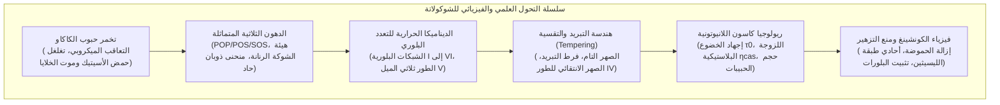
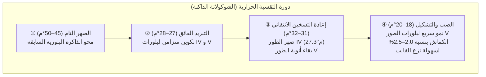

إن القرمشة الواضحة («Snap»)، واللمعان الصقيل، والذوبان الفوري الحريري في الفم عند تناول الشوكولاتة الفاخرة، هي نتاج إحدى أدق منظومات فيزياء التشتت والمادة المكثفة في علوم الأغذية.

يتشكل الطور المستمر للشوكولاتة من زبدة الكاكاو. بفضل احتوائها على جزيئات التراي آسيل جلسرين (TAG) المتماثلة أحادية اللا تشبع، تظهر زبدة الكاكاو <strong>تعدداً شكلياً بلورياً (Polymorphism)</strong> معقداً، حيث تتجمد في ستة أشكال بلورية متباينة (<strong>من الشكل I إلى الشكل VI</strong>). والشكل الوحيد المتوازن شبه المستقر ديناميكياً هو <strong>الشكل V ($\beta_2$)</strong> بدرجة انصهار 33.8 درجة مئوية، وهو الوحيد الذي يجمع بين الصلابة الميكانيكية والانكماش المطلوب لنزع القوالب والذوبان التام تحت درجة حرارة جسم الإنسان (36.5°م).

---

### 1. نبات الكاكاو والتخمر الحيوي

1. <strong>تشريح قرن الكاكاو</strong>: تحتوي ثمار شجرة الكاكاو (*Theobroma cacao*) على 30 إلى 50 بذرة محاطة بلب أبيض سكري (10–15% سكريات، حمض الستريك، pH 3.3–3.8).
2. <strong>التعاقب الميكروبي (5 إلى 7 أيام)</strong>:
   - تخمر خمائري لاهوائي $\to$ بكتيريا حمض اللاكتيك $\to$ أكسدة أسيتيكية طاردة للحرارة بواسطة *Acetobacter*:
     $$\text{C}_2\text{H}_5\text{OH} + \text{O}_2 \longrightarrow \text{CH}_3\text{COOH} + \text{H}_2\text{O} \quad (\Delta H = -493\text{ kJ/mol})$$
   - ترتفع الحرارة إلى 48–52°م، ويتغلغل حمض الأسيتيك داخل الفلقات مسبباً <strong>الموت الخلوي الحاسم للبذرة</strong>.
3. <strong>انطلاق سلائف النكهة</strong>:
   تحلل الإنزيمات البروتينية البروتينات المخزنة إلى أحماض أمينية كارهة للماء (ليوسين، فينيل ألانين) وببتيدات؛ وتؤكسد إنزيمات البوليفينول أوكسيديز مركبات الكاتيكين القابضة إلى تانينات بنية معقدة.

---

### 2. الكيمياء الحيوية لزبدة الكاكاو

تتكون أكثر من 80% من زبدة الكاكاو من جزيئات دهنية متماثلة من نوع SUS:

| نوع الجزيء الدهني | الأحماض الدهنية المرتبطة ($sn\text{-1, 2, 3}$) | النسبة المئوية بالكتلة (%) | نقطة الانصهار للطور $\beta$ |
| :--- | :--- | :--- | :--- |
| <strong>POS</strong> | بالميتات (16:0) - أوليات (18:1) - ستيرات (18:0) | <strong>36 – 42 %</strong> | $35.5^\circ\mathrm{C}$ |
| <strong>SOS</strong> | ستيرات (18:0) - أوليات (18:1) - ستيرات (18:0) | <strong>25 – 31 %</strong> | $41.5^\circ\mathrm{C}$ |
| <strong>POP</strong> | بالميتات (16:0) - أوليات (18:1) - بالميتات (16:0) | <strong>14 – 19 %</strong> | $35.2^\circ\mathrm{C}$ |

- <strong>هيئة الشوكة الرنانة (Tuning-fork)</strong>: تترتب السلاسل المشبعة بخطوط متوازية بينما ينثني حمض الأوليك بزاوية 120 درجة.
- <strong>الانحدار الحاد في نسبة الدهون الصلبة (SFC)</strong>: تكون المادة صلبة بنسبة 75–85% عند 20–25°م، ثم تنهار إلى 0% فجأة بين 30 و35°م، مانحة ذوباناً منعشاً دون أي ملمس دهني متبقٍ.

---

### 3. التعدد الشكلي البلوري والطور V

تتبلور زبدة الكاكاو في ستة أشكال (تصنيف ويلي ولوتون):
- <strong>الشكل I ($\gamma, 17.3^\circ\mathrm{C}$)</strong>: سداسي، غير مستقر تماماً؛
- <strong>الشكل II ($\alpha, 23.3^\circ\mathrm{C}$)</strong>: سداسي ناتج عن التبريد الفجائي؛
- <strong>الشكل III ($\beta'_2, 25.5^\circ\mathrm{C}$)</strong>: معيني متعامد، هش؛
- <strong>الشكل IV ($\beta'_1, 27.3^\circ\mathrm{C}$)</strong>: معيني متعامد، رخو وباهت؛
- <strong>الشكل V ($\beta_2, 33.8^\circ\mathrm{C}$)</strong>: <strong>ثلاثي الميل، حزم ثلاثية السلاسل 3L، لمعان براق، قرمشة حادة، ذوبان عند 34°م</strong>؛
- <strong>الشكل VI ($\beta_1, 36.3^\circ\mathrm{C}$)</strong>: الحالة الأرضية الأكثر استقراراً، يسبب التزهير الدهني وملمساً رميلياً خشناً.

---

### 4. هندسة التبريد والتقسية (Tempering)

يؤدي التراص ثلاثي الميل للطور V إلى <strong>انكماش حجمي بنسبة 2.0 إلى 2.5%</strong>، مما يسمح للوح الشوكولاتة بالانفصال تلقائياً عن جدران القالب.

---

### 5. ريولوجيا كاسون وعملية الكونشينغ

تتبع الشوكولاتة السائلة <strong>نموذج كاسون البلاستيكي</strong>:

$$\sqrt{\tau} = \sqrt{\tau_0} + \sqrt{\eta_{\text{cas}} \dot{\gamma}}$$

- $\tau_0$ (إجهاد خضوع كاسون): الحد الأدنى من القوة لبدء السريان؛
- $\eta_{\text{cas}}$ (لزوجة كاسون البلاستيكية): الاحتكاك الداخلي أثناء التدفق السريع؛
- تميز المستقبلات الحسية في اللسان الجزيئات التي تتجاوز <strong>$20–25\,\mu\text{m}$</strong>، لذا يتم ضبط حجم الحبيبات $D_{90}$ في حدود <strong>$18–22\,\mu\text{m}$</strong>.
- <strong>الكونشينغ والليسيثين</strong>: يعمل الكونشينغ الجاف (60–80°م) على تطاير الرطوبة ($<0.5\%$) وحمض الأسيتيك. وتعمل إضافة 0.3–0.5% من مادة الليسيثين على تغليف جزيئات السكر بطبقة كارهة للماء، مما يخفض إجهاد الخضوع بما يعادل إضافة 3 إلى 5% من زبدة الكاكاو النقية.
