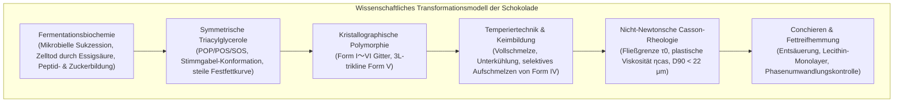
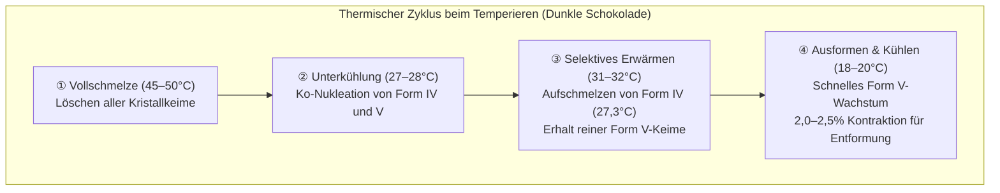

Der seidige Schmelz und der saubere akustische Bruch ("Snap") hochwertiger Schokolade beruhen auf einer der anspruchsvollsten Dispersions- und Kristallisationsphysiken der Lebensmitteltechnologie.

Die kontinuierliche Phase der Schokolade besteht aus Kakaobutter. Aufgrund ihrer symmetrischen Triacylglycerole (TAGs) zeigt Kakaobutter ausgeprägte <strong>Polymorphie</strong> und kristallisiert in sechs unterschiedlichen Gittermodifikationen (<strong>Form I bis Form VI</strong>). Nur die metastabile <strong>Form V ($\beta_2$)</strong> mit einem Schmelzpunkt von 33,8°C besitzt die ideale Kombination aus Hochglanz, Formkontraktion und vollkommener Verflüssigung knapp unterhalb der menschlichen Körperkerntemperatur (36,5°C).

---

### 1. Kakaobotanik und Fermentationsbiotechnologie

1. <strong>Anatomie der Kakaofrucht</strong>: Die Früchte des Kakaobaums (*Theobroma cacao*) enthalten 30–50 Samen, umhüllt von zuckerreichem Fruchtfleisch (Pulpe, 10–15% Zucker, Citronensäure, pH 3,3–3,8).
2. <strong>Mikrobielle Fermentationssukzession (5–7 Tage)</strong>:
   - Anaerobe Hefegärung $\to$ Milchsäurebildung $\to$ stark exotherme Essigsäureoxidation durch *Acetobacter*:
     $$\text{C}_2\text{H}_5\text{OH} + \text{O}_2 \longrightarrow \text{CH}_3\text{COOH} + \text{H}_2\text{O} \quad (\Delta H = -493\text{ kJ/mol})$$
   - Die Temperatur steigt auf 48–52°C. Essigsäure dringt in die Kotyledonen ein, senkt den pH-Wert auf ~4,8 und bewirkt den irreversiblen <strong>Zelltod der Kakaobohne</strong>.
3. <strong>Freisetzung von Aromavorläufern</strong>:
   Endogene Aspartat-Endoproteasen spalten Speicherproteine in hydrophobe Aminosäuren (Leucin, Phenylalanin) und Peptide; Polyphenoloxidasen oxidieren adstringierende Catechine zu braunen Phlobaphenen.

---

### 2. Molekulare Biochemie der Kakaobutter: Triacylglycerole

Über 80% der Kakaobutter bestehen aus symmetrischen, monoungesättigten Triacylglycerolen (SUS-Typ):

| TAG-Spezies | Fettsäureverteilung ($sn\text{-1, 2, 3}$) | Anteil (Gew.-%) | Schmelzpunkt ($\beta$-Form) |
| :--- | :--- | :--- | :--- |
| <strong>POS</strong> | Palmitinsäure (16:0) - Ölsäure (18:1) - Stearinsäure (18:0) | <strong>36 – 42 %</strong> | $35,5^\circ\mathrm{C}$ |
| <strong>SOS</strong> | Stearinsäure (18:0) - Ölsäure (18:1) - Stearinsäure (18:0) | <strong>25 – 31 %</strong> | $41,5^\circ\mathrm{C}$ |
| <strong>POP</strong> | Palmitinsäure (16:0) - Ölsäure (18:1) - Palmitinsäure (16:0) | <strong>14 – 19 %</strong> | $35,2^\circ\mathrm{C}$ |

In der festen Phase nehmen diese Moleküle eine <strong>Stimmgabel-Konformation (Tuning-fork)</strong> ein. Bei Raumtemperatur (20–25°C) liegt der Festfettgehalt bei harten 75–85%, stürzt jedoch zwischen 30°C und 35°C schlagartig auf 0% ab.

---

### 3. Kristalline Polymorphie (Wille & Lutton)

- <strong>Form I ($\gamma, 17,3^\circ\mathrm{C}$)</strong>: Extrem instabil, hexagonal;
- <strong>Form II ($\alpha, 23,3^\circ\mathrm{C}$)</strong>: Instabil, durch Abschrecken gebildet;
- <strong>Form III ($\beta'_2, 25,5^\circ\mathrm{C}$)</strong>: Spröde, orthorhombisch;
- <strong>Form IV ($\beta'_1, 27,3^\circ\mathrm{C}$)</strong>: Weich, orthorhombisch;
- <strong>Form V ($\beta_2, 33,8^\circ\mathrm{C}$)</strong>: <strong>Trikline 3-Kettenlängen-Struktur (3L); brillanter Glanz, perfekter Bruch, Schmelz bei 34°C</strong>;
- <strong>Form VI ($\beta_1, 36,3^\circ\mathrm{C}$)</strong>: Thermodynamischer Grundzustand; verursacht Fettreif und sandiges Mundgefühl.

---

### 4. Temperiertechnik und Keimbildungskinetik

Das Temperieren ist ein präziser thermo-mechanischer Zyklus:

Die dichte Packung der Form V-Kristalle bewirkt eine <strong>Volumenkontraktion von 2,0–2,5%</strong>, wodurch sich die Schokolade spontan von der Formwand ablöst.

---

### 5. Schokoladenrheologie und Casson-Modell

Geschmolzene Schokolade ist eine hochkonzentrierte Suspension (60–70% Feststoffpartikel in Kakaobutter) und gehorcht dem <strong>Casson-Modell</strong>:

$$\sqrt{\tau} = \sqrt{\tau_0} + \sqrt{\eta_{\text{cas}} \dot{\gamma}}$$

- $\tau_0$ (Casson-Fließgrenze): Mindestschubspannung für den Fließbeginn;
- $\eta_{\text{cas}}$ (plastische Viskosität): Reibungswiderstand bei Scherung;
- Da die Mechanorezeptoren der Zunge Partikel ab <strong>$20–25\,\mu\text{m}$</strong> ertasten, muss die maximale Partikelgröße $D_{90}$ strikt auf <strong>$18–22\,\mu\text{m}$</strong> eingestellt werden.

---

### 6. Conchieren und Fettreif

1. <strong>Trockenconchieren</strong>: Scherenergie und Heißluft (60–80°C) treiben Feuchtigkeit ($<0,5\%$) und stechende Essigsäure aus.
2. <strong>Lecithin-Grenzflächenchemie</strong>: 0,3–0,5% Lecithin überzieht die hydrophilen Zuckerpartikel mit lipophilen Schwänzen; senkt die Fließgrenze so stark wie 3–5% zusätzliche Kakaobutter.
3. <strong>Fettreif (Fat Bloom)</strong>: Phasenumwandlung von Form V in Form VI. Niedrig schmelzende Fette migrieren durch Poren an die Oberfläche und bilden streuende Nadelkristalle ($>5\,\mu\text{m}$).
