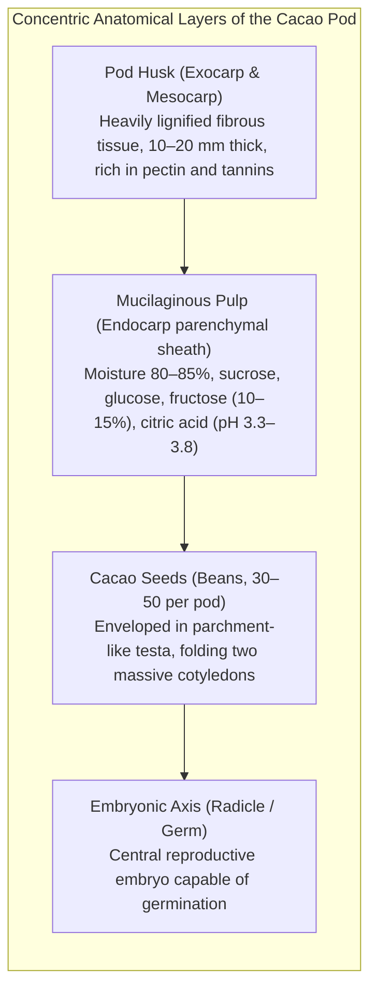
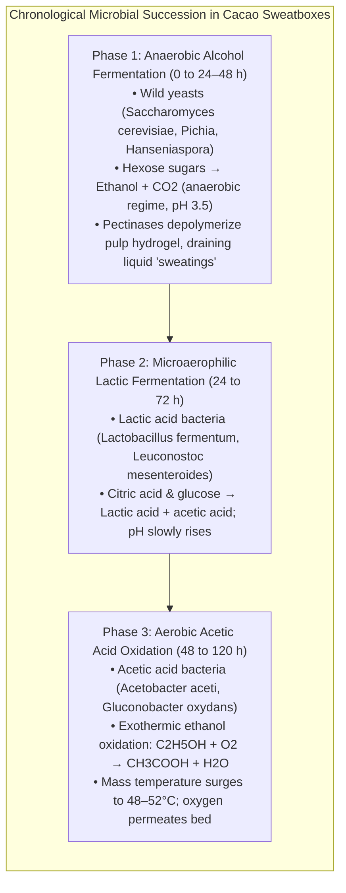
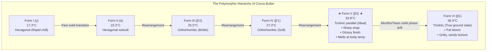
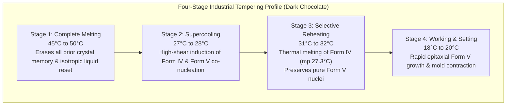
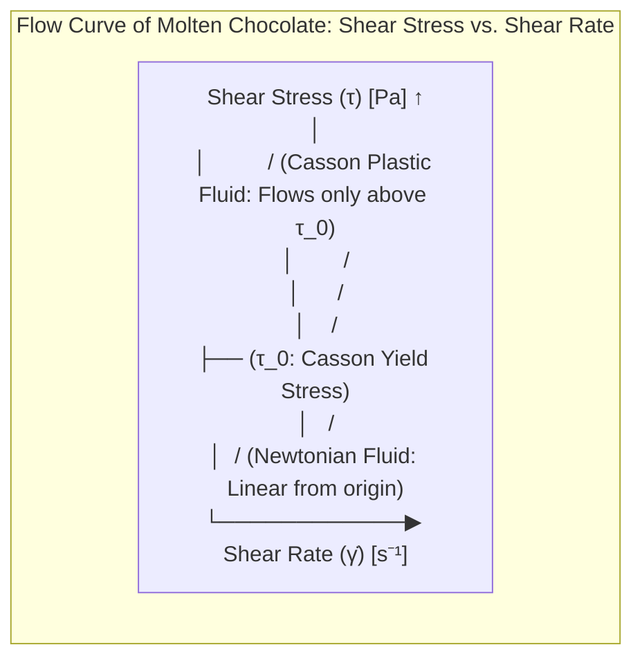
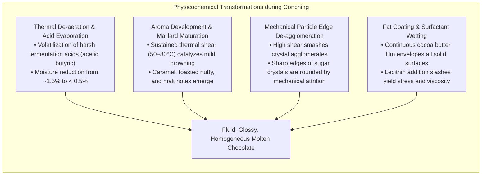

The sensory experience of premium chocolate—its clean acoustic snap, brilliant mirror-like gloss, and instantaneous melt at human body temperature releasing hundreds of aromatic volatiles—is the culmination of one of the most sophisticated solid dispersion physics systems in food science.

At the thermodynamic heart of chocolate lies cocoa butter (*Theobroma* oil), a unique vegetable fat composed predominantly of symmetric monounsaturated triacylglycerols (TAGs). Unlike most edible lipids, cocoa butter exhibits pronounced <strong>polymorphism</strong>, solidifying into six distinct crystalline packing arrangements designated <strong>Form I through Form VI</strong>. Only one of these crystalline geometries—the thermodynamically metastable <strong>Form V ($\beta_2$)</strong> with a sharp melting point of 33.8°C—possesses the precise density, optical reflectivity, and mechanical snap required for confectionery perfection.

This comprehensive scientific guide explores the entire biophysical and chemical architecture of chocolate: from cacao pod anatomy and microbial fermentation biochemistry to triacylglycerol molecular symmetry, the Gibbs free energy landscape of polymorphs, classical nucleation theory (CNT), Casson non-Newtonian suspension rheology, the interfacial surfactant physics of lecithin during conching, and the nanoscale mechanics of fat bloom.

---

### 1. Cacao Botanical Anatomy and Fermentation Biotechnology

#### 1.1 Macro- and Micro-Anatomy of the Cacao Pod

The cacao tree (*Theobroma cacao*, family Malvaceae) bears its fruit directly on the trunk and mature branches through an uncommon botanical adaptation known as cauliflory.



1. <strong>Pod Husk (Pericarp)</strong>: A tough, thick (10–20 mm) fibrous shell that accounts for over 70% of total pod fresh weight, providing mechanical isolation against herbivores and fungal pathogens.
2. <strong>Pulp (Endocarp sheath)</strong>: A spongy, white, mucilaginous hydrogel encasing each seed. It contains 80–85% water, 10–15% fermentable monosaccharides and disaccharides (equimolar glucose and fructose alongside sucrose), 1–2% citric acid, and structural pectin networks. The high citric acid concentration establishes an initial inhospitable pH of 3.3–3.8.
3. <strong>Cacao Beans (Cotyledons)</strong>: Each pod holds 30–50 seeds. The bulk of the seed consists of two convoluted cotyledons (nibs) composed of parenchymal storage tissue. By dry mass, unfermented cotyledons contain:
   - <strong>50–55% Lipids</strong> (cocoa butter),
   - <strong>10–15% Storage Proteins</strong> (principally vicilin-like 7S globulins and albumin polypeptides),
   - <strong>6–8% Polyphenols</strong> (flavan-3-ols including $(-)$-epicatechin, $(+)$-catechin, and oligomeric procyanidins),
   - <strong>1.5–3.0% Methylxanthines</strong> (predominantly theobromine with minor caffeine).

#### 1.2 Genetic Varietals and Biochemical Divergence
- <strong>Criollo</strong>: Native to Central and northern South America. Its seeds contain minimal anthocyanin pigmentation, yielding white-to-pale-pink cotyledons. Criollo beans are characterized by low bitterness and astringency, expressing delicate floral, nutty, and stone-fruit aroma precursors. However, the trees exhibit acute vulnerability to fungal diseases.
- <strong>Forastero</strong>: Native to the Amazon basin, accounting for over 80% of global commercial supply. Its seeds are intensely purple from high anthocyanin reserves, possessing elevated theobromine and polyphenolic contents that confer robust disease resistance and deep, quintessential "cocoa" bitterness.
- <strong>Trinitario</strong>: A fertile natural hybrid of Criollo and Forastero arising in Trinidad, combining Forastero hardiness with Criollo aromatic nuance.

#### 1.3 Microbial Succession Kinetics during Solid-State Fermentation
Raw cacao beans extracted from freshly opened pods are sterile inside, but the sugar-rich pulp is immediately inoculated by epiphytic microflora from knives, baskets, and fruit flies. The beans undergo 5–7 days of spontaneous solid-state fermentation in wooden sweatboxes.



##### Bean Death and the Endogenous Enzymatic Cascade
1. <strong>Thermal and Acidic Cell Death</strong>:
   The intense exothermic oxidation of ethanol by *Acetobacter* releases tremendous enthalpy ($\Delta H = -493\text{ kJ/mol}$), driving pile temperatures above $50^\circ\mathrm{C}$. Simultaneously, hydrophobic volatile acetic acid ($\text{CH}_3\text{COOH}$) diffuses across the permeable seed coat into the cotyledons. The combined assault of hyperthermia and intracellular acidification (cotyledon pH falls from 6.5 to 4.8–5.0) destabilizes lipid bilayer membranes, resulting in <strong>irreversible bean death</strong>.
2. <strong>Subcellular Compartmental Breakdown</strong>:
   In living cotyledons, storage proteins, lipids, polyphenols, and enzymes reside in segregated intracellular vacuoles. Membrane collapse allows endogenous enzymes to mix freely with their substrates:
   - <strong>Aspartic Endoprotease & Carboxypeptidase</strong>: Cleave vicilin-like storage globulins into hydrophilic/hydrophobic oligopeptides and free amino acids (particularly hydrophobic leucine, isoleucine, valine, and phenylalanine).
   - <strong>Invertase</strong>: Hydrolyzes sucrose into glucose and fructose.
   - <strong>Polyphenol Oxidase (PPO)</strong>: Catalyzes the aerobic oxidation of $(-)$-epicatechin into reactive quinones, which polymerize into high-molecular-weight brown tannins (phlobaphenes), quenching severe astringency.

These amino acids, short peptides, and reducing sugars serve as the indispensable raw precursors for pyrolytic Maillard browning during subsequent roasting.

---

### 2. Molecular Biochemistry of Cocoa Butter: Triacylglycerol Symmetry

The distinctive physical behavior of chocolate is dictated entirely by its continuous fat phase: <strong>cocoa butter</strong>. While generic plant oils contain hundreds of randomly distributed fatty acids, cocoa butter displays an extraordinarily narrow, symmetric <strong>triacylglycerol (TAG)</strong> profile.

```
       CH2 - O - CO - R1   (sn-1 position: Saturated Fatty Acid [Palmitic / Stearic])
        │
       CH  - O - CO - R2   (sn-2 position: Monounsaturated Fatty Acid [Oleic Acid])
        │
       CH2 - O - CO - R3   (sn-3 position: Saturated Fatty Acid [Palmitic / Stearic])
```

#### 2.1 The Symmetric Monounsaturated TAG Triad
Approximately 80–85% of cocoa butter TAGs consist of a stereospecific <strong>SUS configuration</strong> (Saturated-Unsaturated-Saturated), wherein the outer $sn\text{-1}$ and $sn\text{-3}$ positions are esterified with straight-chain saturated fatty acids, while the central $sn\text{-2}$ position is occupied by monounsaturated oleic acid.

| Major TAG Species | Systematic Chemical Nomenclature | Fatty Acid Composition | Fraction in Cocoa Butter (% wt) | Pure $\beta$ Polymorph Melting Point |
| :--- | :--- | :--- | :--- | :--- |
| <strong>POS</strong> | 1-Palmitoyl-2-oleoyl-3-stearoyl-glycerol | Palmitic (16:0) - Oleic (18:1) - Stearic (18:0) | <strong>36 – 42 %</strong> | $35.5^\circ\mathrm{C}$ |
| <strong>SOS</strong> | 1,3-Distearoyl-2-oleoyl-glycerol | Stearic (18:0) - Oleic (18:1) - Stearic (18:0) | <strong>25 – 31 %</strong> | $41.5^\circ\mathrm{C}$ |
| <strong>POP</strong> | 1,3-Dipalmitoyl-2-oleoyl-glycerol | Palmitic (16:0) - Oleic (18:1) - Palmitic (16:0) | <strong>14 – 19 %</strong> | $35.2^\circ\mathrm{C}$ |
| <strong>Minor TAGs</strong> | Di-unsaturated (SOO, POO) & Tri-saturated (SSS) | Mixed configurations | 10 – 15 % | Variable ($<20^\circ\mathrm{C}$ or $>50^\circ\mathrm{C}$) |

#### 2.2 Molecular Symmetry and the Thermodynamic Basis of the Sharp Melting Profile
1. <strong>The "Tuning-Fork" Conformation</strong>:
   In the solid state, SUS triacylglycerol molecules adopt a characteristic tuning-fork conformation. The saturated palmitic ($C_{16:0}$) and stearic ($C_{18:0}$) acyl chains extend in parallel all-trans zig-zag conformations on one side of the glycerol moiety, while the $sn\text{-2}$ oleic acid chain ($C_{18:1}$) bends at a rigid ~120° cis-double bond angle.
2. <strong>Isomorphic Mutual Miscibility</strong>:
   Because POS, SOS, and POP possess nearly identical chain lengths ($C_{16}$ and $C_{18}$ saturated chains flanking a central $C_{18:1}$), they cocrystallize within the same crystal subcell without creating significant steric lattice distortions.
3. <strong>The Solid Fat Content (SFC) Profile</strong>:
   This structural homogeneity manifests as an exceptionally steep solid fat content curve. At room temperature ($20–25^\circ\text{C}$), cocoa butter maintains a high solid fraction ($75–85\%$), conferring rigid structural integrity. Yet, between $30^\circ\text{C}$ and $35^\circ\text{C}$, the solid fraction plunges precipitously to $0\%$. This 5°C phase-change cliff creates chocolate's sensational cooling oral melt without lingering greasy residue.

---

### 3. Crystallography & Polymorphism Thermodynamics

Cocoa butter's SUS triacylglycerols can pack into multiple crystalline unit cell geometries with differing molecular packing densities, stabilities, and melting points—a physical phenomenon termed <strong>polymorphism</strong>.



#### 3.1 Physical Characteristics of the Six Polymorphic Forms

| Polymorphic Form | Subcell Crystallographic Lattice | Longitudinal Chain Packing | Melting Point ($T_m$) | Relative Gibbs Free Energy ($G$) | Sensory & Mechanical Attributes |
| :--- | :--- | :--- | :--- | :--- | :--- |
| <strong>Form I ($\gamma$)</strong> | Hexagonal ($\alpha$-type) | 2-Chain Length (2L) | $17.3^\circ\mathrm{C}$ | Highest ($G_I \gg G_V$) | Produced by cryogenic quenching ($-50^\circ\text{C}$); melts immediately |
| <strong>Form II ($\alpha$)</strong> | Hexagonal ($\alpha$-type) | 2-Chain Length (2L) | $23.3^\circ\mathrm{C}$ | Very High | Formed by rapid cooling ($0^\circ\text{C}$); soft, rapidly transitions |
| <strong>Form III ($\beta'_2$)</strong>| Orthorhombic perpendicular ($\beta'$) | 2-Chain Length (2L) | $25.5^\circ\mathrm{C}$ | Moderate | Crumbly, dull appearance; melts instantly on fingertip contact |
| <strong>Form IV ($\beta'_1$)</strong> | Orthorhombic perpendicular ($\beta'$) | 2-Chain Length (2L) | $27.3^\circ\mathrm{C}$ | Low-Intermediate | Soft, heat-sensitive; results from poorly tempered chocolate |
| <strong>Form V ($\beta_2$)</strong> | <strong>Triclinic parallel ($\beta$)</strong> | <strong>3-Chain Length (3L)</strong> | <strong>$33.8^\circ\mathrm{C}$</strong> | <strong>Low (Optimal Metastable State)</strong> | <strong>The confectioner's goal: brilliant gloss, clean snap, contraction for demolding, smooth melt</strong> |
| <strong>Form VI ($\beta_1$)</strong> | Triclinic parallel ($\beta$) | 3-Chain Length (3L) | $36.3^\circ\mathrm{C}$ | <strong>Lowest (Thermodynamic Ground State)</strong> | Cannot be crystallized from melt; forms via solid-state drift; causes fat bloom |

#### 3.2 Subcell Cross-Sectional Packing and Longitudinal Lamellar Structures
Wide-Angle X-ray Scattering (WAXS) and Small-Angle X-ray Scattering (SAXS) illuminate the sub-nanometer architecture of these phases:

1. <strong>Subcell Geometries</strong>:
   - <strong>$\alpha$-subcell (Forms I & II)</strong>: Hydrocarbon chains are circular cylinders with uninhibited rotational freedom, arranged in a hexagonal lattice (single intense WAXS reflection at $d \approx 4.15\text{ \AA}$). Low packing density, low latent heat.
   - <strong>$\beta'$-subcell (Forms III & IV)</strong>: Hydrocarbon zig-zag planes are oriented perpendicular to their neighbors in an orthorhombic lattice (twin diagnostic reflections at $d \approx 4.20\text{ \AA}$ and $3.80\text{ \AA}$).
   - <strong>$\beta$-subcell (Forms V & VI)</strong>: Acyl chains are tilted parallel to one another in a dense triclinic lattice (sharp characteristic single reflection at $d \approx 4.58–4.60\text{ \AA}$). Intermolecular contact is maximized, maximizing van der Waals attraction.
2. <strong>Longitudinal Lamellar Stacking (2L vs. 3L)</strong>:
   In Forms I–IV, molecules stack into a <strong>2-chain length (2L)</strong> lamellar bilayer ($d_{001} \approx 45\text{ \AA}$), where oleic and saturated chains cohabit the same layer. In Form V and VI, the bulky, bent $sn\text{-2}$ oleic acid chains are segregated into their own central hydrocarbon tier, sandwiched between two saturated layers to form a <strong>3-chain length (3L)</strong> lamellar superstructure ($d_{001} \approx 65\text{ \AA}$). This 3L triclinic architecture represents the tightest possible packing of SUS triacylglycerols.

#### 3.3 Ostwald's Rule of Stages and the Kinetic Trap
When molten cocoa butter cools undisturbed, the thermodynamically most stable forms (Form V and VI) do not spontaneously nucleate. According to <strong>Ostwald's Rule of Stages</strong>, the phase with the lowest activation free energy barrier ($\Delta G^\ddagger$) nucleates first—namely, the highly disordered, low-melting Form II ($\alpha$).

$$\text{Liquid Melt} \xrightarrow{\text{fast}} \text{Form II } (\alpha) \xrightarrow{\text{slow}} \text{Form III } (\beta') \xrightarrow{\text{slower}} \text{Form IV } (\beta') \xrightarrow{\text{solid-state}} \text{Form V } (\beta_2)$$

If allowed to solidify without intervention, chocolate ends up as a chaotic mixture of unstable Forms II, III, and IV, leading to a dull, greasy, crumbly product prone to rapid surface fat bloom. <strong>Tempering</strong> is the precise thermo-mechanical intervention engineered to bypass this kinetic trap and steer 100% of crystallization directly into Form V.

---

### 4. Tempering Engineering: Nucleation Kinetics and Thermal Profiling

Tempering is the controlled thermo-mechanical process designed to:
1. Completely erase all thermal crystal memory,
2. Induce high-density homogeneous/heterogeneous nucleation of stable Form V seeds,
3. Selectively melt away all transient lower-melting polymorphs (Forms I–IV), and
4. Seed the bulk liquid with 0.5–1.0 wt% microscopic Form V crystal nuclei.



#### 4.1 The Thermodynamic Rationale of the Four-Stage Thermal Curve (Dark Chocolate)
1. <strong>Complete Melt ($45–50^\circ\text{C}$)</strong>:
   The mass is heated well above the melting point of Form VI ($36.3^\circ\text{C}$) to dissociate residual TAG clusters into an isotropic liquid state.
2. <strong>Supercooling ($27–28^\circ\text{C}$)</strong>:
   The temperature is dropped below the melting point of Form V ($33.8^\circ\text{C}$) to establish thermodynamic driving force: <strong>degree of supercooling ($\Delta T = T_m - T$)</strong>. Under vigorous mechanical shearing in a scraped-surface heat exchanger, Form IV and Form V co-nucleate profusely, dramatically increasing apparent viscosity.
3. <strong>Selective Reheating ($31–32^\circ\text{C}$)</strong>:
   The temperature is precisely elevated to $31.5^\circ\text{C}$. This lies safely above the melting threshold of Form IV ($27.3^\circ\text{C}$), causing all Form IV nuclei to liquefy instantly. Crucially, it remains below the melting threshold of Form V ($33.8^\circ\text{C}$), ensuring that only robust Form V nuclei survive in the slurry. *(For milk chocolate, elevated milk fat lowers these thresholds by ~2°C: cooling to 26–27°C, reheating to 29–30°C).*
4. <strong>Molding & Final Setting ($18–20^\circ\text{C}$)</strong>:
   The seeded chocolate is deposited into molds at 30–31°C and passed through cooling tunnels at 15–18°C. The surviving Form V seeds act as structural templates (epitaxial growth), rapidly drawing liquid TAGs into the growing Form V lattice while releasing latent heat of crystallization ($\Delta H_c \approx 45\text{ kJ/kg}$).

#### 4.2 Classical Nucleation Theory (CNT) and the Avrami Crystallization Model
According to Classical Nucleation Theory, the steady-state nucleation rate $I$ in a supercooled lipid melt is governed by the competition between thermodynamic driving force and viscous transport resistance:

$$I = I_0 \exp\left( -\frac{\Delta G_{\text{diff}}}{k_B T} \right) \exp\left( -\frac{16 \pi \sigma_{sl}^3 T_m^2}{3 \Delta H_f^2 (\Delta T)^2 k_B T} \right)$$

Where:
- $\sigma_{sl}$ is the solid-liquid interfacial free energy,
- $\Delta H_f$ is latent heat of fusion,
- $\Delta T = T_m - T$ is supercooling,
- $\Delta G_{\text{diff}}$ is activation energy for molecular diffusion across the interface.

At high temperatures (small $\Delta T$), the second exponential term dominates, rendering the thermodynamic nucleation barrier insurmountable. At deep supercooling (large $\Delta T$), the first term dominates as viscosity $\mu$ skyrockets, arresting molecular diffusion. Tempering stage 2 ($27–28^\circ\text{C}$) hits the sweet spot where the product of both terms peaks.

The volumetric crystallization fraction $\alpha(t)$ over time follows the <strong>Avrami Equation</strong>:

$$\alpha(t) = 1 - \exp\left( -k_A t^n \right)$$

In properly tempered chocolate, the initial nucleation lag phase is eliminated ($\alpha(0) > 0$). Growth proceeds immediately via three-dimensional spherulitic development ($n \approx 3$), achieving complete crystallization in minutes rather than hours.

#### 4.3 Volumetric Contraction and Mold Release Physics
The dense molecular packing of Form V triclinic crystals induces a <strong>2.0–2.5% volumetric contraction</strong> of the cocoa butter phase during solidification. This contraction pulls the chocolate cleanly away from the polished inner walls of polycarbonate molds, enabling flawless demolding without sticking or tearing.

---

### 5. Chocolate Rheology and Non-Newtonian Flow Mechanics

Liquid chocolate is not a simple Newtonian fluid. It is an ultra-dense solid-in-liquid suspension containing 60–70 wt% solid particles (sucrose crystals, cocoa cell fragments, and optional milk powder solids) dispersed within a continuous hydrophobic cocoa butter matrix. It exhibits pronounced <strong>non-Newtonian plastic flow with a finite yield stress</strong>.



#### 5.1 The Casson Plastic Model
The International Office of Cocoa, Chocolate and Sugar Confectionery (IOCCC) dictates the <strong>Casson Model</strong> as the global standard for chocolate rheology:

$$\sqrt{\tau} = \sqrt{\tau_0} + \sqrt{\eta_{\text{cas}} \dot{\gamma}}$$

Where:
- $\tau$ is shear stress $[\text{Pa}]$,
- $\dot{\gamma}$ is shear rate $[\text{s}^{-1}]$,
- $\tau_0$ is the <strong>Casson Yield Stress</strong> $[\text{Pa}]$,
- $\eta_{\text{cas}}$ is the <strong>Casson Plastic Viscosity</strong> $[\text{Pa}\cdot\text{s}]$.

##### Physical Roles of the Two Casson Parameters
1. <strong>Casson Yield Stress ($\tau_0$)</strong>:
   The minimum shear force required to initiate flow, corresponding to the energy needed to disrupt the internal three-dimensional network of interacting solid particles.
   - <strong>Too High</strong>: Air bubbles remain trapped in molds; chocolate fails to flow into intricate corners.
   - <strong>Too Low</strong>: When enrobing confections (e.g., coating biscuit bars), chocolate drips off the sides, leaving an inadequate coating thickness on corners.
2. <strong>Casson Plastic Viscosity ($\eta_{\text{cas}}$)</strong>:
   The internal friction resisting flow once the yield stress is exceeded at high shear rates. It dictates pipe pumping pressure, deposition speed, and the perceived oral thickness and coating during swallowing.

#### 5.2 Particle Size Distribution and Lingual Tactile Perception
The sensory perception of silkiness versus grittiness is governed by particle size relative to human lingual tactile resolution:
- The human tongue's mechanoreceptors (Merkel cell neurite complexes and Meissner corpuscles) detect individual solid particles down to approximately <strong>$20–25\,\mu\text{m}$</strong>.
- Any significant solid fraction exceeding $30\,\mu\text{m}$ registers in the brain as a defective, chalky, sandy mouthfeel.
- Conversely, grinding particles below $15\,\mu\text{m}$ exponentially increases specific surface area ($S_v \propto 1/d_p$), demanding excessive cocoa butter to wet the particle surfaces and causing yield stress to spike catastrophically. Precision five-roll refiners are tuned to cap the $D_{90}$ particle diameter strictly between <strong>$18\,\mu\text{m}$ and $22\,\mu\text{m}$</strong>.

#### 5.3 Moisture Contamination and Rheological Collapse
Because sucrose is highly polar and water-soluble, even trace moisture contamination ($>0.8–1.0\%$) is disastrous. Water dissolves sugar surfaces into sticky syrup droplets. When particles collide, these syrup layers form capillary liquid bridges, locking particles into a rigid, immovable network. The chocolate "seizes," transforming instantly from a silky liquid into a stiff, unworkable paste.

---

### 6. Conching Physicochemistry and Interfacial Surfactant Engineering

Refined chocolate leaves the roller mills as a dry, flaky, powdery mass with an unpleasantly acidic, astringent bite. <strong>Conching</strong>—invented by Rodolphe Lindt in 1879—is the intensive, long-duration mechanical kneading, shearing, and thermal conditioning process that transforms this powder into a decadent liquid.



#### 6.1 Dry Conching vs. Wet Conching
Modern industrial conches operate in two distinct thermodynamic stages:
1. <strong>Dry Conching</strong>:
   Initially, no additional cocoa butter is added. The high-viscosity paste is subjected to intense shear, friction, and forced hot air ($60–80^\circ\text{C}$). The heat and ventilation drive off volatile acetic acid and evaporate residual moisture down below $0.5\%$. The mechanical shearing rounds the jagged edges of fractured sugar crystals, reducing inter-particle friction.
2. <strong>Wet Conching</strong>:
   Additional cocoa butter and emulsifiers are added, transforming the paste into a free-flowing fluid suspension.

#### 6.2 The Interfacial Chemistry of Soy / Sunflower Lecithin
Lecithin (a natural mixture of phospholipids dominated by phosphatidylcholine) is added at $0.3–0.5\text{ wt\%}$ during wet conching, performing an indispensable thermodynamic function:

```
          [ Hydrophobic Fatty Acid Tails (Non-polar) ] ──▶ Cocoa Butter Oil Matrix
                         │
                      Glycerol
                         │
          [ Zwitterionic Choline / Phosphate Head (Polar) ] ──▶ Sugar Crystal Surface
```

1. <strong>Amphiphilic Monolayer Adsorption</strong>:
   The hydrophilic, zwitterionic head group of phosphatidylcholine anchors electrostatically to the polar hydroxyl groups ($-\text{OH}$) on sucrose crystal surfaces. The two long hydrophobic fatty acid tails project outward into the continuous cocoa butter phase.
2. <strong>Viscosity Reduction and Economic Impact</strong>:
   By converting hydrophilic sugar surfaces into lipophilic exterior coats, lecithin eliminates inter-particle friction and agglomeration. <strong>Adding just 0.4% lecithin reduces yield stress as effectively as adding 3–5% expensive cocoa butter</strong>, delivering massive cost efficiencies while optimizing enrobing fluidity. However, exceeding 0.5% lecithin causes reverse micelle formation, paradoxically increasing viscosity.

---

### 7. Bloom Mechanisms and Structural Degradation

```mermaid
flowchart TD
    subgraph BloomEtiology ["Dual Pathways of Chocolate Surface Bloom"]
        direction TB
        subgraph FatBloomPath ["Fat Bloom Mechanism"]
            FB1["Thermal cycling (25–30°C temperature abuse)"]
            FB2["Partial melting of low-melting TAG fraction (POO, SOO)"]
            FB3["Liquid fat capillary migration through micro-channels to surface"]
            FB4["Recrystallization & polymorphic transition: Form V → Form VI"]
            FB5["Large needle-like crystals (>5 μm) diffuse visible light (white haze)"]
            FB1 --> FB2 --> FB3 --> FB4 --> FB5
        end
        
        subgraph SugarBloomPath ["Sugar Bloom Mechanism"]
            SB1["High ambient humidity (>80% RH) or surface condensation"]
            SB2["Moisture film dissolves surface sucrose crystals into syrup"]
            SB3["Subsequent ambient drying & moisture evaporation"]
            SB4["Sucrose recrystallizes into coarse, irregular macro-crystals (gritty layer)"]
            SB1 --> SB2 --> SB3 --> SB4
        end
    end
```

Even a perfectly tempered chocolate will degrade over time if stored improperly, manifesting as a dull, whitish, chalky haze known as <strong>bloom</strong>.



#### 7.1 Fat Bloom: The Form V to Form VI Phase Transition
Fat bloom is fundamentally a polymorphic and phase-separation failure:
1. <strong>Thermodynamic Ground State Drift</strong>:
   Form V ($\beta_2$) is merely a metastable phase. The true thermodynamic ground state is <strong>Form VI ($\beta_1$)</strong>, possessing a lower Gibbs free energy ($\Delta G = G_{\text{VI}} - G_{\text{V}} < 0$).
2. <strong>Liquid TAG Migration</strong>:
   When chocolate experiences thermal abuse (fluctuations between 25°C and 30°C), low-melting unsaturated TAGs (such as POO and SOO) melt into a mobile liquid phase. Driven by capillary forces and concentration gradients, this liquid fat migrates through microscopic cracks to the surface.
3. <strong>Macrocrystalline Growth</strong>:
   At the surface, this liquid fat slowly recrystallizes into large, sprawling, needle-like Form VI crystals ($>5\,\mu\text{m}$). Because these crystals far exceed the wavelength of visible light ($0.4–0.7\,\mu\text{m}$), they scatter light diffusely (Mie scattering), appearing to the human eye as an unappealing white powdery film. With a higher melting point ($36.3^\circ\text{C}$), bloomed chocolate fails to melt in the mouth, feeling gritty, sandy, and waxy.

#### 7.2 Sugar Bloom: Moisture Dissolution and Recrystallization
While fat bloom is a lipid phase transition, sugar bloom is an aqueous solute phenomenon. When cold chocolate is brought into warm, humid air, water vapor condenses on the surface (reaching the dew point). Surface sucrose dissolves into this microscopic moisture film. As the water subsequently evaporates, sucrose recrystallizes into rough, millimeter-scale macro-crystals that cannot melt in fat. Sugar bloom can be identified diagnostically: it feels gritty to the touch and does not melt when touched with a warm fingertip, whereas fat bloom dissolves smoothly upon finger contact.

---

### 8. Analytical Instrumentation and Nanocrystal Seeding Technology

Modern industrial chocolate manufacturing has replaced sensory guesswork with rigorous analytical metrology:

- <strong>Differential Scanning Calorimetry (DSC)</strong>:
  Measures the heat flux associated with phase transitions as a function of temperature:
  - Form IV: endothermic melting peak at ~27.0°C.
  - Form V: sharp, intense peak at 33.5–34.0°C ($\Delta H \approx 45\text{ J/g}$).
  - Form VI: broad endothermic transition above 36.0°C.
- <strong>Synchrotron X-Ray Diffraction</strong>:
  Facilities such as SPring-8 utilize micro-focused synchrotron X-ray beams to monitor the birth and orientation of Form V subcells in real-time under laminar shear.
- <strong>Seed Crystal Technology (The Pre-Crystallization Revolution)</strong>:
  Rather than subjecting tons of chocolate mass to expensive cooling-reheating cycles in traditional tempering units, modern facilities inject <strong>0.1–0.2 wt% pre-crystallized Form V cocoa butter seed crystals</strong> directly into chocolate held at 32–33°C. The seeds act as instantaneous templates for epitaxial crystal growth, bypassing Form IV entirely, drastically cutting energy consumption, and achieving virtually zero tempering failure rates.

---

### 9. Conclusion: The Masterwork of Food Physics

A single square of fine chocolate represents an exquisite symphony of natural science:

1. <strong>Biochemical Precision</strong>: Controlled fermentation and drying synthesize essential amino-carbonyl flavor precursors inside the cotyledons.
2. <strong>Lipid Symmetry</strong>: The rigid, tuning-fork geometry of symmetric SUS triacylglycerols provides the physical basis for sharp solid-to-liquid melting.
3. <strong>Polymorphic Engineering</strong>: Thermal tempering expertly navigates the Gibbs free energy landscape, selecting Form V triclinic crystals while eradicating inferior phases.
4. <strong>Suspension Rheology</strong>: Conching and lecithin surfactants tune the Casson yield stress and plastic viscosity of an ultra-concentrated non-Newtonian suspension.
5. <strong>Phase Stability</strong>: Thermodynamic barriers are maintained against Form VI fat bloom and aqueous sugar bloom.

When these principles converge, the result is the timeless triumph of chocolate: an engineering marvel that snaps cleanly in the hand and melts like velvet on the tongue.
