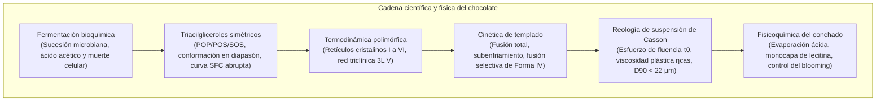
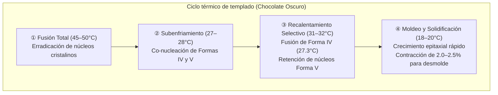

El chasquido acústico limpio («snap»), el brillo espejado y la suave fusión en boca del chocolate de alta calidad responden a una de las ramas más rigurosas de la física de la materia condensada en la ciencia de los alimentos.

La fase continua del chocolate está formada por manteca de cacao. Gracias a sus triacilgliceroles (TAG) monoinsaturados simétricos, exhibe un marcado <strong>polimorfismo cristalino</strong>, solidificando en seis configuraciones reticulares distintas (<strong>Forma I a Forma VI</strong>). Solo la <strong>Forma V ($\beta_2$)</strong>, metaestable y con punto de fusión a 33.8°C, aúna la dureza mecánica, la contracción volumétrica de desmolde y el fundido por debajo de la temperatura corporal (36.5°C).

---

### 1. Botánica del Cacao y Fermentación

1. <strong>Morfología de la Mazorca</strong>: El árbol de cacao (*Theobroma cacao*) produce frutos caulifloros con 30 a 50 semillas inmersas en pulpa blanca azucarada (10–15% azúcares, ácido cítrico, pH 3.3–3.8).
2. <strong>Sucesión Microbiana (5 a 7 días)</strong>:
   - Levaduras anaeróbicas $\to$ Bacterias lácticas $\to$ Oxidación exotérmica por bacterias acéticas (*Acetobacter*):
     $$\text{C}_2\text{H}_5\text{OH} + \text{O}_2 \longrightarrow \text{CH}_3\text{COOH} + \text{H}_2\text{O} \quad (\Delta H = -493\text{ kJ/mol})$$
   - La masa alcanza 48–52°C. El ácido acético desciende el pH a 4.8, provocando la <strong>muerte celular del grano</strong>.
3. <strong>Precursores de Aroma</strong>:
   Endoproteasas aspárticas hidrolizan las proteínas en aminoácidos hidrofóbicos (leucina, fenilalanina); las polifenol oxidasas oxidan las catequinas astringentes a taninos poliméricos marrones.

---

### 2. Bioquímica de la Manteca de Cacao

Más del 80% de la manteca de cacao está formada por triacilgliceroles simétricos tipo SUS:

| Especie de TAG | Posición de Acilos ($sn\text{-1, 2, 3}$) | Porcentaje en Masa (%) | Punto de Fusión ($\beta$) |
| :--- | :--- | :--- | :--- |
| <strong>POS</strong> | Palmitato (16:0) - Oleato (18:1) - Estearato (18:0) | <strong>36 – 42 %</strong> | $35.5^\circ\mathrm{C}$ |
| <strong>SOS</strong> | Estearato (18:0) - Oleato (18:1) - Estearato (18:0) | <strong>25 – 31 %</strong> | $41.5^\circ\mathrm{C}$ |
| <strong>POP</strong> | Palmitato (16:0) - Oleato (18:1) - Palmitato (16:0) | <strong>14 – 19 %</strong> | $35.2^\circ\mathrm{C}$ |

- <strong>Conformación en Diapasón (Tuning-fork)</strong>: Cadenas saturadas paralelas y ácido oleico doblado a 120°.
- <strong>Caída Abrupta del Contenido Graso Sólido (SFC)</strong>: 75–85% a 20–25°C, cayendo a 0% entre 30°C y 35°C, lo que genera una sensación refrescante y libre de residuo graso.

---

### 3. Cristalografía Polimórfica y Forma V

La manteca de cacao cristaliza en seis polimorfos (Wille & Lutton):
- <strong>Forma I ($\gamma, 17.3^\circ\mathrm{C}$)</strong>: Hexagonal, altamente inestable;
- <strong>Forma II ($\alpha, 23.3^\circ\mathrm{C}$)</strong>: Hexagonal, enfriamiento brusco;
- <strong>Forma III ($\beta'_2, 25.5^\circ\mathrm{C}$)</strong>: Ortorrómbica, frágil;
- <strong>Forma IV ($\beta'_1, 27.3^\circ\mathrm{C}$)</strong>: Ortorrómbica, blanda;
- <strong>Forma V ($\beta_2, 33.8^\circ\mathrm{C}$)</strong>: <strong>Triclínica, empaquetamiento 3L, brillo deslumbrante, fractura limpia, fusión a 34°C</strong>;
- <strong>Forma VI ($\beta_1, 36.3^\circ\mathrm{C}$)</strong>: Estado fundamental termodinámico; causa fat bloom (velo blanco) y sensación terrosa.

---

### 4. Ingeniería del Templado Térmico

La densa red triclínica produce una <strong>contracción volumétrica del 2.0 al 2.5%</strong>, permitiendo que el chocolate se separe por sí mismo del molde.

---

### 5. Reología de Casson y Conchado

El chocolate fundido es una suspensión plástica que sigue el <strong>modelo de Casson</strong>:

$$\sqrt{\tau} = \sqrt{\tau_0} + \sqrt{\eta_{\text{cas}} \dot{\gamma}}$$

- $\tau_0$ (esfuerzo de fluencia de Casson) : tensión inicial requerida para vencer la red de partículas de azúcar;
- $\eta_{\text{cas}}$ (viscosidad plástica) : resistencia hidrodinámica al flujo continuo;
- El umbral táctil de la lengua detecta asperezas a partir de <strong>$20–25\,\mu\text{m}$</strong>, por lo que el refinado debe limitar estrictamente el diámetro $D_{90}$ a <strong>$18–22\,\mu\text{m}$</strong>.
- <strong>Conchado y Lecitina</strong>: El conchado en seco (60–80°C) expulsa la humedad ($<0.5\%$) y el ácido acético. Un 0.3–0.5% de lecitina recubre los cristales de azúcar con una monocapa anfifílica, reduciendo el esfuerzo de fluencia tanto como un 3 a 5% de manteca de cacao pura.
