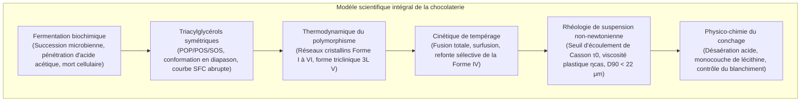
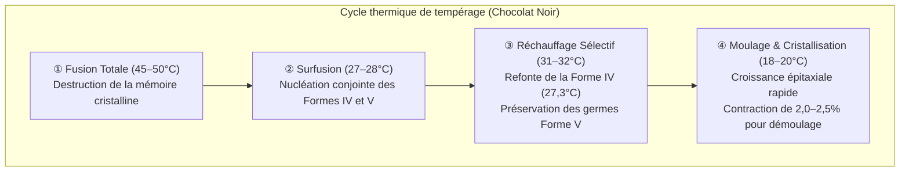

Le cassant net (« snap »), la brillance miroitante et la fusion instantanée en bouche d'un chocolat d'exception reposent sur l'une des disciplines les plus exigeantes de la physique de la matière condensée appliquée à l'alimentation.

La phase continue du chocolat est constituée de beurre de cacao. Composé majoritairement de triacylglycérols (TAG) mono-insaturés symétriques, il présente un <strong>polymorphisme cristallin</strong> remarquable, cristallisant sous six formes distinctes (<strong>Forme I à Forme VI</strong>). Seule la <strong>Forme V ($\beta_2$)</strong>, métastable sur le plan thermodynamique et fondant à 33,8°C, offre la dureté, la contraction au démoulage et la fluidité nécessaires à la dégustation juste en dessous de la température corporelle humaine.

---

### 1. Botanique du Cacaoyer et Fermentation

1. <strong>Morphologie de la Cabosse</strong> : Le cacaoyer (*Theobroma cacao*) produit des cabosses cauliflores abritant 30 à 50 fèves enchâssées dans une pulpe blanche sucrée et acidulée (teneur en sucres de 10 à 15%, acide citrique, pH 3,3–3,8).
2. <strong>Succession Microbienne (5 à 7 jours)</strong> :
   - Levures anaérobies $\to$ Bactéries lactiques $\to$ Bactéries acétiques (*Acetobacter aceti*) :
     $$\text{C}_2\text{H}_5\text{OH} + \text{O}_2 \longrightarrow \text{CH}_3\text{COOH} + \text{H}_2\text{O} \quad (\Delta H = -493\text{ kJ/mol})$$
   - La réaction exothermique porte la température à 48–52°C. L'acide acétique pénètre les cotylédons, abaissant le pH à 4,8 et provoquant la <strong>mort cellulaire irréversible de la fève</strong>.
3. <strong>Libération des Précurseurs d'Arôme</strong> :
   Des protéases aspartiques endogènes hydrolysent les globulines de réserve en acides aminés hydrophobes (leucine, phénylalanine) et oligopeptides ; la polyphénol oxydase oxyde les flavan-3-ols astringents en tanins condensés bruns.

---

### 2. Biochimie des Triacylglycérols du Beurre de Cacao

Plus de 80% du beurre de cacao est formé de triacylglycérols symétriques de type SUS :

| Espèce de TAG | Configuration acylée ($sn\text{-1, 2, 3}$) | Fraction massique (%) | Point de fusion ($\beta$) |
| :--- | :--- | :--- | :--- |
| <strong>POS</strong> | Palmitate (16:0) - Oléate (18:1) - Stéarate (18:0) | <strong>36 – 42 %</strong> | $35,5^\circ\mathrm{C}$ |
| <strong>SOS</strong> | Stéarate (18:0) - Oléate (18:1) - Stéarate (18:0) | <strong>25 – 31 %</strong> | $41,5^\circ\mathrm{C}$ |
| <strong>POP</strong> | Palmitate (16:0) - Oléate (18:1) - Palmitate (16:0) | <strong>14 – 19 %</strong> | $35,2^\circ\mathrm{C}$ |

- <strong>Conformation en Diapason (Tuning-fork)</strong> : Les deux chaînes saturées s'étirent en parallèle tandis que l'acide oléique en position $sn\text{-2}$ forme un coude rigide à 120°.
- <strong>Profil de Fusion Abrupt</strong> : À température ambiante (20–25°C), la fraction solide (SFC) est de 75–85%, puis s'effondre à 0% entre 30°C et 35°C, assurant la sensation de fusion instantanée sans résidu cireux.

---

### 3. Polymorphisme Cristallin et Forme V

Le beurre de cacao présente six formes polymorphiques (Wille & Lutton) :
- <strong>Forme I ($\gamma, 17,3^\circ\mathrm{C}$)</strong> : Hexagonale, hautement instable ;
- <strong>Forme II ($\alpha, 23,3^\circ\mathrm{C}$)</strong> : Hexagonale, obtenue par trempe ;
- <strong>Forme III ($\beta'_2, 25,5^\circ\mathrm{C}$)</strong> : Orthorhombique, friable ;
- <strong>Forme IV ($\beta'_1, 27,3^\circ\mathrm{C}$)</strong> : Orthorhombique, molle et terne ;
- <strong>Forme V ($\beta_2, 33,8^\circ\mathrm{C}$)</strong> : <strong>Triclinique, structure lamellaire 3L, brillance miroir, cassant net, fusion à 34°C</strong> ;
- <strong>Forme VI ($\beta_1, 36,3^\circ\mathrm{C}$)</strong> : État fondamental thermodynamique, responsable du blanchiment gras (fat bloom) et d'une texture sableuse.

---

### 4. Ingénierie du Tempérage Thermique

L'empilement triclinique compact de la Forme V induit une <strong>contraction volumétrique de 2,0 à 2,5%</strong>, permettant au chocolat de se détacher spontanément des moules.

---

### 5. Rhéologie de Casson et Conchage

Le chocolat fondu est une suspension concentrée obéissant au <strong>modèle plastique de Casson</strong> :

$$\sqrt{\tau} = \sqrt{\tau_0} + \sqrt{\eta_{\text{cas}} \dot{\gamma}}$$

- $\tau_0$ (seuil d'écoulement de Casson) : force minimale requise pour initier l'écoulement ;
- $\eta_{\text{cas}}$ (viscosité plastique de Casson) : frottement interne sous cisaillement ;
- La langue percevant les aspérités dès <strong>$20–25\,\mu\text{m}$</strong>, le broyage doit limiter le diamètre $D_{90}$ entre <strong>$18\,\mu\text{m}$ et $22\,\mu\text{m}$</strong>.
- <strong>Conchage & Lécithine</strong> : Le conchage à sec (60–80°C) évapore l'humidité résiduelle ($<0,5\%$) et l'acide acétique. L'ajout de 0,3–0,5% de lécithine forme une monocouche amphotère sur les cristaux de sucre, réduisant le seuil d'écoulement aussi efficacement qu'un apport de 3 à 5% de beurre de cacao pur.
