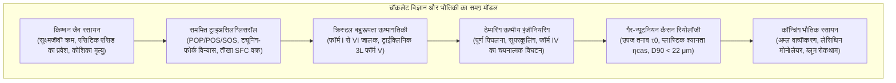
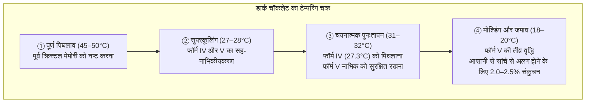

उत्कृष्ट चॉकलेट की कुरकुरी टूटन («snap»), दर्पण जैसी चमकदार चमक और मुंह में शरीर के तापमान पर तुरंत पिघलने का जादुई अनुभव खाद्य विज्ञान में संघनित पदार्थ भौतिकी की सबसे परिष्कृत प्रणालियों में से एक है।

चॉकलेट का निरंतर माध्यम कोकोआ बटर (Cocoa Butter) होता है। सममित मोनो-असंतृप्त ट्राइअसिलग्लिसरॉल (TAG) से भरपूर होने के कारण, यह उल्लेखनीय <strong>क्रिस्टलीय बहुरूपता (Polymorphism)</strong> प्रदर्शित करता है और छह अलग-अलग क्रिस्टल जाली विन्यासों (<strong>फॉर्म I से फॉर्म VI</strong>) में जमता है। इनमें से केवल थर्मोडायनामिक रूप से मेटास्टेबल <strong>फॉर्म V ($\beta_2$)</strong>, जिसका गलनांक 33.8°C है, मानव शरीर के तापमान (36.5°C) से ठीक नीचे तेजी से पिघलने, सही कठोरता और सांचे से सिकुड़कर बाहर निकलने की क्षमता प्रदान करता है।

---

### 1. कोको वनस्पति विज्ञान और किण्वन जैव प्रौद्योगिकी

1. <strong>कोको फल (पॉड) की शारीरिक रचना</strong>: कोको के पेड़ (*Theobroma cacao*) में तने पर फल लगते हैं, जिनमें 30 से 50 बीज मीठे सफेद गूदे (10–15% शर्करा, सिट्रिक एसिड, pH 3.3–3.8) में लिपटे होते हैं।
2. <strong>सूक्ष्मजीवी किण्वन (5 से 7 दिन)</strong>:
   - अवायवीय यीस्ट $\to$ लैक्टिक एसिड बैक्टीरिया $\to$ *Acetobacter* द्वारा अत्यधिक ऊष्माक्षेपी एसिटिक ऑक्सीकरण:
     $$\text{C}_2\text{H}_5\text{OH} + \text{O}_2 \longrightarrow \text{CH}_3\text{COOH} + \text{H}_2\text{O} \quad (\Delta H = -493\text{ kJ/mol})$$
   - तापमान 48–52°C तक बढ़ जाता है। एसिटिक एसिड बीज में प्रवेश कर pH को 4.8 तक गिरा देता है, जिससे <strong>बीज की कोशिकाओं की स्थायी मृत्यु</strong> हो जाती है।
3. <strong>स्वाद अग्रदूतों की उत्पत्ति</strong>:
   एंडोजेनस प्रोटीएज़ एंजाइम प्रोटीन को हाइड्रोफोबिक अमीनो एसिड (ल्यूसीन, फेनिलएलनिन) में तोड़ते हैं; पॉलीफेनोल ऑक्सीडेज कसैले कैटेचिन को भूरे रंग के टैनिन में बदल देता है।

---

### 2. कोकोआ बटर का आणविक जैव रसायन: TAG संरचना

कोकोआ बटर का 80% से अधिक हिस्सा सममित SUS-प्रकार के ट्राइअसिलग्लिसरॉल से बना होता है:

| TAG घटक | फैटी एसिड विन्यास ($sn\text{-1, 2, 3}$) | द्रव्यमान प्रतिशत (%) | $\beta$ रूप का गलनांक |
| :--- | :--- | :--- | :--- |
| <strong>POS</strong> | पाल्मिटेट (16:0) - ओलिएट (18:1) - स्टीयरेट (18:0) | <strong>36 – 42 %</strong> | $35.5^\circ\mathrm{C}$ |
| <strong>SOS</strong> | स्टीयरेट (18:0) - ओलिएट (18:1) - स्टीयरेट (18:0) | <strong>25 – 31 %</strong> | $41.5^\circ\mathrm{C}$ |
| <strong>POP</strong> | पाल्मिटेट (16:0) - ओलिएट (18:1) - पाल्मिटेट (16:0) | <strong>14 – 19 %</strong> | $35.2^\circ\mathrm{C}$ |

- <strong>ट्यूनिंग-फोर्क विन्यास (Tuning-fork)</strong>: संतृप्त श्रृंखलाएं समानांतर फैली होती हैं और ओलिक एसिड 120° पर मुड़ा होता है।
- <strong>तीखा ठोस वसा सामग्री (SFC) वक्र</strong>: 20–25°C पर 75–85% ठोस रहता है और 30°C से 35°C के बीच अचानक 0% पर गिर जाता है, जिससे यह मुंह में बिना चिकनाहट छोड़े तुरंत पिघल जाता है।

---

### 3. क्रिस्टल बहुरूपता और फॉर्म V

कोकोआ बटर छह बहुरूपी रूपों में जमता है (विले एवं लटन वर्गीकरण):
- <strong>फॉर्म I ($\gamma, 17.3^\circ\mathrm{C}$)</strong>: हेक्सागोनल, अत्यंत अस्थिर;
- <strong>फॉर्म II ($\alpha, 23.3^\circ\mathrm{C}$)</strong>: हेक्सागोनल, तेजी से ठंडा करने पर बनता है;
- <strong>फॉर्म III ($\beta'_2, 25.5^\circ\mathrm{C}$)</strong>: ऑर्थोरोम्बिक, भंगुर;
- <strong>फॉर्म IV ($\beta'_1, 27.3^\circ\mathrm{C}$)</strong>: ऑर्थोरोम्बिक, मुलायम और सुस्त;
- <strong>फॉर्म V ($\beta_2, 33.8^\circ\mathrm{C}$)</strong>: <strong>ट्राईक्लिनिक 3L जालक, चमकदार चमक, सटीक टूटन, 34°C पर पिघलना</strong>;
- <strong>फॉर्म VI ($\beta_1, 36.3^\circ\mathrm{C}$)</strong>: वास्तविक थर्मोडायनामिक आधार; फैट ब्लूम और मुंह में रेतीलापन पैदा करता है।

---

### 4. टेम्परिंग थर्मल इंजीनियरिंग

फॉर्म V के घने ट्राईक्लिनिक जमाव के कारण <strong>2.0 से 2.5% आयतन संकुचन (Volumetric Contraction)</strong> होता है, जिससे चॉकलेट सांचे से स्वतः अलग हो जाती है।

---

### 5. कैसन रियोलॉजी और कॉन्चिंग

पिघली हुई चॉकलेट <strong>कैसन प्लास्टिक द्रव मॉडल</strong> का पालन करती है:

$$\sqrt{\tau} = \sqrt{\tau_0} + \sqrt{\eta_{\text{cas}} \dot{\gamma}}$$

- $\tau_0$ (कैसन यील्ड स्ट्रेस): प्रवाह शुरू करने के लिए न्यूनतम आवश्यक तनाव;
- $\eta_{\text{cas}}$ (कैसन प्लास्टिक श्यानता): उच्च कतरनी पर आंतरिक घर्षण;
- जीभ के संवेदी रिसेप्टर्स <strong>$20–25\,\mu\text{m}$</strong> से बड़े कणों को महसूस कर लेते हैं, इसलिए बारीक पिसाई में कण आकार $D_{90}$ को <strong>$18–22\,\mu\text{m}$</strong> के भीतर सख्ती से सीमित किया जाता है।
- <strong>कॉन्चिंग और लेसिथिन</strong>: ड्राई कॉन्चिंग (60–80°C) नमी ($<0.5\%$) और एसिटिक एसिड को बाहर निकालती है। 0.3–0.5% लेसिथिन मिलाने से शर्करा कणों पर सुरक्षात्मक परत बन जाती है, जो यील्ड स्ट्रेस को 3 से 5% शुद्ध कोकोआ बटर के बराबर कम कर देती है।
