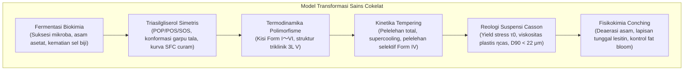
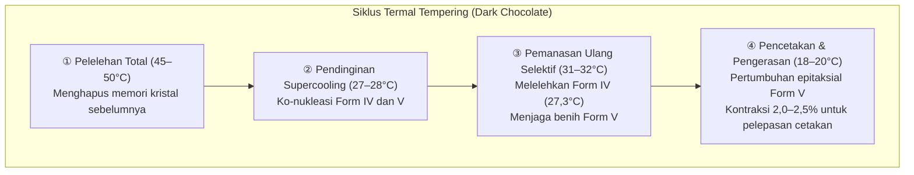

Sensasi patahan renyah («snap»), kilau cermin yang memikat, dan lelehan lembut seketika di mulut dari cokelat berkualitas tinggi berakar pada salah satu cabang fisika materi terkondensasi yang paling presisi dalam ilmu pangan.

Fase kontinu cokelat dibentuk oleh lemak kakao (cocoa butter). Terdiri dari triasilgliserol (TAG) tak jenuh tunggal yang simetris, lemak kakao menunjukkan <strong>polimorfisme kristal</strong> yang unik, memadat ke dalam enam struktur kisi yang berbeda (<strong>Form I hingga Form VI</strong>). Hanya <strong>Form V ($\beta_2$)</strong>, fase metastabil secara termodinamika dengan titik leleh 33,8°C, yang mampu menggabungkan kekerasan mekanis, kontraksi cetakan, dan lelehan sempurna tepat di bawah suhu tubuh manusia (36,5°C).

---

### 1. Botani Kakao dan Bioteknologi Fermentasi

1. <strong>Morfologi Buah Kakao</strong>: Pohon kakao (*Theobroma cacao*) menghasilkan buah cauliflorous yang berisi 30 hingga 50 biji yang terbungkus dalam pulpa putih manis berair (gula 10–15%, asam sitrat, pH 3,3–3,8).
2. <strong>Suksesi Mikroba (5 hingga 7 hari)</strong>:
   - Ragi anaerobik $\to$ Bakteri asam laktat $\to$ Oksidasi asam asetat eksotermik oleh *Acetobacter*:
     $$\text{C}_2\text{H}_5\text{OH} + \text{O}_2 \longrightarrow \text{CH}_3\text{COOH} + \text{H}_2\text{O} \quad (\Delta H = -493\text{ kJ/mol})$$
   - Suhu timbunan mencapai 48–52°C. Asam asetat menembus kotiledon, menurunkan pH menjadi 4,8 dan menyebabkan <strong>kematian sel biji secara permanen</strong>.
3. <strong>Pelepasan Prekursor Aroma</strong>:
   Protease endogen menghidrolisis protein simpanan menjadi asam amino hidrofobik (leusin, fenilalanin) dan peptida pendek; polifenol oksidase mengoksidasi katekin sepat menjadi tanin cokelat polimerik.

---

### 2. Biokimia Molekuler Lemak Kakao: Triasilgliserol (TAG)

Lebih dari 80% lemak kakao terdiri dari TAG simetris tipe SUS:

| Jenis TAG | Komposisi Asam Lemak ($sn\text{-1, 2, 3}$) | Fraksi Massa (%) | Titik Leleh Bentuk $\beta$ |
| :--- | :--- | :--- | :--- |
| <strong>POS</strong> | Palmitat (16:0) - Oleat (18:1) - Stearat (18:0) | <strong>36 – 42 %</strong> | $35,5^\circ\mathrm{C}$ |
| <strong>SOS</strong> | Stearat (18:0) - Oleat (18:1) - Stearat (18:0) | <strong>25 – 31 %</strong> | $41,5^\circ\mathrm{C}$ |
| <strong>POP</strong> | Palmitat (16:0) - Oleat (18:1) - Palmitat (16:0) | <strong>14 – 19 %</strong> | $35,2^\circ\mathrm{C}$ |

- <strong>Konformasi Garpu Tala (Tuning-fork)</strong>: Rantai jenuh lurus memanjang sejajar, sementara asam oleat menekuk pada sudut 120°.
- <strong>Penurunan Curam Kandungan Lemak Padat (SFC)</strong>: 75–85% padat pada 20–25°C, anjlok hingga 0% antara 30°C dan 35°C, menghasilkan lelehan bersih di lidah tanpa residu lilin.

---

### 3. Kristalografi Polimorfisme dan Form V

Lemak kakao mengkristal ke dalam enam bentuk polimorfik (Wille & Lutton):
- <strong>Form I ($\gamma, 17,3^\circ\mathrm{C}$)</strong>: Heksagonal, sangat tidak stabil;
- <strong>Form II ($\alpha, 23,3^\circ\mathrm{C}$)</strong>: Heksagonal, terbentuk dari pendinginan cepat;
- <strong>Form III ($\beta'_2, 25,5^\circ\mathrm{C}$)</strong>: Ortorombik, rapuh;
- <strong>Form IV ($\beta'_1, 27,3^\circ\mathrm{C}$)</strong>: Ortorombik, lunak dan kusam;
- <strong>Form V ($\beta_2, 33,8^\circ\mathrm{C}$)</strong>: <strong>Triklinik 3L, kilau sempurna, patahan renyah («snap»), meleleh pada 34°C</strong>;
- <strong>Form VI ($\beta_1, 36,3^\circ\mathrm{C}$)</strong>: Keadaan dasar termodinamika sebenarnya; menyebabkan fat bloom dan tekstur berpasir.

---

### 4. Rekayasa Termal Tempering

Kerapatan struktur triklinik Form V memicu <strong>kontraksi volume sebesar 2,0 hingga 2,5%</strong>, memungkinkan cokelat lepas secara spontan dari cetakan polikarbonat.

---

### 5. Reologi Casson dan Conching

Cokelat cair mengikuti <strong>model cairan plastis Casson</strong>:

$$\sqrt{\tau} = \sqrt{\tau_0} + \sqrt{\eta_{\text{cas}} \dot{\gamma}}$$

- $\tau_0$ (Casson yield stress) : tegangan geser minimum untuk memulai aliran;
- $\eta_{\text{cas}}$ (viskositas plastis Casson) : hambatan aliran internal pada laju geser tinggi;
- Mekanoreseptor lidah mendeteksi butiran mulai dari <strong>$20–25\,\mu\text{m}$</strong>, sehingga penggilingan halus harus membatasi ukuran partikel $D_{90}$ pada rentang <strong>$18–22\,\mu\text{m}$</strong>.
- <strong>Conching & Lesitin</strong>: Conching kering (60–80°C) menguapkan sisa air ($<0,5\%$) dan asam asetat. Penambahan 0,3–0,5% lesitin melapisi partikel gula dengan lapisan amfifilik, menurunkan yield stress setara dengan penambahan 3 hingga 5% lemak kakao murni.
