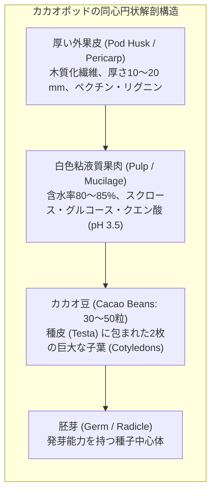
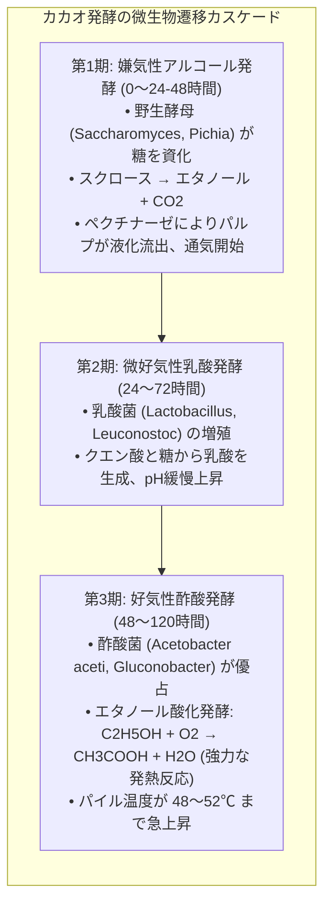
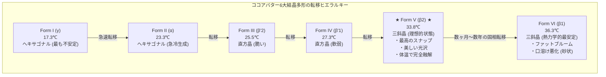
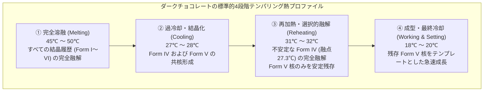
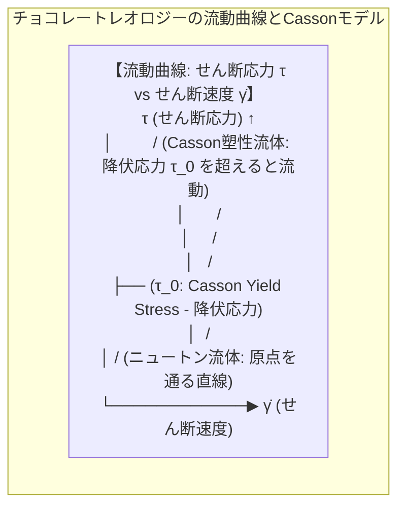
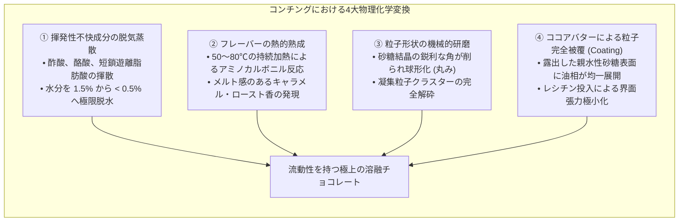
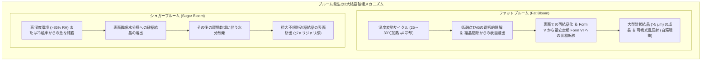

口に含んだ瞬間に滑らかにとろけ、芳醇なカカオアロマと快いスナップ音を放つ一切れのチョコレート。その魅惑的な官能特性の背後には、脂質結晶工学、非平衡相転移熱力学、界面物理化学、非ニュートン流体レオロジー、そして有機分子構造論が極限まで凝縮された「固体分散系の精密物理学」が存在します。

チョコレートの主たる分散媒であるカカオ脂（ココアバター）は、特異なトリアシルグリセロール（TAG）組成を持ち、融点や密度、結晶格子配置が異なる<strong>6つの結晶多形（Form I 〜 Form VI）</strong>を形成します。体温（約36.5℃）の直下である33.8℃でシャープに溶融し、心地よい硬度（スナップ性）と美しい光沢を兼ね備えるのは、唯一<strong>Form V（$\beta_2$ 型）</strong>と呼ばれる熱力学的に準安定な結晶構造のみです。

本稿では、カカオ果実の形態学と微生物発酵生化学から、ココアバターの分子対称性、結晶多形のギブズ自由エネルギー景観、テンパリングの古典的核形成速度論（CNT）とアブラミ方程式、溶融チョコレートのキャソン流動モデル、コンチングにおけるリン脂質界面化学、そしてファットブルームの結晶破壊力学に至るまで、チョコレートの全容を学術的・数理的に徹底解明します。

---

### 1. カカオの植物形態学と発酵生物工学

#### 1.1 カカオポッドの解剖学的構造
カカオノキ（アオイ科カカオ属: *Theobroma cacao*）の果実、通称「カカオポッド（Cacao Pod）」は、幹や太い枝から直接花が咲き結実する「幹生花（Cauliflory）」という特異な植物学的特性を持ちます。



1. <strong>果皮（Husk / Pericarp）</strong>: 厚さ1〜2 cmの頑丈な木質組織。
2. <strong>パルプ（Pulp / Mucilage）</strong>: 種子の周囲を取り巻く純白の海綿状果肉。水分80〜85%、単糖類および二糖類（グルコース、フルクトース、スクロース）を10〜15%、高濃度のクエン酸（1〜2%）を含有し、pH 3.3〜3.8という強酸性環境を呈します。
3. <strong>カカオ種子（Cacao Seed / Bean）</strong>: 外側を薄い種皮（Testa）で覆われ、内部に巨大な2枚の子葉（Cotyledons / ニブ）を折りたたんでいます。子葉は乾燥重量の約50〜55%が脂質（ココアバター）、約10〜15%がタンパク質、約6〜8%がポリフェノール（主としてエピカテキン、プロシアニジン）、約1.5〜3%がメチルキサンチン類（テオブロミン、カフェイン）で構成されています。

#### 1.2 3大主要品種の遺伝的多様性と生化学特性
- <strong>クリオロ種（Criollo）</strong>: 中南米原産の希少種。苦味・渋味を与えるアントシアニン色素が少なく、子葉が白色〜淡紫色。ナッツ様、フローラル、キャラメル様の極めて繊細で高貴な芳香前駆物質を持ちますが、病害虫に極めて脆弱です。
- <strong>フォラステロ種（Forastero）</strong>: アマゾン川流域原産。世界生産量の80%以上を占めます。子葉は濃紫色でポリフェノールとテオブロミン含有量が高く、強烈なカカオ感（ビター感、ボディ）と病害耐性を誇ります。
- <strong>トリニタリオ種（Trinitario）</strong>: クリオロ種とフォラステロ種の自然交配種。両者の耐病性と豊かな芳香プロファイルを兼備します。

#### 1.3 発酵工学：微生物カスケードと子葉内生化学反応
収穫されたカカオ豆は、パルプごと木箱（スウェットボックス）やバナナの葉に包まれ、5〜7日間の発酵（Fermentation）に付されます。カカオ発酵は、無菌的な豆の内部で起こるのではなく、パルプの微生物群集遷移が駆動する「固相発酵バイオプロセス」です。



##### 豆の細胞致死とフレーバー前駆体の生合成
1. <strong>熱と酸による組織壊死</strong>:
   酢酸菌の発熱反応によりパイル温度が $50^\circ\mathrm{C}$ を超え、同時に生成した酢酸（$\text{CH}_3\text{COOH}$）が種皮を透過して子葉細胞内部へと浸透します。酸性化（子葉内pHが約6.5から4.8〜5.0へ低下）と高温の相乗作用により、細胞膜脂質二重層が不可逆的に破壊され、<strong>細胞が死滅（Seed death）</strong>します。
2. <strong>区画化の喪失と酵素カスケードの始動</strong>:
   生きた細胞内で別々の小胞に隔離されていた基質と内因性酵素が接触・混合します。
   - <strong>内因性プロテアーゼ（アスパラギン酸エンドプロテアーゼおよびカルボキシペプチダーゼ）</strong>:
     貯蔵タンパク質（ビシリン様グロブリン）を加水分解し、低分子ペプチドと親水性・疎水性遊離アミノ酸（ロイシン、バリン、フェニルアラニン等）を大量に生成します。
   - <strong>インベルターゼ</strong>:
     スクロースを還元糖（グルコース、フルクトース）へと反転加水分解します。
   - <strong>ポリフェノールオキシダーゼ（PPO）</strong>:
     渋味の元凶であるモノマー型エピカテキンやプロシアニジンをキノンへと酵素酸化し、さらに非酵素的重合によって赤褐色〜黒褐色の高分子色素複合体（タンニン複合体）を形成します。これにより過度な渋味が劇的に低減されます。

これらの生成物（遊離アミノ酸、低分子ペプチド、還元糖）こそが、後の焙煎工程でチョコレート特有の香気を爆発させるメイラード反応の「絶対的前駆体」となります。

---

### 2. ココアバターの分子生化学：トリアシルグリセロール（TAG）構造

チョコレートの融解挙動と物理的剛性を一手に担うのが、カカオ豆に含まれる脂質画分「ココアバター（カカオ脂）」です。一般的な植物油（大豆油、オリーブ油）が多様な不飽和脂肪酸の複雑な混合物で幅広い温度帯でダラダラと溶けるのに対し、ココアバターは<strong>極めて特異的かつ単純な対称型トリアシルグリセロール（Triacylglycerols: TAG）組成</strong>を有しています。

```
       CH2 - O - CO - R1   (sn-1位: 飽和脂肪酸 [パルミチン酸 / ステアリン酸])
        │
       CH  - O - CO - R2   (sn-2位: 不飽和脂肪酸 [オレイン酸])
        │
       CH2 - O - CO - R3   (sn-3位: 飽和脂肪酸 [パルミチン酸 / ステアリン酸])
```

#### 2.1 対称型モノ不飽和TAGの三位一体構造
ココアバターの全TAG分子の約80〜85%は、外側の $sn\text{-1}$ 位と $sn\text{-3}$ 位に直鎖飽和脂肪酸が、中央の $sn\text{-2}$ 位にシス型一価不飽和脂肪酸であるオレイン酸が結合した「飽和-不飽和-飽和（SUS型）」構造で占められています。

| 主要TAG分子種 | 系統名 | 脂肪酸構成 | ココアバター中含有率（重量%） | 単一成分融点（$\beta$型） |
| :--- | :--- | :--- | :--- | :--- |
| <strong>POS</strong> | 1-パルミトイル-2-オレオイル-3-ステアロイルグリセロール | パルミチン酸 (16:0) - オレイン酸 (18:1) - ステアリン酸 (18:0) | <strong>36 〜 42 %</strong> | $35.5^\circ\mathrm{C}$ |
| <strong>SOS</strong> | 1,3-ジステアロイル-2-オレオイルグリセロール | ステアリン酸 (18:0) - オレイン酸 (18:1) - ステアリン酸 (18:0) | <strong>25 〜 31 %</strong> | $41.5^\circ\mathrm{C}$ |
| <strong>POP</strong> | 1,3-ジパルミトイル-2-オレオイルグリセロール | パルミチン酸 (16:0) - オレイン酸 (18:1) - パルミチン酸 (16:0) | <strong>14 〜 19 %</strong> | $35.2^\circ\mathrm{C}$ |
| <strong>その他（SOO, POO等）</strong>| ジ不飽和TAG (SUU型) および飽和TAG (SSS型) | 不規則配置 | 10 〜 15 % | 低融点油分（$<20^\circ\mathrm{C}$）または超高融点 |

#### 2.2 分子対称性と「急峻な融解曲線」の物理化学
なぜココアバターは室温（20〜25℃）でガラスのように硬く、体温（36℃）で一瞬にして完全液体化するのでしょうか。
その秘密は、SUS型分子の立体配座（コンホメーション）にあります。
1. <strong>音叉型（Tuning-fork）構造</strong>:
   $sn\text{-1}$ 位と $sn\text{-3}$ 位の飽和脂肪酸アシル鎖（パルミチン酸 $C_{16}$、ステアリン酸 $C_{18}$）は直線状のオールトランス型炭化水素鎖として平行に整列し、中央の $sn\text{-2}$ 位オレイン酸（$C_{18:1}$）鎖はシス型二重結合部で約120度の角度で屈曲しています。
2. <strong>高度な分子対称性</strong>:
   主成分であるPOS、SOS、POPは炭素鎖長がほぼ均一（$C_{16}\sim C_{18}$）であり、極めて高い分子対称性を持ちます。この幾何学的類似性により、異なるTAG分子同士が結晶格子内で互いに邪魔することなく密接に最密充填（Dense packing）することが可能となり、ファンデルワールス引力が極大化されます。
3. <strong>共晶的融解挙動</strong>:
   この3種類の主要TAGが絶妙な比率で混合しているため、固体脂含有率（Solid Fat Content: SFC）は25℃で約70〜80%という強固な固体を維持しながら、30℃から35℃のわずか5℃の温度区間で一気に0%へと急落します。この極めて急峻な相変化こそが、チョコレート特有の「歯ごたえのあるスナップ性」と「口中での瞬間的クールメルト感」を生み出す熱力学的根源です。

---

### 3. 結晶多形現象（Polymorphism）の熱力学と結晶構造論

固体状態のココアバターは、同一の化学組成でありながら分子パッキング様式が異なる複数の結晶格子構造、すなわち<strong>結晶多形（Polymorphism）</strong>を形成します。



#### 3.1 6大結晶多形の物理特性（Wille & Lutton分類）

1966年にWilleとLuttonによって確立されたローマ数字表記（Form I 〜 VI）と、古典的X線結晶学のギリシャ文字表記（$\gamma, \alpha, \beta', \beta$）の対比を以下に示します。

| 結晶多形 | 結晶格子サブセル | 鎖長パッキング | 融点（$T_m$） | ギブズ自由エネルギー（$G$） | 物理・官能的特徴 |
| :--- | :--- | :--- | :--- | :--- | :--- |
| <strong>Form I ($\gamma$)</strong> | ヘキサゴナル（六方晶） | 2鎖長構造（2L） | $17.3^\circ\mathrm{C}$ | 最も高い（極めて不安定） | 溶融油を $-50^\circ\mathrm{C}$ で超急冷すると生成。即座にForm IIへ転移 |
| <strong>Form II ($\alpha$)</strong> | ヘキサゴナル（六方晶） | 2鎖長構造（2L） | $23.3^\circ\mathrm{C}$ | 高い（不安定相） | $0^\circ\mathrm{C}$ 急冷で生成。非常に軟らかく、室温で数分で崩壊 |
| <strong>Form III ($\beta'_2$)</strong>| オルソロンビック（直方晶）| 2鎖長構造（2L） | $25.5^\circ\mathrm{C}$ | 中程度（準安定） | サクサクしているが脆く、融点が低すぎて手で触ると即座にベタつく |
| <strong>Form IV ($\beta'_1$)</strong> | オルソロンビック（直方晶）| 2鎖長構造（2L） | $27.3^\circ\mathrm{C}$ | やや低い（準安定） | テンパリング不良で生成。光沢がなく、耐熱性が著しく劣る |
| <strong>Form V ($\beta_2$)</strong> | <strong>トリクリニック（三斜晶）</strong>| <strong>3鎖長構造（3L）</strong> | <strong>$33.8^\circ\mathrm{C}$</strong> | <strong>低く安定（最良の準安定相）</strong>| <strong>ショコラティエの至上目標。完璧な光沢、高密度収縮、心地よいスナップ性、体温下融解</strong> |
| <strong>Form VI ($\beta_1$)</strong> | トリクリニック（三斜晶）| 3鎖長構造（3L） | $36.3^\circ\mathrm{C}$ | <strong>最低（熱力学的真の最安定相）</strong>| 液体からは直接晶析不能。Form Vから数ヶ月かけて固相転移。白濁ブルーム、砂利のような口当たり |

#### 3.2 サブセルパッキングと長周期鎖長構造の幾何学
X線回折（XRD）広角測定（WAXS）および小角測定（SAXS）により、結晶内部の立体配座が解明されています。
1. <strong>サブセル充填（Subcell Packing）</strong>:
   - $\alpha$ 型（Form I, II）: 炭化水素鎖がランダムに回転自由度を残した六方晶充填（格子面間隔 $d \approx 4.15\text{ \AA}$）。密度が低く力学的に脆い。
   - $\beta'$ 型（Form III, IV）: 隣接する炭化水素鎖のジグザグ平面が互いに直交する直方晶充填（$d \approx 4.2\text{ \AA}, 3.8\text{ \AA}$）。
   - $\beta$ 型（Form V, VI）: 全ての炭化水素鎖が完全に平行に傾斜して密着する三斜晶充填（$d \approx 4.6\text{ \AA}$ の強力な鋭い単一ピーク）。分子間距離が最小化され、最高密度のパッキングを達成します。
2. <strong>長周期構造（Long Spacings: 2L vs 3L）</strong>:
   POP、POS、SOSの混合系において、Form I〜IVはアシル鎖が2本並んだ「2鎖長構造（2-Chain length: 厚み約 $45\text{ \AA}$）」をとります。しかしForm VおよびVIでは、立体的に嵩高いオレイン酸鎖を中央に排他的に集約し、飽和鎖と分離する「3鎖長構造（3-Chain length: 厚み約 $65\text{ \AA}$）」へとダイナミックに再配列します。この3L三斜晶構造こそが、驚異的な化学的・熱的安定性の鍵となります。

#### 3.3 オストワルドの段階則（Ostwald's Rule of Stages）
融液（完全液体状態）から冷却して結晶化させる際、熱力学的に最も安定なForm VIやForm Vが直接自発核形成することはありません。
オストワルドの段階則に従い、活性化エネルギー障壁 $\Delta G^\ddagger$ が最も低く、分子再配列の手間が少ない最も不安定な相（Form I または II）が速度論的（Kinetically）に優先して析出します。

$$\text{Melt} \xrightarrow{\text{速い}} \text{Form II } (\alpha) \xrightarrow{\text{転移}} \text{Form III } (\beta') \xrightarrow{\text{転移}} \text{Form IV } (\beta') \xrightarrow{\text{転移}} \text{Form V } (\beta_2)$$

無制御に冷却すると、低融点のForm II〜IVが大量に混在した劣悪なチョコレート固形物となり、数日後に表面へ油分が析出して壊滅的な「ファットブルーム」を引き起こします。この熱力学的トラップを回避し、人為的に<strong>Form Vのみを選択的かつ均一に晶出させる精密熱操作工学</strong>こそが「テンパリング（Tempering）」です。

---

### 4. テンパリング工学：結晶核形成速度論と温度制御プロファイル

テンパリングの物理的本質は、<strong>「溶融液中に存在するすべての結晶核を一度リセットした上で、微細なForm Vの結晶種（Seed Crystals）のみを全体積にわたって均一かつ高密度（約0.5〜1.0重量%）に播種・育成し、望ましくないForm I〜IVの結晶核を熱力学的に完全融解・消滅させること」</strong>にあります。



#### 4.1 4段階温度サイクルの熱物理的根拠（ダークチョコレート基準）
1. <strong>完全溶融（$45\sim50^\circ\mathrm{C}$）</strong>:
   過去の結晶記憶や微小結晶クラスターを分子レベルで完全に消失させます。最安定相Form VIの融点（36.3℃）を大きく上回る熱エネルギーを与え、完全な等方性液体相（Isotropic liquid）へとリセットします。
2. <strong>過冷却冷却（$27\sim28^\circ\mathrm{C}$）</strong>:
   Form Vの融点（33.8℃）以下まで液温を一気に引き下げ、結晶化の熱力学的駆動力である<strong>過冷却度（$\Delta T = T_m - T$）</strong>を創出します。この温度域では、Form IV（融点27.3℃）およびForm Vの結晶核形成速度が最大化されます。液の粘度が急上昇し、微小な結晶クラスターが爆発的に発生します。
3. <strong>選択的再加熱（$31\sim32^\circ\mathrm{C}$）</strong>:
   液温を極めて精密に $31.5^\circ\mathrm{C}$ 前後まで昇温します。この温度は、Form IVの融解点（27.3℃）を完全に超えていますが、Form Vの融解点（33.8℃）よりも下回っています。この絶妙な温度ウィンドウにより、<strong>脆弱なForm IV結晶はすべて瞬時に融解して消失し、強靭なForm Vの結晶核のみが液中に生き残ります</strong>。
4. <strong>ワーキング・最終冷却（$18\sim20^\circ\mathrm{C}$）</strong>:
   型（モールド）へ注入後、緩やかな送風冷却下で残存したForm V結晶核が周囲の溶融TAGを巻き込みながらエピタキシャル成長します。結晶化熱（凝固エンタルピー $\Delta H_c \approx 40\sim50\text{ kJ/kg}$）を効率よく放熱しながら、全体系が均一なForm V三斜晶マトリックスへと急速に固定されます。

#### 4.2 古典的核形成理論（CNT）とアブラミ方程式による数理モデル
結晶化速度は、熱力学的駆動力（過冷却度）と動力学的障壁（分子拡散抵抗）のせめぎ合いです。
古典的核形成理論（Classical Nucleation Theory: CNT）において、均一核形成速度 $J$ は以下の方程式で記述されます。

$$J = J_0 \exp\left( -\frac{\Delta G_{\text{diff}}}{k_B T} \right) \exp\left( -\frac{16 \pi \gamma_{sl}^3 T_m^2}{3 \Delta H_f^2 (\Delta T)^2 k_B T} \right)$$

- $\gamma_{sl}$: 固液界面エネルギー
- $\Delta H_f$: 融解潜熱
- $\Delta T$: 過冷却度（$T_m - T$）
- $\Delta G_{\text{diff}}$: 粘性流動に伴う分子拡散の活性化エネルギー

過冷却度 $\Delta T$ が小さい（温度が高い）領域では第二項の界面創出エネルギー障壁が支配的となり核形成が起きません。逆に $\Delta T$ が極端に大きい（急冷）領域では、温度低下により液粘度 $\mu$ が跳ね上がり、第一項の分子拡散項が極端に抑制されてガラス化します。テンパリング工程の冷却温度（27〜28℃）は、この二つの拮抗する曲線の積が極大ピークを迎える最適領域に厳密に一致しています。

さらに、時間 $t$ に対する固相転化率 $\alpha(t)$ は、相転移速度論の金字塔である<strong>アブラミ方程式（Avrami Equation）</strong>に従います。

$$\alpha(t) = 1 - \exp\left( -k_A t^n \right)$$

ここで $k_A$ は結晶化速度定数、$n$ はアブラミ指数です。適切にテンパリングされたチョコレート（あらかじめ均一なForm V核が散布された系）では、核形成段階をスキップして三次元結晶成長が直ちに開始するため、$n \approx 3$ の指数関数的な高速結晶化が達成されます。

#### 4.3 結晶化に伴う体積収縮と型離れ（Demolding）の力学
Form V結晶への転移は、分子が最も密に詰まる三斜晶系パッキングへの移行を意味します。
この相転移に伴い、ココアバターは約<strong>2.0〜2.5%の著しい体積収縮（Volumetric Contraction）</strong>を起こします。
この収縮力学が極めて重要であり、ポリカーボネート製モールドの内壁からチョコレートが自発的にパチンと剥離する「完璧な型離れ」を可能にします。テンパリングが不完全なチョコレートは体積収縮を起こさず、モールドにベタベタと固着して破壊されます。

---

### 5. チョコレートのレオロジーと流動特性

溶融したチョコレートは、水や植物油のような単純なニュートン流体（せん断速度に比例して応力が増大する流体）ではありません。微小な砂糖結晶（親水性）とカカオ固形分粒子が、連続相である疎水性のココアバター中に高密度（容積充填率 $\phi \approx 0.60\sim0.70$）で懸濁した「超高濃度固液分散系」であり、典型的な<strong>降伏応力を持つ非ニュートン流体（塑性流体）</strong>の挙動を示します。



#### 5.1 キャソン流体モデル（Casson Plastic Model）
国際チョコレート菓子工業協会（IOCCC / OICCC）は、溶融チョコレートの粘性特性を評価する世界標準規格として<strong>キャソンの式（Casson Equation）</strong>を採用しています。

$$\sqrt{\tau} = \sqrt{\tau_0} + \sqrt{\eta_{\text{cas}} \dot{\gamma}}$$

- $\tau$: せん断応力（Shear Stress）$[\text{Pa}]$
- $\dot{\gamma}$: せん断速度（Shear Rate）$[\text{s}^{-1}]$
- $\tau_0$: <strong>キャソン降伏応力（Casson Yield Stress）</strong>$[\text{Pa}]$
- $\eta_{\text{cas}}$: <strong>キャソン塑性粘度（Casson Plastic Viscosity）</strong>$[\text{Pa}\cdot\text{s}]$

##### 2大レオロジーパラメータの製造現場における物理的役割
1. <strong>キャソン降伏応力（$\tau_0$）</strong>:
   流動を開始させるために最低限印加しなければならない臨界応力です。内部の砂糖粒子同士が形成する三次元凝集ネットワーク構造を破壊するエネルギーに対応します。
   - <strong>高すぎる場合</strong>: 型の隅々までチョコレートが行き渡らず、成型時に気泡が抜けない。
   - <strong>低すぎる場合</strong>: トリュフやビスケットにコーティング（エンロービング）した際、チョコレートが重力で垂れ落ちてしまい、所定のコーティング厚みを維持できない。
2. <strong>キャソン塑性粘度（$\eta_{\text{cas}}$）</strong>:
   ネットワークが完全に破壊された後の高せん断速度下における流動抵抗（粘りの強さ）です。パイプライン輸送時のポンプ圧力負荷、注入（デポジット）速度、口に入れた瞬間の重厚感や伸びを決定します。

#### 5.2 粒度分布と舌の触覚受容閾値
チョコレートの滑らかな食感（口溶け）は、懸濁している固体粒子群の最大粒子径によって物理的に規定されます。
- 人間の舌の先端に稠密に分布する触覚機械受容器（メルケル細胞、マイスナー小体）の空間分解能閾値は、約<strong>$20\sim25\,\mu\text{m}$</strong>です。
- 固体粒子（粉砕された砂糖結晶およびカカオセルロース片）のサイズが $30\,\mu\text{m}$ を超えると、大脳皮質はそれを「ざらつき（Grittiness / Sandiness）」として知覚します。
- 一方で、粒子を $15\,\mu\text{m}$ 以下に過剰微細化すると、比表面積が爆発的に増大してココアバターを過剰に吸着・拘束するため、キャソン降伏応力が跳ね上がり、ドロドロの流動不能なペーストになってしまいます。したがって、現代の微細粉砕（リファインニング）工学では、<strong>粒径の上限 $D_{90}$ を $18\sim22\,\mu\text{m}$ の狭小レンジに厳密制御すること</strong>が至上命題となります。

---

### 6. コンチング（Conching）の物理化学と界面活性工学

リファイナーによって微粉砕されたばかりのチョコレート原料粉末は、油分が不足したパサパサの「フレーク状粉体」であり、強烈な揮発酸（発酵由来の酢酸）と不快な青臭さ、荒々しい渋味を帯びています。この未熟な粉体マスを、滑らかな液状チョコレートへと不可逆的に変容させる最も劇的な物理化学工程が「コンチング（Conching）」です。

1879年、スイスのロドルフ・リンツ（Rodolphe Lindt）が偶然開発したコンチェ機（貝殻＝Conchに似た舟形攪拌機）に端を発するこの工程は、長時間の強烈なせん断・摩砕・熱風処理を通じて、以下の物理化学変化を同時進行させます。



#### 6.1 乾式コンチング（Dry Conching）と脱水・脱酸メカニズム
現代の高速コンチェでは、初期段階で敢えて追加のココアバターを投入せず、高せん断力をダイレクトに加える「乾式コンチング」が実施されます。
1. <strong>酢酸と水分の蒸散</strong>:
   カカオ発酵由来の過剰な酢酸（刺激臭と喉を刺す酸味の主因）を、摩擦熱（$60\sim80^\circ\mathrm{C}$）と強制排風によって大気中へ放散させます。水分含有率は $1.5\%$ 前後から $0.4\sim0.8\%$ 以下へと急激に低下します。
2. <strong>水分がチョコレートに及ぼす致命的影響</strong>:
   親水性の砂糖粒子表面に微量でも水分（$>1.0\%$）が存在すると、砂糖が局所的に溶解して濃厚な糖蜜シロップ層を形成します。このシロップ滴同士が接触すると架橋結合（Liquid bridge）を生じ、強固な親水性ネットワークを形成して流動性を完全に破壊します（ケーキング現象）。乾式コンチングによる徹底的な脱水は、流動性を獲得するための絶対条件です。

#### 6.2 レシチン（Lecithin）の界面活性メカニズム
コンチングの最終段階（湿式コンチング）において、全体の0.3〜0.5重量%という微量の<strong>大豆またはヒマワリ由来レシチン（ホスファチジルコリンを主成分とするリン脂質混合物）</strong>が添加されます。この微量添加が、チョコレート工学に革命的効果をもたらします。

```
          [ 親油性脂肪酸テール (非極性) ] ──▶ ココアバター油相 (外側)
                     │
                     O (グリセロール骨格)
                     │
          [ 親水性リン酸コリンヘッド (双性イオン) ] ──▶ 砂糖結晶表面 (内側)
```

1. <strong>両親媒性単分子膜の形成</strong>:
   レシチンの正電荷（コリン基）と負電荷（リン酸基）を持つ双性極性ヘッドが、親水性の砂糖結晶表面（水酸基 $-\text{OH}$ に富む）に強力に静電吸着します。一方、外側に伸びる2本の長い非極性脂肪酸鎖（疎水性テール）は、周囲の連続相であるココアバター油相へと配向します。
2. <strong>粘度の劇的低減効果</strong>:
   砂糖粒子の親水性表面が完全に親油性の「脂質コート」で覆われるため、親水性粒子同士の衝突・摩擦・凝集が劇的に消失します。
   わずか<strong>0.3〜0.4%のレシチン添加は、ココアバターを3〜5%追加添加するのと同等の粘度低下（降伏応力の劇的な半減）効果</strong>をもたらします。ココアバターは原料中で最も高価な成分であるため、レシチンの界面制御は経済的にも品質的にも極めて絶大な意義を持ちます。ただし、レシチンを0.5%を超えて過剰添加すると、親水基同士が逆ミセル構造を形成して逆に粘度を跳ね上げるため、厳密な滴定管理が必要です。

---

### 7. ブルーミング（Fat Bloom & Sugar Bloom）の結晶破壊力学

適切に作られた完璧なチョコレートであっても、不適切な保存条件下では表面が粉を吹いたように白濁し、ざらざらの不快な食感へと劣化します。この結晶崩壊現象を<strong>ブルーミング（Bloom）</strong>と呼びます。



#### 7.1 ファットブルーム（Fat Bloom）：Form V から Form VI への相転移
ファットブルームの主因は、熱力学的準安定相である<strong>Form V（$\beta_2$）</strong>から、真の最安定相である<strong>Form VI（$\beta_1$）</strong>への不可逆的固相転移です。
1. <strong>熱力学的駆動力</strong>:
   Form Vはエネルギー極小状態にありますが、真の最安定相であるForm VIの方がギブズ自由エネルギーがさらに低く、熱力学ポテンシャル勾配（$\Delta G = G_{\text{VI}} - G_{\text{V}} < 0$）が存在します。
2. <strong>相分離と液相浸出（Phase Separation & Migration）</strong>:
   室温が25〜30℃程度まで上昇すると、ココアバター中に数%含まれる低融点TAG画分（オレイン酸を2分子含むPOOやSOOなど）が結晶間隙で部分融解します。この液体脂が、毛細管力によって多孔質結晶ネットワークの隙間を縫ってチョコレート表面へと滲み出します（Liquid fat migration）。
3. <strong>針状結晶の異常成長</strong>:
   表面に達した脂質は、微小結晶核を足がかりに再結晶化します。この際、長時間をかけて最もギブズ自由エネルギーの低い<strong>巨大な針状のForm VI結晶（サイズ数マイクロメートル〜十数マイクロメートル）</strong>へと成長します。
4. <strong>光散乱による白濁</strong>:
   結晶サイズが可視光線の波長（$0.4\sim0.7\,\mu\text{m}$）より遥かに大きくなるため、表面に入射した光が激しく乱反射（レイリー散乱・ミー散乱）を起こし、人間の目には白く濁った粉状物として認識されます。同時に融点が36.3℃へと上昇するため、口に入れても体温で溶けず、粘土や砂を噛んでいるような劣悪な口当たりへと成り下がります。

#### 7.2 シュガーブルーム（Sugar Bloom）：吸湿と再結晶化
ファットブルームが「油の相転移」であるのに対し、シュガーブルームは「砂糖の相分離」です。
チョコレートを冷蔵庫などの極冷環境から高温多湿の室内に突然取り出すと、表面温度が露点（Dew Point）を下回り、空気中の水蒸気が結露して表面に微小水滴が付着します。
表面の砂糖微粒子がこの水膜に瞬時に溶解し、飽和ショ糖水溶液層を形成します。その後、周囲の湿度が下がって水分が蒸発すると、砂糖が粗大で不規則な結晶（ミリメートル大）として再析出し、白くザラザラした硬い層を残します。シュガーブルームは水に溶けますが（舐めると甘い）、ファットブルームは脂溶性（指で触ると体温で溶けて透明化する）であるため、官能的に判別が可能です。

---

### 8. 先端分析科学と結晶化ナノ制御技術

現代のチョコレート科学では、経験的な職人技に代わり、ナノスケールの物性測定装置と精密熱工学を駆使した品質制御が確立されています。

#### 8.1 示差走査熱量測定（DSC）とX線回折（XRD）による同定
- <strong>示差走査熱量計（DSC: Differential Scanning Calorimetry）</strong>:
  サンプルと基準物質を一定速度で昇温（例：$5^\circ\mathrm{C/min}$）させ、吸熱・発熱ピークから結晶多形を瞬時に同定します。
  - Form IV: 27.0℃付近の吸熱ピーク
  - Form V: 33.5〜34.0℃の明瞭な鋭い吸熱ピーク（$\Delta H \approx 45\text{ J/g}$）
  - Form VI: 36.0℃以上の高温ピーク
- <strong>放射光X線回折（Synchrotron Radiation XRD）</strong>:
  SPring-8などの大型放射光施設を利用したマイクロ秒単位の時間分解能XRD解析により、せん断応力下におけるForm V核の誕生と成長ダイナミクスが分子レベルでリアルタイム追跡されています。

#### 8.2 シード法（Seeding Technique）によるテンパリングの超省エネ化
古典的な「昇温・降温」を繰り返すテンパリングマシンは莫大な熱エネルギーと冷却電力を消費します。これに対し、最先端の工場で普及が進んでいるのが<strong>「種結晶添加法（Seeding）」</strong>です。
あらかじめ純粋なForm V結晶のみを高密度に育成した特殊なココアバター粉末（ココアバタークリスタル）を、約32〜33℃に保った溶融チョコレートマスに<strong>わずか0.1〜0.2%添加して均一分散させる</strong>技術です。
冷却によるForm IVの副生を一切経ることなく、投入されたForm V種結晶が瞬時にテンプレート（鋳型）となって全体を一斉結晶化させるため、エネルギー消費を大幅に削減し、かつ100%完璧なForm V結晶構造を担保することが可能となっています。

---

### 9. まとめ：一握の甘美に宿る結晶工学の精緻

一粒のショコラを味わう瞬間、私たちは無意識のうちに極限の物理・化学現象を五感で受容しています。

1. <strong>発酵生化学</strong>: 微生物遷移と内因性酵素反応が、アミノ酸と還元糖という無数のアロマ前駆体を子葉に刻み込む。
2. <strong>分子対称性</strong>: ココアバターのPOP/POS/SOSトリアシルグリセロールが、音叉型構造によって三次元最密充填を可能にする。
3. <strong>結晶多形熱力学</strong>: 6つの結晶多形の中から、熱力学的に準安定なForm V三斜晶のみを過冷却と選択的融解の狭間で精密に選択する。
4. <strong>非ニュートンレオロジー</strong>: キャソン流体モデルに基づき、砂糖粒子とココアバターの界面をレシチン単分子膜で調律し、完璧な流動性を獲得する。
5. <strong>相転移防御</strong>: ファットブルームの熱力学的障壁を維持し、Form VIへの不可逆的劣化をナノスケールで封じ込める。

カカオという大自然の恵みに、人類の結晶工学と物理化学の叡智が融合したとき、初めてあの神秘的なスナップと天上の口溶けが完成するのです。
