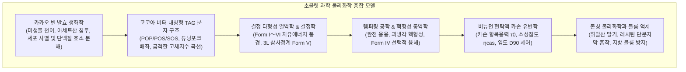
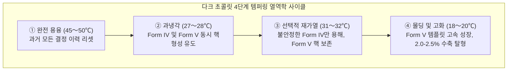

한 입 베어 무는 순간 기분 좋은 스냅(Snap) 소리를 내며 부서지고, 체온에서 매끄럽게 녹아내리며 폭발적인 풍미를 뿜어내는 초콜릿은 식품물리학이 빚어낸 가장 정교한 고체 분산계 시스템입니다.

초콜릿의 연속상을 구성하는 핵심 지질인 코코아 버터(Cocoa Butter)는 독특한 대칭형 트리아실글리세롤(TAG) 구조로 인해 <strong>결정 다형성(Polymorphism)</strong>을 나타내며, 서로 다른 6가지 결정형(<strong>Form I ~ Form VI</strong>)으로 고화됩니다. 이 중 오직 준안정 상태인 <strong>Form V ($\beta_2$ 형)</strong>만이 인간의 체온(약 36.5°C) 바로 아래인 33.8°C에서 급격히 융해되며 완벽한 광택과 단단한 스냅성을 제공합니다.

---

### 1. 카카오 식물형태학과 발효 생물공학

1. <strong>카카오 포드의 구조</strong>: 두꺼운 목질화 과피(Pericarp) 내부에 30~50개의 종자가 흰색 펄프(Pulp, 수분 80~85%, 당도 10~15%, 시트르산 pH 3.3~3.8)에 싸여 있습니다.
2. <strong>미생물 천이 발효 (5~7일)</strong>:
   - 효모의 혐기 알코올 발효 $\to$ 젖산균 발효 $\to$ 초산균(*Acetobacter*)의 호기성 산화 발효:
     $$\text{C}_2\text{H}_5\text{OH} + \text{O}_2 \longrightarrow \text{CH}_3\text{COOH} + \text{H}_2\text{O} \quad (\Delta H = -493\text{ kJ/mol})$$
   - 발열 반응으로 온도가 50°C까지 상승하고, 침투한 아세트산에 의해 내부 pH가 4.8로 급강하하며 <strong>세포막 파괴 및 종자 사멸</strong>이 발생합니다.
3. <strong>전구체 효소 생성</strong>:
   내인성 단백질 분해 효소가 저장 단백질을 소수성 유리 아미노산과 펩타이드로 가수분해하고, 폴리페놀 옥시다아제가 떫은 에피카테킨을 중합시켜 떫은맛을 완화합니다.

---

### 2. 코코아 버터의 대칭형 트리아실글리세롤(TAG) 구조

코코아 버터의 80% 이상은 $sn\text{-1, 3}$ 위치에 포화지방산이, $sn\text{-2}$ 위치에 시스형 올레산이 결합한 SUS 대칭 구조로 구성됩니다:

| 주요 TAG | 지방산 결합 구성 ($sn\text{-1, 2, 3}$) | 함량 (중량%) | 순수 $\beta$형 융점 |
| :--- | :--- | :--- | :--- |
| <strong>POS</strong> | 팔미트산 (16:0) - 올레산 (18:1) - 스테아르산 (18:0) | <strong>36 〜 42 %</strong> | $35.5^\circ\mathrm{C}$ |
| <strong>SOS</strong> | 스테아르산 (18:0) - 올레산 (18:1) - 스테아르산 (18:0) | <strong>25 〜 31 %</strong> | $41.5^\circ\mathrm{C}$ |
| <strong>POP</strong> | 팔미트산 (16:0) - 올레산 (18:1) - 팔미트산 (16:0) | <strong>14 〜 19 %</strong> | $35.2^\circ\mathrm{C}$ |

포화사슬이 평행하고 올레산 사슬이 120° 꺾인 <strong>소리굽쇠(Tuning-fork) 분자 배좌</strong>와 높은 분자 대칭성으로 인해, 상온(20~25°C)에서 75~85%의 단단한 고체 상태를 유지하다가 체온 직전인 30~35°C 사이에서 0%로 수직 낙하하는 극적인 융해 프로파일을 가집니다.

---

### 3. 결정 다형성(Polymorphism)과 Form V

코코아 버터는 6가지 다형체로 결정화됩니다:
- <strong>Form I ($\gamma, 17.3^\circ\mathrm{C}$)</strong>: 초급랭으로 생성되는 극도로 불안정한 육방정계;
- <strong>Form II ($\alpha, 23.3^\circ\mathrm{C}$)</strong>: 급랭 불안정상;
- <strong>Form III ($\beta'_2, 25.5^\circ\mathrm{C}$)</strong>: 취약한 사방정계;
- <strong>Form IV ($\beta'_1, 27.3^\circ\mathrm{C}$)</strong>: 무광택의 약한 사방정계;
- <strong>Form V ($\beta_2, 33.8^\circ\mathrm{C}$)</strong>: <strong>삼사정계 3쇄장(3L) 구조, 완벽한 광택, 쾌적한 스냅, 체온 즉시 융해</strong>;
- <strong>Form VI ($\beta_1, 36.3^\circ\mathrm{C}$)</strong>: 진정한 열역학적 최안정상, 지방 블룸과 꺼칠한 왁스 질감 유발.

---

### 4. 템퍼링 공학과 4단계 온도 사이클

템퍼링은 원치 않는 불안정상(Form I~IV)을 배제하고 오직 Form V 결정핵만을 씨앗으로 남기는 열역학적 공학입니다:

Form V 결정화 시 삼사정계의 치밀한 패킹으로 <strong>2.0~2.5%의 부피 수축</strong>이 발생하여 몰드 내벽에서 깨끗하게 저절로 떨어져 나옵니다.

---

### 5. 초콜릿 유변학(Rheology)과 카손 모델

용융 초콜릿은 <strong>카손 소성 유체 모델(Casson Model)</strong>을 따릅니다:

$$\sqrt{\tau} = \sqrt{\tau_0} + \sqrt{\eta_{\text{cas}} \dot{\gamma}}$$

- $\tau_0$ (카손 항복응력): 흐름을 시작하기 위한 최소 응력;
- $\eta_{\text{cas}}$ (카손 소성점도): 고전단 하에서의 내부 마찰 저항;
- 혀의 기계수용기 촉각 한계는 <strong>$20\sim25\,\mu\text{m}$</strong>이므로, 미세 분쇄 시 입자 크기 $D_{90}$을 <strong>$18\sim22\,\mu\text{m}$</strong>로 정밀 제어해야 거친 입자감 없이 최상의 매끄러움을 얻을 수 있습니다.

---

### 6. 콘칭과 블룸 현상

1. <strong>드라이 콘칭</strong>: 마찰열(60~80°C)과 공기 순환을 통해 잔류 수분을 0.5% 미만으로 증발시키고 불쾌한 아세트산을 휘발 탈기시킵니다.
2. <strong>레시틴 계면활성</strong>: 0.3~0.5% 첨가된 인지질이 친수성 설탕 입자 표면을 둘러싸 소수성 코코아 버터와의 마찰을 제거하여, 코코아 버터 3~5%를 절감하는 점도 강하 효과를 발휘합니다.
3. <strong>블룸(Bloom) 메커니즘</strong>:
   - <strong>지방 블룸(Fat Bloom)</strong>: 온도 변화로 액상화된 저융점 TAG가 표면으로 스며나와 거대 침상 Form VI 결정으로 재결정화되어 빛을 난반사(백화)시킴;
   - <strong>설탕 블룸(Sugar Bloom)</strong>: 결로 수분에 녹은 설탕이 재결정화되어 표면이 거칠어짐.
