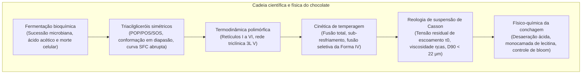
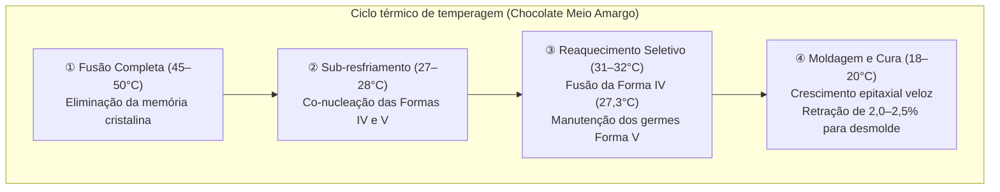

A textura aveludada, o brilho acetinado e a quebra sonora («snap») de um chocolate nobre representam um dos ápices da física da matéria condensada e da engenharia de alimentos.

A fase contínua do chocolate é formada por manteiga de cacau. Composta por triacilgliceróis (TAGs) monoinsaturados simétricos, ela exibe pronunciado <strong>polimorfismo cristalino</strong>, empacotando-se em seis fases distintas (<strong>Forma I a Forma VI</strong>). Apenas a <strong>Forma V ($\beta_2$)</strong>, termodinamicamente metaestável com ponto de fusão a 33,8°C, combina rigidez mecânica, retração no molde e fusão rápida na temperatura corporal.

---

### 1. Botânica do Cacau e Fermentação

1. <strong>Anatomia do Fruto</strong>: O cacaueiro (*Theobroma cacao*) produz frutos caulifloros com 30 a 50 sementes imersas em polpa branca mucilaginosa (10–15% açúcares, ácido cítrico, pH 3,3–3,8).
2. <strong>Sucessão Microbiana (5 a 7 dias)</strong>:
   - Leveduras anaeróbicas $\to$ Bactérias láticas $\to$ Oxidação acética exotérmica (*Acetobacter*):
     $$\text{C}_2\text{H}_5\text{OH} + \text{O}_2 \longrightarrow \text{CH}_3\text{COOH} + \text{H}_2\text{O} \quad (\Delta H = -493\text{ kJ/mol})$$
   - A massa atinge 48–52°C. O ácido acético penetra nos cotilédones, reduzindo o pH para 4,8 e provocando a <strong>morte celular da semente</strong>.
3. <strong>Precursores de Aroma</strong>:
   Proteases aspárticas hidrolisam proteínas de reserva em aminoácidos hidrofóbicos (leucina, fenilalanina); polifenol oxidases convertem catequinas adstringentes em pigmentos condensados castanhos.

---

### 2. Bioquímica dos Triacilgliceróis da Manteiga de Cacau

Mais de 80% da manteiga de cacau consiste em TAGs simétricos do tipo SUS:

| Espécie de TAG | Configuração de Ácidos Graxos ($sn\text{-1, 2, 3}$) | Porcentagem em Massa (%) | Ponto de Fusão ($\beta$) |
| :--- | :--- | :--- | :--- |
| <strong>POS</strong> | Palmitato (16:0) - Oleato (18:1) - Estearato (18:0) | <strong>36 – 42 %</strong> | $35,5^\circ\mathrm{C}$ |
| <strong>SOS</strong> | Estearato (18:0) - Oleato (18:1) - Estearato (18:0) | <strong>25 – 31 %</strong> | $41,5^\circ\mathrm{C}$ |
| <strong>POP</strong> | Palmitato (16:0) - Oleato (18:1) - Palmitato (16:0) | <strong>14 – 19 %</strong> | $35,2^\circ\mathrm{C}$ |

- <strong>Conformação em Diapasão</strong>: Cadeias saturadas paralelas e ácido oleico fletido a 120°.
- <strong>Curva SFC Abrupta</strong>: 75–85% de sólidos a 20–25°C, caindo a 0% entre 30°C e 35°C, garantindo fusão bucal sem viscosidade residual.

---

### 3. Fases Polimórficas e Forma V

- <strong>Forma I ($\gamma, 17,3^\circ\mathrm{C}$)</strong>: Hexagonal, altamente instável;
- <strong>Forma II ($\alpha, 23,3^\circ\mathrm{C}$)</strong>: Hexagonal, gerada por resfriamento abrupto;
- <strong>Forma III ($\beta'_2, 25,5^\circ\mathrm{C}$)</strong>: Ortorrômbica, quebradiça;
- <strong>Forma IV ($\beta'_1, 27,3^\circ\mathrm{C}$)</strong>: Ortorrômbica, macia e opaca;
- <strong>Forma V ($\beta_2, 33,8^\circ\mathrm{C}$)</strong>: <strong>Triclínica 3L, brilho intenso, snap firme, fusão a 34°C</strong>;
- <strong>Forma VI ($\beta_1, 36,3^\circ\mathrm{C}$)</strong>: Estado fundamental termodinâmico, causa fat bloom e sensação arenosa.

---

### 4. Engenharia da Temperagem

A rede triclínica compacta causa uma <strong>retração volumétrica de 2,0 a 2,5%</strong>, promovendo o descolamento espontâneo do chocolate do molde.

---

### 5. Reologia de Casson e Conchagem

O chocolate derretido segue o <strong>modelo de fluido plástico de Casson</strong>:

$$\sqrt{\tau} = \sqrt{\tau_0} + \sqrt{\eta_{\text{cas}} \dot{\gamma}}$$

- $\tau_0$ (tensão de escoamento de Casson) : barreira inicial de tensão para início do fluxo;
- $\eta_{\text{cas}}$ (viscosidade plástica de Casson) : atrito hidrodinâmico sob cisalhamento;
- O limiar tátil da língua percebe partículas acima de <strong>$20–25\,\mu\text{m}$</strong>, exigindo refinamento do $D_{90}$ a <strong>$18–22\,\mu\text{m}$</strong>.
- <strong>Conchagem e Lecitina</strong>: A conchagem a seco (60–80°C) remove água ($<0,5\%$) e ácido acético. A lecitina (0,3–0,5%) ancora-se aos cristais de açúcar, reduzindo a tensão de escoamento de forma equivalente à adição de 3 a 5% de manteiga de cacau.
