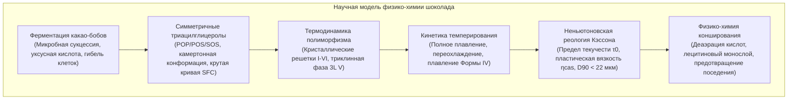
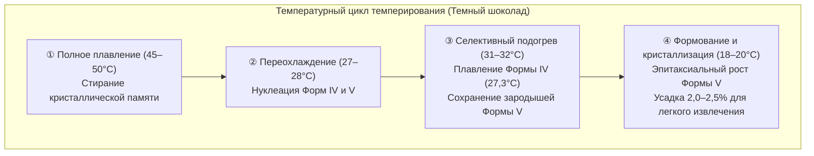

Звонкий хруст («snap»), зеркальный глянец и мгновенное таяние высококачественного шоколада при температуре человеческого тела базируются на сложнейших законах физики конденсированного состояния дисперсных систем.

Непрерывную фазу шоколада образует какао-масло. Благодаря симметричным мононенасыщенным триацилглицеролам (ТАГ) оно проявляет выраженный <strong>кристаллический полиморфизм</strong>, затвердевая в шести структурных модификациях (<strong>Формы I–VI</strong>). Только метастабильная <strong>Форма V ($\beta_2$)</strong> с температурой плавления 33,8°C обеспечивает идеальную твердость, усадку при извлечении из форм и полное таяние при температуре полости рта.

---

### 1. Ботаническая анатомия и ферментация какао

1. <strong>Анатомия какао-боба</strong>: Плоды дерева какао (*Theobroma cacao*) содержат 30–50 семян в белой сладкой пульпе (10–15% сахаров, лимонная кислота, pH 3,3–3,8).
2. <strong>Микробная сукцессия (5–7 дней)</strong>:
   - Анаэробные дрожжи $\to$ Молочнокислые бактерии $\to$ Экзотермическое окисление уксуснокислыми бактериями (*Acetobacter*):
     $$\text{C}_2\text{H}_5\text{OH} + \text{O}_2 \longrightarrow \text{CH}_3\text{COOH} + \text{H}_2\text{O} \quad (\Delta H = -493\text{ кДж/моль})$$
   - Температура массы достигает 48–52°C. Уксусная кислота снижает pH до 4,8, вызывая <strong>термо-кислотную гибель зародыша</strong>.
3. <strong>Образование прекурсоров аромата</strong>:
   Эндогенные аспартатные протеазы расщепляют запасные белки на гидрофобные аминокислоты (лейцин, фенилаланин); полифенолоксидазы окисляют вяжущие катехины в коричневые флобафены.

---

### 2. Биохимия триацилглицеролов какао-масла

Более 80% какао-масла состоит из симметричных ТАГ типа SUS:

| ТАГ-компонент | Ацильный состав ($sn\text{-1, 2, 3}$) | Доля по массе (%) | Точка плавления ($\beta$) |
| :--- | :--- | :--- | :--- |
| <strong>POS</strong> | Пальмитат (16:0) - Олеат (18:1) - Стеарат (18:0) | <strong>36 – 42 %</strong> | $35,5^\circ\mathrm{C}$ |
| <strong>SOS</strong> | Стеарат (18:0) - Олеат (18:1) - Стеарат (18:0) | <strong>25 – 31 %</strong> | $41,5^\circ\mathrm{C}$ |
| <strong>POP</strong> | Пальмитат (16:0) - Олеат (18:1) - Пальмитат (16:0) | <strong>14 – 19 %</strong> | $35,2^\circ\mathrm{C}$ |

- <strong>Камертонная конформация (Tuning-fork)</strong>: Насыщенные цепи вытянуты параллельно, а олеиновая кислота изогнута под углом 120°.
- <strong>Крутой профиль твердого жира (SFC)</strong>: 75–85% твердой фазы при 20–25°C обрушивается до 0% в интервале от 30°C до 35°C.

---

### 3. Полиморфизм какао-масла и Форма V

Шесть кристаллических модификаций какао-масла (по Вилле и Латтону):
- <strong>Форма I ($\gamma, 17,3^\circ\mathrm{C}$)</strong>: Гексагональная, крайне нестабильная;
- <strong>Форма II ($\alpha, 23,3^\circ\mathrm{C}$)</strong>: Гексагональная, результат закалки;
- <strong>Форма III ($\beta'_2, 25,5^\circ\mathrm{C}$)</strong>: Орторомбическая, хрупкая;
- <strong>Форма IV ($\beta'_1, 27,3^\circ\mathrm{C}$)</strong>: Орторомбическая, мягкая и матовая;
- <strong>Форма V ($\beta_2, 33,8^\circ\mathrm{C}$)</strong>: <strong>Триклинная 3L-структура, зеркальный глянец, чистый хруст, таяние при 34°C</strong>;
- <strong>Форма VI ($\beta_1, 36,3^\circ\mathrm{C}$)</strong>: Истинный термодинамический базис; вызывает жировое поседение (fat bloom) и песчанистость.

---

### 4. Инженерия темперирования

Плотная триклинная упаковка дает <strong>объемную усадку на 2,0–2,5%</strong>, за счет чего плитка шоколада свободно отделяется от стенок поликарбонатных форм.

---

### 5. Реология Кэссона и конширование

Расплавленный шоколад описывается <strong>пластической моделью Кэссона</strong>:

$$\sqrt{\tau} = \sqrt{\tau_0} + \sqrt{\eta_{\text{cas}} \dot{\gamma}}$$

- $\tau_0$ (предел текучести Кэссона) : минимальное напряжение для инициации движения;
- $\eta_{\text{cas}}$ (пластическая вязкость Кэссона) : гидродинамическое сопротивление при сдвиге;
- Тактильные механорецепторы языка различают частицы от <strong>$20–25\,\mu\text{m}$</strong>, поэтому помол $D_{90}$ строго ограничивают диапазоном <strong>$18–22\,\mu\text{m}$</strong>.
- <strong>Конширование и лецитин</strong>: Сухое конширование (60–80°C) удаляет избыточную влагу ($<0,5\%$) и летучую уксусную кислоту. Добавка 0,3–0,5% лецитина создает амфифильный монослой на кристаллах сахара, снижая предел текучести так же эффективно, как введение 3–5% чистого какао-масла.
