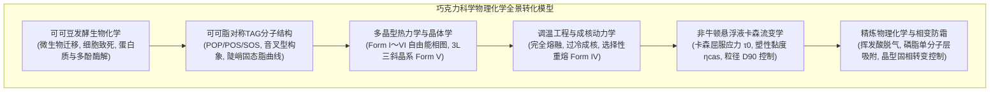
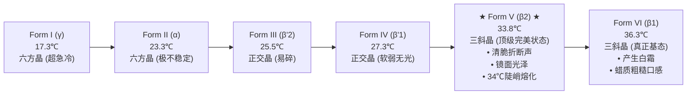
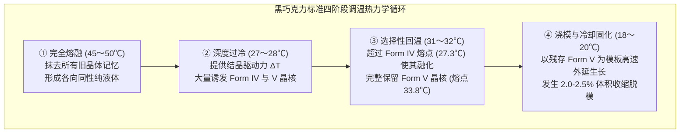

高品质巧克力所具备的清脆折断声（Snap）、如镜面般的诱人光泽以及入口即化、瞬间释放芳香物质的奢华触感，是食品科学领域中最精密复杂的固体分散系物理体系之一。

巧克力连续相的核心基质是可可脂（Cocoa Butter）。它主要由独特的对称单不饱和三酰甘油（TAG）构成，呈现出典型的<strong>多晶型现象（Polymorphism）</strong>，能够结晶为六种截然不同的晶体排列构型（<strong>Form I 至 Form VI</strong>）。其中，仅有热力学亚稳态的 <strong>Form V（$\beta_2$ 型）</strong> 拥有恰好低于人体体温的 33.8°C 熔点，同时兼具卓越的硬度、致密收缩性与光学反射率。

---

### 1. 可可植物形态学与发酵生物工程

#### 1.1 可可果解剖学与子叶生化组成
可可树（*Theobroma cacao*）具有罕见的老茎生花结实特性（Cauliflory）。其果实（可可荚）包含：
1. <strong>外壳（Pod Husk）</strong>：厚达1~2 cm的高度木质化纤维保护层；
2. <strong>白色果肉（Pulp / Mucilage）</strong>：紧密包裹种子的海绵状水凝胶，含水率80~85%，含10~15%还原糖与蔗糖，以及高浓度柠檬酸（pH 3.3~3.8）；
3. <strong>可可豆（Cotyledons / 子叶）</strong>：每荚含有30~50粒。干重中含 <strong>50~55% 可可脂</strong>、<strong>10~15% 储藏蛋白</strong>、<strong>6~8% 多酚</strong>（主要是表儿茶素与原花青素）及 <strong>1.5~3% 可可碱</strong>。

#### 1.2 发酵动力学：微生物群落演替与风味前体生成
在发酵箱中历时5~7天的固相发酵遵循严格的生态演替：
1. <strong>酵母菌主导的厌氧酒精发酵（0~48小时）</strong>：降解果肉糖分生成乙醇与 $\text{CO}_2$，果胶酶液化果肉并排泄出汁液；
2. <strong>乳酸菌微好氧发酵（24~72小时）</strong>：产生乳酸；
3. <strong>醋酸菌好氧发酵（48~120小时）</strong>：剧烈放热氧化乙醇：
   $$\text{C}_2\text{H}_5\text{OH} + \text{O}_2 \longrightarrow \text{CH}_3\text{COOH} + \text{H}_2\text{O} \quad (\Delta H = -493\text{ kJ/mol})$$
   堆温骤升至 48~52°C，醋酸穿透种皮使子叶酸化（pH从6.5骤降至4.8~5.0），导致<strong>种子细胞热/酸致死</strong>。

细胞膜解体引发内源酶级联激活：
- <strong>天冬氨酸内肽酶与羧肽酶</strong>将储藏球蛋白水解为疏水性游离氨基酸（亮氨酸、苯丙氨酸等）和低聚肽；
- <strong>多酚氧化酶（PPO）</strong>将苦涩的表儿茶素氧化聚合成大分子棕褐色鞣质，降低粗糙涩味。
这些产物正是后续焙炒中发生美拉德反应的绝对前体。

---

### 2. 可可脂分子生物化学：对称三酰甘油（TAG）

可可脂绝非普通植物油，其80%以上由三种高度对称的单不饱和甘油三酯构成：

| 主要TAG成分 | 全称 | 脂肪酸连接位点 ($sn\text{-1, 2, 3}$) | 含量（重量%） | 纯$\beta$晶型熔点 |
| :--- | :--- | :--- | :--- | :--- |
| <strong>POS</strong> | 1-棕榈酰-2-油酰-3-硬脂酰甘油 | 棕榈酸 (16:0) - 油酸 (18:1) - 硬脂酸 (18:0) | <strong>36 〜 42 %</strong> | $35.5^\circ\mathrm{C}$ |
| <strong>SOS</strong> | 1,3-二硬脂酰-2-油酰甘油 | 硬脂酸 (18:0) - 油酸 (18:1) - 硬脂酸 (18:0) | <strong>25 〜 31 %</strong> | $41.5^\circ\mathrm{C}$ |
| <strong>POP</strong> | 1,3-二棕榈酰-2-油酰甘油 | 棕榈酸 (16:0) - 油酸 (18:1) - 棕榈酸 (16:0) | <strong>14 〜 19 %</strong> | $35.2^\circ\mathrm{C}$ |

#### 分子构象与超陡峭熔化曲线
1. <strong>音叉型（Tuning-fork）构型</strong>：$sn\text{-1}$ 与 $sn\text{-3}$ 的饱和脂肪酸呈伸展的全反式直链排列，而中央 $sn\text{-2}$ 位的顺式油酸链呈约120°角折叠弯曲；
2. <strong>极高几何同构性</strong>：POS、SOS与POP的链长几乎一致，分子能像拼图般以极高密度紧密镶嵌最密堆积；
3. <strong>固态脂（SFC）阶跃</strong>：室温（20~25°C）下固体脂含量高达75~85%，呈现坚如磐石的硬脆度；而在30°C至35°C区间内，固体脂急剧骤降至0%。这正是其<strong>手握不溶、入口即化</strong>的物理化学本质。

---

### 3. 多晶型结晶热力学（Polymorphism）

可可脂固态拥有六种多晶型（Wille & Lutton 命名法）：

- <strong>亚晶胞排列（Subcell packing）</strong>：
  - $\alpha$ 型（Form I, II）：碳化氢链自由旋转的六方堆积（XRD单特征峰 $d \approx 4.15\text{ \AA}$）；
  - $\beta'$ 型（Form III, IV）：锯齿平面正交垂直排列（双特征峰 $d \approx 4.20\text{ \AA}$ 与 $3.80\text{ \AA}$）；
  - $\beta$ 型（Form V, VI）：倾斜完全平行的致密三斜堆积（极强单尖锐反射 $d \approx 4.58\text{ \AA}$）。
- <strong>纵向链长堆叠（2L vs 3L）</strong>：Form V 和 VI 展现独特的<strong>三链长（3-Chain length, ~65 Å）</strong>超结构，将庞大的顺式油酸链排斥隔离至独立中央夹层，达到热力学最高分子间范德华引力。
- <strong>奥斯特瓦尔德分步规则（Ostwald's Rule）</strong>：自由熔体在自然冷却时，由于Form II的活化能垒最低，会率先析出低熔点不稳定相。必须通过外加剪切与温度调控（调温），才能直接跨越能垒诱发 Form V 结晶。

---

### 4. 调温工程学：四段温控成核动力学

调温（Tempering）的核心物理目标是：<strong>彻底消除熔体原有的杂乱晶体记忆，在全体系内高密度诱导生成 Form V 晶核（约0.5~1.0%），并热力学彻底熔融消除 Form I~IV 不稳定核</strong>。

根据经典成核理论（CNT）与阿布拉米结晶动力学方程 $\alpha(t) = 1 - \exp(-k_A t^n)$，预先分布的 Form V 种晶使体系越过成核诱导期，直接进入三维高速球晶生长（$n \approx 3$）。结晶伴随 <strong>2.0~2.5% 的体积收缩</strong>，使巧克力块从模具内壁自动收缩剥离，实现光洁完美的自发脱模。

---

### 5. 巧克力流变学与卡森塑性流体模型

融化巧克力是由60~70%亲水性微细固体颗粒（蔗糖晶体、可可纤维颗粒）悬浮于连续疏水可可脂油相中构成的超稠固-液分散系，遵循<strong>卡森塑性流体方程（Casson Equation）</strong>：

$$\sqrt{\tau} = \sqrt{\tau_0} + \sqrt{\eta_{\text{cas}} \dot{\gamma}}$$

- $\tau_0$ 为<strong>卡森屈服应力（Casson Yield Stress）</strong>：启动流动的最小应力门槛。屈服应力过高会导致气泡无法排出、模具细节无法填满；过低会导致涂层（Enrobing）挂浆过薄流失；
- $\eta_{\text{cas}}$ 为<strong>卡森塑性黏度（Casson Plastic Viscosity）</strong>：高剪切下的流动摩擦阻力，决定管道泵送与吞咽铺展感；
- <strong>触觉神经阈值</strong>：人舌机械受力受体（默克尔细胞）的颗粒分辨极限约为 <strong>$20\sim25\,\mu\text{m}$</strong>。微粉碎精磨必须将颗粒上限 $D_{90}$ 锁定在 <strong>$18\sim22\,\mu\text{m}$</strong>，既避免粗糙砂粒感，又防止比表面积过大引发黏度爆炸。

---

### 6. 精炼物理化学与表面活性剂作用

1. <strong>干式精炼（Dry Conching）</strong>：强机械剪切摩擦产热（60~80°C），强力脱除多余水分（从1.5%脱水至 $<0.5\%$）与挥发性刺激性醋酸，磨圆蔗糖晶体的锋利边缘；
2. <strong>卵磷脂（大豆/向日葵磷脂）的界面化学</strong>：
   添加仅 <strong>0.3~0.5%</strong> 的两亲性大豆磷脂（磷脂酰胆碱）：
   - 极性两性离子头部紧密静电吸附在亲水性蔗糖晶体表面的羟基（$-\text{OH}$）上；
   - 两条疏水脂肪酸尾伸展进入非极性可可脂连续相。
   这使原本亲水的蔗糖表面包裹上亲脂外衣，阻断颗粒间相互团聚。<strong>添加0.4%卵磷脂降低屈服应力的效果，相当于添加3~5%昂贵可可脂</strong>。

---

### 7. 起霜机理（Fat Bloom & Sugar Bloom）

1. <strong>脂霜（Fat Bloom）</strong>：
   热力学亚稳态 Form V 向最稳定基态 <strong>Form VI</strong> 的固相自发转变。当环境经历温度波动（25~30°C）时，低熔点TAG部分融化形成液相，经微孔隙毛细迁移至表面并重新析出，形成大型针状晶体（$>5\,\mu\text{m}$）。因尺寸远超可见光波长而发生强烈光散射，呈现白色粉末状白霜，且熔点升至36.3°C以上，入口味如嚼蜡。
2. <strong>糖霜（Sugar Bloom）</strong>：
   冷凝水滴附着表面溶解蔗糖形成高浓度糖液，水分再次蒸发后析出粗大不规则糖结晶，触感粗糙不溶于油。
