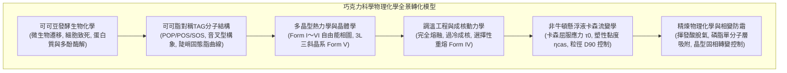
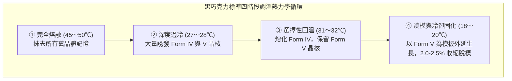

高質量巧克力所具備的清脆折斷聲（Snap）、如鏡面般的誘人光澤以及入口即化、瞬間釋放芳香物質的奢華觸感，是食品科學領域中最精密複雜的固體分散系物理體系之一。

巧克力連續相的核心基質是可可脂（Cocoa Butter）。它主要由獨特的對稱單不飽和三酰甘油（TAG）構成，呈現典型的<strong>多晶型現象（Polymorphism）</strong>，能夠結晶為六種截然不同的晶體排列構型（<strong>Form I 至 Form VI</strong>）。其中，僅有熱力學亞穩態的 <strong>Form V（$\beta_2$ 型）</strong> 擁有恰好低於人體體溫的 33.8°C 熔點，同時兼具卓越的硬度、緻密收縮性與光學反射率。

---

### 1. 可可植物形態學與發酵生物工程

#### 1.1 可可果解剖學與子葉生化組成
可可樹（*Theobroma cacao*）具有罕見的老莖生花結實特性（Cauliflory）。其果實（可可莢）包含：
1. <strong>外殼（Pod Husk）</strong>：厚達1~2 cm的高度木質化纖維保護層；
2. <strong>白色果肉（Pulp / Mucilage）</strong>：緊密包裹種子的海綿狀水凝膠，含水率80~85%，含10~15%還原糖與蔗糖，以及高濃度檸檬酸（pH 3.3~3.8）；
3. <strong>可可豆（Cotyledons / 子葉）</strong>：每莢含有30~50粒。乾重中含 <strong>50~55% 可可脂</strong>、<strong>10~15% 儲藏蛋白</strong>、<strong>6~8% 多酚</strong>（主要是表兒茶素與原花青素）及 <strong>1.5~3% 可可鹼</strong>。

#### 1.2 發酵動力學：微生物群落演替與風味前體生成
在發酵箱中歷時5~7天的固相發酵遵循嚴格的生態演替：
1. <strong>酵母菌主導的厭氧酒精發酵（0~48小時）</strong>：降解果肉糖分生成乙醇與 $\text{CO}_2$，果膠酶液化果肉並排泄出汁液；
2. <strong>乳酸菌微好氧發酵（24~72小時）</strong>：產生乳酸；
3. <strong>醋酸菌好氧發酵（48~120小時）</strong>：劇烈放熱氧化乙醇：
   $$\text{C}_2\text{H}_5\text{OH} + \text{O}_2 \longrightarrow \text{CH}_3\text{COOH} + \text{H}_2\text{O} \quad (\Delta H = -493\text{ kJ/mol})$$
   堆溫驟升至 48~52°C，醋酸穿透種皮使子葉酸化（pH從6.5驟降至4.8~5.0），導致<strong>種子細胞熱/酸致死</strong>。

細胞膜解體引發內源酶級聯激活：
- <strong>天冬氨酸內肽酶與羧肽酶</strong>將儲藏球蛋白水解為疏水性游離氨基酸和低聚肽；
- <strong>多酚氧化酶（PPO）</strong>將苦澀的表兒茶素氧化聚合成大分子棕褐色鞣質，降低粗糙澀味。

---

### 2. 可可脂分子生物化學：對稱三酰甘油（TAG）

可可脂80%以上由三種高度對稱的單不飽和甘油三酯構成：

| 主要TAG成分 | 脂肪酸連接位點 ($sn\text{-1, 2, 3}$) | 含量（重量%） | 純$\beta$晶型熔點 |
| :--- | :--- | :--- | :--- |
| <strong>POS</strong> | 棕櫚酸 (16:0) - 油酸 (18:1) - 硬脂酸 (18:0) | <strong>36 〜 42 %</strong> | $35.5^\circ\mathrm{C}$ |
| <strong>SOS</strong> | 硬脂酸 (18:0) - 油酸 (18:1) - 硬脂酸 (18:0) | <strong>25 〜 31 %</strong> | $41.5^\circ\mathrm{C}$ |
| <strong>POP</strong> | 棕櫚酸 (16:0) - 油酸 (18:1) - 棕櫚酸 (16:0) | <strong>14 〜 19 %</strong> | $35.2^\circ\mathrm{C}$ |

- <strong>音叉型構象</strong>：飽和脂肪酸呈伸展全反式直鏈排列，油酸鏈呈120°角折疊；
- <strong>固態脂陡峭熔解曲線</strong>：室溫20~25°C時高達75~85%，30°C至35°C驟降至0%，造就入口即化神經體驗。

---

### 3. 多晶型結晶熱力學（Polymorphism）

可可脂固態擁有六種多晶型（Wille & Lutton 命名法）：
- <strong>Form I ($\gamma, 17.3^\circ\mathrm{C}$)</strong>：極度不穩定六方晶；
- <strong>Form II ($\alpha, 23.3^\circ\mathrm{C}$)</strong>：急冷生成之不穩定六方晶；
- <strong>Form III ($\beta'_2, 25.5^\circ\mathrm{C}$)</strong>：脆性正交晶；
- <strong>Form IV ($\beta'_1, 27.3^\circ\mathrm{C}$)</strong>：軟弱正交晶；
- <strong>Form V ($\beta_2, 33.8^\circ\mathrm{C}$)</strong>：<strong>三斜晶三鏈長超結構，頂級光澤、清脆折斷、體溫即化</strong>；
- <strong>Form VI ($\beta_1, 36.3^\circ\mathrm{C}$)</strong>：真熱力學基態，引起白霜與蠟質沙粒感。

---

### 4. 調溫工程學：四段溫控成核動力學

結晶過程伴隨 <strong>2.0~2.5% 的體積收縮</strong>，使巧克力自模具內壁脫落，實現自發脫模。

---

### 5. 巧克力流變學與卡森塑性流體模型

溶融巧克力是由60~70%親水性微細固體顆粒（蔗糖晶體、可可纖維顆粒）懸浮於連續疏水可可脂油相中構成的超稠固-液分散系，遵循國際巧克力工業標準的<strong>卡森塑性流體方程（Casson Equation）</strong>：

$$\sqrt{\tau} = \sqrt{\tau_0} + \sqrt{\eta_{\text{cas}} \dot{\gamma}}$$

- $\tau$ 為剪切應力（Shear Stress）$[\text{Pa}]$；
- $\dot{\gamma}$ 為剪切速率（Shear Rate）$[\text{s}^{-1}]$；
- $\tau_0$ 為<strong>卡森屈服應力（Casson Yield Stress）</strong>$[\text{Pa}]$：啟動流動的最小應力門檻。屈服應力過高會導致氣泡無法排出、模具細節無法填滿；過低會導致塗層（Enrobing）掛漿過薄流失；
- $\eta_{\text{cas}}$ 為<strong>卡森塑性黏度（Casson Plastic Viscosity）</strong>$[\text{Pa}\cdot\text{s}]$：高剪切下的流動摩擦阻力，決定管道泵送阻力與吞嚥鋪展感；
- <strong>觸覺神經極限</strong>：人舌機械受力受體（默克爾細胞）的顆粒分辨極限約為 <strong>$20\sim25\,\mu\text{m}$</strong>。微粉碎精磨必須將顆粒上限 $D_{90}$ 嚴格鎖定在 <strong>$18\sim22\,\mu\text{m}$</strong>，既避免粗糙砂粒感，又防止比表面積過大引發黏度劇增。

---

### 6. 精煉物理化學與界面活性劑機制

1. <strong>乾式精煉（Dry Conching）</strong>：強機械剪切摩擦產熱（60~80°C），強烈脫除多餘水分（從1.5%脫水至 $<0.5\%$）與揮發性刺激性醋酸，磨圓蔗糖晶體的鋒利邊緣；
2. <strong>卵磷脂（大豆/向日葵磷脂）的界面化學</strong>：
   添加僅 <strong>0.3~0.5%</strong> 的兩親性大豆磷脂（磷脂酰膽鹼）：
   - 極性兩性離子頭部緊密靜電吸附在親水性蔗糖晶體表面的羥基（$-\text{OH}$）上；
   - 兩條疏水脂肪酸尾伸展進入非極性可可脂連續相。
   這使原本親水的蔗糖表面包裹上親脂外衣，阻斷顆粒間相互團聚。<strong>添加0.4%卵磷脂降低屈服應力的效果，相當於添加3~5%昂貴可可脂</strong>。

---

### 7. 起霜機理（Fat Bloom & Sugar Bloom）與奈米晶體控制

1. <strong>脂霜（Fat Bloom）</strong>：
   熱力學亞穩態 Form V 向最穩定基態 <strong>Form VI</strong> 的固相自發轉變。當環境經歷溫度波動（25~30°C）時，低熔點TAG部分融化形成液相，經微孔隙毛細遷移至表面並重新析出，形成大型針狀晶體（$>5\,\mu\text{m}$）。因尺寸遠超可見光波長而發生強烈光散射，呈現白色粉末狀白霜，且熔點升至36.3°C以上，入口味如嚼蠟。
2. <strong>糖霜（Sugar Bloom）</strong>：
   冷凝水滴附著表面溶解蔗糖形成高濃度糖液，水分再次蒸發後析出粗大不規則糖結晶，觸感粗糙不溶於油。
3. <strong>晶種添加法（Seeding Technique）</strong>：
   現代先進化工廠將預先培育好的 Form V 奈米晶體（0.1~0.2%）直接注入32°C的巧克力液中，誘導整體均勻外延生長，省去傳統複雜升降溫能耗，徹底規避起霜缺陷。

