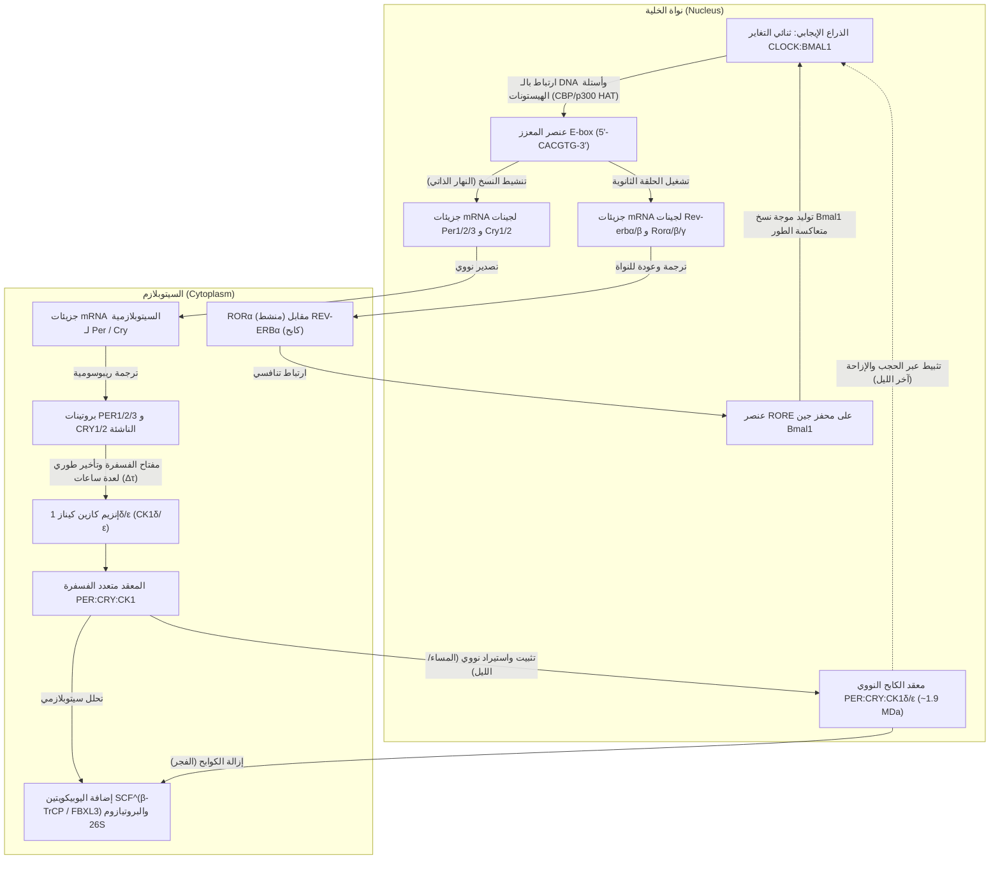
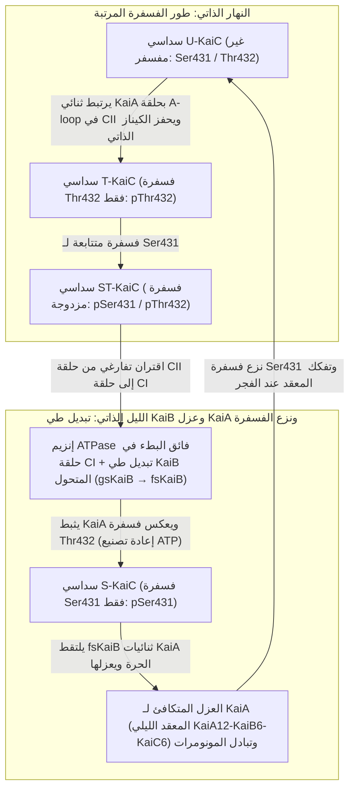

إذا وُضع إنسان أو نبات أو ذبابة فاكهة أو مزرعة من البكتيريا التي تقوم بالتمثيل الضوئي في كهف عميق تحت الأرض أو في غرفة مظلمة معزولة تماماً عن ضوء الشمس وتقلبات درجات الحرارة الخارجية، فهل يفقد الكائن الحي إحساسه بالليل والنهار؟

من المثير للدهشة أن الإجابة هي لا. فحتى في ظروف <strong>الظلام الدامس المستمر (Constant Darkness, DD)</strong>، تحافظ جميع الكائنات الحية تقريباً على سطح الأرض — بدءاً من البكتيريا الزرقاء وحيدة الخلية والفطريات وصولاً إلى النباتات والحشرات والثدييات — على <strong>تذبذب ذاتي بدورة تقارب 24 ساعة</strong>. تخضع دورات النوم والاستيقاظ، وتقلبات درجة حرارة الجسم الأساسية، وإفراز هرموني الكورتيزول والميلاتونين، وضغط الدم، والمراقبة المناعية، والتعبير الجيني لنحو 10% إلى 40% من الجينوم، لسيطرة نواسات جزيئية دقيقة تعمل داخل كل خلية.

غير أنه من منظور الفيزياء الكيميائية والديناميكا غير الخطية، تنطوي هذه الساعة الخلوية على ثلاث مفارقات علمية عميقة:

1. <strong>مفارقة المقياس الزمني والاستقرار (الديناميكا غير الخطية)</strong>: تحدث التفاعلات الكيميائية الحيوية الأولية (ارتباط عوامل النسخ، والترجمة، والفسفرة) خلال أجزاء من الثانية إلى دقائق. علاوة على ذلك، فإن أي حلقة تغذية راجعة سلبية بسيطة ذات متغيرين تتخامد حتماً وتستقر عند نقطة توازن ثابتة. كيف تتمكن شبكة جزيئية عبر <strong>تشعب هوبف (Hopf Bifurcation)</strong> من توليد <strong>تذبذب دورة حدية مستدام ذاتياً (Limit-Cycle Oscillation)</strong> يمتد زمنه الدوري إلى $86,400\text{ ثانية}$ ($24\text{ ساعة}$)؟
2. <strong>عقيدة النسخ الجيني مقابل الساعات البروتينية النقية (البيولوجيا الجزيئية والبنيوية)</strong>: لعقود طويلة، اعتقد علماء البيولوجيا الزمنية أن جميع الإيقاعات اليومية تتطلب <strong>حلقة تغذية راجعة للنسخ والترجمة (TTFL)</strong> تعتمد على الحمض النووي DNA وmRNA. لكن في عام 2005، حطّم <strong>تاكاو كوندو (Takao Kondo)</strong> و<strong>ماساهيرو إيشيورا (Masahiro Ishiura)</strong> هذه العقيدة بإثبات أن خلط <strong>ثلاثة بروتينات منقاة فقط من البكتيريا الزرقاء (KaiA وKaiB وKaiC) مع جزيئات ATP في أنبوب اختبار</strong> — <strong>بغياب تام للـ DNA والـ mRNA والريبوسومات</strong> — ينتج دورة فسفرة مستقرة مدتها 24 ساعة تستمر لأيام!
3. <strong>اللغز الفيزيائي الحيوي لتعويض درجة الحرارة ($Q_{10} \approx 1.0$)</strong>: تخضع معدلات التفاعلات الكيميائية والإنزيمية العادية <strong>لمعادلة أرهينيوس (Arrhenius Equation)</strong> $k(T) = A \exp(-E_a / RT)$، حيث تتضاعف سرعتها مرتين إلى ثلاث مرات لكل ارتفاع في درجة الحرارة بمقدار $10^\circ\text{C}$ ($Q_{10} \approx 2\text{–}3$). لو كانت الساعة البيولوجية تتبع حركية أرهينيوس المعتادة، لأسرعت بأكثر من الضعف في يوم حار ولأصبحت عديمة الجدوى كأداة لقياس الوقت. كيف تحقق الساعات البيولوجية معامل درجة حرارة ثابتاً يبلغ <strong>$Q_{10} \approx 0.95\text{–}1.05$</strong>؟

---

## 1. من تجربة نبات الميموزا (1729) إلى طفرات ذبابة الفاكهة وجائزة نوبل 2017

في عام 1729، وضع عالم الفلك الفرنسي <strong>جان جاك دورتوس دي ميران (Jean-Jacques d'Ortous de Mairan)</strong> نبات الميموزا الحساس (<strong>*Mimosa pudica</strong>*) داخل قبو نبيذ في <strong>ظلام دامس مستمر (DD)</strong>، فلاحظ أن أوراقه استمرت في الانبساط كل صباح والانطواء كل مساء دون رؤية الشمس. وفي عام 1832، أثبت عالم النبات السويسري <strong>أوغستين بيراموس دي كاندول</strong> أن هذه الدورة تتكرر في الظروف الثابتة بـ <strong>فترة جريان حر (Free-Running Period) تبلغ $\tau \approx 22\text{–}23\,\text{ساعة}$</strong>.

في غياب المؤقتات الخارجية (<strong>Zeitgebers</strong>)، يُظهر كل كائن فترته الداخلية الخاصة $\tau$: الفأر $\tau \approx 23.5\,\text{ساعة}$، ذبابة الفاكهة $\tau \approx 23.8\,\text{ساعة}$، و<strong>الإنسان $\tau \approx 24.18\,\text{ساعة}$</strong> ($24\text{ ساعة و}11\text{ دقيقة}$، كما قاسها تشارلز تشيسلر عام 1999). إن انحراف $\tau$ الطفيف عن 24.00 ساعة يثبت أن المذبذب <strong>داخلي المنشأ (Endogenous)</strong>، وقد أطلق عليه <strong>فرانز هالبيرغ</strong> عام 1959 مصطلح <strong>الإيقاع اليومي (Circadian Rhythm)</strong>.

وفي عام 1971، اكتشف <strong>رونالد كونوبكا</strong> و<strong>سيمور بنزر</strong> (معهد كالتك) ثلاث طفرات في جين واحد على الكروموسوم X في ذبابة الفاكهة أطلقا عليه اسم <strong>`period` ($per$)</strong>: الطفرة اللانظمية <strong>$per^0$</strong>، وطفرة الدورة القصيرة <strong>$per^S$</strong> ($\tau \approx 19\,\text{ساعة}$)، وطفرة الدورة الطويلة <strong>$per^L$</strong> ($\tau \approx 29\,\text{ساعة}$). وفي عام 1984، نجح <strong>جيفري هول</strong> و<strong>مايكل روسباش</strong> و<strong>مايكل يونغ</strong> في استنساخ جين `period` وكشف آلية التغذية الراجعة السلبية، فنالوا <strong>جائزة نوبل في الفسيولوجيا أو الطب لعام 2017</strong>.

---

## 2. حلقة التغذية الراجعة للنسخ والترجمة (TTFL) في حقيقيات النوى

في الثدييات، يرتبط المعقد <strong>CLOCK:BMAL1</strong> بتسلسلات <strong>E-box (`5'-CACGTG-3'`)</strong> لتنشيط نسخ جينات <strong>`Per1/2/3`</strong> و<strong>`Cry1/2`</strong>. في السيتوبلازم، تتم فسفرة بروتينات PER بواسطة إنزيم <strong>كازين كيناز $1\delta/\varepsilon$ (CK1$\delta/\varepsilon$)</strong> وتحللها عبر <strong>$\text{SCF}^{\beta\text{-TrCP}}$</strong>. وبعد <strong>تأخير طوري ($\Delta\tau$) من 4 إلى 6 ساعات</strong>، تدخل معقدات <strong>PER:CRY:CK1$\delta/\varepsilon$</strong> ($\sim 1.9\,\text{MDa}$) إلى النواة وتثبط CLOCK:BMAL1 عبر آليتي <strong>الحجب (Blocking)</strong> بواسطة CRY1 و<strong>الإزاحة عن الـ DNA (Displacement)</strong> عبر فسفرة CLOCK، مع استقرار النظام بفضل الحلقة الثانوية <strong>REV-ERB$\alpha/\beta$ / ROR$\alpha/\beta/\gamma$</strong> على عناصر <strong>RORE</strong>.

في البشر، تؤدي طفرة <strong>Ser662Gly في جين `PER2`</strong> (أو <strong>Thr44Ala في `CSNK1D`/CK1$\delta$</strong>) إلى تعطيل الفسفرة المثبتة في منطقة FASP، مما يسرع تحلل PER2 ويقصر الدورة إلى $\tau \approx 21.6\,\text{ساعة}$ مسبباً <strong>متلازمة تقدم طور النوم العائلية (FASPS)</strong> حيث ينام المصابون في السابعة مساءً <strong>ويستيقظون تماماً في الثالثة فجراً</strong>! وعلى العكس، تطيل طفرة $\text{CRY1}\,\Delta 11$ الدورة مسببة متلازمة تأخر طور النوم (FDSPS).

---

## 3. البيولوجيا الرياضية للمذبذبات الجينية: نموذج غودوين-غولدبيتر وتشعب هوبف

في نظام تغذية راجعة سلبية ثنائي المتغيرات بدون تأخير زمني ($\dot{M} = f(P) - \gamma_M M,\; \dot{P} = k_s M - \gamma_P P$ مع $f'(P) < 0$)، يكون تباعد حقل المتجهات سالباً دائماً:

$$\nabla \cdot \mathbf{F} = \frac{\partial \dot{M}}{\partial M} + \frac{\partial \dot{P}}{\partial P} = -\gamma_M - \gamma_P < 0$$

وبموجب <strong>معيار بنديكسون السلبي (Bendixson's Negative Criterion)</strong>، يستحيل رياضياً وجود مدار دوري مغلق (دورة حدية). ولعبور <strong>تشعب هوبف (Hopf Bifurcation)</strong>، صاغ <strong>برايان غودوين (1965)</strong> و<strong>ألبير غولدبيتر (1995)</strong> نموذج المعادلات التفاضلية الثلاثي ($M$، البروتين السيتوبلازمي $P_C$، البروتين النووي $P_N$):

$$\frac{dM}{dt} = \frac{v_s K_I^n}{K_I^n + P_N^n} - v_m \frac{M}{K_m + M}, \qquad \frac{dP_C}{dt} = k_s M - v_d \frac{P_C}{K_d + P_C} - k_1 P_C + k_2 P_N, \qquad \frac{dP_N}{dt} = k_1 P_C - k_2 P_N$$

يتطلب تذبذب الدورة الحدية <strong>ثلاثة شروط رياضية</strong>: (1) <strong>تغذية راجعة سلبية</strong>، (2) <strong>تأخير طوري كافٍ $\Delta\tau$</strong> (إزاحة طورية بمقدار $180^\circ$)، و(3) <strong>لاخطية قوية / حساسية فائقة (Ultrasensitivity)</strong>. في نموذج غودوين ذي التحلل الخطي، تفرض مبرهنة غريفيث (1968) <strong>معامل هيل $n > \sec^3(\pi/3) = 8$</strong>. وتتجاوز الساعات الحيوية هذا الحاجز عبر <strong>إشباع ميكايليس-مينتن الإنزيمي (الحساسية الفائقة من الرتبة صفر، $K_d \ll P_C$، غولدبيتر 1995)</strong> و<strong>المعايرة الجزيئية / العزل المتكافئ 1:1 لمعقد CLOCK:BMAL1 بواسطة PER:CRY (Kim & Forger, 2012)</strong>، مما يولد عتبة لاخطية حادة حتى عند $n = 1$.

---

## 4. اكتشاف تاكاو كوندو وماساهيرو إيشيورا المذهل (2005): ساعة البروتين KaiABC في أنبوب اختبار

في عام 2005، أثبت <strong>ماساتو ناكاجيما</strong> و<strong>تاكاو كوندو</strong> وزملاؤهم (*Science*, 2005) في البكتيريا الزرقاء *Synechococcus elongatus* PCC 7942 أن خلط <strong>ثلاثة بروتينات منقاة فقط (KaiA وKaiB وKaiC) مع ATP</strong> في أنبوب اختبار — بدون DNA أو mRNA — يعيد تكوين تذبذب فسفرة لمدة 24 ساعة معوض حرارياً (<strong>مذبذب ما بعد الترجمة، PTO</strong>).

يُعد سداسي <strong>KaiC</strong> ذو الحلقتين (CI وCII) أبطأ إنزيم ATPase معروف في الطبيعة، إذ يحلل فقط <strong>$\sim 15\text{ جزيء ATP لكل مونومر في اليوم}$</strong>. نهاراً، يحفز <strong>KaiA</strong> الفسفرة الذاتية المرتبة للموقعين <strong>Thr432 (T)</strong> و<strong>Ser431 (S)</strong> ($\text{U} \to \text{T} \to \text{ST}$). وتؤدي فسفرة Ser431 تفارغياً إلى تحفيز تحلل ATP في حلقة CI، حيث يخضع <strong>البروتين المتحول KaiB</strong> لتبديل جذري في طيه ثلاثي الأبعاد (<strong>gsKaiB $\to$ fsKaiB</strong> الشبيه بالثيوريدوكسين)، فيرتبط بحلقة CI و<strong>يعزل كل جزيئات KaiA الحرة</strong> داخل المعقد الليلي $\text{KaiA}_{12}\text{KaiB}_6\text{KaiC}_6$. وعندئذٍ ينزع KaiC الفسفرة عبر إعادة تصنيع ATP من ADP ($\text{ST} \to \text{S} \to \text{U}$) مع مزامنة الجزيئات عبر <strong>تبادل المونومرات (monomer shuffling)</strong>.

| الخاصية | ساعات حقيقيات النوى (الثدييات، الحشرات، النباتات، الفطريات) | الساعة الأساسية للبكتيريا الزرقاء (نظام KaiABC) |
| :--- | :--- | :--- |
| <strong>بنية المذبذب</strong> | <strong>حلقة النسخ والترجمة (TTFL)</strong> | <strong>مذبذب ما بعد الترجمة (PTO)</strong> (مقترن بـ TTFL داخل الخلية) |
| <strong>إعادة التكوين في الأنبوب</strong> | مستحيلة بدون نواة وريبوسومات وبروتيازوم | <strong>كاملة</strong> باستخدام <strong>KaiA + KaiB + KaiC + ATP + $\text{Mg}^{2+}$</strong> |
| <strong>العنصر الإيجابي</strong> | عوامل النسخ (<strong>CLOCK:BMAL1</strong>, CLK:CYC, WC-1:WC-2) | <strong>ثنائي KaiA</strong> (يرتبط بـ A-loop في CII ويحفز الكيناز الذاتي) |
| <strong>العنصر السلبي</strong> | معقدات الكبح (<strong>PER:CRY</strong>, PER:TIM, FRQ) + <strong>CK1$\delta/\varepsilon$</strong> | <strong>KaiB المتحول (fsKaiB)</strong> عبر <strong>العزل المتكافئ لـ KaiA</strong> |
| <strong>مصدر التأخير $\Delta\tau$</strong> | النسخ، الترجمة، فسفرة CK1، الاستيراد النووي | <strong>إنزيم ATPase فائق البطء ($\sim 15\,\text{ATP/يوم}$)</strong> + <strong>تبديل طي KaiB</strong> |
| <strong>تعويض الحرارة ($Q_{10}$)</strong> | $Q_{10} \approx 0.95\text{–}1.05$ (التثبيط الذاتي لـ CK1$\delta/\varepsilon$ ومفتاح PER2) | $Q_{10} \approx 1.0$ (التفارغ البنيوي الذاتي لإنزيم KaiC ATPase) |

---

## 5. حل لغز تعويض درجة الحرارة ($Q_{10} \approx 1.0$)

بينما تفرض <strong>معادلة أرهينيوس</strong> $k(T) = A \exp(-E_a / RT)$ معامل $Q_{10} = \frac{k(T+10)}{k(T)} \approx 2\text{–}3$ على التفاعلات العادية، تحقق الساعات البيولوجية $Q_{10} \approx 1.0$ عبر آليتين:

1. <strong>التوازن المتضاد لبيتر روف (Peter Ruoff, 1992)</strong>:
   بدلالة معاملات التحكم في الدور $C_i^\tau = \frac{\partial \ln \tau}{\partial \ln k_i}$ ($\sum_i C_i^\tau = -1$) وطاقات التنشيط $E_{a,i}$:
   $$\frac{d \ln \tau}{d T} = \sum_{i=1}^{N} \frac{\partial \ln \tau}{\partial \ln k_i} \frac{d \ln k_i}{d T} = \frac{1}{R T^2} \sum_{i=1}^{N} C_i^{\tau} E_{a,i} \approx 0$$
   تتعادل التفاعلات المقصرة للدورة ($C_i^\tau < 0$) مع التفاعلات المتضادة المطيلة للدورة ($C_j^\tau > 0$).
2. <strong>التعويض الذاتي داخل إنزيمي CK1$\delta/\varepsilon$ وKaiC</strong>:
   أثبت <strong>Terauchi & Kondo (2007)</strong> أن نشاط ATPase الأساسي لبروتين KaiC وحده يمتلك $Q_{10} \approx 1.0$. كما اكتشف <strong>ياسوشي إيسوجيما ويوسوكي شينوهارا وهيروكي أويدا (2009، 2017)</strong> أن فسفرة PER2 بواسطة <strong>CK1$\delta/\varepsilon$</strong> في أنبوب الاختبار معوضة حرارياً ($Q_{10} \approx 1.0$)؛ إذ يقابل التسارع التحفيزي عند الحرارة المرتفعة زيادة في ألفة الإنزيم للناتج المفسفر (تثبيط بالناتج عبر الجيب الأنيوني Lys224) مما يبطئ إطلاقه.

---

## 6. النواة فوق التصالبية (SCN) والميلانوبسين والطب الزمني (Chronomedicine)

لمزامنة ساعة الإنسان ($\tau \approx 24.18\,\text{ساعة}$) مع اليوم الشمسي البالغ 24.00 ساعة، تعبر 1–2% من خلايا الشبكية العقدية (<strong>ipRGCs</strong>) عن صبغة <strong>الميلانوبسين (Melanopsin / OPN4)</strong> الحساسة <strong>للضوء الأزرق ($\lambda_{\text{max}} \approx 480\,\text{nm}$)</strong>. وعبر المسار الشبكي الوطائي (RHT)، يُفرز الغلوتامات وPACAP في <strong>النواة فوق التصالبية (SCN)</strong>، مما يفسفر <strong>CREB</strong> ويحفز نسخ <strong>*Per1/2</strong>* الفوري وفق <strong>منحنى استجابة الطور (PRC)</strong>: تأخير الطور أول الليل وتقديمه عند الفجر.

في النواة SCN، يشكل نحو <strong>20,000 عصبون</strong> مترابط عبر <strong>VIP</strong> و<strong>AVP</strong> و<strong>GABA</strong> شبكة مذبذبات كوراموتو متزامنة. وينشأ <strong>اضطراب الرحلات الجوية الطويلة (Jet Lag)</strong> من <strong>انعدام التزامن الداخلي</strong> بين النواة SCN (التي تتكيف سريعاً بالضوء) والساعات الطرفية (في الكبد والأمعاء) التي تتبع مواعيد الطعام. وفي <strong>الطب الزمني (Chronomedicine)</strong>، يؤدي تناول أدوية الستاتين قصيرة العمر قبل النوم، والعلاج الكيميائي الموجه زمنياً (5-FU وأوكساليبلاتين وفق فرانسيس ليفي)، و<strong>إعطاء العلاج المناعي للسرطان (مثبطات نقاط التفتيش المضادة لـ PD-1 مثل بيمبروليزوماب ونيفولوماب) في الصباح بدلاً من المساء إلى مضاعفة معدلات البقاء على قيد الحياة تقريباً لدى مرضى الميلانوما وسرطان الرئة</strong> (*Qian et al., Lancet Oncology, 2021*).
