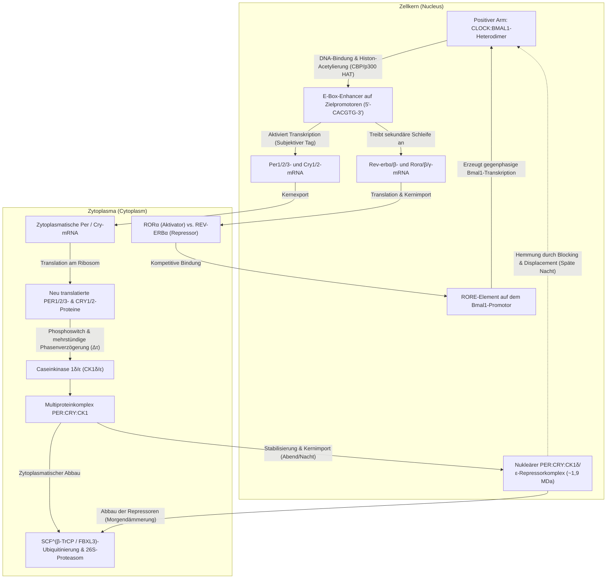
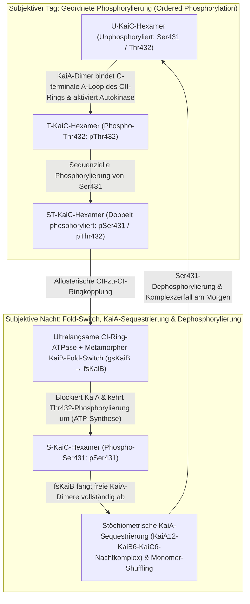

Wenn ein Mensch, eine Pflanze, eine Fruchtfliege oder eine Kultur photosynthetischer Bakterien in einer tiefen unterirdischen Höhle oder einem fensterlosen Bunker vollständig von Sonnenlicht und äußeren Temperaturschwankungen isoliert wird – verliert der Organismus dann das Gefühl für Tag und Nacht?

Überraschenderweise lautet die Antwort Nein. Selbst unter Bedingungen <strong>konstanter Dunkelheit (Constant Darkness, DD)</strong> halten fast alle Lebewesen auf der Erde – von einzelligen Cyanobakterien und Pilzen über Pflanzen und Insekten bis hin zum Menschen – einen <strong>autonomen Rhythmus von etwa 24 Stunden</strong> aufrecht. Schlaf-Wach-Zyklen, Schwankungen der Körperkerntemperatur, die Ausschüttung von Cortisol und Melatonin, Blutdruck, Immunüberwachung sowie die Transkription von 10 % bis 40 % aller proteincodierenden Gene werden durch molekulare Pendel im Inneren jeder einzelnen Zelle präzise gesteuert.

Aus Sicht der chemischen Physik und der nichtlinearen Dynamik birgt diese intrazelluläre Uhr jedoch drei tiefgreifende wissenschaftliche Paradoxa:

1. <strong>Das Zeitskalen- und Stabilitätsparadoxon (Nichtlineare Dynamik)</strong>: Elementare biochemische Reaktionen (Transkriptionsfaktorbindung, Translation, Phosphorylierung) laufen innerhalb von Millisekunden bis Minuten ab. Zudem dämpfen einfache negative Rückkopplungsschleifen mit zwei Variablen unweigerlich aus und konvergieren gegen einen statischen Gleichgewichtspunkt. Wie erzeugt ein molekulares Netzwerk über eine <strong>Hopf-Bifurkation</strong> eine ungedämpfte <strong>Grenzzyklus-Oszillation (Limit-Cycle Oscillation)</strong> mit einer Periode von $86.400\text{ Sekunden}$ ($24\text{ Stunden}$)?
2. <strong>Das Dogma der Gentranskription vs. reine Proteinuhren (Molekular- und Strukturbiologie)</strong>: Jahrzehntelang galt als sicher, dass jede circadiane Uhr auf einer <strong>transkriptionell-translatorischen Rückkopplungsschleife (TTFL)</strong> beruht, die DNA und mRNA benötigt. Im Jahr 2005 erschütterten <strong>Takao Kondo</strong> und <strong>Masahiro Ishiura</strong> dieses Dogma: Sie mischten lediglich <strong>drei gereinigte Proteine aus Cyanobakterien (KaiA, KaiB und KaiC) sowie ATP in einem Reagenzglas</strong> – <strong>ohne jede DNA, ohne mRNA und ohne Ribosomen</strong> – und erzeugten eine hochpräzise 24-Stunden-Phosphorylierungsoszillation, die tagelang anhielt!
3. <strong>Das biophysikalische Rätsel der Temperaturkompensation ($Q_{10} \approx 1{,}0$)</strong>: Normale chemische und enzymatische Reaktionsgeschwindigkeiten folgen der <strong>Arrhenius-Gleichung</strong> $k(T) = A \exp(-E_a / RT)$ und beschleunigen sich bei jedem Temperaturanstieg um $10^\circ\text{C}$ auf das Zwei- bis Dreifache ($Q_{10} \approx 2\text{–}3$). Würde die innere Uhr der normalen Arrhenius-Kinetik folgen, liefe sie an einem warmen Tag mehr als doppelt so schnell und wäre als Zeitmesser völlig unbrauchbar. Wie erreichen biologische Uhren einen nahezu temperaturinvarianten Temperaturkoeffizienten von <strong>$Q_{10} \approx 0{,}95\text{–}1{,}05$</strong>?

---

## 1. Die Entdeckung der endogenen Zeit: Von *Mimosa pudica* (1729) zum Nobelpreis 2017

Im Jahr 1729 stellte der französische Astronom <strong>Jean-Jacques d'Ortous de Mairan</strong> die Sinnpflanze <strong>*Mimosa pudica</strong>*, die tagsüber ihre Blätter entfaltet und nachts zusammenfaltet, in einen völlig dunklen Weinkeller (<strong>DD</strong>). Trotz völliger Abwesenheit von Sonnenlicht öffnete und schloss die Pflanze ihre Blätter weiterhin im Tagesrhythmus. 1832 zeigte der Schweizer Botaniker <strong>Augustin Pyramus de Candolle</strong>, dass diese Bewegung unter konstanten Bedingungen nicht exakt alle 24,0 Stunden, sondern mit einer <strong>Freilaufperiode (Free-Running Period) $\tau \approx 22\text{–}23\,\text{h}$</strong> abläuft.

Ohne äußere <strong>Zeitgeber</strong> (wie Licht-Dunkel-Zyklen) zeigen alle Organismen ihre genetisch festgelegte Eigenperiode $\tau$: Mäuse $\tau \approx 23{,}5\,\text{h}$, die Taufliege *Drosophila melanogaster* $\tau \approx 23{,}8\,\text{h}$ und der Mensch <strong>$\tau \approx 24{,}18\,\text{h}$</strong> ($24\text{ h } 11\text{ min}$, 1999 von Charles Czeisler präzise bestimmt). Da $\tau$ leicht von exakt 24,00 Stunden abweicht, muss der Oszillator endogen in der Zelle verankert sein. 1959 prägte <strong>Franz Halberg</strong> hierfür den Begriff <strong>circadian</strong> (von lateinisch *circa* „ungefähr“ und *dies* „Tag“).

1971 gelang <strong>Ronald Konopka</strong> und <strong>Seymour Benzer</strong> am Caltech der Durchbruch zur Genetik der inneren Uhr: Durch EMS-Mutagenese bei *Drosophila melanogaster* entdeckten sie drei Allele eines einzigen Gens auf dem X-Chromosom, das sie <strong>`period` ($per$)</strong> nannten: <strong>$per^0$</strong> (arrhythmisch), <strong>$per^S$</strong> (verkürzte Periode $\tau \approx 19\,\text{h}$) und <strong>$per^L$</strong> (verlängerte Periode $\tau \approx 29\,\text{h}$). Für die Klonierung von `period` (1984) und die Aufklärung des molekularen Uhrwerks erhielten <strong>Jeffrey C. Hall</strong>, <strong>Michael Rosbash</strong> und <strong>Michael W. Young</strong> den <strong>Nobelpreis für Physiologie oder Medizin 2017</strong>.

---

## 2. Die eukaryotische transkriptionell-translatorische Rückkopplungsschleife (TTFL)

In Säugetieren bilden die bHLH-PAS-Transkriptionsfaktoren <strong>CLOCK</strong> und <strong>BMAL1</strong> ein Heterodimer, das an <strong>E-Box-Sequenzen (`5'-CACGTG-3'`)</strong> bindet und die Transkription der Gene <strong>`Per1/2/3` (Period)</strong> und <strong>`Cry1/2` (Cryptochrome)</strong> aktiviert. Im Zytoplasma werden monomere PER-Proteine durch die <strong>Caseinkinase $1\delta/\varepsilon$ (CK1$\delta/\varepsilon$)</strong> phosphoryliert und über die E3-Ubiquitin-Ligase <strong>$\text{SCF}^{\beta\text{-TrCP}}$</strong> rasch im 26S-Proteasom abgebaut. Erst nach einer <strong>Phasenverzögerung ($\Delta\tau$) von 4 bis 6 Stunden</strong> akkumulieren stabile <strong>PER:CRY:CK1$\delta/\varepsilon$-Komplexe</strong> ($\sim 1{,}9\,\text{MDa}$), wandern in den Zellkern und hemmen CLOCK:BMAL1 zweistufig durch <strong>Blocking</strong> (CRY1 blockiert die CBP/p300-Bindung) und <strong>Displacement</strong> (CK1$\delta/\varepsilon$ phosphoryliert CLOCK und löst den Komplex von der DNA). Eine gekoppelte Sekundärschleife aus <strong>REV-ERB$\alpha/\beta$</strong> (Repressor) und <strong>ROR$\alpha/\beta/\gamma$</strong> (Aktivator) an <strong>RORE-Elementen</strong> des *Bmal1*-Promotors stabilisiert die Oszillation.

Beim Menschen führt eine Punktmutation im <strong>`PER2`-Gen (Ser662Gly)</strong> oder in <strong>`CSNK1D` (CK1$\delta$-Thr44Ala)</strong> zum <strong>Familiären Vorverlagerten Schlafphasensyndrom (FASPS)</strong>: Weil die stabilisierende FASP-Phosphorylierung entfällt, wird PER2 über die Ser478-Degron-Stelle vorzeitig abgebaut. Die Periode verkürzt sich auf $\tau \approx 21{,}6\,\text{h}$, sodass Betroffene abends gegen 19 Uhr einschlafen und <strong>morgens um 3:00 Uhr hellwach sind</strong>! Umgekehrt verlängert die Mutation $\text{CRY1}\,\Delta 11$ die Repression und verursacht das <strong>Verzögerte Schlafphasensyndrom (FDSPS)</strong>.

---

## 3. Mathematische Biologie genetischer Oszillatoren: Goodwin-Modell, Goldbeter-Gleichungen und Hopf-Bifurkation

Warum kann eine einfache Rückkopplungsschleife aus zwei Variablen (mRNA $M$ und Protein $P$) ohne Zeitverzögerung niemals dauerhaft schwingen? Für das zweidimensionale System $\dot{M} = f(P) - \gamma_M M,\; \dot{P} = k_s M - \gamma_P P$ mit $f'(P) < 0$ ist die Divergenz des Vektorfeldes $\mathbf{F}$ überall strikt negativ:

$$\nabla \cdot \mathbf{F} = \frac{\partial \dot{M}}{\partial M} + \frac{\partial \dot{P}}{\partial P} = -\gamma_M - \gamma_P < 0$$

Nach dem <strong>negativen Kriterium von Bendixson</strong> (Folgerung aus dem Satz von Green) kann in einem einfach zusammenhängenden ebenen Gebiet mit vorzeichenkonstanter Divergenz <strong>kein geschlossener Grenzzyklus (Limit Cycle)</strong> existieren; die Spur der Jacobi-Matrix ist $\operatorname{Tr}(J) = -(\gamma_M + \gamma_P) < 0$, sodass nur gedämpfte Schwingungen möglich sind.

Das kanonische 3-Variablen-Modell nach <strong>Brian Goodwin (1965)</strong> und <strong>Albert Goldbeter (1995)</strong> ergänzt den Kerntransport ($M$, zytoplasmatisches Protein $P_C$, nukleäres Repressorprotein $P_N$):

$$\frac{dM}{dt} = \frac{v_s K_I^n}{K_I^n + P_N^n} - v_m \frac{M}{K_m + M}, \qquad \frac{dP_C}{dt} = k_s M - v_d \frac{P_C}{K_d + P_C} - k_1 P_C + k_2 P_N, \qquad \frac{dP_N}{dt} = k_1 P_C - k_2 P_N$$

Für eine <strong>Hopf-Bifurkation</strong> zu einem stabilen Grenzzyklus sind <strong>drei mathematische Zutaten</strong> erforderlich: (1) <strong>Negative Rückkopplung</strong>, (2) <strong>ausreichende Phasenverzögerung $\Delta\tau$</strong> ($180^\circ$ Phasenverschiebung) und (3) <strong>starke Nichtlinearität / Ultrasensitivität</strong>. Beim klassischen Goodwin-Modell mit linearem Abbau bewies J. S. Griffith (1968) aus $(\lambda + \gamma)^3 + G = 0$, dass der <strong>Hill-Koeffizient $n > \sec^3(\pi/3) = 8$</strong> sein muss! Reale biologische Uhren umgehen diese unrealistische Hürde durch <strong>Michaelis-Menten-Sättigung beim Abbau (Nullte-Ordnung-Ultrasensitivität, $K_d \ll P_C$, Goldbeter 1995)</strong> sowie durch <strong>molekulare Titration / stöchiometrische Sequestrierung (Kim & Forger, 2012)</strong>, bei der PER:CRY das Heterodimer CLOCK:BMAL1 im 1:1-Verhältnis hochaffin bindet und am Äquivalenzpunkt $I_T \approx A_T$ selbst für $n = 1$ eine extrem scharfe Schwellwert-Nichtlinearität erzeugt.

---

## 4. Takao Kondos und Masahiro Ishiuras Entdeckung (2005): Die KaiABC-Proteinuhr im Reagenzglas

Im Jahr 2005 bewiesen <strong>Masato Nakajima</strong>, <strong>Takao Kondo</strong> und Kollegen (*Science*, 2005) am Cyanobakterium *Synechococcus elongatus* PCC 7942, dass das Mischen von nur <strong>drei gereinigten Proteinen (KaiA, KaiB, KaiC) und ATP</strong> im Reagenzglas – völlig ohne DNA oder mRNA – einen temperaturkompensierten 24-Stunden-Phosphorylierungszyklus erzeugt (<strong>Post-Translational Oscillator, PTO</strong>).

Das doppelringförmige <strong>KaiC-Hexamer</strong> (CI- und CII-Ring) ist mit nur <strong>$\sim 15\text{ ATP-Molekülen pro Monomer und Tag}$</strong> die langsamste bekannte ATPase der Natur. Tagsüber stimuliert <strong>KaiA</strong> die geordnete Autophosphorylierung im CII-Ring an <strong>Thr432 (T)</strong> und <strong>Ser431 (S)</strong>: $\text{U} \to \text{T} \to \text{ST}$. Die Phosphorylierung von Ser431 triggert allosterisch die ATP-Hydrolyse im CI-Ring. Daraufhin vollzieht das <strong>metamorphe Protein KaiB</strong> einen dramatischen <strong>Faltungswechsel (Fold-Switch)</strong> von seiner inaktiven Tetramer-Grundfaltung (<strong>gsKaiB</strong>) in eine seltene <strong>Thioredoxin-artige Faltung (fsKaiB)</strong>, bindet an den CI-Ring und <strong>sequestriert sämtliches freies KaiA</strong> im inaktiven $\text{KaiA}_{12}\text{KaiB}_6\text{KaiC}_6$-Nachtkomplex. Ohne KaiA dephosphoryliert KaiC über die Rückreaktion mit ADP zu ATP ($\text{ST} \to \text{S} \to \text{U}$) und synchronisiert die Hexamer-Population durch <strong>Monomer-Shuffling</strong>.

| Merkmal | Eukaryotische Uhren (Säuger, Insekten, Pflanzen, Pilze) | Cyanobakterielle Kernuhr (KaiABC-System) |
| :--- | :--- | :--- |
| <strong>Oszillator-Prinzip</strong> | <strong>Transkriptions-Translations-Feedbackschleife (TTFL)</strong> | <strong>Post-translationaler Oszillator (PTO)</strong> (in vivo mit TTFL gekoppelt) |
| <strong>In-vitro-Rekonstitution</strong> | Nicht möglich ohne Zellkern, Ribosomen und Proteasom | <strong>Vollständig möglich</strong> (<strong>KaiA + KaiB + KaiC + ATP + $\text{Mg}^{2+}$</strong> im Reagenzglas) |
| <strong>Positives Element</strong> | Transkriptionsfaktoren (<strong>CLOCK:BMAL1</strong>, CLK:CYC, WC-1:WC-2) | <strong>KaiA-Dimer</strong> (bindet A-Loop des CII-Rings, aktiviert Autokinase) |
| <strong>Negatives Element</strong> | Repressorkomplexe (<strong>PER:CRY</strong>, PER:TIM, FRQ) + <strong>CK1$\delta/\varepsilon$</strong> | <strong>Fold-Switched KaiB (fsKaiB)</strong> durch <strong>stöchiometrische KaiA-Sequestrierung</strong> |
| <strong>Phasenverzögerung $\Delta\tau$</strong> | Transkription, Translation, CK1-Phosphorylierung, Kernimport | <strong>Ultralangsame CI-ATPase ($\sim 15\,\text{ATP/Tag}$)</strong> + <strong>KaiB-Fold-Switching</strong> |
| <strong>Temperaturkompensation</strong> | $Q_{10} \approx 0{,}95\text{–}1{,}05$ (CK1$\delta/\varepsilon$-Produktbindung & PER2-Switch) | $Q_{10} \approx 1{,}0$ (intrinsische strukturelle Allosterie der KaiC-ATPase) |

---

## 5. Das Rätsel der Temperaturkompensation ($Q_{10} \approx 1{,}0$)

Nach der <strong>Arrhenius-Gleichung</strong> $k(T) = A \exp(-E_a / RT)$ steigt die Geschwindigkeit gewöhnlicher Bioreaktionen um $Q_{10} = \frac{k(T+10)}{k(T)} \approx 2\text{–}3$ pro $10^\circ\text{C}$. Biologische Uhren erreichen $Q_{10} \approx 1{,}0$ durch zwei komplementäre Prinzipien:

1. <strong>Antagonistisches Gleichgewicht nach Peter Ruoff (1992)</strong>:
   Für eine Periode $\tau(k_1, \dots, k_N)$ gilt über die Perioden-Kontrollkoeffizienten $C_i^\tau = \frac{\partial \ln \tau}{\partial \ln k_i}$ (mit $\sum_i C_i^\tau = -1$):
   $$\frac{d \ln \tau}{d T} = \sum_{i=1}^{N} \frac{\partial \ln \tau}{\partial \ln k_i} \frac{d \ln k_i}{d T} = \frac{1}{R T^2} \sum_{i=1}^{N} C_i^{\tau} E_{a,i} \approx 0$$
   Wenn Reaktionen mit periodenverkürzendem Effekt ($C_i^\tau < 0$) und antagonistische Reaktionen mit periodenverlängerndem Effekt ($C_j^\tau > 0$, z. B. stabilisierende FASP-Phosphorylierung oder Kernexport) sich in der gewichteten Summe ihrer Aktivierungsenergien $E_{a,i}$ exakt aufheben, bleibt $\tau$ temperaturunabhängig.
2. <strong>Enzym-intrinsische Kompensation in CK1$\delta/\varepsilon$ und KaiC</strong>:
   <strong>Terauchi & Kondo (2007)</strong> zeigten, dass bereits die isolierte KaiC-ATPase-Aktivität ein $Q_{10} \approx 1{,}0$ besitzt. Ebenso wiesen <strong>Yasushi Isojima, Yusuke Shinohara und Hiroki R. Ueda (2009, 2017)</strong> nach, dass die Phosphorylierung von PER2 durch <strong>CK1$\delta/\varepsilon$</strong> im Reagenzglas temperaturkompensiert ist ($Q_{10} \approx 1{,}0$): Bei steigender Temperatur beschleunigt sich zwar der katalytische Phosphattransfer, gleichzeitig erhöht sich jedoch über eine Anionenbindetasche (um Lys224) die Affinität für das phosphorylierte Produkt (Produkthemmung / verzögerte Produktfreisetzung), was die effektive Umsatzrate konstant hält.

---

## 6. Der Nucleus suprachiasmaticus (SCN), Melanopsin und die Chronomedizin

Damit sich die menschliche Uhr ($\tau \approx 24{,}18\,\text{h}$) täglich mit dem 24,00-Stunden-Tag synchronisiert (<strong>Photoentrainment</strong>), besitzen ca. 1–2 % der retinalen Ganglienzellen (<strong>ipRGCs</strong>) das Photopigment <strong>Melanopsin (OPN4)</strong> mit einem Absorptionsmaximum im <strong>blauen Lichtspektrum ($\lambda_{\text{max}} \approx 480\,\text{nm}$)</strong>. Über den <strong>Tractus retinohypothalamicus (RHT)</strong> projizieren ipRGCs direkt zum <strong>Nucleus suprachiasmaticus (SCN)</strong> im Hypothalamus, wo Glutamat und PACAP über $\text{Ca}^{2+}$ und <strong>CREB-Phosphorylierung</strong> an <strong>CRE-Elementen</strong> die sofortige Transkription von *Per1/2* auslösen: Blaulicht am späten Abend bewirkt eine <strong>Phasenverzögerung (Phase Delay)</strong>, Morgenlicht eine <strong>Phasenvorverlagerung (Phase Advance)</strong> gemäß der <strong>Phasenresponsekurve (PRC)</strong>.

Im SCN sind rund <strong>20.000 Neuronen</strong> über <strong>VIP</strong>, <strong>AVP</strong> und <strong>GABA</strong> als <strong>Kuramoto-Netzwerk</strong> gekoppelt, um molekulares Rauschen um $1/\sqrt{N}$ zu unterdrücken. Nach Interkontinentalflügen entsteht <strong>Jetlag</strong> durch die <strong>interne Desynchronisation</strong> zwischen dem rasch durch Licht verschobenen SCN und den trägeren peripheren Organuhren (z. B. in der Leber, die auf Nahrungsaufnahme reagiert). In der <strong>Chronomedizin</strong> revolutioniert dieses Wissen die Therapie: Kurz wirksame Statine wirken abends am besten (Peak der HMG-CoA-Reduktase nachts), zeitmodulierte Chemotherapie (5-FU/Oxaliplatin nach Francis Lévi) senkt Nebenwirkungen drastisch, und aktuelle klinische Studien (*Qian et al., Lancet Oncology, 2021*) belegen, dass <strong>die morgendliche Infusion von Immun-Checkpoint-Inhibitoren (Anti-PD-1-Antikörper wie Pembrolizumab/Nivolumab) das Gesamtüberleben bei fortgeschrittenem Melanom und Lungenkrebs nahezu verdoppelt</strong>, weil T-Zell-Infiltration und Antigenpräsentation vormittags ihr circadianes Maximum erreichen.
