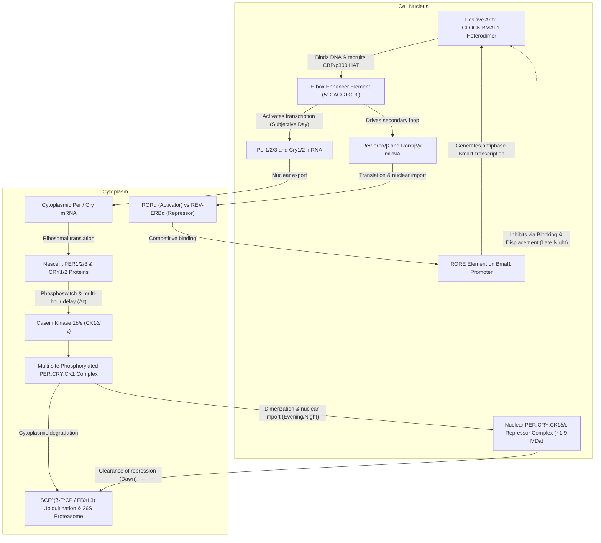
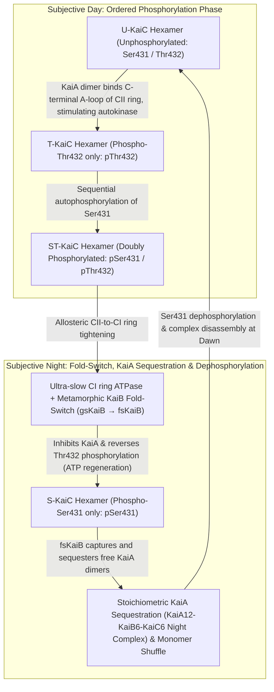

If a human being, a potted plant, a fruit fly, or a culture of photosynthetic bacteria is sealed inside a deep subterranean cavern or a windowless bunker completely isolated from sunlight, ambient temperature fluctuations, and every external cue of Earth's rotation, does the organism lose track of day and night?

Remarkably, the answer is no. Across virtually every domain of life—from unicellular cyanobacteria and fungi to plants, insects, and mammals—living systems continue to oscillate with an endogenous period of <strong>approximately 24 hours</strong>. Sleep-wake cycles, core body temperature fluctuations, endocrine surges of cortisol and melatonin, blood pressure, hepatic metabolism, immune surveillance, and the transcriptional output of 10% to 40% of the entire protein-coding genome are all orchestrated by self-sustaining molecular pendulums ticking inside individual cells.

Yet when examined through the lens of chemical physics and nonlinear dynamics, the existence of an intracellular 24-hour clock presents three profound scientific paradoxes:

1. <strong>The Timescale and Stability Paradox (Nonlinear Dynamics)</strong>: Elementary biochemical reactions—transcription factor binding, phosphorylation, translation, and proteolysis—occur on timescales of milliseconds to minutes. Moreover, simple negative feedback loops in chemistry and control theory almost invariably damp out and settle into a static steady state. How does a soup of jostling macromolecules generate a <strong>self-sustained limit-cycle oscillation</strong> via a <strong>Hopf bifurcation</strong> with a period stretched out to $86,400\text{ seconds}$ ($24\text{ hours}$)?
2. <strong>The Dogma of Genetic Transcription vs. Pure Protein Clocks (Molecular & Structural Biology)</strong>: For decades, chronobiologists believed that all circadian rhythms required a <strong>Transcription-Translation Feedback Loop (TTFL)</strong> cycling between nuclear DNA, cytoplasmic mRNA, and protein repressors. Then, in 2005, <strong>Takao Kondo</strong> and <strong>Masahiro Ishiura</strong>'s group shattered this dogma by demonstrating that mixing just <strong>three purified cyanobacterial proteins (KaiA, KaiB, and KaiC) plus ATP in a test tube</strong>—with <strong>zero DNA, zero mRNA, and zero ribosomes</strong>—produces a rock-solid 24-hour phosphorylation oscillation that persists for days.
3. <strong>The Biophysical Mystery of Temperature Compensation ($Q_{10} \approx 1.0$)</strong>: Ordinary chemical and enzymatic reaction rates obey the <strong>Arrhenius equation</strong>, $k(T) = A \exp(-E_a / RT)$, accelerating two- to three-fold for every $10^\circ\text{C}$ rise in temperature ($Q_{10} \approx 2\text{–}3$). If a biological clock obeyed standard Arrhenius kinetics, a $10^\circ\text{C}$ afternoon warming would cause the clock to run more than twice as fast, rendering it useless as a timepiece. How do biological clocks defy thermal acceleration to maintain an invariant period with a temperature coefficient of <strong>$Q_{10} \approx 0.95\text{–}1.05$</strong>?

In this article, we trace the science of circadian clocks from <strong>Jean-Jacques d'Ortous de Mairan's 1729 *Mimosa pudica* experiment</strong> and the <strong>2017 Nobel Prize in Physiology or Medicine</strong> to the differential equations of the <strong>Goodwin–Goldbeter oscillator</strong>, the structural allostery of the <strong>cyanobacterial KaiABC hexamer</strong>, the physical chemistry of <strong>temperature compensation</strong>, and the clinical frontier of <strong>chronomedicine</strong>.

---

## 1. The Discovery of Endogenous Time: From *Mimosa pudica* to *Drosophila* Mutants

### 1.1 De Mairan's 1729 Wine Cellar Experiment and the Free-Running Period $\tau$

For millennia, the daily leaf movements of plants and the sleep-wake cycles of animals were assumed to be passive, direct responses to the rising and setting of the sun. In 1729, the French astronomer and geophysicist <strong>Jean-Jacques d'Ortous de Mairan</strong> tested this assumption using the sensitive heliotrope plant <strong>*Mimosa pudica</strong>*, which unfolds its leaves toward the sun during the day and folds them shut at night.

De Mairan placed *Mimosa pudica* plants inside a dark closet and wine cellar kept in <strong>constant darkness (DD)</strong>. To his astonishment, the leaves continued to open every morning and close every evening in total darkness, sensing the daytime without ever seeing the sun.

A century later, in 1832, the Swiss botanist <strong>Augustin Pyramus de Candolle</strong> demonstrated an even more decisive property: under constant illumination or constant darkness, *Mimosa pudica* did not open and close on an exact 24.0-hour schedule. Instead, its cycle repeated every <strong>22 to 23 hours</strong>.

In modern chronobiology, the intrinsic period exhibited by an organism isolated from all external time cues (<strong>Zeitgebers</strong>, German for "time-givers" such as light-dark or temperature cycles) is called the <strong>Free-Running Period</strong>, denoted by <strong>$\tau$ (tau)</strong>:

- <strong>*Mimosa pudica* (sensitive plant)</strong>: $\tau \approx 22\text{–}23\,\text{h}$
- <strong>*Mus musculus* (house mouse)</strong>: $\tau \approx 23.5\,\text{h}$
- <strong>*Drosophila melanogaster* (fruit fly)</strong>: $\tau \approx 23.8\,\text{h}$
- <strong>*Homo sapiens* (human)</strong>: $\tau \approx 24.18\,\text{h}$ (precisely measured as $24\text{ h } 11\text{ min} \pm 12\text{ min}$ by Charles Czeisler and colleagues in 1999 using forced desynchrony protocols)

The fact that $\tau$ is *approximately*—but not exactly—$24.00\text{ hours}$ is the smoking gun proving that the rhythm is <strong>endogenous</strong>. If organisms were merely responding to subtle geophysical cues penetrating dark chambers (such as cosmic rays, barometric tides, or geomagnetic fluctuations tied to Earth's rotation), their period in constant darkness would be locked at exactly $24.00\text{ hours}$. Because $\tau$ deviates slightly from 24 hours and varies heritably across species and individuals, the oscillator must reside inside the organism itself. In 1959, <strong>Franz Halberg</strong> coined the term <strong>circadian</strong> (from the Latin *circa*, "about," and *dies*, "day") to describe these self-sustained $\sim 24\text{-hour}$ biological rhythms.

### 1.2 Konopka & Benzer (1971) and the 2017 Nobel Prize

Although <strong>Colin Pittendrigh</strong> and <strong>Jürgen Aschoff</strong> established the formal properties of circadian pacemakers in the 1950s and 1960s, the molecular nature of the clock remained completely unknown. Most physiologists doubted that a complex behavioral rhythm spanning 24 hours could be governed by single genes.

In 1971, <strong>Ronald Konopka</strong> and <strong>Seymour Benzer</strong> at Caltech overturned this skepticism in their landmark paper *"Clock mutants of Drosophila melanogaster"*. By mutagenizing fruit flies with ethyl methanesulfonate (EMS) and screening for abnormalities in adult eclosion (emergence from the pupal case) and locomotor activity rhythms under constant darkness, they isolated three remarkable mutant alleles mapping to a single locus on the X chromosome, which they named <strong>`period` ($per$)</strong>:

1. <strong>$per^0$ (Arrhythmic mutant)</strong>: Completely abolishes the 24-hour rhythm in constant darkness ($\tau = \text{abolished}$; caused by a nonsense stop codon mutation).
2. <strong>$per^S$ (Short-period mutant)</strong>: Accelerates the endogenous clock by 5 hours, yielding a robust free-running period of <strong>$\tau \approx 19\,\text{h}$</strong> (caused by a single missense substitution, Ser589Asn).
3. <strong>$per^L$ (Long-period mutant)</strong>: Slows the endogenous clock by 5 hours, stretching the free-running period to <strong>$\tau \approx 29\,\text{h}$</strong> (caused by a single missense substitution, Val243Asp).

The revelation that a single amino acid substitution in a single protein could compress or dilate an animal's perception of a day from 24 hours to 19 or 29 hours launched molecular chronobiology. In 1984, <strong>Jeffrey C. Hall</strong> and <strong>Michael Rosbash</strong> (at Brandeis University) and <strong>Michael W. Young</strong> (at Rockefeller University) independently cloned the *period* gene. Their subsequent elucidation of how the PER protein regulates its own synthesis earned Hall, Rosbash, and Young the <strong>2017 Nobel Prize in Physiology or Medicine</strong>.

---

## 2. The Eukaryotic Transcription-Translation Feedback Loop (TTFL)

In 1990, Paul Hardin, Jeffrey Hall, and Michael Rosbash discovered that *per* mRNA levels in the *Drosophila* brain oscillate circadianly, peaking in the early night, while PER protein abundance peaks <strong>4 to 6 hours later</strong> in the late night and translocates into the nucleus to repress *per* transcription. In flies, the positive transcription factors <strong>CLOCK (CLK)</strong> and <strong>CYCLE (CYC)</strong> drive transcription of <strong>`period` (*per*)</strong> and <strong>`timeless` (*tim*)</strong>, whose protein products <strong>PER:TIM</strong> dimerize, enter the nucleus after phosphorylation by <strong>DOUBLETIME (DBT, mammalian CK1$\varepsilon$)</strong>, and inhibit CLK:CYC.

In mammals, evolution conserved this core architecture while substituting <strong>Cryptochromes (CRY1 and CRY2)</strong> for TIMELESS as the primary partner of PERIOD proteins. Let us examine the mammalian <strong>Transcription-Translation Feedback Loop (TTFL)</strong> in molecular detail.

### 2.1 The Mammalian Core Loop: CLOCK:BMAL1, E-Box Enhancers, and PER:CRY Repression

1. <strong>Transcriptional Activation via E-Box Elements (Morning/Midday)</strong>:
   At the beginning of the subjective day, two basic helix-loop-helix–PAS (bHLH-PAS) transcription factors—<strong>CLOCK</strong> (or its neuronal paralog <strong>NPAS2</strong>) and <strong>BMAL1</strong> (also known as ARNTL)—heterodimerize in the nucleus. The <strong>CLOCK:BMAL1</strong> complex binds specifically to canonical <strong>E-box (`5'-CACGTG-3'`)</strong> and E'-box (`5'-CACGTT-3'`) cis-regulatory enhancer sequences in the promoters of target genes. CLOCK possesses intrinsic histone acetyltransferase (HAT) activity and recruits coactivators such as CBP/p300 to remodel chromatin and drive robust transcription of the <strong>Period (`Per1`, `Per2`, `Per3`)</strong> and <strong>Cryptochrome (`Cry1`, `Cry2`)</strong> genes.
2. <strong>Cytoplasmic Accumulation, CK1$\delta/\varepsilon$ Phosphorylation, and the Multi-Hour Delay $\Delta\tau$</strong>:
   *Per* and *Cry* transcripts are exported to the cytoplasm and translated into PER and CRY proteins. Crucially, if nascent PER and CRY immediately entered the nucleus and shut off CLOCK:BMAL1, the feedback loop would equilibrate within an hour. To generate a 24-hour period, the cell imposes a <strong>4- to 6-hour phase delay ($\Delta\tau$)</strong> governed by <strong>Casein Kinase $1\delta$ and $1\varepsilon$ (CK1$\delta/\varepsilon$)</strong>.
   Monomeric PER proteins in the cytoplasm are phosphorylated by CK1$\delta/\varepsilon$ at phosphodegron motifs recognized by the F-box protein <strong>$\beta$-TrCP</strong>, targeting uncomplexed PER for polyubiquitination by the <strong>$\text{SCF}^{\beta\text{-TrCP}}$</strong> E3 ubiquitin ligase complex and rapid destruction by the 26S proteasome. Only after *Per* and *Cry* mRNAs accumulate to high levels in the afternoon do PER1/2/3, CRY1/2, and CK1$\delta/\varepsilon$ assemble into stable multimeric complexes that resist immediate degradation and undergo regulated nuclear translocation.
3. <strong>Biphasic Nuclear Repression: Blocking and Displacement (Night)</strong>:
   Inside the nucleus, the <strong>PER:CRY:CK1$\delta/\varepsilon$</strong> macromolecular complex ($\sim 1.9\,\text{MDa}$) represses CLOCK:BMAL1 through two distinct biochemical mechanisms elucidated by Joseph Takahashi, Carrie Partch, and colleagues:
   - <strong>Blocking (by CRY1)</strong>: CRY1 binds directly to the PAS-B domain of CLOCK and the C-terminal transactivation domain (TAD) of BMAL1 *while* CLOCK:BMAL1 remains bound to E-box DNA, sterically blocking the recruitment of CBP/p300 coactivators and recruiting Sin3-HDAC corepressors.
   - <strong>Displacement (by PER2:CK1$\delta/\varepsilon$)</strong>: PER2 acts as a molecular scaffold that delivers CK1$\delta/\varepsilon$ to the DNA-bound CLOCK:BMAL1 complex. CK1$\delta/\varepsilon$ hyperphosphorylates CLOCK, reducing the electrostatic affinity of CLOCK:BMAL1 for E-box DNA and physically displacing the heterodimer from the promoter.
4. <strong>Proteasomal Clearance and Cycle Renewal (Late Night/Dawn)</strong>:
   Once transcription of *Per* and *Cry* is shut down, mRNA levels plummet. During the late night, progressive phosphorylation of nuclear PER by CK1$\delta/\varepsilon$ triggers $\text{SCF}^{\beta\text{-TrCP}}$-mediated degradation, while nuclear CRY1/2 proteins are phosphorylated by AMPK and ubiquitinated by the nuclear E3 ligase <strong>$\text{SCF}^{\text{FBXL3}}$</strong> (counterbalanced in the cytoplasm by <strong>$\text{SCF}^{\text{FBXL21}}$</strong>). By dawn, the nuclear PER:CRY repressor pool is exhausted, freeing CLOCK:BMAL1 to re-bind E-boxes and initiate the next 24-hour cycle.

### 2.2 Familial Advanced Sleep Phase Syndrome (FASPS): Waking Up at 3:00 AM

The clinical relevance of CK1$\delta/\varepsilon$-mediated phosphorylation of PER2 was dramatically demonstrated in 2001 by <strong>Louis Ptáček</strong>, <strong>Ying-Hui Fu</strong>, and colleagues in their study of <strong>Familial Advanced Sleep Phase Syndrome (FASPS)</strong>.

Individuals with FASPS exhibit an extreme, autosomal-dominant "morning lark" phenotype: they experience overwhelming sleepiness around 6:00–7:00 PM every evening and <strong>wake up spontaneously around 3:00–4:00 AM</strong>. When monitored in temporal isolation without time cues, affected family members display an endogenous free-running period shortened by nearly 3 hours ($\tau \approx 21.6\,\text{h}$ vs. $24.18\,\text{h}$ in controls).

Genetic sequencing revealed that FASPS is caused either by a missense mutation in the human <strong>`PER2` gene (Ser662Gly, or hPER2-S662G)</strong> or by a catalytic mutation in <strong>`CSNK1D` encoding CK1$\delta$ (Thr44Ala)</strong>. These mutations exposed a remarkable <strong>Phosphoswitch Mechanism</strong> on the PER2 protein:
- <strong>Region 1 (The FASP Stabilizing Cluster, Ser662–Ser674)</strong>: Normally, priming phosphorylation at Ser662 (Ser659 in mice) allows CK1$\delta/\varepsilon$ to sequentially phosphorylate four downstream serines (`S-X-X-S` motifs). Phosphorylation of this FASP cluster <strong>stabilizes PER2</strong> by inhibiting phosphorylation at the degron site.
- <strong>Region 2 (The $\beta$-TrCP Degron Site, Ser478)</strong>: Phosphorylation at Ser478 by CK1$\delta/\varepsilon$ recruits $\text{SCF}^{\beta\text{-TrCP}}$, triggering rapid <strong>proteasomal degradation</strong> of PER2.

In FASPS patients carrying the <strong>hPER2-S662G</strong> mutation, the priming serine cannot be phosphorylated. Consequently, the stabilizing FASP switch fails, shifting the balance toward Ser478 phosphorylation and premature PER2 degradation. Because nuclear PER2 disappears hours too early each night, transcriptional repression terminates prematurely and the circadian clock runs 3 hours fast! Conversely, in 2017, Michael Young's lab identified a common dominant mutation in <strong>`CRY1` (exon 11 skipping, $\text{CRY1}\,\Delta 11$)</strong> that deletes an autoinhibitory C-terminal tail, strengthens CRY1 binding to CLOCK:BMAL1, lengthens $\tau$, and causes <strong>Familial Delayed Sleep Phase Syndrome (FDSPS)</strong>—turning carriers into chronic "night owls" unable to fall asleep until 3:00–5:00 AM.

### 2.3 Interlocking Secondary Loops: REV-ERB$\alpha$ / ROR$\alpha$ and the Three-Phase Transcriptional Architecture

To confer robustness against molecular noise and expand phase control across the entire day, the core TTFL is interlocked with two auxiliary transcriptional loops:

- <strong>The Stabilizing RORE Loop (REV-ERB$\alpha/\beta$ and ROR$\alpha/\beta/\gamma$)</strong>:
  CLOCK:BMAL1 activates E-box transcription of the nuclear hormone receptors <strong>REV-ERB$\alpha$ (`Nr1d1`)</strong> and <strong>REV-ERB$\beta$ (`Nr1d2`)</strong>, as well as <strong>ROR$\alpha/\beta/\gamma$</strong>. ROR proteins bind <strong>RORE (ROR Response Elements)</strong> in the *Bmal1* promoter to activate *Bmal1* transcription, whereas heme-bound REV-ERB$\alpha/\beta$ competitively binds the same RORE sites and recruits the <strong>NCoR–HDAC3</strong> corepressor complex to repress *Bmal1*. This creates a high-amplitude oscillation of *Bmal1* mRNA peaking in antiphase (late night/dawn) to *Per2* mRNA.
- <strong>The D-Box Loop (DBP / TEF / HLF and E4BP4)</strong>:
  CLOCK:BMAL1 also drives the PAR-bZIP activators <strong>DBP</strong>, <strong>TEF</strong>, and <strong>HLF</strong>, while the RORE loop drives the repressor <strong>E4BP4 (NFIL3)</strong> in antiphase. Acting on <strong>D-box</strong> elements, this loop generates an intermediate transcriptional wave.

As demonstrated in synthetic biology experiments by <strong>Hiroki R. Ueda</strong> and colleagues, the combinatorial logic of <strong>E-boxes (Morning element)</strong>, <strong>D-boxes (Daytime element)</strong>, and <strong>ROREs (Evening/Nighttime element)</strong> forms a complete basis set of phase vectors, enabling the circadian clock to schedule the peak expression of <strong>Clock-Controlled Genes (CCGs)</strong> at any hour of the 24-hour day.

---

## 3. Mathematical Biology of Genetic Oscillators: Goodwin's Model, Goldbeter's Equations, and Hopf Bifurcations

Why does a negative feedback loop oscillate at all? In introductory biology, it is often assumed that whenever gene $A$ activates repressor $B$ and $B$ inhibits $A$, the concentrations will naturally oscillate. However, nonlinear dynamical systems theory proves that <strong>a simple two-variable negative feedback loop without explicit time delay can never sustain limit-cycle oscillations</strong>.

### 3.1 Proof of Impossibility in 2D Negative Feedback via Bendixson's Criterion

Consider a general two-variable Transcription-Translation Feedback Loop tracking mRNA concentration $M(t) \ge 0$ and repressor protein concentration $P(t) \ge 0$:

$$\frac{dM}{dt} = f(P) - \gamma_M M \equiv F_1(M, P), \qquad \frac{dP}{dt} = k_s M - \gamma_P P \equiv F_2(M, P)$$

where $f(P)$ is a monotonically decreasing repression function ($f'(P) < 0$ for all $P \ge 0$), $k_s > 0$ is the translation rate constant, and $\gamma_M, \gamma_P > 0$ are first-order degradation rate constants.

Let us compute the <strong>divergence</strong> of the vector field $\mathbf{F}(M, P) = (F_1, F_2)$ across the positive quadrant $\mathbb{R}_+^2$:

$$\nabla \cdot \mathbf{F} = \frac{\partial F_1}{\partial M} + \frac{\partial F_2}{\partial P} = -\gamma_M - \gamma_P < 0$$

Because $\gamma_M > 0$ and $\gamma_P > 0$, the divergence $\nabla \cdot \mathbf{F}$ is <strong>strictly negative everywhere</strong> and never changes sign. By <strong>Bendixson's Negative Criterion</strong> (a direct consequence of Green's Theorem in the plane, $\iint_\Omega (\nabla \cdot \mathbf{F})\,dM dP = \oint_{\partial\Omega} (\mathbf{F}\cdot\mathbf{n})\,ds = 0$), a simply connected planar region in which $\nabla \cdot \mathbf{F}$ has constant non-zero sign <strong>cannot contain any closed periodic orbit (limit cycle)</strong>.

Equivalently, linearizing around the unique steady state $(M^*, P^*)$ yields the Jacobian matrix:

$$J = \begin{pmatrix} -\gamma_M & f'(P^*) \\ k_s & -\gamma_P \end{pmatrix}$$

Since $f'(P^*) < 0$, the trace and determinant satisfy:

$$\operatorname{Tr}(J) = -(\gamma_M + \gamma_P) < 0, \qquad \det(J) = \gamma_M \gamma_P - k_s f'(P^*) > 0$$

Because $\operatorname{Tr}(J) < 0$ and $\det(J) > 0$ for all positive parameter values and any Hill coefficient $n$, both eigenvalues $\lambda_{1,2}$ always have <strong>strictly negative real parts ($\operatorname{Re}(\lambda_{1,2}) < 0$)</strong>. A Hopf bifurcation ($\operatorname{Tr}(J) = 0$) is mathematically impossible; perturbations around $(M^*, P^*)$ merely spiral inward as damped oscillations.

### 3.2 Brian Goodwin's Oscillator (1965) and Albert Goldbeter's Model (1995)

To escape Bendixson's theorem and cross into a regime of self-sustained limit-cycle oscillations, the system requires at least a <strong>third dynamical variable</strong> introducing a <strong>phase delay ($\Delta\tau$)</strong>—physically realized by cytoplasmic phosphorylation and nuclear transport.

Building on <strong>Brian Goodwin's</strong> classic 1965 genetic oscillator, <strong>Albert Goldbeter</strong> (1995) formulated the canonical ordinary differential equation (ODE) model of the eukaryotic circadian clock tracking mRNA ($M$), cytoplasmic protein ($P_C$), and nuclear repressor protein ($P_N$):

$$\frac{dM}{dt} = \frac{v_s K_I^n}{K_I^n + P_N^n} - v_m \frac{M}{K_m + M}, \qquad \frac{dP_C}{dt} = k_s M - v_d \frac{P_C}{K_d + P_C} - k_1 P_C + k_2 P_N, \qquad \frac{dP_N}{dt} = k_1 P_C - k_2 P_N$$

Here:
- $v_s$ is the maximum transcription rate, $K_I$ is the threshold repression constant, and $n$ is the <strong>Hill coefficient</strong> quantifying cooperative repression of the promoter by nuclear repressor $P_N$.
- $v_m, K_m$ and $v_d, K_d$ are the maximum rates and Michaelis constants for enzymatic degradation of mRNA ($M$) and cytoplasmic protein ($P_C$).
- $k_s$ is the translation rate constant, while $k_1$ and $k_2$ are the rate constants for nuclear import and export.

### 3.3 The Three Mathematical Ingredients for a Hopf Bifurcation and Griffith's $n > 8$ Theorem

As formalized by Béla Novák and John Tyson (2008), generating sustained <strong>Limit-Cycle Oscillations via a Supercritical Hopf Bifurcation</strong> in a genetic feedback loop requires <strong>three mathematical ingredients</strong>:

1. <strong>Negative Feedback</strong>: A closed loop with an odd number of inhibitory edges so that perturbations encounter a restoring force.
2. <strong>Sufficiently Long Phase Delay ($\Delta\tau$)</strong>: Intermediate steps (multi-site phosphorylation by CK1$\delta/\varepsilon$, complex assembly, and nuclear translocation) must delay the feedback signal until its phase shifts by $-\pi\text{ radians}$ ($-180^\circ$), turning negative feedback into positive reinforcement at the resonant frequency $\omega_0$.
3. <strong>Strong Nonlinearity / Ultrasensitivity</strong>: Because each intermediate delay step acts as a low-pass filter that attenuates signal amplitude, the feedback function must be steep enough (ultrasensitive) that the open-loop gain exceeds unity at a phase lag of $180^\circ$.

In 1968, <strong>J. S. Griffith</strong> proved a famous theorem for the classic 3-variable Goodwin oscillator with <strong>linear (first-order) degradation</strong> ($-\gamma_1 M, -\gamma_2 P_C, -\gamma_3 P_N$). At the symmetric point $\gamma_1 = \gamma_2 = \gamma_3 = \gamma$, the characteristic polynomial of the $3 \times 3$ Jacobian matrix is:

$$(\lambda + \gamma)^3 + G = 0$$

where $G = k_s k_1 |f'(P_N^*)| > 0$ is the linearized loop gain. For a pair of complex conjugate eigenvalues $\lambda = \pm i\omega$ to cross the imaginary axis (Hopf bifurcation), each of the three first-order stages must contribute a phase lag of $\pi/3 = 60^\circ$. By the Routh–Hurwitz stability criterion:

$$\frac{G}{\gamma^3} > \sec^3\left(\frac{\pi}{3}\right) = 2^3 = 8$$

Because the logarithmic sensitivity $\left|\frac{d\ln h(P_N)}{d\ln P_N}\right| = \frac{n P_N^n}{K_I^n + P_N^n}$ of a Hill function is strictly bounded above by $n$, Griffith's inequality proves that a 3-variable Goodwin model with linear degradation <strong>cannot oscillate unless the Hill coefficient satisfies $n > 8$</strong> (for $N$ linear cascade steps, $n > \sec^N(\pi/N)$).

A Hill coefficient of $n > 8$ requires at least 9 repressor molecules to bind DNA with extreme allosteric cooperativity—a biochemically implausible requirement. How do real circadian clocks overcome <strong>Griffith's $n > 8$ barrier</strong>?

- <strong>Mechanism A: Michaelis–Menten Saturation / Zero-Order Ultrasensitivity (Goldbeter, 1995)</strong>:
  Notice that in Goldbeter's equations above, degradation of $M$ and $P_C$ follows <strong>saturating Michaelis–Menten kinetics</strong> $\left(-v_d \frac{P_C}{K_d + P_C}\right)$ rather than linear first-order decay. When the degrading enzymes (such as CK1/$\text{SCF}^{\beta\text{-TrCP}}$ and the 26S proteasome) operate near saturation ($P_C^* \gg K_d$), the effective diagonal damping term in the Jacobian matrix, $-\frac{\partial}{\partial P_C}\left(\frac{v_d P_C}{K_d + P_C}\right) = -\frac{v_d K_d}{(K_d + P_C^*)^2}$, becomes very small. This dramatically reduces signal attenuation across the loop, allowing robust limit-cycle oscillations with biologically realistic Hill coefficients of <strong>$n = 2\text{ to }4$</strong> (or even $n = 1$ when combined with reversible phosphorylation cascades).
- <strong>Mechanism B: Molecular Titration / Stoichiometric Sequestration (Kim & Forger, 2012)</strong>:
  As <strong>Jae Kyoung Kim</strong> and <strong>Daniel B. Forger</strong> proved in 2012, mammalian PER:CRY does not bind E-boxes directly with Hill-type cooperativity; instead, it <strong>sequesters CLOCK:BMAL1 into an inactive 1:1 stoichiometric complex</strong> with sub-nanomolar dissociation constant $K_d$. The concentration of free, transcriptionally active activator $A_{\text{free}}$ as a function of total activator $A_T$ and total repressor $I_T$ is given by the quadratic binding equation:
  $$A_{\text{free}}(I_T) = \frac{1}{2}\left[ (A_T - I_T - K_d) + \sqrt{(A_T - I_T - K_d)^2 + 4 A_T K_d} \right]$$
  When binding is tight ($K_d \ll A_T$), $A_{\text{free}}(I_T)$ exhibits a razor-sharp threshold switch at the stoichiometric equivalence point $I_T \approx A_T$, generating massive effective ultrasensitivity <strong>without any cooperative DNA binding ($n = 1$)</strong>!

---

## 4. Takao Kondo & Masahiro Ishiura's Astonishing 2005 Discovery: The Cyanobacterial KaiABC Clock in a Test Tube

Until the late 1990s, two dogmas dominated chronobiology: first, that prokaryotes (bacteria) lacked circadian clocks because they divide faster than once every 24 hours; and second, that all circadian rhythms depended on a nuclear Transcription-Translation Feedback Loop (TTFL).

Both dogmas were demolished by <strong>Takao Kondo</strong>, <strong>Masahiro Ishiura</strong>, <strong>Carl Johnson</strong>, and <strong>Susan Golden</strong> studying the unicellular cyanobacterium <strong>*Synechococcus elongatus* PCC 7942</strong>. Cyanobacteria face a fundamental biochemical conflict: oxygen-evolving photosynthesis during the day generates $\text{O}_2$, which irreversibly destroys <strong>nitrogenase</strong>, the enzyme responsible for nitrogen fixation. Cyanobacteria evolved circadian clocks to temporally segregate incompatible metabolic pathways across the 24-hour cycle.

In 1998, Ishiura, Kondo, and colleagues identified the three-gene clock cluster <strong>`kaiA`, `kaiB`, and `kaiC`</strong> (named after the Japanese word *Kai* [回], meaning "cycle" or "rotation"). Then, in 2005, <strong>Masato Nakajima</strong>, <strong>Keiko Imai</strong>, <strong>Hiroshi Ito</strong>, <strong>Taeko Nishiwaki</strong>, and <strong>Takao Kondo</strong> published a landmark paper in *Science* (*Nakajima et al., 2005*) that stunned the scientific world:

> <strong>Mixing just three purified recombinant proteins—KaiA, KaiB, and KaiC—together with ATP and $\text{Mg}^{2+}$ in a test tube, in the complete absence of DNA, mRNA, ribosomes, or cellular compartments, reconstitutes a self-sustained, temperature-compensated 24-hour oscillation of KaiC phosphorylation that persists for days!</strong>

### 4.1 Molecular Architecture of the KaiABC Post-Translational Oscillator (PTO)

How do three proteins and ATP create a 24-hour clock in a test tube? Two decades of structural biology by Takao Kondo, Shuji Akiyama, Andy LiWang, and Erin O'Shea have revealed an extraordinary macromolecular machine:

1. <strong>The Double-Doughnut KaiC Hexamer and the Slowest ATPase in Nature</strong>:
   <strong>KaiC</strong> ($58\,\text{kDa}$ monomer) assembles into a homohexamer shaped like a <strong>double ring (CI N-terminal ring and CII C-terminal ring)</strong> binding 12 ATP molecules. While typical cellular AAA+ ATPases hydrolyze $10\text{ to }100\text{ ATPs per second}$, the KaiC CI domain hydrolyzes an astonishingly slow <strong>$\sim 15\text{ ATP molecules per monomer per 24-hour day}$</strong> ($\sim 0.6\,\text{ATP}\,\text{h}^{-1}$)! High-resolution X-ray crystal structures by <strong>Jun Abe</strong> and <strong>Shuji Akiyama</strong> (2015) revealed that cis-to-trans isomerization barriers of a peptide bond near the catalytic site and steric hindrance of the lytic water molecule act as an atomic-scale escapement mechanism that slows catalysis down to the circadian timescale.
2. <strong>The Ordered 4-State Phosphorylation Cycle ($\text{U} \to \text{T} \to \text{ST} \to \text{S} \to \text{U}$)</strong>:
   Each KaiC subunit in the CII ring contains two adjacent autophosphorylation residues: <strong>Ser431 (S)</strong> and <strong>Thr432 (T)</strong> (*Nishiwaki et al., 2007; Rust et al., 2007*). Rather than phosphorylating randomly, the KaiC hexamer cycles unidirectionally through four distinct states over 24 hours:
   - <strong>$\text{U (Unphosphorylated)} \to \text{T (pThr432)}$</strong>: During the subjective morning, <strong>KaiA dimers</strong> bind to the exposed C-terminal tentacles (<strong>A-loops</strong>) of the U-KaiC CII domain, tethering them in an active conformation that promotes ATP uptake and autophosphorylation at the kinetically favored <strong>Thr432</strong> residue.
   - <strong>$\text{T (pThr432)} \to \text{ST (pSer431/pThr432)}$</strong>: Continued stimulation by KaiA drives secondary phosphorylation at <strong>Ser431</strong>, peaking in doubly phosphorylated <strong>ST-KaiC</strong> around subjective dusk.
3. <strong>Allosteric Ring Communication and the Metamorphic Fold-Switch of KaiB</strong>:
   Phosphorylation of Ser431 introduces negative charge at the CII subunit interface, tightening the CII ring and allosterically triggering ATP hydrolysis in the lower <strong>CI ring</strong>. This exposes the <strong>B-loop</strong> binding interface on the ADP-bound CI ring.
   At this juncture, <strong>KaiB</strong> undergoes one of the rarest phenomena in protein physics: <strong>metamorphic fold-switching</strong> (*Chang et al., Science, 2015*). In solution, bulk KaiB exists as a stable homotetramer in a ground-state fold (<strong>gsKaiB</strong>, $\beta\alpha\beta\beta\alpha\alpha\beta$ topology) that cannot bind KaiC. However, a tiny fraction of monomeric KaiB spontaneously refolds its C-terminal half into a completely different tertiary structure—a <strong>thioredoxin-like fold-switched state (fsKaiB, $\beta\alpha\beta\alpha\beta\beta\alpha$ topology)</strong>! Because the free-energy barrier between gsKaiB and fsKaiB is large, this slow conformational transition, coupled with ultra-slow CI ATP hydrolysis, creates the <strong>multi-hour phase delay ($\Delta\tau$)</strong> required for oscillation.
4. <strong>Stoichiometric Sequestration of KaiA and ATP Synthesis During Dephosphorylation</strong>:
   Once six <strong>fsKaiB</strong> monomers bind cooperatively to the CI ring of ST/S-KaiC to form the $\text{KaiB}_6\text{KaiC}_6$ complex, the exposed lateral surfaces of fsKaiB avidly <strong>capture and sequester free KaiA dimers</strong> into an autoinhibited <strong>$\text{KaiA}_{12}\text{KaiB}_6\text{KaiC}_6$ night complex</strong>. Just as in Kim and Forger's molecular titration mechanism, once the fraction of S-KaiC crosses a threshold, the entire pool of free KaiA in the test tube is depleted.
   Deprived of KaiA, all KaiC hexamers switch to autodephosphorylation. Remarkably, KaiC does not simply hydrolyze its phosphate groups into inorganic phosphate ($\text{P}_i$); instead, it <strong>transfers the phosphoryl group from pThr432 and pSer431 back onto bound ADP to regenerate ATP</strong> (*Nishiwaki & Kondo, 2012*)! Thr432 dephosphorylates first ($\text{ST} \to \text{S}$), followed by Ser431 ($\text{S} \to \text{U}$). During this dephosphorylation phase, <strong>monomer shuffling</strong> between KaiC hexamers (*Ito et al., 2007*) and competitive KaiA sequestration synchronize trillions of hexamers in the test tube into a single macroscopic oscillation.

| Feature | Eukaryotic Clocks (Mammals, Insects, Plants, Fungi) | Cyanobacterial Core Clock (KaiABC System) |
| :--- | :--- | :--- |
| <strong>Core Oscillator Architecture</strong> | <strong>Transcription-Translation Feedback Loop (TTFL)</strong> | <strong>Post-Translational Oscillator (PTO)</strong> (coupled to an outer TTFL in vivo) |
| <strong>In Vitro Reconstitution</strong> | Impossible without nuclei, ribosomes, and proteasomes | <strong>Fully reconstituted</strong> with purified <strong>KaiA + KaiB + KaiC + ATP + $\text{Mg}^{2+}$</strong> |
| <strong>Positive Element (Activator)</strong> | bHLH-PAS / GATA Transcription Factors (<strong>CLOCK:BMAL1</strong>, CLK:CYC, WC-1:WC-2) | <strong>KaiA Dimer</strong> (binds CII A-loop to stimulate KaiC autokinase activity) |
| <strong>Negative Element (Repressor)</strong> | Repressor Complexes (<strong>PER:CRY</strong>, PER:TIM, FRQ) + <strong>CK1$\delta/\varepsilon$</strong> | <strong>Fold-Switched KaiB (fsKaiB)</strong> mediating <strong>stoichiometric KaiA sequestration</strong> |
| <strong>Origin of Phase Delay ($\Delta\tau$)</strong> | Transcription, translation, multi-site CK1 phosphorylation, nuclear import | <strong>Ultra-slow CI ATPase ($\sim 15\,\text{ATP/day}$)</strong> + <strong>Metamorphic KaiB fold-switching</strong> |
| <strong>Origin of Nonlinearity</strong> | Michaelis–Menten zero-order decay + <strong>1:1 molecular titration of CLOCK:BMAL1</strong> | Cooperative hexamer switching + <strong>titration/sequestration of free KaiA</strong> |
| <strong>Temperature Compensation ($Q_{10}$)</strong> | $Q_{10} \approx 0.95\text{–}1.05$ (CK1$\delta/\varepsilon$ product binding & PER2 phosphoswitch) | $Q_{10} \approx 1.0$ (intrinsic structural allostery of KaiC CI/CII ATPase) |

---

## 5. Solving the Deepest Biophysical Mystery: Temperature Compensation ($Q_{10} \approx 1.0$)

### 5.1 The Arrhenius Paradox: Why Ordinary Biochemical Reactions Fail as Clocks

In physical chemistry, the rate constant $k(T)$ of an elementary thermal reaction over an activation energy barrier $E_a$ is governed by the <strong>Arrhenius equation</strong>:

$$k(T) = A \exp\left(-\frac{E_a}{R T}\right)$$

where $A$ is the pre-exponential frequency factor, $R = 8.314\,\text{J}\cdot\text{mol}^{-1}\cdot\text{K}^{-1}$ is the universal gas constant, and $T$ is absolute temperature. Biologists quantify thermal sensitivity using the dimensionless <strong>temperature coefficient $Q_{10}$</strong>, defined as the ratio of reaction rates (or oscillation frequencies $f = 1/\tau$) separated by $10^\circ\text{C}$ ($10\,\text{K}$):

$$Q_{10} = \frac{k(T + 10)}{k(T)} = \exp\left(\frac{10 E_a}{R T (T + 10)}\right)$$

For typical biochemical and enzymatic reactions at physiological temperatures ($T \approx 300\,\text{K}$), activation energies lie in the range $E_a \approx 50\text{ to }80\,\text{kJ/mol}$, yielding:

$$Q_{10} \approx 2.0 \text{ to } 3.0$$

That is, ordinary cellular reactions—including the eukaryotic cell division cycle—speed up <strong>two- to three-fold</strong> for every $10^\circ\text{C}$ increase in temperature. If a circadian clock were a simple chain of Arrhenius reactions with $Q_{10} = 2.5$, a fruit fly, plant, or cyanobacterium whose clock ran with a 24-hour period at $20^\circ\text{C}$ would see its period shrink to $24 / 2.5 = 9.6\text{ hours}$ on a warm $30^\circ\text{C}$ afternoon! Even in homeothermic mammals, peripheral tissue temperatures and febrile states fluctuate by several degrees, which would desynchronize cellular clocks across the body.

In 1954, <strong>Colin Pittendrigh</strong> demonstrated in *Drosophila pseudoobscura* that the eclosion clock maintains virtually the same 24-hour period across $16^\circ\text{C}$, $21^\circ\text{C}$, and $26^\circ\text{C}$. Across all circadian organisms, the period $\tau$ exhibits <strong>Temperature Compensation</strong>:

$$Q_{10}^{(\tau)} = \frac{\tau(T)}{\tau(T + 10^\circ\text{C})} \approx 0.95 \text{ to } 1.05 \quad (\approx 1.0)$$

How can a biochemical network built from temperature-sensitive enzymes ($Q_{10} \approx 2\text{–}3$) achieve an overall period that is temperature-invariant ($Q_{10} \approx 1.0$)?

### 5.2 Systems-Level Compensation: Peter Ruoff's Antagonistic Balance (1992)

In 1992, physical chemist <strong>Peter Ruoff</strong> proposed a general systems-biology framework known as <strong>Antagonistic Balance</strong>. Suppose the oscillation period $\tau = \tau(k_1, k_2, \dots, k_N)$ depends on $N$ elementary rate constants, each obeying the Arrhenius relation $\frac{d\ln k_i}{dT} = \frac{E_{a,i}}{RT^2} > 0$. Differentiating $\ln \tau$ with respect to temperature $T$ via the chain rule yields:

$$\frac{d \ln \tau}{d T} = \sum_{i=1}^{N} \frac{\partial \ln \tau}{\partial \ln k_i} \frac{d \ln k_i}{d T} = \frac{1}{R T^2} \sum_{i=1}^{N} C_i^{\tau} E_{a,i}$$

where the dimensionless sensitivity

$$C_i^{\tau} \equiv \frac{\partial \ln \tau}{\partial \ln k_i} = \frac{k_i}{\tau} \frac{\partial \tau}{\partial k_i}$$

is the <strong>Period Control Coefficient</strong> (from Metabolic Control Analysis), measuring the fractional change in period $\tau$ upon a fractional change in rate constant $k_i$. By dimensional scaling (Euler's homogeneous function theorem, since multiplying all rates $k_i$ by $\alpha$ scales the period by $\alpha^{-1}$), the control coefficients obey the exact summation theorem:

$$\sum_{i=1}^{N} C_i^{\tau} = -1$$

If every reaction in the oscillator had $C_i^\tau < 0$ (meaning speeding up any step always shortens the period), then because $E_{a,i} > 0$, the sum $\sum_i C_i^\tau E_{a,i}$ would be strictly negative and the clock would inevitably speed up with temperature.

However, in a feedback oscillator with competing branches, certain reactions—such as stabilizing phosphorylation of PER2 at the FASP site, dephosphorylation, or nuclear export—possess <strong>positive period control coefficients ($C_j^\tau > 0$)</strong>: accelerating those reactions *lengthens* the oscillation period! Temperature compensation ($d\ln \tau / dT \approx 0$, or $Q_{10} \approx 1.0$) is achieved when evolution tunes the activation energies $E_{a,i}$ so that period-shortening reactions ($C_i^\tau < 0$) and period-lengthening reactions ($C_j^\tau > 0$) cancel out in <strong>Antagonistic Balance</strong>:

$$\sum_{i=1}^{N} C_i^{\tau} E_{a,i} = 0$$

This equation also explains why single point mutations in clock genes (such as $per^S$, $per^L$, or *tau* mutant CK1$\varepsilon$) often simultaneously alter the period $\tau$ *and* impair temperature compensation: changing a single rate constant shifts the control coefficients $C_i^\tau$ away from the balanced hyperplane $\sum C_i^\tau E_{a,i} = 0$.

### 5.3 Single-Enzyme Autonomous Compensation: CK1$\delta/\varepsilon$ Autoinhibition and KaiC Allostery

Remarkably, nature did not rely solely on network-wide antagonistic balance; it embedded temperature compensation <strong>directly inside the catalytic cycle of the core pacemaker enzymes themselves</strong>:

1. <strong>Intrinsic Temperature Compensation of Mammalian CK1$\delta/\varepsilon$ Phosphorylation (Isojima et al., 2009; Shinohara et al., 2017)</strong>:
   In 2009, <strong>Yasushi Isojima</strong>, <strong>Hiroki R. Ueda</strong>, and colleagues discovered that the in vitro phosphorylation of a peptide spanning the PER2 FASP/$\beta$-TrCP region by purified <strong>CK1$\delta$ or CK1$\varepsilon$</strong> is *intrinsically temperature-compensated* ($Q_{10} \approx 1.0\text{–}1.2$ between $25^\circ\text{C}$ and $35^\circ\text{C}$), whereas phosphorylation of generic substrates like casein exhibits normal Arrhenius acceleration ($Q_{10} > 2.0$).
   In 2017, <strong>Yusuke Shinohara</strong>, <strong>Hiroki R. Ueda</strong>, and colleagues (*Molecular Cell*, 2017) solved the atomic mechanism through crystal structures and kinetic modeling of CK1$\delta$. While the catalytic phosphoryl-transfer rate $k_{\text{chem}}$ increases exponentially with temperature, CK1$\delta$ possesses an evolutionarily conserved anion-binding pocket near <strong>Lys224 (K224)</strong> that mediates <strong>temperature-dependent product affinity (product inhibition)</strong>. As temperature rises, CK1$\delta$ binds more tightly to its phosphorylated PER2 product and undergoes autoinhibitory conformational changes that slow down product release ($k_{\text{off}}$). This intra-enzymatic tug-of-war between accelerated catalysis and decelerated product release yields a flat effective turnover rate across physiological temperatures, which is further reinforced at the cellular level by the two-site PER2 <strong>phosphoswitch</strong> (competing FASP stabilization vs. $\beta$-TrCP degradation).
2. <strong>Intrinsic Temperature Compensation of the Cyanobacterial KaiC ATPase (Terauchi et al., 2007)</strong>:
   Similarly, <strong>Kazuki Terauchi</strong> and <strong>Takao Kondo</strong> (2007) demonstrated that purified <strong>KaiC hexamers alone in buffer + ATP</strong> (without KaiA or KaiB) exhibit a basal ATPase rate of $\sim 15\,\text{ATP}\,\text{day}^{-1}$ that is completely temperature-compensated (<strong>$Q_{10} \approx 1.0$</strong>) between $25^\circ\text{C}$ and $35^\circ\text{C}$! As thermal energy rises, increased steric crowding and hydrogen-bond rearrangement at the CI active site shift the equilibrium toward an autoinhibited ADP-bound state, acting as a built-in molecular governor.

---

## 6. Master Pacemaker Synchronization in the SCN, Melanopsin Photoentrainment, and Chronomedicine

### 6.1 Melanopsin ipRGCs (480 nm Blue Light) and the Phase Response Curve (PRC)

Because the human endogenous free-running period averages $\tau \approx 24.18\,\text{h}$, our internal clock would drift later by $\sim 11\text{ minutes}$ every day without daily resetting. Synchronization (<strong>photoentrainment</strong>) to Earth's exact $24.00\text{-hour}$ rotation is mediated by a specialized non-visual photoreceptor system in the retina discovered between 1998 and 2002 by Ignacio Provencio, Satchidananda Panda, Samer Hattar, and Russell Foster.

Even in mice or blind patients lacking functional rod and cone photoreceptors, circadian photoentrainment remains intact as long as the eyes are present. This is because $\sim 1\text{–}2\%$ of retinal ganglion cells express the photopigment <strong>Melanopsin (OPN4)</strong>, rendering them <strong>intrinsically photosensitive Retinal Ganglion Cells (ipRGCs)</strong> with a peak spectral sensitivity in the <strong>blue light range ($\lambda_{\text{max}} \approx 480\,\text{nm}$)</strong>.

When $480\,\text{nm}$ blue light strikes melanopsin, ipRGCs fire action potentials along the monosynaptic <strong>Retinohypothalamic Tract (RHT)</strong> directly to the <strong>Suprachiasmatic Nucleus (SCN)</strong> of the hypothalamus, releasing <strong>glutamate</strong> and <strong>PACAP</strong> (pituitary adenylate cyclase-activating polypeptide). In SCN neurons, $\text{Ca}^{2+}$ influx and cAMP signaling activate CaMKII, PKA, and MAPK/ERK cascades that phosphorylate the transcription factor <strong>CREB</strong> at Ser133. Phospho-CREB binds to <strong>CRE (cAMP Response Elements)</strong> in the promoters of <strong>`Per1` and `Per2`</strong>, triggering an acute burst of *Per1/2* transcription within 15 to 30 minutes.

This acute light-induced *Per* surge explains the universal shape of the circadian <strong>Phase Response Curve (PRC)</strong>:
- <strong>Subjective Day (Dead Zone)</strong>: Endogenous *Per* transcription is already high; a light pulse causes minimal additional effect and negligible phase shift.
- <strong>Early Subjective Night (Phase Delay)</strong>: Endogenous *Per* mRNA is normally falling; light-induced *Per1/2* transcription pushes levels back up, delaying the descent and <strong>shifting the clock backward</strong> (staying up later, waking up later—the exact mechanism by which late-night smartphone and LED screens emitting $480\,\text{nm}$ blue light induce circadian delay).
- <strong>Late Subjective Night / Early Dawn (Phase Advance)</strong>: Endogenous *Per* mRNA is at its trough and about to rise; morning light prematurely boosts *Per1/2* transcription, <strong>advancing the clock forward</strong> to lock the $24.18\,\text{h}$ human pacemaker onto the $24.00\,\text{h}$ solar day.

### 6.2 The Suprachiasmatic Nucleus (SCN): 20,000 Coupled Neurons and the Physics of Jet Lag

While almost every cell in the mammalian body—hepatocytes, cardiomyocytes, fibroblasts, adipocytes, and immune cells—contains a functional TTFL (<strong>peripheral clocks</strong>), individual isolated cells in culture are noisy oscillators whose periods fluctuate by $\pm 1.5\text{ hours}$ due to stochastic transcriptional bursting.

To create a rock-solid reference clock, the mammalian <strong>Suprachiasmatic Nucleus (SCN)</strong> couples approximately <strong>20,000 neurons</strong> in the anterior hypothalamus into a synchronized network (<strong>Kuramoto coupled oscillator network</strong>). SCN neurons communicate via the neuropeptides <strong>VIP (Vasoactive Intestinal Peptide, acting through VPAC2 receptors in the ventral core)</strong>, <strong>AVP (Arginine Vasopressin, enriched in the dorsal shell)</strong>, and the neurotransmitter <strong>GABA</strong>. Intercellular coupling averages out single-cell molecular noise by a factor of $1/\sqrt{N}$, reducing period jitter from hours in isolated fibroblasts to just minutes across the intact SCN network.

This hierarchical architecture explains the misery of <strong>Jet Lag (Circadian Desynchrony)</strong>. When you fly across eight time zones, the ventral SCN receives direct RHT light input and begins shifting its phase, but strong intercellular AVP/VIP coupling creates network inertia that limits the SCN's phase shift to roughly <strong>1 to 1.5 hours per day</strong> (as Hitoshi Okamura and colleagues showed, blocking V1a/V1b vasopressin receptors in the SCN eliminates this interneuronal resistance and virtually abolishes jet lag in mice!). Worse still, <strong>peripheral clocks</strong> in the liver, pancreas, gut, and heart do not receive direct light input; they are entrained by body temperature rhythms, autonomic innervation, glucocorticoid surges, and <strong>feeding-fasting cycles</strong>. For a week after transmeridian travel, the brain's SCN, the liver's metabolic clock, and the gut's digestive clock oscillate out of phase with one another—a state of <strong>internal desynchronization</strong> that impairs cognition, metabolism, and immunity.

### 6.3 Chronomedicine and Cancer Chronotherapy: Why the Time of Infusion Saves Lives

Because the core TTFL regulates up to 40% of the mammalian transcriptome—including cytochrome P450 drug-metabolizing enzymes, efflux transporters, DNA excision repair factors (such as <strong>XPA</strong>), cell-cycle checkpoints (<strong>WEE1</strong>, <strong>p21</strong>), and immune trafficking—the efficacy and toxicity of medical treatments depend profoundly on the <strong>biological time of administration (Chronomedicine / Chronotherapy)</strong>:

1. <strong>Cardiovascular and Metabolic Pharmacology</strong>: Over half of the World Health Organization's top 100 best-selling drugs target proteins whose expression oscillates circadianly (*Zhang et al., PNAS, 2014*). For instance, hepatic cholesterol biosynthesis is gated by CLOCK:BMAL1 regulation of <strong>HMG-CoA reductase</strong>, which peaks during the night in humans; consequently, short-half-life statins (such as simvastatin) lower LDL cholesterol significantly more effectively when taken at bedtime rather than in the morning.
2. <strong>Cytotoxic Chemotherapy (Francis Lévi's Chronomodulated Infusions)</strong>: In colorectal cancer, <strong>Francis Lévi</strong> and colleagues demonstrated that delivering <strong>5-fluorouracil (5-FU)</strong> and <strong>oxaliplatin</strong> via chronomodulated pumps—peaking 5-FU at 4:00 AM (when dihydropyrimidine dehydrogenase catabolism is highest and bone marrow/mucosal DNA synthesis is lowest) and oxaliplatin at 4:00 PM—dramatically reduces severe mucositis and peripheral neuropathy while improving objective tumor response rates compared to constant-rate infusion.
3. <strong>Cancer Immunotherapy (Immune Checkpoint Inhibitors)</strong>: Perhaps the most striking clinical breakthrough in modern chronomedicine involves <strong>anti-PD-1 / anti-PD-L1 immune checkpoint inhibitors</strong> (pembrolizumab, nivolumab, ipilimumab). Dendritic cell migration to lymph nodes, antigen presentation, and $\text{CD8}^+$ cytotoxic T-cell infiltration into tumors are all governed by intrinsic leukocyte circadian clocks, peaking in humans during the <strong>morning and early afternoon</strong>. In landmark clinical studies of advanced melanoma, non-small-cell lung cancer, and renal cell carcinoma (*Qian et al., The Lancet Oncology, 2021*, and subsequent randomized trials), patients who received their immunotherapy infusions predominantly in the <strong>morning / early afternoon</strong> achieved <strong>nearly double the progression-free and overall survival</strong> compared to patients infused in the late afternoon! Without altering a single molecule of the drug or adding a cent to treatment cost, aligning clinical medicine with the molecular phase of the circadian clock is transforming human survival.

---

## 7. Conclusion: Four Billion Years of Planetary Rotation Encoded in Macromolecules

From Jean-Jacques d'Ortous de Mairan's dark wine cellar in 1729 to the crystal structures of CLOCK:BMAL1, PER:CRY:CK1$\delta/\varepsilon$, and the cyanobacterial KaiABC hexamer, the study of circadian rhythms reveals one of evolution's most profound engineering triumphs.

To survive on a planet rotating every 24 hours under blazing sunlight and freezing darkness, life could not afford to merely react to dawn after the sun had already risen; it had to <strong>anticipate</strong> the coming day hours in advance. Across billions of years, evolution sculpted nonlinear feedback loops with precisely calibrated multi-hour phase delays, stoichiometric molecular titration, metamorphic protein fold-switching, and temperature-compensated catalytic pockets ($Q_{10} \approx 1.0$) that defy the thermal chaos of the Arrhenius equation. Every cell in our body carries within it a living molecular pendulum—an unbroken four-billion-year memory of Earth's rotation.

---

## References

1. de Mairan, J.-J. d'O. (1729). Observation botanique. *Histoire de l'Académie Royale des Sciences*, 35–36.
2. Pittendrigh, C. S. (1954). On temperature independence in the clock system controlling emergence time in *Drosophila*. *Proceedings of the National Academy of Sciences (PNAS)*, 40(10), 1018–1029.
3. Goodwin, B. C. (1965). Oscillatory behavior in enzymatic control processes. *Advances in Enzyme Regulation*, 3, 425–438.
4. Griffith, J. S. (1968). Mathematics of cellular control processes I. Negative feedback to one gene. *Journal of Theoretical Biology*, 20(2), 202–208.
5. Konopka, R. J., & Benzer, S. (1971). Clock mutants of *Drosophila melanogaster*. *PNAS*, 68(9), 2112–2116.
6. Hardin, P. E., Hall, J. C., & Rosbash, M. (1990). Feedback of the *Drosophila period* gene product on circadian cycling of its messenger RNA levels. *Nature*, 343(6258), 536–540.
7. Ruoff, P. (1992). Introducing temperature-compensation in any reaction kinetic oscillator model. *Journal of Interdisciplinary Cycle Research*, 23(2), 92–99.
8. Goldbeter, A. (1995). A model for circadian oscillations in the *Drosophila* period protein (PER). *Proceedings of the Royal Society of London B*, 261(1362), 319–324.
9. Ishiura, M., Kutsuna, S., Aoki, S., Iwasaki, H., Andersson, C. R., Tanabe, A., Golden, S. S., Johnson, C. H., & Kondo, T. (1998). Expression of a gene cluster *kaiABC* as a circadian feedback process in cyanobacteria. *Science*, 281(5382), 1519–1523.
10. Toh, K. L., Jones, C. R., He, Y., Eide, E. J., Hinz, W. A., Virshup, D. M., Ptáček, L. J., & Fu, Y.-H. (2001). An h*Per2* phosphorylation site mutation in familial advanced sleep phase syndrome. *Science*, 291(5506), 1040–1043.
11. Nakajima, M., Imai, K., Ito, H., Nishiwaki, T., Murayama, Y., Iwasaki, H., Oyama, T., & Kondo, T. (2005). Reconstitution of circadian oscillation of cyanobacterial KaiC phosphorylation in vitro. *Science*, 308(5720), 414–415.
12. Terauchi, K., Kitayama, Y., Nishiwaki, T., Miwa, K., Murayama, Y., Oyama, T., & Kondo, T. (2007). ATPase activity of KaiC determines the basic timing for circadian clock of cyanobacteria. *PNAS*, 104(41), 16377–16381.
13. Isojima, Y., Nakajima, M., Ukai, H., Fujishima, H., Yamada, R. G., Masumoto, K. H., ... & Ueda, H. R. (2009). CKI$\varepsilon/\delta$-dependent phosphorylation is a temperature-insensitive, period-determining process in the mammalian circadian clock. *PNAS*, 106(37), 15744–15749.
14. Kim, J. K., & Forger, D. B. (2012). A mechanism for robust circadian timekeeping via stoichiometric balance. *Molecular Systems Biology*, 8(1), 630.
15. Abe, J., Hiyama, T. B., Mukaiyama, A., Son, S., Mori, T., Saito, S., ... & Akiyama, S. (2015). Atomic-scale origins of slowness in the cyanobacterial circadian clock. *Science*, 349(6245), 312–316.
16. Chang, Y. G., Cohen, S. E., Phong, C., Myers, W. K., Kim, Y. I., Tseng, R., ... & LiWang, A. (2015). A protein fold switch joins the circadian oscillator to clock output in cyanobacteria. *Science*, 349(6245), 324–328.
17. Shinohara, Y., Koyama, Y. M., Ukai-Tadenuma, M., Hirokawa, T., Kikuchi, M., Yamada, R. G., ... & Ueda, H. R. (2017). Temperature-sensitive substrate and product binding underlie temperature-compensated phosphorylation in the clock. *Molecular Cell*, 67(5), 783–798.
18. Qian, D. C., Kleber, T., Brammer, B., Xu, K. M., Switchenko, J. M., Janopaul-Naylor, J. R., ... & Buchwald, Z. S. (2021). Effect of immunotherapy time-of-day infusion on overall survival among patients with advanced melanoma in the USA (MEMOIR): a propensity score-matched analysis of a single-centre, longitudinal study. *The Lancet Oncology*, 22(12), 1777–1786.
