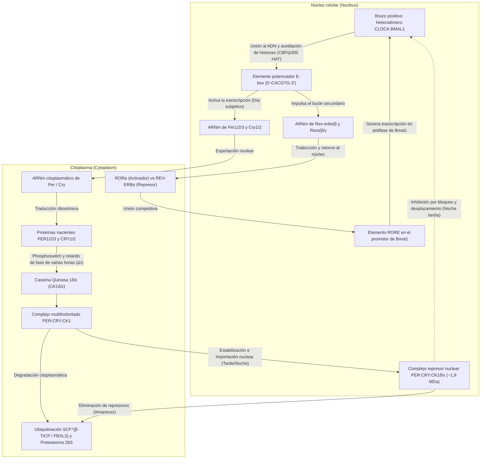
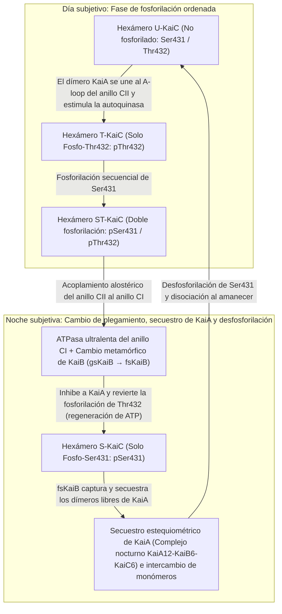

Si un ser humano, una planta, una mosca de la fruta o un cultivo de bacterias fotosintéticas queda encerrado en una cueva subterránea profunda o en una cámara oscura completamente aislada de la luz solar y de las fluctuaciones de temperatura, ¿pierde el organismo la noción del día y de la noche?

Sorprendentemente, la respuesta es no. Incluso bajo condiciones de <strong>oscuridad constante (Constant Darkness, DD)</strong>, prácticamente todos los seres vivos de la Tierra —desde las cianobacterias unicelulares y los hongos hasta las plantas, los insectos y los mamíferos— mantienen una <strong>oscilación autónoma con un período de aproximadamente 24 horas</strong>. Los ciclos de sueño y vigilia, la temperatura corporal central, la secreción de cortisol y melatonina, la presión arterial, la vigilancia inmunitaria y la expresión del 10 % al 40 % de todos los genes codificantes de proteínas están gobernados por péndulos moleculares dentro de cada célula.

Sin embargo, desde la perspectiva de la físico-química y la dinámica no lineal, este reloj intracelular plantea tres profundos acertijos científicos:

1. <strong>La paradoja de la escala temporal y la estabilidad (Dinámica no lineal)</strong>: Las reacciones bioquímicas elementales (unión de factores de transcripción, traducción, fosforilación) ocurren en milisegundos o minutos. Además, un bucle simple de retroalimentación negativa de dos variables se amortigua inevitablemente hasta detenerse en un punto de equilibrio. ¿Cómo logra una red molecular, mediante una <strong>bifurcación de Hopf</strong>, sostener una <strong>oscilación de ciclo límite (Limit-Cycle Oscillation)</strong> con un período de $86.400\text{ segundos}$ ($24\text{ horas}$)?
2. <strong>El dogma de la transcripción genética frente a los relojes puramente proteicos (Biología molecular y estructural)</strong>: Durante décadas se creyó que todo reloj circadiano requería un <strong>bucle de retroalimentación de transcripción-traducción (TTFL)</strong> dependiente de ADN y ARNm. Pero en 2005, <strong>Takao Kondo</strong> y <strong>Masahiro Ishiura</strong> demolieron este dogma al demostrar que mezclar tan solo <strong>tres proteínas purificadas de cianobacterias (KaiA, KaiB y KaiC) con ATP en un tubo de ensayo</strong> —<strong>sin ADN, sin ARNm y sin ribosomas</strong>— genera una oscilación de fosforilación de 24 horas durante días.
3. <strong>El misterio biofísico de la compensación de temperatura ($Q_{10} \approx 1{,}0$)</strong>: Las velocidades de las reacciones químicas y enzimáticas obedecen a la <strong>ecuación de Arrhenius</strong>, $k(T) = A \exp(-E_a / RT)$, duplicándose o triplicándose por cada aumento de $10^\circ\text{C}$ ($Q_{10} \approx 2\text{–}3$). Si el reloj biológico siguiera la cinética ordinaria de Arrhenius, correría más del doble de rápido en una tarde cálida, volviéndose inútil para medir el tiempo. ¿Cómo logran los relojes biológicos un coeficiente térmico invariante de <strong>$Q_{10} \approx 0{,}95\text{–}1{,}05$</strong>?

---

## 1. De la planta *Mimosa pudica* (1729) a los mutantes de *Drosophila* y el Premio Nobel 2017

En 1729, el astrónomo francés <strong>Jean-Jacques d'Ortous de Mairan</strong> colocó la planta sensitiva <strong>*Mimosa pudica</strong>* en una bodega en <strong>oscuridad constante (DD)</strong> y observó que sus hojas seguían abriéndose cada mañana y cerrándose cada noche sin ver el sol. En 1832, el botánico suizo <strong>Augustin Pyramus de Candolle</strong> demostró que bajo condiciones constantes este ciclo se repite con un <strong>período de libre curso (Free-Running Period) $\tau \approx 22\text{–}23\,\text{h}$</strong>.

En ausencia de sincronizadores externos (<strong>Zeitgebers</strong>), cada especie muestra su propio período endógeno $\tau$: $\tau \approx 23{,}5\,\text{h}$ en el ratón, $\tau \approx 23{,}8\,\text{h}$ en la mosca *Drosophila melanogaster* y <strong>$\tau \approx 24{,}18\,\text{h}$ en el ser humano</strong> ($24\text{ h } 11\text{ min}$, medido por Charles Czeisler en 1999). El hecho de que $\tau$ difiera ligeramente de 24,00 horas demuestra que el oscilador es <strong>endógeno</strong>, término bautizado como <strong>circadiano</strong> por <strong>Franz Halberg</strong> en 1959 (del latín *circa*, «alrededor de», y *dies*, «día»).

En 1971, <strong>Ronald Konopka</strong> y <strong>Seymour Benzer</strong> (Caltech) descubrieron mediante mutagénesis en *Drosophila* tres alelos mutantes de un único gen en el cromosoma X llamado <strong>`period` ($per$)</strong>: <strong>$per^0$</strong> (arrítmico), <strong>$per^S$</strong> (período corto $\tau \approx 19\,\text{h}$) y <strong>$per^L$</strong> (período largo $\tau \approx 29\,\text{h}$). En 1984, <strong>Jeffrey C. Hall</strong>, <strong>Michael Rosbash</strong> y <strong>Michael W. Young</strong> clonaron el gen `period` y descifraron su mecanismo de retroalimentación negativa, hallazgo galardonado con el <strong>Premio Nobel de Fisiología o Medicina en 2017</strong>.

---

## 2. El bucle de retroalimentación transcripción-traducción (TTFL) en eucariotas

En los mamíferos, el heterodímero <strong>CLOCK:BMAL1</strong> se une a secuencias <strong>E-box (`5'-CACGTG-3'`)</strong> para activar la transcripción de <strong>`Per1/2/3`</strong> y <strong>`Cry1/2`</strong>. En el citoplasma, las proteínas PER monoméricas son fosforiladas por la <strong>Caseína Quinasa $1\delta/\varepsilon$ (CK1$\delta/\varepsilon$)</strong> y degradadas por <strong>$\text{SCF}^{\beta\text{-TrCP}}$</strong>. Tras un <strong>retardo de fase ($\Delta\tau$) de 4 a 6 horas</strong>, los complejos <strong>PER:CRY:CK1$\delta/\varepsilon$</strong> ($\sim 1{,}9\,\text{MDa}$) entran en el núcleo e inhiben a CLOCK:BMAL1 mediante <strong>bloqueo</strong> (CRY1) y <strong>desplazamiento del ADN</strong> (fosforilación de CLOCK mediada por PER2:CK1$\delta/\varepsilon$), estabilizados por el bucle secundario <strong>REV-ERB$\alpha/\beta$ / ROR$\alpha/\beta/\gamma$</strong> sobre elementos <strong>RORE</strong>.

En humanos, la mutación <strong>Ser662Gly en `PER2`</strong> (o <strong>Thr44Ala en `CSNK1D`/CK1$\delta$</strong>) impide la fosforilación estabilizadora del dominio FASP, acelera la degradación de PER2 vía Ser478, acorta el período a $\tau \approx 21{,}6\,\text{h}$ y causa el <strong>Síndrome Familiar de Fase del Sueño Avanzada (FASPS)</strong>: los pacientes se duermen a las 19:00 y <strong>se despiertan completamente alerta a las 3:00 de la madrugada</strong>. Por el contrario, la mutación $\text{CRY1}\,\Delta 11$ alarga $\tau$ y provoca el síndrome de fase retrasada (FDSPS).

---

## 3. Biología matemática de los osciladores genéticos: Modelo de Goodwin–Goldbeter y bifurcación de Hopf

En un sistema bidimensional de retroalimentación negativa sin retardo ($\dot{M} = f(P) - \gamma_M M,\; \dot{P} = k_s M - \gamma_P P$ con $f'(P) < 0$), la divergencia del campo vectorial es estrictamente negativa en todo el plano positivo:

$$\nabla \cdot \mathbf{F} = \frac{\partial \dot{M}}{\partial M} + \frac{\partial \dot{P}}{\partial P} = -\gamma_M - \gamma_P < 0$$

Por el <strong>criterio negativo de Bendixson</strong>, es matemáticamente imposible que exista una órbita cerrada (ciclo límite). Para cruzar una <strong>bifurcación de Hopf</strong>, <strong>Brian Goodwin (1965)</strong> y <strong>Albert Goldbeter (1995)</strong> formularon el modelo de tres variables ($M$, proteína citoplasmática $P_C$, proteína nuclear $P_N$):

$$\frac{dM}{dt} = \frac{v_s K_I^n}{K_I^n + P_N^n} - v_m \frac{M}{K_m + M}, \qquad \frac{dP_C}{dt} = k_s M - v_d \frac{P_C}{K_d + P_C} - k_1 P_C + k_2 P_N, \qquad \frac{dP_N}{dt} = k_1 P_C - k_2 P_N$$

La oscilación de ciclo límite requiere <strong>tres ingredientes matemáticos</strong>: (1) <strong>retroalimentación negativa</strong>, (2) <strong>un retardo de fase $\Delta\tau$ suficientemente largo</strong> (desfase de $180^\circ$) y (3) <strong>fuerte no linealidad / ultrasensibilidad</strong>. Con degradación lineal de primer orden, el teorema de Griffith (1968) exige un <strong>coeficiente de Hill $n > \sec^3(\pi/3) = 8$</strong>. Los relojes reales superan esta barrera mediante la <strong>degradación enzimática saturada de Michaelis-Menten (ultrasensibilidad de orden cero, $K_d \ll P_C$, Goldbeter 1995)</strong> y la <strong>titulación molecular / secuestro estequiométrico 1:1 de CLOCK:BMAL1 por PER:CRY (Kim & Forger, 2012)</strong>, que genera un umbral no lineal abrupto incluso con $n = 1$.

---

## 4. El asombroso descubrimiento de Takao Kondo y Masahiro Ishiura (2005): El reloj KaiABC en un tubo de ensayo

En 2005, <strong>Masato Nakajima</strong>, <strong>Takao Kondo</strong> y colaboradores (*Science*, 2005) demostraron en la cianobacteria *Synechococcus elongatus* PCC 7942 que mezclar únicamente <strong>tres proteínas purificadas (KaiA, KaiB y KaiC) más ATP</strong> en un tubo de ensayo —sin ADN ni ARNm— reconstituye una oscilación de fosforilación de 24 horas compensada térmicamente (<strong>oscilador postraduccional, PTO</strong>).

El hexámero de doble anillo <strong>KaiC</strong> (anillos CI y CII) es la ATPasa más lenta de la naturaleza, hidrolizando tan solo <strong>$\sim 15\text{ moléculas de ATP por monómero al día}$</strong>. Durante el día, <strong>KaiA</strong> estimula la autofosforilación ordenada de <strong>Thr432 (T)</strong> y <strong>Ser431 (S)</strong> ($\text{U} \to \text{T} \to \text{ST}$). Al fosforilarse Ser431, el acoplamiento alostérico activa la hidrólisis de ATP en el anillo CI, donde la <strong>proteína metamórfica KaiB</strong> cambia radicalmente su plegamiento tridimensional (<strong>gsKaiB $\to$ fsKaiB</strong> tipo tiorredoxina), se une al anillo CI y <strong>secuestra todo el KaiA libre</strong> en el complejo nocturno $\text{KaiA}_{12}\text{KaiB}_6\text{KaiC}_6$. Sin KaiA, KaiC se desfosforila regenerando ATP a partir de ADP ($\text{ST} \to \text{S} \to \text{U}$) y sincroniza los hexámeros mediante <strong>intercambio de monómeros (monomer shuffling)</strong>.

| Característica | Relojes eucariotas (Mamíferos, Insectos, Plantas, Hongos) | Reloj central de cianobacterias (Sistema KaiABC) |
| :--- | :--- | :--- |
| <strong>Arquitectura</strong> | <strong>Bucle transcripción-traducción (TTFL)</strong> | <strong>Oscilador postraduccional (PTO)</strong> (acoplado a TTFL in vivo) |
| <strong>Reconstitución in vitro</strong> | Imposible sin núcleo, ribosomas ni proteasoma | <strong>Completa</strong> con <strong>KaiA + KaiB + KaiC + ATP + $\text{Mg}^{2+}$</strong> purificados |
| <strong>Elemento positivo</strong> | Factores de transcripción (<strong>CLOCK:BMAL1</strong>, CLK:CYC, WC-1:WC-2) | <strong>Dímero KaiA</strong> (se une al A-loop de CII y estimula la autoquinasa) |
| <strong>Elemento negativo</strong> | Complejos represores (<strong>PER:CRY</strong>, PER:TIM, FRQ) + <strong>CK1$\delta/\varepsilon$</strong> | <strong>KaiB metamórfico (fsKaiB)</strong> mediante <strong>secuestro estequiométrico de KaiA</strong> |
| <strong>Origen del retardo $\Delta\tau$</strong> | Transcripción, traducción, fosforilación CK1, importación nuclear | <strong>ATPasa CI ultralenta ($\sim 15\,\text{ATP/día}$)</strong> + <strong>cambio de plegamiento de KaiB</strong> |
| <strong>Compensación térmica</strong> | $Q_{10} \approx 0{,}95\text{–}1{,}05$ (autoinhibición de CK1$\delta/\varepsilon$ y phosphoswitch PER2) | $Q_{10} \approx 1{,}0$ (alostería estructural intrínseca de la ATPasa KaiC) |

---

## 5. El misterio de la compensación de temperatura ($Q_{10} \approx 1{,}0$)

Mientras que la <strong>ecuación de Arrhenius</strong> $k(T) = A \exp(-E_a / RT)$ impone un $Q_{10} = \frac{k(T+10)}{k(T)} \approx 2\text{–}3$ a las reacciones ordinarias, los relojes circadianos logran $Q_{10} \approx 1{,}0$ mediante dos principios:

1. <strong>Equilibrio antagónico de Peter Ruoff (1992)</strong>:
   En términos de los coeficientes de control del período $C_i^\tau = \frac{\partial \ln \tau}{\partial \ln k_i}$ ($\sum_i C_i^\tau = -1$) y las energías de activación $E_{a,i}$:
   $$\frac{d \ln \tau}{d T} = \sum_{i=1}^{N} \frac{\partial \ln \tau}{\partial \ln k_i} \frac{d \ln k_i}{d T} = \frac{1}{R T^2} \sum_{i=1}^{N} C_i^{\tau} E_{a,i} \approx 0$$
   Las reacciones que acortan el período ($C_i^\tau < 0$) se compensan exactamente con las reacciones antagónicas que lo alargan ($C_j^\tau > 0$).
2. <strong>Compensación intrínseca en las enzimas CK1$\delta/\varepsilon$ y KaiC</strong>:
   <strong>Terauchi y Kondo (2007)</strong> demostraron que la actividad ATPasa basal de KaiC por sí sola tiene $Q_{10} \approx 1{,}0$. Asimismo, <strong>Yasushi Isojima, Yusuke Shinohara y Hiroki R. Ueda (2009, 2017)</strong> descubrieron que la fosforilación de PER2 por <strong>CK1$\delta/\varepsilon$</strong> in vitro está compensada térmicamente ($Q_{10} \approx 1{,}0$), ya que la aceleración catalítica a mayor temperatura es contrarrestada por una mayor afinidad por el producto fosforilado (inhibición por producto mediada por el bolsillo aniónico K224).

---

## 6. El núcleo supraquiasmático (SCN), la melanopsina y la cronomedicina

Para sincronizar el reloj humano ($\tau \approx 24{,}18\,\text{h}$) con el día solar de 24,00 horas (<strong>fotoentrenamiento</strong>), el 1–2 % de las células ganglionares de la retina (<strong>ipRGCs</strong>) expresan <strong>melanopsina (OPN4)</strong>, sensible a la <strong>luz azul ($\lambda_{\text{max}} \approx 480\,\text{nm}$)</strong>. A través del tracto retinohipotalámico (RHT), liberan glutamato y PACAP en el <strong>núcleo supraquiasmático (SCN)</strong>, fosforilando a <strong>CREB</strong> e induciendo la transcripción aguda de <strong>*Per1/2</strong>* según la <strong>curva de respuesta de fase (PRC)</strong>: retraso de fase al anochecer y avance de fase al amanecer.

En el SCN, unas <strong>20.000 neuronas</strong> acopladas mediante <strong>VIP</strong>, <strong>AVP</strong> y <strong>GABA</strong> forman una red de osciladores de Kuramoto. El <strong>jet lag</strong> se produce por la <strong>desincronización interna</strong> entre el SCN (reajustado rápidamente por la luz) y los relojes periféricos (hígado, tracto gastrointestinal) sincronizados por el horario de las comidas. En <strong>cronomedicina</strong>, administrar estatinas de vida corta antes de dormir, aplicar quimioterapia cronomodulada (5-FU y oxaliplatino según Francis Lévi) y programar las <strong>infusiones de inmunoterapia (inhibidores de PD-1 como pembrolizumab o nivolumab) por la mañana en lugar de por la tarde casi duplica la supervivencia global en pacientes con melanoma y cáncer de pulmón</strong> (*Qian et al., Lancet Oncology, 2021*).
