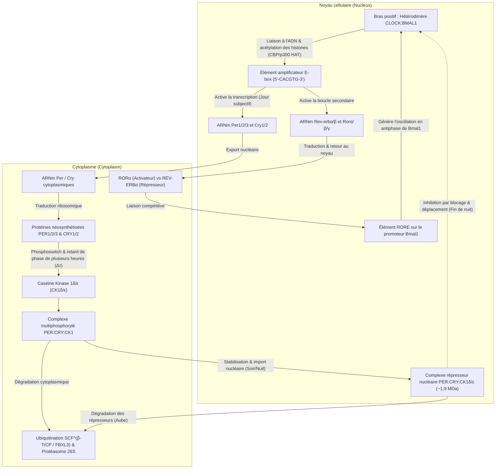
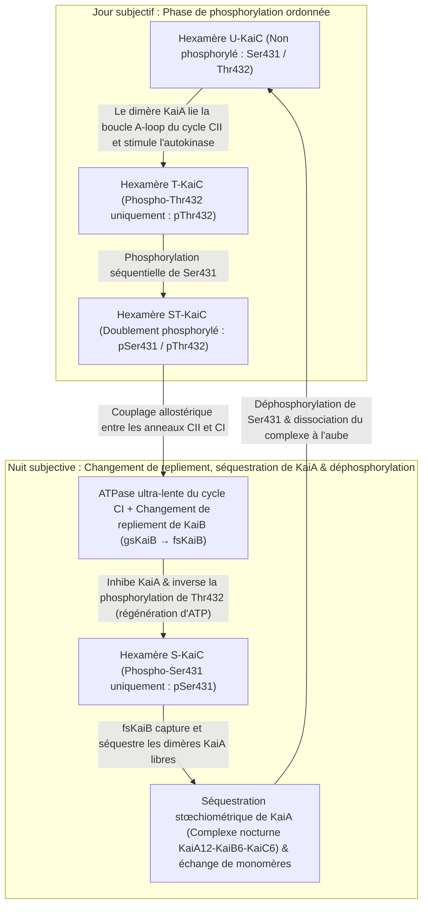

Si un être humain, une plante, une drosophile ou une culture de bactéries photosynthétiques est enfermé au fond d'une grotte souterraine ou dans une chambre noire totalement isolée de la lumière du soleil et des variations de température, l'organisme perd-il pour autant la notion du jour et de la nuit ?

Étonnamment, la réponse est non. Même placés en <strong>obscurité constante (Constant Darkness, DD)</strong>, presque tous les êtres vivants sur Terre — des cyanobactéries unicellulaires et des champignons aux plantes, insectes et mammifères — maintiennent une <strong>oscillation autonome d'une période d'environ 24 heures</strong>. Le cycle veille-sommeil, la température corporelle centrale, les pics hormonaux de cortisol et de mélatonine, la pression artérielle, la réponse immunitaire ainsi que l'expression de 10 % à 40 % des gènes codant pour des protéines sont gouvernés par de véritables pendules moléculaires nichées au cœur de chaque cellule.

Pourtant, du point de vue de la physico-chimie et de la dynamique non linéaire, cette horloge intracellulaire soulève trois profonds paradoxes scientifiques :

1. <strong>Le paradoxe de l'échelle de temps et de la stabilité (Dynamique non linéaire)</strong> : Les réactions biochimiques élémentaires (liaison des facteurs de transcription, traduction, phosphorylation) s'accomplissent en quelques millisecondes à quelques minutes. De plus, une simple boucle de rétroaction négative à deux variables s'amortit inévitablement vers un état stationnaire fixe. Comment un réseau moléculaire parvient-il, via une <strong>bifurcation de Hopf</strong>, à engendrer une <strong>oscillation auto-entretenue de cycle limite (Limit-Cycle Oscillation)</strong> dont la période atteint $86\,400\text{ secondes}$ ($24\text{ heures}$) ?
2. <strong>Le dogme de la transcription génétique face aux horloges purement protéiques (Biologie moléculaire et structurale)</strong> : Pendant des décennies, les chronobiologistes ont pensé que toute horloge circadienne reposait nécessairement sur une <strong>boucle de rétroaction transcription-traduction (TTFL)</strong> impliquant l'ADN et l'ARNm. Or, en 2005, l'équipe de <strong>Takao Kondo</strong> et <strong>Masahiro Ishiura</strong> a pulvérisé ce dogme en démontrant que le simple mélange de <strong>trois protéines purifiées de cyanobactéries (KaiA, KaiB et KaiC) et d'ATP dans un tube à essai</strong> — <strong>sans aucune trace d'ADN, d'ARNm ni de ribosomes</strong> — suffit à générer un cycle de phosphorylation de 24 heures parfaitement stable pendant plusieurs jours !
3. <strong>L'énigme biophysique de la compensation thermique ($Q_{10} \approx 1{,}0$)</strong> : Les vitesses des réactions chimiques et enzymatiques obéissent à la <strong>loi d'Arrhenius</strong>, $k(T) = A \exp(-E_a / RT)$, doublant ou triplant pour chaque hausse de température de $10^\circ\text{C}$ ($Q_{10} \approx 2\text{–}3$). Si notre horloge biologique suivait la cinétique d'Arrhenius ordinaire, elle tournerait deux fois plus vite lors d'une journée chaude, devenant inutilisable. Comment les horloges circadiennes parviennent-elles à stabiliser leur période avec un coefficient thermique de <strong>$Q_{10} \approx 0{,}95\text{–}1{,}05$</strong> ?

---

## 1. De la sensitive *Mimosa pudica* (1729) aux mutants *Drosophila* et au prix Nobel 2017

En 1729, l'astronome français <strong>Jean-Jacques d'Ortous de Mairan</strong> plaça une plante sensitive (<strong>*Mimosa pudica</strong>*), connue pour déployer ses feuilles le jour et les replier la nuit, au fond d'une cave à vin plongée dans l'<strong>obscurité constante (DD)</strong>. Malgré l'absence totale de lumière solaire, la plante continua d'ouvrir ses feuilles chaque matin et de les fermer chaque soir. En 1832, le botaniste suisse <strong>Augustin Pyramus de Candolle</strong> mesura qu'en conditions constantes, ce cycle se répète non pas en exactement 24,0 heures, mais avec une <strong>période en libre cours (Free-Running Period) $\tau \approx 22\text{–}23\,\text{h}$</strong>.

En l'absence de tout donneur de temps externe (<strong>Zeitgeber</strong>), chaque espèce révèle sa période endogène $\tau$ : $\tau \approx 23{,}5\,\text{h}$ chez la souris, $\tau \approx 23{,}8\,\text{h}$ chez la drosophile et <strong>$\tau \approx 24{,}18\,\text{h}$ chez l'être humain</strong> ($24\text{ h } 11\text{ min}$, mesurée par Charles Czeisler en 1999). Cet écart léger mais reproductible par rapport à 24,00 heures prouve le caractère <strong>endogène</strong> de l'oscillateur, baptisé <strong>rythme circadien</strong> par <strong>Franz Halberg</strong> en 1959 (du latin *circa*, « environ », et *dies*, « jour »).

En 1971, <strong>Ronald Konopka</strong> et <strong>Seymour Benzer</strong> (Caltech) identifièrent par mutagenèse chez *Drosophila melanogaster* trois allèles mutants d'un seul et même gène situé sur le chromosome X, nommé <strong>`period` ($per$)</strong> : <strong>$per^0$</strong> (arythmique), <strong>$per^S$</strong> (période courte $\tau \approx 19\,\text{h}$) et <strong>$per^L$</strong> (période longue $\tau \approx 29\,\text{h}$). En 1984, <strong>Jeffrey C. Hall</strong>, <strong>Michael Rosbash</strong> et <strong>Michael W. Young</strong> clonèrent le gène `period` et élucidèrent le mécanisme moléculaire d'autorégulation négative, travaux couronnés par le <strong>prix Nobel de physiologie ou médecine 2017</strong>.

---

## 2. La boucle de rétroaction transcription-traduction (TTFL) chez les eucaryotes

Chez les mammifères, les facteurs de transcription bHLH-PAS <strong>CLOCK</strong> et <strong>BMAL1</strong> forment l'hétérodimère <strong>CLOCK:BMAL1</strong>, qui se lie aux séquences <strong>E-box (`5'-CACGTG-3'`)</strong> pour activer la transcription des gènes <strong>`Per1/2/3`</strong> et <strong>`Cry1/2`</strong>. Dans le cytoplasme, les protéines PER monomériques sont phosphorylées par la <strong>Caséine Kinase $1\delta/\varepsilon$ (CK1$\delta/\varepsilon$)</strong> et dégradées via l'ubiquitine ligase <strong>$\text{SCF}^{\beta\text{-TrCP}}$</strong>. Après un <strong>retard de phase ($\Delta\tau$) de 4 à 6 heures</strong>, les complexes <strong>PER:CRY:CK1$\delta/\varepsilon$</strong> ($\sim 1{,}9\,\text{MDa}$) pénètrent dans le noyau et inhibent CLOCK:BMAL1 par <strong>blocage</strong> (via CRY1) et <strong>déplacement hors de l'ADN</strong> (phosphorylation de CLOCK par PER2:CK1$\delta/\varepsilon$). Une boucle secondaire entrelacée mettant en jeu les récepteurs nucléaires <strong>REV-ERB$\alpha/\beta$</strong> (répresseur) et <strong>ROR$\alpha/\beta/\gamma$</strong> (activateur) sur les éléments <strong>RORE</strong> du promoteur *Bmal1* stabilise l'ensemble du réseau.

Chez l'humain, la mutation <strong>Ser662Gly du gène `PER2`</strong> (ou <strong>Thr44Ala de `CSNK1D`/CK1$\delta$</strong>) abolit la phosphorylation stabilisatrice de la région FASP, accélère la dégradation de PER2 via le dégron Ser478, raccourcit la période à $\tau \approx 21{,}6\,\text{h}$ et provoque le <strong>syndrome familial d'avance de phase du sommeil (FASPS)</strong> : les patients s'endorment vers 19 h et <strong>se réveillent spontanément à 3 h du matin</strong> ! À l'inverse, la mutation $\text{CRY1}\,\Delta 11$ prolonge la répression transcriptionnelle et cause le syndrome de retard de phase (FDSPS).

---

## 3. Biologie mathématique des oscillateurs génétiques : Modèle de Goodwin–Goldbeter et bifurcation de Hopf

Pourquoi une boucle de rétroaction négative à deux variables ($\dot{M} = f(P) - \gamma_M M,\; \dot{P} = k_s M - \gamma_P P$ avec $f'(P) < 0$) sans retard explicite ne peut-elle jamais osciller de façon soutenue ? Parce que la divergence du champ de vecteurs plan $\mathbf{F}$ est partout strictement négative :

$$\nabla \cdot \mathbf{F} = \frac{\partial \dot{M}}{\partial M} + \frac{\partial \dot{P}}{\partial P} = -\gamma_M - \gamma_P < 0$$

D'après le <strong>critère négatif de Bendixson</strong>, aucun cycle limite périodique ne peut exister dans le quadrant positif ($\operatorname{Tr}(J) < 0, \det(J) > 0$). Pour franchir une <strong>bifurcation de Hopf</strong> et générer une oscillation de cycle limite, <strong>Brian Goodwin (1965)</strong> et <strong>Albert Goldbeter (1995)</strong> ont formulé le système à trois variables ($M$, protéine cytoplasmique $P_C$, protéine nucléaire $P_N$) :

$$\frac{dM}{dt} = \frac{v_s K_I^n}{K_I^n + P_N^n} - v_m \frac{M}{K_m + M}, \qquad \frac{dP_C}{dt} = k_s M - v_d \frac{P_C}{K_d + P_C} - k_1 P_C + k_2 P_N, \qquad \frac{dP_N}{dt} = k_1 P_C - k_2 P_N$$

Une oscillation soutenue exige <strong>trois ingrédients mathématiques</strong> : (1) <strong>une rétroaction négative</strong>, (2) <strong>un retard de phase $\Delta\tau$ suffisant</strong> (déphasage de $180^\circ$), et (3) <strong>une forte non-linéarité / ultrasensibilité</strong>. Dans le modèle de Goodwin à dégradation linéaire d'ordre 1, l'équation caractéristique $(\lambda + \gamma)^3 + G = 0$ impose un <strong>coefficient de Hill $n > \sec^3(\pi/3) = 8$</strong> (théorème de Griffith, 1968). Les horloges biologiques réelles franchissent cette barrière sans coopérativité irréaliste grâce à la <strong>saturation enzymatique de Michaelis-Menten (ultrasensibilité d'ordre zéro, $K_d \ll P_C$, Goldbeter 1995)</strong> et au <strong>titrage moléculaire par séquestration stœchiométrique 1:1 de CLOCK:BMAL1 par PER:CRY (Kim & Forger, 2012)</strong>, qui produit un seuil non linéaire abrupt même pour $n = 1$.

---

## 4. La découverte stupéfiante de Takao Kondo et Masahiro Ishiura (2005) : L'horloge protéique KaiABC en tube à essai

En 2005, <strong>Masato Nakajima</strong>, <strong>Takao Kondo</strong> et leurs collègues (*Science*, 2005) ont démontré chez la cyanobactérie *Synechococcus elongatus* PCC 7942 qu'en mélangeant simplement <strong>trois protéines purifiées (KaiA, KaiB, KaiC) et de l'ATP</strong> dans un tube à essai — sans ADN ni ARNm — la phosphorylation de l'hexamère KaiC oscille avec une période de 24 heures compensée en température (<strong>oscillateur post-traductionnel, PTO</strong>).

L'hexamère <strong>KaiC</strong> à double anneau (CI et CII) est l'ATPase la plus lente connue du monde vivant, n'hydrolysant qu'<strong>environ 15 molécules d'ATP par monomère et par jour</strong>. Le jour, <strong>KaiA</strong> stimule l'autophosphorylation ordonnée de KaiC sur <strong>Thr432 (T)</strong> puis <strong>Ser431 (S)</strong> ($\text{U} \to \text{T} \to \text{ST}$). La phosphorylation de Ser431 déclenche allostériquement l'hydrolyse de l'ATP dans l'anneau CI, permettant à la <strong>protéine métamorphique KaiB</strong> de changer radicalement son repliement tridimensionnel (<strong>gsKaiB $\to$ fsKaiB</strong> de type thiorédoxine), de se lier à l'anneau CI et de <strong>séquestrer tout le KaiA libre</strong> au sein du complexe nocturne $\text{KaiA}_{12}\text{KaiB}_6\text{KaiC}_6$. Privé de KaiA, KaiC se déphosphoryle en régénérant de l'ATP à partir d'ADP ($\text{ST} \to \text{S} \to \text{U}$) tout en synchronisant la population par <strong>échange de monomères (monomer shuffling)</strong>.

| Caractéristique | Horloges eucaryotes (Mammifères, Insectes, Plantes, Champignons) | Horloge centrale des cyanobactéries (Système KaiABC) |
| :--- | :--- | :--- |
| <strong>Architecture</strong> | <strong>Boucle transcription-traduction (TTFL)</strong> | <strong>Oscillateur post-traductionnel (PTO)</strong> (couplé à une TTFL in vivo) |
| <strong>Reconstitution in vitro</strong> | Impossible sans noyau, ribosomes et protéasome | <strong>Totale</strong> avec <strong>KaiA + KaiB + KaiC + ATP + $\text{Mg}^{2+}$</strong> purifiés |
| <strong>Élément positif</strong> | Facteurs de transcription (<strong>CLOCK:BMAL1</strong>, CLK:CYC, WC-1:WC-2) | <strong>Dimère KaiA</strong> (lie la boucle A-loop de CII et active l'autokinase) |
| <strong>Élément négatif</strong> | Complexes répresseurs (<strong>PER:CRY</strong>, PER:TIM, FRQ) + <strong>CK1$\delta/\varepsilon$</strong> | <strong>KaiB métamorphique (fsKaiB)</strong> séquestrant stœchiométriquement <strong>KaiA</strong> |
| <strong>Origine du délai $\Delta\tau$</strong> | Transcription, traduction, phosphorylation CK1, import nucléaire | <strong>ATPase CI ultra-lente ($\sim 15\,\text{ATP/jour}$)</strong> + <strong>bascule de repliement KaiB</strong> |
| <strong>Compensation thermique</strong> | $Q_{10} \approx 0{,}95\text{–}1{,}05$ (auto-inhibition de CK1$\delta/\varepsilon$ & phosphoswitch PER2) | $Q_{10} \approx 1{,}0$ (allostérie structurale intrinsèque de l'ATPase KaiC) |

---

## 5. L'énigme de la compensation thermique ($Q_{10} \approx 1{,}0$)

Alors que la <strong>loi d'Arrhenius</strong> $k(T) = A \exp(-E_a / RT)$ impose un facteur $Q_{10} = \frac{k(T+10)}{k(T)} \approx 2\text{–}3$ aux réactions biochimiques ordinaires, les horloges circadiennes maintiennent $Q_{10} \approx 1{,}0$ grâce à deux mécanismes :

1. <strong>L'équilibre antagoniste de Peter Ruoff (1992)</strong> :
   En fonction des coefficients de contrôle de la période $C_i^\tau = \frac{\partial \ln \tau}{\partial \ln k_i}$ ($\sum_i C_i^\tau = -1$) et des énergies d'activation $E_{a,i}$, la dérivation thermique de la période $\tau$ donne :
   $$\frac{d \ln \tau}{d T} = \sum_{i=1}^{N} \frac{\partial \ln \tau}{\partial \ln k_i} \frac{d \ln k_i}{d T} = \frac{1}{R T^2} \sum_{i=1}^{N} C_i^{\tau} E_{a,i} \approx 0$$
   La compensation résulte de l'annulation mutuelle entre les réactions qui raccourcissent la période ($C_i^\tau < 0$) et celles qui l'allongent ($C_j^\tau > 0$).
2. <strong>La compensation enzymatique intrinsèque de CK1$\delta/\varepsilon$ et KaiC</strong> :
   <strong>Terauchi & Kondo (2007)</strong> ont établi que l'activité ATPase basale de KaiC seul possède déjà un $Q_{10} \approx 1{,}0$. De même, <strong>Yasushi Isojima, Yusuke Shinohara et Hiroki R. Ueda (2009, 2017)</strong> ont démontré que la phosphorylation de PER2 par <strong>CK1$\delta/\varepsilon$</strong> in vitro est intrinsèquement compensée en température ($Q_{10} \approx 1{,}0$) : l'accélération thermique du transfert catalytique de phosphate est exactement contrebalancée par une affinité accrue (via la poche anionique K224) pour le produit phosphorylé, freinant sa libération.

---

## 6. Le noyau suprachiasmatique (SCN), la mélanopsine et la chronomédecine

Pour synchroniser l'horloge humaine ($\tau \approx 24{,}18\,\text{h}$) sur le cycle solaire de 24,00 heures (<strong>entraînement photique</strong>), 1 à 2 % des cellules ganglionnaires de la rétine (<strong>ipRGCs</strong>) expriment la <strong>mélanopsine (OPN4)</strong>, sensible à la <strong>lumière bleue ($\lambda_{\text{max}} \approx 480\,\text{nm}$)</strong>. Via la voie rétinohypothalamique (RHT), le signal lumineux libère du glutamate et du PACAP dans le <strong>noyau suprachiasmatique (SCN)</strong>, activant la phosphorylation de <strong>CREB</strong> et l'induction immédiate des gènes <strong>*Per1/2</strong>* selon la <strong>courbe de réponse de phase (PRC)</strong> : retard de phase en début de nuit (effet délétère des écrans bleus le soir) et avance de phase à l'aube.

Au sein du SCN, environ <strong>20 000 neurones</strong> couplés par les neuropeptides <strong>VIP</strong>, <strong>AVP</strong> et le <strong>GABA</strong> forment un réseau d'oscillateurs de Kuramoto ultra-précis. Lors d'un vol transméridien, le <strong>décalage horaire (jet lag)</strong> naît de la <strong>désynchronisation interne</strong> entre le SCN recalé par la lumière et les horloges périphériques (foie, tube digestif) entraînées plus lentement par les repas. En <strong>chronomédecine</strong>, ce chronométrage moléculaire transforme la clinique : prise vespérale des statines à demi-vie courte, chronochimiothérapie du cancer colorectal (5-FU et oxaliplatine selon Francis Lévi), et surtout <strong>immunothérapie anticancéreuse (inhibiteurs de point de contrôle anti-PD-1 tels que le pembrolizumab ou le nivolumab)</strong>, dont les études cliniques récentes (*Qian et al., Lancet Oncology, 2021*) montrent qu'une <strong>perfusion administrée le matin plutôt que l'après-midi double presque la survie globale des patients</strong> grâce au pic matinal d'infiltration tumorale des lymphocytes T $\text{CD8}^+$.
