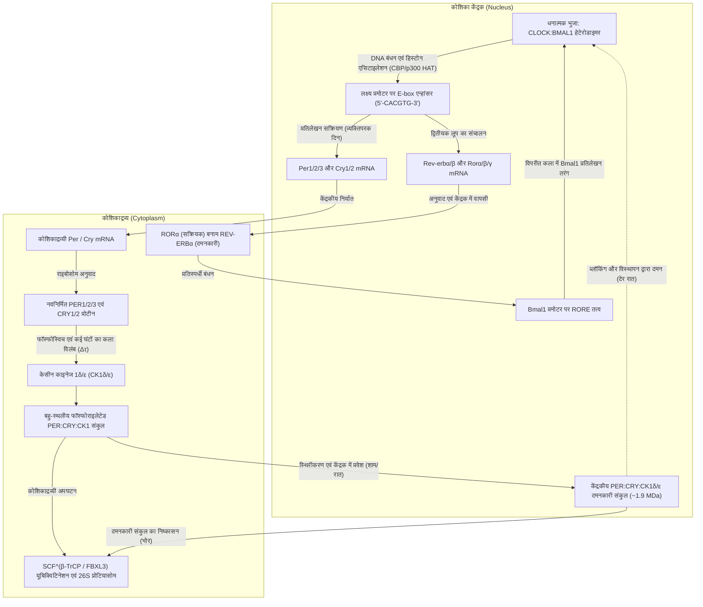
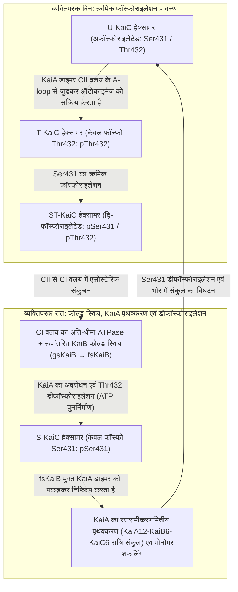

यदि किसी मनुष्य, पौधे, फल मक्खी (ड्रोसोफिला) या प्रकाश-संश्लेषी जीवाणुओं को सूर्य के प्रकाश और बाहरी तापमान के उतार-चढ़ाव से पूरी तरह अलग किसी गहरी भूमिगत गुफा या बिना खिड़की वाले अंधेरे कमरे में बंद कर दिया जाए, तो क्या वह जीव दिन और रात का भान खो देगा?

आश्चर्यजनक रूप से, उत्तर 'नहीं' है। <strong>निरंतर अंधकार (Constant Darkness, DD)</strong> की स्थिति में भी, एककोशिकीय साइनोबैक्टीरिया और कवक से लेकर पौधों, कीटों और स्तनधारियों तक, पृथ्वी के लगभग सभी जीव <strong>लगभग 24 घंटे की अवधि का स्वायत्त दोलन (autonomous oscillation)</strong> बनाए रखते हैं। सोने-जागने का चक्र, शरीर के आंतरिक तापमान का उतार-चढ़ाव, कोर्टिसोल और मेलाटोनिन हार्मोन का स्राव, रक्तचाप, प्रतिरक्षा निगरानी और संपूर्ण जीनोम के 10% से 40% प्रोटीन-कोडिंग जीनों की अभिव्यक्ति प्रत्येक कोशिका के भीतर चलने वाले 'आणविक लोलक' (molecular pendulum) द्वारा नियंत्रित होती है।

किंतु रासायनिक भौतिकी और अरैखिक गतिकी (Nonlinear Dynamics) की दृष्टि से इस अंतःकोशिकीय घड़ी में तीन गहरे वैज्ञानिक विरोधाभास छिपे हैं:

1. <strong>समय-मापनी और स्थिरता का विरोधाभास (अरैखिक गतिकी)</strong>: कोशिका के भीतर प्राथमिक जैव-रासायनिक अभिक्रियाएँ (ट्रांसक्रिप्शन कारकों का जुड़ना, अनुवाद, फॉस्फोराइलेशन) मिलीसेकंड से कुछ मिनटों में पूरी हो जाती हैं। इसके अलावा, नियंत्रण सिद्धांत में दो चरों वाला साधारण ऋणात्मक फीडबैक लूप अनिवार्य रूप से अवमंदित (damped) होकर स्थिर संतुलन अवस्था में रुक जाता है। फिर एक आणविक नेटवर्क <strong>होप्फ द्विभाजन (Hopf Bifurcation)</strong> के माध्यम से बिना रुके $86,400\text{ सेकंड}$ ($24\text{ घंटे}$) की अवधि वाला <strong>सीमा-चक्र स्व-दोलन (Limit-Cycle Oscillation)</strong> कैसे उत्पन्न करता है?
2. <strong>जीन प्रतिलेखन का सिद्धांत बनाम शुद्ध प्रोटीन घड़ी (आणविक एवं संरचनात्मक जीवविज्ञान)</strong>: दशकों तक यह माना जाता रहा कि प्रत्येक सर्केडियन घड़ी के लिए DNA और mRNA पर आधारित <strong>प्रतिलेखन-अनुवाद फीडबैक लूप (TTFL)</strong> अनिवार्य है। किंतु 2005 में, <strong>ताकाओ कोंडो (Takao Kondo)</strong> और <strong>मासाहिरो इशिउरा (Masahiro Ishiura)</strong> ने यह दिखाकर इस सिद्धांत को ध्वस्त कर दिया कि <strong>बिना किसी DNA, बिना mRNA और बिना राइबोसोम के</strong>, केवल एक परखनली (test tube) में <strong>साइनोबैक्टीरिया के तीन शुद्ध प्रोटीनों (KaiA, KaiB और KaiC) को ATP के साथ मिलाने मात्र से</strong> 24 घंटे का फॉस्फोराइलेशन चक्र कई दिनों तक चलता रहता है!
3. <strong>तापमान क्षतिपूर्ति (Temperature Compensation, $Q_{10} \approx 1.0$) का जैव-भौतिक रहस्य</strong>: सामान्य रासायनिक और एंजाइमी अभिक्रियाओं की दर <strong>आरहेनियस समीकरण (Arrhenius Equation)</strong> $k(T) = A \exp(-E_a / RT)$ का पालन करती है, अर्थात् तापमान में प्रत्येक $10^\circ\text{C}$ की वृद्धि पर गति 2 से 3 गुना बढ़ जाती है ($Q_{10} \approx 2\text{–}3$)। यदि जैविक घड़ी सामान्य आरहेनियस गतिकी का पालन करती, तो गर्म दोपहर में यह दोगुनी से भी अधिक तेज़ चलने लगती और समय बताने में पूरी तरह विफल हो जाती। जैविक घड़ियाँ किस प्रकार तापीय त्वरण को निरस्त कर <strong>$Q_{10} \approx 0.95\text{–}1.05$</strong> की स्थिर अवधि बनाए रखती हैं?

---

## 1. छुईमुई (*Mimosa pudica*, 1729) के प्रयोग से लेकर ड्रोसोफिला म्यूटेंट और 2017 के नोबेल पुरस्कार तक

1729 में, फ्रांसीसी खगोलशास्त्री <strong>जीन-जैक्स डी'ओर्टस डी मेरान (Jean-Jacques d'Ortous de Mairan)</strong> ने छुईमुई के पौधे (<strong>*Mimosa pudica</strong>*) को <strong>निरंतर अंधकार (DD)</strong> वाले तहखाने में रखा और पाया कि सूर्य के प्रकाश के बिना भी इसकी पत्तियाँ प्रतिदिन सुबह खुलती थीं और रात में बंद हो जाती थीं। 1832 में स्विस वनस्पतिशास्त्री <strong>ऑगस्टिन पिरामस डी कैंडोल</strong> ने सिद्ध किया कि स्थिर परिस्थितियों में यह चक्र ठीक 24.0 घंटे में नहीं, बल्कि <strong>मुक्त-चाल अवधि (Free-Running Period) $\tau \approx 22\text{–}23\,\text{घंटे}$</strong> में दोहराया जाता है।

बाहरी समय-संकेतों (<strong>ज़ाइटगेबर, Zeitgebers</strong>) के अभाव में प्रत्येक प्रजाति अपनी अंतर्जात अवधि $\tau$ प्रदर्शित करती है: चूहे में $\tau \approx 23.5\,\text{घंटे}$, *Drosophila melanogaster* में $\tau \approx 23.8\,\text{घंटे}$ और <strong>मनुष्य में $\tau \approx 24.18\,\text{घंटे}$</strong> ($24\text{ घंटे } 11\text{ मिनट}$, चार्ल्स सीज़लर द्वारा 1999 में मापा गया)। $\tau$ का 24.00 घंटे से थोड़ा भिन्न होना प्रमाणित करता है कि यह घड़ी कोशिका के भीतर <strong>अंतर्जात (Endogenous)</strong> है, जिसे 1959 में <strong>फ्रांज हालबर्ग</strong> ने <strong>सर्केडियन रिद्म (Circadian Rhythm / दैनिक लय)</strong> नाम दिया।

1971 में, <strong>रोनाल्ड कोनोप्का</strong> और <strong>सीमोर बेंज़र</strong> (कैलटेक) ने *Drosophila* में उत्परिवर्तन द्वारा X गुणसूत्र पर स्थित एकल जीन <strong>`period` ($per$)</strong> के तीन म्यूटेंट खोजे: <strong>$per^0$</strong> (लयहीन), <strong>$per^S$</strong> (लघु अवधि $\tau \approx 19\,\text{घंटे}$) और <strong>$per^L$</strong> (दीर्घ अवधि $\tau \approx 29\,\text{घंटे}$)। 1984 में `period` जीन की क्लोनिंग और ऋणात्मक फीडबैक तंत्र को स्पष्ट करने के लिए <strong>जेफ्री हॉल</strong>, <strong>माइकल रोसबाश</strong> और <strong>माइकल यंग</strong> को <strong>2017 का शरीर क्रिया विज्ञान या चिकित्सा का नोबेल पुरस्कार</strong> प्रदान किया गया।

---

## 2. यूकेरियोटिक प्रतिलेखन-अनुवाद फीडबैक लूप (TTFL) की आणविक कार्यप्रणाली

स्तनधारियों में <strong>CLOCK:BMAL1</strong> हेटेरोडाइमर <strong>E-box (`5'-CACGTG-3'`)</strong> अनुक्रमों से जुड़कर <strong>`Per1/2/3`</strong> और <strong>`Cry1/2`</strong> जीनों के प्रतिलेखन को सक्रिय करता है। कोशिकाद्रव्य में एकल PER प्रोटीन को <strong>केसीन काइनेज $1\delta/\varepsilon$ (CK1$\delta/\varepsilon$)</strong> द्वारा फॉस्फोराइलेट किया जाता है और <strong>$\text{SCF}^{\beta\text{-TrCP}}$</strong> द्वारा अपघटित किया जाता है। <strong>4 से 6 घंटे के कला विलंब ($\Delta\tau$)</strong> के बाद, स्थिर <strong>PER:CRY:CK1$\delta/\varepsilon$</strong> संकुल ($\sim 1.9\,\text{MDa}$) केंद्रक में प्रवेश करते हैं और <strong>ब्लॉकिंग</strong> (CRY1 द्वारा) तथा <strong>DNA से विस्थापन</strong> (PER2:CK1$\delta/\varepsilon$ द्वारा CLOCK के फॉस्फोराइलेशन) के माध्यम से CLOCK:BMAL1 को दबाते हैं, जिसे <strong>RORE</strong> तत्वों पर <strong>REV-ERB$\alpha/\beta$ / ROR$\alpha/\beta/\gamma$</strong> का द्वितीयक लूप स्थिरता प्रदान करता है।

मनुष्यों में <strong>`PER2` जीन के Ser662Gly उत्परिवर्तन</strong> (या <strong>`CSNK1D`/CK1$\delta$ के Thr44Ala</strong>) से FASP क्षेत्र का स्थिरीकरण करने वाला फॉस्फोराइलेशन रुक जाता है, जिससे PER2 का शीघ्र अपघटन होता है, अवधि घटकर $\tau \approx 21.6\,\text{घंटे}$ रह जाती है और <strong>पारिवारिक अग्रिम निद्रा कला सिंड्रोम (FASPS)</strong> उत्पन्न होता है: रोगी शाम 7 बजे सो जाते हैं और <strong>सुबह 3:00 बजे पूरी तरह जाग जाते हैं</strong>! इसके विपरीत, $\text{CRY1}\,\Delta 11$ उत्परिवर्तन $\tau$ को बढ़ाकर विलंबित निद्रा सिंड्रोम (FDSPS) उत्पन्न करता है।

---

## 3. आनुवंशिक दोलकों का गणितीय जीवविज्ञान: गुडविन–गोल्डबेटर मॉडल और होप्फ द्विभाजन

बिना समय विलंब वाले दो-चर ऋणात्मक फीडबैक तंत्र ($\dot{M} = f(P) - \gamma_M M,\; \dot{P} = k_s M - \gamma_P P$, जहाँ $f'(P) < 0$) में सदिश क्षेत्र का अपसरण (Divergence) सर्वत्र ऋणात्मक होता है:

$$\nabla \cdot \mathbf{F} = \frac{\partial \dot{M}}{\partial M} + \frac{\partial \dot{P}}{\partial P} = -\gamma_M - \gamma_P < 0$$

<strong>बेंडिक्सन के ऋणात्मक मानदंड (Bendixson's Negative Criterion)</strong> के अनुसार ऐसे समतल क्षेत्र में कोई भी बंद आवर्ती कक्षा (सीमा चक्र) अस्तित्व में नहीं हो सकती। <strong>होप्फ द्विभाजन (Hopf Bifurcation)</strong> द्वारा सतत दोलन उत्पन्न करने के लिए <strong>ब्रायन गुडविन (1965)</strong> और <strong>अल्बर्ट गोल्डबेटर (1995)</strong> ने तीन चरों ($M$, कोशिकाद्रव्यी प्रोटीन $P_C$, केंद्रकीय प्रोटीन $P_N$) का अवकल समीकरण मॉडल प्रस्तुत किया:

$$\frac{dM}{dt} = \frac{v_s K_I^n}{K_I^n + P_N^n} - v_m \frac{M}{K_m + M}, \qquad \frac{dP_C}{dt} = k_s M - v_d \frac{P_C}{K_d + P_C} - k_1 P_C + k_2 P_N, \qquad \frac{dP_N}{dt} = k_1 P_C - k_2 P_N$$

सीमा-चक्र दोलन के लिए <strong>तीन गणितीय घटक</strong> अनिवार्य हैं: (1) <strong>ऋणात्मक फीडबैक</strong>, (2) <strong>पर्याप्त कला विलंब $\Delta\tau$</strong> ($180^\circ$ कला विस्थापन), और (3) <strong>प्रबल अरैखिकता / अतिसंवेदनशीलता (Ultrasensitivity)</strong>। रैखिक प्रथम-कोटि अपघटन वाले गुडविन मॉडल में ग्रिफिथ प्रमेय (1968) के अनुसार <strong>हिल गुणांक $n > \sec^3(\pi/3) = 8$</strong> होना आवश्यक है। वास्तविक जैविक घड़ियाँ इस बाधा को <strong>माइकेलिस-मेंटेन एंजाइम संतृप्ति (शून्य-कोटि अतिसंवेदनशीलता, $K_d \ll P_C$, गोल्डबेटर 1995)</strong> तथा <strong>आणविक अनुमापन / PER:CRY द्वारा CLOCK:BMAL1 के 1:1 रससमीकरणमितीय पृथक्करण (Molecular Titration, Kim & Forger, 2012)</strong> के माध्यम से पार करती हैं, जिससे $n = 1$ पर भी तीव्र अरैखिक स्विच उत्पन्न होता है।

---

## 4. ताकाओ कोंडो और मासाहिरो इशिउरा की 2005 की क्रांतिकारी खोज: परखनली में KaiABC प्रोटीन घड़ी

2005 में, <strong>मासातो नाकाजिमा</strong>, <strong>ताकाओ कोंडो</strong> और सहयोगियों (*Science*, 2005) ने साइनोबैक्टीरिया *Synechococcus elongatus* PCC 7942 में प्रदर्शित किया कि परखनली में केवल <strong>तीन शुद्ध प्रोटीनों (KaiA, KaiB और KaiC) को ATP के साथ</strong> मिलाने पर — बिना किसी DNA या mRNA के — तापमान-क्षतिपूरित 24 घंटे का फॉस्फोराइलेशन दोलन स्वतः चलता रहता है (<strong>अनुवादोत्तर दोलक, PTO</strong>)।

दोहरे वलय वाला <strong>KaiC हेक्सामर</strong> (CI और CII वलय) प्रकृति का सबसे धीमा ज्ञात ATPase है, जो <strong>प्रति मोनोमर प्रतिदिन केवल $\sim 15\text{ ATP अणुओं}$</strong> का जल-अपघटन करता है। दिन में <strong>KaiA</strong> क्रमिक रूप से <strong>Thr432 (T)</strong> और <strong>Ser431 (S)</strong> के ऑटोफॉस्फोराइलेशन को प्रेरित करता है ($\text{U} \to \text{T} \to \text{ST}$)। Ser431 के फॉस्फोराइलेशन से एलोस्टेरिक रूप से CI वलय में ATP जल-अपघटन होता है, जिसके बाद <strong>रूपांतरित प्रोटीन (Metamorphic Protein) KaiB</strong> अपनी त्रि-आयामी संरचना को पूरी तरह बदलकर (<strong>gsKaiB $\to$ fsKaiB</strong> थायोरिडॉक्सिन-सदृश फोल्ड) CI वलय से जुड़ जाता है और <strong>सभी मुक्त KaiA को $\text{KaiA}_{12}\text{KaiB}_6\text{KaiC}_6$ रात्रि संकुल में कैद (Sequestration)</strong> कर लेता है। KaiA के अभाव में KaiC फॉस्फेट समूह को वापस ADP पर स्थानांतरित कर <strong>ATP का पुनर्निर्माण</strong> करते हुए डीफॉस्फोराइलेट होता है ($\text{ST} \to \text{S} \to \text{U}$) और <strong>मोनोमर शफलिंग</strong> द्वारा सभी हेक्सामरों की कला को तुल्यकालिक (synchronize) बनाता है।

| विशेषता | यूकेरियोटिक घड़ियाँ (स्तनधारी, कीट, पौधे, कवक) | साइनोबैक्टीरिया की मुख्य घड़ी (KaiABC तंत्र) |
| :--- | :--- | :--- |
| <strong>मूल दोलन सिद्धांत</strong> | <strong>प्रतिलेखन-अनुवाद फीडबैक लूप (TTFL)</strong> | <strong>अनुवादोत्तर दोलक (PTO)</strong> (जीव के भीतर TTFL से युग्मित) |
| <strong>परखनली में पुनर्गठन</strong> | केंद्रक, राइबोसोम और प्रोटियासोम के बिना असंभव | <strong>पूर्णतः संभव</strong> (केवल <strong>KaiA + KaiB + KaiC + ATP + $\text{Mg}^{2+}$</strong> से) |
| <strong>धनात्मक तत्व</strong> | प्रतिलेखन कारक (<strong>CLOCK:BMAL1</strong>, CLK:CYC, WC-1:WC-2) | <strong>KaiA डाइमर</strong> (CII वलय के A-loop से जुड़कर ऑटोकाइनेज सक्रियण) |
| <strong>ऋणात्मक तत्व</strong> | दमनकारी संकुल (<strong>PER:CRY</strong>, PER:TIM, FRQ) + <strong>CK1$\delta/\varepsilon$</strong> | <strong>फोल्ड-स्विच्ड KaiB (fsKaiB)</strong> द्वारा <strong>KaiA का रससमीकरणमितीय पृथक्करण</strong> |
| <strong>कला विलंब $\Delta\tau$ का स्रोत</strong> | प्रतिलेखन, अनुवाद, CK1 बहु-फॉस्फोराइलेशन, केंद्रक प्रवेश | <strong>अति-धीमा CI ATPase ($\sim 15\,\text{ATP/दिन}$)</strong> + <strong>KaiB फोल्ड-स्विच</strong> |
| <strong>तापमान क्षतिपूर्ति ($Q_{10}$)</strong> | $Q_{10} \approx 0.95\text{–}1.05$ (CK1$\delta/\varepsilon$ उत्पाद अवरोधन एवं PER2 स्विच) | $Q_{10} \approx 1.0$ (KaiC ATPase की आंतरिक संरचनात्मक एलोस्टेरी) |

---

## 5. तापमान क्षतिपूर्ति ($Q_{10} \approx 1.0$) के रहस्य का समाधान

जहाँ <strong>आरहेनियस समीकरण</strong> $k(T) = A \exp(-E_a / RT)$ सामान्य जैव-रासायनिक अभिक्रियाओं के लिए $Q_{10} = \frac{k(T+10)}{k(T)} \approx 2\text{–}3$ निर्धारित करता है, वहीं सर्केडियन घड़ियाँ दो सिद्धांतों से $Q_{10} \approx 1.0$ प्राप्त करती हैं:

1. <strong>पीटर रुओफ का विरोधी संतुलन सिद्धांत (Ruoff's Antagonistic Balance, 1992)</strong>:
   अवधि नियंत्रण गुणांकों $C_i^\tau = \frac{\partial \ln \tau}{\partial \ln k_i}$ ($\sum_i C_i^\tau = -1$) और सक्रियण ऊर्जाओं $E_{a,i}$ के पदों में:
   $$\frac{d \ln \tau}{d T} = \sum_{i=1}^{N} \frac{\partial \ln \tau}{\partial \ln k_i} \frac{d \ln k_i}{d T} = \frac{1}{R T^2} \sum_{i=1}^{N} C_i^{\tau} E_{a,i} \approx 0$$
   अवधि को घटाने वाली अभिक्रियाएँ ($C_i^\tau < 0$) और अवधि को बढ़ाने वाली विरोधी अभिक्रियाएँ ($C_j^\tau > 0$) एक-दूसरे के तापीय प्रभाव को पूर्णतः निरस्त कर देती हैं।
2. <strong>CK1$\delta/\varepsilon$ और KaiC एंजाइमों के भीतर अंतर्निहित क्षतिपूर्ति</strong>:
   <strong>Terauchi & Kondo (2007)</strong> ने दिखाया कि अकेले KaiC हेक्सामर की आधारभूत ATPase गतिविधि में ही $Q_{10} \approx 1.0$ का गुण मौजूद है। इसी प्रकार, <strong>यासुशी इसोजिमा, युसुके शिनोहारा और हिरोकी उएदा (2009, 2017)</strong> ने खोजा कि परखनली में <strong>CK1$\delta/\varepsilon$</strong> द्वारा PER2 का फॉस्फोराइलेशन स्वतः तापमान-क्षतिपूरित ($Q_{10} \approx 1.0$) होता है, क्योंकि उच्च तापमान पर उत्प्रेरक गति बढ़ने के साथ ही फॉस्फोराइलेटेड उत्पाद के प्रति एंजाइम की बंधुता (Lys224 ऋणायन पॉकेट के माध्यम से उत्पाद अवरोधन) बढ़ जाती है, जिससे उत्पाद का निष्कासन धीमा हो जाता है।

---

## 6. सुप्राकायास्मैटिक न्यूक्लियस (SCN), मेलानोप्सिन और क्रोनोमेडिसिन (Chronomedicine)

मनुष्य की अंतर्जात घड़ी ($\tau \approx 24.18\,\text{घंटे}$) को 24.00 घंटे के सौर दिन के साथ सिंक्रनाइज़ करने (<strong>प्रकाश-समकालन / Photoentrainment</strong>) के लिए रेटिना की 1–2% गैन्ग्लियन कोशिकाएँ (<strong>ipRGCs</strong>) <strong>नीले प्रकाश ($\lambda_{\text{max}} \approx 480\,\text{nm}$)</strong> के प्रति संवेदनशील फोटोपिगमेंट <strong>मेलानोप्सिन (Melanopsin / OPN4)</strong> व्यक्त करती हैं। रेटिनोहाइपोथैलेमिक पथ (RHT) के माध्यम से यह संकेत हाइपोथैलेमस के <strong>सुप्राकायास्मैटिक न्यूक्लियस (SCN)</strong> में ग्लूटामेट और PACAP मुक्त करता है, जिससे <strong>CREB</strong> का फॉस्फोराइलेशन होता है और <strong>कला प्रतिक्रिया वक्र (PRC)</strong> के अनुसार <strong>*Per1/2* जीनों का त्वरित प्रतिलेखन</strong> प्रेरित होता है: रात के प्रारंभ में नीले प्रकाश से कला विलंब (Phase Delay) और भोर के प्रकाश से कला अग्रगमन (Phase Advance)।

SCN के भीतर लगभग <strong>20,000 न्यूरॉन</strong> <strong>VIP</strong>, <strong>AVP</strong> और <strong>GABA</strong> के माध्यम से परस्पर जुड़कर कुरामोतो युग्मित दोलक नेटवर्क बनाते हैं। हवाई यात्रा के बाद <strong>जेट लैग (Jet Lag)</strong> प्रकाश से तुरंत रीसेट होने वाले SCN और भोजन के समय से धीरे-धीरे ढलने वाली परिधीय अंग घड़ियों (यकृत, पाचन तंत्र) के बीच <strong>आंतरिक विसमकालन (Internal Desynchronization)</strong> के कारण होता है। <strong>क्रोनोमेडिसिन</strong> में, कोलेस्ट्रॉल घटाने वाली अल्पकालिक स्टैटिन दवाओं को रात में लेना, कोलोरेक्टल कैंसर में समय-नियंत्रित कीमोथेरेपी (फ्रांसिस लेवी के अनुसार 5-FU और ऑक्सालिप्लैटिन), और <strong>कैंसर इम्यूनोथेरेपी (एंटी-PD-1 चेकपॉइंट अवरोधक जैसे पेम्ब्रोलिज़ुमाब या निवोलुमाब) का इन्फ्यूजन दोपहर या शाम के बजाय सुबह के समय देना मेलेनोमा और फेफड़ों के कैंसर के रोगियों की कुल उत्तरजीविता (Overall Survival) को लगभग दोगुना कर देता है</strong> (*Qian et al., Lancet Oncology, 2021*)।
