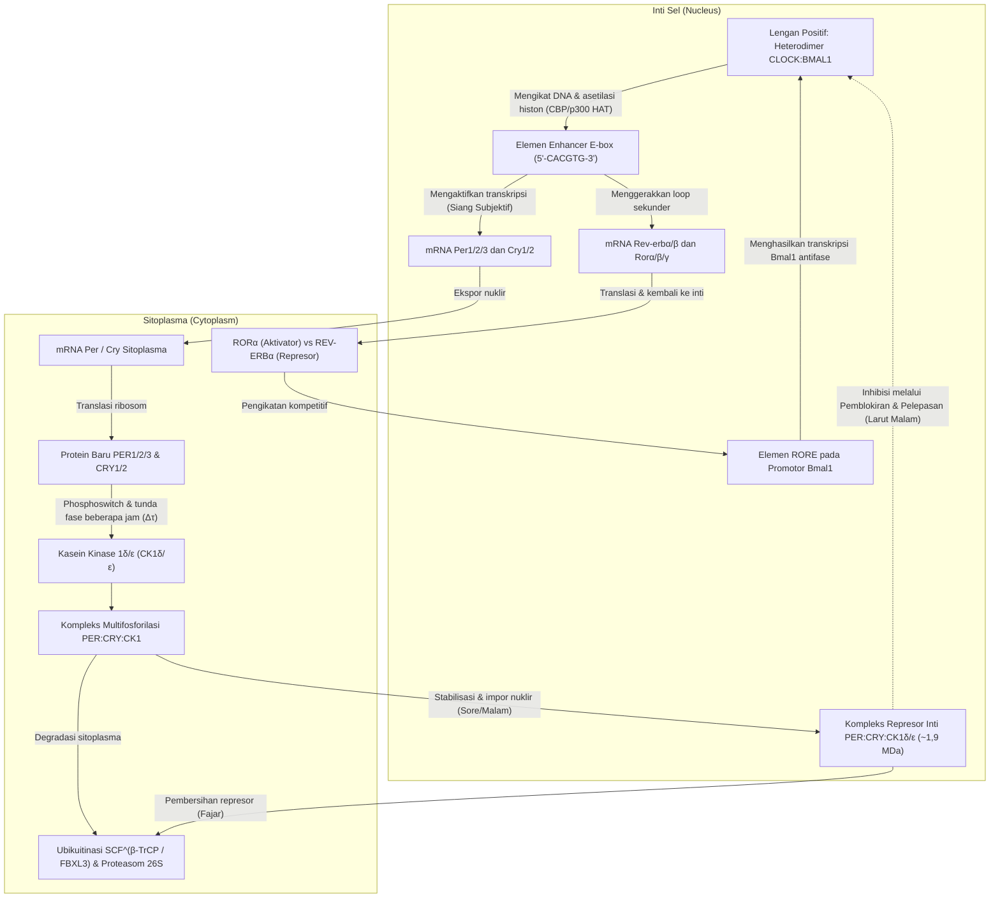
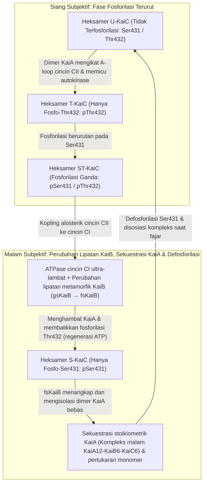

Jika seorang manusia, tanaman, lalat buah, atau kultur bakteri fotosintetik ditempatkan di dalam gua bawah tanah yang dalam atau ruang gelap gulita yang sepenuhnya terisolasi dari sinar matahari dan fluktuasi suhu luar, apakah organisme tersebut akan kehilangan orientasi siang dan malam?

Mengejutkannya, jawabannya adalah tidak. Bahkan dalam kondisi <strong>kegelapan konstan (Constant Darkness, DD)</strong>, hampir semua makhluk hidup di Bumi—mulai dari sianobakteri uniseluler dan jamur hingga tumbuhan, serangga, dan mamalia—tetap mempertahankan <strong>osilasi otonom dengan periode sekitar 24 jam</strong>. Siklus tidur-bangun, fluktuasi suhu inti tubuh, sekresi hormon kortisol dan melatonin, tekanan darah, pengawasan imun, hingga ekspresi 10% sampai 40% dari seluruh gen penyandi protein dikendalikan secara presisi oleh bandul molekuler di dalam setiap sel.

Namun, jika ditinjau dari sudut pandang fisika kimia dan dinamika nonlinier, jam intraseluler 24 jam ini menyimpan tiga paradoks ilmiah yang mendalam:

1. <strong>Paradoks Skala Waktu dan Stabilitas (Dinamika Nonlinier)</strong>: Reaksi biokimia elementer (pengikatan faktor transkripsi, translasi, fosforilasi) berlangsung dalam skala milidetik hingga menit. Selain itu, umpan balik negatif sederhana dengan dua variabel pasti akan mengalami redaman (damping) dan berhenti pada titik kesetimbangan statis. Bagaimana jaringan molekuler melalui <strong>bifurkasi Hopf</strong> dapat menghasilkan <strong>osilasi siklus batas (Limit-Cycle Oscillation)</strong> yang tak teredam dengan periode sepanjang $86.400\text{ detik}$ ($24\text{ jam}$)?
2. <strong>Dogma Transkripsi Genetik vs. Jam Protein Murni (Biologi Molekuler dan Struktural)</strong>: Selama puluhan tahun, para kronobiolog meyakini bahwa semua ritme sirkadian memerlukan <strong>Loop Umpan Balik Transkripsi-Translasi (TTFL)</strong> yang melibatkan DNA dan mRNA. Namun pada tahun 2005, <strong>Takao Kondo</strong> dan <strong>Masahiro Ishiura</strong> meruntuhkan dogma ini dengan membuktikan bahwa mencampurkan <strong>tiga protein sianobakteri murni (KaiA, KaiB, dan KaiC) ditambah ATP di dalam tabung reaksi</strong>—<strong>tanpa DNA, tanpa mRNA, dan tanpa ribosom</strong>—mampu menghasilkan osilasi fosforilasi 24 jam yang stabil selama berhari-hari!
3. <strong>Misteri Biofisika Kompensasi Suhu ($Q_{10} \approx 1{,}0$)</strong>: Laju reaksi kimia dan enzimatik biasa mematuhi <strong>persamaan Arrhenius</strong>, $k(T) = A \exp(-E_a / RT)$, yang meningkat dua hingga tiga kali lipat setiap kenaikan suhu $10^\circ\text{C}$ ($Q_{10} \approx 2\text{–}3$). Jika jam biologis mengikuti kinetika Arrhenius biasa, jam tersebut akan berjalan lebih dari dua kali lebih cepat pada siang hari yang panas sehingga gagal berfungsi sebagai penunjuk waktu. Bagaimana jam biologis mempertahankan koefisien suhu yang nyaris konstan pada <strong>$Q_{10} \approx 0{,}95\text{–}1{,}05$</strong>?

---

## 1. Dari Tanaman Putri Malu *Mimosa pudica* (1729) hingga Mutan *Drosophila* dan Nobel 2017

Pada tahun 1729, astronom Prancis <strong>Jean-Jacques d'Ortous de Mairan</strong> menempatkan tanaman putri malu (<strong>*Mimosa pudica</strong>*) di dalam gudang anggur bawah tanah dalam <strong>kegelapan konstan (DD)</strong> dan mengamati bahwa daunnya tetap membuka setiap pagi dan menutup setiap malam tanpa sinar matahari. Pada tahun 1832, ahli botani Swiss <strong>Augustin Pyramus de Candolle</strong> membuktikan bahwa dalam kondisi konstan, siklus ini berulang bukan tepat 24,0 jam, melainkan dengan <strong>periode berjalan bebas (Free-Running Period) $\tau \approx 22\text{–}23\,\text{jam}$</strong>.

Tanpa isyarat waktu eksternal (<strong>Zeitgeber</strong>), setiap spesies menunjukkan periode endogen $\tau$ masing-masing: tikus $\tau \approx 23{,}5\,\text{jam}$, lalat buah *Drosophila melanogaster* $\tau \approx 23{,}8\,\text{jam}$, dan <strong>manusia $\tau \approx 24{,}18\,\text{jam}$</strong> ($24\text{ jam } 11\text{ menit}$, diukur secara presisi oleh Charles Czeisler pada tahun 1999). Penyimpangan kecil $\tau$ dari 24,00 jam membuktikan bahwa osilator tersebut bersifat <strong>endogen</strong>, yang dinamai <strong>ritme sirkadian</strong> oleh <strong>Franz Halberg</strong> pada tahun 1959 (dari bahasa Latin *circa*, "sekitar", dan *dies*, "hari").

Pada tahun 1971, <strong>Ronald Konopka</strong> dan <strong>Seymour Benzer</strong> (Caltech) menemukan melalui mutagenesis pada *Drosophila* tiga alel mutan pada satu lokus gen tunggal di kromosom X yang dinamai <strong>`period` ($per$)</strong>: <strong>$per^0$</strong> (aritmik), <strong>$per^S$</strong> (periode pendek $\tau \approx 19\,\text{jam}$), dan <strong>$per^L$</strong> (periode panjang $\tau \approx 29\,\text{jam}$). Pada tahun 1984, <strong>Jeffrey C. Hall</strong>, <strong>Michael Rosbash</strong>, dan <strong>Michael W. Young</strong> berhasil mengkloning gen `period` dan mengungkap mekanisme umpan balik negatifnya, yang mengantarkan mereka meraih <strong>Hadiah Nobel Fisiologi atau Kedokteran tahun 2017</strong>.

---

## 2. Loop Umpan Balik Transkripsi-Translasi (TTFL) pada Eukariota

Pada mamalia, heterodimer <strong>CLOCK:BMAL1</strong> berikatan dengan sekuens <strong>E-box (`5'-CACGTG-3'`)</strong> untuk mengaktifkan transkripsi gen <strong>`Per1/2/3`</strong> dan <strong>`Cry1/2`</strong>. Di sitoplasma, monomer PER difosforilasi oleh <strong>Kasein Kinase $1\delta/\varepsilon$ (CK1$\delta/\varepsilon$)</strong> dan didegradasi melalui <strong>$\text{SCF}^{\beta\text{-TrCP}}$</strong>. Setelah <strong>penundaan fase ($\Delta\tau$) selama 4 hingga 6 jam</strong>, kompleks stabil <strong>PER:CRY:CK1$\delta/\varepsilon$</strong> ($\sim 1{,}9\,\text{MDa}$) masuk ke inti sel dan menghambat CLOCK:BMAL1 melalui <strong>pemblokiran</strong> (CRY1) dan <strong>pelepasan dari DNA</strong> (fosforilasi CLOCK oleh PER2:CK1$\delta/\varepsilon$), serta distabilkan oleh loop sekunder <strong>REV-ERB$\alpha/\beta$ / ROR$\alpha/\beta/\gamma$</strong> pada elemen <strong>RORE</strong>.

Pada manusia, mutasi <strong>Ser662Gly pada gen `PER2`</strong> (atau <strong>Thr44Ala pada `CSNK1D`/CK1$\delta$</strong>) menghilangkan fosforilasi penstabil pada klaster FASP, mempercepat degradasi PER2 melalui situs degron Ser478, memperpendek periode menjadi $\tau \approx 21{,}6\,\text{jam}$, dan menyebabkan <strong>Sindrom Fase Tidur Maju Familial (FASPS)</strong>: penderita mengantuk pukul 19.00 dan <strong>terbangun sepenuhnya pada pukul 03.00 dini hari</strong>! Sebaliknya, mutasi $\text{CRY1}\,\Delta 11$ memperpanjang $\tau$ dan menyebabkan sindrom fase tidur tertunda (FDSPS).

---

## 3. Biologi Matematika Osilator Genetik: Model Goodwin–Goldbeter dan Bifurkasi Hopf

Dalam sistem umpan balik negatif dua variabel tanpa tunda waktu ($\dot{M} = f(P) - \gamma_M M,\; \dot{P} = k_s M - \gamma_P P$ dengan $f'(P) < 0$), divergensi medan vektor selalu bernilai negatif di seluruh kuadran positif:

$$\nabla \cdot \mathbf{F} = \frac{\partial \dot{M}}{\partial M} + \frac{\partial \dot{P}}{\partial P} = -\gamma_M - \gamma_P < 0$$

Berdasarkan <strong>kriteria negatif Bendixson</strong>, orbit tertutup (siklus batas) secara matematis tidak mungkin terbentuk. Untuk melintasi <strong>bifurkasi Hopf</strong>, <strong>Brian Goodwin (1965)</strong> dan <strong>Albert Goldbeter (1995)</strong> merumuskan sistem tiga variabel ($M$, protein sitoplasma $P_C$, protein inti $P_N$):

$$\frac{dM}{dt} = \frac{v_s K_I^n}{K_I^n + P_N^n} - v_m \frac{M}{K_m + M}, \qquad \frac{dP_C}{dt} = k_s M - v_d \frac{P_C}{K_d + P_C} - k_1 P_C + k_2 P_N, \qquad \frac{dP_N}{dt} = k_1 P_C - k_2 P_N$$

Osilasi siklus batas yang berkelanjutan memerlukan <strong>tiga syarat matematis</strong>: (1) <strong>umpan balik negatif</strong>, (2) <strong>tunda fase $\Delta\tau$ yang cukup panjang</strong> (pergeseran fase $180^\circ$), dan (3) <strong>nonlinieritas / ultrasensitivitas yang kuat</strong>. Dengan degradasi linier orde pertama, teorema Griffith (1968) menuntut <strong>koefisien Hill $n > \sec^3(\pi/3) = 8$</strong>. Jam biologis nyata melampaui batas ini melalui <strong>kejenuhan enzim Michaelis-Menten (ultrasensitivitas orde nol, $K_d \ll P_C$, Goldbeter 1995)</strong> serta <strong>titrasi molekuler / sekuestrasi stoikiometrik 1:1 CLOCK:BMAL1 oleh PER:CRY (Kim & Forger, 2012)</strong> yang menghasilkan ambang nonlinier tajam bahkan pada $n = 1$.

---

## 4. Penemuan Mengejutkan Takao Kondo & Masahiro Ishiura (2005): Jam Protein KaiABC dalam Tabung Reaksi

Pada tahun 2005, <strong>Masato Nakajima</strong>, <strong>Takao Kondo</strong>, dan rekan-rekannya (*Science*, 2005) membuktikan pada sianobakteri *Synechococcus elongatus* PCC 7942 bahwa mencampurkan hanya <strong>tiga protein murni (KaiA, KaiB, dan KaiC) ditambah ATP</strong> di dalam tabung reaksi—tanpa DNA maupun mRNA—mampu membentuk kembali osilasi fosforilasi 24 jam yang terkompensasi suhu (<strong>osilator pascatranslasi, PTO</strong>).

Heksamer cincin ganda <strong>KaiC</strong> (cincin CI dan CII) adalah ATPase paling lambat di alam, hanya menghidrolisis <strong>$\sim 15\text{ molekul ATP per monomer per hari}$</strong>. Pada siang hari, <strong>KaiA</strong> memicu autofosforilasi terurut pada <strong>Thr432 (T)</strong> dan <strong>Ser431 (S)</strong> ($\text{U} \to \text{T} \to \text{ST}$). Fosforilasi Ser431 secara alosterik memicu hidrolisis ATP di cincin CI, di mana <strong>protein metamorfik KaiB</strong> mengubah lipatan tiga dimensinya secara drastis (<strong>gsKaiB $\to$ fsKaiB</strong> mirip tioredoksin), mengikat cincin CI, dan <strong>mensekuestrasi seluruh KaiA bebas</strong> ke dalam kompleks malam $\text{KaiA}_{12}\text{KaiB}_6\text{KaiC}_6$. Tanpa KaiA, KaiC mengalami defosforilasi dengan meregenerasi ATP dari ADP ($\text{ST} \to \text{S} \to \text{U}$) dan menyinkronkan populasi melalui <strong>pertukaran monomer (monomer shuffling)</strong>.

| Karakteristik | Jam Eukariotik (Mamalia, Serangga, Tumbuhan, Jamur) | Jam Inti Sianobakteri (Sistem KaiABC) |
| :--- | :--- | :--- |
| <strong>Arsitektur Osilator</strong> | <strong>Loop Umpan Balik Transkripsi-Translasi (TTFL)</strong> | <strong>Osilator Pascatranslasi (PTO)</strong> (terkopel TTFL in vivo) |
| <strong>Rekonstitusi In Vitro</strong> | Tidak mungkin tanpa inti sel, ribosom, dan proteasom | <strong>Sepenuhnya berhasil</strong> dengan <strong>KaiA + KaiB + KaiC + ATP + $\text{Mg}^{2+}$</strong> |
| <strong>Elemen Positif</strong> | Faktor transkripsi (<strong>CLOCK:BMAL1</strong>, CLK:CYC, WC-1:WC-2) | <strong>Dimer KaiA</strong> (mengikat A-loop CII & memicu autokinase) |
| <strong>Elemen Negatif</strong> | Kompleks represor (<strong>PER:CRY</strong>, PER:TIM, FRQ) + <strong>CK1$\delta/\varepsilon$</strong> | <strong>KaiB metamorfik (fsKaiB)</strong> melalui <strong>sekuestrasi stoikiometrik KaiA</strong> |
| <strong>Sumber Tunda Fase $\Delta\tau$</strong> | Transkripsi, translasi, fosforilasi CK1, impor nuklir | <strong>ATPase CI ultra-lambat ($\sim 15\,\text{ATP/hari}$)</strong> + <strong>fold-switch KaiB</strong> |
| <strong>Kompensasi Suhu ($Q_{10}$)</strong> | $Q_{10} \approx 0{,}95\text{–}1{,}05$ (autoinhibisi CK1$\delta/\varepsilon$ & phosphoswitch PER2) | $Q_{10} \approx 1{,}0$ (alosteri struktural intrinsik ATPase KaiC) |

---

## 5. Memecahkan Misteri Kompensasi Suhu ($Q_{10} \approx 1{,}0$)

Sementara <strong>persamaan Arrhenius</strong> $k(T) = A \exp(-E_a / RT)$ menghasilkan $Q_{10} = \frac{k(T+10)}{k(T)} \approx 2\text{–}3$ untuk reaksi biokimia biasa, jam sirkadian mencapai $Q_{10} \approx 1{,}0$ melalui dua prinsip:

1. <strong>Keseimbangan Antagonis Peter Ruoff (1992)</strong>:
   Berdasarkan koefisien kontrol periode $C_i^\tau = \frac{\partial \ln \tau}{\partial \ln k_i}$ ($\sum_i C_i^\tau = -1$) dan energi aktivasi $E_{a,i}$:
   $$\frac{d \ln \tau}{d T} = \sum_{i=1}^{N} \frac{\partial \ln \tau}{\partial \ln k_i} \frac{d \ln k_i}{d T} = \frac{1}{R T^2} \sum_{i=1}^{N} C_i^{\tau} E_{a,i} \approx 0$$
   Reaksi yang memperpendek periode ($C_i^\tau < 0$) diseimbangkan secara tepat oleh reaksi antagonis yang memperpanjang periode ($C_j^\tau > 0$).
2. <strong>Kompensasi Intrinsik pada Enzim CK1$\delta/\varepsilon$ dan KaiC</strong>:
   <strong>Terauchi & Kondo (2007)</strong> membuktikan bahwa aktivitas ATPase basal KaiC murni sudah memiliki $Q_{10} \approx 1{,}0$. Demikian pula, <strong>Yasushi Isojima, Yusuke Shinohara, dan Hiroki R. Ueda (2009, 2017)</strong> menemukan bahwa fosforilasi PER2 oleh <strong>CK1$\delta/\varepsilon$</strong> in vitro terkompensasi suhu ($Q_{10} \approx 1{,}0$), karena percepatan katalitik pada suhu tinggi diimbangi oleh peningkatan afinitas terhadap produk terfosforilasi (inhibisi produk melalui kantong anion Lys224).

---

## 6. Nukleus Suprakiasmatik (SCN), Melanopsin, dan Kronomedisin

Untuk menyinkronkan jam manusia ($\tau \approx 24{,}18\,\text{jam}$) dengan hari matahari 24,00 jam (<strong>photoentrainment</strong>), sekitar 1–2% sel ganglion retina (<strong>ipRGCs</strong>) mengekspresikan fotopigmen <strong>melanopsin (OPN4)</strong> yang peka terhadap <strong>cahaya biru ($\lambda_{\text{max}} \approx 480\,\text{nm}$)</strong>. Melalui traktus retinohipotalamik (RHT), sinyal cahaya melepaskan glutamat dan PACAP di <strong>Nukleus Suprakiasmatik (SCN)</strong>, memfosforilasi <strong>CREB</strong>, dan memicu transkripsi cepat <strong>*Per1/2</strong>* sesuai <strong>Kurva Respons Fase (PRC)</strong>: penundaan fase di awal malam dan percepatan fase saat fajar.

Di dalam SCN, sekitar <strong>20.000 neuron</strong> yang terkopel melalui <strong>VIP</strong>, <strong>AVP</strong>, dan <strong>GABA</strong> membentuk jaringan osilator Kuramoto. <strong>Jet lag</strong> terjadi akibat <strong>desinkronisasi internal</strong> antara SCN yang cepat beradaptasi terhadap cahaya dan jam organ perifer (hati, saluran cerna) yang mengikuti jadwal makan. Dalam <strong>kronomedisin</strong>, pemberian statin kerja pendek sebelum tidur, kemoterapi kronomodulasi (5-FU dan oksaliplatin menurut Francis Lévi), serta <strong>infus imunoterapi (inhibitor checkpoint anti-PD-1 seperti pembrolizumab atau nivolumab) pada pagi hari dibandingkan sore hari terbukti hampir menggandakan kelangsungan hidup keseluruhan pasien melanoma dan kanker paru-paru</strong> (*Qian et al., Lancet Oncology, 2021*).
