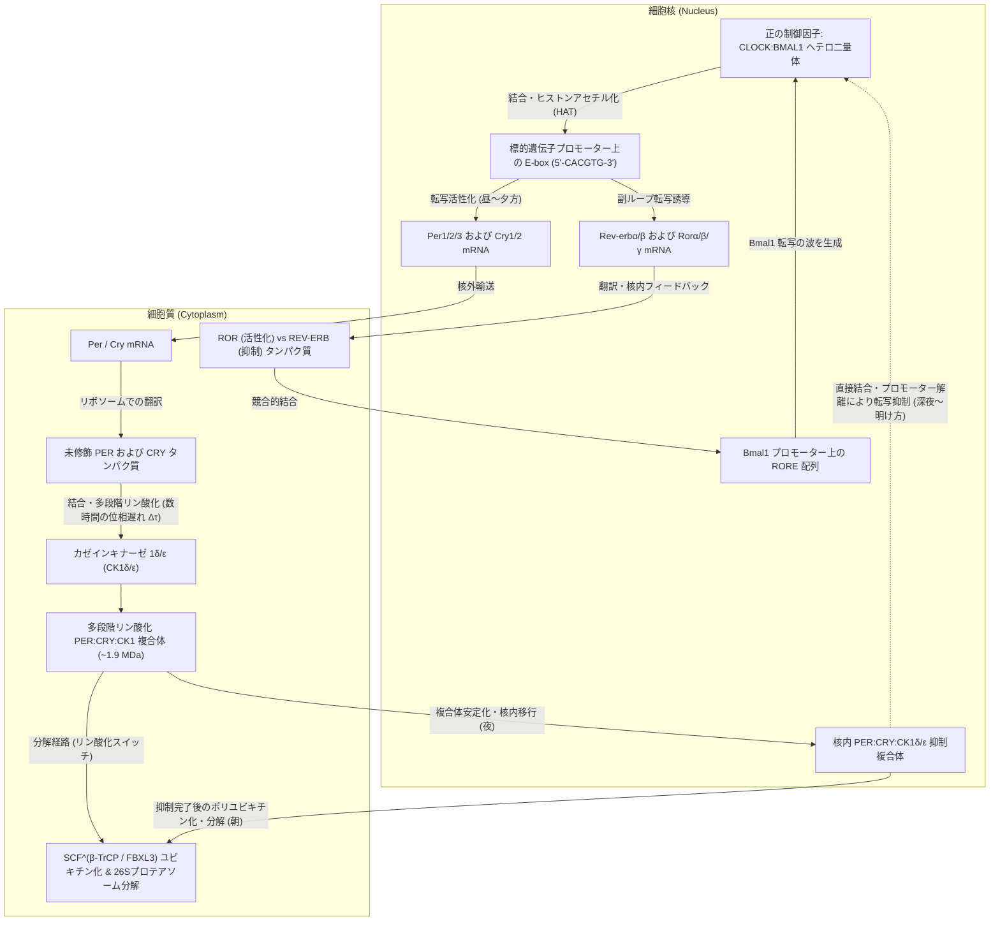
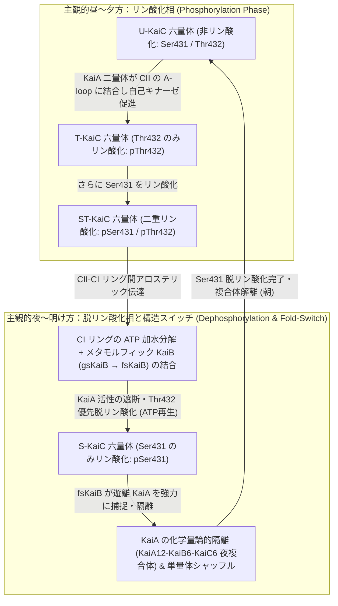

太陽の光が一切届かない地下深くの洞窟や、窓のない完全な暗室に閉じ込められたとき、私たちの身体は「今が昼なのか夜なのか」を見失ってしまうのだろうか。

驚くべきことに、答えは「ノー」である。外部からの光や温度の手がかりを完全に遮断した環境（恒暗条件）においても、ヒトを含む動物、植物、菌類、さらには単細胞のシアノバクテリア（光合成細菌）に至るまで、地球上のほぼすべての生命は<strong>約24時間周期の自律的なリズム</strong>を刻み続ける。睡眠と覚醒、深部体温の上下、コルチゾールやメラトニンといったホルモンの分泌、血圧や免疫応答、さらには全ゲノムの数割におよぶ遺伝子の発現量が、細胞ひとつひとつの内部に組み込まれた「分子の振り子」によって精緻に制御されているのである。

しかし、物理学や化学の視点から冷静に考えると、この「細胞内の時計」には極めて奇妙で深い謎がいくつも潜んでいる。

第一に、細胞内の分子反応（転写や翻訳、酵素反応）は通常、数ミリ秒から数十分のタイムスケールで進行する。それにもかかわらず、なぜ分子のネットワークは減衰して定常状態に落ち着くことなく、<strong>24時間（86,400秒）という途方もなく長い周期の自励振動（リミットサイクル振動）</strong>を維持できるのか？

第二に、生命の時計は必ず「DNAからmRNAへの転写」と「タンパク質への翻訳」という遺伝子発現のループを必要とするのか？――実は2005年、日本の近藤孝男らの研究グループが、<strong>DNAもmRNAも一切含まない試験管の中で、たった3種類の精製タンパク質（KaiA, KaiB, KaiC）とATPを混ぜるだけで、24時間周期の化学振動が何日も続く</strong>ことを実証し、世界の生物学界を震撼させた。

第三に、そして時間生物学（Chronobiology）における最大の生物物理学ミステリーが<strong>「温度補償性（Temperature Compensation）」</strong>である。通常の化学反応や酵素反応の速度は、アレニウスの法則に従って温度が $10^\circ\text{C}$ 上昇するごとに2倍から3倍に加速する（温度係数 $Q_{10} \approx 2\text{〜}3$）。もし体内時計が普通の生化学反応の連鎖でできているならば、気温や体温が少し上がっただけで時計の針は猛スピードで進み、時計としての機能を完全に失ってしまうはずだ。ところが実際の体内時計は、温度が $10^\circ\text{C}$ 変化しても周期がほとんど変わらない（<strong>$Q_{10} \approx 1.0$</strong>）という驚異的な性質を備えている。

本稿では、1729年のオジギソウの暗室実験から2017年ノーベル生理学・医学賞へと至る転写翻訳フィードバックループ（TTFL）の分子機構、非線形力学系におけるグッドウィン振動子とホップ分岐の数理、シアノバクテリアのKaiABC翻訳後振動子（PTO）の精緻な構造ダイナミクス、温度補償性を実現する拮抗バランスと酵素内部の分子ブレーキ、そして視交叉上核（SCN）の光同調から時間医学（クロノメディシン）の最前線までを体系的に解き明かす。

---

## 1. 暗闇の中のオジギソウと変異ハエ：体内時計の発見史

### 1.1 ド・メランの1729年の実験と「自由継続周期 $\tau$」

生物が持つ24時間リズムは、長らく「太陽の昇り沈みに対する受動的な反応」に過ぎないと考えられていた。朝になって光が当たれば植物は葉を開き、夜になって暗くなれば葉を閉じる――ただそれだけのことだと信じられていたのである。

この素朴な常識を最初に覆したのは、1729年、フランスの天文学者・地球物理学者である<strong>ジャン＝ジャック・ドルトゥス・ド・メラン（Jean-Jacques d'Ortous de Mairan）</strong>が行ったシンプルかつ決定的な実験だった。ド・メランは、昼に葉を開き夜に葉を閉じる「就眠運動」で知られるオジギソウ（*Mimosa pudica*）の鉢植えを、太陽光が一切入らない自宅のワインセラー（恒暗条件：Constant Darkness, <strong>DD</strong>）に運び込み、その葉の動きを観察した。

もし葉の開閉が太陽光に対する単なる受動的応答であれば、暗闇に置かれたオジギソウは葉を閉じたままになるはずである。しかし実際には、オジギソウは完全な暗闇の中でも、外の太陽の動きと歩調を合わせるように、朝になると葉を開き、夜になると葉を閉じる運動を何日も繰り返した。これは、生物が外部環境の周期的変化を受動的になぞっているのではなく、<strong>生体内部に自律的な計時機構（内因性振動子：Endogenous Oscillator）を備えている</strong>ことを示す人類初の科学的証拠であった。

その後、植物学者オーギュスタン・ピラミュ・ド・カンドール（Augustin Pyramus de Candolle）は1832年、恒暗条件または恒明条件においたオジギソウの葉の開閉周期を精密に測定し、その周期が地球の自転周期である「きっかり24.0時間」ではなく、<strong>22〜23時間というわずかに24時間からずれた固有の周期</strong>で回り続けていることを発見した。

外部からの時刻の手がかり（光や温度のサイクルなど、ドイツ語で「時間を与えるもの」を意味する<strong>ツァイトゲーバー：Zeitgeber</strong>）をすべて取り除いた恒常条件（フリーラン条件）において、生物の内因性時計が自発的に刻む周期を<strong>自由継続周期（Free-Running Period）</strong>と呼び、記号 <strong>$\tau$（タウ）</strong> で表す。

- <strong>オジギソウ</strong>：$\tau \approx 22\text{〜}23\,\text{h}$
- <strong>ハツカネズミ（マウス）</strong>：$\tau \approx 23.5\,\text{h}$
- <strong>キイロショウジョウバエ</strong>：$\tau \approx 23.8\,\text{h}$
- <strong>ヒト（ホモ・サピエンス）</strong>：$\tau \approx 24.18\,\text{h}$（ハーバード大学のチャールズ・ツァイスラーらが1999年に強制脱同調プロトコルで精密測定した平均値であり、標準偏差は約 $\pm 0.2\,\text{h}$）

自由継続周期 $\tau$ がきっかり 24.00 時間ではなく「約24時間」であるという事実は極めて重要である。なぜなら、もし生物が地球の自転に伴う未知の宇宙線や磁場、重力潮汐などの外部物理シグナルを感知して動いているのなら、恒暗条件でも周期は厳密に 24.00 時間になるはずだからだ。$\tau$ が種や個体ごとにわずかに 24 時間からずれていることこそが、この時計が紛れもなく生物自身の細胞内に実装された自律的な生化学発振器であることの決定的な証明なのである。

1959年、時間生物学の父の一人である<strong>フランツ・ハルバーグ（Franz Halberg）</strong>は、ラテン語の *circa*（約、およそ）と *dies*（1日）を組み合わせ、この約24時間の内因性リズムを<strong>「サーカディアンリズム（Circadian Rhythm：概日リズム）」</strong>と命名した。

### 1.2 コノプカとベンザーの衝撃（1971年）：単一遺伝子 `period` が時間を支配する

20世紀半ばまでに、コリン・ピットエンドリ（Colin Pittendrigh）やユルゲン・アショフ（Jürgen Aschoff）らの先駆的研究によって概日リズムの現象論的性質（フリーラン、光による位相同調、温度補償性）は確立された。しかし、「細胞のどこに時計の歯車があるのか？」という分子実体は謎に包まれていた。当時、多くの生物学者は「24時間もの長い周期を持つ行動リズムは、神経系や内分泌系など個体全体の複雑なネットワークから創発するものであり、単一の遺伝子に還元できるはずがない」と考えていた。

この懐疑論を打ち砕いたのが、1971年、カリフォルニア工科大学の<strong>ロナルド・コノプカ（Ronald Konopka）</strong>と<strong>シーモア・ベンザー（Seymour Benzer）</strong>による歴史的論文 *"Clock mutants of Drosophila melanogaster"* であった。

彼らはキイロショウジョウバエに化学変異原（EMS：メタンスルホン酸エチル）を処理し、蛹から成虫へと羽化するタイミング（羽化リズム）や成虫の歩行活動リズムが異常になった突然変異体を徹底的にスクリーニングした。約2,000系統を調べた結果、彼らは驚くべき3種類の変異系統を単離した。

1. <strong>$per^0$（無周期変異：Arrhythmic）</strong>：恒暗条件において24時間のリズムが完全に消失し、昼夜を問わずランダムに活動・羽化する（$\tau = \text{なし}$）。
2. <strong>$per^S$（短周期変異：Short-period）</strong>：恒暗条件における自由継続周期が約5時間短縮し、<strong>$\tau \approx 19\,\text{h}$</strong> で規則正しく活動する。
3. <strong>$per^L$（長周期変異：Long-period）</strong>：恒暗条件における自由継続周期が約5時間延長し、<strong>$\tau \approx 29\,\text{h}$</strong> のゆっくりとしたリズムを刻む。

遺伝学的マッピングの結果、これら3つの劇的な表現型（リズムの消失、19時間への加速、29時間への減速）はすべて、<strong>X染色体上の全く同じ単一の遺伝子座――`period`（$per$）遺伝子――における異なる点突然変異（ナンセンス変異およびミスセンス変異）</strong>によって引き起こされていることが判明したのである！

単一のタンパク質のたった1つのアミノ酸が置き換わるだけで、生物というマクロな個体の「1日の長さ」が19時間にも29時間にも伸縮するという事実は、生命科学における最大のパラダイムシフトの一つとなった。そして1984年、<strong>ジェフリー・ホール（Jeffrey C. Hall）</strong>と<strong>マイケル・ロスバッシュ（Michael Rosbash）</strong>のチーム、および<strong>マイケル・ヤング（Michael W. Young）</strong>のチームがそれぞれ独立に `period` 遺伝子のクローニングと塩基配列決定に成功し、この発見が後の<strong>2017年ノーベル生理学・医学賞</strong>へと結実することになる。

---

## 2. 真核生物の転写翻訳フィードバックループ（TTFL）の分子機構

クローニングされた `period` 遺伝子がコードするタンパク質 <strong>PER</strong> は、いったいどのようにして24時間の時を刻んでいるのか。1990年、ホールとロスバッシュ（およびポール・ハーディン）は、ショウジョウバエの脳内における *per* mRNA の量と PER タンパク質の量がどちらも約24時間周期で振動しており、しかも <strong>mRNA のピークから約4〜6時間遅れてタンパク質のピークが訪れる</strong>ことを見出した。

この発見から提唱されたのが、すべての真核生物（菌類、植物、昆虫、哺乳類）の体内時計の基本設計原理である<strong>「転写翻訳フィードバックループ（TTFL: Transcription-Translation Feedback Loop）」</strong>モデルである。ここではまず、私たちヒトを含む<strong>哺乳類のTTFL</strong>の精緻な分子機構を詳しく見ていこう。

### 2.1 中核ループ（Core Loop）：CLOCK:BMAL1 と PER:CRY のせめぎ合い

哺乳類の細胞内時計の中核ループは、アクセル役である「正の制御因子（Positive Arm）」と、ブレーキ役である「負の制御因子（Negative Arm）」の相互作用によって駆動されている。

1. <strong>朝の転写起動（CLOCK:BMAL1 による E-box 活性化）</strong>：
   主観的朝（活動期の始まり）になると、塩基性ヘリックス・ループ・ヘリックス（bHLH）ドメインと2つの PAS（PER-ARNT-SIM）ドメインを持つ2種類の転写因子、<strong>CLOCK</strong>（脳の特定領域ではパラログの <strong>NPAS2</strong>）と <strong>BMAL1</strong>（別名 ARNTL）が核内でヘテロ二量体 <strong>CLOCK:BMAL1</strong> を形成する。
   CLOCK:BMAL1 は、標的遺伝子のプロモーターやエンハンサー領域に存在する6塩基のパリンドローム配列 <strong>E-box（`5'-CACGTG-3'`）</strong> に特異的に結合する。興味深いことに、CLOCK タンパク質自身がヒストンアセチル化酵素（HAT: Histone Acetyltransferase）活性を持っており、さらに CBP/p300 などのコアクチベーターをリクルートすることでクロマチン構造を緩め、<strong>Period 遺伝子群（`Per1`, `Per2`, `Per3`）</strong>および <strong>Cryptochrome 遺伝子群（`Cry1`, `Cry2`）</strong>の転写を強力に開始させる。
2. <strong>昼から夕方の蓄積と多段階リン酸化（時間遅れ $\Delta\tau$ の生成）</strong>：
   転写された *Per* および *Cry* の mRNA は細胞質へと輸送され、リボソームによって PER タンパク質および CRY タンパク質へと翻訳される。しかし、作られたばかりの PER や CRY がすぐに核へ戻って転写を止めてしまっては、24時間という長い周期は生まれない。
   ここで決定的な役割を果たすのが、セリン・スレオニンキナーゼである<strong>カゼインキナーゼ $1\delta$ および $1\varepsilon$（Casein Kinase $1\delta/\varepsilon$: CK1$\delta/\varepsilon$）</strong>（ショウジョウバエにおける <strong>Doubletime: DBT</strong> のホモログ）である。細胞質で合成されたばかりの単独の PER タンパク質は極めて不安定であり、CK1$\delta/\varepsilon$ によって特定のセリン残基（$\beta$-TrCP 認識モチーフ）がリン酸化されると、E3ユビキチンリガーゼ複合体 <strong>$\text{SCF}^{\beta\text{-TrCP}}$</strong> によって即座にポリユビキチン化され、26Sプロテアソームで分解されてしまう。
   その結果、*Per* mRNA が増えてからも、細胞質内で PER と CRY が十分に蓄積し、互いに結合して <strong>PER:CRY:CK1$\delta/\varepsilon$ 三者複合体</strong>として安定化するまでには、<strong>約4〜6時間におよぶ長いタイムラグ（位相遅れ）</strong>が生じる。
3. <strong>夜の核内移行と転写抑制（Displacement & Blocking）</strong>：
   夕方から夜にかけて、安定化した PER:CRY:CK1$\delta/\varepsilon$ 複合体（さらに足場タンパク質やクロマチン修飾酵素を巻き込んだ分子量約 $1.9\,\text{MDa}$ の巨大複合体）が核内へと移行する。
   核内に入った PER:CRY 複合体は、E-box 上で転写を駆動している CLOCK:BMAL1 に直接結合し、その転写活性化能を完全に封じ込める。近年の生化学・構造生物学的研究（高橋ジョセフ Joseph S. Takahashi や Partch らの研究）により、この抑制には巧妙な二段階のメカニズムがあることが分かっている。
   - <strong>CRY1 による Blocking（阻害）</strong>：CRY1 は CLOCK の PAS-B ドメインおよび BMAL1 のC末端トランス活性化ドメイン（TAD）に直接結合し、CLOCK:BMAL1 を DNA（E-box）に結合させたままの状態で、コアクチベーター（CBP/p300）との結合を競合的に遮断する。
   - <strong>PER2:CK1 による Displacement（引き剥がし）</strong>：PER2 が複合体中に運んできた CK1$\delta/\varepsilon$ が CLOCK 自身を直接リン酸化する。リン酸化された CLOCK:BMAL1 は E-box DNA に対する親和性を失い、プロモーター上から物理的に引き剥がされる（Displacement）。
4. <strong>深夜から明け方の分解とリセット</strong>：
   自身の転写が止まったことで、夜半過ぎには *Per* / *Cry* mRNA の供給が途絶える。核内に残った PER タンパク質は CK1$\delta/\varepsilon$ によるさらなる進行性リン酸化を受けて $\text{SCF}^{\beta\text{-TrCP}}$ により分解され、CRY タンパク質は核内の E3 ユビキチンリガーゼ <strong>$\text{SCF}^{\text{FBXL3}}$</strong>（および細胞質で拮抗的に働く $\text{SCF}^{\text{FBXL21}}$）や AMPK（AMP活性化プロテインキナーゼ）によるリン酸化を介して分解される。
   明け方までに核内の PER:CRY 抑制複合体が完全に一掃されると、CLOCK:BMAL1 は再び E-box に結合できるようになり、新しい1日の転写サイクルが幕を開ける。

### 2.2 家族性睡眠相前進症候群（FASPS）：1つのアミノ酸変異が人生の時間を変える

この TTFL と CK1 によるリン酸化がいかにヒトの生活時間を直接支配しているかを劇的に示したのが、2001年にルイス・プタチェク（Louis Ptáček）とイン・フー（Ying-Hui Fu）らが解明した<strong>家族性睡眠相前進症候群（FASPS: Familial Advanced Sleep Phase Syndrome）</strong>の家系研究である。

FASPS の家系に属する人々は、毎日夕方18時〜19時頃になると抗いがたい強烈な眠気に襲われて就寝し、まだ真っ暗な<strong>午前3時〜4時頃に完全に目が覚めてしまう</strong>という極端な「超朝型」の体質を常染色体顕性（優性）遺伝として受け継いでいる。彼らを時間隔離実験室に入れて自由継続周期 $\tau$ を測定すると、健常者の平均 $24.18\,\text{h}$ に対して、<strong>$\tau \approx 21.6\text{〜}23.3\,\text{h}$</strong> へと大幅に短縮していた。

遺伝子解析の結果、ある家系ではヒト <strong>`PER2` 遺伝子の662番目のセリンがグリシンに置換する点変異（hPER2-S662G）</strong>が見つかり、別の家系ではリン酸化酵素である <strong>`CSNK1D`（CK1$\delta$）遺伝子の44番目のスレオニンがアラニンに置換する変異（CK1$\delta$-T44A）</strong>が同定された。

その分子メカニズムは精巧を極める（<strong>リン酸化スイッチ仮説：Phosphoswitch Model</strong>）。PER2 タンパク質には、分解を促す「$\beta$-TrCP 認識部位（S478 周辺）」と、タンパク質を安定化させる「FASP 領域（S659/hS662 から連なる5つの連続したセリン残基：`S-X-X-S` モチーフ）」という2つの競合するリン酸化領域が存在する。通常、S662（マウスでは S659）がプライミング・リン酸化されると、CK1$\delta/\varepsilon$ は下流のセリン残基を連鎖的にリン酸化し、PER2 の分解にブレーキをかけて核内での寿命を延ばす。ところが S662G 変異によってこのプライミング部位が失われると、安定化ブレーキが効かなくなり、PER2 は分解促進経路へと傾いて早期に消失する。結果として負のフィードバックループが通常より早く終了し、時計の周期が数時間短縮してしまうのである。

逆に2017年、マイケル・ヤングらのグループは、どれほど早く寝ようとしても午前3時〜5時まで眠れず昼過ぎまで起きられない<strong>家族性睡眠相後退症候群（FDSPS: Familial Delayed Sleep Phase Syndrome）</strong>の家系から、<strong>`CRY1` 遺伝子のエクソン11スキッピング変異（$CRY1\,\Delta 11$）</strong>を発見した。C末端の自己阻害テールの一部を欠失した変異型 CRY1 は CLOCK:BMAL1 に対する結合親和性が異常に高まり、転写抑制が過剰に長引くことで内因性周期 $\tau$ を延長させていた。「朝起きられない」「夜起きていられない」という現象の多くは、怠慢や気合いの問題ではなく、文字通り分子時計のキナーゼ速度定数や解離定数 $K_d$ の物理化学的変化によって規定されているのである。

### 2.3 連結する副ループ（REV-ERB / ROR と DBP / E4BP4）と3位相転写アーキテクチャ

哺乳類の TTFL は、単一の `CLOCK:BMAL1` $\leftrightarrow$ `PER:CRY` ループだけで動いているわけではない。時計の振幅を安定化させ、細胞内の多様な遺伝子群を1日のあらゆる時間帯（朝・昼・夜）に正確に割り振るため、さらに2つの副ループ（Interlocking Secondary Loops）が歯車のように噛み合っている。

- <strong>第2のループ（RORE ループ：REV-ERB$\alpha/\beta$ と ROR$\alpha/\beta/\gamma$）</strong>：
  CLOCK:BMAL1 は E-box を介して、核内受容体スーパーファミリーに属する転写抑制因子 <strong>REV-ERB$\alpha / \beta$</strong>（遺伝子名 `Nr1d1 / Nr1d2`）と、転写活性化因子 <strong>ROR$\alpha / \beta / \gamma$</strong> の転写も活性化する。翻訳された ROR と REV-ERB は、*Bmal1*（および *Clock*, *Cry1*）遺伝子のプロモーター上に存在する <strong>RORE（ROR Response Element）</strong> 配列を巡って競合する。ROR は *Bmal1* 転写を活性化し、遅れて蓄積する REV-ERB はヘム（Heme）をリガンドとして結合しつつ NCoR–HDAC3（ヒストン脱アセチル化酵素3）コリプレッサー複合体をリクルートし、*Bmal1* 転写を強力に抑制する。これにより、*Per/Cry* と逆位相（アンチフェーズ：夜から明け方にピーク）で振動する *Bmal1* mRNA の鋭いリズムが生まれる。
- <strong>第3のループ（D-box ループ：DBP / TEF / HLF と E4BP4）</strong>：
  さらに CLOCK:BMAL1 は PAR-bZIP 型転写活性化因子である <strong>DBP</strong>（および TEF, HLF）を駆動し、一方 RORE ループは塩基性ロイシンジッパー型転写抑制因子 <strong>E4BP4（NFIL3）</strong> を逆位相で駆動する。これらは <strong>D-box</strong> 配列上で競合し、昼から夕方にピークを持つ転写の波を作り出す。

日本の理化学研究所の上田泰己らのグループがシステム生物学的に解明したように、この <strong>E-box（朝の要素：Morning element）</strong>、<strong>D-box（昼の要素：Daytime element）</strong>、<strong>RORE（夜の要素：Evening element）</strong> という3つのシス配列モジュールが組み合わさることで、任意の位相（0時〜24時のあらゆる時刻）にピークを持つ遺伝子発現プロファイルを合成することが可能になっている。実際、哺乳類の肝臓や心臓、脳などの臓器ごとに調べると、タンパク質をコードする全遺伝子の約 <strong>10%〜40%</strong>（臓器横断的に見れば全ゲノムの過半数）が、この3位相アーキテクチャの支配下で概日振動していることが明らかになっている。

---

## 3. 遺伝子振動子の数理生物学：なぜ負のフィードバックは減衰せずに振動できるのか？

ここで、システム生物学および非線形力学（Nonlinear Dynamics）の視点から、体内時計の核心に迫る根本的な問いを立てよう。

<strong>「AがBを増やし、増えたBがAを抑える（負のフィードバック）」という回路があれば、それだけで自動的に振動（リズム）が生まれるのだろうか？</strong>

直感的には「Aが増える $\to$ Bが増える $\to$ Aが減る $\to$ Bが減る $\to$ またAが増える…」と永久に振動しそうに思える。しかし、微分方程式を書いて厳密に解析すると、<strong>単純な2変数の負のフィードバック回路は絶対に持続振動（リミットサイクル振動）を起こすことができず、必ず減衰して一定の定常状態（平衡点）に収束して止まってしまう</strong>ことが数学的に証明されるのである。

### 3.1 2変数負のフィードバック系の不可能性証明（ベンディクソンの定理）

この衝撃的な事実を数式で確認してみよう。いま、時計遺伝子の mRNA 濃度を $M(t) \ge 0$、それが翻訳されてできた抑制タンパク質濃度を $P(t) \ge 0$ とする最も単純な2変数の転写・翻訳フィードバック系を考える。

$$\frac{dM}{dt} = f(P) - \gamma_M M \equiv F_1(M, P)$$

$$\frac{dP}{dt} = k_s M - \gamma_P P \equiv F_2(M, P)$$

ここで、$f(P)$ はタンパク質 $P$ によって単調減少する転写速度関数（負のフィードバックであるため、すべての $P \ge 0$ に対して微分 $f'(P) < 0$）、$k_s > 0$ は翻訳速度定数、$\gamma_M > 0$ および $\gamma_P > 0$ はそれぞれ mRNA とタンパク質の一次分解速度定数である。

この2次元平面上のベクトル場 $\mathbf{F}(M, P) = (F_1(M, P), F_2(M, P))$ の<strong>発散（Divergence）</strong>を計算すると、次のようになる。

$$\nabla \cdot \mathbf{F} = \frac{\partial F_1}{\partial M} + \frac{\partial F_2}{\partial P} = -\gamma_M - \gamma_P < 0$$

分解速度定数 $\gamma_M, \gamma_P$ は正の定数であるから、発散 $\nabla \cdot \mathbf{F}$ は相空間 $(M, P)$ の第一象限全域において<strong>常に厳密に負（$-\gamma_M - \gamma_P < 0$）であり、決して符号を変えない</strong>。

力学系理論における<strong>ベンディクソンの負基準（Bendixson's Negative Criterion：グリーンの定理からの直接の帰結）</strong>によれば、単連結な2次元平面領域 $D$ 内でベクトル場の発散 $\nabla \cdot \mathbf{F}$ が恒等的にゼロでなく、かつ符号を変えない場合、領域 $D$ の内部には閉軌道（周期解・リミットサイクル）は<strong>1つも存在し得ない</strong>。なぜなら、もし閉軌道 $\Gamma$ が存在すれば、それが囲む領域 $\Omega$ 上での面積分はグリーンの定理より

$$\iint_{\Omega} (\nabla \cdot \mathbf{F}) \, dM dP = \oint_{\Gamma} (\mathbf{F} \cdot \mathbf{n}) \, ds = 0$$

とならなければならないが（軌道上ではベクトル場 $\mathbf{F}$ は接線方向を向くため法線ベクトル $\mathbf{n}$ との内積は常に $0$）、左辺の被積分関数が常に負であれば積分値は負となり矛盾するからである。

さらに、一意に定まる定常状態（固定点）$(M^*, P^*)$ の周りでの<strong>ヤコビ行列（Jacobian Matrix）</strong> $J$ を計算すると、

$$J = \begin{pmatrix} -\gamma_M & f'(P^*) \\ k_s & -\gamma_P \end{pmatrix}$$

となる。そのトレース（跡）と行列式は、$f'(P^*) < 0$ より

$$\operatorname{Tr}(J) = -(\gamma_M + \gamma_P) < 0, \qquad \det(J) = \gamma_M \gamma_P - k_s f'(P^*) > 0$$

を満たす。2次正方行列において $\operatorname{Tr}(J) < 0$ かつ $\det(J) > 0$ であれば、固有値 $\lambda_{1,2} = \frac{1}{2}\left(\operatorname{Tr}(J) \pm \sqrt{\operatorname{Tr}(J)^2 - 4\det(J)}\right)$ の実部は<strong>必ず負（$\operatorname{Re}(\lambda_{1,2}) < 0$）</strong>となる。すなわち、フィードバックの傾き $|f'(P^*)|$ をどれほど大きくしても（たとえヒル係数 $n = 100$ に設定しても！）、固定点が不安定化するホップ分岐（$\operatorname{Tr}(J) = 0$）は永遠に起こらず、せいぜい虚部が現れて減衰振動（Damped Oscillation：安定渦状点）しながら平衡点へ吸い込まれて止まるだけなのである。

### 3.2 グッドウィン振動子（1965年）とゴールドベターの概日時計モデル（1995年）

では、実際の生物はどうやってこの数学的障壁を乗り越え、減衰しない<strong>自励振動（Limit-Cycle Oscillation）</strong>を生み出しているのか？

その答えは、mRNA が作られてから核内で転写が抑制されるまでの間に、<strong>第3（およびそれ以上）の独立した状態変数＝「時間遅れ（Phase Delay）」の中間ステップ</strong>が介在していることにある。

1965年、数理生物学者の<strong>ブライアン・グッドウィン（Brian Goodwin）</strong>は遺伝子制御ネットワークの最小振動モデル（グッドウィン振動子）を提唱した。さらに1995年、ブリュッセル自由大学の<strong>アラン・ゴールドベター（Albert Goldbeter）</strong>は、ショウジョウバエの PER タンパク質のリン酸化と核移行を組み込んだ概日時計の数理モデルを定式化した。その骨格となる3変数（mRNA 濃度 $M$、細胞質タンパク質濃度 $P_C$、核内抑制タンパク質濃度 $P_N$）の連立常微分方程式（ODE）は以下の形で表される。

$$\frac{dM}{dt} = \frac{v_s K_I^n}{K_I^n + P_N^n} - v_m \frac{M}{K_m + M}, \qquad \frac{dP_C}{dt} = k_s M - v_d \frac{P_C}{K_d + P_C} - k_1 P_C + k_2 P_N, \qquad \frac{dP_N}{dt} = k_1 P_C - k_2 P_N$$

ここで各パラメータの生物学的意味は以下の通りである。
- $v_s$：最大転写速度、$K_I$：核内タンパク質 $P_N$ による転写抑制の解離定数（閾値濃度）
- $n$：抑制の協同性を表す<strong>ヒル係数（Hill Coefficient）</strong>
- $v_m, K_m$：mRNA の酵素的分解における最大速度とミカエリス定数
- $k_s$：mRNA からの翻訳速度定数
- $v_d, K_d$：細胞質タンパク質 $P_C$ の酵素的分解（CK1リン酸化＋プロテアソーム分解）における最大速度とミカエリス定数
- $k_1, k_2$：タンパク質の細胞質から核への移行速度定数（$k_1$）と核から細胞質への逆輸送速度定数（$k_2$）

### 3.3 ホップ分岐を起こす3つの数理的条件と「ヒル係数 $n > 8$ の壁」

この3変数以上の力学系において、定常状態が不安定化し、<strong>超臨界ホップ分岐（Supercritical Hopf Bifurcation）</strong>を経て安定なリミットサイクル（自励振動）が出現するためには、以下の<strong>3つの数理的必須条件</strong>がすべて満たされなければならない（*Novák & Tyson, Nature Reviews Molecular Cell Biology, 2008*）。

1. <strong>負のフィードバックループ（Negative Feedback）</strong>：系が行き過ぎたときに引き戻す復元力。
2. <strong>十分に長い位相遅れ（Sufficient Time Delay $\Delta\tau$）</strong>：信号がループを一周して戻ってくるまでに位相が $180^\circ$（$\pi\,\text{rad}$）遅れ、定常状態からのズレを打ち消すはずの負のフィードバックが、タイミングの遅れゆえに逆にズレを増幅する「正のフィードバック（不安定化）」として働くこと。
3. <strong>強い非線形性・超感受性（Nonlinearity / Ultrasensitivity）</strong>：中間ステップを通過するたびに信号の波は鈍り（ローパスフィルタ効果）、減衰する。一周回ってきたときのループ利得（Loop Gain）が $1$ を超えて振動を維持するためには、フィードバック関数に急峻なスイッチ様の非線形性が不可欠である。

この第3の条件がいかに厳しいかを示す有名な定理が、1968年にグリフィス（J. S. Griffith）が証明した<strong>「グッドウィン振動子における $n > 8$ の不等式」</strong>である。

もし上記のモデルにおいて、分解反応がすべて飽和しない単純な一次反応（線形分解：$-k_m M, -k_p P_C, -k_n P_N$）であったと仮定しよう。対称な減衰率 $k_1 = k_2 = k_3 = k$ を持つ3変数グッドウィン鎖の固定点におけるヤコビ行列の特性方程式は、ラウス・フルビッツの安定判別法（Routh–Hurwitz criterion）または位相条件より次のように書ける。

$$(\lambda + k)^3 + g = 0$$

ここで $g > 0$ はフィードバックループ全体の微分利得である。この方程式が純虚数根 $\lambda = \pm i \omega$ を持ってホップ分岐を起こす臨界条件は、各項の位相遅れが $\pi / 3 = 60^\circ$ ずつ（3段で合計 $180^\circ$）になるときであり、

$$\cos\left(\frac{\pi}{3}\right) = \frac{1}{2} \implies \frac{g}{k^3} \ge \sec^3\left(\frac{\pi}{3}\right) = 2^3 = 8$$

となる。ヒル関数 $h(P_N) = \frac{K_I^n}{K_I^n + P_N^n}$ の対数微分感度は最大でも $n$ 未満であるため、一次分解の3変数グッドウィンモデルが自励振動を起こすためには、<strong>ヒル係数が $n > 8$ でなければならない</strong>（一般に $N$ 段の線形遅延鎖であれば $n > \sec^N(\pi/N)$ が必要）。

ところが分子生物学的に考えると、ヒル係数 $n > 8$ というのは「9個以上の抑制タンパク質単量体が強い正の協同性をもって一斉にプロモーターに結合する」ことを意味し、実際の転写因子複合体（二量体や四量体）としては極めて非現実的である。では、実際の体内時計はどうやってこの「$n > 8$ の壁」を突破しているのだろうか？数理生物学は2つのエレガントな解答を導き出した。

- <strong>突破口1：ミカエリス・メンテン型分解によるゼロ次超感受性（Zero-Order Ultrasensitivity — Goldbeter, 1995）</strong>：
  上記のゴールドベターの式をよく見ると、mRNA やタンパク質の分解項が一次反応（$-k_d P_C$）ではなく、<strong>ミカエリス・メンテン型の酵素反応 $\left(-v_d \frac{P_C}{K_d + P_C}\right)$</strong> になっている。プロテアソームやキナーゼが基質に対して飽和に近い領域（$P_C \gg K_d$）で働くと、分解速度は基質濃度によらない定数 $v_d$（ゼロ次反応）に漸近する。するとヤコビ行列の対角成分（実効的な自己減衰率 $-\frac{\partial}{\partial P_C}\left(\frac{v_d P_C}{K_d + P_C}\right) = -\frac{v_d K_d}{(K_d + P_C^*)^2}$）が劇的に小さくなり、信号の減衰が抑えられるため、<strong>ヒル係数が $n = 2\text{〜}4$ という生物学的に自然な値であっても容易にホップ分岐が起きて強固なリミットサイクル振動が発生する</strong>のである。
- <strong>突破口2：分子滴定・化学量論的隔離（Molecular Titration / Stoichiometric Sequestration — Kim & Forger, 2012）</strong>：
  さらにミシガン大学のダニエル・フォージャー（Daniel B. Forger）とジェ・キョン・キム（Jae Kyoung Kim）が2012年に *Molecular Systems Biology* で示したように、哺乳類の時計では PER:CRY が E-box に直接結合するのではなく、活性化因子 CLOCK:BMAL1 と <strong>1対1の化学量論比で極めて強く結合して不活性化する（分子滴定：Molecular Titration）</strong>。解離定数 $K_d$ が非常に小さいとき、遊離して働ける CLOCK:BMAL1 の濃度 $A_{\text{free}}$ は、総活性化因子濃度 $A_T$ と総抑制因子濃度 $I_T$ に対して
  $$A_{\text{free}} = \frac{1}{2}\left[ (A_T - I_T - K_d) + \sqrt{(A_T - I_T - K_d)^2 + 4 A_T K_d} \right]$$
  という関数に従う。この関数は $I_T \approx A_T$ の化学量論的等量点において極めて鋭い折れ曲がり（閾値超感受性）を示すため、<strong>ヒル係数 $n = 1$（協同性ゼロ）であっても、CLOCK:BMAL1 と PER:CRY のモル比が適切な範囲にあれば頑健な自励振動が生まれる</strong>。実際、肝細胞などで BMAL1 を過剰発現させすぎると（$A_T \gg I_T$ となって等量点を超えると）振動が止まるという実験事実も、この分子滴定モデルによって完璧に説明される。

---

## 4. 試験管内で動くシアノバクテリアの KaiABC タンパク質時計（2005年の衝撃）

真核生物における TTFL の解明が進んでいた1990年代、時間生物学者の間には2つの強固なドグマ（定説）が存在していた。

1. <strong>「原核生物（バクテリア）には概日時計は存在しない」</strong>：バクテリアは栄養条件が良ければ数十分〜数時間に1回という猛スピードで細胞分裂を繰り返す。「1日よりも寿命（世代時間）が短い単細胞生物に、24時間を測る時計など進化するはずがない（"24-hour barrier"）」と信じられていた。
2. <strong>「すべての概日時計は転写・翻訳フィードバックループ（TTFL）を必須の基本原理とする」</strong>。

この2つのドグマを根底から覆し、時間生物学の歴史を塗り替えたのが、名古屋大学の<strong>近藤孝男（Takao Kondo）</strong>と<strong>石浦正寛（Masahiro Ishiura）</strong>を中心とする日本の研究グループであった。

### 4.1 原核生物における概日リズムの発見と `kaiABC` 遺伝子クラスター

1980年代後半、台湾の黄（Huang）とグロベラー（Grobbelaar）らは、単細胞のシアノバクテリア（ラン藻）の一種が「昼に光合成を行い、夜に窒素固定を行う」という24時間リズムを示すことを見出した。その理由は生化学的に明快である。空気中の窒素分子（$\text{N}_2$）をアンモニアに還元する酵素<strong>ニトロゲナーゼ（Nitrogenase）</strong>は、酸素（$\text{O}_2$）に触れると不可逆的に失活してしまう。一方、光合成の明反応は水を分解して大量の酸素を発生させる。同じ単一細胞内で「酸素を出す光合成」と「酸素に弱い窒素固定」を両立させるため、シアノバクテリアは進化の過程で<strong>「昼は光合成、夜は窒素固定」と時間的に分離（Temporal Separation）する体内時計</strong>を獲得したのである。

1993〜1994年、近藤孝男、石浦正寛、カール・ジョンソン（Carl H. Johnson）、スーザン・ゴールデン（Susan S. Golden）らの国際共同チームは、単細胞シアノバクテリア *Synechococcus elongatus* PCC 7942 のゲノムにホタルの発光遺伝子（ルシフェラーゼ遺伝子 `luxAB`）を組み込み、生物発光の強弱として時計のリズムを自動計測する画期的な系を構築した。彼らはこの発光バクテリアが、数時間に1回のペースで激しく細胞分裂を繰り返しながらも、母細胞から娘細胞へと寸分の狂いもなく24時間の位相を引き継いで光り続けることを証明した。

そして1998年、近藤と石浦らは網羅的な突然変異スクリーニングと相補実験により、周期が14時間から60時間まで変化したり無周期になったりする多数の時計変異体を解析し、原因となる3つの隣接する遺伝子クラスターを同定した。彼らは日本語で「回転・周期（サイクル）」を意味する「回」にちなんで、これらを <strong>`kaiA`、`kaiB`、`kaiC`</strong> と命名した（*Ishiura et al., Science, 1998*）。

### 4.2 2005年 *Science* 誌の金字塔：DNAもmRNAもない試験管の中で時計が動いた！

当初はシアノバクテリアの KaiABC 時計も、真核生物と同様に KaiC が自身の遺伝子 `kaiBC` の転写を抑制する TTFL で動いていると考えられていた。しかし、近藤研究室の岩崎秀雄や冨田・中島らは2000年代初頭、奇妙な現象に気づいた。シアノバクテリアを完全な暗闇に置いたり、<strong>転写阻害剤（リファンピシン）や翻訳阻害剤（クロラムフェニコール）を大量に投与して細胞内の mRNA 合成とタンパク質合成を完全にストップさせても、細胞内にすでにある KaiC タンパク質のリン酸化サイクルだけは24時間周期で動き続けていた</strong>のである（*Tomita et al., Science, 2005*）。

「もしかすると、転写も翻訳も要らないのではないか？ 3つのタンパク質だけで時計が回っているのではないか？」

2005年4月、近藤孝男研究室の<strong>中島正人（Masato Nakajima）</strong>、<strong>今井圭子（Keiko Imai）</strong>、<strong>伊藤浩史（Hiroshi Ito）</strong>、<strong>西脇妙子（Taeko Nishiwaki）</strong>らは、生命科学史に残る歴史的実験を行った（*Nakajima et al., "Reconstitution of Circadian Oscillation of Cyanobacterial KaiC Phosphorylation in Vitro", Science, 2005*）。

彼らがエッペンドルフチューブ（試験管）の中に入れたものは、たったこれだけだった。

- 精製した組換えタンパク質 <strong>KaiA</strong>（$1.2\,\mu\text{M}$）
- 精製した組換えタンパク質 <strong>KaiB</strong>（$3.5\,\mu\text{M}$）
- 精製した組換えタンパク質 <strong>KaiC</strong>（$3.5\,\mu\text{M}$）
- エネルギー源としての <strong>ATP</strong>（$1\,\text{mM}$）とマグネシウムイオン（$\text{Mg}^{2+}$）を含む緩衝液

ここには、<strong>DNAも、mRNAも、リボソームも、プロテアソームも、細胞膜すらも一切存在しない</strong>。タンパク質の「新規合成」も「分解」も起こり得ない純粋な3種類のタンパク質溶液である。

この試験管を $30^\circ\text{C}$ の恒温槽に入れ、2時間おきにサンプルを採取して SDS-PAGE 電気泳動で KaiC のリン酸化状態を追跡したところ、なんと<strong>試験管の中で KaiC のリン酸化率（40% $\leftrightarrow$ 80%）が約24時間周期で規則正しい正弦波を描き、3日間以上にわたって減衰することなく自励振動し続けた</strong>のである！さらに驚くべきことに、元のシアノバクテリアで周期が短くなる変異（たとえば16時間周期や22時間周期の KaiC 変異体）や長くなる変異（28時間周期）のタンパク質を精製して試験管内で混ぜると、試験管内のリン酸化リズムも生体内と全く同じ周期（16時間や28時間）で振動し、しかも $25^\circ\text{C}$ から $35^\circ\text{C}$ まで温度を変えても周期がほとんど変わらない<strong>温度補償性（$Q_{10} \approx 1.0$）</strong>まで完璧に再現された。

これが、生命科学史上初めて試験管内で完全再構成された概日時計――<strong>翻訳後振動子（PTO: Post-Translational Oscillator）</strong>の誕生であった。

### 4.3 KaiABC 翻訳後振動子（PTO）の超精密な分子・構造ダイナミクス

なぜたった3種類のタンパク質と ATP だけで、24時間という極端に遅く、かつ減衰しない化学振動が可能なのか？X線結晶構造解析、クライオ電子顕微鏡（Cryo-EM）、高速原子間力顕微鏡（HS-AFM）、およびNMRを用いた20年にわたる徹底的な構造生物学研究により、その驚くべきナノマシン機構が解明された。

1. <strong>二重リング六量体 KaiC と「世界一遅い ATPase」</strong>：
   中心となる <strong>KaiC</strong>（単量体 519 アミノ酸、約 $58\,\text{kDa}$）は、ATP の存在下で6分子が会合し、ドーナツを2つ重ねたような<strong>二重リング構造のホモ六量体（Hexamer）</strong>を形成する。N末端側のリングを <strong>CI ドメイン</strong>、C末端側のリングを <strong>CII ドメイン</strong>と呼び、両方のリングのサブユニット界面に合計12分子の ATP が結合する。
   驚くべきは CI ドメインの ATP 加水分解速度である。一般的なモータータンパク質（ミオシンやキネシン）やシャペロンが1秒間に数個〜数十個の ATP を加水分解するのに対し、KaiC は<strong>単量体あたり「1日に約 15 個（1時間に約 0.6 個、すなわち1分子あたり約 100 分に 1 回！）」しか ATP を加水分解しない</strong>。この極限まで抑制された超低速 ATPase 反応（CI ドメインにおける水分子の求核攻撃に対する立体障害と水素結合ネットワーク）こそが、24時間というマクロな時間スケールを生み出す物理的な「砂時計（ペースメーカー）」の正体である（*Terauchi et al., PNAS, 2007; Abe et al., Science, 2015*）。
2. <strong>順序付きリン酸化サイクル（Ordered Phosphorylation Cycle：$\text{U} \to \text{T} \to \text{ST} \to \text{S} \to \text{U}$）</strong>：
   KaiC の CII ドメインには、隣接する2つの自己リン酸化部位――<strong>431番目のセリン（Ser431: S）</strong>と<strong>432番目のスレオニン（Thr432: T）</strong>――が存在する（*Nishiwaki et al., PNAS, 2007; Rust et al., Science, 2007*）。これにより KaiC サブユニットは4つの状態をとるが、24時間のサイクルの中でランダムに遷移するのではなく、厳密に以下の時計回りの順序で遷移する。
   - <strong>$\text{U}$（非リン酸化状態：Ser431, Thr432）$\to \text{T}$（Thr432 リン酸化状態：Ser431, pThr432）</strong>：
     主観的朝、非リン酸化の U-KaiC 六量体の CII ドメインから突き出たC末端テール（<strong>A-loop</strong>）に、促進因子である <strong>KaiA 二量体</strong>が結合する。KaiA が A-loop を引っ張り出すことで CII ドメインの活性部位に ATP が取り込まれやすくなり、自己キナーゼ活性がオンになる。速度論的に反応しやすい Thr432 がまず最初にリン酸化され、T-KaiC が蓄積する。
   - <strong>$\text{T} \to \text{ST}$（二重リン酸化状態：pSer431, pThr432）</strong>：
     引き続き KaiA の作用のもとで2つ目の部位である Ser431 がリン酸化され、昼から夕方にかけて二重リン酸化状態（ST-KaiC）がピークに達する。
   - <strong>$\text{ST} \to \text{S}$（Ser431 のみリン酸化状態：pSer431, Thr432）</strong>：
     Ser431 に負電荷を持つリン酸基が付加されると、CII リングのサブユニット界面が強く引き締まり（リング収縮）、その構造変化がアロステリックに下層の CI リングへと伝達される。
3. <strong>メタモルフィック・タンパク質 KaiB の劇的なフォールド・スイッチ（Fold-Switching）</strong>：
   ここで構造生物学史上最も劇的なイベントの一つが起きる（*Chang et al., Science, 2015*）。
   抑制因子である <strong>KaiB</strong> は、溶液中で単独で存在するときは安定な四量体を形成しており、その三次元構造（$\beta\alpha\beta\beta\alpha\alpha\beta$ トポロジー：基底状態 <strong>gsKaiB</strong>）は KaiC に結合することができない。ところが、ごくわずかな割合で四量体から解離した単量体 KaiB は、後半の二次構造を根本から組み替え、<strong>チオレドキシン様フォールド（Thioredoxin-like fold: $\beta\alpha\beta\alpha\beta\beta\alpha$ トポロジー：フォールドスイッチ状態 </strong>fsKaiB<strong>）へとタンパク質全体の立体構造を大変換（Metamorphic Protein）</strong>する！
   この希少な活性型 <strong>fsKaiB</strong> だけが、CII リングからの信号を受け取って CI ドメインで ATP を加水分解した後の（ADP結合型）CI リング上の露出部位（B-loop）に協同的に6分子結合できる。この「gsKaiB $\rightleftharpoons$ fsKaiB の高い自由エネルギー障壁を伴う極めて遅い構造変換」と「CI ドメインの超低速 ATP 加水分解」が組み合わさることで、ST-KaiC ができてから KaiB が結合するまでに<strong>数時間の決定的な位相遅れ（Phase Delay）</strong>が生まれるのである。
4. <strong>KaiA の化学量論的隔離（Sequestration）と ATP 再合成による自己脱リン酸化</strong>：
   CI リング上に形成された $\text{KaiB}_6\text{KaiC}_6$ 複合体（特に S-KaiC 状態）は、フォールドスイッチした fsKaiB の側面を通じて、溶液中の遊離の <strong>KaiA 二量体を極めて強い親和性で捕捉・隔離（Sequestration）</strong>し、不活性な巨大夜複合体（$\text{KaiA}_{12}\text{KaiB}_6\text{KaiC}_6$）へと閉じ込める。
   ここで前節の数理モデル（Kim & Forger の分子滴定！）を思い出してほしい。試験管内のすべての KaiC 六量体を活性化し続けるには遊離の KaiA が必要だが、一定割合の KaiC が S-KaiC となって fsKaiB を結合させると、系内の遊離 KaiA が一気に吸い尽くされる（非線形な全か無かのスイッチ）。
   KaiA を失ったすべての KaiC 六量体は、一斉に脱リン酸化モードへと切り替わる。しかも驚くべきことに、KaiC の「脱リン酸化」は単なる加水分解によるリン酸の放出ではなく、主に<strong>リン酸化セリン／スレオニンから ADP へとリン酸基を戻して ATP を再合成する逆反応（$\text{pKaiC} + \text{ADP} \to \text{KaiC} + \text{ATP}$）</strong>を経て進行する（*Nishiwaki & Kondo, JBC, 2012*）！まず Thr432 が優先的に脱リン酸化されて $\text{ST} \to \text{S}$ となり、続いて Ser431 が脱リン酸化されて $\text{S} \to \text{U}$ へと戻る。さらにこの脱リン酸化相では、異なる KaiC 六量体間で単量体同士が入れ替わる<strong>「モノマー・シャッフル（Monomer Shuffling）」</strong>（*Ito et al., Nature Structural & Molecular Biology, 2007*）も起き、試験管内の数兆個の KaiC 六量体の位相が完全に同期（Synchronization）して長い旅路を走り続けるのである。

| 比較項目 | 真核生物の時計（哺乳類・昆虫・植物・菌類） | シアノバクテリアのコア時計（KaiABC 系） |
| :--- | :--- | :--- |
| <strong>基本発振原理</strong> | <strong>転写翻訳フィードバックループ（TTFL）</strong> | <strong>翻訳後振動子（PTO: Post-Translational Oscillator）</strong>（生体内ではTTFLが外側に連結） |
| <strong>試験管内再構成</strong> | 不可（核・リボソーム・プロテアソーム・クロマチンが必須） | <strong>可能</strong>（KaiA + KaiB + KaiC + ATP + $\text{Mg}^{2+}$ のみで持続振動） |
| <strong>正の制御因子</strong> | 転写因子複合体（CLOCK:BMAL1, CLK:CYC, WC-1:WC-2） | <strong>KaiA 二量体</strong>（KaiC CII ドメインの A-loop に結合しリン酸化促進） |
| <strong>負の制御因子</strong> | 転写抑制複合体（PER:CRY, PER:TIM, FRQ） | <strong>メタモルフィック KaiB（fsKaiB）</strong>による <strong>KaiA の化学量論的隔離</strong> |
| <strong>時間遅れ $\Delta\tau$ の源泉</strong> | 転写・スプライシング・翻訳・CK1多段階リン酸化・核移行 | <strong>CI ドメインの超低速 ATPase（15 ATP/日）</strong> ＋ <strong>KaiB のフォールドスイッチ</strong> |
| <strong>非線形性の源泉</strong> | E-box 協同結合、ゼロ次分解、CLOCK:BMAL1 の分子滴定 | 六量体協同スイッチと <strong>fsKaiB:KaiC による遊離 KaiA の分子滴定（隔離）</strong> |
| <strong>温度補償性（$Q_{10}$）</strong> | $Q_{10} \approx 0.95\text{〜}1.05$（CK1$\delta/\varepsilon$ の自己阻害とリン酸化スイッチ） | $Q_{10} \approx 1.0$（KaiC 単体の ATPase 活性自体が構造アロステリーで補償） |

---

## 5. 時間生物学最大の生物物理学ミステリー：温度補償性（$Q_{10} \approx 1.0$）の謎を解く

ここまで見てきたように、生命は数十億年の進化の中で、真核生物の TTFL やシアノバクテリアの KaiABC といった見事な分子発振器を作り上げた。しかし、どれほど精巧な発振器であっても、「時計（Clock）」として使い物になるためには、物理化学の絶対法則ともいえる壁をもう一つ乗り越えなければならない。それが<strong>「温度補償性（Temperature Compensation）」</strong>である。

### 5.1 アレニウスの法則とのパラドックス：なぜ普通の化学反応は時計になれないのか？

1889年、スウェーデンの物理化学者スヴァンテ・アレニウス（Svante Arrhenius）が定式化したように、熱運動する分子が活性化エネルギー障壁 $E_a$ を乗り越えて起こす化学反応の速度定数 $k(T)$ は、絶対温度 $T$ に対して指数関数的に増大する（<strong>アレニウスの式</strong>）。

$$k(T) = A \exp\left(-\frac{E_a}{R T}\right)$$

ここで $A$ は頻度因子、$R = 8.314\,\text{J/(mol}\cdot\text{K)}$ は気体定数である。生理学や生化学では、温度が $10^\circ\text{C}$（$10\,\text{K}$）上昇したときに反応速度（または振動周波数 $f = 1/\tau$）が何倍になるかを表す無次元指標として<strong>温度係数 $Q_{10}$（Temperature Coefficient）</strong>を定義する。

$$Q_{10} = \left(\frac{k(T + 10)}{k(T)}\right) = \exp\left(\frac{10 E_a}{R T (T + 10)}\right)$$

常温（$T \approx 300\,\text{K} \approx 27^\circ\text{C}$）において、一般的な酵素反応や生化学反応の活性化エネルギー $E_a$ はおよそ $50\text{〜}80\,\text{kJ/mol}$ の範囲にある。これを上式に代入すると、

$$Q_{10} \approx \exp\left(\frac{10 \times 60,000}{8.314 \times 300 \times 310}\right) \approx e^{0.78} \approx 2.2 \quad (\text{一般に } Q_{10} \approx 2.0\text{〜}3.0)$$

となる。つまり、普通の生化学反応は<strong>温度が $10^\circ\text{C}$ 上がると速度が2倍から3倍に跳ね上がる</strong>のである。

もし生物の体内時計が単なる生化学反応の直列リレーであったらどうなるか？変温動物である昆虫や魚類、植物、バクテリアはもちろんのこと、恒温動物の末梢組織であっても、涼しい朝（$20^\circ\text{C}$）には1周期24時間だった時計が、暑い昼下がり（$30^\circ\text{C}$）には1周期10時間へと猛烈に加速してしまう。気温によって進む速さが2倍も3倍も変わる時計など、時刻を知る道具としては全く役に立たない（実際、18世紀にジョン・ハリソンが海上クロノメーター H4 を発明するまで、金属の熱膨張によって振り子の長さが変わる温度誤差は機械式時計にとっても最大の敵であり、バイメタルによる温度補償機構の発明によって初めて克服された）。

1954年、コリン・ピットエンドリ（Colin Pittendrigh）はショウジョウバエ（*Drosophila pseudoobscura*）の羽化リズムを $16^\circ\text{C}$、$21^\circ\text{C}$、$26^\circ\text{C}$ の異なる恒温環境で測定し、温度が $10^\circ\text{C}$ 変化しても羽化リズムの周期 $\tau$ がほぼ完全に一定（$24\,\text{h}$ 付近）に保たれていることを発見した。その後の研究により、すべての生物の概日時計の周波数に対する温度係数は

$$Q_{10} = \frac{\tau(T)}{\tau(T + 10^\circ\text{C})} \approx 0.95 \text{ 〜 } 1.05 \quad (\text{ほぼ完全に } 1.0)$$

という驚異的な範囲に収まっていることが確認された（ちなみに細胞分裂周期 Cell Cycle は温度補償されておらず、$Q_{10} \approx 2\text{〜}3$ で高温ほど速く分裂する）。一体どうやって、熱揺らぎに支配された柔らかいタンパク質分子が、アレニウスの法則を打ち消して $Q_{10} \approx 1.0$ を実現しているのだろうか？

### 5.2 システムレベルの解決策：ピーター・ルオフの拮抗バランス理論（1992年）

このパラドックスに対する最初の数理的回答を与えたのが、1992年にノルウェーの化学者<strong>ピーター・ルオフ（Peter Ruoff）</strong>が提唱した<strong>「拮抗バランス理論（Antagonistic Balance Hypothesis）」</strong>である。

ルオフは、「時計を構成する個々の生化学素過程 $k_i$ が温度に鈍感（$E_{a,i} \approx 0$）である必要はまったくない」と指摘した。いま、振動子の周期 $\tau$ が $N$ 個の素反応速度定数 $k_1, k_2, \dots, k_N$ の関数 $\tau = \tau(k_1, k_2, \dots, k_N)$ として決まっているとする。各反応速度 $k_i(T) = A_i \exp(-E_{a,i} / RT)$ が通常のアレニウス則（$Q_{10} \approx 2\text{〜}3$）に従うとき、周期の対数 $\ln \tau$ を温度 $T$ で微分すると、連鎖律（Chain Rule）より次の美しい関係式が導かれる。

$$\frac{d \ln \tau}{d T} = \sum_{i=1}^{N} \left(\frac{\partial \ln \tau}{\partial \ln k_i}\right) \frac{d \ln k_i}{d T} = \frac{1}{R T^2} \sum_{i=1}^{N} C_i^{\tau} E_{a,i}$$

ここで、無次元の偏微係数

$$C_i^{\tau} \equiv \frac{\partial \ln \tau}{\partial \ln k_i} = \frac{k_i}{\tau} \frac{\partial \tau}{\partial k_i}$$

は代謝制御解析（Metabolic Control Analysis）において<strong>周期制御係数（Period Control Coefficient / Elasticity）</strong>と呼ばれる量であり、「$i$ 番目の反応速度 $k_i$ が $1\%$ 速くなったときに、周期 $\tau$ が何 $\%$ 変化するか」を表している。

時間スケールの次元解析（オイラーの斉次関数定理）から、すべての反応速度を一斉に $\alpha$ 倍にすれば周期は $1/\alpha$ 倍になるため、制御係数の総和には常に次の総和則（Summation Theorem）が成り立つ。

$$\sum_{i=1}^{N} C_i^{\tau} = -1$$

もしすべての素過程が「速くなれば周期を縮める（$C_i^{\tau} < 0$）」反応ばかりであれば、$E_{a,i} > 0$ より $\sum C_i^{\tau} E_{a,i} < 0$ となり、温度が上がれば周期 $\tau$ は必ず短くなってしまう。

しかし、フィードバックネットワークの中に<strong>「その反応速度 $k_j$ が速くなると、逆に時計全体の周期 $\tau$ が長くなる（すなわち正の周期制御係数 $C_j^{\tau} > 0$ を持つ）拮抗的な反応」</strong>（たとえば、抑制因子の分解を妨げて安定化するリン酸化反応や、核から細胞質への逆輸送 $k_2$、競合的な脱リン酸化など）が組み込まれていれば話は一変する！負の制御係数を持つ反応群（$C_i^{\tau} < 0$）と、正の制御係数を持つ反応群（$C_j^{\tau} > 0$）の間で、活性化エネルギーの重み付き和がちょうど釣り合う条件：

$$\sum_{i=1}^{N} C_i^{\tau} E_{a,i} = \sum_{i \in \text{加速系}} |C_i^{\tau}| (-E_{a,i}) + \sum_{j \in \text{減速系}} C_j^{\tau} E_{a,j} \approx 0$$

が成立するとき、個々の酵素反応はすべて高温で2〜3倍に猛加速しているにもかかわらず、<strong>周期を縮めようとする効果と周期を延ばそうとする効果がシステム全体で完全に相殺（Antagonistic Balance）し、マクロな周期 $\tau$ は温度に対して不変（$d\ln\tau / dT = 0 \implies Q_{10} = 1.0$）となる</strong>のである！

### 5.3 分子・酵素レベルの驚異：CK1$\delta/\varepsilon$ の自己阻害と KaiC ATPase の固有温度補償

ルオフの拮抗バランス理論は見事だったが、2000年代後半、実験生物学者たちはさらに一歩踏み込んだ驚くべき事実を発見した。温度補償性は複雑な遺伝子ネットワーク全体だけでなく、<strong>時計のペースメーカーとなる「たった1つの酵素（キナーゼやATPase）の内部」にすでに物理的に埋め込まれていた</strong>のである。

1. <strong>シアノバクテリア KaiC 単体の ATPase 活性の温度補償（Terauchi et al., 2007）</strong>：
   近藤孝男らのグループの寺内一姫らは、KaiA も KaiB も入れず、<strong>精製した KaiC 六量体と ATP だけを混ぜて、その微弱な ATP 加水分解活性（1日あたり約15 ATP）を $25^\circ\text{C}$、$30^\circ\text{C}$、$35^\circ\text{C}$ で測定</strong>した。通常の酵素であれば ATPase 活性は $10^\circ\text{C}$ 上昇で2倍以上に増えるはずである。ところが驚くべきことに、<strong>KaiC 単体の ATP 加水分解速度そのものが $Q_{10} \approx 1.0\text{〜}1.1$ とほぼ完全に温度補償されていた</strong>！
   さらに様々な周期変異体（16時間〜48時間周期）の KaiC を調べると、各変異体の「単体での ATPase 速度」と「時計としての振動周波数（$1/\tau$）」が完全に比例（直線関係）していた。結晶構造解析（Abe et al., *Science* 2015）により、KaiC の CI ドメイン内部では、ATP の加水分解が進もうとすると活性部位のペプチド結合のシス・トランス異性化や水分子の配置を巡る立体障害（コンフォメーション歪み）が増大し、熱エネルギーの上昇による反応加速に構造的な「分子ガバナー（遠心調速機）」としてブレーキをかけていることが判明した。
2. <strong>哺乳類 CK1$\delta/\varepsilon$ キナーゼ反応の試験管内温度補償（Isojima et al., 2009; Shinohara et al., 2017）</strong>：
   哺乳類でも全く同じ衝撃が起きた。2009年、磯島康史と<strong>上田泰己（Hiroki R. Ueda）</strong>らの研究チームは、精製した哺乳類のリン酸化酵素 <strong>CK1$\delta$ / CK1$\varepsilon$</strong> と基質である PER2 ペプチドを試験管内で混合し、そのリン酸化速度を測定した。すると、一般的なキナーゼ基質（カゼインなど）に対する CK1 のリン酸化速度は通常通り温度とともに上昇する（$Q_{10} > 2.0$）にもかかわらず、<strong>時計タンパク質 PER2（特に FASP 領域および $\beta$-TrCP 領域）に対するリン酸化速度だけは、試験管内で $25^\circ\text{C}$ から $35^\circ\text{C}$ まで温度を上げてもほとんど変化しない（$Q_{10} \approx 1.0\text{〜}1.2$）</strong>ことを発見したのである！
   さらに2017年、篠原・上田ら（*Shinohara et al., Molecular Cell, 2017*）はその原子レベルのメカニズムを解明した。CK1$\delta$ の触媒ドメインのすぐ近くには、進化的に高度に保存された塩基性アミノ酸 <strong>K224（リシン224）</strong> を含む陰イオン結合ポケットと自己阻害領域が存在する。温度が上昇すると、リン酸基を転移する化学反応ステップ自体はアレニウス則に従って速くなるが、同時に<strong>リン酸化された生成物（リン酸化 PER2 ペプチド）が酵素から解離するステップ（生成物阻害：Product Inhibition）の温度依存性が逆向きに変化し、高温になるほど酵素が生成物を離しにくくなって実効的な代謝回転数（$k_{\text{cat}}$）にブレーキがかかる</strong>。さらに細胞内では、先述した PER2 上の「安定化リン酸化（FASP 部位）」と「分解促進リン酸化（$\beta$-TrCP 部位）」という2つの競合経路のバランス（ルオフの拮抗バランス！）が重なることで、二重・三重の安全装置として $Q_{10} \approx 1.0$ の恒常性が守られているのである。

---

## 6. 光同調、視交叉上核（SCN）の2万個のニューロン同期、そして時間医学

### 6.1 なぜ周期は「きっかり24時間」ではないのか？位相応答曲線（PRC）とメラノプシン

ここで第1節の疑問に立ち返ろう。ヒトの自由継続周期が平均 $\tau \approx 24.18\,\text{h}$、マウスが $\tau \approx 23.5\,\text{h}$ であるなら、毎日少しずつ地球の自転（$T = 24.00\,\text{h}$）からズレていってしまうのではないか？

もちろん現実にはそうならない。なぜなら、体内時計には毎朝の太陽光を浴びることで時計の針のズレを修正し、地球の24時間周期にピタリと合わせる<strong>「光同調（Photoentrainment）」</strong>の仕組みが備わっているからである。

生物に暗い環境で短い光パルスを当てたとき、その光を浴びた「主観的時刻（位相）」によって時計の針が進むか遅れるかをプロットした曲線を<strong>位相応答曲線（PRC: Phase Response Curve）</strong>と呼ぶ。あらゆる昼行性・夜行性生物に共通する PRC の大原則は以下の3つである。

1. <strong>主観的昼（Subjective Day）の不感帯（Dead Zone）</strong>：もともと太陽が出ているはずの昼間に光を浴びても、時計の位相はほとんど変化しない。
2. <strong>主観的夜の前半（夕方〜深夜）の位相後退（Phase Delay）</strong>：「まだ昼が続いている」と時計が判断し、時計の針を後ろへ戻す（夜更かし・朝寝坊の方向へシフトする）。
3. <strong>主観的夜の後半（深夜〜明け方）の位相前進（Phase Advance）</strong>：「もう新しい朝が来た」と時計が判断し、時計の針を前へ進める（早寝・早起きの方向へシフトする）。

ヒトの内因性周期 $\tau$ は約 $24.18\,\text{h}$ であり、放っておくと毎日約11分ずつ遅れていく。だからこそ、<strong>毎朝起きたときに太陽光を浴びて「位相前進（Phase Advance）」を起こし、時計を約11分ずつ前に進めることで、24.00 時間の地球にロック（位相同期：Phase Locking / Arnold Tongue）して生きている</strong>のである。逆に、夜遅くにコンビニの明るい照明やスマートフォンの画面を見ると「位相後退」が起き、ただでさえ24時間より長いヒトの時計がさらに後ろへズレて、深刻な概日リズム睡眠障害や社会的時差ボケ（Social Jet Lag）を引き起こす。

では、目のどこがこの「時計のための光」を感じ取っているのか？驚くべきことに、視覚を担う網膜の「桿体（Rod）」と「錐体（Cone）」を遺伝的にすべて失って完全に失明したマウス（あるいは網膜変性症で視覚を失った一部の全盲患者）に光を当てても、体内時計は正常に明暗サイクルに同調する。

1998年から2002年にかけて、イグナシオ・プロヴェンシオ（Ignacio Provencio）、サッチー・パンダ（Satchidananda Panda）、サメール・ハッター（Samer Hattar）、ラッセル・フォスター（Russell Foster）らが突き止めたその正体が、網膜の最も内側にある網膜神経節細胞（RGC）のうち、わずか $1\text{〜}2\%$ の細胞だけが発現している第3の光受容タンパク質<strong>「メラノプシン（Melanopsin / OPN4）」</strong>であった。

この<strong>内因性光感受性網膜神経節細胞（ipRGC: intrinsically photosensitive Retinal Ganglion Cells）</strong>が持つメラノプシンは、<strong>波長約 $480\,\text{nm}$ の青色光（ブルーライト）</strong>に対して最大の感度を持つ。ipRGC が $480\,\text{nm}$ の青色光を受け取ると、その電気信号は視覚野へ行くのとは別の専用回線――<strong>網膜視床下部路（RHT: Retinohypothalamic Tract）</strong>――を通って、視神経が交差する真上に位置する脳内のマスター時計、<strong>視交叉上核（SCN: Suprachiasmatic Nucleus）</strong>へと直接伝達される。

RHT の神経終末からグルタミン酸と神経ペプチド PACAP が放出されると、SCN ニューロン内に $\text{Ca}^{2+}$ イオンが流入し、キナーゼカスケード（CaMKII / PKA / MAPK）が活性化されて転写因子 <strong>CREB（cAMP応答配列結合タンパク質）</strong>がリン酸化される。リン酸化 CREB は、*Per1* および *Per2* 遺伝子のプロモーター上にある <strong>CRE（cAMP Response Element）配列</strong>に即座に結合し、CLOCK:BMAL1 とは無関係に <strong>*Per1 / Per2* mRNA の急激な転写バースト（光誘導）</strong>を引き起こす！

- もし夕方〜深夜（本来 *Per* mRNA が減り始めている時間帯）に光が当たれば、*Per* が再び作られて減少が遅れるため<strong>位相後退</strong>が起きる。
- もし明け方（本来これから *Per* mRNA が増え始める時間帯）に光が当たれば、*Per* の立ち上がりが前倒しされるため<strong>位相前進</strong>が起きる。

これが、光が分子時計の針を直接動かす見事な生化学的メカニズムである。

### 6.2 視交叉上核（SCN）の20,000個のニューロン結合と「時差ボケ」の正体

哺乳類では、目の奥の視床下部にある小さな神経核――左右合わせても米粒の半分にも満たない<strong>約 20,000 個のニューロン集団である視交叉上核（SCN）</strong>――が全身の時計を統括する「中央マスターペースメーカー（Master Pacemaker）」として君臨している。

実は、私たちの皮膚の線維芽細胞や肝臓・腎臓・心臓・肺の細胞を1つずつ取り出してシャーレで培養しても、個々の細胞は立派に TTFL を回して約24時間のリズムを刻む（<strong>末梢時計：Peripheral Clocks</strong>）。しかし、バラバラに培養された単一細胞のリズムは、分子数の少なさに起因する確率的な転写ノイズ（分子ノイズ）のため、周期が $22\,\text{h} \sim 26\,\text{h}$ と大きく揺らぎ、数日もするとお互いの位相がバラバラに脱同期して集団としての波は消えてしまう。

それに対し、SCN の約 20,000 個のニューロンは、神経ペプチドである <strong>VIP（Vasoactive Intestinal Peptide：血管作動性腸管ペプチド）</strong>、<strong>AVP（アルギニン・バソプレシン）</strong>、および神経伝達物質 <strong>GABA</strong> を介して互いに密接なシナプス・傍分泌ネットワーク（日本の物理学者・蔵本由紀が定式化した<strong>蔵本モデルの結合振動子系：Coupled Oscillators</strong>）を形成している。20,000 個の振動子が VIP-VPAC2 受容体シグナルを介して毎日お互いの位相を引き込み合うことで、中心極限定理（結合によるノイズ低減効果 $\sigma_{\text{network}} \propto \sigma_{\text{cell}} / \sqrt{N}$）により周期の揺らぎが劇的に抑え込まれ、何ヶ月・何年にわたって誤差数分以内という超高精度のマスタークロックとして機能するのである。

この「SCN（中央時計）」と「全身の臓器（末梢時計）」の階層構造こそが、私たちが飛行機で何時間ものタイムゾーンを一気に飛び越えたときに苦しむ<strong>「時差ボケ（Jet Lag）」</strong>の真の原因である。

たとえば東京からニューヨーク（時差14時間）へ飛んだとしよう。網膜の ipRGC から直接光信号を受け取る <strong>SCN（脳のマスター時計）は、現地の太陽光を浴びることで比較的速やかに（1日あたり約1〜1.5時間ずつ）新しい時間帯へとリセット</strong>される。ところが、肝臓や消化管、膵臓、筋肉といった<strong>末梢臓器の時計</strong>には目がないため、SCN からの自律神経シグナル、深部体温リズム、糖質コルチコイド（副腎皮質ホルモン）の分泌、そして「食事のタイミング」といった間接的なシグナルを受け取って少しずつ位相を合わせるしかない。

このとき、肝臓の時計が適応するスピードと、心臓や腎臓、脳のSCNが適応するスピードがそれぞれ異なるため、数日間にわたって<strong>「脳の時計はニューヨークの昼12時を指しているのに、肝臓の代謝時計はまだ東京の深夜2時で眠っており、消化管の時計は明け方5時を指している」という身体内部の時計同士のバラバラな分裂状態――内部脱同調（Internal Desynchronization）</strong>――が発生する。京都大学の岡村均らが発見したように、SCN で働くバソプレシン（AVP）受容体（V1a/V1b）のシグナルがこのニューロン間の強固な結合を維持して急激な位相シフトにブレーキをかけているため（いわばSCNの「慣性」）、私たちは時差ボケに苦しむのである。

### 6.3 時間医学（Chronomedicine）と時間薬理学（Chronotherapy）の最前線

体内時計の分子機構が解明された現在、その知見は医学と創薬のあり方を根本から変革しつつある。それが<strong>「時間医学（Chronomedicine）」</strong>および<strong>「時間薬理学・時間治療（Chronopharmacology / Chronotherapy）」</strong>である。

2014年、ジョン・ホーゲネシュ（John Hogenesch）らがマウスの12臓器にわたるトランスクリプトームを解析した結果、<strong>世界中で最も多く処方されているベストセラー医薬品トップ100のうち、実に半数以上（56品目）の標的分子（受容体や酵素）の遺伝子発現量が、1日の中で概日振動している</strong>ことが判明した。特に半減期が短い薬（数時間以内に代謝される薬）の場合、「朝飲むか、夜飲むか」によって薬効や副作用が劇的に変化する。

- <strong>脂質異常症治療薬（短時間作用型スタチン：シンバスタチンなど）</strong>：肝臓におけるコレステロール合成の律速酵素である <strong>HMG-CoA還元酵素</strong> の発現と活性は、CLOCK:BMAL1 の支配下で<strong>深夜にピーク</strong>を迎える。そのため、半減期の短いスタチンは朝ではなく「夕食後または就寝前」に服用することで、はるかに高いコレステロール低下効果を発揮する。
- <strong>抗がん剤のクロノセラピー（大腸がん化学療法）</strong>：フランスのフランシス・レヴィ（Francis Lévi）らが臨床試験で実証したように、正常な粘膜細胞や骨髄細胞の DNA 合成・細胞分裂（S期/M期）や薬物解毒酵素（ジヒドロピリミジン脱水素酵素 DPD やグルタチオン）には明確な概日リズムがある。大腸がんの標準治療薬である <strong>5-FU（フルオロウラシル）</strong> と <strong>オキサリプラチン</strong> を、一定速度でだらだら点滴するのではなく、正常細胞の毒性が最小になる時間帯（5-FUは午前4時ピーク、オキサリプラチンは午後4時ピーク）に合わせてプログラム輸液ポンプで投与すると、重篤な粘膜炎や末梢神経障害の副作用が半減し、腫瘍縮小効果が有意に向上する。
- <strong>がん免疫チェックポイント阻害薬の「午前投与 vs 午後投与」の衝撃</strong>：
  さらに2021年以降、世界中のがん治療医に衝撃を与えているのが、ノーベル賞薬である<strong>免疫チェックポイント阻害薬（抗PD-1抗体ペムブロリズマブ、ニボルマブなど）の投与時間帯による劇的な生存率の差</strong>である。
  樹状細胞がリンパ節へ移動してT細胞にがん抗原を提示するプロセスや、CD8陽性キラーT細胞が血液から腫瘍組織内へ浸潤するプロセス、さらにはT細胞表面の PD-1 発現量は、すべて BMAL1 を介した免疫細胞の体内時計によって制御されており、ヒトでは<strong>午前中から昼にかけて免疫応答が最も活性化</strong>する。
  悪性黒色腫（メラノーマ）や非小細胞肺がん、腎細胞がんなどの複数の臨床研究（*Qian et al., Lancet Oncology, 2021* ほか多数のコホート研究）において、抗PD-1抗体の点滴を<strong>「午前〜昼過ぎ（たとえば16時30分より前）」に受けた患者群は、夕方や午後に多くの投与を受けた患者群に比べて、無増悪生存期間（PFS）および全生存期間（OS）が最大で約1.5倍〜2倍近く長かった</strong>という驚くべき結果が相次いで報告されている。薬の量も種類も1ミリグラムも変えず、ただ「点滴を打つ時刻を午前に変えるだけ」で難治性がんの生存率が劇的に改善する可能性が示されたことは、時間生物学が基礎科学の枠を超え、直接的に人の命を救う臨床科学へと進化したことを物語っている。

---

## 7. おわりに：地球の自転を分子に刻み込んだ40億年の記憶

1729年、ド・メランが暗いワインセラーの中で静かに葉を開閉するオジギソウを見つめたときから約300年。人類はついに、その目に見えない「時間の振り子」の正体を、原子の座標と微分方程式の言葉で書き下すところまで辿り着いた。

それは、CLOCK:BMAL1 と PER:CRY が E-box 上で繰り広げる転写と翻訳の追いかけっこであり、グッドウィンとゴールドベターが描いた「時間遅れと非線形性が生むホップ分岐のリミットサイクル」であり、そしてDNAすら持たない試験管の中で、1日にわずか15個のATPをゆっくりと噛み砕きながら構造を大変換させて時を刻むシアノバクテリアの KaiABC ナノマシンであった。しかもそれらの時計は、熱運動の嵐の中でアレニウスの法則に抗い、拮抗バランスと酵素内部の自己阻害ブレーキによって $Q_{10} \approx 1.0$ という奇跡のような温度補償性を実現していた。

なぜ地球上の生命は、これほどまでに精巧でコストのかかる時計を、すべての細胞の内部に作り上げたのだろうか。

それは、生命が誕生した太古の昔から40億年もの間、この惑星が1日たりとも休むことなく自転を続け、「光と闇」「温暖と寒冷」という逃れられない周期的な環境変化を生命に突きつけてきたからにほかならない。日が昇ってから慌てて光合成や代謝の準備を始める個体よりも、<strong>「もうすぐ夜が明ける」と未来を予測（Anticipation）し、夜明けの数時間前から遺伝子にスイッチを入れて待ち構えることができる個体</strong>の方が、生存競争において圧倒的に有利だったのだ。

今この瞬間も、あなたの網膜のメラノプシンは光の色を測り、視交叉上核の20,000個のニューロンはVIPを介して美しい同期の波を奏で、全身37兆個の細胞の中で PER と CRY と CK1 が静かに時を刻んでいる。私たちの身体の奥底には、40億年間にわたる地球の自転の記憶が、生きた分子の振り子としてそのまま刻み込まれているのである。

---

## 参考文献（References）

1. de Mairan, J.-J. d'O. (1729). Observation botanique. *Histoire de l'Académie Royale des Sciences*, 35–36.
2. Pittendrigh, C. S. (1954). On temperature independence in the clock system controlling emergence time in *Drosophila*. *Proceedings of the National Academy of Sciences (PNAS)*, 40(10), 1018–1029.
3. Goodwin, B. C. (1965). Oscillatory behavior in enzymatic control processes. *Advances in Enzyme Regulation*, 3, 425–438.
4. Griffith, J. S. (1968). Mathematics of cellular control processes I. Negative feedback to one gene. *Journal of Theoretical Biology*, 20(2), 202–208.
5. Konopka, R. J., & Benzer, S. (1971). Clock mutants of *Drosophila melanogaster*. *PNAS*, 68(9), 2112–2116.
6. Hardin, P. E., Hall, J. C., & Rosbash, M. (1990). Feedback of the *Drosophila period* gene product on circadian cycling of its messenger RNA levels. *Nature*, 343(6258), 536–540.
7. Ruoff, P. (1992). Introducing temperature-compensation in any reaction kinetic oscillator model. *Journal of Interdisciplinary Cycle Research*, 23(2), 92–99.
8. Goldbeter, A. (1995). A model for circadian oscillations in the *Drosophila* period protein (PER). *Proceedings of the Royal Society of London B*, 261(1362), 319–324.
9. Ishiura, M., Kutsuna, S., Aoki, S., Iwasaki, H., Andersson, C. R., Tanabe, A., Golden, S. S., Johnson, C. H., & Kondo, T. (1998). Expression of a gene cluster *kaiABC* as a circadian feedback process in cyanobacteria. *Science*, 281(5382), 1519–1523.
10. Toh, K. L., Jones, C. R., He, Y., Eide, E. J., Hinz, W. A., Virshup, D. M., Ptáček, L. J., & Fu, Y.-H. (2001). An h*Per2* phosphorylation site mutation in familial advanced sleep phase syndrome. *Science*, 291(5506), 1040–1043.
11. Nakajima, M., Imai, K., Ito, H., Nishiwaki, T., Murayama, Y., Iwasaki, H., Oyama, T., & Kondo, T. (2005). Reconstitution of circadian oscillation of cyanobacterial KaiC phosphorylation in vitro. *Science*, 308(5720), 414–415.
12. Terauchi, K., Kitayama, Y., Nishiwaki, T., Miwa, K., Murayama, Y., Oyama, T., & Kondo, T. (2007). ATPase activity of KaiC determines the basic timing for circadian clock of cyanobacteria. *PNAS*, 104(41), 16377–16381.
13. Isojima, Y., Nakajima, M., Ukai, H., Fujishima, H., Yamada, R. G., Masumoto, K. H., ... & Ueda, H. R. (2009). CKI$\varepsilon/\delta$-dependent phosphorylation is a temperature-insensitive, period-determining process in the mammalian circadian clock. *PNAS*, 106(37), 15744–15749.
14. Kim, J. K., & Forger, D. B. (2012). A mechanism for robust circadian timekeeping via stoichiometric balance. *Molecular Systems Biology*, 8(1), 630.
15. Abe, J., Hiyama, T. B., Mukaiyama, A., Son, S., Mori, T., Saito, S., ... & Akiyama, S. (2015). Atomic-scale origins of slowness in the cyanobacterial circadian clock. *Science*, 349(6245), 312–316.
16. Shinohara, Y., Koyama, Y. M., Ukai-Tadenuma, M., Hirokawa, T., Kikuchi, M., Yamada, R. G., ... & Ueda, H. R. (2017). Temperature-sensitive substrate and product binding underlie temperature-compensated phosphorylation in the clock. *Molecular Cell*, 67(5), 783–798.
17. Qian, D. C., Kleber, T., Brammer, B., Xu, K. M., Switchenko, J. M., Janopaul-Naylor, J. R., ... & Buchwald, Z. S. (2021). Effect of immunotherapy time-of-day infusion on overall survival among patients with advanced melanoma in the USA (MEMOIR): a propensity score-matched analysis of a single-centre, longitudinal study. *The Lancet Oncology*, 22(12), 1777–1786.
