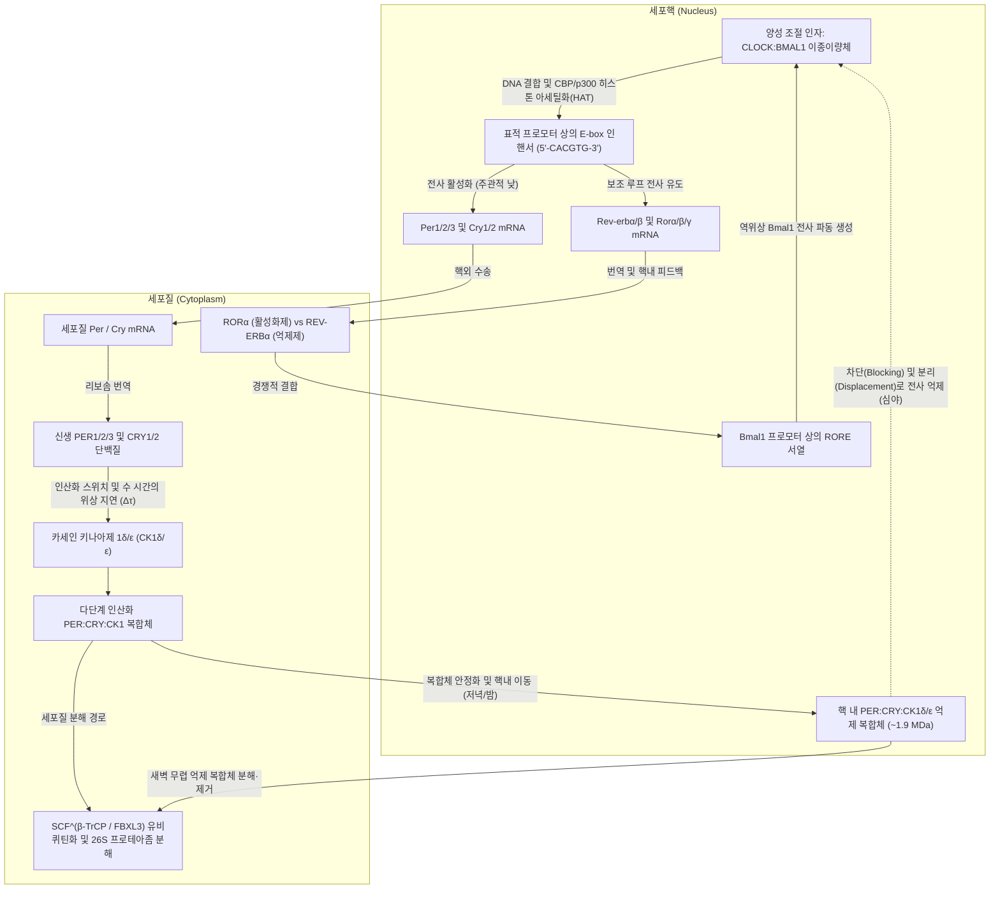
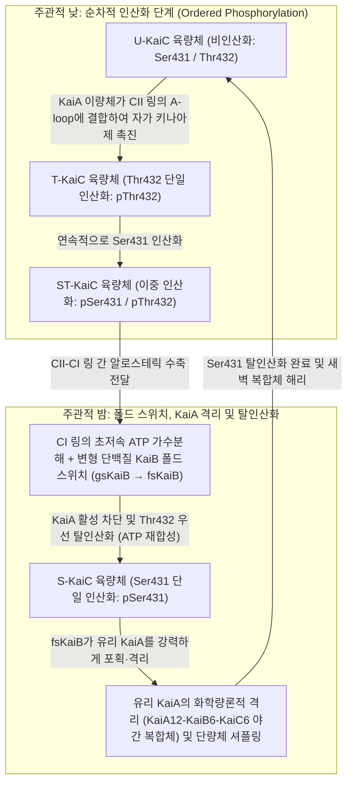

태양빛이 전혀 닿지 않는 깊은 지하 동굴이나 창문 없는 완벽한 암실에 갇힌다면, 생명체의 몸은 '지금이 낮인지 밤인지'를 완전히 잃어버리게 될까?

놀랍게도 정답은 '아니다'이다. 외부의 빛과 온도 변화를 완전히 차단한 항상성 어둠 조건(Constant Darkness, DD)에서도 인간을 포함한 포유류, 곤충, 식물, 균류, 심지어 단세포 광합성 세균인 시아노박테리아(남세균)에 이르기까지 지구상의 거의 모든 생명체는 <strong>약 24시간 주기의 자율적인 생체 리듬</strong>을 끊임없이 유지한다. 수면과 각성, 심부 체온의 오르내림, 코르티솔과 멜라토닌 같은 호르몬 분비, 혈압과 면역 감시, 나아가 전체 단백질 암호화 유전자의 10~40%에 달하는 유전자 발현량이 개별 세포 내부에 내장된 '분자 진자(molecular pendulum)'에 의해 정교하게 통제되고 있다.

그러나 화학물리학과 비선형 동역학(Nonlinear Dynamics)의 관점에서 살펴보면, 세포 내 24시간 시계에는 세 가지 근본적인 과학적 역설이 숨어 있다.

1. <strong>시간 스케일과 안정성의 역설(비선형 동역학)</strong>: 전사 인자 결합, 번역, 인산화 등 세포 내 기본 생화학 반응은 밀리초에서 수 분 내에 일어난다. 게다가 제어이론에서 단순한 2변수 음성 피드백 루프는 필연적으로 감쇠하여 정적인 평형 상태(steady state)에 수렴해 멈춰버린다. 분자 네트워크는 어떻게 <strong>호프 분기(Hopf Bifurcation)</strong>를 거쳐 감쇠하지 않는 <strong>극한 주기 자려 진동(Limit-Cycle Oscillation)</strong>을 생성하며, 그 주기를 무려 $86,400\text{초}$($24\text{시간}$)까지 늘릴 수 있는가?
2. <strong>유전자 전사 도그마 대 순수 단백질 시계(분자 및 구조생물학)</strong>: 오랫동안 시간생물학계는 모든 생체시계가 핵 내 DNA에서 mRNA로의 전사와 단백질로의 번역을 거치는 <strong>전사-번역 피드백 루프(TTFL)</strong>를 필수 기반으로 한다고 믿었다. 그러나 2005년, 일본 나고야 대학의 <strong>곤도 다카오(Takao Kondo)</strong>와 <strong>이시우라 마사히로(Masahiro Ishiura)</strong> 연구팀은 <strong>DNA도 mRNA도 리보솜도 전혀 없는 시험관 안에서 단지 세 종류의 정제된 시아노박테리아 단백질(KaiA, KaiB, KaiC)과 ATP만 섞어주어도 24시간 주기의 인산화 진동이 며칠 동안 지속된다</strong>는 사실을 증명하여 생물학계를 뒤흔들었다.
3. <strong>온도 보상성(Temperature Compensation, $Q_{10} \approx 1.0$)의 생물물리학적 수수께끼</strong>: 일반적인 화학 반응과 효소 반응 속도는 <strong>아레니우스 방정식(Arrhenius Equation)</strong> $k(T) = A \exp(-E_a / RT)$를 따르며, 온도가 $10^\circ\text{C}$ 올라갈 때마다 속도가 2~3배 빨라진다(온도 계수 $Q_{10} \approx 2\text{–}3$). 만약 생체시계가 보통의 생화학 반응 사슬로 이루어져 있다면, 기온이 $10^\circ\text{C}$ 오른 날에는 시계가 두 배 이상 빨라져 시계로서의 기능을 완전히 상실할 것이다. 생체시계는 어떻게 열운동 가속을 상쇄하고 <strong>$Q_{10} \approx 0.95\text{–}1.05$</strong>라는 불변의 주기를 유지하는가?

이 글에서는 1729년 미모사 암실 실험과 2017년 노벨 생리의학상 수상 업적인 진핵생물 TTFL 메커니즘부터, 굿윈-골드베터(Goodwin–Goldbeter) 진동자 미분방정식, 시아노박테리아 KaiABC 번역 후 진동자(PTO)의 구조적 알로스테리, 온도 보상성을 구현하는 길항적 균형 및 효소 자기억제 메커니즘, 그리고 시교차상핵(SCN)의 광동조와 시간의학(Chronomedicine)의 최전선까지 체계적으로 해부한다.

---

## 1. 내재적 시간의 발견: 1729년 미모사 실험에서 초파리 `period` 돌연변이까지

### 1.1 드 메랑의 1729년 와인 저장고 실험과 자유 지속 주기 $\tau$

수천 년 동안 식물이 낮에 잎을 펼치고 밤에 오므리는 취면 운동(nyctinasty)은 태양빛에 대한 단순한 수동적 반응으로 여겨졌다. 1729년 프랑스의 천문학자 <strong>장자크 도르투스 드 메랑(Jean-Jacques d'Ortous de Mairan)</strong>은 신경초라 불리는 <strong>미모사(*Mimosa pudica*)</strong> 화분을 햇빛이 전혀 들지 않는 지하 와인 저장고(항상성 어둠 조건, <strong>DD</strong>)에 넣고 관찰했다. 놀랍게도 미모사는 완전한 암흑 속에서도 매일 아침 잎을 활짝 열고 밤이면 잎을 닫는 리듬을 그대로 지속했다.

1832년 스위스의 식물학자 <strong>오귀스탱 피라뮈 드 캉돌(Augustin Pyramus de Candolle)</strong>은 일정한 환경에서 미모사의 잎 개폐 주기를 정밀 측정하여, 그 주기가 지구의 자전 주기인 정확히 24.0시간이 아니라 <strong>약 22~23시간</strong>이라는 사실을 밝혀냈다.

외부의 시간 단서(<strong>차이트게버, Zeitgeber</strong> — 빛이나 온도 주기)를 모두 제거한 상태에서 생명체가 자발적으로 나타내는 고유 주기를 <strong>자유 지속 주기(Free-Running Period, $\tau$)</strong>라고 부른다.

- <strong>미모사(*Mimosa pudica*)</strong>: $\tau \approx 22\text{–}23\,\text{h}$
- <strong>생쥐(*Mus musculus*)</strong>: $\tau \approx 23.5\,\text{h}$
- <strong>노랑초파리(*Drosophila melanogaster*)</strong>: $\tau \approx 23.8\,\text{h}$
- <strong>인간(*Homo sapiens*)</strong>: $\tau \approx 24.18\,\text{h}$ (1999년 하버드 대학교 찰스 자이슬러 연구팀이 강제 탈동조 프로토콜로 측정한 평균값 $24\text{시간 } 11\text{분} \pm 12\text{분}$)

$\tau$가 정확히 24.00시간이 아니라 '약 24시간'이라는 사실은 생체시계가 지구 자전에 따른 미지의 외부 물리 신호에 의존하는 것이 아니라 <strong>세포 내부에 구현된 내인성 생화학 발진기(Endogenous Oscillator)</strong>임을 입증하는 결정적 증거다. 1959년 <strong>프란츠 할베르크(Franz Halberg)</strong>는 라틴어 *circa*(약)와 *dies*(하루)를 합쳐 <strong>일주기 리듬(Circadian Rhythm, 서카디안 리듬)</strong>이라는 용어를 제창했다.

### 1.2 코놉카와 벤저(1971) 그리고 2017년 노벨 생리의학상

1971년 캘리포니아 공과대학교의 <strong>로널드 코놉카(Ronald Konopka)</strong>와 <strong>시모어 벤저(Seymour Benzer)</strong>는 초파리에 화학 돌연변이원(EMS)을 처리하여 우화(eclosion) 및 보행 활동 리듬이 변한 세 가지 돌연변이 계통을 분리했고, 이들이 모두 X 염색체의 단일 유전자 좌위인 <strong>`period`($per$)</strong>의 점돌연변이임을 밝혀냈다.

1. <strong>$per^0$(무주기 돌연변이)</strong>: 암흑 조건에서 24시간 리듬이 완전히 소실됨(종결 코돈을 만드는 넌센스 돌연변이).
2. <strong>$per^S$(단주기 돌연변이)</strong>: 내인성 주기가 <strong>$\tau \approx 19\,\text{h}$</strong>로 단축됨(Ser589Asn 미스센스 돌연변이).
3. <strong>$per^L$(장주기 돌연변이)</strong>: 내인성 주기가 <strong>$\tau \approx 29\,\text{h}$</strong>로 연장됨(Val243Asp 미스센스 돌연변이).

단일 단백질의 아미노산 하나가 바뀌는 것만으로 생명체의 하루 길이가 19시간이나 29시간으로 변한다는 발견은 큰 충격을 주었다. 이후 1984년 `period` 유전자를 클로닝하고 전사-번역 피드백 메커니즘을 규명한 <strong>제프리 홀(Jeffrey C. Hall)</strong>, <strong>마이클 로스배시(Michael Rosbash)</strong>, <strong>마이클 영(Michael W. Young)</strong>은 <strong>2017년 노벨 생리의학상</strong>을 수상했다.

---

## 2. 진핵생물의 전사-번역 피드백 루프(TTFL) 분자 메커니즘

### 2.1 포유류의 핵심 루프(CLOCK:BMAL1, E-box, PER:CRY)와 FASPS 수면 장애

1. <strong>아침의 전사 개시(CLOCK:BMAL1과 E-box)</strong>:
   bHLH-PAS 전사 인자인 <strong>CLOCK</strong>(또는 <strong>NPAS2</strong>)과 <strong>BMAL1</strong>이 이종이량체 <strong>CLOCK:BMAL1</strong>을 형성하여 표적 유전자 프로모터의 <strong>E-box(`5'-CACGTG-3'`)</strong> 서열에 결합한다. CLOCK의 히스톤 아세틸기전이효소(HAT) 활성과 CBP/p300 조활성인자 모집을 통해 <strong>`Per1/2/3`</strong>와 <strong>`Cry1/2`</strong> 유전자의 전사가 강력하게 촉진된다.
2. <strong>세포질 축적, CK1$\delta/\varepsilon$ 다단계 인산화 및 위상 지연($\Delta\tau$)</strong>:
   세포질에서 번역된 단독 PER 단백질은 <strong>카세인 키나아제 $1\delta/\varepsilon$(CK1$\delta/\varepsilon$)</strong>에 의해 인산화되면 E3 유비퀴틴 연결효소 <strong>$\text{SCF}^{\beta\text{-TrCP}}$</strong>에 의해 즉각 분해된다. 따라서 충분한 양의 PER와 CRY가 축적되어 안정한 <strong>PER:CRY:CK1$\delta/\varepsilon$ 삼자 복합체</strong>를 이루고 핵으로 들어가기까지 <strong>약 4~6시간의 결정적인 시간 지연($\Delta\tau$)</strong>이 발생한다.
3. <strong>핵내 이동과 이중 전사 억제(Blocking & Displacement)</strong>:
   핵으로 들어간 거대 PER:CRY:CK1$\delta/\varepsilon$ 복합체($\sim 1.9\,\text{MDa}$)는 두 단계로 CLOCK:BMAL1을 억제한다. 첫째, <strong>CRY1</strong>이 CLOCK:BMAL1에 직접 결합하여 CBP/p300과의 상호작용을 차단(Blocking)한다. 둘째, <strong>PER2</strong>가 운반한 CK1$\delta/\varepsilon$가 CLOCK을 직접 인산화하여 E-box DNA로부터 물리적으로 떼어낸다(Displacement). 새벽이 되면 핵 내 PER와 CRY가 각각 $\text{SCF}^{\beta\text{-TrCP}}$와 <strong>$\text{SCF}^{\text{FBXL3}}$</strong>에 의해 분해되면서 새로운 주기가 시작된다.
4. <strong>가족성 수면 위상 전진 증후군(FASPS — 새벽 3시에 깨어나는 유전 질환)</strong>:
   2001년 루이스 프타체크(Louis Ptáček)와 푸잉후이(Ying-Hui Fu) 연구팀은 저녁 7시에 잠들어 <strong>새벽 3~4시에 완전히 깨어나는 극단적 아침형 가계(FASPS, $\tau \approx 21.6\,\text{h}$)</strong>에서 인간 <strong>`PER2` 유전자의 Ser662Gly 돌연변이</strong>와 <strong>`CSNK1D`(CK1$\delta$)의 Thr44Ala 돌연변이</strong>를 발견했다. PER2 단백질에는 FASP 안정화 인산화 영역(Ser662~Ser674)과 $\beta$-TrCP 분해 촉진 영역(Ser478)이 경쟁하는 <strong>인산화 스위치(Phosphoswitch)</strong>가 존재하는데, Ser662Gly 변이로 안정화 브레이크가 고장 나면 PER2가 조기 분해되어 시계가 약 3시간 빨라진다. 반대로 `CRY1` 엑손 11 결실 변이($\text{CRY1}\,\Delta 11$)는 전사 억제를 연장시켜 <strong>가족성 수면 위상 지연 증후군(FDSPS, 극단적 올빼미형)</strong>을 유발한다.
5. <strong>보조 루프(REV-ERB$\alpha$ / ROR$\alpha$ 및 D-box)</strong>:
   CLOCK:BMAL1은 핵수용체 <strong>`Rev-erbα/β`</strong>와 <strong>`Rorα/β/γ`</strong>의 전사도 유도하며, 이들은 *Bmal1* 프로모터의 <strong>RORE</strong> 서열에서 경쟁하여 *Bmal1*의 역위상 진동을 만들어낸다. 여기에 <strong>DBP / E4BP4</strong>의 <strong>D-box</strong> 루프가 맞물려 전 유전체의 10~40%에 달하는 일주기 조절 유전자(CCGs)의 위상을 정밀하게 조율한다.

---

## 3. 유전자 진동자의 수리생물학: 굿윈 진동자, 골드베터 모델과 호프 분기

### 3.1 벤딕슨 정리(Bendixson's Criterion)에 의한 2변수 음성 피드백의 진동 불가능성 증명

mRNA 농도 $M(t)$와 억제 단백질 농도 $P(t)$만으로 이루어진 시간 지연 없는 2변수 음성 피드백 시스템 $\dot{M} = f(P) - \gamma_M M,\; \dot{P} = k_s M - \gamma_P P$ ($f'(P) < 0$)를 생각하자. 이 2차원 벡터장 $\mathbf{F} = (F_1, F_2)$의 <strong>발산(Divergence)</strong>은 다음과 같다.

$$\nabla \cdot \mathbf{F} = \frac{\partial \dot{M}}{\partial M} + \frac{\partial \dot{P}}{\partial P} = -\gamma_M - \gamma_P < 0$$

분해 속도 상수 $\gamma_M, \gamma_P > 0$이므로 발산은 제1사분면 전역에서 항상 엄밀한 음수이며 부호가 바뀌지 않는다. <strong>벤딕슨의 음성 판정법(Bendixson's Negative Criterion)</strong>에 의해 이러한 평면 영역 내에는 닫힌 주기 궤도(극한 주기, Limit Cycle)가 <strong>절대로 존재할 수 없다</strong>. 야코비 행렬의 대각합 $\operatorname{Tr}(J) = -(\gamma_M + \gamma_P) < 0$이고 행렬식 $\det(J) > 0$이므로 고정점은 항상 점근 안정하며 감쇠 진동만 일어날 뿐이다.

### 3.2 굿윈 진동자(1965)와 골드베터의 생체시계 모델(1995)

감쇠하지 않는 자려 진동이 일어나려면 세포질 인산화와 핵 수송 지연을 나타내는 제3의 변수가 필수적이다. <strong>브라이언 굿윈(Brian Goodwin, 1965)</strong>과 <strong>알베르 골드베터(Albert Goldbeter, 1995)</strong>의 3변수 미분방정식 모델은 다음과 같다.

$$\frac{dM}{dt} = \frac{v_s K_I^n}{K_I^n + P_N^n} - v_m \frac{M}{K_m + M}, \qquad \frac{dP_C}{dt} = k_s M - v_d \frac{P_C}{K_d + P_C} - k_1 P_C + k_2 P_N, \qquad \frac{dP_N}{dt} = k_1 P_C - k_2 P_N$$

이 시스템이 <strong>호프 분기(Hopf Bifurcation)</strong>를 거쳐 안정한 극한 주기 진동을 생성하기 위한 <strong>세 가지 수학적 조건</strong>은 다음과 같다.
1. <strong>음성 피드백(Negative Feedback)</strong>;
2. <strong>충분히 긴 위상 지연(Phase Delay $\Delta\tau$)</strong>: 신호가 루프를 한 바퀴 돌 때 위상이 $180^\circ$($\pi\,\text{rad}$) 지연되어야 함;
3. <strong>강한 비선형성 및 초민감성(Nonlinearity / Ultrasensitivity)</strong>: 선형 1차 분해를 가정한 3변수 굿윈 모델에서는 특성방정식 $(\lambda + \gamma)^3 + G = 0$이 순허근을 갖기 위해 <strong>힐 계수(Hill Coefficient) $n > \sec^3(\pi/3) = 8$</strong>이라는 비현실적인 협동성이 요구된다(Griffith 정리, 1968).
   실제 생체시계는 두 가지 메커니즘으로 이 '$n > 8$의 장벽'을 돌파한다. 첫째, 골드베터 모델처럼 분해 효소가 포화 영역($K_d \ll P_C$)에서 작동하는 <strong>미카엘리스-멘텐 영차 초민감성(Zero-Order Ultrasensitivity)</strong>을 통해 유효 감쇠율을 낮추어 $n = 2\text{–}4$에서도 진동을 일으킨다. 둘째, <strong>김재경(Jae Kyoung Kim)과 대니얼 포저(Daniel B. Forger)(2012)</strong>가 규명한 <strong>분자 적정 및 화학량론적 격리(Molecular Titration / Stoichiometric Sequestration)</strong> 메커니즘을 통해, PER:CRY가 CLOCK:BMAL1과 $1:1$로 강하게 결합하여 당량점($I_T \approx A_T$) 부근에서 예리한 비선형 임계 스위치를 형성함으로써 $n = 1$에서도 강건한 자려 진동을 생성한다.

---

## 4. 곤도 다카오와 이시우라 마사히로의 2005년 대발견: 시험관 속 시아노박테리아 KaiABC 단백질 시계

1998년 곤도 다카오와 이시우라 마사히로 연구팀은 광합성 세균인 시아노박테리아(*Synechococcus elongatus* PCC 7942)에서 <strong>`kaiA`, `kaiB`, `kaiC`</strong> 유전자 클러스터를 발견했다. 이어 2005년, <strong>나카지마 마사토(Masato Nakajima)</strong>와 곤도 다카오 연구팀은 《Science》에 전 세계 생물학계를 경악시킨 논문을 발표했다.

> <strong>DNA도, mRNA도, 리보솜도 전혀 없는 시험관 안에서 정제된 세 종류의 단백질(KaiA, KaiB, KaiC)과 ATP(및 $\text{Mg}^{2+}$)만 혼합하자, KaiC 단백질의 인산화 상태가 약 24시간 주기로 며칠 동안 감쇠 없이 자려 진동하며 온도 보상성($Q_{10} \approx 1.0$)까지 완벽히 재현되었다!</strong>

### 4.1 KaiABC 번역 후 진동자(PTO)의 초정밀 나노머신 메커니즘

1. <strong>이중 링 육량체 KaiC와 자연계에서 가장 느린 ATPase</strong>:
   <strong>KaiC</strong>는 N말단 <strong>CI 링</strong>과 C말단 <strong>CII 링</strong>이 겹쳐진 이중 도넛 모양의 동종육량체(Hexamer)다. 놀랍게도 KaiC는 <strong>단량체당 하루에 약 15개의 ATP 분자</strong>($\sim 0.6\,\text{ATP}\cdot\text{h}^{-1}$)만 가수분해하는 초저속 ATPase이며, CI 활성 부위의 입체 장애와 수소 결합 네트워크가 24시간의 느린 시간 스케일을 결정하는 원자 수준의 '탈진기(escapement)' 역할을 한다.
2. <strong>순차적 인산화 사이클($\text{U} \to \text{T} \to \text{ST} \to \text{S} \to \text{U}$)과 KaiB의 폴드 스위치(Fold-Switching)</strong>:
   낮 동안 <strong>KaiA 이량체</strong>가 KaiC CII 링의 A-loop에 결합하면 CII 내부의 두 잔기인 <strong>Thr432(T)</strong>와 <strong>Ser431(S)</strong>이 순서대로 인산화된다($\text{U} \to \text{T} \to \text{ST}$). Ser431이 인산화되면 CII 링이 수축하며 CI 링의 ATP 가수분해를 유발한다. 이때 용액 속에서 안정한 사량체 기저 폴드(<strong>gsKaiB</strong>)로 존재하던 <strong>KaiB</strong>가 단량체로 해리되면서 단백질 3차원 구조 자체를 완전히 뒤집는 <strong>티오레독신 유사 폴드(fsKaiB, Metamorphic Protein)</strong>로 전환되어 CI 링에 결합한다! 이 높은 에너지 장벽의 구조 전환이 수 시간의 위상 지연을 만들어낸다.
3. <strong>KaiA의 화학량론적 격리(Sequestration)와 ATP 재생 탈인산화</strong>:
   CI 링에 결합한 fsKaiB는 용액 내의 유리 <strong>KaiA를 모두 포획하여 불활성 야간 복합체($\text{KaiA}_{12}\text{KaiB}_6\text{KaiC}_6$)에 격리</strong>시킨다(분자 적정 스위치!). KaiA를 잃은 KaiC는 인산기를 ADP로 되돌려 <strong>ATP를 재합성하는 역반응</strong>을 통해 Thr432와 Ser431을 차례로 탈인산화($\text{ST} \to \text{S} \to \text{U}$)하며, <strong>단량체 셔플링(Monomer Shuffling)</strong>을 통해 시험관 내 모든 육량체의 위상을 동기화시킨다.

| 비교 항목 | 진핵생물 생체시계 (포유류, 곤충, 식물, 균류) | 시아노박테리아 핵심 시계 (KaiABC 시스템) |
| :--- | :--- | :--- |
| <strong>기본 발진 원리</strong> | <strong>전사-번역 피드백 루프 (TTFL)</strong> | <strong>번역 후 진동자 (PTO)</strong> (생체 내에서는 외곽 TTFL과 결합) |
| <strong>시험관 내 재구성</strong> | 불가능 (핵, 리보솜, 프로테아좀 필수) | <strong>완전 재구성 가능</strong> (<strong>KaiA + KaiB + KaiC + ATP + $\text{Mg}^{2+}$</strong>만으로 진동) |
| <strong>양성 조절 인자</strong> | 전사 인자 복합체 (<strong>CLOCK:BMAL1</strong>, CLK:CYC, WC-1:WC-2) | <strong>KaiA 이량체</strong> (CII 링 A-loop 결합 및 자가 키나아제 촉진) |
| <strong>음성 조절 인자</strong> | 핵 내 억제 복합체 (<strong>PER:CRY</strong>, PER:TIM, FRQ) + <strong>CK1$\delta/\varepsilon$</strong> | <strong>폴드 스위치 KaiB (fsKaiB)</strong>에 의한 <strong>유리 KaiA의 화학량론적 격리</strong> |
| <strong>위상 지연 $\Delta\tau$ 원천</strong> | 전사, 번역, CK1 다단계 인산화 스위치 및 핵내 수송 | <strong>CI 링 초저속 ATPase (~15 ATP/일)</strong> + <strong>KaiB 변형 폴드 스위치</strong> |
| <strong>온도 보상성 ($Q_{10}$)</strong> | $Q_{10} \approx 0.95\text{–}1.05$ (CK1$\delta/\varepsilon$ 생성물 억제 및 PER2 스위치) | $Q_{10} \approx 1.0$ (KaiC 단일 효소 ATPase 자체의 구조적 알로스테리) |

---

## 5. 온도 보상성($Q_{10} \approx 1.0$)의 생물물리학: 아레니우스 법칙을 어떻게 극복하는가?

일반적인 화학 반응 속도는 <strong>아레니우스 방정식</strong> $k(T) = A \exp(-E_a / RT)$를 따르므로 $10^\circ\text{C}$ 온도 상승 시 $Q_{10} = \frac{k(T+10)}{k(T)} \approx 2\text{–}3$배 빨라진다. 반면 생체시계는 다음 두 가지 원리로 <strong>$Q_{10} \approx 1.0$</strong>을 달성한다.

1. <strong>피터 루오프의 길항적 균형 이론(Ruoff's Antagonistic Balance, 1992)</strong>:
   주기 $\tau(k_1, \dots, k_N)$의 온도 미분은 주기 제어 계수 $C_i^\tau = \frac{\partial \ln \tau}{\partial \ln k_i}$ ($\sum C_i^\tau = -1$)와 활성화 에너지 $E_{a,i}$에 의해 다음과 같이 표현된다.
   $$\frac{d \ln \tau}{d T} = \sum_{i=1}^{N} \frac{\partial \ln \tau}{\partial \ln k_i} \frac{d \ln k_i}{d T} = \frac{1}{R T^2} \sum_{i=1}^{N} C_i^{\tau} E_{a,i} \approx 0$$
   주기를 단축시키는 반응($C_i^\tau < 0$)과 주기를 연장시키는 길항 반응($C_j^\tau > 0$, 예: FASP 안정화 인산화, 핵외 수송)이 모두 고온에서 빨라지더라도, 가중 합 $\sum_i C_i^\tau E_{a,i} = 0$이 성립하면 서로 완벽히 상쇄되어 주기가 일정하게 유지된다.
2. <strong>단일 효소 내부의 온도 보상(우에다 히로키 연구팀의 CK1$\delta/\varepsilon$ 자기억제와 KaiC ATPase)</strong>:
   놀랍게도 온도 보상성은 단일 효소 내부에 이미 물리적으로 내장되어 있다. <strong>데라우치와 곤도(2007)</strong>는 KaiC 육량체 단독의 ATPase 활성 자체가 $Q_{10} \approx 1.0$임을 증명했다. 또한 포유류에서도 <strong>이소지마, 시노하라, 우에다 히로키(Isojima et al., 2009; Shinohara et al., 2017)</strong> 연구팀이 정제된 <strong>CK1$\delta/\varepsilon$에 의한 PER2 인산화 반응 자체가 시험관 내에서 온도 보상($Q_{10} \approx 1.0$)</strong>됨을 발견했다. 온도가 오르면 촉매 반응 속도는 빨라지지만, CK1$\delta$의 K224 음이온 결합 포켓이 인산화된 생성물(pPER2)과 더 강하게 결합하여 생성물 방출 속도를 늦추는 자기억제(Product Inhibition)가 동시에 작동하여 온도에 무관한 속도를 유지한다.

---

## 6. 시교차상핵(SCN) 마스터 시계, 멜라놉신 광동조 및 시간의학(Chronomedicine)

인간의 망막에는 시각을 담당하는 간상세포·원추세포 외에 약 1~2%의 <strong>내재성 광감수성 망막 신경절 세포(ipRGCs)</strong>가 존재하며, <strong>파장 $480\,\text{nm}$의 청색광(블루라이트)</strong>에 반응하는 광수용 단백질 <strong>멜라놉신(Melanopsin / OPN4)</strong>을 발현한다. 청색광 신호가 망막시상하부로(RHT)를 통해 시상하부의 마스터 시계인 <strong>시교차상핵(SCN)</strong>에 전달되면 글루탐산과 PACAP가 방출되어 $\text{Ca}^{2+}$ 유입 및 <strong>CREB</strong> 인산화를 거쳐 <strong>*Per1/2* 유전자의 즉각적인 전사 폭발</strong>을 일으킨다. 초저녁이나 심야의 스마트폰 블루라이트는 감소하던 *Per*를 다시 높여 <strong>위상 지연(Phase Delay, 올빼미화)</strong>을 유발하고, 아침 햇빛은 *Per* 상승을 앞당겨 <strong>위상 전진(Phase Advance)</strong>을 일으킴으로써 $24.18\,\text{h}$의 인간 시계를 $24.00\,\text{h}$의 지구 자전에 동기화시킨다.

또한 좌우 약 <strong>20,000개의 SCN 뉴런</strong>은 신경펩티드 <strong>VIP</strong>, <strong>AVP</strong> 및 <strong>GABA</strong>를 통해 밀접하게 결합된 진동자 네트워크(<strong>구라모토 모델, Kuramoto Coupled Oscillators</strong>)를 형성하여 단일 세포의 분자 노이즈를 $1/\sqrt{N}$로 압축한다. 해외여행 시 빛으로 빠르게 재설정되는 뇌의 SCN과 식사·체온 신호에 의존하여 천천히 움직이는 간·소화관 등의 말초 시계 사이에 위상 불일치(<strong>내부 탈동조, Internal Desynchronization</strong>)가 발생하는 것이 바로 <strong>시차증(Jet Lag)</strong>이다.

오늘날 이 원리는 <strong>시간의학(Chronomedicine)</strong>과 <strong>시간약리학(Chronotherapy)</strong>으로 꽃피고 있다. 콜레스테롤 합성 효소(HMG-CoA 환원효소)가 밤에 피크를 이루므로 단시간 작용 스타틴은 취침 전에 복용할 때 효과가 극대화되며, 대장암 항암제(5-FU와 옥살리플라틴)의 시간조절 투여는 독성을 절반으로 줄인다. 특히 최근의 임상 연구(*Qian et al., Lancet Oncology, 2021* 등)는 T세포의 종양 침윤과 수지상세포의 항원 제시가 활발한 <strong>오전 시간대에 면역관문억제제(항PD-1 항체 펨브롤리주맙·니볼루맙 등)를 투여받은 암 환자군이 오후 투여군에 비해 전체 생존기간(OS)이 약 2배 가까이 길다</strong>는 충격적인 결과를 보여주며, 생체시계 과학이 생명을 구하는 임상의학의 핵심 패러다임으로 자리 잡았음을 증명하고 있다.
