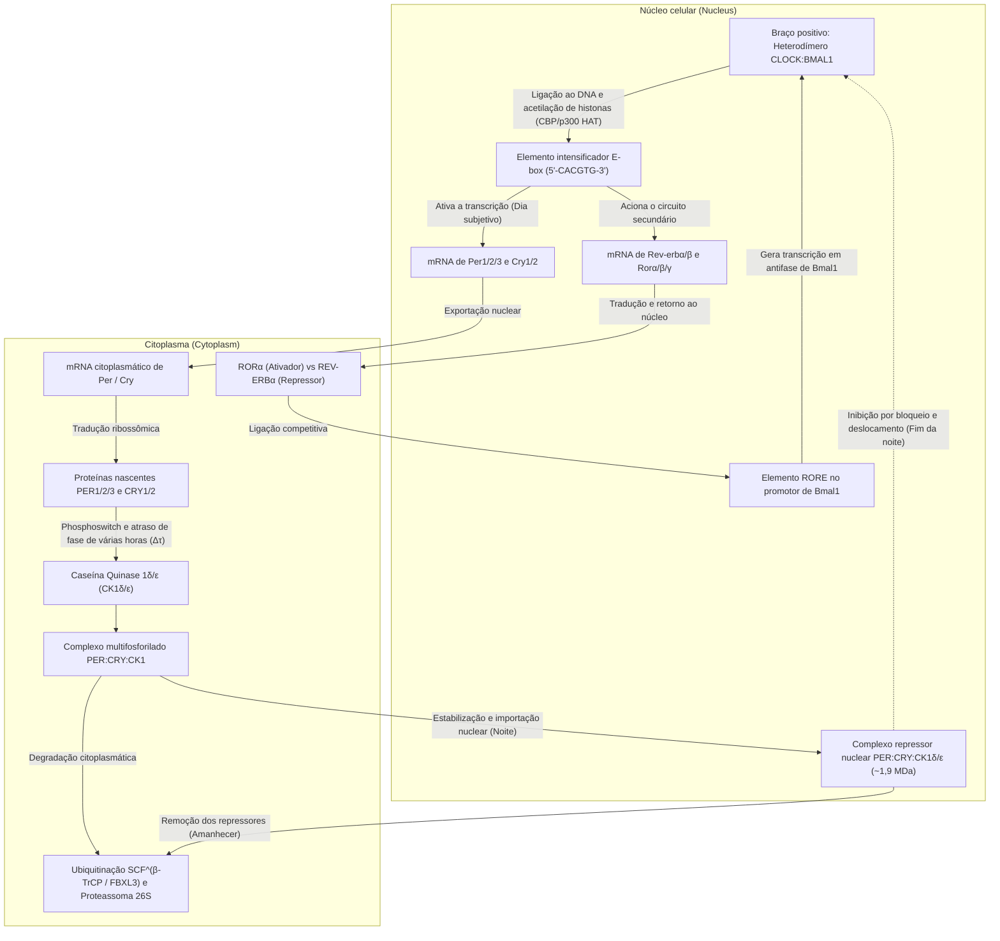
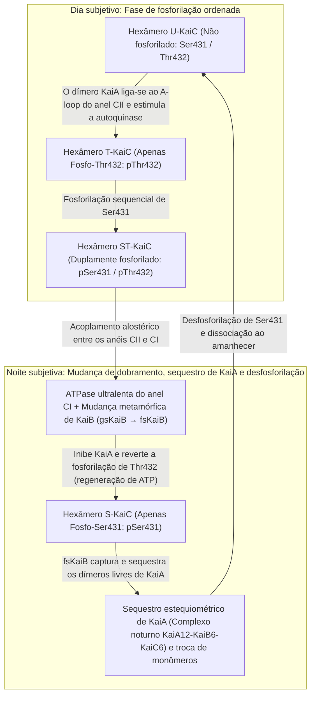

Se um ser humano, uma planta, uma mosca-das-frutas ou uma cultura de bactérias fotossintéticas for trancado em uma caverna subterrânea profunda ou em uma câmara escura totalmente isolada da luz solar e das variações de temperatura, o organismo perde a noção de dia e noite?

Surpreendentemente, a resposta é não. Mesmo sob condições de <strong>escuridão constante (Constant Darkness, DD)</strong>, praticamente todos os seres vivos da Terra — desde cianobactérias unicelulares e fungos até plantas, insetos e mamíferos — mantêm uma <strong>oscilação autônoma com período de aproximadamente 24 horas</strong>. O ciclo sono-vigília, a temperatura corporal central, a secreção de cortisol e melatonina, a pressão arterial, a vigilância imunológica e a expressão de 10% a 40% de todos os genes codificadores de proteínas são governados por pêndulos moleculares dentro de cada célula.

Contudo, sob a ótica da físico-química e da dinâmica não linear, esse relógio intracelular esconde três profundos paradoxos científicos:

1. <strong>O paradoxo da escala de tempo e da estabilidade (Dinâmica não linear)</strong>: As reações bioquímicas elementares (ligação de fatores de transcrição, tradução, fosforilação) ocorrem em milissegundos ou minutos. Além disso, um circuito simples de retroalimentação negativa de duas variáveis inevitavelmente sofre amortecimento e para em um ponto de equilíbrio estático. Como uma rede molecular consegue, por meio de uma <strong>bifurcação de Hopf</strong>, sustentar uma <strong>oscilação de ciclo limite (Limit-Cycle Oscillation)</strong> com período de $86.400\text{ segundos}$ ($24\text{ horas}$)?
2. <strong>O dogma da transcrição genética versus relógios puramente proteicos (Biologia molecular e estrutural)</strong>: Durante décadas, acreditou-se que todo relógio circadiano dependia de um <strong>circuito de retroalimentação transcrição-tradução (TTFL)</strong> envolvendo DNA e mRNA. Em 2005, <strong>Takao Kondo</strong> e <strong>Masahiro Ishiura</strong> derrubaram esse dogma ao demonstrar que a simples mistura de <strong>três proteínas purificadas de cianobactérias (KaiA, KaiB e KaiC) com ATP em um tubo de ensaio</strong> — <strong>sem DNA, sem mRNA e sem ribossomos</strong> — produz uma oscilação de fosforilação de 24 horas perfeitamente estável por vários dias!
3. <strong>O mistério biofísico da compensação de temperatura ($Q_{10} \approx 1{,}0$)</strong>: As taxas das reações químicas e enzimáticas obedecem à <strong>equação de Arrhenius</strong>, $k(T) = A \exp(-E_a / RT)$, dobrando ou triplicando a cada aumento de $10^\circ\text{C}$ ($Q_{10} \approx 2\text{–}3$). Se o relógio biológico seguisse a cinética comum de Arrhenius, ele correria mais de duas vezes mais rápido em uma tarde quente, tornando-se inútil como marcador de tempo. Como os relógios biológicos alcançam um coeficiente térmico invariante de <strong>$Q_{10} \approx 0{,}95\text{–}1{,}05$</strong>?

---

## 1. Da planta *Mimosa pudica* (1729) aos mutantes de *Drosophila* e ao Prêmio Nobel de 2017

Em 1729, o astrônomo francês <strong>Jean-Jacques d'Ortous de Mairan</strong> colocou a planta sensitiva <strong>*Mimosa pudica</strong>* em uma adega em <strong>escuridão constante (DD)</strong> e observou que suas folhas continuavam se abrindo todas as manhãs e se fechando todas as noites. Em 1832, o botânico suíço <strong>Augustin Pyramus de Candolle</strong> demonstrou que, em condições constantes, esse ciclo se repete com um <strong>período de livre curso (Free-Running Period) $\tau \approx 22\text{–}23\,\text{h}$</strong>.

Na ausência de sincronizadores externos (<strong>Zeitgebers</strong>), cada espécie revela seu período endógeno $\tau$: $\tau \approx 23{,}5\,\text{h}$ no camundongo, $\tau \approx 23{,}8\,\text{h}$ na *Drosophila melanogaster* e <strong>$\tau \approx 24{,}18\,\text{h}$ no ser humano</strong> ($24\text{ h } 11\text{ min}$, medido por Charles Czeisler em 1999). O fato de $\tau$ divergir ligeiramente de 24,00 horas comprova que o oscilador é <strong>endógeno</strong>, batizado de <strong>circadiano</strong> por <strong>Franz Halberg</strong> em 1959 (do latim *circa*, "cerca de", e *dies*, "dia").

Em 1971, <strong>Ronald Konopka</strong> e <strong>Seymour Benzer</strong> (Caltech) descobriram por mutagênese em *Drosophila* três alelos mutantes de um único gene no cromossomo X chamado <strong>`period` ($per$)</strong>: <strong>$per^0$</strong> (arrítmico), <strong>$per^S$</strong> (período curto $\tau \approx 19\,\text{h}$) e <strong>$per^L$</strong> (período longo $\tau \approx 29\,\text{h}$). Em 1984, <strong>Jeffrey C. Hall</strong>, <strong>Michael Rosbash</strong> e <strong>Michael W. Young</strong> clonaram o gene `period` e elucidaram seu mecanismo de retroalimentação negativa, conquista laureada com o <strong>Prêmio Nobel de Fisiologia ou Medicina de 2017</strong>.

---

## 2. O circuito de retroalimentação transcrição-tradução (TTFL) em eucariotos

Nos mamíferos, o heterodímero <strong>CLOCK:BMAL1</strong> liga-se às sequências <strong>E-box (`5'-CACGTG-3'`)</strong> para ativar a transcrição de <strong>`Per1/2/3`</strong> e <strong>`Cry1/2`</strong>. No citoplasma, as proteínas PER monoméricas são fosforiladas pela <strong>Caseína Quinase $1\delta/\varepsilon$ (CK1$\delta/\varepsilon$)</strong> e degradadas via <strong>$\text{SCF}^{\beta\text{-TrCP}}$</strong>. Após um <strong>atraso de fase ($\Delta\tau$) de 4 a 6 horas</strong>, os complexos <strong>PER:CRY:CK1$\delta/\varepsilon$</strong> ($\sim 1{,}9\,\text{MDa}$) entram no núcleo e inibem CLOCK:BMAL1 por <strong>bloqueio</strong> (CRY1) e <strong>deslocamento do DNA</strong> (fosforilação de CLOCK por PER2:CK1$\delta/\varepsilon$), estabilizados pelo circuito secundário <strong>REV-ERB$\alpha/\beta$ / ROR$\alpha/\beta/\gamma$</strong> nos elementos <strong>RORE</strong>.

Em humanos, a mutação <strong>Ser662Gly em `PER2`</strong> (ou <strong>Thr44Ala em `CSNK1D`/CK1$\delta$</strong>) impede a fosforilação estabilizadora da região FASP, acelera a degradação de PER2 via Ser478, encurta o período para $\tau \approx 21{,}6\,\text{h}$ e causa a <strong>Síndrome Familiar da Fase do Sono Avançada (FASPS)</strong>: os pacientes sentem sono às 19h e <strong>despertam totalmente alertas às 3h da madrugada</strong>! Já a mutação $\text{CRY1}\,\Delta 11$ prolonga a repressão e causa a síndrome da fase atrasada (FDSPS).

---

## 3. Biologia matemática dos osciladores genéticos: Modelo de Goodwin–Goldbeter e bifurcação de Hopf

Em um sistema bidimensional de retroalimentação negativa sem atraso ($\dot{M} = f(P) - \gamma_M M,\; \dot{P} = k_s M - \gamma_P P$ com $f'(P) < 0$), a divergência do campo vetorial é estritamente negativa em todo o quadrante positivo:

$$\nabla \cdot \mathbf{F} = \frac{\partial \dot{M}}{\partial M} + \frac{\partial \dot{P}}{\partial P} = -\gamma_M - \gamma_P < 0$$

Pelo <strong>critério negativo de Bendixson</strong>, nenhuma órbita fechada (ciclo limite) pode existir. Para cruzar uma <strong>bifurcação de Hopf</strong>, <strong>Brian Goodwin (1965)</strong> e <strong>Albert Goldbeter (1995)</strong> formularam o sistema de três variáveis ($M$, proteína citoplasmática $P_C$, proteína nuclear $P_N$):

$$\frac{dM}{dt} = \frac{v_s K_I^n}{K_I^n + P_N^n} - v_m \frac{M}{K_m + M}, \qquad \frac{dP_C}{dt} = k_s M - v_d \frac{P_C}{K_d + P_C} - k_1 P_C + k_2 P_N, \qquad \frac{dP_N}{dt} = k_1 P_C - k_2 P_N$$

A oscilação sustentada exige <strong>três ingredientes matemáticos</strong>: (1) <strong>retroalimentação negativa</strong>, (2) <strong>atraso de fase $\Delta\tau$ suficiente</strong> (defasagem de $180^\circ$) e (3) <strong>forte não linearidade / ultrassensibilidade</strong>. Com degradação linear de primeira ordem, o teorema de Griffith (1968) exige um <strong>coeficiente de Hill $n > \sec^3(\pi/3) = 8$</strong>. Os relógios biológicos reais superam essa barreira por meio da <strong>saturação enzimática de Michaelis-Menten (ultrassensibilidade de ordem zero, $K_d \ll P_C$, Goldbeter 1995)</strong> e da <strong>titulação molecular / sequestro estequiométrico 1:1 de CLOCK:BMAL1 por PER:CRY (Kim & Forger, 2012)</strong>, que gera um limiar não linear abrupto mesmo com $n = 1$.

---

## 4. A surpreendente descoberta de Takao Kondo e Masahiro Ishiura (2005): O relógio KaiABC em tubo de ensaio

Em 2005, <strong>Masato Nakajima</strong>, <strong>Takao Kondo</strong> e colaboradores (*Science*, 2005) demonstraram na cianobactéria *Synechococcus elongatus* PCC 7942 que misturar apenas <strong>três proteínas purificadas (KaiA, KaiB e KaiC) mais ATP</strong> em um tubo de ensaio — sem DNA nem mRNA — reconstitui uma oscilação de fosforilação de 24 horas compensada termicamente (<strong>oscilador pós-traducional, PTO</strong>).

O hexâmero de anel duplo <strong>KaiC</strong> (anéis CI e CII) é a ATPase mais lenta da natureza, hidrolisando apenas <strong>$\sim 15\text{ moléculas de ATP por monômero por dia}$</strong>. Durante o dia, <strong>KaiA</strong> estimula a autofosforilação ordenada de <strong>Thr432 (T)</strong> e <strong>Ser431 (S)</strong> ($\text{U} \to \text{T} \to \text{ST}$). A fosforilação de Ser431 aciona alostericamente a hidrólise de ATP no anel CI, onde a <strong>proteína metamórfica KaiB</strong> muda radicalmente seu dobramento tridimensional (<strong>gsKaiB $\to$ fsKaiB</strong> tipo tiorredoxina), liga-se ao anel CI e <strong>sequestra todo o KaiA livre</strong> no complexo noturno $\text{KaiA}_{12}\text{KaiB}_6\text{KaiC}_6$. Sem KaiA, o KaiC se desfosforila regenerando ATP a partir de ADP ($\text{ST} \to \text{S} \to \text{U}$) e sincroniza os hexâmeros por <strong>troca de monômeros (monomer shuffling)</strong>.

| Característica | Relógios eucarióticos (Mamíferos, Insetos, Plantas, Fungos) | Relógio central de cianobactérias (Sistema KaiABC) |
| :--- | :--- | :--- |
| <strong>Arquitetura</strong> | <strong>Circuito transcrição-tradução (TTFL)</strong> | <strong>Oscilador pós-traducional (PTO)</strong> (acoplado a TTFL in vivo) |
| <strong>Reconstituição in vitro</strong> | Impossível sem núcleo, ribossomos e proteassoma | <strong>Completa</strong> com <strong>KaiA + KaiB + KaiC + ATP + $\text{Mg}^{2+}$</strong> purificados |
| <strong>Elemento positivo</strong> | Fatores de transcrição (<strong>CLOCK:BMAL1</strong>, CLK:CYC, WC-1:WC-2) | <strong>Dímero KaiA</strong> (liga-se ao A-loop de CII e estimula a autoquinase) |
| <strong>Elemento negativo</strong> | Complexos repressores (<strong>PER:CRY</strong>, PER:TIM, FRQ) + <strong>CK1$\delta/\varepsilon$</strong> | <strong>KaiB metamórfico (fsKaiB)</strong> mediando <strong>sequestro estequiométrico de KaiA</strong> |
| <strong>Origem do atraso $\Delta\tau$</strong> | Transcrição, tradução, fosforilação CK1, importação nuclear | <strong>ATPase CI ultralenta ($\sim 15\,\text{ATP/dia}$)</strong> + <strong>mudança de dobramento de KaiB</strong> |
| <strong>Compensação térmica</strong> | $Q_{10} \approx 0{,}95\text{–}1{,}05$ (autoinibição de CK1$\delta/\varepsilon$ e phosphoswitch PER2) | $Q_{10} \approx 1{,}0$ (alosteria estrutural intrínseca da ATPase KaiC) |

---

## 5. O mistério da compensação de temperatura ($Q_{10} \approx 1{,}0$)

Enquanto a <strong>equação de Arrhenius</strong> $k(T) = A \exp(-E_a / RT)$ impõe um $Q_{10} = \frac{k(T+10)}{k(T)} \approx 2\text{–}3$ às reações bioquímicas comuns, os relógios circadianos alcançam $Q_{10} \approx 1{,}0$ por meio de dois mecanismos:

1. <strong>Equilíbrio antagônico de Peter Ruoff (1992)</strong>:
   Em função dos coeficientes de controle do período $C_i^\tau = \frac{\partial \ln \tau}{\partial \ln k_i}$ ($\sum_i C_i^\tau = -1$) e das energias de ativação $E_{a,i}$:
   $$\frac{d \ln \tau}{d T} = \sum_{i=1}^{N} \frac{\partial \ln \tau}{\partial \ln k_i} \frac{d \ln k_i}{d T} = \frac{1}{R T^2} \sum_{i=1}^{N} C_i^{\tau} E_{a,i} \approx 0$$
   As reações que encurtam o período ($C_i^\tau < 0$) são exatamente compensadas pelas reações antagônicas que o alongam ($C_j^\tau > 0$).
2. <strong>Compensação intrínseca nas enzimas CK1$\delta/\varepsilon$ e KaiC</strong>:
   <strong>Terauchi e Kondo (2007)</strong> demonstraram que a atividade ATPase basal do KaiC isolado já possui $Q_{10} \approx 1{,}0$. Da mesma forma, <strong>Yasushi Isojima, Yusuke Shinohara e Hiroki R. Ueda (2009, 2017)</strong> descobriram que a fosforilação de PER2 por <strong>CK1$\delta/\varepsilon$</strong> in vitro é compensada termicamente ($Q_{10} \approx 1{,}0$), pois a aceleração catalítica em temperaturas mais altas é contrabalançada por uma maior afinidade pelo produto fosforilado (inibição por produto mediada pelo bolso aniônico K224).

---

## 6. O núcleo supraquiasmático (SCN), a melanopsina e a cronomedicina

Para sincronizar o relógio humano ($\tau \approx 24{,}18\,\text{h}$) com o dia solar de 24,00 horas (<strong>fotoarrastamento</strong>), 1% a 2% das células ganglionares da retina (<strong>ipRGCs</strong>) expressam <strong>melanopsina (OPN4)</strong>, sensível à <strong>luz azul ($\lambda_{\text{max}} \approx 480\,\text{nm}$)</strong>. Pelo trato retino-hipotalâmico (RHT), liberam glutamato e PACAP no <strong>núcleo supraquiasmático (SCN)</strong>, fosforilando <strong>CREB</strong> e induzindo a transcrição imediata de <strong>*Per1/2</strong>* conforme a <strong>curva de resposta de fase (PRC)</strong>: atraso de fase no início da noite e avanço de fase ao amanhecer.

No SCN, cerca de <strong>20.000 neurônios</strong> acoplados via <strong>VIP</strong>, <strong>AVP</strong> e <strong>GABA</strong> formam uma rede de osciladores de Kuramoto. O <strong>jet lag</strong> decorre da <strong>dessincronização interna</strong> entre o SCN (rapidamente ajustado pela luz) e os relógios periféricos (fígado, trato digestivo) sincronizados pelas refeições. Na <strong>cronomedicina</strong>, administrar estatinas de meia-vida curta antes de dormir, aplicar quimioterapia cronomodulada (5-FU e oxaliplatina segundo Francis Lévi) e realizar <strong>infusões de imunoterapia (inibidores de PD-1 como pembrolizumabe ou nivolumabe) pela manhã em vez da tarde quase dobra a sobrevida global de pacientes com melanoma e câncer de pulmão</strong> (*Qian et al., Lancet Oncology, 2021*).
