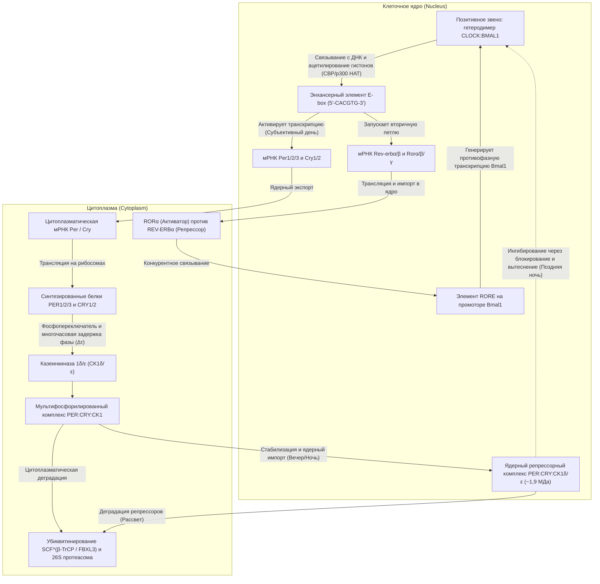
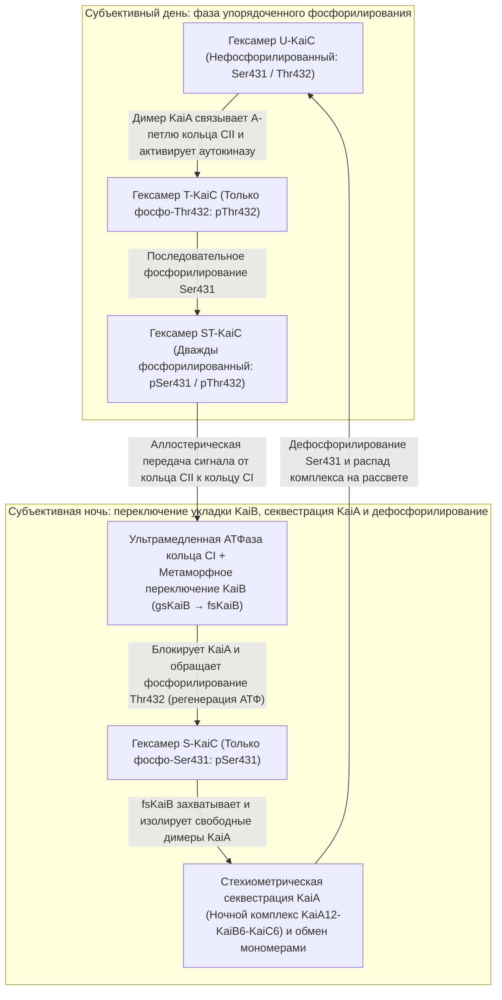

Если человека, растение, плодовую мушку или культуру фотосинтезирующих бактерий поместить в глубокую подземную пещеру или тёмный бункер, полностью изолированный от солнечного света и перепадов температуры, потеряет ли организм ощущение дня и ночи?

Удивительно, но ответ — нет. Даже в условиях <strong>постоянной темноты (Constant Darkness, DD)</strong> практически все живые существа на Земле — от одноклеточных цианобактерий и грибов до растений, насекомых и млекопитающих — продолжают поддерживать <strong>автономные колебания с периодом около 24 часов</strong>. Циклы сна и бодрствования, колебания внутренней температуры тела, секреция кортизола и мелатонина, артериальное давление, иммунный надзор и экспрессия от 10 % до 40 % всех белок-кодирующих генов управляются молекулярными маятниками внутри каждой клетки.

Однако с точки зрения химической физики и нелинейной динамики эти внутриклеточные часы скрывают три глубоких научных парадокса:

1. <strong>Парадокс масштаба времени и устойчивости (Нелинейная динамика)</strong>: Элементарные биохимические реакции (связывание факторов транскрипции, трансляция, фосфорилирование) протекают за миллисекунды или минуты. Более того, простая двухкомпонентная петля отрицательной обратной связи неизбежно затухает и приходит в статическое равновесие. Как молекулярная сеть через <strong>бифуркацию Хопфа</strong> порождает незатухающие <strong>автоколебания предельного цикла (Limit-Cycle Oscillation)</strong> с периодом в $86\,400\text{ секунд}$ ($24\text{ часа}$)?
2. <strong>Догма генетической транскрипции против чисто белковых часов (Молекулярная и структурная биология)</strong>: Десятилетиями считалось, что любые циркадные часы требуют <strong>транскрипционно-трансляционной петли обратной связи (TTFL)</strong> с участием ДНК и мРНК. Но в 2005 году <strong>Такао Кондо (Takao Kondo)</strong> и <strong>Масахиро Исиура (Masahiro Ishiura)</strong> разрушили эту догму, показав, что смешивание всего <strong>трёх очищенных белков цианобактерий (KaiA, KaiB и KaiC) с АТФ в пробирке</strong> — <strong>без ДНК, без мРНК и без рибосом</strong> — запускает устойчивый 24-часовой цикл фосфорилирования, длящийся сутками!
3. <strong>Биофизическая загадка температурной компенсации ($Q_{10} \approx 1{,}0$)</strong>: Скорости обычных химических и ферментативных реакций подчиняются <strong>уравнению Аррениуса</strong> $k(T) = A \exp(-E_a / RT)$, ускоряясь в 2–3 раза при каждом повышении температуры на $10^\circ\text{C}$ ($Q_{10} \approx 2\text{–}3$). Если бы биологические часы подчинялись обычной кинетике Аррениуса, в тёплый день они шли бы более чем вдвое быстрее и стали бы бесполезны как хронометр. Как циркадные часы удерживают практически инвариантный температурный коэффициент <strong>$Q_{10} \approx 0{,}95\text{–}1{,}05$</strong>?

---

## 1. От мимозы де Мерана (1729) к мутантам *Drosophila* и Нобелевской премии 2017 года

В 1729 году французский астроном <strong>Жан-Жак д'Орту де Меран (Jean-Jacques d'Ortous de Mairan)</strong> поместил стыдливую мимозу (<strong>*Mimosa pudica</strong>*), раскрывающую листья днём и складывающую их ночью, в винный погреб в условия <strong>постоянной темноты (DD)</strong>. Несмотря на полное отсутствие солнца, растение продолжало раскрывать листья каждое утро и закрывать каждый вечер. В 1832 году швейцарский ботаник <strong>Огюстен Пирам де Кандоль</strong> установил, что в постоянных условиях этот цикл повторяется не ровно через 24,0 часа, а с <strong>периодом свободного хода (Free-Running Period) $\tau \approx 22\text{–}23\,\text{ч}$</strong>.

В отсутствие внешних датчиков времени (<strong>цейтгеберов, Zeitgebers</strong>) каждый вид демонстрирует свой эндогенный период $\tau$: у мыши $\tau \approx 23{,}5\,\text{ч}$, у дрозофилы $\tau \approx 23{,}8\,\text{ч}$, а <strong>у человека $\tau \approx 24{,}18\,\text{ч}$</strong> ($24\text{ ч } 11\text{ мин}$, измерено Чарльзом Чейслером в 1999 году). Отклонение $\tau$ от точных 24,00 часов доказывает <strong>эндогенную</strong> природу осциллятора, названного <strong>Францем Хальбергом</strong> в 1959 году <strong>циркадным ритмом</strong> (от лат. *circa* — «около» и *dies* — «день»).

В 1971 году <strong>Рональд Конопка</strong> и <strong>Сеймур Бензер</strong> (Калтех) с помощью мутагенеза у *Drosophila melanogaster* открыли три мутантных аллеля одного гена на X-хромосоме, названного <strong>`period` ($per$)</strong>: <strong>$per^0$</strong> (аритмичный), <strong>$per^S$</strong> (короткий период $\tau \approx 19\,\text{ч}$) и <strong>$per^L$</strong> (длинный период $\tau \approx 29\,\text{ч}$). В 1984 году <strong>Джеффри Холл</strong>, <strong>Майкл Росбаш</strong> и <strong>Майкл Янг</strong> клонировали ген `period` и расшифровали механизм отрицательной обратной связи, за что были удостоены <strong>Нобелевской премии по физиологии и медицине 2017 года</strong>.

---

## 2. Транскрипционно-трансляционная петля обратной связи (TTFL) у эукариот

У млекопитающих гетеродимер <strong>CLOCK:BMAL1</strong> связывается с последовательностями <strong>E-box (`5'-CACGTG-3'`)</strong>, активируя транскрипцию генов <strong>`Per1/2/3`</strong> и <strong>`Cry1/2`</strong>. В цитоплазме мономеры PER фосфорилируются <strong>казеинкиназой $1\delta/\varepsilon$ (CK1$\delta/\varepsilon$)</strong> и подвергаются убиквитинированию комплексом <strong>$\text{SCF}^{\beta\text{-TrCP}}$</strong>. После <strong>фазовой задержки ($\Delta\tau$) в 4–6 часов</strong> стабильные комплексы <strong>PER:CRY:CK1$\delta/\varepsilon$</strong> ($\sim 1{,}9\,\text{МДа}$) входят в ядро и подавляют CLOCK:BMAL1 путём <strong>блокирования</strong> (CRY1) и <strong>снятия с ДНК</strong> (фосфорилирование CLOCK киназой CK1$\delta/\varepsilon$), а вторичная петля <strong>REV-ERB$\alpha/\beta$ / ROR$\alpha/\beta/\gamma$</strong> на элементах <strong>RORE</strong> стабилизирует ритм.

У человека точечная мутация <strong>Ser662Gly в гене `PER2`</strong> (или <strong>Thr44Ala в `CSNK1D`/CK1$\delta$</strong>) нарушает стабилизирующее фосфорилирование FASP-кластера, ускоряет распад PER2 через дегрон Ser478, сокращает период до $\tau \approx 21{,}6\,\text{ч}$ и вызывает <strong>семейный синдром опережения фазы сна (FASPS)</strong>: пациенты засыпают около 19:00 и <strong>просыпаются в 3:00 ночи</strong>! Напротив, мутация $\text{CRY1}\,\Delta 11$ удлиняет $\tau$ и вызывает синдром задержки фазы сна (FDSPS).

---

## 3. Математическая биология генетических осцилляторов: модель Гудвина–Гольдбетера и бифуркация Хопфа

В двумерной системе с отрицательной обратной связью без запаздывания ($\dot{M} = f(P) - \gamma_M M,\; \dot{P} = k_s M - \gamma_P P$, где $f'(P) < 0$) дивергенция векторного поля всюду строго отрицательна:

$$\nabla \cdot \mathbf{F} = \frac{\partial \dot{M}}{\partial M} + \frac{\partial \dot{P}}{\partial P} = -\gamma_M - \gamma_P < 0$$

Согласно <strong>отрицательному критерию Бендиксона</strong>, замкнутая периодическая траектория (предельный цикл) в такой системе существовать не может. Чтобы преодолеть это ограничение и пройти через <strong>бифуркацию Хопфа</strong>, <strong>Брайан Гудвин (1965)</strong> и <strong>Альбер Гольдбетер (1995)</strong> сформулировали трёхкомпонентную систему ОДУ ($M$, цитоплазматический белок $P_C$, ядерный репрессор $P_N$):

$$\frac{dM}{dt} = \frac{v_s K_I^n}{K_I^n + P_N^n} - v_m \frac{M}{K_m + M}, \qquad \frac{dP_C}{dt} = k_s M - v_d \frac{P_C}{K_d + P_C} - k_1 P_C + k_2 P_N, \qquad \frac{dP_N}{dt} = k_1 P_C - k_2 P_N$$

Для возникновения автоколебаний необходимы <strong>три математических условия</strong>: (1) <strong>отрицательная обратная связь</strong>, (2) <strong>достаточно длительная задержка фазы $\Delta\tau$</strong> (сдвиг фазы на $180^\circ$) и (3) <strong>сильная нелинейность / ультрачувствительность</strong>. При линейном распаде первого порядка теорема Гриффита (1968) требует <strong>коэффициента Хилла $n > \sec^3(\pi/3) = 8$</strong>. Реальные биологические часы обходят этот барьер благодаря <strong>ферментативному насыщению Михаэлиса–Ментен (ультрачувствительности нулевого порядка, $K_d \ll P_C$, Гольдбетер 1995)</strong> и <strong>молекулярному титрованию / стехиометрической секвестрации 1:1 комплекса CLOCK:BMAL1 белками PER:CRY (Kim & Forger, 2012)</strong>, создающей резкий нелинейный порог даже при $n = 1$.

---

## 4. Открытие Такао Кондо и Масахиро Исиуры (2005): белковые часы KaiABC в пробирке

В 2005 году <strong>Масато Накадзима</strong>, <strong>Такао Кондо</strong> и соавторы (*Science*, 2005) продемонстрировали на цианобактерии *Synechococcus elongatus* PCC 7942, что смешивание всего <strong>трёх очищенных белков (KaiA, KaiB и KaiC) и АТФ</strong> в пробирке — в полном отсутствии ДНК и мРНК — воссоздаёт температурно-компенсированный 24-часовой цикл фосфорилирования (<strong>посттрансляционный осциллятор, PTO</strong>).

Двухкольцевой гексамер <strong>KaiC</strong> (кольца CI и CII) является самой медленной из известных АТФаз в природе, гидролизуя лишь <strong>$\sim 15\text{ молекул АТФ на мономер в сутки}$</strong>. Днём <strong>KaiA</strong> стимулирует упорядоченное аутофосфорилирование остатков <strong>Thr432 (T)</strong> и <strong>Ser431 (S)</strong> ($\text{U} \to \text{T} \to \text{ST}$). Фосфорилирование Ser431 аллостерически запускает гидролиз АТФ в кольце CI, после чего <strong>метаморфный белок KaiB</strong> радикально меняет свою пространственную укладку (<strong>gsKaiB $\to$ fsKaiB</strong> тиоредоксинового типа), связывается с кольцом CI и <strong>секвестрирует весь свободный KaiA</strong> в ночном комплексе $\text{KaiA}_{12}\text{KaiB}_6\text{KaiC}_6$. Лишённый KaiA, гексамер KaiC дефосфорилируется путём ресинтеза АТФ из АДФ ($\text{ST} \to \text{S} \to \text{U}$) и синхронизирует популяцию через <strong>обмен мономерами (monomer shuffling)</strong>.

| Характеристика | Эукариотические часы (Млекопитающие, Насекомые, Растения, Грибы) | Ядерные часы цианобактерий (Система KaiABC) |
| :--- | :--- | :--- |
| <strong>Архитектура осциллятора</strong> | <strong>Транскрипционно-трансляционная петля (TTFL)</strong> | <strong>Посттрансляционный осциллятор (PTO)</strong> (связан с TTFL in vivo) |
| <strong>Реконструкция in vitro</strong> | Невозможна без ядра, рибосом и протеасом | <strong>Полная</strong> в растворе <strong>KaiA + KaiB + KaiC + АТФ + $\text{Mg}^{2+}$</strong> |
| <strong>Позитивный элемент</strong> | Транскрипционные факторы (<strong>CLOCK:BMAL1</strong>, CLK:CYC, WC-1:WC-2) | <strong>Димер KaiA</strong> (связывает A-loop кольца CII, стимулируя аутокиназу) |
| <strong>Негативный элемент</strong> | Репрессорные комплексы (<strong>PER:CRY</strong>, PER:TIM, FRQ) + <strong>CK1$\delta/\varepsilon$</strong> | <strong>Метаморфный KaiB (fsKaiB)</strong> через <strong>стехиометрическую секвестрацию KaiA</strong> |
| <strong>Источник задержки $\Delta\tau$</strong> | Транскрипция, трансляция, фосфорилирование CK1, импорт в ядро | <strong>Ультрамедленная АТФаза CI ($\sim 15\,\text{АТФ/сутки}$)</strong> + <strong>фолд-свитч KaiB</strong> |
| <strong>Температурная компенсация</strong> | $Q_{10} \approx 0{,}95\text{–}1{,}05$ (автоингибирование CK1$\delta/\varepsilon$ и фосфопереключатель PER2) | $Q_{10} \approx 1{,}0$ (внутренняя структурная аллостерия АТФазы KaiC) |

---

## 5. Загадка температурной компенсации ($Q_{10} \approx 1{,}0$)

В то время как <strong>уравнение Аррениуса</strong> $k(T) = A \exp(-E_a / RT)$ даёт $Q_{10} = \frac{k(T+10)}{k(T)} \approx 2\text{–}3$ для обычных реакций, циркадные часы обеспечивают $Q_{10} \approx 1{,}0$ за счёт двух механизмов:

1. <strong>Антагонистический баланс Петера Руоффа (1992)</strong>:
   Выражая температурную производную периода $\tau$ через коэффициенты контроля периода $C_i^\tau = \frac{\partial \ln \tau}{\partial \ln k_i}$ ($\sum_i C_i^\tau = -1$) и энергии активации $E_{a,i}$:
   $$\frac{d \ln \tau}{d T} = \sum_{i=1}^{N} \frac{\partial \ln \tau}{\partial \ln k_i} \frac{d \ln k_i}{d T} = \frac{1}{R T^2} \sum_{i=1}^{N} C_i^{\tau} E_{a,i} \approx 0$$
   Реакции, сокращающие период ($C_i^\tau < 0$), точно уравновешиваются антагонистическими реакциями, удлиняющими период ($C_j^\tau > 0$).
2. <strong>Внутриферментная компенсация в CK1$\delta/\varepsilon$ и KaiC</strong>:
   <strong>Terauchi & Kondo (2007)</strong> показали, что базальная АТФазная активность самого гексамера KaiC уже обладает $Q_{10} \approx 1{,}0$. Аналогично, <strong>Ясуси Исодзима, Юсукэ Синохара и Хироки Уэда (2009, 2017)</strong> обнаружили, что фосфорилирование PER2 киназой <strong>CK1$\delta/\varepsilon$</strong> in vitro температурно компенсировано ($Q_{10} \approx 1{,}0$): ускорение каталитического переноса фосфата при нагревании компенсируется усилением сродства к фосфорилированному продукту (анионный карман Lys224) и замедлением его высвобождения.

---

## 6. Супрахиазматическое ядро (SCN), меланопсин и хрономедицина

Для синхронизации часов человека ($\tau \approx 24{,}18\,\text{ч}$) с 24,00-часовыми солнечными сутками (<strong>фотозахват</strong>) 1–2 % ганглиозных клеток сетчатки (<strong>ipRGCs</strong>) экспрессируют фотопигмент <strong>меланопсин (OPN4)</strong>, чувствительный к <strong>синему свету ($\lambda_{\text{max}} \approx 480\,\text{нм}$)</strong>. По ретиногипоталамическому тракту (RHT) сигнал поступает в <strong>супрахиазматическое ядро (SCN)</strong> гипоталамуса, где глутамат и PACAP вызывают фосфорилирование <strong>CREB</strong> и быструю индукцию транскрипции <strong>*Per1/2</strong>* в соответствии с <strong>фазовой кривой отклика (PRC)</strong>: задержка фазы в начале ночи и опережение фазы на рассвете.

В SCN около <strong>20 000 нейронов</strong>, связанных через нейропептиды <strong>VIP</strong>, <strong>AVP</strong> и <strong>ГАМК (GABA)</strong>, образуют сеть связанных осцилляторов Курамото. При перелётах через часовые пояса <strong>джетлаг</strong> возникает из-за <strong>внутренней десинхронизации</strong> между быстро перестраивающимся от света SCN и периферическими часами (печень, ЖКТ), реагирующими на режим питания. В <strong>хрономедицине</strong> приём статинов короткого действия перед сном, хрономодулированная химиотерапия колоректального рака (5-ФУ и оксалиплатин по Франсису Леви) и <strong>утреннее введение ингибиторов иммунных контрольных точек (анти-PD-1 антител, таких как пембролизумаб и ниволумаб) вместо вечернего почти вдвое увеличивают общую выживаемость пациентов с меланомой и раком лёгких</strong> (*Qian et al., Lancet Oncology, 2021*).
