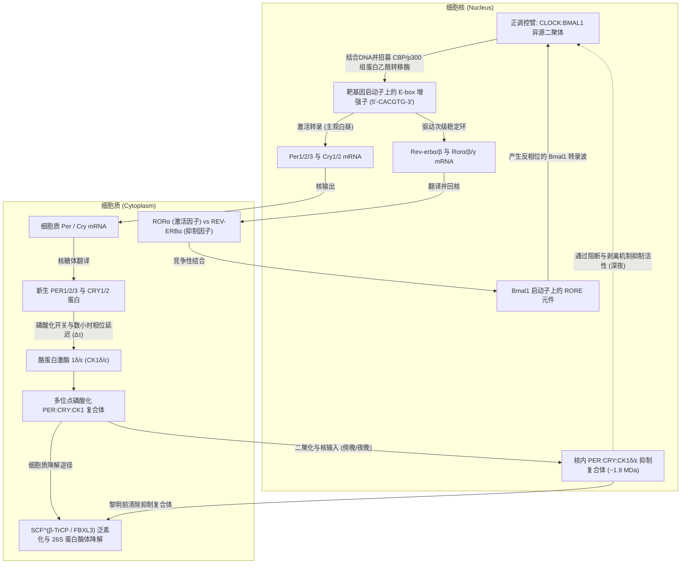
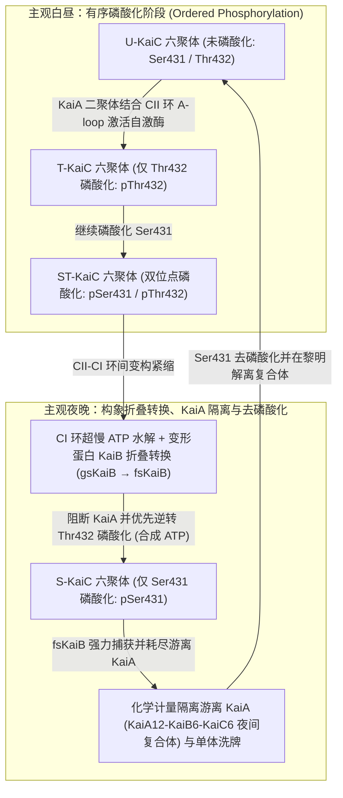

如果将人类、植物、果蝇或光合细菌置于完全隔绝阳光、温度恒定的地下深处洞穴或暗室之中，生命是否会因此失去对“白昼与黑夜”的感知？

令人惊叹的是，答案是否定的。即使在完全消除外界光线与温度周期线索的恒暗条件（Constant Darkness, DD）下，从单细胞的蓝藻（蓝细菌）、真菌、植物、昆虫，到包括人类在内的哺乳动物，地球上几乎所有生命体依然能够维持<strong>周期约为24小时的自主振荡</strong>。睡眠与觉醒、核心体温的起伏、皮质醇与褪黑素的分泌、血压与免疫监视，乃至全基因组中10%至40%的蛋白质编码基因的表达水平，都由每个细胞内部的“分子摆钟”精确调控。

然而，若从化学物理与非线性动力学的视角审视，细胞内的24小时生物钟隐藏着三个极其深邃的科学悖论：

1. <strong>时间尺度与稳定性悖论（非线性动力学）</strong>：细胞内的基本生化反应（转录因子结合、翻译、磷酸化修饰）通常在毫秒至数分钟内完成；而且在控制论中，简单的双变量负反馈回路必然会发生阻尼衰减并停留在稳态平衡点。分子网络究竟如何通过<strong>霍普夫分岔（Hopf Bifurcation）</strong>产生持续不衰减的<strong>极限环自激振荡（Limit-Cycle Oscillation）</strong>，并将周期拉长至整整 $86,400\text{秒}$（$24\text{小时}$）？
2. <strong>中心法则教条与纯蛋白质时钟（分子与结构生物学）</strong>：长期以来，时间生物学界坚信一切昼夜节律都必须依赖“DNA转录为mRNA、再翻译为蛋白质抑制自身转录”的<strong>转录-翻译反馈环（TTFL）</strong>。然而在2005年，日本名古屋大学的<strong>近藤孝男（Takao Kondo）</strong>与<strong>石浦正宽（Masahiro Ishiura）</strong>团队打破了这一教条：他们仅将<strong>三种纯化的蓝藻重组蛋白（KaiA、KaiB、KaiC）与ATP混合在试管中</strong>——在<strong>完全没有DNA、没有mRNA、没有核糖体</strong>的条件下，试管内的KaiC蛋白磷酸化水平竟以24小时周期持续振荡了数天之久！
3. <strong>温度补偿性之谜（Temperature Compensation, $Q_{10} \approx 1.0$）</strong>：普通化学与酶促反应速率遵循<strong>阿伦尼乌斯方程（Arrhenius Equation）</strong> $k(T) = A \exp(-E_a / RT)$，温度每升高 $10^\circ\text{C}$，反应速率就会加快2至3倍（温度系数 $Q_{10} \approx 2\text{–}3$）。如果生物钟遵循普通生化动力学，当环境温度升高 $10^\circ\text{C}$ 时，时钟就会走快两倍以上，彻底丧失计时功能。生物钟究竟如何抵消热运动加速，实现 <strong>$Q_{10} \approx 0.95\text{–}1.05$</strong> 的恒定周期？

本文将从1729年的含羞草实验出发，系统阐述真核生物TTFL分子机制、古德温-戈德贝特（Goodwin–Goldbeter）振荡器方程、蓝藻KaiABC翻译后振荡器（PTO）的原子级变构机制、温度补偿性的拮抗平衡与单酶自抑制理论，以及视交叉上核（SCN）光同步与时间医学（Chronomedicine）的临床前沿。

---

## 1. 内源性时间的发现：从含羞草暗室实验到果蝇 `period` 突变体

### 1.1 德·梅朗1729年的酒窖实验与自由运行周期 $\tau$

在数千年的历史中，人们一直认为植物叶片的昼开夜合与动物的昼夜作息只是对太阳升起与落下的被动反应。1729年，法国天文学家兼地球物理学家<strong>让-雅克·多尔图斯·德·梅朗（Jean-Jacques d'Ortous de Mairan）</strong>利用具有感夜运动的<strong>含羞草（*Mimosa pudica*）</strong>进行了一项著名实验。他将含羞草移入完全不见阳光的地下酒窖（恒暗条件，DD）中观察。令人惊讶的是，即使在绝对黑暗中，含羞草依然每天清晨按时展开叶片，傍晚按时闭合，仿佛能“感知”外部的太阳。

1832年，瑞士植物学家<strong>奥古斯丁·皮拉穆斯·德·堪多（Augustin Pyramus de Candolle）</strong>进一步精确测量发现，在恒定条件下，含羞草叶片开合的周期并非严格的24.0小时，而是<strong>22至23小时</strong>。

在现代时间生物学中，屏蔽所有外部授时因子（<strong>Zeitgeber</strong>，德语“时间给予者”，如光照和温度周期）后，生物体自主展现的内源性周期被称为<strong>自由运行周期（Free-Running Period）</strong>，记作 <strong>$\tau$（tau）</strong>：

- <strong>含羞草（*Mimosa pudica*）</strong>：$\tau \approx 22\text{–}23\,\text{h}$
- <strong>小家鼠（*Mus musculus*）</strong>：$\tau \approx 23.5\,\text{h}$
- <strong>黑腹果蝇（*Drosophila melanogaster*）</strong>：$\tau \approx 23.8\,\text{h}$
- <strong>人类（*Homo sapiens*）</strong>：$\tau \approx 24.18\,\text{h}$（哈佛大学 Charles Czeisler 团队于1999年利用强迫去同步化实验精确测定的人类平均内源周期为 $24\text{小时}11\text{分钟} \pm 12\text{分钟}$）

自由运行周期 $\tau$ “接近但不等于24.00小时”是证明生物钟具有<strong>内源性（Endogenous）</strong>的决定性证据：如果生物只是感应某种穿透暗室的地球自转物理信号（如宇宙射线或重力潮汐），其周期必然严格锁定为24.00小时。正因为 $\tau$ 偏离24小时且具有物种与个体遗传特异性，才证明这台振荡器切实存在于细胞内部。1959年，<strong>弗朗茨·哈尔伯格（Franz Halberg）</strong>结合拉丁语 *circa*（大约）与 *dies*（一天），正式提出了<strong>昼夜节律（Circadian Rhythm，又称近日节律）</strong>这一术语。

### 1.2 科诺普卡与本泽（1971）及2017年诺贝尔生理学或医学奖

1971年，加州理工学院的<strong>罗纳德·科诺普卡（Ronald Konopka）</strong>与<strong>西摩·本泽（Seymour Benzer）</strong>利用化学诱变剂（EMS）对黑腹果蝇进行诱变，筛选羽化节律与活动节律异常的突变体。他们分离出了三种全部定位于X染色体同一基因座——<strong>`period`（$per$）基因</strong>——的经典突变品系：

1. <strong>$per^0$（无节律突变体）</strong>：在恒暗条件下24小时节律完全消失（由无义突变导致提前终止密码子产生）。
2. <strong>$per^S$（短周期突变体）</strong>：内源性周期缩短至 <strong>$\tau \approx 19\,\text{h}$</strong>（由单个错义突变 Ser589Asn 引起）。
3. <strong>$per^L$（长周期突变体）</strong>：内源性周期延长至 <strong>$\tau \approx 29\,\text{h}$</strong>（由单个错义突变 Val243Asp 引起）。

单个基因中的单个氨基酸替换就能将动物的一天缩短为19小时或拉长为29小时，这一发现彻底开启了分子时间生物学时代。1984年，<strong>杰弗里·霍尔（Jeffrey C. Hall）</strong>、<strong>迈克尔·罗斯巴什（Michael Rosbash）</strong>与<strong>迈克尔·杨（Michael W. Young）</strong>成功克隆了 `period` 基因，并揭示了其编码的 PER 蛋白通过负反馈调控自身转录的分子机制，三人因此荣膺<strong>2017年诺贝尔生理学或医学奖</strong>。

---

## 2. 真核生物的转录-翻译反馈环（TTFL）分子机制

在果蝇中，正调控异源二聚体 <strong>CLK:CYC</strong> 激活 *per* 与 *tim*（*timeless*）基因转录，PER:TIM 复合体经激酶 <strong>DOUBLETIME（DBT，即哺乳动物 CK1$\varepsilon$ 同源物）</strong>磷酸化后入核抑制 CLK:CYC。而在哺乳动物中，隐花色素蛋白 <strong>CRY1/2</strong> 取代了 TIM 成为 PER 的核心搭档。

### 2.1 哺乳动物核心环：CLOCK:BMAL1、E-box 与 PER:CRY 抑制复合体

1. <strong>清晨的转录激活（CLOCK:BMAL1 结合 E-box）</strong>：
   含有 bHLH-PAS 结构域的转录因子 <strong>CLOCK</strong>（或脑内的 <strong>NPAS2</strong>）与 <strong>BMAL1（ARNTL）</strong>形成异源二聚体 <strong>CLOCK:BMAL1</strong>，特异性结合靶基因启动子区的 <strong>E-box（`5'-CACGTG-3'`）</strong> 序列。CLOCK 自身具有组蛋白乙酰转移酶（HAT）活性，并招募 CBP/p300 开放染色质，强力驱动 <strong>`Per1/2/3`</strong> 和 <strong>`Cry1/2`</strong> 基因的转录。
2. <strong>细胞质积累、CK1$\delta/\varepsilon$ 磷酸化与数小时相位延迟（$\Delta\tau$）</strong>：
   *Per* 与 *Cry* mRNA 运出细胞核并翻译为蛋白质。如果新生 PER 和 CRY 立即入核抑制转录，振荡周期将不足1小时。为了产生24小时周期，<strong>酪蛋白激酶 $1\delta/\varepsilon$（Casein Kinase $1\delta/\varepsilon$, CK1$\delta/\varepsilon$）</strong>对游离的 PER 单体进行磷酸化，使其被 E3 泛素连接酶 <strong>$\text{SCF}^{\beta\text{-TrCP}}$</strong> 识别并经由 26S 蛋白酶体迅速降解。直到午后至傍晚，PER、CRY 与 CK1$\delta/\varepsilon$ 才能组装成稳定的多聚体复合体，产生长达 <strong>4至6小时的相位延迟（Phase Delay）</strong>。
3. <strong>夜晚入核与双重抑制机制（Blocking & Displacement）</strong>：
   分子量约 $1.9\,\text{MDa}$ 的 <strong>PER:CRY:CK1$\delta/\varepsilon$</strong> 复合体进入细胞核，通过两步机制关闭 CLOCK:BMAL1：一是 <strong>CRY1 直接结合 CLOCK-BMAL1</strong> 的反式激活结构域，阻断共激活因子 CBP/p300（Blocking）；二是 <strong>PER2 携带的 CK1$\delta/\varepsilon$ 直接磷酸化 CLOCK</strong>，降低其对 E-box DNA 的亲和力，将 CLOCK:BMAL1 从启动子上物理剥离（Displacement）。
4. <strong>家族性睡眠相位前移综合征（FASPS，凌晨3点醒来的遗传病）</strong>：
   2001年，Louis Ptáček 与傅嫈惠（Ying-Hui Fu）团队发现，人类 <strong>`PER2` 基因的 Ser662Gly 突变</strong>或 <strong>`CSNK1D`（编码 CK1$\delta$）的 Thr44Ala 突变</strong>会导致<strong>家族性睡眠相位前移综合征（FASPS）</strong>。患者每天傍晚18–19点即困倦入睡，<strong>凌晨3点至4点便完全清醒</strong>，内源周期缩短至 $\tau \approx 21.6\,\text{h}$。这是因为 PER2 蛋白存在“磷酸化开关（Phosphoswitch）”：Ser662 引导的 FASP 连续丝氨酸簇磷酸化负责<strong>稳定 PER2</strong>，而 Ser478 位点的磷酸化则招募 $\beta$-TrCP <strong>促进 PER2 降解</strong>。Ser662Gly 突变破坏了稳定化开关，导致核内 PER2 过早被降解，提前解除了转录抑制，使生物钟每天快走约3小时！反之，2017年发现的 `CRY1` 第11外显子跳跃突变（$\text{CRY1}\,\Delta 11$）则增强了对 CLOCK:BMAL1 的抑制，延长周期并导致<strong>家族性睡眠相位延迟综合征（FDSPS，极端夜猫子）</strong>。
5. <strong>次级互锁环（REV-ERB$\alpha$ / ROR$\alpha$ 与 D-box）</strong>：
   CLOCK:BMAL1 同时激活核受体 <strong>`Rev-erbα/β`</strong> 与 <strong>`Rorα/β/γ`</strong> 的转录。ROR 结合 *Bmal1* 启动子上的 <strong>RORE 元件</strong>激活转录，而随后积累的 REV-ERB$\alpha/\beta$ 竞争性结合 RORE 并招募 NCoR-HDAC3 抑制 *Bmal1* 转录。配合 <strong>DBP / E4BP4</strong> 调控的 <strong>D-box</strong> 环路，<strong>E-box（晨间元件）</strong>、<strong>D-box（日间元件）</strong>与 <strong>RORE（晚间元件）</strong>构成了三相转录架构，赋予振荡器极高的鲁棒性。

---

## 3. 基因振荡器的数学生物学：古德温模型、戈德贝特方程与霍普夫分岔

为什么负反馈回路能够持续振荡而不衰减？让我们从常微分方程（ODE）严格证明其数学条件。

### 3.1 本迪克森准则证明：无延迟的双变量负反馈回路不可能持续振荡

若仅考虑 mRNA 浓度 $M(t)$ 与蛋白质浓度 $P(t)$ 两个变量：

$$\frac{dM}{dt} = f(P) - \gamma_M M \equiv F_1(M, P), \qquad \frac{dP}{dt} = k_s M - \gamma_P P \equiv F_2(M, P)$$

其中 $f'(P) < 0$。二维向量场 $\mathbf{F} = (F_1, F_2)$ 的<strong>散度（Divergence）</strong>为：

$$\nabla \cdot \mathbf{F} = \frac{\partial F_1}{\partial M} + \frac{\partial F_2}{\partial P} = -\gamma_M - \gamma_P < 0$$

由于降解速率常数 $\gamma_M, \gamma_P > 0$，散度在整个第一象限恒为严格负数且绝不变号。根据动力系统中的<strong>本迪克森负准则（Bendixson's Negative Criterion，格林公式的直接推论）</strong>，散度不变号的单连通平面区域内<strong>绝对不存在任何闭合周期轨道（极限环）</strong>！其雅可比矩阵的迹 $\operatorname{Tr}(J) = -(\gamma_M + \gamma_P) < 0$ 且行列式 $\det(J) = \gamma_M \gamma_P - k_s f'(P^*) > 0$，特征值实部恒为负，系统只会以阻尼振荡螺旋收敛至稳态平衡点。

### 3.2 古德温振荡器（1965）与戈德贝特模型（1995）

为了突破二维限制并通过<strong>超临界霍普夫分岔（Hopf Bifurcation）</strong>产生极限环振荡，必须引入代表细胞质磷酸化与核转运延迟的第三变量。<strong>布莱恩·古德温（Brian Goodwin, 1965）</strong>与<strong>阿尔伯特·戈德贝特（Albert Goldbeter, 1995）</strong>建立的三变量昼夜节律核心微分方程组为：

$$\frac{dM}{dt} = \frac{v_s K_I^n}{K_I^n + P_N^n} - v_m \frac{M}{K_m + M}, \qquad \frac{dP_C}{dt} = k_s M - v_d \frac{P_C}{K_d + P_C} - k_1 P_C + k_2 P_N, \qquad \frac{dP_N}{dt} = k_1 P_C - k_2 P_N$$

其中 $M$ 为 mRNA 浓度，$P_C$ 为细胞质蛋白浓度，$P_N$ 为核内抑制蛋白浓度，$n$ 为<strong>希尔系数（Hill Coefficient）</strong>。产生持续极限环振荡需要<strong>三大数学要素</strong>：
1. <strong>负反馈（Negative Feedback）</strong>：提供回复力；
2. <strong>足够长的相位延迟（Phase Delay $\Delta\tau$）</strong>：多步磷酸化与核输入使信号相位滞后达到 $180^\circ$（$\pi$ 弧度）；
3. <strong>强非线性与超敏性（Nonlinearity / Ultrasensitivity）</strong>：在具有线性一阶降解的三变量古德温模型中，根据劳斯-赫尔维茨判据（Griffith 定理, 1968），要使特征方程 $(\lambda + \gamma)^3 + G = 0$ 产生纯虚根，必须满足<strong>希尔系数 $n > \sec^3(\pi/3) = 2^3 = 8$</strong>！
   真实生物钟无需 $n > 8$ 的极端DNA结合协同性，而是通过两种机制产生超敏性：一是 Goldbeter 方程中的<strong>米氏酶促饱和降解（零级超敏性，Zero-Order Ultrasensitivity，$K_d \ll P_C$）</strong>，大幅降低了有效阻尼率；二是 <strong>Kim 与 Forger（2012）揭示的分子滴定与化学计量隔离机制（Molecular Titration / Stoichiometric Sequestration）</strong>——PER:CRY 与 CLOCK:BMAL1 按 $1:1$ 高亲和力结合，在等量点 $I_T \approx A_T$ 处产生极其陡峭的阈值非线性开关，使得 $n = 1$ 时亦能稳健振荡。

---

## 4. 近藤孝男与石浦正宽2005年的震撼发现：试管中的蓝藻 KaiABC 蛋白质生物钟

1998年，近藤孝男与石浦正宽等人在单细胞蓝藻（*Synechococcus elongatus* PCC 7942）中鉴定出昼夜节律基因簇 <strong>`kaiA`、`kaiB`、`kaiC`</strong>（源于日语“回”[Kai]，意为循环）。2005年，近藤团队的<strong>中岛正人（Masato Nakajima）</strong>等人在《Science》发表了一项震撼生命科学界的里程碑研究：

> <strong>在完全没有DNA、没有mRNA、没有核糖体的试管中，仅将纯化的重组蛋白 KaiA、KaiB、KaiC 与 ATP（及 $\text{Mg}^{2+}$）混合，KaiC 的磷酸化水平便呈现出周期约为24小时、持续数天不衰减且具备温度补偿性的自激振荡！</strong>

### 4.1 KaiABC 翻译后振荡器（PTO）的精密结构动力学

1. <strong>双环六聚体 KaiC 与自然界最慢的 ATP 酶</strong>：
   <strong>KaiC</strong> 组装成由 N 端 <strong>CI 环</strong>与 C 端 <strong>CII 环</strong>构成的双甜甜圈状同源六聚体。每个 KaiC 单体<strong>每天仅水解约 15 个 ATP 分子</strong>（约 $0.6\,\text{ATP}\cdot\text{h}^{-1}$），比普通解旋酶或肌球蛋白慢数万倍！CI 活性位点肽键的顺反异构化能垒与水分子空间位阻构成了原子级“擒纵器”，奠定了24小时的宏观慢时间尺度。
2. <strong>有序四态磷酸化循环（$\text{U} \to \text{T} \to \text{ST} \to \text{S} \to \text{U}$）</strong>：
   CII 结构域上的 <strong>Ser431（S）</strong> 与 <strong>Thr432（T）</strong> 严格按顺时针方向循环：白昼时 <strong>KaiA 二聚体</strong>结合 KaiC C端的 <strong>A-loop</strong>，促进自激酶活性，先将 Thr432 磷酸化（$\text{U} \to \text{T}$），再将 Ser431 磷酸化形成双磷酸化态（$\text{T} \to \text{ST}$）。
3. <strong>变形蛋白（Metamorphic Protein）KaiB 的折叠转换与 KaiA 化学计量隔离</strong>：
   当 Ser431 被磷酸化后，CII 环紧缩并通过环间变构触发 CI 环水解 ATP，暴露出 B-loop。此时，原本以稳定的四聚体基态折叠（<strong>gsKaiB</strong>）存在的 KaiB 解离为单体，并将其三维拓扑结构彻底重排为罕见的<strong>硫氧还蛋白样折叠态（fsKaiB，Fold-Switched KaiB）</strong>！这种高能垒的缓慢构象转换提供了关键的数小时相位延迟。6个 fsKaiB 协同结合到 CI 环后，将溶液中所有游离的 <strong>KaiA 二聚体捕获并隔离（Sequestration）</strong>进失活的 $\text{KaiA}_{12}\text{KaiB}_6\text{KaiC}_6$ 夜间复合体中。失去 KaiA 激发的 KaiC 六聚体通过将磷酸基团转回 ADP 重新合成 ATP 的逆反应，依次完成 $\text{ST} \to \text{S} \to \text{U}$ 的去磷酸化，并通过<strong>单体洗牌（Monomer Shuffling）</strong>实现试管内数万亿分子的相位同步。

| 比较维度 | 真核生物时钟（哺乳动物、昆虫、植物、真菌） | 蓝藻核心时钟（KaiABC 系统） |
| :--- | :--- | :--- |
| <strong>核心振荡架构</strong> | <strong>转录-翻译反馈环（TTFL）</strong> | <strong>翻译后振荡器（PTO）</strong>（体内与外层 TTFL 耦合） |
| <strong>试管体外重构</strong> | 无法脱离细胞核、核糖体与蛋白酶体独立运转 | <strong>完全重构</strong>（仅需纯化 <strong>KaiA + KaiB + KaiC + ATP + $\text{Mg}^{2+}$</strong>） |
| <strong>正调控元件</strong> | 转录因子异源二聚体（<strong>CLOCK:BMAL1</strong>, CLK:CYC, WC-1:WC-2） | <strong>KaiA 二聚体</strong>（结合 CII 环 A-loop 激活 KaiC 自激酶） |
| <strong>负调控元件</strong> | 核内抑制复合体（<strong>PER:CRY</strong>, PER:TIM, FRQ）+ <strong>CK1$\delta/\varepsilon$</strong> | <strong>折叠转换态 KaiB（fsKaiB）</strong>介导的 <strong>KaiA 化学计量隔离</strong> |
| <strong>相位延迟 $\Delta\tau$ 来源</strong> | 转录、翻译、CK1 多位点磷酸化开关与核输入 | <strong>CI 环超慢 ATPase（~15 ATP/天）</strong> + <strong>KaiB 变形折叠转换</strong> |
| <strong>温度补偿机制（$Q_{10}$）</strong> | $Q_{10} \approx 0.95\text{–}1.05$（CK1$\delta/\varepsilon$ 产物抑制与 PER2 磷酸化开关） | $Q_{10} \approx 1.0$（KaiC 单体 ATPase 自身的结构变构补偿） |

---

## 5. 破解时间生物学最深邃的生物物理之谜：温度补偿性（$Q_{10} \approx 1.0$）

普通生化反应速率遵循<strong>阿伦尼乌斯方程</strong>：

$$k(T) = A \exp\left(-\frac{E_a}{R T}\right), \qquad Q_{10} = \frac{k(T + 10)}{k(T)} = \exp\left(\frac{10 E_a}{R T (T + 10)}\right) \approx 2.0\text{–}3.0$$

然而自 Colin Pittendrigh（1954）在果蝇羽化实验中证实以来，所有生物钟的周期温度系数均保持在 <strong>$Q_{10} \approx 0.95\text{–}1.05$</strong>。生物体通过两个层面的机制破解了阿伦尼乌斯悖论：

1. <strong>彼得·鲁奥夫的拮抗平衡理论（Ruoff's Antagonistic Balance, 1992）</strong>：
   设周期 $\tau(k_1, \dots, k_N)$ 由 $N$ 个遵循阿伦尼乌斯定律的基元反应决定，对温度求导可得：
   $$\frac{d \ln \tau}{d T} = \sum_{i=1}^{N} \frac{\partial \ln \tau}{\partial \ln k_i} \frac{d \ln k_i}{d T} = \frac{1}{R T^2} \sum_{i=1}^{N} C_i^{\tau} E_{a,i} \approx 0$$
   其中 $C_i^\tau = \frac{\partial \ln \tau}{\partial \ln k_i}$ 为周期控制系数（满足 $\sum_i C_i^\tau = -1$）。尽管每个反应随温度升高都加快了2至3倍（$E_{a,i} > 0$），但网络中同时存在缩短周期的反应（$C_i^\tau < 0$）和延长周期的拮抗反应（$C_j^\tau > 0$，如稳定化磷酸化或核输出），当加权活化能之和 $\sum_i C_i^\tau E_{a,i} = 0$ 时，加速与减速效应精确抵消，宏观周期保持不变。
2. <strong>核心酶内部的分子级温度补偿（上田泰己团队的 CK1$\delta/\varepsilon$ 自抑制与 KaiC 变构调节）</strong>：
   更惊人的是，温度补偿直接内嵌在单个核心酶分子中！<strong>寺内一姬与近藤孝男（2007）</strong>发现，仅含 KaiC 六聚体与 ATP 的基础 ATPase 活性本身就具有 $Q_{10} \approx 1.0$。而在哺乳动物中，<strong>矶岛康史、筱原佑介与上田泰己（Isojima et al., 2009; Shinohara et al., 2017）</strong>证明，纯化的 <strong>CK1$\delta/\varepsilon$ 在试管中磷酸化 PER2 底物的反应本身就是温度补偿的（$Q_{10} \approx 1.0$）</strong>！高温虽然加速了催化磷酸基团转移，但 CK1$\delta$ 的 K224 阴离子结合口袋对磷酸化产物的亲和力随温度升高而增强（产物释放减慢/自抑制增强），从而在单酶水平锁定了恒定的磷酸化速率。

---

## 6. 视交叉上核（SCN）主起搏器、黑视蛋白光同步与时间医学

### 6.1 黑视蛋白（Melanopsin, 480 nm 蓝光）与相位响应曲线（PRC）

人类约 $24.18\,\text{h}$ 的内源周期依靠每天清晨的阳光进行重置（<strong>光同步，Photoentrainment</strong>）。视网膜中约 1%–2% 的<strong>内在光敏视网膜神经节细胞（ipRGCs）</strong>表达感光蛋白<strong>黑视蛋白（Melanopsin / OPN4）</strong>，其最大吸收波长位于 <strong>$480\,\text{nm}$ 蓝光波段</strong>。蓝光激活 ipRGCs 后，信号沿<strong>视网膜下丘脑束（RHT）</strong>直达下丘脑的<strong>视交叉上核（SCN）</strong>，释放谷氨酸与 PACAP，触发 $\text{Ca}^{2+}$ 内流并磷酸化转录因子 <strong>CREB</strong>，结合 *Per1/2* 启动子上的 <strong>CRE 元件</strong>诱导 *Per* mRNA 急速转录：
- <strong>主观夜晚前半段（傍晚至深夜）照光</strong>：在 *Per* 原本下降时强行拉高 *Per*，引起<strong>相位延迟（Phase Delay，熬夜效应——深夜手机蓝光导致失眠的分子根源）</strong>；
- <strong>主观夜晚后半段（黎明清晨）照光</strong>：提前启动 *Per* 上升，引起<strong>相位前移（Phase Advance）</strong>，将人体 $24.18\,\text{h}$ 的时钟校准至地球的 $24.00\,\text{h}$。

### 6.2 SCN 的 20,000 个耦合神经元、时差综合征与癌症时间医学（Chronomedicine）

哺乳动物全身器官（肝脏、心脏、免疫细胞）都拥有外周生物钟，但单细胞振荡受分子噪声影响极易失步。位于下丘脑的中央主起搏器 <strong>SCN</strong> 由约 <strong>20,000 个神经元</strong>组成，通过神经肽 <strong>VIP（血管活性肠肽）</strong>、<strong>AVP（精氨酸加压素）</strong>及神经递质 <strong>GABA</strong> 相互耦合（<strong>藏本耦合振荡器网络，Kuramoto Model</strong>），将周期误差压缩至数分钟以内。跨时区飞行时，接收光信号的 SCN 与依赖进食/体温信号的外周器官时钟（如肝脏）调整速度不一致，导致全身时钟发生<strong>内部去同步化（Internal Desynchronization）</strong>，这正是<strong>时差反应（Jet Lag）</strong>的本质。

在临床医学中，超过半数畅销药物的靶点受生物钟调控：短效他汀类降脂药在睡前服用可精准狙击夜间达峰的 HMG-CoA 还原酶；Francis Lévi 开创的结直肠癌时辰化疗（5-FU 凌晨4点达峰、奥沙利铂下午4点达峰）显著降低了毒性并提高了疗效；而近年多项重磅临床研究（如 *Qian et al., Lancet Oncology, 2021*）更证实，由于 $\text{CD8}^+$ T 细胞肿瘤浸润与树突状细胞抗原呈递在清晨至上午最为活跃，<strong>在上午（而非下午或傍晚）输注抗 PD-1 免疫检查点抑制剂（如帕博利珠单抗、纳武利尤单抗），可将晚期黑色素瘤与肺癌患者的总生存期（OS）延长近一倍</strong>！

从1729年酒窖中的含羞草到改写癌症生存率的免疫时间疗法，四十亿年的地球自转早已化作精密的非线性微分方程与蛋白质构象律动，深深刻印在每一个生命细胞的分子摆钟之中。
