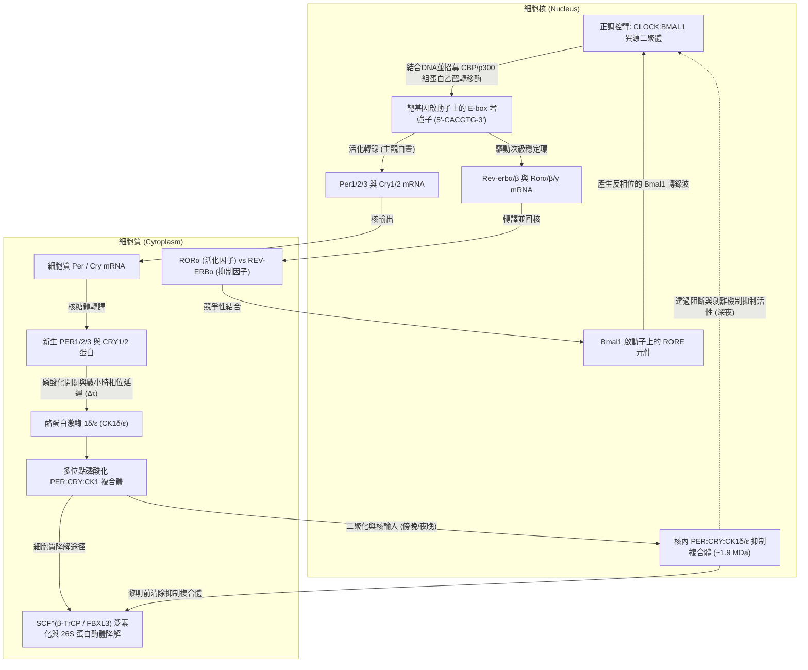
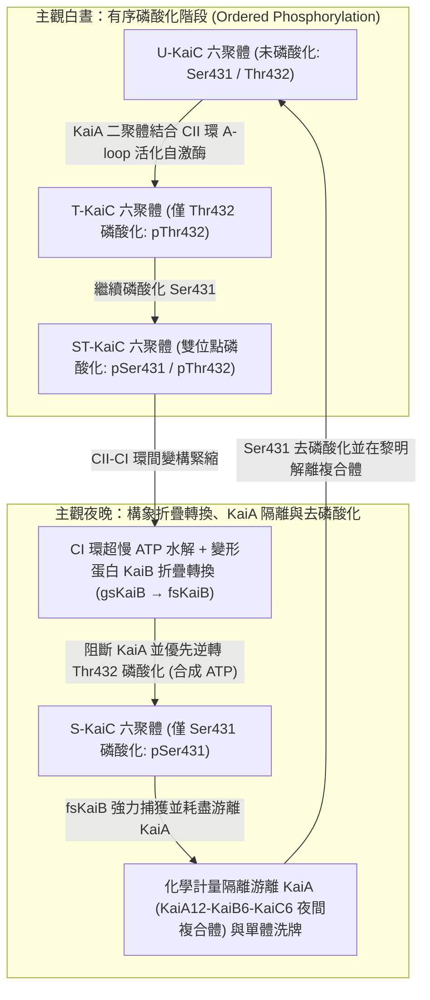

如果將人類、植物、果蠅或光合細菌置於完全隔絕陽光、溫度恆定的地下深處洞穴或暗室之中，生命是否會因此失去對「白晝與黑夜」的感知？

令人驚嘆的是，答案是否定的。即使在完全消除外界光線與溫度週期線索的恆暗條件（Constant Darkness, DD）下，從單細胞的藍綠菌（藍細菌）、真菌、植物、昆蟲，到包括人類在內的哺乳動物，地球上幾乎所有生命體依然能夠維持<strong>週期約為24小時的自主振盪</strong>。睡眠與覺醒、核心體溫的起伏、皮質醇與褪黑激素的分泌、血壓與免疫監視，乃至全基因組中10%至40%的蛋白質編碼基因的表現量，都由每個細胞內部的「分子擺鐘」精確調控。

然而，若從化學物理與非線性動力學的視角審視，細胞內的24小時生理時鐘隱藏著三個極其深邃的科學悖論：

1. <strong>時間尺度與穩定性悖論（非線性動力學）</strong>：細胞內的基本生化反應（轉錄因子結合、轉譯、磷酸化修飾）通常在毫秒至數分鐘內完成；而且在控制論中，簡單的雙變數負回饋迴路必然會發生阻尼衰減並停留在穩態平衡點。分子網路究竟如何透過<strong>霍普夫分岔（Hopf Bifurcation）</strong>產生持續不衰減的<strong>極限環自激振盪（Limit-Cycle Oscillation）</strong>，並將週期拉長至整整 $86,400\text{秒}$（$24\text{小時}$）？
2. <strong>中心法則教條與純蛋白質時鐘（分子與結構生物學）</strong>：長期以來，時間生物學界堅信一切晝夜節律都必須依賴「DNA轉錄為mRNA、再轉譯為蛋白質抑制自身轉錄」的<strong>轉錄-轉譯回饋迴路（TTFL）</strong>。然而在2005年，日本名古屋大學的<strong>近藤孝男（Takao Kondo）</strong>與<strong>石浦正寬（Masahiro Ishiura）</strong>團隊打破了這一教條：他們僅將<strong>三種純化的藍綠菌重組蛋白（KaiA、KaiB、KaiC）與ATP混合在試管中</strong>——在<strong>完全沒有DNA、沒有mRNA、沒有核糖體</strong>的條件下，試管內的KaiC蛋白磷酸化水準竟以24小時週期持續振盪了數天之久！
3. <strong>溫度補償性之謎（Temperature Compensation, $Q_{10} \approx 1.0$）</strong>：普通化學與酵素反應速率遵循<strong>阿瑞尼斯方程式（Arrhenius Equation）</strong> $k(T) = A \exp(-E_a / RT)$，溫度每升高 $10^\circ\text{C}$，反應速率就會加快2至3倍（溫度係數 $Q_{10} \approx 2\text{–}3$）。如果生理時鐘遵循普通生化動力學，當環境溫度升高 $10^\circ\text{C}$ 時，時鐘就會走快兩倍以上，徹底喪失計時功能。生理時鐘究竟如何抵消熱運動加速，實現 <strong>$Q_{10} \approx 0.95\text{–}1.05$</strong> 的恆定週期？

本文將從1729年的含羞草實驗出發，系統闡述真核生物TTFL分子機制、古德溫-戈德貝特（Goodwin–Goldbeter）振盪器方程式、藍綠菌KaiABC轉譯後振盪器（PTO）的原子級變構機制、溫度補償性的拮抗平衡與單酵素自抑制理論，以及視交叉上核（SCN）光同步與時間醫學（Chronomedicine）的臨床前沿。

---

## 1. 內源性時間的發現：從含羞草暗室實驗到果蠅 `period` 突變體

### 1.1 德·梅朗1729年的酒窖實驗與自由運行週期 $\tau$

在數千年的歷史中，人們一直認為植物葉片的晝開夜合與動物的晝夜作息只是對太陽升起與落下的被動反應。1729年，法國天文學家兼地球物理學家<strong>讓-雅克·多爾圖斯·德·梅朗（Jean-Jacques d'Ortous de Mairan）</strong>利用具有感夜運動的<strong>含羞草（*Mimosa pudica*）</strong>進行了一項著名實驗。他將含羞草移入完全不見陽光的地下酒窖（恆暗條件，DD）中觀察。令人驚訝的是，即使在絕對黑暗中，含羞草依然每天清晨按時展開葉片，傍晚按時閉合，彷彿能「感知」外部的太陽。

1832年，瑞士植物學家<strong>奧古斯丁·皮拉穆斯·德·堪多（Augustin Pyramus de Candolle）</strong>進一步精確測量發現，在恆定條件下，含羞草葉片開合的週期並非嚴格的24.0小時，而是<strong>22至23小時</strong>。

在現代時間生物學中，屏蔽所有外部授時因子（<strong>Zeitgeber</strong>，德語「時間給予者」，如光照和溫度週期）後，生物體自主展現的內源性週期被稱為<strong>自由運行週期（Free-Running Period）</strong>，記作 <strong>$\tau$（tau）</strong>：

- <strong>含羞草（*Mimosa pudica*）</strong>：$\tau \approx 22\text{–}23\,\text{h}$
- <strong>小家鼠（*Mus musculus*）</strong>：$\tau \approx 23.5\,\text{h}$
- <strong>黑腹果蠅（*Drosophila melanogaster*）</strong>：$\tau \approx 23.8\,\text{h}$
- <strong>人類（*Homo sapiens*）</strong>：$\tau \approx 24.18\,\text{h}$（哈佛大學 Charles Czeisler 團隊於1999年利用強迫去同步化實驗精確測定的人類平均內源週期為 $24\text{小時}11\text{分鐘} \pm 12\text{分鐘}$）

自由運行週期 $\tau$ 「接近但不等於24.00小時」是證明生理時鐘具有<strong>內源性（Endogenous）</strong>的決定性證據：如果生物只是感應某種穿透暗室的地球自轉物理訊號（如宇宙射線或重力潮汐），其週期必然嚴格鎖定為24.00小時。正因為 $\tau$ 偏離24小時且具有物種與個體遺傳特異性，才證明這台振盪器切實存在於細胞內部。1959年，<strong>弗朗茨·哈爾伯格（Franz Halberg）</strong>結合拉丁語 *circa*（大約）與 *dies*（一天），正式提出了<strong>晝夜節律（Circadian Rhythm，又稱近日節律）</strong>這一術語。

### 1.2 科諾普卡與本澤（1971）及2017年諾貝爾生理學或醫學獎

1971年，加州理工學院的<strong>羅納德·科諾普卡（Ronald Konopka）</strong>與<strong>西摩·本澤（Seymour Benzer）</strong>利用化學誘變劑（EMS）對黑腹果蠅進行誘變，篩選羽化節律與活動節律異常的突變體。他們分離出了三種全部定位於X染色體同一基因座——<strong>`period`（$per$）基因</strong>——的經典突變品系：

1. <strong>$per^0$（無節律突變體）</strong>：在恆暗條件下24小時節律完全消失（由無義突變導致提前終止密碼子產生）。
2. <strong>$per^S$（短週期突變體）</strong>：內源性週期縮短至 <strong>$\tau \approx 19\,\text{h}$</strong>（由單個錯義突變 Ser589Asn 引起）。
3. <strong>$per^L$（長週期突變體）</strong>：內源性週期延長至 <strong>$\tau \approx 29\,\text{h}$</strong>（由單個錯義突變 Val243Asp 引起）。

單個基因中的單個胺基酸替換就能將動物的一天縮短為19小時或拉長為29小時，這一發現徹底開啟了分子時間生物學時代。1984年，<strong>傑佛瑞·霍爾（Jeffrey C. Hall）</strong>、<strong>麥可·羅斯巴什（Michael Rosbash）</strong>與<strong>麥可·楊（Michael W. Young）</strong>成功選殖了 `period` 基因，並揭示了其編碼的 PER 蛋白透過負回饋調控自身轉錄的分子機制，三人因此榮膺<strong>2017年諾貝爾生理學或醫學獎</strong>。

---

## 2. 真核生物的轉錄-轉譯回饋迴路（TTFL）分子機制

在果蠅中，正調控異源二聚體 <strong>CLK:CYC</strong> 活化 *per* 與 *tim*（*timeless*）基因轉錄，PER:TIM 複合體經激酶 <strong>DOUBLETIME（DBT，即哺乳動物 CK1$\varepsilon$ 同源物）</strong>磷酸化後入核抑制 CLK:CYC。而在哺乳動物中，隱花色素蛋白 <strong>CRY1/2</strong> 取代了 TIM 成為 PER 的核心搭檔。

### 2.1 哺乳動物核心環：CLOCK:BMAL1、E-box 與 PER:CRY 抑制複合體

1. <strong>清晨的轉錄活化（CLOCK:BMAL1 結合 E-box）</strong>：
   含有 bHLH-PAS 結構域的轉錄因子 <strong>CLOCK</strong>（或腦內的 <strong>NPAS2</strong>）與 <strong>BMAL1（ARNTL）</strong>形成異源二聚體 <strong>CLOCK:BMAL1</strong>，特異性結合靶基因啟動子區的 <strong>E-box（`5'-CACGTG-3'`）</strong> 序列。CLOCK 自身具有組蛋白乙醯轉移酶（HAT）活性，並招募 CBP/p300 開放染色質，強力驅動 <strong>`Per1/2/3`</strong> 和 <strong>`Cry1/2`</strong> 基因的轉錄。
2. <strong>細胞質積累、CK1$\delta/\varepsilon$ 磷酸化與數小時相位延遲（$\Delta\tau$）</strong>：
   *Per* 與 *Cry* mRNA 運出細胞核並轉譯為蛋白質。如果新生 PER 和 CRY 立即入核抑制轉錄，振盪週期將不足1小時。為了產生24小時週期，<strong>酪蛋白激酶 $1\delta/\varepsilon$（Casein Kinase $1\delta/\varepsilon$, CK1$\delta/\varepsilon$）</strong>對游離的 PER 單體進行磷酸化，使其被 E3 泛素連接酶 <strong>$\text{SCF}^{\beta\text{-TrCP}}$</strong> 識別並經由 26S 蛋白酶體迅速降解。直到午後至傍晚，PER、CRY 與 CK1$\delta/\varepsilon$ 才能組裝成穩定的多聚體複合體，產生長達 <strong>4至6小時的相位延遲（Phase Delay）</strong>。
3. <strong>夜晚入核與雙重抑制機制（Blocking & Displacement）</strong>：
   分子量約 $1.9\,\text{MDa}$ 的 <strong>PER:CRY:CK1$\delta/\varepsilon$</strong> 複合體進入細胞核，透過兩步機制關閉 CLOCK:BMAL1：一是 <strong>CRY1 直接結合 CLOCK-BMAL1</strong> 的反式活化結構域，阻斷共活化因子 CBP/p300（Blocking）；二是 <strong>PER2 攜帶的 CK1$\delta/\varepsilon$ 直接磷酸化 CLOCK</strong>，降低其對 E-box DNA 的親和力，將 CLOCK:BMAL1 從啟動子上物理剝離（Displacement）。
4. <strong>家族性睡眠相位前移症候群（FASPS，凌晨3點醒來的遺傳病）</strong>：
   2001年，Louis Ptáček 與傅嫈惠（Ying-Hui Fu）團隊發現，人類 <strong>`PER2` 基因的 Ser662Gly 突變</strong>或 <strong>`CSNK1D`（編碼 CK1$\delta$）的 Thr44Ala 突變</strong>會導致<strong>家族性睡眠相位前移症候群（FASPS）</strong>。患者每天傍晚18–19點即困倦入睡，<strong>凌晨3點至4點便完全清醒</strong>，內源週期縮短至 $\tau \approx 21.6\,\text{h}$。這是因為 PER2 蛋白存在「磷酸化開關（Phosphoswitch）」：Ser662 引導的 FASP 連續絲胺酸簇磷酸化負責<strong>穩定 PER2</strong>，而 Ser478 位點的磷酸化則招募 $\beta$-TrCP <strong>促進 PER2 降解</strong>。Ser662Gly 突變破壞了穩定化開關，導致核內 PER2 過早被降解，提前解除了轉錄抑制，使生理時鐘每天快走約3小時！反之，2017年發現的 `CRY1` 第11外顯子跳躍突變（$\text{CRY1}\,\Delta 11$）則增強了對 CLOCK:BMAL1 的抑制，延長週期並導致<strong>家族性睡眠相位延遲症候群（FDSPS，極端夜貓子）</strong>。
5. <strong>次級互鎖環（REV-ERB$\alpha$ / ROR$\alpha$ 與 D-box）</strong>：
   CLOCK:BMAL1 同時活化核受體 <strong>`Rev-erbα/β`</strong> 與 <strong>`Rorα/β/γ`</strong> 的轉錄。ROR 結合 *Bmal1* 啟動子上的 <strong>RORE 元件</strong>活化轉錄，而隨後積累的 REV-ERB$\alpha/\beta$ 競爭性結合 RORE 並招募 NCoR-HDAC3 抑制 *Bmal1* 轉錄。配合 <strong>DBP / E4BP4</strong> 調控的 <strong>D-box</strong> 環路，<strong>E-box（晨間元件）</strong>、<strong>D-box（日間元件）</strong>與 <strong>RORE（晚間元件）</strong>構成了三相轉錄架構，賦予振盪器極高的魯棒性。

---

## 3. 基因振盪器的數學生物學：古德溫模型、戈德貝特方程式與霍普夫分岔

為什麼負回饋迴路能夠持續振盪而不衰減？讓我們從常微分方程式（ODE）嚴格證明其數學條件。

### 3.1 本迪克森準則證明：無延遲的雙變數負回饋迴路不可能持續振盪

若僅考慮 mRNA 濃度 $M(t)$ 與蛋白質濃度 $P(t)$ 兩個變數：

$$\frac{dM}{dt} = f(P) - \gamma_M M \equiv F_1(M, P), \qquad \frac{dP}{dt} = k_s M - \gamma_P P \equiv F_2(M, P)$$

其中 $f'(P) < 0$。二維向量場 $\mathbf{F} = (F_1, F_2)$ 的<strong>散度（Divergence）</strong>為：

$$\nabla \cdot \mathbf{F} = \frac{\partial F_1}{\partial M} + \frac{\partial F_2}{\partial P} = -\gamma_M - \gamma_P < 0$$

由於降解速率常數 $\gamma_M, \gamma_P > 0$，散度在整個第一象限恆為嚴格負數且絕不變號。根據動力系統中的<strong>本迪克森負準則（Bendixson's Negative Criterion，格林公式的直接推論）</strong>，散度不變號的單連通平面區域內<strong>絕對不存在任何閉合週期軌道（極限環）</strong>！其雅可比矩陣的跡 $\operatorname{Tr}(J) = -(\gamma_M + \gamma_P) < 0$ 且行列式 $\det(J) = \gamma_M \gamma_P - k_s f'(P^*) > 0$，特徵值實部恆為負，系統只會以阻尼振盪螺旋收斂至穩態平衡點。

### 3.2 古德溫振盪器（1965）與戈德貝特模型（1995）

為了突破二維限制並透過<strong>超臨界霍普夫分岔（Hopf Bifurcation）</strong>產生極限環振盪，必須引入代表細胞質磷酸化與核轉運延遲的第三變數。<strong>布萊恩·古德溫（Brian Goodwin, 1965）</strong>與<strong>阿爾伯特·戈德貝特（Albert Goldbeter, 1995）</strong>建立的三變數晝夜節律核心微分方程組為：

$$\frac{dM}{dt} = \frac{v_s K_I^n}{K_I^n + P_N^n} - v_m \frac{M}{K_m + M}, \qquad \frac{dP_C}{dt} = k_s M - v_d \frac{P_C}{K_d + P_C} - k_1 P_C + k_2 P_N, \qquad \frac{dP_N}{dt} = k_1 P_C - k_2 P_N$$

其中 $M$ 為 mRNA 濃度，$P_C$ 為細胞質蛋白濃度，$P_N$ 為核內抑制蛋白濃度，$n$ 為<strong>希爾係數（Hill Coefficient）</strong>。產生持續極限環振盪需要<strong>三大數學要素</strong>：
1. <strong>負回饋（Negative Feedback）</strong>：提供回復力；
2. <strong>足夠長的相位延遲（Phase Delay $\Delta\tau$）</strong>：多步磷酸化與核輸入使訊號相位滯後達到 $180^\circ$（$\pi$ 弳度）；
3. <strong>強非線性與超敏性（Nonlinearity / Ultrasensitivity）</strong>：在具有線性一階降解的三變數古德溫模型中，根據勞斯-赫爾維茨判據（Griffith 定理, 1968），要使特徵方程式 $(\lambda + \gamma)^3 + G = 0$ 產生純虛根，必須滿足<strong>希爾係數 $n > \sec^3(\pi/3) = 2^3 = 8$</strong>！
   真實生理時鐘無需 $n > 8$ 的極端DNA結合協同性，而是透過兩種機制產生超敏性：一是 Goldbeter 方程式中的<strong>米氏酵素飽和降解（零級超敏性，Zero-Order Ultrasensitivity，$K_d \ll P_C$）</strong>，大幅降低了有效阻尼率；二是 <strong>Kim 與 Forger（2012）揭示的分子滴定與化學計量隔離機制（Molecular Titration / Stoichiometric Sequestration）</strong>——PER:CRY 與 CLOCK:BMAL1 按 $1:1$ 高親和力結合，在等量點 $I_T \approx A_T$ 處產生極其陡峭的閾值非線性開關，使得 $n = 1$ 時亦能穩健振盪。

---

## 4. 近藤孝男與石浦正寬2005年的震撼發現：試管中的藍綠菌 KaiABC 蛋白質生理時鐘

1998年，近藤孝男與石浦正寬等人在單細胞藍綠菌（*Synechococcus elongatus* PCC 7942）中鑑定出晝夜節律基因簇 <strong>`kaiA`、`kaiB`、`kaiC`</strong>（源於日語「回」[Kai]，意為循環）。2005年，近藤團隊的<strong>中島正人（Masato Nakajima）</strong>等人在《Science》發表了一項震撼生命科學界的里程碑研究：

> <strong>在完全沒有DNA、沒有mRNA、沒有核糖體的試管中，僅將純化的重組蛋白 KaiA、KaiB、KaiC 與 ATP（及 $\text{Mg}^{2+}$）混合，KaiC 的磷酸化水準便呈現出週期約為24小時、持續數天不衰減且具備溫度補償性的自激振盪！</strong>

### 4.1 KaiABC 轉譯後振盪器（PTO）的精密結構動力學

1. <strong>雙環六聚體 KaiC 與自然界最慢的 ATP 酶</strong>：
   <strong>KaiC</strong> 組裝成由 N 端 <strong>CI 環</strong>與 C 端 <strong>CII 環</strong>構成的雙甜甜圈狀同源六聚體。每個 KaiC 單體<strong>每天僅水解約 15 個 ATP 分子</strong>（約 $0.6\,\text{ATP}\cdot\text{h}^{-1}$），比普通解旋酶或肌球蛋白慢數萬倍！CI 活性位點肽鍵的順反異構化能壘與水分子空間位阻構成了原子級「擒縱器」，奠定了24小時的巨觀慢時間尺度。
2. <strong>有序四態磷酸化循環（$\text{U} \to \text{T} \to \text{ST} \to \text{S} \to \text{U}$）</strong>：
   CII 結構域上的 <strong>Ser431（S）</strong> 與 <strong>Thr432（T）</strong> 嚴格按順時針方向循環：白晝時 <strong>KaiA 二聚體</strong>結合 KaiC C端的 <strong>A-loop</strong>，促進自激酶活性，先將 Thr432 磷酸化（$\text{U} \to \text{T}$），再將 Ser431 磷酸化形成雙磷酸化態（$\text{T} \to \text{ST}$）。
3. <strong>變形蛋白（Metamorphic Protein）KaiB 的折疊轉換與 KaiA 化學計量隔離</strong>：
   當 Ser431 被磷酸化後，CII 環緊縮並透過環間變構觸發 CI 環水解 ATP，暴露出 B-loop。此時，原本以穩定的四聚體基態折疊（<strong>gsKaiB</strong>）存在的 KaiB 解離為單體，並將其三維拓撲結構徹底重排為罕見的<strong>硫氧還蛋白樣折疊態（fsKaiB，Fold-Switched KaiB）</strong>！這種高能壘的緩慢構象轉換提供了關鍵的數小時相位延遲。6個 fsKaiB 協同結合到 CI 環後，將溶液中所有游離的 <strong>KaiA 二聚體捕獲並隔離（Sequestration）</strong>進失活的 $\text{KaiA}_{12}\text{KaiB}_6\text{KaiC}_6$ 夜間複合體中。失去 KaiA 激發的 KaiC 六聚體透過將磷酸基團轉回 ADP 重新合成 ATP 的逆反應，依次完成 $\text{ST} \to \text{S} \to \text{U}$ 的去磷酸化，並透過<strong>單體洗牌（Monomer Shuffling）</strong>實現試管內數兆分子的相位同步。

| 比較維度 | 真核生物時鐘（哺乳動物、昆蟲、植物、真菌） | 藍綠菌核心時鐘（KaiABC 系統） |
| :--- | :--- | :--- |
| <strong>核心振盪架構</strong> | <strong>轉錄-轉譯回饋迴路（TTFL）</strong> | <strong>轉譯後振盪器（PTO）</strong>（體內與外層 TTFL 耦合） |
| <strong>試管體外重構</strong> | 無法脫離細胞核、核糖體與蛋白酶體獨立運轉 | <strong>完全重構</strong>（僅需純化 <strong>KaiA + KaiB + KaiC + ATP + $\text{Mg}^{2+}$</strong>） |
| <strong>正調控元件</strong> | 轉錄因子異源二聚體（<strong>CLOCK:BMAL1</strong>, CLK:CYC, WC-1:WC-2） | <strong>KaiA 二聚體</strong>（結合 CII 環 A-loop 活化 KaiC 自激酶） |
| <strong>負調控元件</strong> | 核內抑制複合體（<strong>PER:CRY</strong>, PER:TIM, FRQ）+ <strong>CK1$\delta/\varepsilon$</strong> | <strong>折疊轉換態 KaiB（fsKaiB）</strong>介導的 <strong>KaiA 化學計量隔離</strong> |
| <strong>相位延遲 $\Delta\tau$ 來源</strong> | 轉錄、轉譯、CK1 多位點磷酸化開關與核輸入 | <strong>CI 環超慢 ATPase（~15 ATP/天）</strong> + <strong>KaiB 變形折疊轉換</strong> |
| <strong>溫度補償機制（$Q_{10}$）</strong> | $Q_{10} \approx 0.95\text{–}1.05$（CK1$\delta/\varepsilon$ 產物抑制與 PER2 磷酸化開關） | $Q_{10} \approx 1.0$（KaiC 單體 ATPase 自身的結構變構補償） |

---

## 5. 破解時間生物學最深邃的生物物理之謎：溫度補償性（$Q_{10} \approx 1.0$）

普通生化反應速率遵循<strong>阿瑞尼斯方程式</strong>：

$$k(T) = A \exp\left(-\frac{E_a}{R T}\right), \qquad Q_{10} = \frac{k(T + 10)}{k(T)} = \exp\left(\frac{10 E_a}{R T (T + 10)}\right) \approx 2.0\text{–}3.0$$

然而自 Colin Pittendrigh（1954）在果蠅羽化實驗中證實以來，所有生理時鐘的週期溫度係數均保持在 <strong>$Q_{10} \approx 0.95\text{–}1.05$</strong>。生物體透過兩個層面的機制破解了阿瑞尼斯悖論：

1. <strong>彼得·魯奧夫的拮抗平衡理論（Ruoff's Antagonistic Balance, 1992）</strong>：
   設週期 $\tau(k_1, \dots, k_N)$ 由 $N$ 個遵循阿瑞尼斯定律的基元反應決定，對溫度求導可得：
   $$\frac{d \ln \tau}{d T} = \sum_{i=1}^{N} \frac{\partial \ln \tau}{\partial \ln k_i} \frac{d \ln k_i}{d T} = \frac{1}{R T^2} \sum_{i=1}^{N} C_i^{\tau} E_{a,i} \approx 0$$
   其中 $C_i^\tau = \frac{\partial \ln \tau}{\partial \ln k_i}$ 為週期控制係數（滿足 $\sum_i C_i^\tau = -1$）。儘管每個反應隨溫度升高都加快了2至3倍（$E_{a,i} > 0$），但網路中同時存在縮短週期的反應（$C_i^\tau < 0$）和延長週期的拮抗反應（$C_j^\tau > 0$，如穩定化磷酸化或核輸出），當加權活化能之和 $\sum_i C_i^\tau E_{a,i} = 0$ 時，加速與減速效應精確抵消，巨觀週期保持不變。
2. <strong>核心酵素內部的分子級溫度補償（上田泰己團隊的 CK1$\delta/\varepsilon$ 自抑制與 KaiC 變構調節）</strong>：
   更驚人的是，溫度補償直接內嵌在單個核心酵素分子中！<strong>寺內一姬與近藤孝男（2007）</strong>發現，僅含 KaiC 六聚體與 ATP 的基礎 ATPase 活性本身就具有 $Q_{10} \approx 1.0$。而在哺乳動物中，<strong>磯島康史、篠原佑介與上田泰己（Isojima et al., 2009; Shinohara et al., 2017）</strong>證明，純化的 <strong>CK1$\delta/\varepsilon$ 在試管中磷酸化 PER2 受質的反應本身就是溫度補償的（$Q_{10} \approx 1.0$）</strong>！高溫雖然加速了催化磷酸基團轉移，但 CK1$\delta$ 的 K224 陰離子結合口袋對磷酸化產物的親和力隨溫度升高而增強（產物釋放減慢/自抑制增強），從而在單酵素水準鎖定了恆定的磷酸化速率。

---

## 6. 視交叉上核（SCN）主起搏器、黑視蛋白光同步與時間醫學

### 6.1 黑視蛋白（Melanopsin, 480 nm 藍光）與相位響應曲線（PRC）

人類約 $24.18\,\text{h}$ 的內源週期依靠每天清晨的陽光進行重置（<strong>光同步，Photoentrainment</strong>）。視網膜中約 1%–2% 的<strong>內在光敏視網膜神經節細胞（ipRGCs）</strong>表現感光蛋白<strong>黑視蛋白（Melanopsin / OPN4）</strong>，其最大吸收波長位於 <strong>$480\,\text{nm}$ 藍光波段</strong>。藍光活化 ipRGCs 後，訊號沿<strong>視網膜下視丘束（RHT）</strong>直達下視丘的<strong>視交叉上核（SCN）</strong>，釋放麩胺酸與 PACAP，觸發 $\text{Ca}^{2+}$ 內流並磷酸化轉錄因子 <strong>CREB</strong>，結合 *Per1/2* 啟動子上的 <strong>CRE 元件</strong>誘導 *Per* mRNA 急速轉錄：
- <strong>主觀夜晚前半段（傍晚至深夜）照光</strong>：在 *Per* 原本下降時強行拉高 *Per*，引起<strong>相位延遲（Phase Delay，熬夜效應——深夜手機藍光導致失眠的分子根源）</strong>；
- <strong>主觀夜晚後半段（黎明清晨）照光</strong>：提前啟動 *Per* 上升，引起<strong>相位前移（Phase Advance）</strong>，將人體 $24.18\,\text{h}$ 的時鐘校準至地球的 $24.00\,\text{h}$。

### 6.2 SCN 的 20,000 個耦合神經元、時差症候群與癌症時間醫學（Chronomedicine）

哺乳動物全身器官（肝臟、心臟、免疫細胞）都擁有周邊生理時鐘，但單細胞振盪受分子雜訊影響極易失步。位於下視丘的中央主起搏器 <strong>SCN</strong> 由約 <strong>20,000 個神經元</strong>組成，透過神經肽 <strong>VIP（血管活性腸肽）</strong>、<strong>AVP（精胺酸加壓素）</strong>及神經傳導物質 <strong>GABA</strong> 相互耦合（<strong>藏本耦合振盪器網路，Kuramoto Model</strong>），將週期誤差壓縮至數分鐘以內。跨時區飛行時，接收光訊號的 SCN 與依賴進食/體溫訊號的周邊器官時鐘（如肝臟）調整速度不一致，導致全身時鐘發生<strong>內部去同步化（Internal Desynchronization）</strong>，這正是<strong>時差反應（Jet Lag）</strong>的本質。

在臨床醫學中，超過半數暢銷藥物的靶點受生理時鐘調控：短效史他汀類降血脂藥在睡前服用可精準狙擊夜間達峰的 HMG-CoA 還原酶；Francis Lévi 開創的結直腸癌時辰化療（5-FU 凌晨4點達峰、奧沙利鉑下午4點達峰）顯著降低了毒性並提高了療效；而近年多項重磅臨床研究（如 *Qian et al., Lancet Oncology, 2021*）更證實，由於 $\text{CD8}^+$ T 細胞腫瘤浸潤與樹突狀細胞抗原呈遞在清晨至上午最為活躍，<strong>在上午（而非下午或傍晚）輸注抗 PD-1 免疫檢查點抑制劑（如帕博利珠單抗、納武利尤單抗），可將晚期黑色素瘤與肺癌患者的總存活期（OS）延長近一倍</strong>！

從1729年酒窖中的含羞草到改寫癌症存活率的免疫時間療法，四十億年的地球自轉早已化作精密的非線性微分方程式與蛋白質構象律動，深深刻印在每一個生命細胞的分子擺鐘之中。
