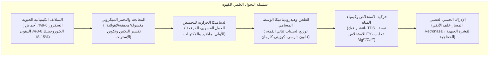

يمثل فنجان القهوة اليومي أحد أكثر النظم العلمية التطبيقية تعقيداً، حيث تتلاقى علوم النبات الزراعية، والهندسة الحيوية للميكروبات، والديناميكا الحرارية غير المتوازنة، وحركية التفاعلات العضوية، وميكانيكا الموائع في الأوساط المسامية، والفسيولوجيا العصبية للحواس.

داخل حبة البن الخضراء، يُحتجز أكثر من ألف مركب كيميائي داخل شبكة خلوية سليلوزية صلبة. عند التحميص فوق 200 درجة مئوية، تؤدي تفاعلات مايلارد، وتحلل شتريكر، والكرملة، وتفكك أحماض الكلوروجينيك إلى تكوين مئات المركبات العطرية المتطايرة. وعند الاستخلاص بالماء الساخن، يخضع الترشيح لقانون دارسي وانتشار فيك.

---

### 1. تشريح كرزة القهوة وكيمياء البن الأخضر

1. <strong>الغلاف الخارجي (Exocarp / القشرة)</strong>: بشرة خارجية شمعية تمنع فقدان الماء؛ تمنحها الأنثوسيانينات لوناً أحمر أو أصفر عند النضج.
2. <strong>الغلاف الأوسط (Mesocarp / اللب)</strong>: نسيج غني بالماء (~80%) والسكريات البسيطة (سكروز، فركتوز، جلوكوز، 18-24 بريكس) وحمض الماليك.
3. <strong>الصمغ (Mucilage)</strong>: هيدروجيل مائي غير ذائب بسمك 0.5-2 مم يتكون من أحماض بكتينية وأرابينوجالاكتان.
4. <strong>الغلاف الداخلي (Endocarp / الغشاء الجلدي)</strong>: طبقة خشبية صلبة من خلايا حجرية مكونة من السليلوز واللجنين.
5. <strong>القشرة الفضية (Silver Skin)</strong>: غشاء رقيق غني بمضادات الأكسدة ينفصل أثناء التحميص على شكل قشور (Chaff).
6. <strong>السويداء (Endosperm / حبة البن الخضراء)</strong>: نسيج تخزين ذو جدران خلوية سميكة ($5\sim10\,\mu\text{m}$)، يحتوي على الدهون والبروتينات وأحماض الكلوروجينيك.

| المكون الكيميائي (% الوزن الجاف) | أرابيكا (*C. arabica*) | روبوستا (*C. canephora*) | الدور في التحميص والمذاق |
| :--- | :--- | :--- | :--- |
| <strong>التضاعف الصبغي</strong> | $2n = 4x = 44$ (رباعي ذاتي) | $2n = 2x = 22$ (ثنائي) | إخصاب ذاتي، نكهات معقدة وحمضية نقية |
| <strong>السكروز</strong> | <strong>6.0 – 9.0 %</strong> | 3.0 – 5.0 % | المصدر الأساسي للأحماض العضوية ومركبات الفوران |
| <strong>إجمالي الدهون</strong> | <strong>15.0 – 18.0 %</strong> | 8.0 – 12.0 % | استقرار رغوة الإسبريسو وحبس الجزيئات العطرية |
| <strong>الكافيين</strong> | 0.9 – 1.5 % | <strong>1.8 – 3.2 %</strong> | قلويد مقاوم للحرارة؛ يسهم بنحو 10-15% من المرارة |
| <strong>التريجونيلين</strong> | <strong>0.8 – 1.2 %</strong> | 0.4 – 0.7 % | يتحلل حرارياً إلى النياسين (فيتامين B3) والبيريدينات |
| <strong>أحماض الكلوروجينيك (CGA)</strong>| 5.5 – 8.0 % | <strong>7.0 – 11.0 %</strong> | تتحول إلى لاكتونات (مرارة محببة) وفينيل إندان (مرارة لاذعة) |

---

### 2. طرق المعالجة والتخمر الميكروبي

1. <strong>المعالجة المغسولة (Washed)</strong>: إزالة اللب ميكانيكياً ثم التخمير في الماء لمدة 12-36 ساعة. تحلل إنزيمات البكتيناز الصمغ البكتيني:
   $$\text{Pectin} + n\text{H}_2\text{O} \xrightarrow{\text{Pectinase}} \text{D-Galacturonic Acid} + \text{Methanol}$$
   تنتج كوباً نظيفاً وحموضة ساطعة واضحة.
2. <strong>المعالجة المجففة (Natural)</strong>: تجفيف الكرزات كاملة تحت الشمس لمدة 2-4 أسابيع. يؤدي الانتشار الأسموزي للسكريات إلى قوام غني ونكهات الفواكه المجففة.
3. <strong>التخمير اللاهوائي (Anaerobic)</strong>: يتم في خزانات محكمة مع ضخ غاز $\text{CO}_2$. تسيطر بكتيريا حمض اللاكتيك فتهبط الحموضة إلى 3.8–4.2 منتجة إسترات تمنح نكهات القرفة والفواكه الاستوائية.

---

### 3. الديناميكا الحرارية والتحميص

ينتقل إجمالي التدفق الحراري $\dot{Q}_{\text{total}}$ إلى الحبوب عبر التوصيل والحمل والإشعاع:

$$\dot{Q}_{\text{total}} = \dot{Q}_{\text{cond}} + \dot{Q}_{\text{conv}} + \dot{Q}_{\text{rad}}$$

في المحامص الهوائية الحديثة، يمثل الحمل الحراري القسري 70-85% من الطاقة ($\dot{Q}_{\text{conv}} = h_{\text{conv}} A_{\text{bean}} (T_{\text{air}} - T_{\text{bean}})$).

- <strong>معدل ارتفاع درجة الحرارة (RoR)</strong>: المشتقة الزمنية لدرجة حرارة الحبوب $\text{RoR}(t) = \frac{\mathrm{d}(BT)}{\mathrm{d}t}$ بوحدة $[^\circ\mathrm{C/min}]$. المنحنى المتناقص بسلاسة يضمن تحميصاً متجانساً.
- <strong>الفرقعة الأولى (First Crack)</strong>: عند 200-205 درجة مئوية، يبلغ ضغط البخار الداخلي وغاز $\text{CO}_2$ نحو 15-25 ضغطاً جوياً، فتنفجر جدران الخلايا مكونة بنية مسامية شبيهة بقرص العسل (مسام 20-40 ميكرومتر).
- <strong>نسبة وقت التطوير (DTR)</strong>: 10-14% للتحميص الفاتح، 15-19% للتحميص المتوسط.

---

### 4. التفاعلات الكيميائية أثناء التحميص

1. <strong>تفاعل مايلارد وتكسير شتريكر</strong>: يتفاعل السكر المختزل مع الأحماض الأمينية لإنتاج مركبات أمادوري، ثم تتشكل ثنائيات الكربونيل ومواد شتريكر الألدهيدية (3-ميثيل بوتانال: رائحة الشعير) والألكيل بيرازينات (رائحة المكسرات والتحميص)، وتتوج بتكون <strong>الميلانويدينات</strong>.
2. <strong>الكرملة</strong>: التحلل الحراري للسكروز فوق 160°م يُولد الفيورانات والمولتول ذات النكهات الكراميلية.
3. <strong>تفكك أحماض الكلوروجينيك</strong>:
   - 180–215°م: إنتاج <strong>لاكتونات أحماض الكلوروجينيك</strong>، المسؤولة عن <strong>المرارة اللطيفة المنعشة</strong>.
   - >220°م: التفكك إلى <strong>الفينيل إندانات</strong> المسببة <strong>للمرارة القاسية والقابضة</strong>.

---

### 5. هيدروديناميكا الوسط المسامي وقانون دارسي

يخضع تدفق الماء عبر كعكة القهوة المطحونة لـ <strong>قانون دارسي</strong>:

$$Q = \frac{-k_p A}{\mu} \frac{\Delta P}{L}$$

حيث ترتبط النفاذية $k_p$ بـ <strong>معادلة كوزيني-كارمان</strong>:

$$k_p = \frac{\epsilon^3}{K_{\text{CK}} S_v^2 (1 - \epsilon)^2}$$

في الإسبريسو عند ضغط 9 بار، تسبب عدم التجانس في الكبس ظاهرة <strong>التشعب (Channeling)</strong>، مما يؤدي إلى استخلاص مفرط ومر في القنوات واستخلاص ضعيف وحامض في المناطق الكثيفة.

---

### 6. حركية الاستخلاص ومعيار الكأس الذهبية SCA

يتبع الاستخلاص <strong>قانون فيك الثاني للانتشار</strong>:

$$\frac{\partial C}{\partial t} = D_{\text{eff}} \left( \frac{\partial^2 C}{\partial r^2} + \frac{2}{r} \frac{\partial C}{\partial r} \right)$$

1. <strong>0–30 ثانية</strong>: استخلاص الأحماض العضوية السريعة والسكريات البسيطة والكافيين.
2. <strong>30–90 ثانية</strong>: استخلاص البيرازينات واللاكتونات وتوازن الحلاوة.
3. <strong>>90 ثانية</strong>: خروج الفينيل إندانات والمركبات القابضة.

- <strong>المواد الصلبة الذائبة الكلية (TDS)</strong>: 1.15–1.45% للقهوة المقطرة، 8.0–12.0% للإسبريسو.
- <strong>نسبة الاستخلاص (Extraction Yield - EY)</strong>:
  $$\text{EY} = \frac{M_{\text{beverage}} \times \text{TDS}}{M_{\text{dose}}} \times 100 \quad [\%]$$
  النطاق المثالي لجمعية القهوة المختصة (SCA): <strong>18.0% إلى 22.0%</strong>.

---

### 7. كيمياء المياه والإدراك الحسي

1. <strong>أيونات المعادن</strong>:
   - $\text{Mg}^{2+}$: كثافة شحنة عالية تسحب الأحماض الفاكهية والإسترات بكفاءة عبر التخليب.
   - $\text{Ca}^{2+}$: يمنح قواماً سلساً لكنه يشكل ترسبات كلسية.
2. <strong>منظومة البيكربونات</strong>:
   $$\text{HCO}_3^- + \text{H}_3\text{O}^+ \rightleftharpoons \text{H}_2\text{CO}_3 + \text{H}_2\text{O} \rightleftharpoons 2\,\text{H}_2\text{O} + \text{CO}_2 \uparrow$$
   القلوية الزائدة تمحو الحموضة وتجعل الطعم باهتاً؛ والقلوية المنخفضة تجعل الحموضة لاذعة كالخل.
3. <strong>المسار خلف الأنفي</strong>: 2-فورفوريل ثيول هو جوهر رائحة القهوة الطازجة. عند البلع، تتطاير المركبات مع هواء الزفير نحو الظهارة الشمية، ليدمج المخ المذاق والرائحة في مفهوم "النكهة (Flavor)" المتكامل.
