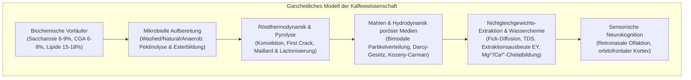
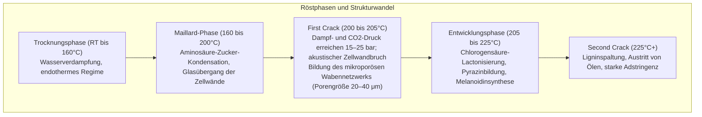

Eine Tasse Kaffee ist ein hochentwickeltes multidisziplinäres System an der Schnittstelle von Agrarbotanik, mikrobieller Fermentationstechnik, Nichtgleichgewichtsthermodynamik, organischer Reaktionskinetik, Granulatphysik, poröser Strömungsmechanik und sensorischer Neurobiologie.

Im Inneren des Rohkaffees liegen über 1.000 biochemische Vorläuferstoffe in einer dichten Cellulosematrix vor. Beim Rösten bei Temperaturen über 200°C wandeln sich diese durch Maillard-Reaktionen, Strecker-Abbau, Saccharose-Karamellisierung und Chlorogensäure-Spaltung in hunderte flüchtige Aromastoffe um. Bei der Heißwasserextraktion regeln Darcys Gesetz und Ficksche Diffusion den instationären Fest-Flüssig-Stofftransport in die Tasse.

---

### 1. Morphologie der Kaffeekirsche und Rohkaffee-Biochemie

#### 1.1 Histologische Gewebeschichten
Die Frucht der Kaffeepflanze (*Coffea arabica* und *Coffea canephora*) ist eine steinfruchtartige Beere mit konzentrischer Schichtung:

1. <strong>Exokarp (Haut)</strong>: Einschichtige Epidermis mit wachsartiger Kutikula; Anthocyane färben sie bei Reife rot oder gelb.
2. <strong>Mesokarp (Pulpe)</strong>: Parenchymgewebe mit ~80% Feuchtigkeit, reich an Glucose, Fructose, Saccharose (18–24° Brix) und Äpfelsäure.
3. <strong>Muzilagelage (Pektinschleim)</strong>: 0,5–2 mm dicke Hydrogelschicht aus unlöslichen Pektinsäuren und Arabinogalactanen.
4. <strong>Endokarp (Pergamenthaut)</strong>: Stark verholzte Sklereidenschicht aus Cellulose (40–45%), Hemicellulose und Lignin.
5. <strong>Silberhäutchen (Spermoderm)</strong>: Dünne Samenschale, reich an Antioxidantien, löst sich beim Rösten als Spreu (Chaff).
6. <strong>Endosperm (Rohkaffeebohne)</strong>: Speicherorgan mit dicken Zellwänden ($5\sim10\,\mu\text{m}$), dicht gepackt mit Lipiden, Proteinen, Saccharose und Chlorogensäuren.

#### 1.2 Arabica vs. Robusta im biochemischen Vergleich

| Parameter (% Trockenmasse) | Arabica (*C. arabica*) | Robusta (*C. canephora*) | Röst- und Aromafunktion |
| :--- | :--- | :--- | :--- |
| <strong>Ploidie & Chromosomen</strong> | $2n = 4x = 44$ (Allotetraploid) | $2n = 2x = 22$ (Diploid) | Selbstbefruchtend, komplex regulierter Stoffwechsel |
| <strong>Saccharose</strong> | <strong>6,0 – 9,0 %</strong> | 3,0 – 5,0 % | Hauptvorläufer für aliphatische Säuren und Karamellaromen |
| <strong>Gesamtlipide</strong> | <strong>15,0 – 18,0 %</strong> | 8,0 – 12,0 % | Crema-Stabilisierung und Träger lipophiler Aromastoffe |
| <strong>Koffein</strong> | 0,9 – 1,5 % | <strong>1,8 – 3,2 %</strong> | Thermostabiles Alkaloid; ca. 10–15% der wahrgenommenen Bitterkeit |
| <strong>Trigonellin</strong> | <strong>0,8 – 1,2 %</strong> | 0,4 – 0,7 % | Pyrolysiert zu Niacin (Vitamin B3) und Alkylpyridinen |
| <strong>Chlorogensäuren (CGA)</strong> | 5,5 – 8,0 % | <strong>7,0 – 11,0 %</strong> | Spaltet sich in Lactone (edle Bittere) und Phenylindane (adstringierend) |

---

### 2. Aufbereitungsprozesse und Mikrobiologie

1. <strong>Nassaufbereitung (Washed)</strong>: Mechanisches Entpulpen und Unterwasserfermentation für 12–36 Stunden. Pektinasen epiphytischer Bakterien (*Pectobacterium*, *Bacillus*) spalten Pektinbindungen:
   $$\text{Pektin} + n\text{H}_2\text{O} \xrightarrow{\text{Pektinase}} \text{Galacturonsäure} + \text{Methanol}$$
   Ergibt ein klares Tassenprofil ("Clean Cup") mit lebendiger Zitronen- und Äpfelsäure.
2. <strong>Trockenaufbereitung (Natural)</strong>: Trocknung ganzer Kirschen für 2–4 Wochen an der Sonne. Durch osmotische Gradienten diffundieren Einfachzucker und Hefe-Ester (Ethylacetat) in das Endosperm; verleiht schweren Körper und Fruchtnoten.
3. <strong>Anaerobe Fermentation</strong>: In gasdichten Tanks verdrängt $\text{CO}_2$ den Sauerstoff. Milchsäurebakterien (*Leuconostoc*, *Lactobacillus*) dominieren; der pH-Wert sinkt auf 3,8–4,2. Die Synthese verzweigter Carbonsäureester liefert intensive Zimt-, Kardamom- und Beerennoten.

---

### 3. Rösttechnik und Thermodynamik

Der Röstprozess kombiniert Wärmeleitung, erzwungene Konvektion und Strahlung:

$$\dot{Q}_{\text{total}} = \dot{Q}_{\text{cond}} + \dot{Q}_{\text{conv}} + \dot{Q}_{\text{rad}}$$

Moderne Heißluftröster übertragen 70–85% der Wärmeenergie per Konvektion ($\dot{Q}_{\text{conv}} = h_{\text{conv}} A_{\text{bean}} (T_{\text{air}} - T_{\text{bean}})$).

- <strong>Rate of Rise (RoR)</strong>: Erste Zeitableitung der Bohnentemperatur $\text{RoR}(t) = \frac{\mathrm{d}(BT)}{\mathrm{d}t}$ in $[^\circ\mathrm{C/min}]$. Eine stetig fallende Kurve garantiert gleichmäßige Energieübertragung.
- <strong>Development Time Ratio (DTR)</strong>: Prozentualer Anteil der Zeit zwischen First Crack und Röstende an der Gesamtdauer ($10–14\%$ bei hellen Röstungen, $15–19\%$ bei mittleren).

---

### 4. Reaktionskinetik beim Rösten

1. <strong>Maillard-Reaktion & Strecker-Abbau</strong>: Reduzierende Zucker reagieren mit freien Aminogruppen zu Amadori-Verbindungen, die zu Dicarbonylen zerfallen. Der Strecker-Abbau liefert Aldehyde (z. B. 3-Methylbutanal: malzig) und Alkylpyrazine (nussig, röstig). Endprodukte sind hochmolekulare <strong>Melanoide</strong>, die Körper und Crema bedingen.
2. <strong>Karamellisierung</strong>: Oberhalb von 160°C spaltet sich Saccharose; Furanone (Furaneol, Sotolon) und Maltol schenken Noten von Karamell und getoastetem Zucker.
3. <strong>Chlorogensäure-Abbau</strong>:
   - 180–215°C: Bildung von 3-CQL und 4-CQL <strong>Lactonen</strong>, die für eine <strong>angenehme, balancierte Bittere</strong> sorgen.
   - Über 220°C: Zersetzung in <strong>Phenylindane</strong>, die eine <strong>scharfe, adstringierende, medizinische Bittere</strong> erzeugen.

---

### 5. Mahltechnik und poröse Strömungsmechanik

Gemahlener Kaffee weist eine <strong>bimodale Partikelgrößenverteilung</strong> auf:
- <strong>Boulders ($300\sim1200\,\mu\text{m}$)</strong>: Verbände intakter Zellen; Extraktion erfolgt diffusionskontrolliert.
- <strong>Fines ($< 100\,\mu\text{m}$)</strong>: Zellwandfragmente; lösen sich sofort an der Oberfläche auf.

Die Perkolation folgt dem <strong>Darcy-Gesetz</strong>:

$$Q = \frac{-k_p A}{\mu} \frac{\Delta P}{L}$$

Die Permeabilität $k_p$ wird durch die <strong>Kozeny-Carman-Gleichung</strong> bestimmt:

$$k_p = \frac{\epsilon^3}{K_{\text{CK}} S_v^2 (1 - \epsilon)^2}$$

Bei 9 bar Espresso-Brühdruck führt eine ungleichmäßige Bettdichte zu <strong>Channeling</strong>: Wasser bahnt sich Risse mit minimalem Widerstand, was zur gleichzeitigen lokalen Überextraktion (bitter, kratzig) und Unterextraktion der dichten Zonen (wässrig, sauer) führt.

---

### 6. Extraktionskinetik, TDS und SCA Gold Cup

Die Stoffdiffusion aus zylindrischen/sphärischen Partikeln gehorcht dem <strong>2. Fickschen Gesetz</strong>:

$$\frac{\partial C}{\partial t} = D_{\text{eff}} \left( \frac{\partial^2 C}{\partial r^2} + \frac{2}{r} \frac{\partial C}{\partial r} \right)$$

Niedermolekulare Stoffe eluieren gemäß der Stokes-Einstein-Gleichung am schnellsten:
1. <strong>Phase 1 (0–30 s)</strong>: Fruchtsäuren, Einfachzucker, Koffein;
2. <strong>Phase 2 (30–90 s)</strong>: Pyrazine, Furane, Lactone, Saccharose (Aromenbalance);
3. <strong>Phase 3 (ab 90 s)</strong>: Phenylindane, Polyphenole (Gefahr der Überextraktion).

- <strong>TDS (Total Dissolved Solids)</strong>: Anteil gelöster Feststoffe in Massenprozent (Filterkaffee: $1,15–1,45\%$, Espresso: $8,0–12,0\%$).
- <strong>Extraktionsausbeute (Extraction Yield: EY)</strong>:
  $$\text{EY} = \frac{M_{\text{beverage}} \times \text{TDS}}{M_{\text{dose}}} \times 100 \quad [\%]$$
  SCA Gold Cup Idealbereich: <strong>18,0% bis 22,0%</strong>.

---

### 7. Wasserchemie und sensorische Neurowissenschaft

1. <strong>Mineralische Kationen</strong>:
   - $\text{Mg}^{2+}$: Hohe Ladungsdichte, starke Lewis-Acidität; extrahiert Sauerstoff-funktionelle Aromastoffe und Fruchtsäuren besonders selektiv.
   - $\text{Ca}^{2+}$: Milde Koordination; verleiht dem Getränk cremige Viskosität, bildet aber Kalk.
2. <strong>Bicarbonat-Puffersystem</strong>:
   $$\text{HCO}_3^- + \text{H}_3\text{O}^+ \rightleftharpoons \text{H}_2\text{CO}_3 + \text{H}_2\text{O} \rightleftharpoons 2\,\text{H}_2\text{O} + \text{CO}_2 \uparrow$$
   Zu hohe Alkalinität ($>80\text{ mg/L}$) neutralisiert Säuren und lässt Kaffee flach und kreidig wirken; zu geringe Alkalinität ($<20\text{ mg/L}$) resultiert in schneidender Essigsäure-Schärfe.
3. <strong>Retronasale Olfaktion</strong>: Das Schlüsselaroma 2-Furfurylthiol oxidiert an der Luft rasch zu geruchlosem Disulfid. Beim Schlucken werden Aromen durch Körperwärme (37°C) freigesetzt, steigen retronasal zum Riechepithel auf und werden im orbitofrontalen Kortex mit den fünf Grundgeschmäcken zum Gesamteindruck "Flavor" integriert.
