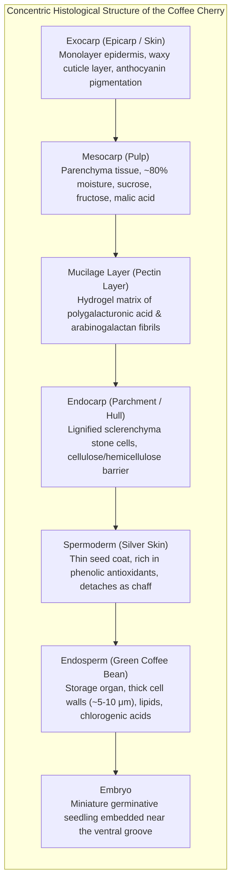
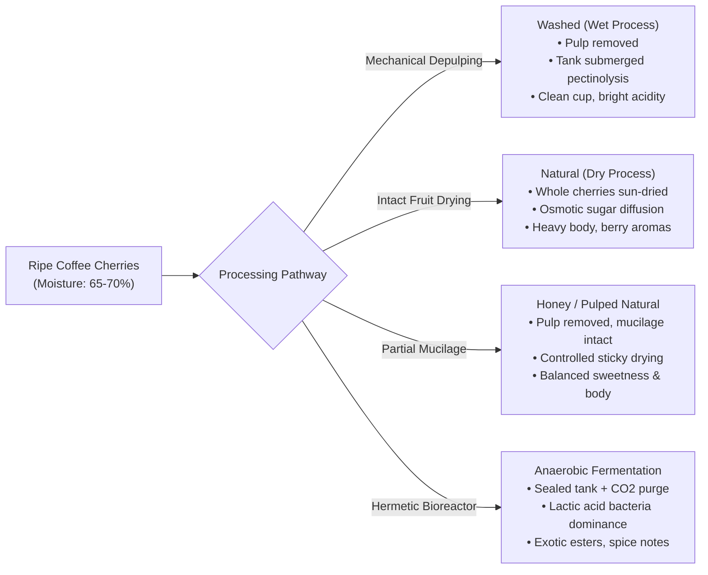
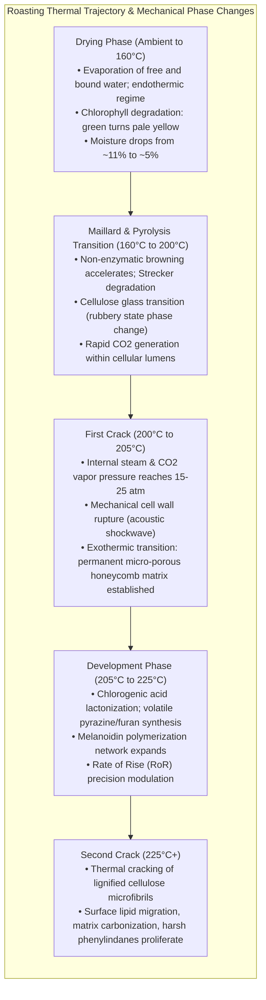
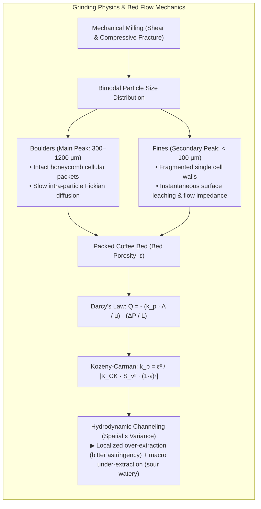
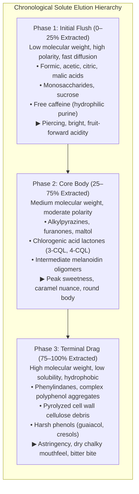
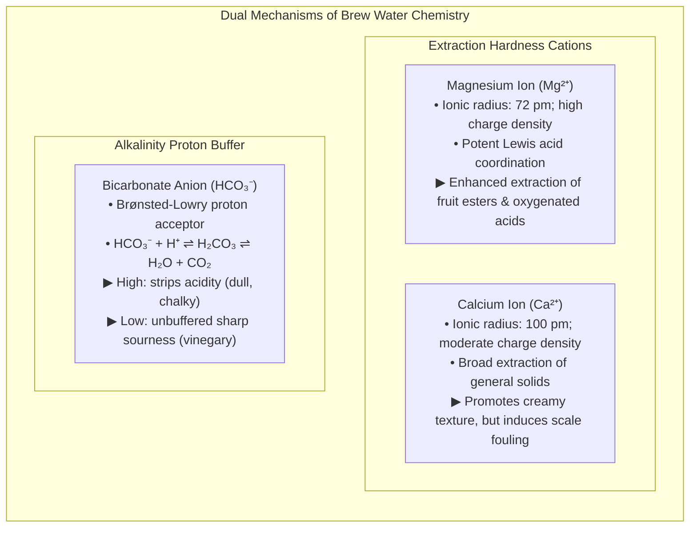
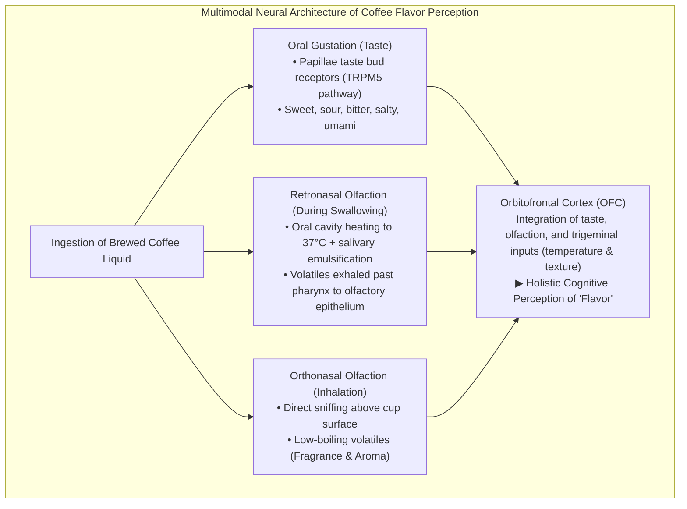

The humble cup of coffee consumed daily by hundreds of millions of people worldwide represents one of the most sophisticated multidisciplinary systems in applied science. It integrates agronomic plant physiology, microbial metabolic engineering, non-equilibrium thermodynamics, organic reaction kinetics, granular physics, porous media fluid mechanics, and neurosensory cognitive physiology.

Within a single unroasted green coffee bean, over one thousand distinct biochemical precursors are tightly sequestered inside a rigid cellulosic cellular matrix. Upon exposure to temperatures exceeding 200°C during pyrolytic roasting, these precursors undergo an intricate cascade of non-enzymatic browning (the Maillard reaction), Strecker degradation, sucrose caramelization, and chlorogenic acid isomerization. When the roasted bean is mechanically comminuted and subjected to high-temperature water percolation, transient solid-liquid leaching dynamics governed by Darcy's law and Fickian diffusion extract soluble solids and volatile aromatics into an aqueous brew.

This scientific guide provides an exhaustive, mathematically rigorous exploration of the entire coffee continuum—from cherry cellular anatomy and fermentation microbiology to convective roasting heat transfer, bed flow mechanics, extraction yields, inorganic water coordination chemistry, and the retronasal neuroscience of flavor perception.

---

### 1. Plant Morphology and Biochemical Precursors of the Coffee Cherry

#### 1.1 Macro- and Micro-Anatomical Architecture of the Pericarp and Seed

The fruit of the coffee plant (*Coffea arabica* and *Coffea canephora*), colloquially termed the "coffee cherry," is a drupe-like berry structured in concentric histological layers that protect two hemispherically paired seeds.

1. <strong>Exocarp (Skin)</strong>: A monolayer of parenchymal epidermal cells coated by an epicuticular wax layer that prevents transpirational desiccation and pathogen invasion. During maturation, chloroplast chlorophyll degrades and gives way to anthocyanins (principally cyanidin-3-rutinoside) and carotenoids, manifesting the characteristic vibrant crimson, yellow, or orange color.
2. <strong>Mesocarp (Pulp)</strong>: A fleshy parenchymal tissue exhibiting high water activity ($> 0.98$) and moisture content (~80–85%). It concentrates photosynthetic assimilates: glucose, fructose, sucrose, and organic acids (predominantly malic and citric acids), reaching soluble solids concentrations of 18–24° Brix at peak physiological maturity.
3. <strong>Mucilage (Pectin Layer)</strong>: A dense hydrogel layer (0.5–2.0 mm thick) adhering tenaciously to the parchment. It consists of cross-linked pectic polysaccharides (insoluble protopectin, polygalacturonic acids) and neutral arabinogalactan polymers hydrated in an aqueous milieu.
4. <strong>Endocarp (Parchment)</strong>: A tough, protective endocarp composed of dead, heavily lignified sclereids (stone cells). It functions as a rigid osmotic and physical shield, preventing premature germination and regulating mass transfer during post-harvest drying.
5. <strong>Silver Skin (Spermoderm)</strong>: The delicate, translucent integument directly surrounding the endosperm. It is rich in structural cellulose, fiber, and chlorogenic acid derivatives, and exfoliates during roasting as "chaff."
6. <strong>Endosperm (Green Bean)</strong>: The economic payload of the coffee plant. The endosperm cells possess extraordinarily thick ($5–10\,\mu\text{m}$) primary cell walls composed of non-cellulosic structural mannans, glucomannans, and cellulose microfibrils. Within the cellular lumens, proteins, triacylglycerols, sucrose, and chlorogenic acid potassium complexes reside in a quasi-crystalline, desiccated state.

#### 1.2 Comparative Biochemical Profiles: *Coffea arabica* vs. *Coffea canephora*

The global coffee economy is dominated by two commercial species: *Coffea arabica* (Arabica, cultivated primarily at high altitudes between 1,000 and 2,200 m) and *Coffea canephora* (Robusta, resilient in lowland tropical regions). Their distinct genetic ploidy drives stark biochemical divergence.

| Chemical Component (% Dry Matter Basis) | *Coffea arabica* (Arabica) | *Coffea canephora* (Robusta) | Functional Impact on Roasting & Sensory Profile |
| :--- | :--- | :--- | :--- |
| <strong>Karyotype & Ploidy</strong> | $2n = 4x = 44$ (Allotetraploid) | $2n = 2x = 22$ (Diploid) | High self-fertility, genetic homogeneity, complex metabolic regulation |
| <strong>Sucrose</strong> | <strong>6.0 – 9.0 %</strong> | 3.0 – 5.0 % | Primary precursor for Maillard intermediates, aliphatic acids, and caramels |
| <strong>Total Lipids</strong> | <strong>15.0 – 18.0 %</strong> | 8.0 – 12.0 % | Espresso crema emulsification, lipid-phase aroma entrapment |
| <strong>Caffeine (Alkaloid)</strong> | 0.9 – 1.5 % | <strong>1.8 – 3.2 %</strong> | Thermally stable purine alkaloid; contributes 10–15% of perceived bitterness |
| <strong>Trigonelline</strong> | <strong>0.8 – 1.2 %</strong> | 0.4 – 0.7 % | Pyrolyzes into nicotinic acid (Vitamin B3) and volatile alkylpyridines |
| <strong>Total Chlorogenic Acids (CGA)</strong> | 5.5 – 8.0 % | <strong>7.0 – 11.0 %</strong> | Degrades into bitter lactones and harsh phenylindanes; antioxidant activity |
| <strong>Cellulose & Hemicelluloses</strong> | 48.0 – 54.0 % | 50.0 – 56.0 % | Structural cellular scaffolding, $\text{CO}_2$ gas retention, beverage viscosity |
| <strong>Free Amino Acids & Proteins</strong> | 9.0 – 12.0 % | 10.0 – 13.0 % | Amine donors for non-enzymatic browning and Strecker degradation |

The higher sucrose content of Arabica serves as a thermal catalyst during roasting, driving the rapid formation of aliphatic organic acids (formic, acetic, glycolic), furans, and maltol. This imparts Arabica's celebrated dynamic acidity and aromatic complexity. Conversely, Robusta's elevated chlorogenic acid and caffeine concentrations confer natural insecticidal and antimicrobial resistance in the wild, but yield a pungent, earthy, woody, and intensely bitter beverage with pronounced crema body.

---

### 2. Post-Harvest Processing and Microbial Fermentation Biotechnology

Post-harvest processing converts freshly picked cherries (moisture content ~65–70%) into exportable green beans stabilized at a safe storage moisture content of 10.0–12.0% ($a_w < 0.65$), halting cellular respiration and preventing mycotoxin-producing fungal proliferation (*Aspergillus ochraceus*).

#### 2.1 The Washed (Wet) Process: Enzymatic Pectinolysis
In the washed method, mechanical depulpers shear off the exocarp and the bulk of the mesocarp. The parchment remains enveloped by the sticky mucilage layer.
- <strong>Biochemical Depolymerization Mechanism</strong>: The demucilaged beans are submerged in water-filled concrete or stainless-steel fermentation vats for 12 to 36 hours. Endogenous fruit pectinases collaborate with enzymes secreted by epiphytic bacteria and yeasts (*Pectobacterium*, *Bacillus*, *Kluyveromyces marxianus*). Pectin methylesterase (PME) hydrolyzes the methyl ester linkages of polygalacturonic acid, liberating methanol and polygalacturonic acid. Subsequently, endo- and exo-polygalacturonases (PG) cleave the $\alpha\text{-(1}\to\text{4)-D-}$galactosiduronic bonds:
  $$\text{Pectin} + n\text{H}_2\text{O} \xrightarrow{\text{PME, PG}} \text{D-Galacturonic Acid Oligomers} + n\text{CH}_3\text{OH}$$
  This solubilizes the hydrogel matrix, allowing it to be flushed away completely with clean wash water.
- <strong>Sensory Expression</strong>: Because sugar migration from the fruit pulp is terminated early, washed coffees display an immaculate "clean cup," revealing pure varietal genetics and terroir-derived citric and malic acidity without confounding winey or over-ripe ferment artifacts.

#### 2.2 The Natural (Dry) Process: Osmotic Gradients and Passive Solute Diffusion
In natural processing, whole intact cherries are spread across African raised beds or concrete patios and dried under ambient solar radiation for 15 to 30 days.
- <strong>Biophysical Dynamics</strong>: As solar heating drives moisture evaporation from the outer skin, the water activity within the mesocarp declines, elevating osmotic pressure. Soluble monosaccharides (glucose, fructose), aliphatic acids, and low-molecular-weight esters migrate down concentration gradients, permeating across the parchment layer into the embryonic endosperm tissues. Concurrently, natural fermentative metabolism by wild yeasts (*Saccharomyces cerevisiae*, *Hanseniaspora uvarum*) synthesizes fruit esters (ethyl acetate, ethyl butyrate, isoamyl acetate).
- <strong>Sensory Expression</strong>: Natural coffees exhibit profound body, viscous mouthfeel, and prominent aromatics of blueberries, dried figs, stone fruit, and dark chocolate.

#### 2.3 Anaerobic and Extended Maceration Fermentation
Pioneered by modern specialty coffee producers, anaerobic fermentation involves placing depulped or whole cherries into hermetically sealed stainless-steel or HDPE bioreactors equipped with one-way gas release valves, followed by pressurized carbon dioxide displacement ($\text{CO}_2$ flushing).
- <strong>Microbial Ecological Shift</strong>: The total exclusion of molecular oxygen halts the electron transport chains of obligate aerobes (filamentous molds and acetic acid bacteria *Acetobacter*). Acid-tolerant, facultative anaerobic lactic acid bacteria (LAB: *Leuconostoc mesenteroides*, *Lactobacillus plantarum*) rapidly dominate the population.
- <strong>Metabolic Pathway</strong>: LAB metabolize hexoses via the homofermentative Embden-Meyerhof-Parnas pathway and heterofermentative phosphoketolase pathway, producing lactic acid:
  $$\text{C}_6\text{H}_{12}\text{O}_6 \longrightarrow 2\,\text{CH}_3\text{CH(OH)COO}^- + 2\,\text{H}^+ \quad (\text{L-Lactic Acid})$$
  The reactor medium experiences a controlled pH drop from ~5.5 down to 3.8–4.0. Concurrently, microbial acyltransferases catalyze the esterification of organic acids with higher alcohols, synthesizing long-chain and branched esters (ethyl lactate, ethyl hexanoate, isoamyl butyrate). This bio-transformation infuses the porous bean with striking tasting notes of cinnamon, cardamom, passionfruit, candied citrus, and creamy dairy-like textures.

---

### 3. Roasting Engineering: Heat Transfer and Solid-Phase Structural Evolution

Roasting is an engineered transient non-equilibrium thermodynamic process that drives moisture down to 1.5–2.5%, expands the cellular matrix via explosive steam and carbon dioxide liberation, and catalyzes thousands of parallel pyrolytic reactions.

#### 3.1 Coupled Modes of Heat Transfer

The total instantaneous thermal energy flux $\dot{Q}_{\text{total}}$ delivered to the charge of coffee beans in a drum or fluid-bed roaster is defined by the classical triad of conductive, convective, and radiative heat transfer:

$$\dot{Q}_{\text{total}} = \dot{Q}_{\text{cond}} + \dot{Q}_{\text{conv}} + \dot{Q}_{\text{rad}}$$

1. <strong>Conduction ($\dot{Q}_{\text{cond}}$)</strong>: Heat transfer mediated by direct physical contact between the metallic drum wall (cast iron or carbon steel) and bean surfaces:
   $$\dot{Q}_{\text{cond}} = h_{\text{cond}} A_{\text{contact}} (T_{\text{drum}} - T_{\text{bean}})$$
   Excessive conductive flux induces localized surface charring, known in industrial terminology as "scorching" or "facing."
2. <strong>Forced Convection ($\dot{Q}_{\text{conv}}$)</strong>: Heat transfer mediated by the high-velocity stream of hot combustion gases and atmospheric air drawn through the tumbling bean bed:
   $$\dot{Q}_{\text{conv}} = h_{\text{conv}} A_{\text{bean}} (T_{\text{air}} - T_{\text{bean}})$$
   In state-of-the-art single-pass and recirculating roasters (e.g., Loring, Probat), forced convection delivers 70–85% of total thermal energy. The convective heat transfer coefficient $h_{\text{conv}}$ scales with air velocity $u_{\text{air}}$ according to $h_{\text{conv}} \propto u_{\text{air}}^{0.6–0.8}$, drastically reducing boundary layer thermal resistance.
3. <strong>Radiation ($\dot{Q}_{\text{rad}}$)</strong>: Electromagnetic radiation emitted by the radiant drum walls and gas burner surfaces, governed by the Stefan-Boltzmann law:
   $$\dot{Q}_{\text{rad}} = \sigma \epsilon_{\text{bean}} A_{\text{bean}} (T_{\text{wall}}^4 - T_{\text{bean}}^4)$$

#### 3.2 Transient Internal Heat Conduction and the Physics of First Crack

Approximating the coffee bean as an equivalent sphere of radius $R$, the spatial and temporal temperature field $T(r, t)$ is modeled by the transient spherical heat conduction equation:

$$\rho(t) c_p(T) \frac{\partial T}{\partial t} = \frac{1}{r^2} \frac{\partial}{\partial r} \left( k(T) r^2 \frac{\partial T}{\partial r} \right) + \dot{S}_{\text{rxn}}(T)$$

Where:
- $\rho(t)$ is the apparent bean density (which decreases dynamically from $\sim 1,250\text{ kg/m}^3$ to $\sim 550\text{ kg/m}^3$ due to volumetric expansion),
- $c_p(T)$ is the temperature-dependent specific heat capacity,
- $k(T)$ is thermal conductivity, and
- $\dot{S}_{\text{rxn}}(T)$ represents the volumetric heat generation from endothermic vaporization and exothermic chemical decompositions.

As the internal temperature crosses the glass transition temperature ($T_g \approx 140–160^\circ\text{C}$), the rigid, brittle, glassy cellulose-hemicellulose cell wall matrix undergoes a second-order thermodynamic phase transition into an amorphous, rubbery, viscoelastic state. Meanwhile, water vapor and pyrolytically generated carbon dioxide ($\text{CO}_2$) accumulate within the cellular lumens, generating internal pressures exceeding 15 to 25 atmospheres ($1.5–2.5\text{ MPa}$).

When this hydrostatic vapor pressure exceeds the tensile yield strength of the softened cell walls around $200–205^\circ\text{C}$, catastrophic mechanical failure occurs across thousands of adjacent cells. The resulting acoustic shockwave is audible as <strong>First Crack</strong>. The bean volume expands by 50–80%, creating an open, interconnected microporous cellular network with pores ranging from 20 to $40\,\mu\text{m}$ in diameter.

#### 3.3 Roasting Control Metrics: Rate of Rise (RoR) and Development Time Ratio (DTR)

Precision roasting relies on mathematical derivatives of the real-time Bean Temperature ($BT$) curve measured by grounded thermocouples or RTD probes:

- <strong>Rate of Rise (RoR)</strong>: The first time derivative of the bean temperature:
  $$\text{RoR}(t) = \frac{\mathrm{d}(BT)}{\mathrm{d}t} \quad [^\circ\mathrm{C/min}]$$
  Following the initial charge of cold green coffee, the measured temperature drops to an inflection minimum known as the <strong>Turning Point (TP)</strong>. Specialty roasting theory dictates that the subsequent RoR curve should exhibit a continuous, smooth, monotonically decreasing trajectory until drop. An abrupt collapse in RoR ("crash") stalls chemical development, imparting a flat, cardboard-like "baked" defect. Conversely, an upward spike in RoR ("flick") overheats remaining surface sugars, producing acrid, charred taints.
- <strong>Development Time Ratio (DTR)</strong>: The percentage of total roast time ($t_{\text{total}}$) elapsed between the onset of First Crack ($t_{\text{FC}}$) and roast termination ($t_{\text{drop}}$):
  $$\text{DTR} = \frac{t_{\text{drop}} - t_{\text{FC}}}{t_{\text{total}}} \times 100 \quad [\%]$$
  Standard DTR values range from 10–14% for Nordic light roasts (preserving delicate florals and malic acidity), 15–19% for omni/medium roasts, and 20–25% for espresso/dark roasts.

---

### 4. Organic Reaction Networks during Pyrolytic Roasting

At temperatures exceeding 160°C, green coffee transforms into an extraordinarily active chemical reactor, synthesizing over 800 volatile compounds.

```mermaid
flowchart TD
    subgraph PyrolysisNetworks ["Integrated Roasting Organic Reaction Pathways"]
        direction TB
        subgraph MaillardSection ["Maillard Reaction & Strecker Cascade"]
            ReducingSugars["Reducing Sugars<br/>(Glucose, Fructose)"]
            AminoAcids["Free Amino Acids & Peptides<br/>(Unprotonated -NH2)"]
            ReducingSugars & AminoAcids --> Glucosylamines["Glycosylamines"]
            Glucosylamines --> Amadori["Amadori Rearrangement Products<br/>(1-amino-1-deoxy-2-ketoses)"]
            Amadori --> Dicarbonyls["Reactive α-Dicarbonyls<br/>(Diacetyl, Pyruvaldehyde)"]
            Dicarbonyls --> Strecker["Strecker Degradation<br/>(3-Methylbutanal, Phenylacetaldehyde)"]
            Amadori --> Melanoidins["Melanoidin Polymers<br/>(High-molecular-weight brown pigments & body)"]
        end
        
        subgraph CaramelizationSection ["Caramelization"]
            Sucrose["Sucrose (6–9%)"] -->|Thermal Cleavage| Furans["Furan & Furanone Derivatives<br/>(Furaneol, Sotolon, Maltol)<br/>Caramel, toasted sweet aromatics"]
        end
        
        subgraph CGASection ["Chlorogenic Acid (CGA) Degradation"]
            CGA["Chlorogenic Acids (5-CQA)"] -->|180–215°C Dehydration| Lactones["CGA Lactones (3-CQL, 4-CQL)<br/>Pleasant, clean, crisp bitterness"]
            Lactones -->|220°C+ Over-roast Pyrolysis| Phenylindanes["Phenylindanes<br/>Harsh, lingering, astringent bitterness"]
            CGA -->|Hydrolysis| QuinicAcid["Quinic Acid (Astringent sourness)"] & CaffeicAcid["Caffeic Acid"]
        end
        
        subgraph TrigonellineSection ["Trigonelline Pyrolysis"]
            Trig["Trigonelline"] -->|Thermal Demethylation| Niacin["Nicotinic Acid (Vitamin B3)"] & Pyridines["Alkylpyridines<br/>Roasted, smokey nuance"]
        end
    end
```

#### 4.1 The Maillard Reaction and Strecker Degradation Cascade
The Maillard reaction is a non-enzymatic browning cascade triggered by nucleophilic attack of unprotonated primary amino groups ($-\text{NH}_2$) from amino acids or peptide chains upon the electrophilic carbonyl carbon ($\text{C}=\text{O}$) of reducing sugars.

1. <strong>Initial Condensation and Amadori Rearrangement</strong>:
   The condensation of an aldose with an amino acid forms an unstable N-substituted glycosylamine, which loses water to form a Schiff base. Under acid catalysis, this species undergoes Amadori rearrangement to yield a stable 1-amino-1-deoxy-2-ketose.
2. <strong>Deoxyosone Formation and Carbonyl Cleavage</strong>:
   Depending on micro-environmental pH, Amadori compounds undergo 1,2-enolization (yielding 3-deoxyosones that dehydrate into hydroxymethylfurfural, HMF, and furfural) or 2,3-enolization (yielding 1-deoxyosones that undergo retro-aldol fragmentation into highly reactive dicarbonyls: diacetyl, glyoxal, and methylglyoxal).
3. <strong>Strecker Degradation</strong>:
   Reactive $\alpha$-dicarbonyl intermediates interact with $\alpha$-amino acids, driving transamination followed by decarboxylation:
   $$\text{R-CH(NH}_2\text{)COOH} + \text{R'-CO-CO-R''} \longrightarrow \text{R-CHO} + \text{CO}_2 + \text{R-CH(NH}_2\text{)-CO-R''}$$
   This converts amino acids into key Strecker aldehydes:
   - <strong>Leucine/Isoleucine</strong> $\longrightarrow$ 3-Methylbutanal / 2-Methylbutanal (malty, toasted grain, sweet fruit).
   - <strong>Phenylalanine</strong> $\longrightarrow$ Phenylacetaldehyde (floral, honeylike).
   - <strong>Methionine</strong> $\longrightarrow$ Methional (savory, potato-like broth note).
   The resulting $\alpha$-aminoketones undergo self-condensation and oxidation to form <strong>alkylpyrazines</strong> (e.g., 2-ethyl-3,5-dimethylpyrazine), the signature chemical group behind roasted nut and chocolate aromas.
4. <strong>Melanoidin Macromolecular Assemblage</strong>:
   In the final stages, low-molecular-weight intermediates, pyrroles, and dicarbonyls cross-link through repeated aldol and polycondensation reactions into high-molecular-weight brown nitrogenous polymers termed <strong>melanoidins</strong>. Melanoidins bind polyphenols, provide the physical foundation for espresso crema stability, and contribute substantial antioxidant and radical-scavenging properties.

#### 4.2 Caramelization of Sucrose
Caramelization proceeds independently of amino compounds through the pure thermal degradation of non-reducing sucrose once temperatures surpass its melting point ($160–186^\circ\text{C}$). Glycosidic bond scission yields D-glucose and D-fructose, which dehydrate into anhydro-sugars (levoglucosan) and cyclize into furan and pyran derivatives. These include <strong>furaneol</strong> (4-hydroxy-2,5-dimethyl-3(2H)-furanone) and <strong>maltol</strong>, imparting sweet, buttery, caramel, and cotton-candy aromatics.

#### 4.3 Chlorogenic Acid Pyrolysis: The Evolution of Bitterness
Chlorogenic acids (principally 5-caffeoylquinic acid, 5-CQA), which constitute up to 8% of green Arabica and 11% of Robusta dry weight, dictate the evolution of brew bitterness across roast levels:

1. <strong>Chlorogenic Acid Lactones (CQL)</strong>:
   Between $180^\circ\text{C}$ and $215^\circ\text{C}$ (light to medium roast), the quinic acid moiety undergoes intramolecular dehydration and lactonization, forming 3-caffeoylquinic-1,5-lactone (3-CQL) and 4-caffeoylquinic-1,5-lactone (4-CQL). These lactones exhibit a low sensory threshold and deliver the refined, pleasant, palate-cleansing bitterness characteristic of top-tier specialty coffee.
2. <strong>Phenylindane Proliferation</strong>:
   When roasting extends into dark territory ($> 220^\circ\text{C}$), the lactone rings and caffeoyl moieties break down completely, polymerizing into polycyclic aromatic structures termed phenylindanes. Phenylindanes produce a harsh, lingering, highly astringent, and medicinal bitterness. Concurrently, quinic acid is cleaved from caffeic acid, accumulating as free quinic acid and imparting an unpleasantly sour, baked aftertaste.

---

### 5. Comminution Physics and Porous Media Hydrodynamics

Grinding (comminution) mechanically fractures the roasted bean's cellular skeleton, expanding the solid-liquid contact interface by several orders of magnitude to facilitate rapid mass transfer into hot water.

#### 5.1 The Bimodal Particle Size Distribution
Regardless of whether an industrial roller mill or a high-end commercial grinder (e.g., Mahlkönig EK43 flat burrs or conical burrs) is employed, laser diffraction particle size analysis invariably reveals a <strong>bimodal distribution</strong>:

1. <strong>Boulders (Macro-particles: $300–1,200\,\mu\text{m}$)</strong>:
   Agglomerates composed of dozens to hundreds of intact plant cells. Within boulders, the honeycomb cellular network is fully preserved. Water must enter through capillary action, dissolve internal solutes, and transport them outward via intra-particle molecular diffusion.
2. <strong>Fines (Micro-particles: $< 100\,\mu\text{m}$, typically $10–45\,\mu\text{m}$)</strong>:
   Cell wall shards resulting from brittle transgranular fracture across individual $30\,\mu\text{m}$ cells. Fines have negligible internal diffusion resistance; their entire soluble and lipid payload dissolves virtually instantaneously upon contact with water.

While fines provide necessary hydraulic flow resistance in espresso and stabilize crema microbubbles, an excessive fines fraction clogs filter paper pores in gravity pour-overs, causing percolation stalls and localized over-extraction.

#### 5.2 Porous Media Flow: Darcy's Law and the Kozeny-Carman Relationship
Percolation through a packed coffee bed is governed by <strong>Darcy's Law</strong>:

$$Q = \frac{-k_p A}{\mu} \frac{\Delta P}{L}$$

Where:
- $Q$ is volumetric flow rate $[\text{m}^3/\text{s}]$,
- $k_p$ is intrinsic bed permeability $[\text{m}^2]$,
- $A$ is the cross-sectional filtration area $[\text{m}^2]$,
- $\mu$ is fluid dynamic viscosity $[\text{Pa}\cdot\text{s}]$ (which falls by ~65% as water temperature rises from 20°C to 93°C),
- $\Delta P$ is the hydrostatic or pump-driven pressure drop across the bed $[\text{Pa}]$ (1–3 kPa in gravity pour-over; 9 bar = 900 kPa in espresso),
- $L$ is bed height $[\text{m}]$.

The structural permeability $k_p$ is defined by the <strong>Kozeny-Carman Equation</strong>:

$$k_p = \frac{\epsilon^3}{K_{\text{CK}} S_v^2 (1 - \epsilon)^2}$$

Where:
- $\epsilon$ is bed porosity (void volume fraction, typically $0.35–0.48$),
- $K_{\text{CK}}$ is the Kozeny-Carman constant ($\approx 5.0$ for packed beds of irregular particles),
- $S_v$ is the specific surface area per unit solid volume:
  $$S_v = \frac{6}{\phi d_p}$$
  with $\phi$ being particle sphericity and $d_p$ the harmonic mean particle diameter.

Because permeability scales with $d_p^2$ and exhibits an acute non-linear dependence on porosity ($\frac{\epsilon^3}{(1-\epsilon)^2}$), minor reductions in particle size or migration of fines into interstitial voids trigger massive exponential surges in hydraulic resistance.

#### 5.3 The Physics of Hydrodynamic Channeling
During high-pressure espresso extraction (9 bar), any spatial heterogeneity in bed density—such as micro-clumps or edge tamp voids—creates paths of least hydraulic resistance. Fluid lines converge toward these regions. The resulting surge in localized interstitial velocity exerts violent shear forces that scour particles from channel walls, expanding the pore diameter.

This phenomenon, known as <strong>channeling</strong>, causes water to rush through localized fissures, ruthlessly over-extracting bitter phenylindanes and harsh tannins along the channel boundaries. Concurrently, the rest of the tightly packed bed remains unreached and under-extracted, delivering a hollow, sour, astringent, and defective beverage. Techniques such as the Weiss Distribution Technique (WDT) and progressive pre-infusion mitigate channeling by driving bed porosity variance toward zero ($\sigma_\epsilon^2 \to 0$).

---

### 6. Non-Equilibrium Extraction Kinetics and Mass Transfer

Solid-liquid extraction in coffee is a dual-mechanism phenomenon combining instantaneous surface washing with intra-particle non-steady-state diffusion.

#### 6.1 Fickian Diffusion Model in Spherical Coordinates
The spatial-temporal concentration distribution $C(r, t)$ of a dissolved solute within an idealized spherical coffee particle of radius $R$ is governed by <strong>Fick's Second Law</strong>:

$$\frac{\partial C}{\partial t} = D_{\text{eff}} \left( \frac{\partial^2 C}{\partial r^2} + \frac{2}{r} \frac{\partial C}{\partial r} \right)$$

The effective intra-particle diffusivity $D_{\text{eff}}$ accounts for structural tortuosity $\tau$, constrictivity $K_c$, and internal matrix porosity $\epsilon_p$:

$$D_{\text{eff}} = D_0 \frac{\epsilon_p K_c}{\tau}$$

According to the <strong>Stokes-Einstein relation</strong>, the bulk aqueous diffusion coefficient $D_0$ is directly proportional to absolute thermodynamic temperature $T$ and inversely proportional to solvent dynamic viscosity $\mu$ and hydrodynamic solute radius $r_H$:

$$D_0 = \frac{k_B T}{6 \pi \mu r_H}$$

#### 6.2 The Extraction Timeline and Chemical Elution Order
Because effective diffusivity $D_{\text{eff}}$ scales inversely with hydrodynamic molecular radius $r_H$, coffee compounds elute in a strict chronological hierarchy:

1. <strong>Early Phase (Fast Diffusers)</strong>:
   Low-molecular-weight polar species—acetic acid ($M_w=60$), malic acid ($M_w=134$), citric acid ($M_w=192$), caffeine ($M_w=194$), and simple sugars—diffuse rapidly out of the cellular matrix within the first 15–30 seconds. The initial extract displays intense acidity, high electrical conductivity, and a low pH ($< 4.2$).
2. <strong>Middle Phase (Sweetness & Aroma Peak)</strong>:
   Alkylpyrazines, furans, sucrose, and mono-chlorogenic acid lactones elute as thermal energy sustains high diffusion flux. The beverage achieves sensory harmony as acidity is balanced by sweetness and roasted aromatics.
3. <strong>Late Phase (Astringent Over-Extraction)</strong>:
   Large, poorly soluble, hydrophobic compounds—phenylindanes, heavy melanoidin polymers, and polycyclic phenolics—slowly leach into the stream. If brewing continues past this point, drying astringency and harsh ash-like bitterness overwhelm the palate.

---

### 7. Quantitative Brewing Metrology: TDS, Extraction Yield, and the SCA Golden Cup

```mermaid
flowchart TD
    subgraph SCABrewingChart ["SCA Brewing Control Chart (Concentration vs. Yield)"]
        direction TB
        subgraph HighTDS ["Strong Zone (High TDS > 1.45%)"]
            T1["Strong & Under-extracted<br/>(Concentrated sour, salty)"] --- T2["Strong & Balanced<br/>(Intense, rich, syrupy)"] --- T3["Strong & Over-extracted<br/>(Heavy, bitter, astringent)"]
        end
        subgraph IdealBand ["★ SCA Golden Cup Target Domain ★"]
            M1["Under-extracted Band<br/>EY < 18.0%<br/>Sour, grassy, lacking sweetness"] --- GoldCup["★ GOLD CUP IDEAL ★<br/>TDS: 1.15% to 1.45%<br/>EY: 18.0% to 22.0%<br/>Harmonious acidity, sweetness, clarity"] --- M3["Over-extracted Band<br/>EY > 22.0%<br/>Dry, bitter, medicinal finish"]
        end
        subgraph LowTDS ["Weak Zone (Low TDS < 1.15%)"]
            B1["Weak & Under-extracted<br/>(Thin, watery sourness)"] --- B2["Weak & Balanced<br/>(Delicate, tea-like clarity)"] --- B3["Weak & Over-extracted<br/>(Watery bitterness, hollow)"]
        end
    end
```

Modern coffee brewing standardizes sensory balance through analytical metrology, centering on <strong>Total Dissolved Solids (TDS)</strong> and <strong>Extraction Yield (EY)</strong>.

#### 7.1 TDS and Critical-Angle Optical Refractometry
<strong>Total Dissolved Solids (TDS)</strong> represents the mass fraction of non-volatile organic and inorganic solids dissolved in the brew:

$$\text{TDS} = \frac{M_{\text{solutes}}}{M_{\text{beverage}}} \times 100 \quad [\%]$$

Precision digital refractometers (e.g., VST LAB Coffee) measure the refractive index $n_{\text{liquid}}$ using a sodium D-line laser or LED ($\lambda = 589.3\text{ nm}$). By detecting the critical angle of total internal reflection $\theta_c$ at the boundary between a sapphire prism and the liquid sample:

$$n_{\text{liquid}} = n_{\text{prism}} \sin \theta_c$$

The instrument applies empirical polynomial calibrations and high-resolution temperature compensation algorithms to convert $n_{\text{liquid}}$ directly into coffee TDS with an accuracy of $\pm 0.01\%$. Standard filter coffee TDS ranges from $1.15\%$ to $1.45\%$, while traditional espresso concentrates solids into an $8.0–12.0\%$ TDS solution.

#### 7.2 Mathematical Formulation of Extraction Yield (EY)
<strong>Extraction Yield (EY)</strong> denotes the mass percentage of the initial dry coffee dose $M_{\text{dose}}$ transferred into the final cup $M_{\text{beverage}}$:

$$\text{EY} = \frac{M_{\text{beverage}} \times \text{TDS}}{M_{\text{dose}}} \quad [\%]$$

- The theoretical maximum extractable fraction of a roasted coffee bean is approximately $28–32\%$ by mass (the remaining ~70% consists of insoluble structural cellulose, lignin, and cell wall matrix).
- <strong>Under-Extraction ($\text{EY} < 18.0\%$)</strong>: Insufficient leaching leaves behind core sugars and aromatics. Organic acids dominate, causing unbalanced sourness, vegetal grassiness, and a lack of lingering sweetness.
- <strong>The Golden Cup Ideal ($18.0\% \le \text{EY} \le 22.0\%$)</strong>: Defined by the Specialty Coffee Association (SCA) as the optimal balance of organic acids, sugars, and aromatic oils, delivering nuanced terroir expression, complex acidity, and clean sweetness.
- <strong>Over-Extraction ($\text{EY} > 22.0\%$)</strong>: Excessive elution pulls out slow-diffusing phenylindanes, tannins, and pyrolytic breakdown fragments. The beverage turns astringent, drying, and bitterly acrid.

---

### 8. Water Chemistry: Inorganic Coordination and Buffer Equilibrium

Brew water constitutes ~98.5% of filter coffee and ~90% of espresso. Water is far from an inert solvent; its dissolved inorganic electrolytes act as reactive Lewis acid chelators and Brønsted-Lowry proton buffers that govern extraction yield and perceived acidity.

#### 8.1 Cation Coordination Dynamics: $\text{Mg}^{2+}$ vs. $\text{Ca}^{2+}$
Divalent alkaline earth cations act as Lewis acids, forming coordination complexes with the non-bonding electron pairs of oxygen-rich functional groups (hydroxyls, carboxylates, carbonyls) in coffee flavor molecules:

- <strong>Magnesium ($\text{Mg}^{2+}$)</strong>:
  Possessing a compact ionic radius ($72\text{ pm}$) and high charge density, $\text{Mg}^{2+}$ exerts a strong electrostatic attraction toward oxygen-bearing compounds. It selectively accelerates the extraction of oxygenated aromatics, malic acid, and citric acid, highlighting crisp fruit-forward notes.
- <strong>Calcium ($\text{Ca}^{2+}$)</strong>:
  With a larger ionic radius ($100\text{ pm}$) and lower charge density, $\text{Ca}^{2+}$ exhibits weaker coordination with polar acids, but bonds broadly with generic polysaccharides and lipids, boosting overall perceived body and creamy mouthfeel. However, at concentrations above 80 ppm, calcium precipitates with carbonate anions to form insoluble calcium carbonate ($\text{CaCO}_3$) scale, clogging espresso boiler hydraulics.

#### 8.2 Bicarbonate ($\text{HCO}_3^-$) Alkalinity and Acid-Base Buffering
Alkalinity quantifies the capacity of water to neutralize hydronium ions ($\text{H}_3\text{O}^+$), governed primarily by the bicarbonate-carbonic acid equilibrium:

$$\text{HCO}_3^- + \text{H}_3\text{O}^+ \rightleftharpoons \text{H}_2\text{CO}_3 + \text{H}_2\text{O} \rightleftharpoons 2\,\text{H}_2\text{O} + \text{CO}_2 \uparrow$$

1. <strong>Excessive Alkalinity ($> 80\text{ mg/L as }\text{CaCO}_3$)</strong>:
   Abundant bicarbonate ions rapidly absorb protons dissociated from citric, malic, and phosphoric acids. The final beverage pH is driven up toward 5.5, neutralizing bright acidity and rendering the coffee flat, chalky, earthy, and dull.
2. <strong>Deficient Alkalinity ($< 20\text{ mg/L as }\text{CaCO}_3$)</strong>:
   The water provides negligible buffering capacity. Beverage pH drops unchecked below 4.0, causing raw aliphatic acids (acetic and formic) to deliver a piercing, sour, vinegary sting on the tongue.

#### 8.3 Specialty Coffee Association (SCA) Standard Water Specifications

| Chemical Metric | Target Value | Acceptable Operational Range | Sensory and Engineering Influence |
| :--- | :--- | :--- | :--- |
| <strong>Total Hardness</strong> | $68\text{ mg/L as }\text{CaCO}_3$ | $50 – 175\text{ mg/L}$ | Extraction yield and body development |
| <strong>Calcium Hardness</strong> | $50 – 65\text{ ppm}$ | $30 – 80\text{ ppm}$ | Creamy mouthfeel; scale risk if $>80\text{ ppm}$ |
| <strong>Magnesium Hardness</strong> | $30 – 50\text{ ppm}$ | $20 – 60\text{ ppm}$ | Extraction of fruity acids and oxygenated volatiles |
| <strong>Total Alkalinity</strong> | $40\text{ mg/L as }\text{CaCO}_3$ | $40 – 75\text{ mg/L}$ | Buffers acidity; preserves lively, dynamic cup balance |
| <strong>pH</strong> | $7.0$ | $6.5 – 8.0$ | Neutral baseline solvent state |
| <strong>Total Dissolved Solids (TDS)</strong> | $150\text{ mg/L}$ | $75 – 250\text{ mg/L}$ | Overall solvency and mineral equilibrium |
| <strong>Free Chlorine / Chloramines</strong> | <strong>$0\text{ mg/L}$</strong> | <strong>$0\text{ mg/L}$ (Zero Tolerance)</strong> | Reacts with chlorogenic acids to form phenolic medicinal off-flavors |

---

### 9. Volatile Aroma Chemistry and the Neurobiology of Sensory Perception

The human sensory experience of coffee is a multimodal neural synthesis combining gustatory taste receptor stimulation in the oral cavity with olfactory receptor activation via the retronasal pathway, processed in the orbitofrontal cortex.

#### 9.1 Key Volatile Impact Compounds and Olfactory Odor Activity Values

Gas chromatography-mass spectrometry (GC-MS) coupled with gas chromatography-olfactometry (GC-O) identifies several indispensable volatile impact odorants:

| Chemical Family | Compound Name | Primary Sensory Descriptor | Odor Detection Threshold (Air) |
| :--- | :--- | :--- | :--- |
| <strong>Thiol / Mercaptan</strong> | <strong>2-Furfurylthiol</strong> | Iconic freshly brewed roast coffee aroma | <strong>$0.01\text{ ng/L}$ (Extremely Low)</strong> |
| <strong>Furanone</strong> | 4-Hydroxy-2,5-dimethyl-3(2H)-furanone (Furaneol) | Sweet caramel, strawberry, cotton candy | $0.05\text{ ng/L}$ |
| <strong>Furanone</strong> | 3-Hydroxy-4,5-dimethylfuran-2(5H)-one (Sotolon) | Maple syrup, fenugreek, curry, burnt sugar | $0.02\text{ ng/L}$ |
| <strong>Alkylpyrazine</strong> | 2-Ethyl-3,5-dimethylpyrazine | Roasted hazelnut, toasted cocoa nibs | $0.01 – 0.05\text{ ng/L}$ |
| <strong>Aldehyde</strong> | 3-Methylbutanal (Isovaleraldehyde) | Malty, toasted cereal, fermented apple | $0.2\text{ ng/L}$ |
| <strong>Ester</strong> | Ethyl 2-methylbutyrate | Tropical fruit, blackberry, ripe pineapple | $0.1\text{ ng/L}$ |
| <strong>Phenol</strong> | 4-Vinylguaiacol / Guaiacol | Clove spice, peaty smoke, woody nuance | $0.1\text{ ng/L}$ |
| <strong>Terpene</strong> | Linalool | Bergamot citrus, lavender, jasmine florals | $0.2\text{ ng/L}$ |

Among these, <strong>2-furfurylthiol</strong> is the quintessential "roast coffee" character-impact molecule. Because of its free thiol ($-\text{SH}$) group, it readily undergoes oxidative dimerization into an odorless disulfide in the presence of dissolved atmospheric oxygen, serving as the primary molecular driver of coffee staling.

#### 9.2 Physiological Dynamics: Orthonasal vs. Retronasal Pathways
- <strong>Orthonasal Pathway</strong>:
  Volatile compounds evaporate from the cup and are inhaled directly through the anterior nares. This pathway is dominated by highly volatile, low-boiling species (short-chain aldehydes, esters, and volatile sulfur compounds), establishing the initial impressions of "fragrance" (dry ground coffee) and "aroma" (wet brewed crust).
- <strong>Retronasal Pathway</strong>:
  When coffee is introduced into the oral cavity and swallowed, the liquid is heated to body temperature ($37^\circ\text{C}$) and sheared against mucosal surfaces. Salivary $\alpha$-amylase and mucin proteins interact with the coffee matrix, destabilizing micro-emulsified lipid droplets. As air is exhaled post-swallowing, mid- and high-boiling volatiles (pyrazines, guaiacols, lactones) are swept up through the pharynx to the olfactory cleft. This retronasal stimulation constitutes the true physiological basis of coffee <strong>flavor</strong> and <strong>aftertaste</strong>.

#### 9.3 The WCR/SCA Coffee Taster's Flavor Wheel Taxonomy
Redesigned in 2016 through collaboration between the Specialty Coffee Association and World Coffee Research, the Coffee Taster's Flavor Wheel represents a sensory lexicon grounded in peer-reviewed descriptive sensory analysis.

The wheel organizes flavor attributes into concentric tiers: nine core overarching categories at the center (Floral, Fruity, Sour/Fermented, Green/Vegetative, Roasted, Spices, Nutty/Cocoa, Sweet, Other) radiate outward into secondary and tertiary descriptors. Crucially, each terminal attribute is anchored to standardized, chemically pure sensory reference standards (e.g., specific concentrations of ethyl butyrate, citric acid, or hexanal), transforming subjective sensory impressions into rigorous, reproducible scientific data.

---

### 10. Conclusion: A Unified Synthesis of Coffee Science

The transformation of raw coffee into an exceptional beverage is a masterclass in applied natural science:

1. <strong>Agronomic Botany</strong>: Ploidy and cellular architecture set the upper limit on sucrose, chlorogenic acid, and lipid precursor pools.
2. <strong>Fermentation Microbiology</strong>: Controlled anaerobic and enzymatic processing sculpts the organic acid profile and bio-synthesizes volatile fruit esters.
3. <strong>Roasting Kinetics</strong>: Conjugate heat transfer governs the glass transition of cell walls, internal vapor pressure explosions, and competitive branching between the Maillard reaction, caramelization, and chlorogenic acid degradation.
4. <strong>Comminution & Hydrodynamics</strong>: Particle size distributions dictate bed porosity, permeability, and localized flow fields under Darcy's law and the Kozeny-Carman relation.
5. <strong>Aqueous Mass Transfer & Coordination</strong>: Fickian diffusion rates establish elution hierarchies, while water hardness cations ($\text{Mg}^{2+}$, $\text{Ca}^{2+}$) and bicarbonate buffers modulate flavor extraction and perceived acidity.
6. <strong>Neurosensory Integration</strong>: Orthonasal and retronasal olfactory pathways combine with taste receptor signaling in the orbitofrontal cortex to produce the holistic experience of coffee flavor.

By framing coffee through the lens of fundamental physics, chemistry, and biology, roasters, baristas, and food scientists can replace empirical guesswork with deterministic, reproducible, and measurable excellence.
