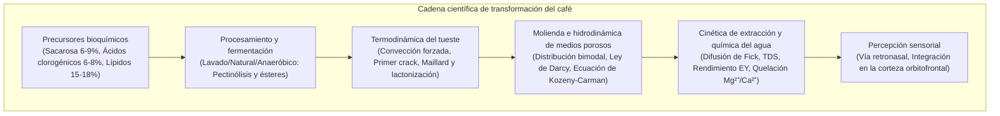
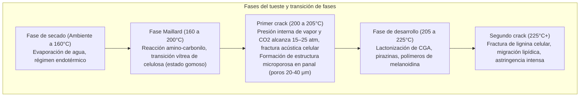

La taza de café consumida a diario en todo el mundo constituye uno de los sistemas multidisciplinares más avanzados de las ciencias aplicadas, articulando fisiología vegetal, biotecnología fermentativa, termodinámica fuera del equilibrio, cinética de reacciones orgánicas, mecánica de medios porosos y neurobiología sensorial.

En el grano de café verde, más de un millar de precursores químicos permanecen confinados en una rígida matriz celular celulósica. A temperaturas superiores a 200°C en el tostador, la reacción de Maillard, la degradación de Strecker, la caramelización y la escisión de ácidos clorogénicos generan cientos de compuestos volátiles aromáticos. Durante la extracción, la percolación de agua caliente responde a la ley de Darcy y a la difusión de Fick.

---

### 1. Morfología de la Cereza y Bioquímica del Grano Verde

1. <strong>Exocarpio (Piel)</strong>: Epidermis monocelular con cutícula cerosa; las antocianinas le confieren su color rojo o amarillo.
2. <strong>Mesocarpio (Pulpa)</strong>: Tejido carnoso rico en agua (~80%), azúcares libres (fructosa, glucosa, sacarosa, 18-24° Brix) y ácido málico.
3. <strong>Mucílago</strong>: Capa de hidrogel viscoso (0.5 a 2 mm) formada por ácidos pécticos entrecruzados y arabinogalactanos insolubles.
4. <strong>Endocarpio (Pergamino)</strong>: Estructura dura de células pétreas lignificadas (celulosa 40-45%, hemicelulosa y lignina).
5. <strong>Película plateada (Espermodermo)</strong>: Fina cubierta seminal rica en polifenoles que se desprende durante el tueste (paxarilla o chaff).
6. <strong>Endospermo (Grano de café verde)</strong>: Tejido de reserva con paredes celulares engrosadas ($5\sim10\,\mu\text{m}$), que alberga lípidos, proteínas, sacarosa y sales de ácido clorogénico.

| Componente Químico (% Base Seca) | Arábica (*C. arabica*) | Robusta (*C. canephora*) | Impacto en el tueste y perfil sensorial |
| :--- | :--- | :--- | :--- |
| <strong>Ploidía</strong> | $2n = 4x = 44$ (Alotetraploide) | $2n = 2x = 22$ (Diploide) | Autógama, perfil aromático refinado y complejo |
| <strong>Sacarosa</strong> | <strong>6.0 – 9.0 %</strong> | 3.0 – 5.0 % | Precursor fundamental de ácidos alifáticos y furanos |
| <strong>Lípidos totales</strong> | <strong>15.0 – 18.0 %</strong> | 8.0 – 12.0 % | Estabilización de la crema y fijación de aromas lipofílicos |
| <strong>Cafeína</strong> | 0.9 – 1.5 % | <strong>1.8 – 3.2 %</strong> | Alcaloide termoestable; 10-15% del amargor percibido |
| <strong>Trigonelina</strong> | <strong>0.8 – 1.2 %</strong> | 0.4 – 0.7 % | Pirólisis en niacina (vitamina B3) y alquilpiridinas |
| <strong>Ácidos clorogénicos (CGA)</strong>| 5.5 – 8.0 % | <strong>7.0 – 11.0 %</strong> | Se degradan en lactonas (amargor limpio) y fenilindanos (amargor áspero) |

---

### 2. Procesamiento Postcosecha y Fermentación Microbiana

1. <strong>Proceso Lavado (Washed)</strong>: Despulpado mecánico y fermentación sumergida durante 12 a 36 horas. Pectinasas de bacterias (*Pectobacterium*, *Bacillus*) hidrolizan la pectina:
   $$\text{Pectina} + n\text{H}_2\text{O} \xrightarrow{\text{Pectinasa}} \text{Ácido D-galacturónico} + \text{Metanol}$$
   Produce una taza limpia y brillante, con marcada acidez málica y cítrica.
2. <strong>Proceso Natural (Dry)</strong>: Secado del fruto entero en camas africanas durante 2 a 4 semanas. La difusión osmótica de azúcares y ésteres de levaduras hacia el endospermo aporta cuerpo denso y notas a frutos silvestres.
3. <strong>Fermentación Anaeróbica</strong>: En tanques presurizados con $\text{CO}_2$. Las bacterias lácticas (*Leuconostoc*, *Lactobacillus*) disminuyen el pH a 3.8–4.2 y generan ésteres alifáticos ramificados (canela, maracuyá).

---

### 3. Termodinámica del Tueste y Cinética de Transferencia de Calor

El flujo total de calor $\dot{Q}_{\text{total}}$ hacia los granos se rige por:

$$\dot{Q}_{\text{total}} = \dot{Q}_{\text{cond}} + \dot{Q}_{\text{conv}} + \dot{Q}_{\text{rad}}$$

En tostadoras modernas de aire forzado, la convección aporta del 70 al 85% de la energía ($\dot{Q}_{\text{conv}} = h_{\text{conv}} A_{\text{bean}} (T_{\text{air}} - T_{\text{bean}})$).

- <strong>Tasa de aumento de temperatura (Rate of Rise - RoR)</strong>: $\text{RoR}(t) = \frac{\mathrm{d}(BT)}{\mathrm{d}t}$ en $[^\circ\mathrm{C/min}]$. Debe exhibir una curva suave y monotónicamente decreciente.
- <strong>Ratio de tiempo de desarrollo (DTR)</strong>:
  $$\text{DTR} = \frac{t_{\text{total}} - t_{\text{FC}}}{t_{\text{total}}} \times 100 \quad [\%]$$
  10–14% en tuestes claros, 15–19% en tuestes medios.

---

### 4. Red de Reacciones Orgánicas

1. <strong>Reacción de Maillard y Degradación de Strecker</strong>: Interacción entre azúcares reductores y aminoácidos, pasando por el reordenamiento de Amadori hasta formar $\alpha$-dicarbonilos. La degradación de Strecker genera aldehídos aromáticos (3-metilbutanal: notas a malta) y alquilpirazinas (frutos secos tostados), culminando en <strong>melanoidinas</strong>, responsables del cuerpo y la crema.
2. <strong>Caramelización</strong>: Degradación térmica de la sacarosa a $>160^\circ\text{C}$ produciendo furanonas (furaneol, sotolón) y maltol (dulzor tostado y caramelo).
3. <strong>Evolución del amargor por CGA</strong>:
   - 180–215°C: Lactonas de ácido clorogénico (3-CQL, 4-CQL), que aportan un <strong>amargor balanceado y placentero</strong>.
   - >220°C: Pirólisis a <strong>fenilindanos</strong>, responsables de un <strong>amargor áspero, seco y persistente</strong>.

---

### 5. Molienda e Hidrodinámica en Lechos Porosos

La molienda genera una <strong>distribución bimodal de tamaño de partícula</strong>:
- <strong>Boulders ($300\sim1200\,\mu\text{m}$)</strong>: Partículas macroscópicas con células intactas, reguladas por difusión interna.
- <strong>Fines ($< 100\,\mu\text{m}$)</strong>: Fragmentos microscópicos de pared celular, disolución superficial instantánea.

El flujo a través de la pastilla de café sigue la <strong>ley de Darcy</strong>:

$$Q = \frac{-k_p A}{\mu} \frac{\Delta P}{L}$$

La permeabilidad $k_p$ responde a la <strong>ecuación de Kozeny-Carman</strong>:

$$k_p = \frac{\epsilon^3}{K_{\text{CK}} S_v^2 (1 - \epsilon)^2}$$

Bajo 9 bares en espresso, gradientes de empaquetamiento provocan <strong>canalizaciones (Channeling)</strong>, lo que genera sobreextracción amarga en las grietas y subextracción ácida en las zonas densas.

---

### 6. Cinética de Extracción, TDS y SCA Gold Cup

La difusión intraparticular responde a la <strong>segunda ley de Fick</strong>:

$$\frac{\partial C}{\partial t} = D_{\text{eff}} \left( \frac{\partial^2 C}{\partial r^2} + \frac{2}{r} \frac{\partial C}{\partial r} \right)$$

Según la fórmula de Stokes-Einstein, las moléculas de menor radio hidrodinámico eluyen primero:
1. <strong>0–30 s</strong>: Ácidos orgánicos ligeros, sacarosa, cafeína (acidez brillante).
2. <strong>30–90 s</strong>: Alquilpirazinas, furanos, lactonas de CGA (equilibrio dulce y tostado).
3. <strong>>90 s</strong>: Fenilindanos pesados y polifenoles (astringencia y sequedad).

- <strong>TDS (Total Dissolved Solids)</strong>: Medido mediante refractómetro óptico láser ($1.15–1.45\%$ en café filtrado, $8.0–12.0\%$ en espresso).
- <strong>Rendimiento de extracción (Extraction Yield - EY)</strong>:
  $$\text{EY} = \frac{M_{\text{beverage}} \times \text{TDS}}{M_{\text{dose}}} \times 100 \quad [\%]$$
  Rango ideal SCA Gold Cup: <strong>18.0% a 22.0%</strong>.

---

### 7. Química del Agua y Neurobiología Sensorial

1. <strong>Cationes</strong>:
   - $\text{Mg}^{2+}$: Alta densidad de carga, potente ácido de Lewis; quelata selectivamente ácidos de frutas y ésteres aromáticos.
   - $\text{Ca}^{2+}$: Extracción moderada, confiere textura aterciopelada, pero produce incrustaciones calcáreas.
2. <strong>Bicarbonato y Buffer de pH</strong>:
   $$\text{HCO}_3^- + \text{H}_3\text{O}^+ \rightleftharpoons \text{H}_2\text{CO}_3 + \text{H}_2\text{O} \rightleftharpoons 2\,\text{H}_2\text{O} + \text{CO}_2 \uparrow$$
   Alcalinidad $>80\text{ mg/L}$ anula la acidez; alcalinidad $<20\text{ mg/L}$ torna la bebida agresivamente avinagrada.
3. <strong>Vía Retronasal</strong>: El 2-furfuriltiol evoca el aroma característico a café recién tostado. Al tragar, el café a 37°C libera sus volátiles a través de la faringe hacia el epitelio olfatorio, donde la corteza orbitofrontal sintetiza el sabor integral ("Flavor").
