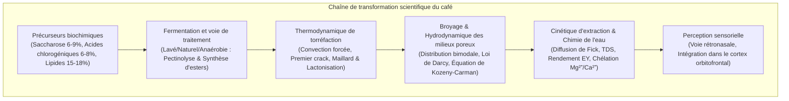
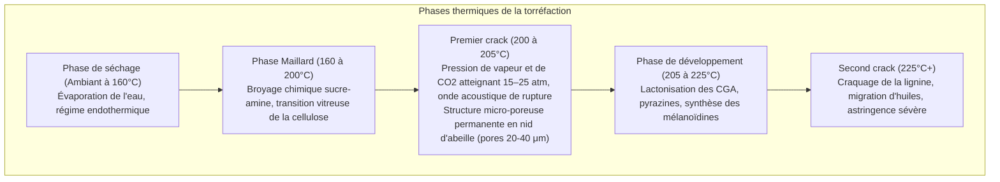

La tasse de café quotidienne représente l'un des systèmes multidisciplinaires les plus complexes des sciences appliquées, associant botanique agronomique, biotechnologie microbienne, thermodynamique hors-équilibre, cinétique chimique, physique des milieux poreux et neurobiologie sensorielle.

Dans le grain de café vert, plus d'un millier de précurseurs biochimiques sont piégés au sein d'une matrice cellulaire rigide de cellulose. Lors de la torréfaction à plus de 200°C, la réaction de Maillard, la dégradation de Strecker, la caramélisation et le clivage des acides chlorogéniques engendrent des centaines de molécules aromatiques volatiles. Lors de l'extraction, la percolation obéit à la loi de Darcy et à la diffusion de Fick.

---

### 1. Morphologie de la Cerise et Biochimie du Grain Vert

1. <strong>Exocarpe (Peau)</strong> : Épiderme cutinisé protégeant le fruit. Les anthocyanes lui confèrent sa teinte rouge ou jaune à maturité.
2. <strong>Mésocarpe (Pulpe)</strong> : Parenchyme riche en eau (~80%), en sucres simples (fructose, glucose, saccharose, 18-24° Brix) et en acide malique.
3. <strong>Mucilage</strong> : Hydrogel visqueux de 0,5 à 2 mm d'épaisseur composé d'acides pectiques et d'arabinogalactanes insolubles.
4. <strong>Endocarpe (Parchemin)</strong> : Enveloppe sclérifiée rigide (cellulose 40-45%, hémicellulose et lignine).
5. <strong>Pellicule argentée (Spermoderme)</strong> : Tégument entourant l'albumen, riche en composés phénoliques, détaché à la torréfaction sous forme de pellicules (chaff).
6. <strong>Endosperme (Grain de café vert)</strong> : Tissu de réserve aux parois cellulaires épaisses ($5\sim10\,\mu\text{m}$), abritant lipides, protéines, saccharose et acides chlorogéniques.

| Composant (% Matière Sèche) | Arabica (*C. arabica*) | Robusta (*C. canephora*) | Rôle sensoriel et comportement à la torréfaction |
| :--- | :--- | :--- | :--- |
| <strong>Ploïdie</strong> | $2n = 4x = 44$ (Allotétraploïde) | $2n = 2x = 22$ (Diploïde) | Autogame, profil aromatique complexe et équilibré |
| <strong>Saccharose</strong> | <strong>6,0 – 9,0 %</strong> | 3,0 – 5,0 % | Précurseur majeur des acides aliphatiques et des furanes |
| <strong>Lipides totaux</strong> | <strong>15,0 – 18,0 %</strong> | 8,0 – 12,0 % | Stabilité de la crema et solvant des arômes hydrophobes |
| <strong>Caféine</strong> | 0,9 – 1,5 % | <strong>1,8 – 3,2 %</strong> | Alcaloïde thermostable ; ~10-15% de l'amertume perçue |
| <strong>Trigonelline</strong> | <strong>0,8 – 1,2 %</strong> | 0,4 – 0,7 % | Pyrolyse en niacine (vitamine B3) et alkylpyridines |
| <strong>Acides chlorogéniques (CGA)</strong>| 5,5 – 8,0 % | <strong>7,0 – 11,0 %</strong> | Dégradation en lactones (amertume fine) et phénylindanes (amertume râpeuse) |

---

### 2. Procédés de Traitement et Biotechnologie Fermentaire

1. <strong>Procédé Lavé (Washed)</strong> : Dépulpage mécanique et immersion en cuves d'eau pendant 12 à 36 heures. Des pectinases bactériennes (*Pectobacterium*, *Bacillus*) catalysent l'hydrolyse du mucilage :
   $$\text{Pectine} + n\text{H}_2\text{O} \xrightarrow{\text{Pectinase}} \text{Acide D-galacturonique} + \text{Méthanol}$$
   Révèle une tasse brillante, limpide, à l'acidité citrique vive.
2. <strong>Procédé Naturel (Dry)</strong> : Séchage des cerises entières sur lits africains pendant 2 à 4 semaines. La migration osmotique des sucres et des esters de levures confère une rondeur sirupeuse et des notes de fruits rouges.
3. <strong>Fermentation Anaérobie</strong> : En cuves hermétiques saturées en $\text{CO}_2$. Les bactéries lactiques (*Leuconostoc*, *Lactobacillus*) abaissent le pH à 3,8–4,2 et synthétisent des esters complexes (cannelle, fruits tropicaux).

---

### 3. Thermodynamique et Cinétique de Torréfaction

Le transfert thermique total $\dot{Q}_{\text{total}}$ vers les grains s'exprime comme :

$$\dot{Q}_{\text{total}} = \dot{Q}_{\text{cond}} + \dot{Q}_{\text{conv}} + \dot{Q}_{\text{rad}}$$

Dans les torréfacteurs modernes, la convection forcée assure 70 à 85% du flux ($\dot{Q}_{\text{conv}} = h_{\text{conv}} A_{\text{bean}} (T_{\text{air}} - T_{\text{bean}})$).

- <strong>Taux de montée en température (Rate of Rise - RoR)</strong> : Dérivée temporelle $\text{RoR}(t) = \frac{\mathrm{d}(BT)}{\mathrm{d}t}$ en $[^\circ\mathrm{C/min}]$. Une décroissance monotone et continue garantit une structure homogène.
- <strong>Ratio de développement (DTR)</strong> :
  $$\text{DTR} = \frac{t_{\text{total}} - t_{\text{FC}}}{t_{\text{total}}} \times 100 \quad [\%]$$
  10–14% pour les torréfactions claires, 15–19% pour les torréfactions moyennes.

---

### 4. Réseau Réactionnel Organique

1. <strong>Réaction de Maillard & Dégradation de Strecker</strong> : Condensation des sucres réducteurs avec les acides aminés, réarrangement d'Amadori, puis décarboxylation générant des aldéhydes (3-méthylbutanal pour les notes de malt) et des alkylpyrazines (noisette grillée). Polymérisation en <strong>mélanoïdines</strong>, garantes du corps et de la persistance de la crema.
2. <strong>Caramélisation</strong> : Dégradation du saccharose au-dessus de 160°C en furanes (furaneol, maltol), apportant des arômes de caramel et de pain grillé.
3. <strong>Dégradation des acides chlorogéniques</strong> :
   - 180–215°C : Formation de 3-CQL et 4-CQL <strong>lactones</strong>, apportant une <strong>amertume noble et rafraîchissante</strong>.
   - >220°C : Décomposition thermique en <strong>phénylindanes</strong>, produisant une <strong>amertume râpeuse, âcre et astringente</strong>.

---

### 5. Hydrodynamique en Milieu Poreux et Loi de Darcy

La mouture présente une <strong>distribution granulométrique bimodale</strong> :
- <strong>Boulders ($300\sim1200\,\mu\text{m}$)</strong> : Particules volumineuses à cellules intactes, gouvernées par la diffusion interne.
- <strong>Fines ($< 100\,\mu\text{m}$)</strong> : Débris de parois cellulaires sans résistance interne, immédiatement solubilisés.

Le flux d'eau chaude à travers la galette est décrit par la <strong>loi de Darcy</strong> :

$$Q = \frac{-k_p A}{\mu} \frac{\Delta P}{L}$$

La perméabilité $k_p$ est reliée à la porosité par l'<strong>équation de Kozeny-Carman</strong> :

$$k_p = \frac{\epsilon^3}{K_{\text{CK}} S_v^2 (1 - \epsilon)^2}$$

En extraction espresso sous 9 bars, des hétérogénéités de tassement créent un <strong>phénomène de cheminement préférentiel (Channeling)</strong>, provoquant simultanément une sur-extraction locale amère et une sous-extraction globale acide et aqueuse.

---

### 6. Cinétique d'Extraction, TDS et Gold Cup SCA

La diffusion du soluté obéit à la <strong>seconde loi de Fick</strong> :

$$\frac{\partial C}{\partial t} = D_{\text{eff}} \left( \frac{\partial^2 C}{\partial r^2} + \frac{2}{r} \frac{\partial C}{\partial r} \right)$$

Selon la relation de Stokes-Einstein, les molécules de faible rayon hydrodynamique s'éluent en premier :
1. <strong>0–30 s</strong> : Acides organiques (malique, citrique), sucres simples, caféine.
2. <strong>30–90 s</strong> : Pyrazines, furanes, lactones de CGA (équilibre aromatique idéal).
3. <strong>>90 s</strong> : Phénylindanes, macromolécules phénoliques (sécheresse et amertume).

- <strong>TDS (Total Dissolved Solids)</strong> : Concentration massique des solides dissous (1,15–1,45% en filtration douce, 8,0–12,0% en espresso).
- <strong>Rendement d'extraction (Extraction Yield - EY)</strong> :
  $$\text{EY} = \frac{M_{\text{beverage}} \times \text{TDS}}{M_{\text{dose}}} \times 100 \quad [\%]$$
  Norme SCA Gold Cup : <strong>18,0% à 22,0%</strong>.

---

### 7. Chimie de l'Eau et Neurophysiologie Sensorielle

1. <strong>Cations Minéraux</strong> :
   - $\text{Mg}^{2+}$ : Rayon compact (72 pm), forte densité de charge ; chélate puissamment les molécules aromatiques oxygénées et les acides de fruits.
   - $\text{Ca}^{2+}$ : Coordination équilibrée, favorise la texture crémeuse mais précipite en tartre.
2. <strong>Tampon Bicarbonate</strong> :
   $$\text{HCO}_3^- + \text{H}_3\text{O}^+ \rightleftharpoons \text{H}_2\text{CO}_3 + \text{H}_2\text{O} \rightleftharpoons 2\,\text{H}_2\text{O} + \text{CO}_2 \uparrow$$
   Une alcalinité $>80\text{ mg/L}$ étouffe l'acidité (tasse terne) ; une alcalinité $<20\text{ mg/L}$ produit une acidité vinaigrée agressive.
3. <strong>Voie Rétronasale</strong> : Le 2-furfurylthiol confère l'arôme caractéristique du café fraîchement infusé. Lors de la déglutition, le liquide réchauffé à 37°C libère ses composés volatils vers l'épithélium olfactif, où le cortex orbitofrontal intègre goût et odorat pour forger la perception globale de la flaveur.
