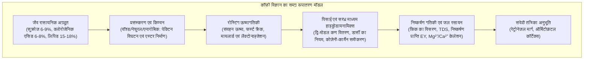

दैनिक जीवन में पी जाने वाली कॉफ़ी का एक प्याला अनुप्रयुक्त विज्ञान की सबसे जटिल और परिष्कृत प्रणालियों में से एक है। इसमें कृषि वनस्पति विज्ञान, सूक्ष्मजीवी किण्वन, गैर-संतुलन ऊष्मागतिकी, कार्बनिक प्रतिक्रिया गतिकी, सरंध्र माध्यम तरल यांत्रिकी और संवेदी तंत्रिका विज्ञान का अद्भुत समन्वय होता है।

कच्चे हरे कॉफ़ी बीन (Green Bean) के भीतर एक हज़ार से अधिक जैव रासायनिक अग्रदूत सेल्यूलोज़ की कठोर कोशिका संरचना में जकड़े होते हैं। 200°C से अधिक तापमान पर रोस्टिंग के दौरान, मायलार्ड प्रतिक्रिया, स्ट्रेकर क्षरण, कैरामेलाइज़ेशन और क्लोरोजेनिक एसिड के विखंडन से सैकड़ों वाष्पशील सुगंधित यौगिक बनते हैं। इसके बाद गर्म पानी से निष्कर्षण के दौरान यह प्रक्रिया डार्सी के नियम और फ़िक के विसरण नियम के अनुसार घटित होती है।

---

### 1. कॉफ़ी चेरी की शारीरिक संरचना एवं हरे बीन का जैव रसायन

1. <strong>एक्सोकार्प (बाहरी छिलका)</strong>: मोम जैसी परत वाली बाह्यत्वचा, जो पकने पर एंथोसायनिन के कारण लाल या पीली हो जाती है।
2. <strong>मेसोकार्प (गूदा / पल्प)</strong>: पानी से भरपूर (~80%) ऊतक, जिसमें ग्लूकोज़, फ्रुक्टोज़, सुक्रोज़ (18–24° Brix) और मैलिक एसिड प्रचुर मात्रा में होते हैं।
3. <strong>म्यूसिलेज (पेक्टिन परत)</strong>: 0.5–2 मिमी मोटी चिपचिपी हाइड्रोसेल परत, जो पेक्टिक एसिड और अरेबिनोगैलेक्टन से बनी होती है।
4. <strong>एंडोकार्प (पार्चमेंट / चर्मपत्र)</strong>: सेल्यूलोज़ (40–45%), हेमीसेल्यूलोज़ और लिग्निन से बनी कठोर सुरक्षात्मक परत।
5. <strong>सिल्वर स्किन (बीज चोल)</strong>: पतली सुरक्षात्मक परत, जो रोस्टिंग के दौरान चॉफ (भूसी) के रूप में अलग हो जाती है।
6. <strong>एंडोस्पर्म (हरा कॉफ़ी बीन)</strong>: मोटी कोशिका भित्ति ($5\sim10\,\mu\text{m}$) वाला भंडारण ऊतक, जिसमें लिपिड, प्रोटीन, सुक्रोज़ और क्लोरोजेनिक एसिड संचित होते हैं।

| रासायनिक घटक (% शुष्क भार) | अरेबिका (*C. arabica*) | रोबस्टा (*C. canephora*) | रोस्टिंग एवं स्वाद प्रभाव |
| :--- | :--- | :--- | :--- |
| <strong>गुणसूत्र संख्या</strong> | $2n = 4x = 44$ (चतुर्गुणित) | $2n = 2x = 22$ (द्विगुणित) | स्व-परागित, सूक्ष्म एवं संतुलित स्वाद प्रोफ़ाइल |
| <strong>सुक्रोज़</strong> | <strong>6.0 – 9.0 %</strong> | 3.0 – 5.0 % | स्निग्ध कार्बनिक अम्लों और फ्यूरान सुगंध का मुख्य स्रोत |
| <strong>कुल लिपिड</strong> | <strong>15.0 – 18.0 %</strong> | 8.0 – 12.0 % | एस्प्रेसो क्रेमा का स्थिरीकरण और वाष्पशील सुगंध का वाहक |
| <strong>कैफीन</strong> | 0.9 – 1.5 % | <strong>1.8 – 3.2 %</strong> | ऊष्मा-स्थिर एल्कलॉइड; कुल कड़वाहट का 10–15% भाग |
| <strong>ट्राइगोनेलिन</strong> | <strong>0.8 – 1.2 %</strong> | 0.4 – 0.7 % | नियासिन (विटामिन B3) और पाइरिडीन में तापीय अपघटन |
| <strong>क्लोरोजेनिक एसिड (CGA)</strong>| 5.5 – 8.0 % | <strong>7.0 – 11.0 %</strong> | लैक्टोन (उत्कृष्ट कड़वाहट) और फेनिलइन्डेन (तीखी कड़वाहट) में रूपांतरण |

---

### 2. प्रसंस्करण और सूक्ष्मजीवी किण्वन

1. <strong>वॉश्ड प्रक्रिया (Washed)</strong>: गूदा हटाने के बाद 12–36 घंटे पानी में किण्वन। सूक्ष्मजीवों के पेक्टिनेज़ एंजाइम पेक्टिन का जल-अपघटन करते हैं:
   $$\text{Pectin} + n\text{H}_2\text{O} \xrightarrow{\text{Pectinase}} \text{D-Galacturonic Acid} + \text{Methanol}$$
   यह बिल्कुल साफ और चमकदार सिट्रिक व मैलिक अम्लीय स्वाद प्रदान करता है।
2. <strong>नेचुरल प्रक्रिया (Natural)</strong>: पूरी चेरी को 2–4 सप्ताह धूप में सुखाया जाता है। शर्करा के परासरणी विसरण से गहरा गाढ़ापन (body) और फलों जैसी सुगंध आती है।
3. <strong>एनारोबिक किण्वन (Anaerobic)</strong>: $\text{CO}_2$ युक्त वायुरोधी टैंकों में लैक्टिक एसिड बैक्टीरिया pH को 3.8–4.2 तक गिराते हैं, जिससे दालचीनी और उष्णकटिबंधीय फलों जैसे एस्टर बनते हैं।

---

### 3. रोस्टिंग ऊष्मागतिकी और भौतिक परिवर्तन

बीन्स में कुल ऊष्मा प्रवाह $\dot{Q}_{\text{total}}$ चालन, संवहन और विकिरण का योग होता है:

$$\dot{Q}_{\text{total}} = \dot{Q}_{\text{cond}} + \dot{Q}_{\text{conv}} + \dot{Q}_{\text{rad}}$$

आधुनिक गर्म हवा वाले रोस्टर में 70–85% ऊष्मा संवहन द्वारा स्थानांतरित होती है।

- <strong>तापमान वृद्धि दर (Rate of Rise - RoR)</strong>: बीन तापमान का समय अवकलज $\text{RoR}(t) = \frac{\mathrm{d}(BT)}{\mathrm{d}t}$। एक सहज घटता हुआ वक्र एकसमान रोस्ट सुनिश्चित करता है।
- <strong>फर्स्ट क्रैक (First Crack)</strong>: 200–205°C पर आंतरिक भाप और $\text{CO}_2$ का दबाव 15–25 वायुमंडल तक पहुंच जाता है, जिससे कोशिकाएं फटकर स्थायी सूक्ष्म छिद्रयुक्त मधुमक्खी के छत्ते जैसी संरचना (20-40 μm) बनाती हैं।
- <strong>डेवलपमेंट टाइम रेश्यो (DTR)</strong>: फर्स्ट क्रैक से समाप्ति तक का समय अनुपात (लाइट रोस्ट के लिए 10–14%, मीडियम के लिए 15–19%)।

---

### 4. रोस्टिंग की कार्बनिक रसायन प्रतिक्रियाएं

1. <strong>मायलार्ड प्रतिक्रिया और स्ट्रेकर क्षरण</strong>: कम करने वाली शर्करा और अमीनो एसिड मिलकर अमाडोरी यौगिक बनाते हैं। स्ट्रेकर क्षरण से एल्डीहाइड (3-मिथाइल ब्यूटानल: माल्ट सुगंध) और एल्काइलपाइराज़ीन (भुने मेवे की सुगंध) बनते हैं, जो अंत में <strong>मेलानॉइडिन</strong> पॉलिमर बनाते हैं।
2. <strong>कैरामेलाइज़ेशन</strong>: 160°C से ऊपर सुक्रोज़ के अपघटन से फ्यूरानोन और माल्टोल बनते हैं, जो कैरामेल जैसी मिठास देते हैं।
3. <strong>क्लोरोजेनिक एसिड का अपघटन</strong>:
   - 180–215°C: 3-CQL और 4-CQL <strong>लैक्टोन</strong> बनते हैं, जो <strong>मनभावन और संतुलित कड़वाहट</strong> देते हैं।
   - >220°C: अपघटन से <strong>फेनिलइन्डेन</strong> बनते हैं, जो <strong>अत्यधिक तीखी, कसैली और अप्रिय कड़वाहट</strong> पैदा करते हैं।

---

### 5. सरंध्र माध्यम हाइड्रोडायनामिक्स और डार्सी का नियम

कॉफ़ी बेड से होकर जल का प्रवाह <strong>डार्सी के नियम</strong> का पालन करता है:

$$Q = \frac{-k_p A}{\mu} \frac{\Delta P}{L}$$

पारगम्यता $k_p$ <strong>कोज़ेनी-कार्मैन समीकरण</strong> द्वारा निर्धारित होती है:

$$k_p = \frac{\epsilon^3}{K_{\text{CK}} S_v^2 (1 - \epsilon)^2}$$

एस्प्रेसो में 9 बार दबाव पर घनत्व की विषमता <strong>चैनलिंग (Channeling)</strong> उत्पन्न करती है, जिससे दरारों में अत्यधिक कड़वा निष्कर्षण और घने भागों में अल्प-निष्कर्षण होता है।

---

### 6. निष्कर्षण गतिकी, TDS और SCA गोल्ड कप मानक

ठोस-तरल विसरण <strong>फ़िक के दूसरे नियम</strong> का पालन करता है:

$$\frac{\partial C}{\partial t} = D_{\text{eff}} \left( \frac{\partial^2 C}{\partial r^2} + \frac{2}{r} \frac{\partial C}{\partial r} \right)$$

1. <strong>0–30 सेकंड</strong>: हल्के कार्बनिक अम्ल, शर्करा और कैफीन सबसे पहले बाहर आते हैं।
2. <strong>30–90 सेकंड</strong>: पाइराज़ीन, फ्यूरान और लैक्टोन (मिठास और सुगंध का संतुलन)।
3. <strong>>90 सेकंड</strong>: भारी फेनिलइन्डेन और पॉलीफेनोल (कसैलापन और रूखापन)।

- <strong>TDS (कुल घुलनशील ठोस)</strong>: फ़िल्टर कॉफ़ी के लिए $1.15–1.45\%$, एस्प्रेसो के लिए $8.0–12.0\%$।
- <strong>निष्कर्षण प्राप्ति (Extraction Yield - EY)</strong>:
  $$\text{EY} = \frac{M_{\text{beverage}} \times \text{TDS}}{M_{\text{dose}}} \times 100 \quad [\%]$$
  SCA गोल्ड कप आदर्श सीमा: <strong>18.0% से 22.0%</strong>।

---

### 7. जल रसायन और संवेदी अनुभूति

1. <strong>खनिज धनायन</strong>:
   - $\text{Mg}^{2+}$: उच्च आवेश घनत्व के कारण अम्लों और सुगंधित एस्टरों को प्रभावी रूप से निष्कर्षित करता है।
   - $\text{Ca}^{2+}$: मखमली बनावट देता है परंतु उपकरण में स्केल बनाता है।
2. <strong>बाइकार्बोनेट बफर</strong>:
   $$\text{HCO}_3^- + \text{H}_3\text{O}^+ \rightleftharpoons \text{H}_2\text{CO}_3 + \text{H}_2\text{O} \rightleftharpoons 2\,\text{H}_2\text{O} + \text{CO}_2 \uparrow$$
   अत्यधिक क्षारीयता ($>80\text{ mg/L}$) स्वाद को सपाट कर देती है; बहुत कम क्षारीयता ($<20\text{ mg/L}$) स्वाद को सिरके जैसा तीखा बना देती है।
3. <strong>रेट्रोनेज़ल घ्राण मार्ग</strong>: 2-फरफ्यूरिलथायोल ताज़ी कॉफ़ी की मुख्य सुगंध है। निगलते समय वाष्पशील सुगंध पीछे से घ्राण उपकला तक पहुंचती है, जहां मस्तिष्क का ऑर्बिटोफ्रंटल कॉर्टेक्स स्वाद और गंध को मिलाकर संपूर्ण "फ्लेवर (Flavor)" की अनुभूति कराता है।
