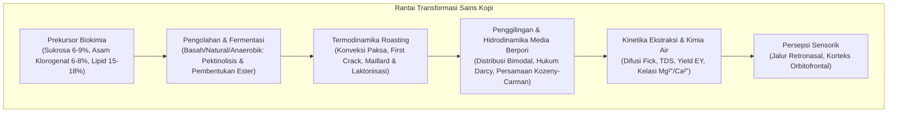
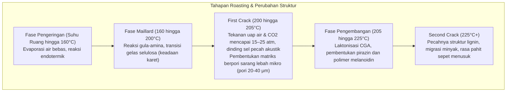

Secangkir kopi yang dinikmati setiap hari di seluruh dunia merupakan salah satu sistem multidisiplin paling rumit dalam sains terapan, memadukan botani agronomi, bioteknologi fermentasi mikroba, termodinamika non-ekuilibrium, kinetika reaksi organik, mekanika fluida media berpori, dan neurobiologi sensorik.

Di dalam biji kopi hijau (green bean), lebih dari seribu prekursor biokimia terkurung dalam matriks seluler selulosa yang kaku. Saat disangrai pada suhu di atas 200°C, reaksi Maillard, degradasi Strecker, karamelisasi, dan pemecahan asam klorogenat menghasilkan ratusan senyawa volatil aromatik. Saat diseduh dengan air panas, perkolasi fluida diatur oleh hukum Darcy dan difusi Fick.

---

### 1. Morfologi Ceri Kopi dan Biokimia Biji Hijau

1. <strong>Eksokarp (Kulit Luar)</strong>: Epidermis berkutikula lilin; antosianin memberikan warna merah atau kuning saat matang.
2. <strong>Mesokarp (Daging Buah / Pulp)</strong>: Jaringan parenkim kaya air (~80%), mengandung glukosa, fruktosa, sukrosa (18–24° Brix), dan asam malat.
3. <strong>Musilase (Lendir Pektin)</strong>: Hidrogel tidak larut setebal 0,5–2 mm yang terdiri dari polimer pektin dan arabinogalaktan.
4. <strong>Endokarp (Parchment / Kulit Tanduk)</strong>: Lapisan keras sel batu berlignin (selulosa 40–45%, hemiselulosa, dan lignin).
5. <strong>Kulit Ari (Silver Skin / Spermoderm)</strong>: Lapisan pelindung tipis di sekitar endosperma yang terlepas saat roasting sebagai sekam (chaff).
6. <strong>Endosperma (Biji Kopi Hijau)</strong>: Jaringan penyimpan dengan dinding sel tebal ($5\sim10\,\mu\text{m}$), menyimpan lipid, protein, sukrosa, dan asam klorogenat.

| Komponen Kimia (% Berat Kering) | Arabika (*C. arabica*) | Robusta (*C. canephora*) | Fungsi Roasting dan Profil Rasa |
| :--- | :--- | :--- | :--- |
| <strong>Ploidi</strong> | $2n = 4x = 44$ (Alotetraploid) | $2n = 2x = 22$ (Diploid) | Menyerbuk sendiri, profil rasa seimbang dan kompleks |
| <strong>Sukrosa</strong> | <strong>6,0 – 9,0 %</strong> | 3,0 – 5,0 % | Prekursor utama asam alifatik dan senyawa furan |
| <strong>Total Lipid</strong> | <strong>15,0 – 18,0 %</strong> | 8,0 – 12,0 % | Stabilitas crema espresso dan penangkap aroma lipofilik |
| <strong>Kafein</strong> | 0,9 – 1,5 % | <strong>1,8 – 3,2 %</strong> | Alkaloid termostabil; menyumbang 10–15% rasa pahit |
| <strong>Trigonelin</strong> | <strong>0,8 – 1,2 %</strong> | 0,4 – 0,7 % | Terpirolisis menjadi niasin (vitamin B3) dan piridin |
| <strong>Asam Klorogenat (CGA)</strong>| 5,5 – 8,0 % | <strong>7,0 – 11,0 %</strong> | Menjadi lakton (pahit elegan) dan fenilindan (astringen) |

---

### 2. Pengolahan Pascapanen dan Bioteknologi Fermentasi

1. <strong>Proses Basah (Washed)</strong>: Pengupasan mekanis diikuti perendaman fermentasi 12–36 jam. Enzim pektinase bakteri (*Pectobacterium*, *Bacillus*) menghidrolisis lendir pektin:
   $$\text{Pektin} + n\text{H}_2\text{O} \xrightarrow{\text{Pektinase}} \text{Asam D-galakturonat} + \text{Metanol}$$
   Menghasilkan profil seduhan bersih (clean cup) dengan keasaman sitrat dan malat yang cerah.
2. <strong>Proses Kering (Natural)</strong>: Pengeringan buah utuh di atas meja pengering selama 2–4 minggu. Difusi osmotik gula buah ke endosperma menghasilkan body tebal dan aroma buah beri.
3. <strong>Fermentasi Anaerobik</strong>: Dilakukan dalam tangki kedap udara bertekanan $\text{CO}_2$. Bakteri asam laktat (*Leuconostoc*, *Lactobacillus*) menurunkan pH menjadi 3,8–4,2 dan mensintesis ester berantai cabang (kayu manis, markisa).

---

### 3. Termodinamika Roasting dan Transformasi Fisik

Fluks panas total $\dot{Q}_{\text{total}}$ ke biji kopi dirumuskan sebagai:

$$\dot{Q}_{\text{total}} = \dot{Q}_{\text{cond}} + \dot{Q}_{\text{conv}} + \dot{Q}_{\text{rad}}$$

Pada mesin roasting modern berudara panas, konveksi paksa menyumbang 70–85% panas ($\dot{Q}_{\text{conv}} = h_{\text{conv}} A_{\text{bean}} (T_{\text{air}} - T_{\text{bean}})$).

- <strong>Laju Kenaikan Suhu (Rate of Rise - RoR)</strong>: $\text{RoR}(t) = \frac{\mathrm{d}(BT)}{\mathrm{d}t}$ dalam $[^\circ\mathrm{C/min}]$. Penurunan RoR yang halus dan monoton menjamin kematangan yang merata.
- <strong>Rasio Waktu Pengembangan (Development Time Ratio - DTR)</strong>:
  $$\text{DTR} = \frac{t_{\text{total}} - t_{\text{FC}}}{t_{\text{total}}} \times 100 \quad [\%]$$
  10–14% untuk light roast, 15–19% untuk medium roast.

---

### 4. Kimia Organik Roasting

1. <strong>Reaksi Maillard & Degradasi Strecker</strong>: Interaksi antara gula pereduksi dan asam amino membentuk senyawa Amadori. Degradasi Strecker menghasilkan aldehida (3-metilbutanal: aroma malt) dan alkilpirazin (kacang panggang), yang kemudian berpolimerisasi menjadi <strong>melanoidin</strong>.
2. <strong>Karamelisasi</strong>: Pirolisis sukrosa pada suhu $>160^\circ\text{C}$ membentuk furanon (furaneol, sotolon) dan maltol (aroma karamel manis).
3. <strong>Dekomposisi Asam Klorogenat</strong>:
   - 180–215°C: Terbentuk <strong>lakton asam klorogenat</strong> (3-CQL dan 4-CQL), memberikan <strong>rasa pahit yang bersih dan sedap</strong>.
   - >220°C: Terurai menjadi <strong>fenilindan</strong>, menghasilkan <strong>rasa pahit yang kering, menusuk, dan sepet (astringen)</strong>.

---

### 5. Hidrodinamika Media Berpori dan Hukum Darcy

Proses penggilingan menghasilkan <strong>distribusi ukuran partikel bimodal</strong>:
- <strong>Boulders ($300\sim1200\,\mu\text{m}$)</strong>: Partikel kasar dengan sel utuh, dikontrol oleh difusi internal.
- <strong>Fines ($< 100\,\mu\text{m}$)</strong>: Pecahan dinding sel yang langsung larut seketika.

Aliran air melalui bubuk kopi mengikuti <strong>hukum Darcy</strong>:

$$Q = \frac{-k_p A}{\mu} \frac{\Delta P}{L}$$

Permeabilitas $k_p$ ditentukan oleh <strong>persamaan Kozeny-Carman</strong>:

$$k_p = \frac{\epsilon^3}{K_{\text{CK}} S_v^2 (1 - \epsilon)^2}$$

Pada espresso 9 bar, variasi kerapatan memicu <strong>saluran preferensial (Channeling)</strong>, yang menyebabkan over-ekstraksi pahit pada retakan dan under-ekstraksi asam pada area yang padat.

---

### 6. Kinetika Ekstraksi, TDS, dan Standar Emas SCA

Difusi senyawa terlarut mengikuti <strong>hukum Fick kedua</strong>:

$$\frac{\partial C}{\partial t} = D_{\text{eff}} \left( \frac{\partial^2 C}{\partial r^2} + \frac{2}{r} \frac{\partial C}{\partial r} \right)$$

1. <strong>0–30 dtk</strong>: Asam organik ringan, gula sederhana, dan kafein keluar pertama.
2. <strong>30–90 dtk</strong>: Alkilpirazin, furan, dan lakton CGA larut (puncak keseimbangan rasa).
3. <strong>>90 dtk</strong>: Fenilindan berat dan polifenol keluar (menghasilkan rasa pahit sepet berlebih).

- <strong>TDS (Total Dissolved Solids)</strong>: Persentase massa padatan terlarut ($1,15–1,45\%$ untuk kopi filter, $8,0–12,0\%$ untuk espresso).
- <strong>Yield Ekstraksi (Extraction Yield - EY)</strong>:
  $$\text{EY} = \frac{M_{\text{beverage}} \times \text{TDS}}{M_{\text{dose}}} \times 100 \quad [\%]$$
  Rentang ideal SCA Gold Cup: <strong>18,0% hingga 22,0%</strong>.

---

### 7. Kimia Air dan Persepsi Sensorik

1. <strong>Kation Mineral</strong>:
   - $\text{Mg}^{2+}$: Kerapatan muatan tinggi; sangat efektif mengikat dan mengekstrak asam buah serta ester volatil.
   - $\text{Ca}^{2+}$: Memberikan tekstur lembut, tetapi dapat menimbulkan kerak kapur.
2. <strong>Buffer Bikarbonat</strong>:
   $$\text{HCO}_3^- + \text{H}_3\text{O}^+ \rightleftharpoons \text{H}_2\text{CO}_3 + \text{H}_2\text{O} \rightleftharpoons 2\,\text{H}_2\text{O} + \text{CO}_2 \uparrow$$
   Alkalinitas $>80\text{ mg/L}$ menetralkan asam dan membuat rasa datar/hambar; alkalinitas $<20\text{ mg/L}$ membuat rasa asam terlalu tajam seperti cuka.
3. <strong>Jalur Retronasal</strong>: 2-furfuriltiol adalah molekul khas aroma kopi segar. Saat menelan, senyawa volatil naik ke epitel penciuman melalui jalur retronasal, di mana korteks orbitofrontal memadukan rasa dan aroma menjadi persepsi utuh "Flavor".
