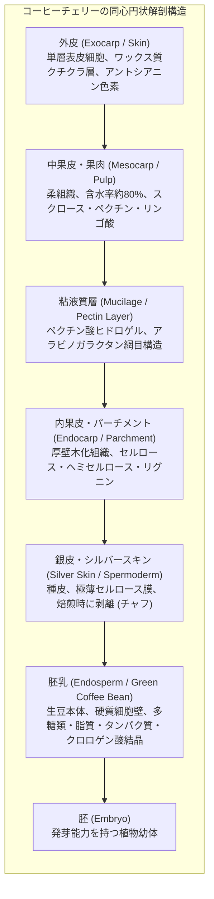
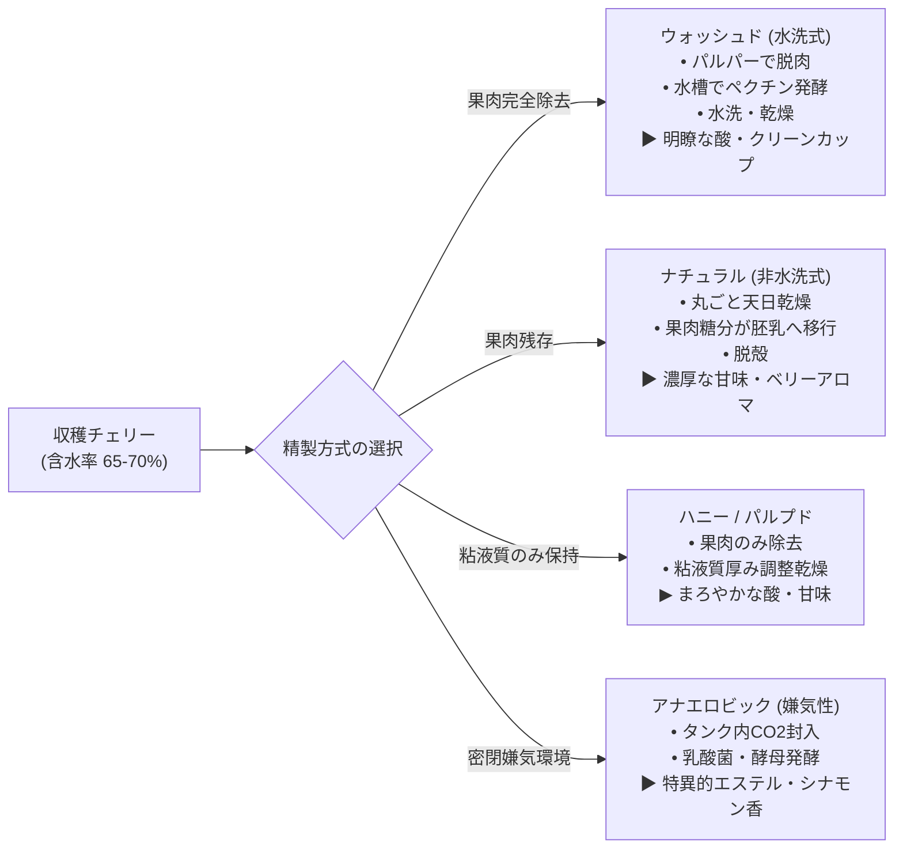
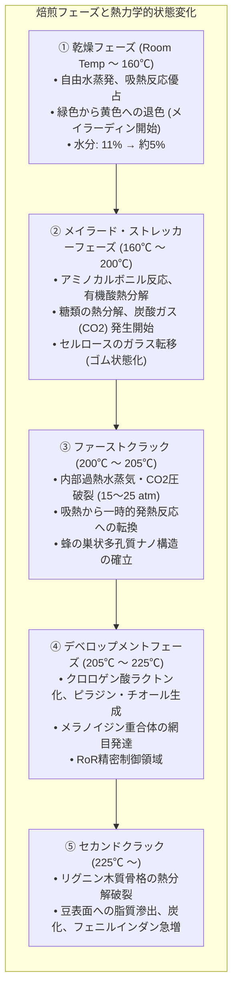
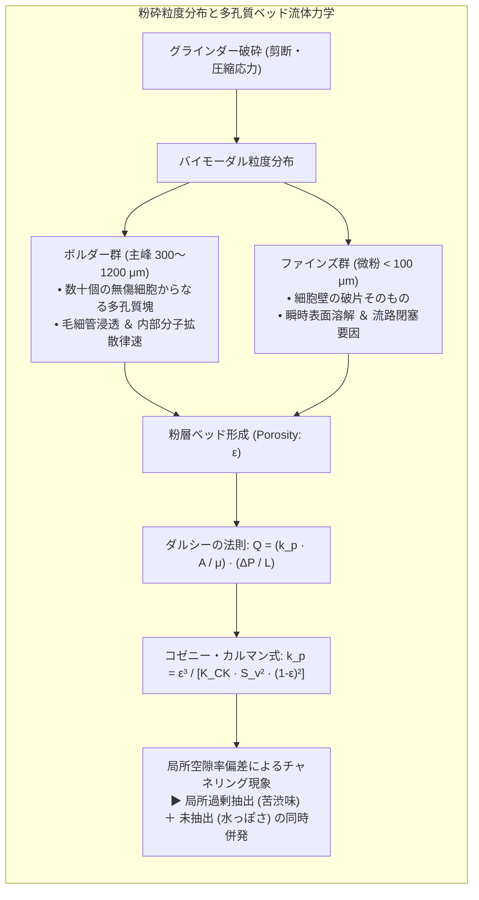
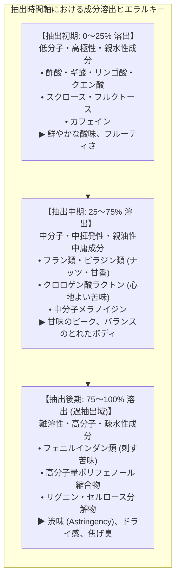
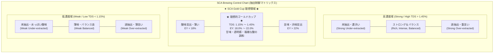
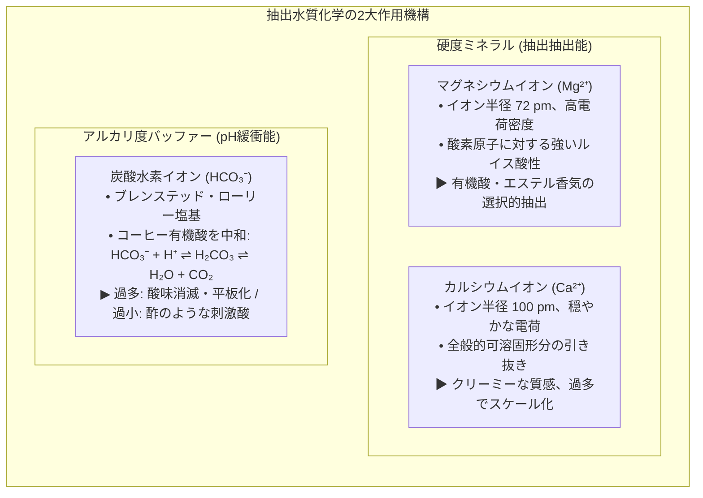
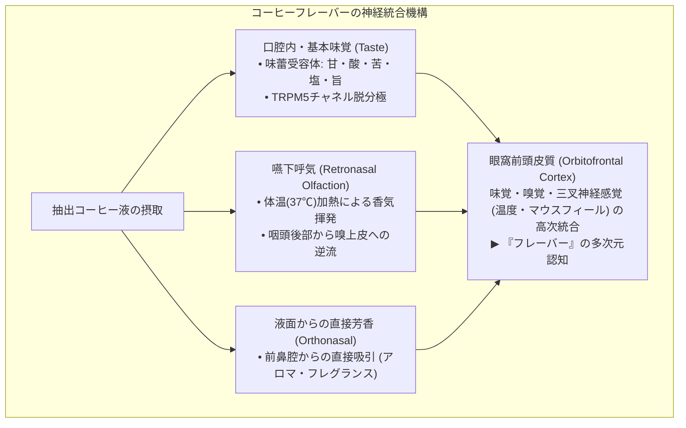

日常の一杯として世界中で親しまれるコーヒーは、農業生物学、微生物発酵工学、非平衡熱力学、有機反応速度論、粉体工学、多孔質流体力学、そして末梢・中枢神経生理学が極めて高い次元で緊密に交錯する、驚くべき「学際的複合科学系」です。

緑色の生豆（グリーンコーヒー）に内在する約千種類以上の前駆物質が、摂氏200度を超える焙煎環境において複雑な熱分解、アミノカルボニル重合（メイラード反応）、ストレッカー分解、カラメル化反応を経て揮発性香気成分へと昇華し、粉砕された多孔質セルロース媒体を透過する熱水との非定常固液抽出ダイナミクスを経てカップへと注がれます。

本稿では、コーヒーチェリーの組織形態学と微細構造から、ウォッシュド・ナチュラル・アナエロビック発酵の生化学代謝、焙煎における伝熱工学と反応熱力学モデル、ダルシー則とコゼニー・カルマン式に基づく粉体流体力学、フィックの拡散則による溶出速度論、TDSと抽出収率（EY）の数学的相関、無機イオンが支配する水質配位化学、そしてレトロネーザル経路を通じたフレーバー知覚の脳神経科学に至るまで、コーヒーの全工程を物理化学的原理に基づいて徹底的に解き明かします。

---

### 1. コーヒー果実の植物形態学と生豆の生化学

#### 1.1 コーヒーチェリーの組織解剖学と細胞構造

コーヒーノキ（アカネ科コフィア属: *Coffea*）の果実、通称「コーヒーチェリー（Coffee Cherry）」は、中心部に位置する2粒の種子（対面して平らな面を持つ豆）を多層の保護組織が同心円状に包み込む核果様果実（Drupe-like berry）です。

それぞれの層は固有の生理学的機能と化学組成を持ち、精製工程における水分移動や発酵代謝の境界条件として機能します。

1. <strong>外皮（Exocarp）</strong>: 厚さ数十マイクロメートルの緻密な表皮組織であり、クチクラ層によって過度の蒸散や病原菌の侵入から保護されています。未熟期にはクロロフィルによる鮮緑色を呈しますが、成熟過程でクロロフィルが酵素分解され、シアニジン-3-ルチノシドなどのアントシアニン系色素が急速に蓄積して深紅（品種によってはカロテノイドによる黄色・橙色）へと変化します。
2. <strong>果肉（Mesocarp / Pulp）</strong>: 水分を80%以上含む多汁質の柔組織です。光合成産物である可溶性還元糖（フルクトース、グルコース）および非還元糖（スクロース）が高濃度に濃縮され、成熟ピーク時にはBrix糖度が18〜24%に達します。
3. <strong>粘液質層（Mucilage）</strong>: 果肉とパーチメントの中間に存在する厚さ0.5〜2 mmのゲル状組織です。ペクチン酸（ポリガラクツロン酸）、中性多糖類（L-アラビノース、D-ガラクトースを主鎖・側鎖に持つアラビノガラクタン）、およびポリフェノールが水分を抱え込み、高粘性の不溶性ヒドロゲルマトリックスを形成しています。
4. <strong>パーチメント（Endocarp）</strong>: 木質化したスクレレンキマ細胞（石細胞）からなる頑丈な殻です。種子を乾燥ストレスや物理的衝撃から隔離し、乾燥工程において水蒸気透過の律速バリアとして機能します。
5. <strong>シルバースキン（Spermoderm）</strong>: 種子の最外層を覆う種皮であり、多量のフェノール性化合物を含みます。
6. <strong>胚乳（Endosperm）</strong>: 商業的に「生豆（Green Coffee Bean）」と呼ばれる組織です。厚さ $5\sim10\,\mu\text{m}$ の強固な一次細胞壁（不溶性マンナン、ガラクトマンナン、セルロース骨格）がハニカム状の格子を形成し、その内部の内腔（ルーメン）にタンパク質顆粒、脂質滴、スクロース結晶、クロロゲン酸カリウム錯体が整然と充填されています。

#### 1.2 アラビカ種とカネフォラ（ロブスタ）種の生化学的比較

世界の商業コーヒー生産は、標高1,000〜2,200 mの高地冷涼な熱帯山岳地帯で栽培されるアラビカ種（*Coffea arabica*）と、病害虫や高温多湿に強い低地性のカネフォラ種（*Coffea canephora*、通称ロブスタ）の2大種に大別されます。両者は倍数性および生化学的プロファイルにおいて本質的に異なっています。

| 生化学成分（生豆乾物重量%） | アラビカ種 (*C. arabica*) | カネフォラ種 (*C. canephora*) | 焙煎時の変換反応と香味への影響 |
| :--- | :--- | :--- | :--- |
| <strong>染色体数・倍数性</strong> | $2n = 4x = 44$（異質四倍体） | $2n = 2x = 22$（二倍体） | 自家受粉による固定化と高い遺伝的均質性 |
| <strong>ショ糖（スクロース）</strong> | <strong>6.0 〜 9.0 %</strong> | 3.0 〜 5.0 % | メイラード反応前駆体、フルーティな芳香酸（ギ酸・酢酸）の主源 |
| <strong>総脂質（遊離脂肪酸含む）</strong> | <strong>15.0 〜 18.0 %</strong> | 8.0 〜 12.0 % | エスプレッソクレマの気泡安定化、脂溶性芳香成分のトラップ担体 |
| <strong>カフェイン</strong> | 0.9 〜 1.5 % | <strong>1.8 〜 3.2 %</strong> | プリンアルカロイド、熱的に極めて安定、苦味全体の10〜15%を構成 |
| <strong>トリゴネリン</strong> | <strong>0.8 〜 1.2 %</strong> | 0.4 〜 0.7 % | 熱分解によりピリジン類およびニコチン酸（ビタミンB3）を生成 |
| <strong>総クロロゲン酸（CGA）</strong>| 5.5 〜 8.0 % | <strong>7.0 〜 11.0 %</strong> | 焙煎で分解してラクトン類およびフェニルインダン類（重厚な苦味・渋味）へ |
| <strong>不溶性多糖類（細胞壁）</strong> | 48.0 〜 54.0 % | 50.0 〜 56.0 % | 多孔質炭素骨格の形成、抽出液の粘度（ボディ感）と気泡保持能 |

アラビカ種は、スクロース含有量がカネフォラ種の約2倍に達する一方で、クロロゲン酸やカフェインといった苦味・渋味成分が抑制されています。この生化学的構成こそが、焙煎時に豊かな酸味、甘味芳香（フルクトース・グルコース熱分解物）、およびフローラル・フルーティなアロマを花開かせる決定打となっています。対照的にカネフォラ種はクロロゲン酸とカフェインに富み、深煎りにおいて厚みのあるボディー、土っぽい（アーシー）、スモーキーで重厚な苦味をもたらし、エスプレッソブレンドのクレマ補強用として重宝されます。

---

### 2. 精製プロセスと微生物発酵工学

収穫されたチェリーの含水率（約65〜70%）を、種子の生命活動を休眠させカビ毒（オクラトキシンA等）の発生を防ぐ保存安全限界（含水率10〜12%、水分活性 $a_w < 0.65$）まで脱水・乾燥する工程が「精製（Processing）」です。精製は単なる脱水工程にとどまらず、微生物による酵素変換を通じて生豆内部へ香味前駆物質を浸透させる「制御バイオプロセス」です。

#### 2.1 ウォッシュド（Washed / Wet Process）：酵素的ペクチン解重合
ウォッシュドプロセスでは、メカニカルパルパーによって外皮と果肉を機械的に剥離します。しかし、種子の周囲には水不溶性の粘液質ゲル（Mucilage）が強固に固着しています。

1. <strong>生化学的解重合機構</strong>: 水を満たした発酵槽（Fermentation Tank）に12〜36時間浸漬します。チェリー果皮や環境水中に常在するペクチン資化性微生物（*Pectobacterium*, *Bacillus subtilis*, *Enterobacter*, *Kluyveromyces* 等）が増殖し、菌体外酵素（ペクチンメチルエステラーゼ: PME、ポリガラクチュロナーゼ: PG、ペクチンリアーゼ: PL）を分泌します。
   $$\text{Pectin (メチルエステル化ポリガラクツロン酸)} \xrightarrow{\text{PME}} \text{Pectic Acid} + n\text{CH}_3\text{OH}$$
   $$\text{Pectic Acid} \xrightarrow{\text{PG}} \text{D-Galacturonic Acid Oligomers (水溶性化)}$$
2. <strong>香味発現の特性</strong>: 粘液質が迅速に水洗除去されるため、果肉由来の糖分や二次代謝産物が胚乳組織へ過剰に移行しません。結果として、品種固有のテロワール、土壌ミネラル、高地栽培特有の鮮やかなリンゴ酸・クエン酸のプロファイルが一切の雑味（Taint）なく純粋に表現される「クリーンカップ（Clean Cup）」が完成します。

#### 2.2 ナチュラル（Natural / Dry Process）：浸透圧勾配と組織内物質移行
果肉を一切除去せず、完熟チェリーをそのままパティオ（コンクリート乾燥場）または通気性の高いアフリカンレイズドベッドに広げ、2〜4週間にわたって天日乾燥させます。

1. <strong>生化学的代謝動態</strong>: 生きたチェリー果実の細胞呼吸が持続する初期段階において、果肉中のスクロースがインベルターゼによりフルクトースとグルコースへと反転加水分解されます。乾燥が進むにつれて果肉組織の水分ポテンシャルが低下し、強烈な浸透圧勾配が発生します。
2. <strong>胚乳への溶質拡散</strong>: 果肉中に濃縮された還元糖、遊離アミノ酸、および果皮の野生酵母（*Hanseniaspora uvarum*, *Pichia guillermondii*）が代謝生成した脂肪酸エステル（酢酸エチル、イソアミルアルコールエステル）が、パーチメントの微小孔隙を通って胚乳細胞へとゆっくり浸透拡散します。
3. <strong>香味特性</strong>: 焙煎時にこれらの糖とエステルが熱反応し、ブルーベリー、ストロベリー、赤ワイン、ドライフルーツを想起させる濃密なフルーティアロマと、丸みを帯びた重厚なマウスフィールがもたらされます。

#### 2.3 嫌気性制御発酵（Anaerobic Fermentation）の代謝工学
近年のスペシャルティコーヒー界を席巻しているアナエロビック発酵は、密閉可能な耐圧ステンレス製バイオリアクタータンクにチェリーまたはパルプト豆を封入し、発生した $\text{CO}_2$（または外部から高圧注入した炭酸ガス）によって内部の酸素を完全置換する先端バイオプロセスです。

1. <strong>微生物相の遷移</strong>: 溶存酸素がゼロとなる嫌気状態では、好気性のカビ類（*Aspergillus*, *Penicillium*）や酢酸菌（*Acetobacter*）の呼吸鎖電子伝達系が完全に停止し、増殖が阻止されます。代わりに、耐酸性・通性嫌気性の真正乳酸菌群（*Leuconostoc mesenteroides*, *Lactobacillus plantarum*）が優占種となります。
2. <strong>乳酸発酵カスケード</strong>: 解糖系（EMP経路）またはヘテロ型リン酸ケトラーゼ経路を介してピルビン酸から乳酸が大量に生成され、培地のpHは急激に低下（pH 5.5から3.8〜4.2へ）します。
   $$\text{C}_6\text{H}_{12}\text{O}_6 \xrightarrow{\text{Glycolysis}} 2\,\text{CH}_3\text{COCOO}^- + 2\,\text{H}^+ \xrightarrow{\text{LDH}} 2\,\text{CH}_3\text{CH(OH)COO}^- \quad (\text{乳酸})$$
3. <strong>特異的エステル生合成</strong>: 菌体内酵素アシルCoAトランスフェラーゼの触媒により、乳酸、短鎖脂肪酸（酪酸、カプロン酸）、およびエタノールが高効率で脱水縮合され、揮発性エステル類が爆発的に生合成されます。これにより、従来の精製法では到達し得なかった、シナモン、カルダモン、バナナリキュール、パイナップルといった鮮烈かつエキゾチックなアロマプロファイルが生豆内部に固定されます。

---

### 3. 焙煎工学：伝熱熱力学と物理構造の多孔質化

焙煎は、水分を約1.5〜2.5%まで脱水させながら、緻密なセルロース細胞構造を多孔質スポンジ状マトリックスへと変貌させ、内部で数千の同時並行化学反応を駆動させる非定常非平衡熱工学プロセスです。

#### 3.1 伝熱モードの三位一体解析

焙煎機（ドラム式、熱風浮動式）内部における豆群への総熱伝達量 $\dot{Q}_{\text{total}}$ は、熱伝導（Conduction）、強制熱対流（Forced Convection）、熱放射（Radiation）の総和として定式化されます。

$$\dot{Q}_{\text{total}} = \dot{Q}_{\text{cond}} + \dot{Q}_{\text{conv}} + \dot{Q}_{\text{rad}}$$

1. <strong>熱伝導（Conduction）</strong>: 鋼板・鋳鉄製ドラムの内壁と豆表面の接触熱移動。
   $$\dot{Q}_{\text{cond}} = h_{\text{cont}} A_{\text{cont}} (T_{\text{drum}} - T_{\text{bean}})$$
   伝導熱比率が高すぎると、豆の外皮表面のみが局所加熱され、焦げ（Scorching / Facing）の原因となります。
2. <strong>強制対流（Forced Convection）</strong>: 排風ブロワーによってドラム内を高速流動する加熱燃焼ガス・清浄空気からのエンタルピー移動。
   $$\dot{Q}_{\text{conv}} = h_{\text{conv}} A_{\text{bean}} (T_{\text{air}} - T_{\text{bean}})$$
   現代のスペシャルティロースター（Loring, Probat, Giesen）では全熱量の70〜85%を熱風対流が担い、境界層の薄層化によって豆内部への均一かつ迅速な伝熱を実現しています。
3. <strong>熱放射（Radiation）</strong>: ドラム金属壁およびバーナー赤外光からの電磁波放射。ステファン・ボルツマンの法則に従います。
   $$\dot{Q}_{\text{rad}} = \sigma \epsilon_{\text{bean}} A_{\text{bean}} (T_{\text{wall}}^4 - T_{\text{bean}}^4)$$

#### 3.2 豆内部の非定常熱伝導とガラス転移・ファーストクラック力学

球形粒子近似における豆内部の温度場 $T(r, t)$ は、以下の非定常熱伝導偏微分方程式で支配されます。

$$\rho(t) c_p(T) \frac{\partial T}{\partial t} = \frac{1}{r^2} \frac{\partial}{\partial r} \left( k(T) r^2 \frac{\partial T}{\partial r} \right) + \dot{q}_{\text{rxn}}(T)$$

ここで $\rho$ は豆の見かけ密度（焙煎進行とともに $1,250\text{ kg/m}^3 \to 550\text{ kg/m}^3$ へ激減）、$c_p$ は比熱、$k$ は熱伝導率、$\dot{q}_{\text{rxn}}$ は焙煎反応熱（吸熱および発熱）の内部生成項です。

焙煎初期、豆内部に含まれる水分が蒸発して過熱水蒸気となり、細胞内圧が急増します。常温では硬く脆いガラス状態（Glassy state）にあったセルロース・ヘミセルロース細胞壁は、温度と水分の可塑化作用により<strong>ガラス転移点（$T_g \approx 140\sim160^\circ\mathrm{C}$）</strong>を超え、柔軟なゴム状態（Rubbery state）へと相転移します。

さらに昇温が進み $200^\circ\mathrm{C}$ 前後に達すると、ヘミセルロースの脱炭酸・熱分解により二酸化炭素（$\text{CO}_2$）が大量発生し、細胞内圧は15〜25気圧（1.5〜2.5 MPa）に達します。この内圧がゴム状態細胞壁の弾性破断限界を超えた瞬間、音響的衝撃波を伴って微小破裂が連鎖します。これが<strong>ファーストクラック（First Crack: 1ハゼ）</strong>です。この破裂によって閉塞していた細胞内腔が開放され、空孔率（Porosity）約50〜60%、細孔径 $20\sim40\,\mu\text{m}$ の微細多孔質ナノスポンジ構造が恒久的に確立されます。

#### 3.3 焙煎制御の数理：RoRとDTRの制御工学

焙煎プロファイルの科学的管理には、温度センサー（薄径熱電対または赤外線RTD）から得られる豆温度（Bean Temperature: $BT$）の動的変化を微分解析する手法が不可欠です。

- <strong>Rate of Rise (RoR)</strong>: 豆温度の時間微分値。
  $$\text{RoR}(t) = \frac{\mathrm{d}(BT)}{\mathrm{d}t} \quad [^\circ\mathrm{C/min}]$$
  チャージ（生豆投入）直後、センサーは室温の生豆に熱を奪われて一時的に急降下し、最低到達点である<strong>ターニングポイント（Turning Point: TP）</strong>を迎えます。TP以降、焙煎終了（ドロップ）に至るまで、RoRは常に滑らかに減衰し続ける「単調非増加曲線（Monotonically Decreasing RoR Curve）」を維持することが、熱力学的均一性の至上命題とされます。途中でRoRが反落する「クラッシュ（Crash）」は香気の抜け（Baked）を、再上昇する「フリック（Flick）」は焦げ付き（Flick-burn / Carbon taint）を招きます。
- <strong>Development Time Ratio (DTR)</strong>: 全焙煎時間 $t_{\text{total}}$ に対する、ファーストクラック開始点 $t_{\text{FC}}$ から煎り止め（ドロップ）までの時間比率。
  $$\text{DTR} = \frac{t_{\text{total}} - t_{\text{FC}}}{t_{\text{total}}} \times 100 \quad [\%]$$
  ライトロースト（浅煎り）では10〜14%、ミディアムロースト（中煎り）では15〜19%、ダークロースト（深煎り）では20〜25%が基準値となります。DTRのわずか1%の差異が、有機酸の残存率とピラジン・ラクトン類の生成比率を不可逆的に決定づけます。

---

### 4. 焙煎における有機化学反応速度論

摂氏160℃を超えた焙煎環境は、数百種類の有機化合物が関与する超高密度ケミカルリアクターへと変貌します。

```mermaid
flowchart TD
    subgraph OrganicChemistryPathways ["焙煎化学反応ネットワーク"]
        direction TB
        subgraph MaillardNetwork ["メイラード反応系"]
            Sugar["還元糖 (フルクトース, グルコース)"]
            Amino["アミノ酸 (遊離アミノ基)"]
            Sugar & Amino --> Glucosylamine["配糖体アミン縮合"]
            Glucosylamine --> Amadori["アマドリ転位化合物"]
            Amadori --> Dicarbonyl["ジカルボニル骨格 (ジアセチル等)"]
            Dicarbonyl --> Strecker["ストレッカー分解<br/>(イソバレルアルデヒド等)"]
            Amadori --> Melanoidin["メラノイジン高分子重合体<br/>(褐色色素・コク・抗酸化)"]
        end
        
        subgraph Caramelization ["カラメル化反応系"]
            Sucrose["スクロース (6〜9%)"] -->|脱水・熱分解| Furans["フラン類 (フラネオール・マルトール)<br/>甘いキャラメル・トースト香"]
        end
        
        subgraph CGAPathway ["クロロゲン酸熱分解系"]
            CGA["クロロゲン酸 (5-CQA等)"] -->|180〜210℃ 脱水環化| Lactones["CQAラクトン類 (3-CQL, 4-CQL)<br/>良質で心地よい苦味"]
            Lactones -->|220℃〜 過熱分解| Phenylindanes["フェニルインダン類<br/>強烈で収斂性の刺す苦味"]
            CGA -->|加水分解| Quinic["キナ酸 (収斂性酸味)"] & Caffeic["カフェ酸"]
        end
        
        subgraph TrigonellinePathway ["トリゴネリン熱分解系"]
            Trigo["トリゴネリン"] -->|脱メチル・熱分解| Niacin["ニコチン酸 (ビタミンB3)"] & Pyridines["ピリジン類 (スモーキー・ロースト)"]
        end
    end
```

#### 4.1 メイラード反応（アミノカルボニル反応）の素反応機構
メイラード反応は、還元糖の親電子性カルボニル炭素と、タンパク質・ペプチド・遊離アミノ酸の求核性非プロトン化アミノ基（$-\text{NH}_2$）の相互作用から開始されます。

1. <strong>アマドリ転位（Amadori Rearrangement）</strong>:
   アルドースとアミノ基から脱水縮合して生じたシッフ塩基中間体（グリコシルアミン）は、プロトン移動を経て安定なケトサミン構造である1-アミノ-1-デオキシ-2-ケトース（アマドリ化合物）へと不可逆的に転位します。
2. <strong>脱水・開裂・ジカルボニル中間体の生成</strong>:
   アマドリ化合物は弱酸性条件下で1,2-エノール化を起こし、3-デオキシオソンを経由してヒドロキシメチルフルフラール（HMF）やフルフラールを生成します。一方、中性付近では2,3-エノール化により1-デオキシオソンを生じ、これが逆アルドール開裂してジアセチル（バター様アロマ）やピルブアルデヒドなどの高反応性ジカルボニル化合物を大量に放出します。
3. <strong>ストレッカー分解（Strecker Degradation）</strong>:
   $\alpha$-ジカルボニル化合物とアミノ酸が反応し、シッフ塩基中間体を経てアミノ酸の脱炭酸が起こります。
   $$\text{R-CH(NH}_2\text{)COOH} + \text{R'-CO-CO-R''} \longrightarrow \text{R-CHO} + \text{CO}_2 + \text{R-CH(NH}_2\text{)-CO-R''}$$
   これによりアミノ酸特有の側鎖を持つストレッカーアルデヒド（例：ロイシン由来の3-メチルブタナール［香ばしい麦芽香］、フェニルアラニン由来のフェニルアセトアルデヒド［ハチミツ・フローラル香］）が合成されます。さらに副生したアミノケトン同士が自己縮合してジヒドロピラジン環を形成し、酸化されて芳香族ピラジン類（ローストナッツ香）が完成します。
4. <strong>メラノイジン（Melanoidins）の重合形成</strong>:
   未反応のアミノ化合物とジカルボニル中間体が幾重にもアルドール縮合・ピロール化重合を繰り返し、分子量数千から数万に及ぶ褐色含窒素高分子ヘテロポリマー「メラノイジン」が合成されます。メラノイジンはポリフェノール錯体を抱え込み、抽出液の褐色度、泡立ち（クレマ）、濃厚なマウスフィール、および活性酸素消去活性（抗酸化能）の大部分を担います。

#### 4.2 カラメル化（Caramelization）の熱分解経路
アミノ化合物の介在なしに、スクロースが融点（約160〜186℃）以上で熱脱水・二量化・環化する反応です。スクロースのグルコシド結合が開裂してフルクトースとグルコースとなり、脱水環化してレボグルコサンやフラネオール（4-ヒドロキシ-2,5-ジメチル-3(2H)-フラノン）、マルトールを生成します。これらがコーヒーに甘美なカラメル香、トースト香、メープルシロップ様のふくよかさを付与します。

#### 4.3 クロロゲン酸の熱分解と苦味の分子進化
生豆中に豊富に存在するクロロゲン酸（CGA: 主として5-カフェオイルキナ酸 5-CQA）は、焙煎熱によって以下のように段階的進化を遂げます。

1. <strong>クロロゲン酸ラクトン（CQL: Chlorogenic Acid Lactones）</strong>:
   焙煎温度 $180\sim215^\circ\mathrm{C}$（浅煎り〜中煎り）において、キナ酸残基のC-1カルボキシル基とC-5またはC-3水酸基が分子内脱水エステル化を起こし、3-カフェオイルキナ酸-1,5-ラクトン（3-CQL）および4-カフェオイルキナ酸-1,5-ラクトン（4-CQL）が生成します。これらは閾値が低く、<strong>「上質で心地よい、キレのある爽快な苦味」</strong>として知覚されます。
2. <strong>フェニルインダン類（Phenylindanes）</strong>:
   焙煎がさらに進行し $220^\circ\mathrm{C}$ を超える深煎り（フレンチ〜イタリアン）に達すると、ラクトン構造やカフェ酸骨格が脱炭酸・熱分解し、芳香環の縮合二量化によってフェニルインダン誘導体が生合成されます。フェニルインダン類は持続性が極めて長く、<strong>「舌を刺すような収斂性のある強い苦味・エグ味」</strong>をもたらします。

---

### 5. 粉砕工学と多孔質媒体の流体力学

多孔質化した焙煎豆を粉砕（Grinding）する目的は、表面積を劇的に拡張し、内部に閉じ込められた可溶成分と揮発性香気を熱水抽出相へと効率的に解き放つことにあります。

#### 5.1 粒度分布のバイモーダル特性（Bimodal Distribution）
高性能な工業用ローラーミルやスペシャルティ用グラインダー（EK43等の大型フラット刃、コニカル刃）で豆を破砕しても、粒子径は単一の正規分布にはならず、必ず明確な2つのピークを持つ「バイモーダル分布」を形成します。

1. <strong>主峰粒子群（ボルダー: Boulders / 粒径 $300\sim1,200\,\mu\text{m}$）</strong>:
   植物細胞が十数個から数百個連なった多孔質粒子です。内部には無傷のハニカム状細胞壁が残存しており、熱水が細孔内部へ毛細管圧で浸透し、内部の可溶成分を溶かし出して外部バルク液へと分子拡散させる必要があります（拡散律速）。
2. <strong>微粉群（ファインズ: Fines / 粒径 $< 100\,\mu\text{m}$）</strong>:
   単一の細胞壁（厚み $5\sim10\,\mu\text{m}$）が剪断破断されて生じた微細片です。内部空間を持たないため、熱水と接触した瞬間に表面付着成分が100%瞬間溶解します。

微粉はエスプレッソにおいてクレマの粘性とボディを形成する不可欠な役割を果たす一方、重力ドリップにおいてはペーパーフィルターの細孔を目詰まり（Clogging）させ、水流を極端に停滞させて過剰抽出の元凶となります。

#### 5.2 多孔質媒体流動：ダルシー則とコゼニー・カルマンの式
コーヒーベッド（粉層）を熱水が透過する流動は、多孔質流体力学の基本原理である<strong>ダルシーの法則（Darcy's Law）</strong>によって記述されます。

$$Q = \frac{-k_p A}{\mu} \frac{\Delta P}{L}$$

- $Q$: 透過体積流量 $[\text{m}^3/\text{s}]$
- $k_p$: 粉層ベッドの固有透過係数（Permeability）$[\text{m}^2]$
- $A$: バスケット・フィルターの有効断面積 $[\text{m}^2]$
- $\mu$: 抽出液の動粘性係数 $[\text{Pa}\cdot\text{s}]$（液温93℃の水は常温20℃の約1/3まで低下）
- $\Delta P$: ベッド上下の圧力損失 $[\text{Pa}]$（重力ドリップで $1\sim3\text{ kPa}$、エスプレッソで $9\text{ bar} = 900\text{ kPa}$）
- $L$: 粉層の充填厚み（ベッド深さ）$[\text{m}]$

ベッドの幾何学的透過性を示す $k_p$ は、粒子の比表面積と空隙率を考慮した<strong>コゼニー・カルマンの式（Kozeny-Carman Equation）</strong>によって厳密に結びつけられます。

$$k_p = \frac{\epsilon^3}{K_{\text{CK}} S_v^2 (1 - \epsilon)^2}$$

- $\epsilon$: 空隙率（Porosity: 間隙体積 / 全体積、通常 $0.35\sim0.50$）
- $K_{\text{CK}}$: コゼニー定数（屈曲度と形状係数の積、不規則粒子充填層では約 $5.0$）
- $S_v$: 粒子の比表面積（全粒子表面積 / 粒子実体積）$= \frac{6}{\phi d_p}$（$\phi$ は球形度、$d_p$ は有効平均粒径）

この式が示す決定的な物理法則は、粉砕粒度 $d_p$ を半分に微細化すると、比表面積 $S_v$ は2倍となり、流動抵抗は4倍に跳ね上がるという点です。さらに微粉がボルダーの間隙に入り込んで空隙率 $\epsilon$ が低下すると、$\frac{\epsilon^3}{(1-\epsilon)^2}$ の強い非線形性により、流動抵抗は指数関数的に増大します。

#### 5.3 チャネリングの流体力学的破壊機構
高圧（9気圧）のエスプレッソ抽出時、粉層内に局所的な充填密度の疎密（ポロシティ $\epsilon$ のムラ）が存在すると、流動抵抗の最も低い領域へ局所的に流線が集中します。流速 $u$ の上昇に伴う動圧と流体力学的剪断応力により、その経路周辺の微粒子が洗い流されて流路がさらに急拡大します。これが<strong>チャネリング（Channeling）</strong>です。

チャネル（水みち）を通過した多量の湯は局所を激しく過剰抽出し、エグ味や渋味（フェニルインダン、ポリフェノール）を根こそぎ溶出させる一方で、流動が停滞した高密度領域は未抽出のまま取り残され、水っぽさと未熟な酸味をカップにもたらします。現代のエスプレッソ工学でWDT（Weiss Distribution Technique: 極細針による粉の解砕・均等分散）が重視されるのは、コゼニー・カルマン式における空隙率 $\epsilon$ の空間的分散 $\sigma_\epsilon^2 \to 0$ を物理的に達成するためです。

---

### 6. 抽出ダイナミクスと物質移動速度論

粉砕されたコーヒー粒子から熱水への可溶性固形分の溶出（固液抽出: Leaching）は、粒子表面からの瞬間界面溶解と、粒子内部の多孔質細孔を満たす液相からの非定常分子拡散の二相連立系です。

#### 6.1 フィックの第二法則に基づく非定常内部拡散モデル
球形粒子（半径 $R$）内部の細孔溶液中における溶質濃度 $C(r, t)$ の時間発展は、球座標系における<strong>フィックの拡散方程式（Fick's Second Law）</strong>によって記述されます。

$$\frac{\partial C}{\partial t} = D_{\text{eff}} \left( \frac{\partial^2 C}{\partial r^2} + \frac{2}{r} \frac{\partial C}{\partial r} \right)$$

ここで $D_{\text{eff}}$ は多孔質マトリックス内部の実効拡散係数（Effective Diffusivity）であり、自由水中における分子固有の拡散係数 $D_0$ に対し、細孔隙率 $\epsilon_p$、流路の屈曲度 $\tau$、くびれ係数 $K_c$ を乗じた補正値として与えられます。

$$D_{\text{eff}} = D_0 \frac{\epsilon_p K_c}{\tau}$$

アインシュタイン・ストークスの式より、自由水中拡散係数 $D_0$ は絶対温度 $T$ に比例し、溶質の流体力学的分子半径 $r_H$ および溶媒粘度 $\mu$ に反比例します。

$$D_0 = \frac{k_B T}{6 \pi \mu r_H}$$

#### 6.2 溶出成分の速度論的ヒエラルキー
アインシュタイン・ストークスの式が明示するように、分子量・分子半径 $r_H$ が小さく極性の高い化合物ほど拡散速度 $D_0$ が極めて大きく、逆に分子量が大きく疎水的な芳香族ポリマーは拡散が極端に遅滞します。この物理法則により、抽出進行に伴う明確なフレーバー発現の時間的順序が規定されます。

1. <strong>第1段階（酸味・軽快香気の瞬時溶出）</strong>:
   低分子量の極性物質群（酢酸 $M_w=60$、リンゴ酸 $M_w=134$、クエン酸 $M_w=192$、カフェイン $M_w=194$、還元糖）が、最初の15〜30秒間で急速に溶出します。この段階の抽出液は極めて高い酸濃度を示し、pHは4.0以下に低下します。
2. <strong>第2段階（甘味・ナッツ香・まろやかさの発現）</strong>:
   中分子量のスクロース、クロロゲン酸モノラクトン類、ピラジン類、フラン類が溶け出します。酸味が糖と中分子メラノイジンによってマスキングされ、官能的な甘味とアロマの調和がピークに達します。
3. <strong>第3段階（渋味・焦げ苦味の遅延溶出）</strong>:
   水への溶解度が低く分子量の大きいフェニルインダン類、高分子メラノイジン重合体、加水分解タンニン様物質がゆっくりと粒子内部から這い出してきます。抽出をこの段階まで継続しすぎると、心地よい甘香が押し潰され、口腔粘膜のタンパク質を凝固させる収斂性（Astringency）が支配的となります。

---

### 7. 定量的抽出制御：TDS、収率（EY）、SCAゴールドカップ基準

コーヒー抽出の官能的印象を物理量として定量化し、再現可能な制御工学へと昇華させるための指標が、<strong>TDS（総溶解固形分）</strong>と<strong>収率（Extraction Yield: EY）</strong>です。

#### 7.1 TDS（総溶解固形分）と屈折計の光学測定原理
<strong>TDS (Total Dissolved Solids)</strong> は、抽出液中に溶解している不揮発性固形分（多糖類、有機酸、カフェイン、ミネラル等の総和）の質量パーセント濃度 $[\%]$ です。

$$\text{TDS} = \frac{M_{\text{solute}}}{M_{\text{solution}}} \times 100 \quad [\%]$$

現代のコーヒーツールでは、臨界角屈折計（Digital Refractometer: VST LAB Coffee等）が使用されます。スネルの法則に基づき、サファイアプリズムとコーヒー液滴の界面における全反射臨界角 $\theta_c$ から液の屈折率 $n_D$ を高精度（$\pm 0.0001$）に測定します。

$$n_{\text{liquid}} = n_{\text{prism}} \sin \theta_c$$

コーヒー溶解成分の屈折率増分特性はショ糖溶液（Brix）と近似していますが、特有の多糖類・フェノール類による偏向を補正するため、温度補正付きの専用換算アルゴリズムによって正確なTDS値へと変換されます。ドリップコーヒーにおける標準TDSは $1.15\sim1.45\%$、エスプレッソにおける標準TDSは $8.0\sim12.0\%$ です。

#### 7.2 抽出収率（Extraction Yield: EY）の数学的定義
<strong>収率（EY）</strong>は、使用した乾燥コーヒー粉重量 $M_{\text{dose}}$ から、どれだけの質量の可溶成分が抽出液 $M_{\text{beverage}}$ へ移行したかを示す歩留まりパーセンテージです。

$$\text{EY} = \frac{M_{\text{beverage}} \times \text{TDS}}{M_{\text{dose}}} \quad [\%]$$

- 焙煎コーヒー粉の重量のうち、熱水によって溶出可能な可溶性成分の理論的最大限界値は約 $28\sim32\%$ です（残りの約70%は不溶性のセルロース・リグニン木質骨格）。
- <strong>未抽出領域（Under-extraction: $\text{EY} < 18\%$）</strong>:
  溶出速度の速い有機酸のみが先行して抽出され、甘味を担う糖類や香ばしさを支える中分子化合物の溶出が不十分です。尖った酸味（Sour）、塩味のような刺激（Salty）、青臭さが目立ちます。
- <strong>理想調和領域（Gold Cup Ideal: $18.0\% \le \text{EY} \le 22.0\%$）</strong>:
  酸味、甘味、苦味、ボディが黄金比率で調和し、テロワール特有の微細なアロマが立体的に展開します。近年の極浅煎りスペシャルティでは、均一粉砕技術の進化により $22\sim24\%$ の超高収率でも濁りのないクリーンカップが達成される例が増えています。
- <strong>過抽出領域（Over-extraction: $\text{EY} > 22.0\%$）</strong>:
  難溶性のフェニルインダン、タンニン様高分子メラノイジンが溶出します。舌の表面が乾くような不快な収斂性（Dry astringency）、薬品臭、焦げ苦味が後味を覆い尽くします。

---

### 8. 水質化学：ミネラルイオンの配位錯体とpH緩衝系

ドリップコーヒーの約98.5%、エスプレッソの約90%は「水」そのものです。水は単なる受動的溶媒ではなく、溶解している無機電解質イオンがフレーバー分子の引き抜き（キレート抽出）と味覚受容体の電位応答を能動的に左右する「化学反応試薬」です。

#### 8.1 陽イオンの配位化学：$\text{Mg}^{2+}$ vs $\text{Ca}^{2+}$
水中の二価金属陽イオンは、ルイス酸として機能し、コーヒー豆細胞マトリックス内部の極性官能基（水酸基、カルボニル基、カルボキシル基）に対して配位結合を形成します。

- <strong>マグネシウムイオン（$\text{Mg}^{2+}$）</strong>:
  パウリングのイオン半径が $72\text{ pm}$ と小さく、非常に高い表面電荷密度を持ちます。これにより、クエン酸、リンゴ酸、フルーティな芳香エステル類が持つ酸素原子の非共有電子対を強力にキレート配位し、マトリックスから水相へと効率的に引き抜きます。
- <strong>カルシウムイオン（$\text{Ca}^{2+}$）</strong>:
  イオン半径が $100\text{ pm}$ と大きく、電荷密度が分散しているため、有機酸に対する配位親和性は $\text{Mg}^{2+}$ より劣りますが、一般的な多糖類や苦味化合物を均等に溶出させ、丸みを帯びたクリーミーな質感をもたらします。

#### 8.2 炭酸水素イオン（$\text{HCO}_3^-$）による酸塩基緩衝平衡
水中に溶存する重炭酸塩（アルカリ度: Alkalinity）は、コーヒーの知覚酸味を決定づける最重要因子です。

$$\text{HCO}_3^- + \text{H}_3\text{O}^+ \rightleftharpoons \text{H}_2\text{CO}_3 + \text{H}_2\text{O} \rightleftharpoons 2\,\text{H}_2\text{O} + \text{CO}_2 \uparrow$$

1. <strong>高アルカリ度水（$> 80\text{ mg/L as }\text{CaCO}_3$）</strong>:
   豊富な重炭酸イオンがコーヒー由来の有機酸（クエン酸、リンゴ酸）が解離したプロトンを即座に捕捉・中和します。抽出液のpHは5.0以上に跳ね上がり、明るく爽快なフルーツの酸味が完全に打ち消され、重苦しく平板でチョークのような濁った味覚（Dull and chalky）になります。
2. <strong>低アルカリ度水（$< 20\text{ mg/L as }\text{CaCO}_3$）</strong>:
   プロトンの中和がほとんど起きず、液のpHは3.8〜4.2付近まで過度に低下します。酢酸やギ酸の鋭利な解離プロトンが直接舌を刺激し、ツンと刺すような攻撃的で不快な酸味（Sour / Sharp vinegar）となります。

#### 8.3 SCA水質基準の化学的スペック

| パラメータ | SCA理想目標値（Target） | 許容適正範囲 | 香味・抽出機器への影響 |
| :--- | :--- | :--- | :--- |
| <strong>総硬度（Total Hardness）</strong> | $68\text{ mg/L as }\text{CaCO}_3$ | $50 \sim 175\text{ mg/L}$ | 抽出効率とボディの厚みを決定 |
| <strong>カルシウム硬度</strong> | $50\sim65\text{ ppm}$ | $30 \sim 80\text{ ppm}$ | マイルドな質感、過剰時は機器スケール化 |
| <strong>マグネシウム硬度</strong> | $30\sim50\text{ ppm}$ | $20 \sim 60\text{ ppm}$ | フルーティな酸味・エステルの引き抜き |
| <strong>アルカリ度（Alkalinity）</strong> | $40\text{ mg/L as }\text{CaCO}_3$ | $40 \sim 75\text{ mg/L}$ | 酸味のプロトン緩衝能を直接制御 |
| <strong>pH</strong> | $7.0$ | $6.5 \sim 8.0$ | 原水の初期酸塩基状態 |
| <strong>TDS（蒸発残留物）</strong> | $150\text{ mg/L}$ | $75 \sim 250\text{ mg/L}$ | 溶媒としての溶解余力 |
| <strong>残留塩素（Chlorine）</strong> | <strong>$0\text{ mg/L}$</strong> | <strong>$0\text{ mg/L}$</strong> | 豆のフェノール類と反応してクロロフェノール（異臭）を生成するため完全除去必須 |

---

### 9. 揮発性香気化合物とフレーバーホイールの官能知覚機構

私たちが「このコーヒーはジャスミンの香りがする」「アプリコットの酸味がある」と表現する体験は、口腔内の味覚受容体細胞による基本五味と、鼻腔後部の嗅上皮による数百種類の揮発分子受容が脳の眼窩前頭皮質（OFC）で統合された高次神経表象です。

#### 9.1 主要な香気活性分子の化学構造と嗅覚閾値

ガスクロマトグラフィー質量分析（GC-MS）およびオルファクトメトリー（GC-O）により同定された、コーヒー特有の香気を司る主要インパクト分子を分類します。

| 化学分類 | 代表的化合物名 | 特徴的香気記述（Aroma Descriptor） | 嗅覚知覚閾値（空気中） |
| :--- | :--- | :--- | :--- |
| <strong>含硫チオール</strong> | <strong>2-フルフリルチオール (2-Furfurylthiol)</strong> | 焙煎直後の極上ローストコーヒー香そのもの | <strong>$0.01\text{ ng/L}$（超低閾値）</strong> |
| <strong>フラン・フラノン</strong>| ソトロン (Sotolon) / フラネオール | 甘いメープル、カラメル、黒糖 | $0.02 \sim 0.05\text{ ng/L}$ |
| <strong>アルキルピラジン</strong>| 2-エチル-3,5-ジメチルピラジン | ローストヘーゼルナッツ、香ばしい大豆 | $0.05\text{ ng/L}$ |
| <strong>アルデヒド</strong> | 3-メチルブタナール (イソバレルアルデヒド) | 麦芽香、熟成リンゴ、フルーティ | $0.2\text{ ng/L}$ |
| <strong>エステル</strong> | 酢酸エチル、酪酸イソアミル | パイナップル、アプリコット、バナナ | $1 \sim 10\text{ ng/L}$ |
| <strong>フェノール</strong> | 4-ビニルグアイアコール / グアイアコール | クローブ、スパイシー、穏やかなスモーク | $0.1\text{ ng/L}$ |
| <strong>テルペン</strong> | リナロール、ゲラニオール | ジャスミン、ラベンダー、ベルガモット | $0.1 \sim 0.5\text{ ng/L}$ |

特に含硫化合物の2-フルフリルチオールは、数兆分の一の濃度でも人間が知覚できる最強のコーヒートップノートですが、空気中の酸素分子によってジスルフィド架橋二量体（無臭）へと極めて速やかに自己酸化失活します。これが焙煎豆の「鮮度劣化（Staling）」の主因です。

#### 9.2 オルソネーザル（前鼻腔）とレトロネーザル（後鼻腔）の生理学的二重経路
- <strong>オルソネーザル経路（Orthonasal Pathway）</strong>:
  カップを鼻に近づけて直接吸気する経路です。揮発性の高い低沸点分子（短鎖エステル、低級アルデヒド）が優占し、「フレグランス（粉の乾香）」および「アロマ（液の立ち香）」を形作ります。
- <strong>レトロネーザル経路（Retronasal Pathway）</strong>:
  液体を口に含み、嚥下（飲み下す）する瞬間、呼気とともに口腔から咽頭を経て嗅上皮へと揮発分子が送り込まれる経路です。液温が口腔内で37℃に温められ、唾液中のアミラーゼやムチンと乳化混合されることで、脂質相に捕集されていた中〜高沸点分子（ピラジン類、チオール類、テルペン類）が気相へと一気に脱出します。これこそが、私たちがコーヒーを飲んだ後に鼻へ抜ける芳醇な「フレーバー」および「アフターフック（後味の余韻）」の実体です。

#### 9.3 WCR/SCAフレーバーホイールの階層構造体系
2016年にワールド・コーヒー・リサーチ（WCR）とSCAが開発した「Coffee Taster's Flavor Wheel」は、感覚分析学の国際規格（Sensory Lexicon）に基づき、各属性に厳密な化学的参照物質（Chemical Reference Standards）が指定された、客観的共通言語システムです。

中心円の9大カテゴリ（Floral, Fruity, Sour/Fermented, Green/Vegetative, Roasted, Spices, Nutty/Cocoa, Sweet, Other）から、外周に向かって精密な個別フレーバー記述子（例: Blueberry, Jasmine, Dark Chocolate等）へと放射状に細分化され、世界中のカッパーや研究者がブレのない同一の官能尺度でコーヒーを評価することを可能にしています。

---

### 10. まとめ：一滴の液体に凝縮された物理・化学の調和

コーヒーの一杯を極めるという営みは、単なる職人的な勘や経験則にとどまらず、農芸化学から多孔質流体力学に至る広大な科学法則の緻密なオーケストレーションそのものです。

1. <strong>生豆の生化学</strong>: アラビカ種のゲノムが規定するスクロース、脂質、クロロゲン酸の初期バランスが、ポテンシャルの絶対上限を定めます。
2. <strong>精製発酵</strong>: 微生物の嫌気代謝カスケードが、有機酸の解離平衡と特異的芳香エステルを胚乳細胞へ刻み込みます。
3. <strong>焙煎熱工学</strong>: 強制対流と熱伝導の熱流束制御が、細胞壁の多孔質ナノ構造を破裂形成し、メイラード・ストレッカー・カラメル化の分岐ネットワークから芳香ピラジンと心地よいクロロゲン酸ラクトンを紡ぎ出します。
4. <strong>粉砕と流体力学</strong>: コゼニー・カルマン式の空隙率制御とフィックの非定常拡散速度論が、熱水との接触界面においてマイクロ秒単位の物質移動を調律します。
5. <strong>水質化学</strong>: マグネシウムのキレート配位能と重炭酸バッファー能が、最終的なプロトン濃度と味蕾・嗅覚受容体への刺激強度を決定づけます。

この精緻な科学連鎖を理解し、計量可能・再現可能なパラメータとして掌握することこそが、現代のバリスタ、ロースター、そしてコーヒー科学を探求するすべての技術者に求められる至高の境地なのです。
