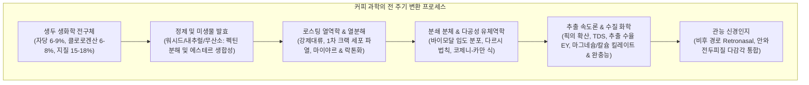
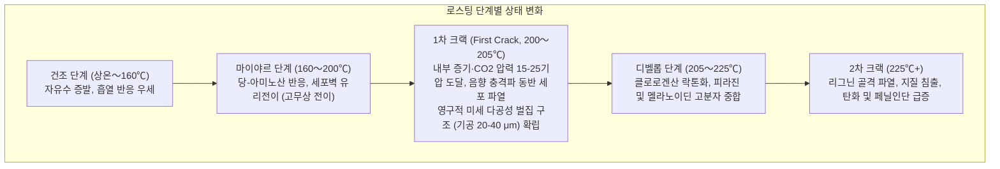

우리가 일상적으로 마시는 한 잔의 커피는 농업 식물학, 미생물 발효공학, 비평형 열역학, 유기 반응속도론, 분체공학, 다공성 매질 유체역학, 그리고 뇌신경 관능생리학이 극도로 정밀하게 융합된 고도의 종합 과학 시스템입니다.

생두(Green Coffee Bean) 내부에 저장된 1,000여 종의 전구물질은 200°C가 넘는 고온 로스팅 과정에서 비효소적 갈변(마이야르 반응), 스트레커 분해, 캐러멜화, 클로로겐산 이성질화를 거쳐 수많은 휘발성 향기 물질로 탈바꿈합니다. 이어 미세하게 분쇄된 다공성 셀룰로오스 베드를 통과하는 열수 추출 과정에서 다르시의 법칙과 픽의 확산 법칙에 따라 추출되어 최종 음료로 완성됩니다.

---

### 1. 커피 체리의 식물형태학과 생두 생화학

#### 1.1 커피 체리의 다층 해부학적 구조
커피나무(*Coffea arabica* 및 *Coffea canephora*)의 열매인 커피 체리는 중앙의 종자를 동심원상으로 감싸는 다층 보호 구조를 갖추고 있습니다:

1. <strong>외과피 (Exocarp / Skin)</strong>: 큐티클 왁스층을 지닌 단층 표피로, 성숙하면서 엽록소가 파괴되고 안토시아닌(시아니딘-3-루티노사이드 등)이 축적되어 붉은색 또는 노란색을 띱니다.
2. <strong>중과피 (Mesocarp / Pulp)</strong>: 수분 약 80% 이상의 유조직으로, 과당, 포도당, 자당(당도 18~24° Brix) 및 말산, 구연산이 풍부합니다.
3. <strong>점액질층 (Mucilage)</strong>: 두께 0.5~2 mm의 불용성 하이드로겔로, 폴리갈락투론산 펙틴과 아라비노갈락탄 중성 다당류가 수화되어 형성됩니다.
4. <strong>내과피 (Endocarp / Parchment)</strong>: 목질화된 후벽세포(스톤셀)로 이루어진 단단한 보호막으로 셀룰로오스(40~45%), 헤미셀룰로오스, 리그닌으로 구성됩니다.
5. <strong>은피 (Silver Skin / Spermoderm)</strong>: 배유를 감싸는 얇은 종피로, 로스팅 시 팽창 박리되어 채프(Chaff)가 됩니다.
6. <strong>배유 (Endosperm / 생두 본체)</strong>: 두꺼운 일차 세포벽($5\sim10\,\mu\text{m}$) 내부에 지질구, 단백질 과립, 자당 결정, 클로로겐산 복합체가 치밀하게 응축되어 있습니다.

#### 1.2 아라비카와 로부스타의 성분 비교

| 성분 (건조 중량 기준 %) | 아라비카 (*C. arabica*) | 로부스타 (*C. canephora*) | 기능 및 향미 특성 |
| :--- | :--- | :--- | :--- |
| <strong>염색체 수 & 배수성</strong> | $2n = 4x = 44$ (이질사배체) | $2n = 2x = 22$ (이배체) | 자가수분, 유전적 균질성, 정교한 대사 |
| <strong>자당 (Sucrose)</strong> | <strong>6.0 〜 9.0 %</strong> | 3.0 〜 5.0 % | 열분해되어 지방족 산(포름산, 아세트산) 및 퓨란류 형성 |
| <strong>총 지질</strong> | <strong>15.0 〜 18.0 %</strong> | 8.0 〜 12.0 % | 에스프레소 크레마 미세기포 안정화 및 향기 성분 포집 |
| <strong>카페인</strong> | 0.9 〜 1.5 % | <strong>1.8 〜 3.2 %</strong> | 열적으로 매우 안정한 알칼로이드, 전체 쓴맛의 10~15% 구성 |
| <strong>트리고넬린</strong> | <strong>0.8 〜 1.2 %</strong> | 0.4 〜 0.7 % | 열분해로 비타민 B3(니아신) 및 피리딘류 생성 |
| <strong>총 클로로겐산 (CGA)</strong>| 5.5 〜 8.0 % | <strong>7.0 〜 11.0 %</strong> | 락톤(고급스러운 쓴맛) 및 페닐인단(거친 떫은맛) 전구체 |

---

### 2. 정제 가공과 미생물 발효공학

수확된 체리의 수분(65~70%)을 안전한 저장 한계(10.0~12.0%, 수분활성도 $a_w < 0.65$)까지 건조하는 정제 과정은 발효를 통해 향미 전구물질을 조절하는 생물공학 공정입니다.

1. <strong>워시드 (Washed / 수세식)</strong>: 펄퍼로 과육을 제거한 후, 발효 탱크에서 미생물(*Pectobacterium*, *Bacillus*)의 펙틴 분해 효소(펙틴메틸에스테라아제, 폴리갈락투로나아제)가 점액질을 가수분해하여 씻어냅니다. 티피컬한 떼루아 본연의 밝고 깨끗한 산미와 클린컵을 발현합니다.
2. <strong>내추럴 (Natural / 건식)</strong>: 체리 전과를 아프리칸 베드에서 2~4주간 건조합니다. 과육의 높은 삼투압에 의해 환원당과 야생 효모(*Hanseniaspora*) 유래 에스테르(에틸아세테이트 등)가 배유 내부로 확산 침투하여 묵직한 바디감과 베리류 향을 완성합니다.
3. <strong>무산소 발효 (Anaerobic Fermentation)</strong>: 밀폐 탱크에 $\text{CO}_2$를 충진하여 통성 혐기성 젖산균(*Leuconostoc*, *Lactobacillus*)이 우점하게 만듭니다. pH가 3.8~4.2로 급강하하며 시나몬, 패션프루트, 열대과일 에스테르 화합물이 폭발적으로 합성됩니다.

---

### 3. 로스팅 열역학과 1차 크랙의 물리학

로스팅 챔버 내 총 열전달은 전도, 강제대류, 복사의 합으로 정의됩니다:

$$\dot{Q}_{\text{total}} = \dot{Q}_{\text{cond}} + \dot{Q}_{\text{conv}} + \dot{Q}_{\text{rad}}$$

현대 스페셜티 열풍 로스터는 전체 열량의 70~85%를 강제대류($\dot{Q}_{\text{conv}} = h_{\text{conv}} A_{\text{bean}} (T_{\text{air}} - T_{\text{bean}})$)로 공급합니다.

- <strong>RoR (Rate of Rise)</strong>: 생두 온도($BT$)의 시간당 변화율:
  $$\text{RoR}(t) = \frac{\mathrm{d}(BT)}{\mathrm{d}t} \quad [^\circ\mathrm{C/min}]$$
  터닝 포인트 이후 완만한 단조 감소 곡선(Monotonically decreasing curve)을 유지해야 완벽한 열적 균질성을 얻을 수 있습니다.
- <strong>DTR (Development Time Ratio)</strong>: 1차 크랙 시점부터 배출까지의 시간 비율:
  $$\text{DTR} = \frac{t_{\text{total}} - t_{\text{FC}}}{t_{\text{total}}} \times 100 \quad [\%]$$
  약배전(Light)은 10~14%, 중배전은 15~19%, 강배전은 20~25%가 표준입니다.

---

### 4. 로스팅 유기화학 반응 속도론

1. <strong>마이야르 반응 (Maillard Reaction)</strong>: 환원당과 아미노산의 아민기가 축합하여 아마도리 화합물을 형성하고, 탈수 및 분해를 통해 고반응성 디카르보닐(디아세틸 등)을 방출합니다.
2. <strong>스트레커 분해 (Strecker Degradation)</strong>: 디카르보닐 화합물과 아미노산이 반응하여 탈탄산 스트레커 알데히드(3-메틸부타날: 몰트 향 등)와 알킬피라진(견과류, 로스팅 향)을 합성합니다. 이들은 최종적으로 질소 함유 고분자인 <strong>멜라노이딘(Melanoidins)</strong>으로 중합되어 바디감과 항산화 활성을 제공합니다.
3. <strong>캐러멜화 (Caramelization)</strong>: 160°C 이상에서 자당이 열분해되어 퓨라네올(Furaneol), 말톨(Maltol) 등 퓨란 유도체를 생성하여 캐러멜 단향을 부여합니다.
4. <strong>클로로겐산의 열분해</strong>:
   - 중약배전 (180~215°C): 3-CQL, 4-CQL 등 <strong>클로로겐산 락톤</strong>으로 분자내 탈수 환화되어 <strong>상쾌하고 품격 있는 쓴맛</strong>을 부여합니다.
   - 강배전 (>220°C): 락톤 구조가 파괴되고 방향족 다환 물질인 <strong>페닐인단(Phenylindanes)</strong>으로 변환되어 <strong>거칠고 오래 남는 떫은 쓴맛</strong>을 만듭니다.

---

### 5. 분쇄 공학과 다공성 매질 유체역학

그라인더로 분쇄된 커피 분체는 전형적인 <strong>바이모달(Bimodal) 입도 분포</strong>를 형성합니다:
- <strong>볼더 (Boulders, $300\sim1200\,\mu\text{m}$)</strong>: 세포벽 벌집 구조가 온전히 보존된 큰 입자로, 내부 모세관 침투 및 확산율속 지배를 받습니다.
- <strong>파인즈 (Fines, $< 100\,\mu\text{m}$)</strong>: 파쇄된 세포벽 파편으로, 접촉 즉시 표면 성분이 100% 순간 용출됩니다.

커피 베드 내부의 열수 흐름은 다공성 매질의 <strong>다르시 법칙(Darcy's Law)</strong>을 따릅니다:

$$Q = \frac{-k_p A}{\mu} \frac{\Delta P}{L}$$

고유 침투율 $k_p$는 <strong>코제니-카만 식(Kozeny-Carman Equation)</strong>으로 계산됩니다:

$$k_p = \frac{\epsilon^3}{K_{\text{CK}} S_v^2 (1 - \epsilon)^2}$$

9기압의 에스프레소 추출 시 미세한 밀도 불균일은 유로 저항이 가장 낮은 곳으로 유선을 집중시키는 <strong>채널링(Channeling)</strong>을 유발하여, 균열부는 극심한 과다추출(떫은맛, 쓴맛)을, 주변부는 과소추출(시큼함, 물맛)을 동시 발생시킵니다. WDT 칠침봉 교반은 공극률 편차 $\sigma_\epsilon^2 \to 0$을 달성하기 위한 유체역학적 제어 기술입니다.

---

### 6. 추출 속도론, TDS 및 SCA 골든컵 기준

다공성 입자 내부로부터의 용출은 <strong>픽의 제2확산법칙(Fick's Second Law)</strong>을 따릅니다:

$$\frac{\partial C}{\partial t} = D_{\text{eff}} \left( \frac{\partial^2 C}{\partial r^2} + \frac{2}{r} \frac{\partial C}{\partial r} \right)$$

스토크스-아인슈타인 관계식($D_0 \propto 1/r_H$)에 따라 분자 크기가 작을수록 먼저 빠져나옵니다:
1. <strong>초기 (0~30초)</strong>: 저분자 유기산(아세트산, 구연산, 말산), 단당류, 카페인 용출;
2. <strong>중기 (30~90초)</strong>: 피라진, 퓨란, 클로로겐산 락톤, 자당 용출 (단맛과 향미의 밸런스 정점);
3. <strong>후기 (90초 이후)</strong>: 난용성 페닐인단, 고분자 폴리페놀 침출 (과다추출 시 떫고 거친 맛).

- <strong>TDS (총 용존 고형분)</strong>: 굴절계로 측정한 용액의 질량 농도. 필터 커피의 표준 TDS는 $1.15\sim1.45\%$, 에스프레소는 $8.0\sim12.0\%$입니다.
- <strong>추출 수율 (Extraction Yield: EY)</strong>:
  $$\text{EY} = \frac{M_{\text{beverage}} \times \text{TDS}}{M_{\text{dose}}} \times 100 \quad [\%]$$
  SCA 골든컵 기준에 따른 이상적 추출 수율은 <strong>18.0% 〜 22.0%</strong>입니다.

---

### 7. 수질 화학과 관능 인지 신경과학

1. <strong>미네랄 양이온의 역할</strong>:
   - $\text{Mg}^{2+}$: 이온 반경이 작고 전하 밀도가 높아 강한 루이스 산으로 기능하며, 유기산 및 에스테르 향미 분자를 강력하게 킬레이트 결합으로 추출합니다.
   - $\text{Ca}^{2+}$: 전반적 고형분을 균형 있게 추출하여 부드러운 질감을 형성합니다.
2. <strong>탄산수소염 완충능</strong>:
   $$\text{HCO}_3^- + \text{H}_3\text{O}^+ \rightleftharpoons \text{H}_2\text{CO}_3 + \text{H}_2\text{O} \rightleftharpoons 2\,\text{H}_2\text{O} + \text{CO}_2 \uparrow$$
   알칼리도가 너무 높으면($>80\text{ mg/L}$) 유기산을 모두 중화시켜 산미를 없애고 텁텁하게 만들며, 너무 낮으면($<20\text{ mg/L}$) 식초처럼 자극적인 날카로운 산미가 됩니다.
3. <strong>향기 분자와 비후(Retronasal) 경로</strong>:
   갓 추출한 커피의 핵심 향인 2-퍼퓨릴티올(2-Furfurylthiol)은 공기 중 산소에 의해 빠르게 산화 불활성화됩니다. 음료를 삼킬 때 체온(37°C)에 의해 기화된 향기 성분이 인두를 거쳐 후각 상피로 역류하는 비후 경로를 통해 대뇌 안와전두피질(OFC)에서 미각과 결합하여 다차원적인 입체적 '플레이버(Flavor)'로 인식됩니다.
