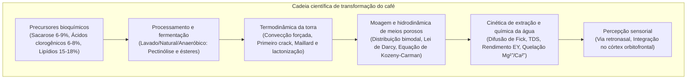
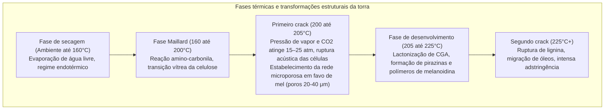

A xícara de café consumida diariamente em todo o mundo representa um dos sistemas multidisciplinares mais refinados da ciência aplicada, congregando botânica agronômica, microbiologia fermentativa, termodinâmica do não-equilíbrio, cinética de reações orgânicas, mecânica de meios porosos e neurobiologia sensorial.

No grão de café verde, mais de mil precursores bioquímicos encontram-se retidos em uma densa matriz celular celulósica. Ao ser submetido a temperaturas superiores a 200°C na torra, essas substâncias atravessam a reação de Maillard, degradação de Strecker, caramelização e clivagem de ácidos clorogênicos, gerando centenas de compostos voláteis aromáticos. Na extração com água quente, o escoamento responde à lei de Darcy e à difusão de Fick.

---

### 1. Anatomia da Cereja e Bioquímica do Grão Cru

1. <strong>Exocarpo (Casca)</strong>: Epiderme uniestratificada recoberta por cutícula cerosa; antocianinas conferem a cor vermelha ou amarela na maturação.
2. <strong>Mesocarpo (Polpa)</strong>: Parênquima rico em água (~80%), açúcares redutores (frutose, glicose, sacarose, 18-24° Brix) e ácido málico.
3. <strong>Mucilagem</strong>: Hidrogel insolúvel de 0,5 a 2 mm de espessura formado por polímeros pécticos e arabinogalactanos.
4. <strong>Endocarpo (Pergaminho)</strong>: Envoltório rígido de esclereídeos lenificados (celulose 40-45%, hemicelulose e lignina).
5. <strong>Película prateada (Espermoderme)</strong>: Fino tegumento seminal rico em polifenóis, que se solta durante a torra na forma de película (chaff).
6. <strong>Endosperma (Grão de café verde)</strong>: Tecido de reserva com espessas paredes celulares ($5\sim10\,\mu\text{m}$), contendo lipídios, proteínas, sacarose e ácidos clorogênicos.

| Componente (% Matéria Seca) | Arábica (*C. arabica*) | Robusta (*C. canephora*) | Função na torra e perfil sensorial |
| :--- | :--- | :--- | :--- |
| <strong>Ploidia</strong> | $2n = 4x = 44$ (Alotetraploide) | $2n = 2x = 22$ (Diploide) | Autógama, perfil aromático refinado e elegante |
| <strong>Sacarose</strong> | <strong>6,0 – 9,0 %</strong> | 3,0 – 5,0 % | Precursor-chave de ácidos alifáticos e furanos |
| <strong>Lipídios totais</strong> | <strong>15,0 – 18,0 %</strong> | 8,0 – 12,0 % | Formação da crema e retenção de aromas lipofílicos |
| <strong>Cafeína</strong> | 0,9 – 1,5 % | <strong>1,8 – 3,2 %</strong> | Alcaloide termoestável; contribui com 10-15% do amargor |
| <strong>Trigonelina</strong> | <strong>0,8 – 1,2 %</strong> | 0,4 – 0,7 % | Degradação térmica em niacina (vitamina B3) e piridinas |
| <strong>Ácidos clorogênicos (CGA)</strong>| 5,5 – 8,0 % | <strong>7,0 – 11,0 %</strong> | Convertem-se em lactonas (amargor limpo) e fenilindanos (adstringência) |

---

### 2. Processamento Pós-Colheita e Fermentação

1. <strong>Via Úmida (Lavado)</strong>: Despolpamento mecânico seguido de imersão por 12 a 36 horas. Pectinases microbianas despolimerizam o hidrogel péctico:
   $$\text{Pectina} + n\text{H}_2\text{O} \xrightarrow{\text{Pectinase}} \text{Ácido D-galacturônico} + \text{Metanol}$$
   Origina uma bebida limpa, com acidez cítrica e málica brilhante.
2. <strong>Via Seca (Natural)</strong>: Frutos inteiros secos ao sol por 2 a 4 semanas. A migração osmótica de açúcares para o endosperma gera notas intensas de frutas vermelhas e corpo xaroposo.
3. <strong>Fermentação Anaeróbica</strong>: Conduzida em biorreatores herméticos saturados com $\text{CO}_2$. Bactérias láticas (*Leuconostoc*, *Lactobacillus*) abaixam o pH para 3,8–4,2 e sintetizam ésteres alifáticos ramificados (canela, maracujá).

---

### 3. Termodinâmica da Torra e Fases de Transformação

O fluxo de calor total $\dot{Q}_{\text{total}}$ transmitido aos grãos resulta de:

$$\dot{Q}_{\text{total}} = \dot{Q}_{\text{cond}} + \dot{Q}_{\text{conv}} + \dot{Q}_{\text{rad}}$$

Em torradores modernos de leito fluidizado ou tambor perfurado, a convecção forçada representa 70 a 85% do fluxo térmico.

- <strong>Taxa de Elevação (Rate of Rise - RoR)</strong>: $\text{RoR}(t) = \frac{\mathrm{d}(BT)}{\mathrm{d}t}$ em $[^\circ\mathrm{C/min}]$. Uma desaceleração suave e monotônica evita defeitos térmicos.
- <strong>Razão de Tempo de Desenvolvimento (DTR)</strong>:
  $$\text{DTR} = \frac{t_{\text{total}} - t_{\text{FC}}}{t_{\text{total}}} \times 100 \quad [\%]$$
  10–14% em torras claras, 15–19% em torras médias.

---

### 4. Química Orgânica da Torra

1. <strong>Reação de Maillard e Degradação de Strecker</strong>: Açúcares redutores reagem com aminoácidos livres formando intermediários de Amadori e dicabonilas ativas. A degradação de Strecker libera aldeídos aromáticos (3-metilbutanal: notas de malte) e alquilpirazinas (aromas de avelã tostada), convergindo para a formação de <strong>melanoidinas</strong>.
2. <strong>Caramelização</strong>: Degradação puramente térmica da sacarose acima de 160°C, sintetizando furanonas (furaneol, sotolon) e maltol (aromas doces de caramelo).
3. <strong>Pirólise de Ácidos Clorogênicos</strong>:
   - 180–215°C: Geração de lactonas de ácido clorogênico (3-CQL e 4-CQL), responsáveis pelo <strong>amargor elegante e prazeroso</strong>.
   - >220°C: Formação de <strong>fenilindanos</strong>, promotores de um <strong>amargor agressivo, seco e medicinal</strong>.

---

### 5. Hidrodinâmica em Meios Porosos e Lei de Darcy

A moagem gera uma <strong>distribuição granulométrica bimodal</strong>:
- <strong>Boulders ($300\sim1200\,\mu\text{m}$)</strong>: Fragmentos com células intactas, regulados por difusão intrapartícula.
- <strong>Fines ($< 100\,\mu\text{m}$)</strong>: Fragmentos de parede celular que se dissolvem instantaneamente.

O fluxo através do leito de café obedece à <strong>lei de Darcy</strong>:

$$Q = \frac{-k_p A}{\mu} \frac{\Delta P}{L}$$

A permeabilidade $k_p$ é dada pela <strong>equação de Kozeny-Carman</strong>:

$$k_p = \frac{\epsilon^3}{K_{\text{CK}} S_v^2 (1 - \epsilon)^2}$$

Sob pressão de 9 bar no espresso, variações na densidade do leito induzem <strong>canalização (Channeling)</strong>, com sobre-extração severa nas fissuras e sub-extração nas regiões compactadas.

---

### 6. Cinética de Extração, TDS e Gold Cup da SCA

A difusão sólida-líquida obedece à <strong>segunda lei de Fick</strong>:

$$\frac{\partial C}{\partial t} = D_{\text{eff}} \left( \frac{\partial^2 C}{\partial r^2} + \frac{2}{r} \frac{\partial C}{\partial r} \right)$$

Pela relação de Stokes-Einstein, solutos menores eluem primeiro:
1. <strong>0–30 s</strong>: Ácidos orgânicos de baixo peso molecular, cafeína, açúcares simples;
2. <strong>30–90 s</strong>: Alquilpirazinas, furanos, lactonas de CGA (equilíbrio de doçura e acidez);
3. <strong>>90 s</strong>: Fenilindanos pesados e polifenóis (risco de adstringência e amargor excessivo).

- <strong>TDS (Total Dissolved Solids)</strong>: Medido por refratometria de ângulo crítico ($1,15–1,45\%$ em filtrados, $8,0–12,0\%$ em espresso).
- <strong>Rendimento de Extração (Extraction Yield - EY)</strong>:
  $$\text{EY} = \frac{M_{\text{beverage}} \times \text{TDS}}{M_{\text{dose}}} \times 100 \quad [\%]$$
  Faixa ideal SCA Gold Cup: <strong>18,0% a 22,0%</strong>.

---

### 7. Química da Água e Neurobiologia Sensorial

1. <strong>Cátions Minerais</strong>:
   - $\text{Mg}^{2+}$: Raio iônico pequeno (72 pm), forte atração eletrostática; quela eficientemente ácidos frutados e compostos oxigenados.
   - $\text{Ca}^{2+}$: Proporciona textura sedosa e corpo, mas pode precipitar calcário.
2. <strong>Tampão Bicarbonato</strong>:
   $$\text{HCO}_3^- + \text{H}_3\text{O}^+ \rightleftharpoons \text{H}_2\text{CO}_3 + \text{H}_2\text{O} \rightleftharpoons 2\,\text{H}_2\text{O} + \text{CO}_2 \uparrow$$
   Alcalinidade $>80\text{ mg/L}$ neutraliza a acidez e resulta em sabor choco; alcalinidade $<20\text{ mg/L}$ torna o café agressivamente ácido.
3. <strong>Via Retronasal</strong>: O 2-furfuriltiol é a molécula insígnia do aroma do café recém-extraído. Ao engolir, os voláteis ascendem pela faringe até o epitélio olfatório, onde o córtex orbitofrontal integra estímulos gustativos e olfativos na percepção global de sabor ("Flavor").
