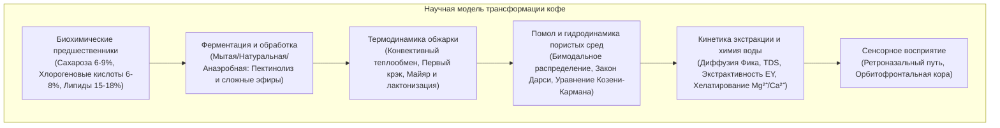
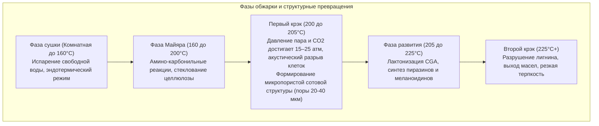

Чашка кофе, потребляемая ежедневно миллионами людей, представляет собой сложнейшую междисциплинарную систему, объединяющую агрономическую ботанику, микробную ферментацию, неравновесную термодинамику, органическую химическую кинетику, гидродинамику пористых сред и сенсорную нейробиологию.

В зеленом зерне более тысячи биохимических предшественников заключены в жесткий каркас из растительной целлюлозы. При температуре обжарки выше 200°C реакция Майяра, деградация Штрекера, карамелизация и изомеризация хлорогеновых кислот порождают сотни летучих ароматических веществ. При заваривании экстракция подчиняется закону Дарси и закону диффузии Фика.

---

### 1. Морфология кофейной ягоды и биохимия зеленого зерна

1. <strong>Экзокарпий (Кожица)</strong>: Однослойный эпидермис с кутикулой; антоцианы окрашивают его в красный или желтый цвет при созревании.
2. <strong>Мезокарпий (Мякоть)</strong>: Паренхимная ткань с влажностью ~80%, богатая сахарозой, глюкозой, фруктозой (18–24° Brix) и яблочной кислотой.
3. <strong>Муцилаж (Клейковина)</strong>: Слой гидрогеля толщиной 0,5–2 мм из нерастворимых пектиновых кислот и арабиногалактанов.
4. <strong>Эндокарпий (Пачмент / Пергаментная оболочка)</strong>: Одревесневший слой склереид (целлюлоза 40–45%, гемицеллюлоза, лигнин).
5. <strong>Серебряная оболочка (Спермодерма)</strong>: Тонкая семенная кожура, отделяющаяся при обжарке в виде шелухи (chaff).
6. <strong>Эндосперм (Зеленое зерно)</strong>: Плотная ткань с толстыми клеточными стенками ($5\sim10\,\mu\text{m}$), содержащая липиды, белки, кристаллы сахарозы и хлорогенаты.

| Компонент (% сухой массы) | Арабика (*C. arabica*) | Робуста (*C. canephora*) | Роль в обжарке и профиле вкуса |
| :--- | :--- | :--- | :--- |
| <strong>Плоидность</strong> | $2n = 4x = 44$ (Аллотетраплоид) | $2n = 2x = 22$ (Диплоид) | Самоопыляемый, сложный ароматический профиль |
| <strong>Сахароза</strong> | <strong>6,0 – 9,0 %</strong> | 3,0 – 5,0 % | Источник алифатических кислот и фуранов |
| <strong>Общие липиды</strong> | <strong>15,0 – 18,0 %</strong> | 8,0 – 12,0 % | Стабильность крема в эспрессо и связывание ароматов |
| <strong>Кофеин</strong> | 0,9 – 1,5 % | <strong>1,8 – 3,2 %</strong> | Термостойкий алкалоид; дает 10–15% общей горечи |
| <strong>Тригонеллин</strong> | <strong>0,8 – 1,2 %</strong> | 0,4 – 0,7 % | Пиролиз в ниацин (витамин B3) и пиридины |
| <strong>Хлорогеновые кислоты (CGA)</strong>| 5,5 – 8,0 % | <strong>7,0 – 11,0 %</strong> | Источник лактонов (приятная горечь) и фенилинданов (терпкость) |

---

### 2. Первичная обработка и микробная ферментация

1. <strong>Мытый способ (Washed)</strong>: Механическая депульпация и водная ферментация 12–36 часов. Пектиназы микроорганизмов гидролизуют пектиновый гель:
   $$\text{Pectin} + n\text{H}_2\text{O} \xrightarrow{\text{Pectinase}} \text{D-Galacturonic Acid} + \text{Methanol}$$
   Обеспечивает чистый профиль чашки с выраженной яблочной и лимонной кислотностью.
2. <strong>Натуральный способ (Dry)</strong>: Сушка целых ягод на африканских кроватях 2–4 недели. Осмотическая диффузия сахаров в эндосперм придает плотное тело и ноты ягод.
3. <strong>Анаэробная ферментация</strong>: В герметичных танках под давлением $\text{CO}_2$. Молочнокислые бактерии снижают pH до 3,8–4,2, образуя сложные эфиры (корица, тропические фрукты).

---

### 3. Термодинамика и фазовые переходы обжарки

Тепловой поток $\dot{Q}_{\text{total}}$ к зернам складывается из кондукции, вынужденной конвекции и излучения:

$$\dot{Q}_{\text{total}} = \dot{Q}_{\text{cond}} + \dot{Q}_{\text{conv}} + \dot{Q}_{\text{rad}}$$

В конвекционных ростерах поток горячего воздуха обеспечивает 70–85% тепла ($\dot{Q}_{\text{conv}} = h_{\text{conv}} A_{\text{bean}} (T_{\text{air}} - T_{\text{bean}})$).

- <strong>Скорость нарастания температуры (Rate of Rise - RoR)</strong>: $\text{RoR}(t) = \frac{\mathrm{d}(BT)}{\mathrm{d}t}$ в $[^\circ\mathrm{C/min}]$. Непрерывно убывающая траектория обеспечивает термодинамическую стабильность.
- <strong>Коэффициент времени развития (DTR)</strong>:
  $$\text{DTR} = \frac{t_{\text{total}} - t_{\text{FC}}}{t_{\text{total}}} \times 100 \quad [\%]$$
  10–14% для светлой обжарки, 15–19% для средней.

---

### 4. Органическая химия обжарки

1. <strong>Реакция Майяра и распад по Штрекеру</strong>: Взаимодействие восстанавливающих сахаров с аминокислотами через соединения Амадори. Распад по Штрекеру образует альдегиды (3-метилбутаналь: солод) и алкилпиразины (жареные орехи). Финальная полимеризация дает <strong>меланоидины</strong>, формирующие тело напитка.
2. <strong>Карамелизация</strong>: Термический распад сахарозы выше 160°C с образованием фуранонов (фуранеол, сотолон) и мальтола (карамельная сладость).
3. <strong>Хлорогеновые кислоты</strong>:
   - 180–215°C: Образуются <strong>лактоны</strong> (3-CQL, 4-CQL), создающие <strong>благородную, чистую горечь</strong>.
   - >220°C: Распад на <strong>фенилинданы</strong>, придающие <strong>жгучую, вяжущую и аптечную горечь</strong>.

---

### 5. Гидродинамика пористых сред и закон Дарси

Помол кофе образует <strong>бимодальное распределение частиц</strong>:
- <strong>Крупная фракция (Boulders, $300\sim1200\,\mu\text{m}$)</strong>: Конгломераты целых клеток с диффузионным ограничением.
- <strong>Пыль (Fines, $< 100\,\mu\text{m}$)</strong>: Осколки клеточных стенок с мгновенной поверхностной экстракцией.

Поток воды через кофейную таблетку описывается <strong>законом Дарси</strong>:

$$Q = \frac{-k_p A}{\mu} \frac{\Delta P}{L}$$

Проницаемость $k_p$ рассчитывается по <strong>уравнению Козени-Кармана</strong>:

$$k_p = \frac{\epsilon^3}{K_{\text{CK}} S_v^2 (1 - \epsilon)^2}$$

При экстракции эспрессо (9 бар) локальная неоднородность плотности вызывает <strong>каналообразование (Channeling)</strong>, приводя к одновременному переэкстракту в трещинах и недоэкстракту в плотных зонах.

---

### 6. Кинетика экстракции, TDS и стандарт SCA Gold Cup

Диффузия вещества подчиняется <strong>второму закону Фика</strong>:

$$\frac{\partial C}{\partial t} = D_{\text{eff}} \left( \frac{\partial^2 C}{\partial r^2} + \frac{2}{r} \frac{\partial C}{\partial r} \right)$$

Согласно формуле Стокса-Эйнштейна, вещества с малым радиусом молекул выходят первыми:
1. <strong>0–30 с</strong>: Легкие органические кислоты, сахара, кофеин.
2. <strong>30–90 s</strong>: Пиразины, фураны, лактоны (пик баланса вкуса).
3. <strong>>90 s</strong>: Фенилинданы, тяжелые полифенолы (вяжущая горечь).

- <strong>TDS (Total Dissolved Solids)</strong>: Концентрация растворенных веществ ($1,15–1,45\%$ для фильтра, $8,0–12,0\%$ для эспрессо).
- <strong>Выход экстракции (Extraction Yield - EY)</strong>:
  $$\text{EY} = \frac{M_{\text{beverage}} \times \text{TDS}}{M_{\text{dose}}} \times 100 \quad [\%]$$
  Стандарт SCA Gold Cup: <strong>18,0% – 22,0%</strong>.

---

### 7. Химия воды и сенсорная нейробиология

1. <strong>Катионы минерализации</strong>:
   - $\text{Mg}^{2+}$: Высокая плотность заряда; эффективно хелатирует фруктовые кислоты и кислородсодержащие эфиры.
   - $\text{Ca}^{2+}$: Придает шелковистость напитку, но образует накипь.
2. <strong>Бикарбонатный буфер</strong>:
   $$\text{HCO}_3^- + \text{H}_3\text{O}^+ \rightleftharpoons \text{H}_2\text{CO}_3 + \text{H}_2\text{O} \rightleftharpoons 2\,\text{H}_2\text{O} + \text{CO}_2 \uparrow$$
   Щелочность $>80\text{ мг/л}$ гасит кислотность (плоский вкус); щелочность $<20\text{ мг/л}$ делает кислотность едкой и уксусной.
3. <strong>Ретроназальный путь</strong>: 2-фурфурилтиол формирует аромат свежесваренного кофе. При глотании летучие соединения нагреваются до 37°C и направляются к обонятельному эпителию, где орбитофронтальная кора мозга формирует комплексное восприятие вкуса («Flavor»).
