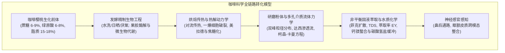
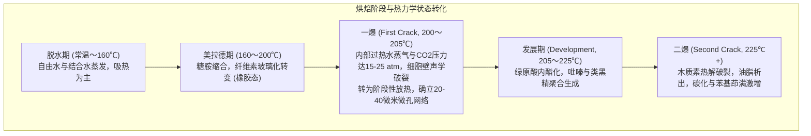

日常饮用的一杯咖啡，是农业生物学、微生物发酵工程、非平衡态热力学、有机反应动力学、多孔介质流体力学以及神经感官生理学高度交织的复杂科学体系。

在生豆（Green Coffee Bean）内部，上千种前体化合物被禁锢在致密的纤维素细胞骨架中。在超过200°C的烘焙过程中，这些物质经历美拉德反应、斯特雷克降解、蔗糖焦糖化与绿原酸异构化，生成多达数百种挥发性风味分子。磨粉后经热水冲煮，多孔介质内的溶质在达西定律与菲克扩散定律支配下析出，最终呈现于咖啡杯中。



---

### 1. 咖啡樱桃形态学与生豆生物化学

#### 1.1 樱桃同心多层组织解剖
咖啡树（*Coffea arabica* 与 *Coffea canephora*）的果实呈核果状，具有严格分化的多层同心结构：

1. <strong>外果皮（Exocarp / 鲜皮）</strong>：单层致密表皮细胞，外被蜡质角质层，成熟时叶绿素降解，花青素（矢车菊素-3-金红石苷等）大量沉积呈现鲜红或黄色。
2. <strong>中果皮（Mesocarp / 果肉）</strong>：含水率约80%的薄壁组织，富含可溶性糖（果糖、葡萄糖、蔗糖，糖度达18~24° Brix）与苹果酸、柠檬酸。
3. <strong>果胶粘液层（Mucilage）</strong>：厚约0.5~2 mm的高粘性水凝胶，由多聚半乳糖醛酸水不溶性果胶分子与中性阿拉伯半乳聚糖相互交联而成。
4. <strong>内果皮（Endocarp / 羊皮纸层 Parchment）</strong>：高度木质化的石细胞层，富含纤维素（40~45%）、半纤维素与木质素，构筑渗透屏障。
5. <strong>银皮（Spermoderm / Silver Skin）</strong>：紧贴胚乳的极薄种皮，在烘焙过程中膨胀脱落形成银皮屑（Chaff）。
6. <strong>胚乳（Endosperm / 咖啡生豆）</strong>：厚壁（$5\sim10\,\mu\text{m}$）细胞组成的硬质组织，内含蛋白质、脂质微滴、蔗糖结晶与绿原酸钾盐络合物。

#### 1.2 阿拉比卡与罗布斯塔的生化对比

| 生化组分（干重%） | 阿拉比卡 (*C. arabica*) | 罗布斯塔 (*C. canephora*) | 烘焙与风味表征 |
| :--- | :--- | :--- | :--- |
| <strong>染色体与倍性</strong> | $2n = 4x = 44$（异源四倍体） | $2n = 2x = 22$（二倍体） | 自花授粉，遗传稳定，代谢途径精细 |
| <strong>蔗糖（Sucrose）</strong> | <strong>6.0 〜 9.0 %</strong> | 3.0 〜 5.0 % | 烘焙中有机酸（甲酸、乙酸）与呋喃类的前体 |
| <strong>游离脂质</strong> | <strong>15.0 〜 18.0 %</strong> | 8.0 〜 12.0 % | 意式浓缩油脂（Crema）稳定剂与芳香物质捕集介质 |
| <strong>咖啡因</strong> | 0.9 〜 1.5 % | <strong>1.8 〜 3.2 %</strong> | 耐热生物碱，贡献约10~15%的整体感知苦味 |
| <strong>葫芦巴碱（Trigonelline）</strong>| <strong>0.8 〜 1.2 %</strong> | 0.4 〜 0.7 % | 热解生成维生素B3（烟酸）与挥发性吡啶类 |
| <strong>总绿原酸（CGA）</strong> | 5.5 〜 8.0 % | <strong>7.0 〜 11.0 %</strong> | 热解转化为绿原酸内酯（优质苦味）及苯基茚满（粗糙苦涩味） |

---

### 2. 生豆精制与微生物发酵工程

精制（Processing）旨在将鲜果含水率由65~70%降低至安全贮藏临界值（10.0~12.0%，水分活度 $a_w < 0.65$），同时调控生豆内部风味前体分布。

1. <strong>水洗法（Washed / Wet Process）</strong>：机械去除果皮果肉后，在发酵槽中由环境果胶分解菌（*Pectobacterium*, *Bacillus*）及内源果胶酶水解果胶多糖：
   $$\text{Pectin} + n\text{H}_2\text{O} \xrightarrow{\text{Pectinase}} \text{D-Galacturonic Acid} + \text{Methanol}$$
   粘液层彻底脱除，呈现干净透亮的纯正地域风味与明快果酸。
2. <strong>日晒法（Natural / Dry Process）</strong>：整果干燥2~4周。果肉高渗透压驱动单糖、有机酸与野生酵母（*Hanseniaspora*）发酵产生的酯类（乙酸乙酯、丁酸乙酯）经羊皮纸孔隙向胚乳被动扩散，赋予醇厚触感与浓郁莓果芳香。
3. <strong>厌氧发酵（Anaerobic Fermentation）</strong>：密封罐充入 $\text{CO}_2$ 隔绝氧气，兼性厌氧乳酸菌（*Leuconostoc*, *Lactobacillus*）主导发酵，pH快速降至3.8~4.2，抑制杂菌并高产支链脂肪酸酯，赋予肉桂、热带水果与朗姆酒般特殊香气。

---

### 3. 烘焙热力学与传热动力学

烘焙是高度动态的非稳态热工过程，烘豆机内部热量传递由传导、对流与辐射共同驱动：

$$\dot{Q}_{\text{total}} = \dot{Q}_{\text{cond}} + \dot{Q}_{\text{conv}} + \dot{Q}_{\text{rad}}$$

现代精品热风式烘焙中，强制对流（$\dot{Q}_{\text{conv}} = h_{\text{conv}} A_{\text{bean}} (T_{\text{air}} - T_{\text{bean}})$）贡献70~85%的热量。



#### 烘焙控制关键参量：RoR 与 DTR
- <strong>升温速率（Rate of Rise: RoR）</strong>：豆温（Bean Temperature: $BT$）对时间的导数：
  $$\text{RoR}(t) = \frac{\mathrm{d}(BT)}{\mathrm{d}t} \quad [^\circ\mathrm{C/min}]$$
  理想烘焙曲线要求RoR在回温点（Turning Point）后保持光滑的单调递减趋势（Monotonically decreasing curve）。RoR急剧崩塌（Crash）会导致焦烤味（Baked），而反弹（Flick）会导致局部灼焦（Flick-burn）。
- <strong>发展时间比（Development Time Ratio: DTR）</strong>：一爆点到出炉时间占总烘焙时间的百分比：
  $$\text{DTR} = \frac{t_{\text{total}} - t_{\text{FC}}}{t_{\text{total}}} \times 100 \quad [\%]$$
  浅度烘焙（Light Roast）通常为10~14%，中度烘焙为15~19%，深焙为20~25%。

---

### 4. 烘焙有机化学反应网络

1. <strong>美拉德反应（Maillard Reaction）</strong>：还原糖羰基与未质子化游离氨基缩合形成糖胺，经阿马多里重排（Amadori Rearrangement）形成酮胺化合物。中性与微酸条件下脱水生成脱氧奥苏酮与高活性二羰基化合物（丁二酮、丙酮醛）。
2. <strong>斯特雷克降解（Strecker Degradation）</strong>：二羰基化合物与氨基酸反应脱羧生成斯特雷克醛类（如亮氨酸降解生成异戊醛［3-甲基丁醛］带来麦芽坚果香，苯丙氨酸生成苯乙醛带来花香），副产氨基酮缩合氧化生成烷基吡嗪类。最终聚合形成高分子量含氮棕色聚合物——<strong>类黑精（Melanoidins）</strong>，构筑咖啡液的醇厚度与油脂。
3. <strong>焦糖化反应（Caramelization）</strong>：蔗糖在160℃以上热解开裂为葡萄糖与果糖，进一步脱水环化生成呋喃类（呋喃酮 Furaneol、麦芽酚 Maltol），赋予焦糖、太妃糖与甜香。
4. <strong>绿原酸（CGA）热解演变</strong>：
   - 浅至中度烘焙（180~215℃）：5-CQA分子内脱水环化生成3-CQA-1,5-内酯（3-CQL）与4-CQA-1,5-内酯（4-CQL），带来<strong>清新、优雅的宜人苦味</strong>。
   - 深度烘焙（>220℃）：内酯环与咖啡酸进一步聚合开裂生成苯基茚满（Phenylindanes），带来<strong>粗糙、持久的干苦涩味</strong>。

---

### 5. 粉体研磨与多孔介质流体力学

烘焙使豆体空隙率大增。经磨盘剪切破碎后，粉体呈现显著的<strong>双峰粒径分布（Bimodal Distribution）</strong>：
- <strong>粗颗粒（Boulders, $300\sim1200\,\mu\text{m}$）</strong>：保留完整蜂窝状细胞壁内部孔隙，受毛细渗透与内部扩散控制。
- <strong>极细粉（Fines, $< 100\,\mu\text{m}$）</strong>：细胞壁破片，几乎无扩散阻力，表面瞬时完全溶出。

咖啡粉层中的水流服从多孔介质<strong>达西定律（Darcy's Law）</strong>：

$$Q = \frac{-k_p A}{\mu} \frac{\Delta P}{L}$$

其中固有渗透率 $k_p$ 由<strong>柯森-卡曼方程（Kozeny-Carman Equation）</strong>决定：

$$k_p = \frac{\epsilon^3}{K_{\text{CK}} S_v^2 (1 - \epsilon)^2}$$

- $\epsilon$ 为粉层空隙率（Porosity）；
- $S_v$ 为颗粒比表面积（$S_v = \frac{6}{\phi d_p}$）。

由于流动阻力与粒径平方反比并对空隙率呈三次方高度非线性响应，细粉沉降导致局部 $\epsilon$ 降低会急剧恶化渗透性。在9 bar高压浓缩萃取中，粉层密度微小不均会诱发<strong>通道效应（Channeling）</strong>，导致裂隙处剧烈过萃（苦涩、杂味）与周边区域严重欠萃（稀薄、尖酸）并存。

---

### 6. 萃取动力学、TDS与SCA金杯准则

多孔介质固液溶出服从球坐标系<strong>菲克第二扩散定律（Fick's Second Law）</strong>：

$$\frac{\partial C}{\partial t} = D_{\text{eff}} \left( \frac{\partial^2 C}{\partial r^2} + \frac{2}{r} \frac{\partial C}{\partial r} \right)$$

由斯托克斯-爱因斯坦公式 $D_0 = \frac{k_B T}{6 \pi \mu r_H}$ 可知，水动力学半径 $r_H$ 较小的低分子物质优先扩散出溶：
1. <strong>初期（0~30秒）</strong>：低分子有机酸（乙酸、柠檬酸、苹果酸）、单糖、咖啡因迅猛析出，呈尖锐酸度；
2. <strong>中期（30~90秒）</strong>：中分子的烷基吡嗪、呋喃、绿原酸内酯与蔗糖溶出，酸甜趋于平衡；
3. <strong>后期（90秒以上）</strong>：难溶性大分子多酚、苯基茚满、焦糊分解物慢速渗出，过萃则带来干涩感。

```
                     【SCA 冲煮控制图表 (Brewing Control Chart)】
   高 TDS │
  (浓烈浓度) │   [浓度高 · 欠萃取]           [浓度高 · 萃取平衡]           [浓度高 · 过萃取]
            │   (Strong Under-extracted)     (Strong Balanced)           (Strong Over-extracted)
   1.15〜   ├───────────────────────────┼───────────────────────────┼────────────────────────
   1.45%    │                           │    ★ 金杯理想平衡区间 ★    │
            │   [浓度适中 · 欠萃取]      │     TDS: 1.15 〜 1.45%    │   [浓度适中 · 过萃取]
            │   (尖锐酸涩, EY < 18%)     │      EY: 18.0 〜 22.0%    │   (焦苦收敛, EY > 22%)
   低 TDS   ├───────────────────────────┼───────────────────────────┼────────────────────────
  (稀薄浓度) │   [稀薄水感 · 欠萃取]         [浓度低 · 萃取平衡]           [稀薄水感 · 过萃取]
            └───────────────────────────┴───────────────────────────┴────────────────────────
                                       18.0%                       22.0%
                                       萃取收率 (Extraction Yield: EY) ──▶
```

- <strong>总溶解固体量（TDS）</strong>：以临界角激光折射仪测定折射率 $n_D$，经算法校正得出质量百分浓度。手冲咖啡理想TDS为 $1.15\sim1.45\%$，意式浓缩为 $8.0\sim12.0\%$。
- <strong>萃取收率（Extraction Yield: EY）</strong>：
  $$\text{EY} = \frac{M_{\text{beverage}} \times \text{TDS}}{M_{\text{dose}}} \times 100 \quad [\%]$$
  SCA金杯标准（Gold Cup Standard）将理想萃取率划定为 <strong>18.0% 〜 22.0%</strong>。

---

### 7. 水质化学：阳离子配位与缓冲平衡

水占滴滤咖啡的98.5%以上。水中矿物质离子是萃取的活性化学试剂：

1. <strong>镁离子（$\text{Mg}^{2+}$）与钙离子（$\text{Ca}^{2+}$）</strong>：
   - $\text{Mg}^{2+}$ 离子半径小（72 pm），表面电荷密度高，具备极强路易斯酸性，优先通过强配位键螯合含氧基团，显著增强果酸（柠檬酸、苹果酸）与芳香酯类的萃取效率；
   - $\text{Ca}^{2+}$ 离子半径较大（100 pm），电荷密度中等，温和萃取整体可溶固形物，增强顺滑触感。
2. <strong>碳酸氢根（$\text{HCO}_3^-$）与碱度缓冲体系</strong>：
   $$\text{HCO}_3^- + \text{H}_3\text{O}^+ \rightleftharpoons \text{H}_2\text{CO}_3 + \text{H}_2\text{O} \rightleftharpoons 2\,\text{H}_2\text{O} + \text{CO}_2 \uparrow$$
   - 碱度过高（$>80\text{ mg/L as }\text{CaCO}_3$）：过度中和有机酸解离质子，使杯中酸质完全丧失，风味平板粗钝（Dull/Chalky）；
   - 碱度过低（$<20\text{ mg/L}$）：无法缓冲强质子释放，导致刺鼻醋酸般过锐酸味（Vinegary/Sour）。

---

### 8. 挥发物化学与感官神经感知

1. <strong>标志性香气化合物</strong>：
   - <strong>2-糠基硫醇（2-Furfurylthiol）</strong>：嗅觉阈值极低（$0.01\text{ ng/L}$），构成刚冲泡新鲜咖啡的标志性香气。遇氧极易自氧化二聚失活，是咖啡陈化氧化的主导分子。
   - <strong>烷基吡嗪类（2-乙基-3,5-二甲基吡嗪）</strong>：坚果、烤面包香气。
   - <strong>呋喃酮（Furaneol）与索托隆（Sotolon）</strong>：焦糖、枫糖香气。
2. <strong>双重感官感知通路</strong>：
   - <strong>前鼻通路（Orthonasal）</strong>：靠近杯面吸气，感知低沸点轻质挥发物（干香 Fragrance / 湿香 Aroma）；
   - <strong>鼻后通路（Retronasal）</strong>：咖啡液含入口腔吞咽时，经体温（37℃）加热与唾液乳化，脂溶性香气挥发随呼气逆流至嗅上皮，由大脑眶额皮质（OFC）将基本味觉、嗅觉与三叉神经质感融为一体，生成立体的终极“风味（Flavor）”。
