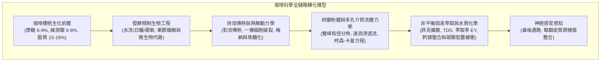
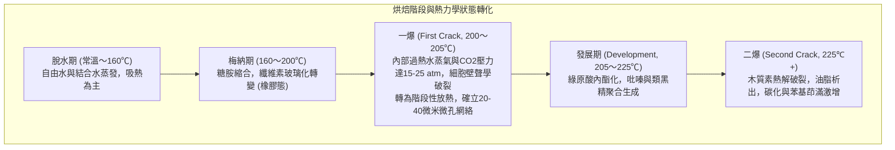

日常飲用的一杯咖啡，是農業生物學、微生物發酵工程、非平衡態熱力學、有機反應動力學、多孔介質流體力學以及神經感官生理學高度交織的複雜科學體系。

在生豆（Green Coffee Bean）內部，上千種前體化合物被禁錮在緻密的纖維素細胞骨架中。在超過200°C的烘焙過程中，這些物質經歷梅納反應、斯特雷克降解、蔗糖焦糖化與綠原酸異構化，生成多達數百種揮發性風味分子。磨粉後經熱水沖煮，多孔介質內的溶質在達西定律與菲克擴散定律支配下析出，最終呈現於咖啡杯中。

---

### 1. 咖啡櫻桃形態學與生豆生物化學

#### 1.1 櫻桃同心多層組織解剖
咖啡樹（*Coffea arabica* 與 *Coffea canephora*）的果實呈核果狀，具有嚴格分化的多層同心結構：

1. <strong>外果皮（Exocarp / 鮮皮）</strong>：單層緻密表皮細胞，外被蠟質角質層，成熟時葉綠素降解，花青素（矢車菊素-3-金紅石苷等）大量沉積呈現鮮紅或黃色。
2. <strong>中果皮（Mesocarp / 果肉）</strong>：含水率約80%的薄壁組織，富含可溶性糖（果糖、葡萄糖、蔗糖，糖度達18~24° Brix）與蘋果酸、檸檬酸。
3. <strong>果膠粘液層（Mucilage）</strong>：厚約0.5~2 mm的高粘性水凝膠，由多聚半乳糖醛酸水不溶性果膠分子與中性阿拉伯半乳聚糖相互交聯而成。
4. <strong>內果皮（Endocarp / 羊皮紙層 Parchment）</strong>：高度木質化的石細胞層，富含纖維素（40~45%）、半纖維素與木質素，構築滲透屏障。
5. <strong>銀皮（Spermoderm / Silver Skin）</strong>：緊貼胚乳的極薄種皮，在烘焙過程中膨脹脫落形成銀皮屑（Chaff）。
6. <strong>胚乳（Endosperm / 咖啡生豆）</strong>：厚壁（$5\sim10\,\mu\text{m}$）細胞組成的硬質組織，內含蛋白質、脂質微滴、蔗糖結晶與綠原酸鉀鹽絡合物。

#### 1.2 阿拉比卡與羅布斯塔的生化對比

| 生化組分（乾重%） | 阿拉比卡 (*C. arabica*) | 羅布斯塔 (*C. canephora*) | 烘焙與風味表徵 |
| :--- | :--- | :--- | :--- |
| <strong>染色體與倍性</strong> | $2n = 4x = 44$（異源四倍體） | $2n = 2x = 22$（二倍體） | 自花授粉，遺傳穩定，代謝途徑精細 |
| <strong>蔗糖（Sucrose）</strong> | <strong>6.0 〜 9.0 %</strong> | 3.0 〜 5.0 % | 烘焙中有機酸（甲酸、乙酸）與呋喃類的前體 |
| <strong>游離脂質</strong> | <strong>15.0 〜 18.0 %</strong> | 8.0 〜 12.0 % | 義式濃縮油脂（Crema）穩定劑與芳香物質捕集介質 |
| <strong>咖啡因</strong> | 0.9 〜 1.5 % | <strong>1.8 〜 3.2 %</strong> | 耐熱生物鹼，貢獻約10~15%的整體感知苦味 |
| <strong>葫蘆巴鹼（Trigonelline）</strong>| <strong>0.8 〜 1.2 %</strong> | 0.4 〜 0.7 % | 熱解生成維生素B3（煙酸）與揮發性吡啶類 |
| <strong>總綠原酸（CGA）</strong> | 5.5 〜 8.0 % | <strong>7.0 〜 11.0 %</strong> | 熱解轉化為綠原酸內酯（優質苦味）及苯基茚滿（粗糙苦澀味） |

---

### 2. 生豆精制與微生物發酵工程

精制（Processing）旨在將鮮果含水率由65~70%降低至安全貯藏臨界值（10.0~12.0%，水分活度 $a_w < 0.65$），同時調控生豆內部風味前體分佈。

1. <strong>水洗法（Washed / Wet Process）</strong>：機械去除果皮果肉後，在發酵槽中由環境果膠分解菌（*Pectobacterium*, *Bacillus*）及內源果膠酶水解果膠多醣：
   $$\text{Pectin} + n\text{H}_2\text{O} \xrightarrow{\text{Pectinase}} \text{D-Galacturonic Acid} + \text{Methanol}$$
   粘液層徹底脫除，呈現乾淨透亮的純正地域風味與明快果酸。
2. <strong>日曬法（Natural / Dry Process）</strong>：整果乾燥2~4週。果肉高滲透壓驅動單糖、有機酸與野生酵母（*Hanseniaspora*）發酵產生的酯類（乙酸乙酯、丁酸乙酯）經羊皮紙孔隙向胚乳被動擴散，賦予醇厚觸感與濃郁莓果芳香。
3. <strong>厭氧發酵（Anaerobic Fermentation）</strong>：密封罐充入 $\text{CO}_2$ 隔絕氧氣，兼性厭氧乳酸菌（*Leuconostoc*, *Lactobacillus*）主導發酵，pH快速降至3.8~4.2，抑制雜菌並高產支鏈脂肪酸酯，賦予肉桂、熱帶水果與蘭姆酒般特殊香氣。

---

### 3. 烘焙熱力學與傳熱動力學

烘焙是高度動態的非穩態熱工過程，烘豆機內部熱量傳遞由傳導、對流與輻射共同驅動：

$$\dot{Q}_{\text{total}} = \dot{Q}_{\text{cond}} + \dot{Q}_{\text{conv}} + \dot{Q}_{\text{rad}}$$

現代精品熱風式烘焙中，強制對流（$\dot{Q}_{\text{conv}} = h_{\text{conv}} A_{\text{bean}} (T_{\text{air}} - T_{\text{bean}})$）貢獻70~85%的熱量。

#### 烘焙控制關鍵參量：RoR 與 DTR
- <strong>升溫速率（Rate of Rise: RoR）</strong>：豆溫（Bean Temperature: $BT$）對時間的導數：
  $$\text{RoR}(t) = \frac{\mathrm{d}(BT)}{\mathrm{d}t} \quad [^\circ\mathrm{C/min}]$$
  理想烘焙曲線要求RoR在回溫點（Turning Point）後保持光滑的單調遞減趨勢（Monotonically decreasing curve）。
- <strong>發展時間比（Development Time Ratio: DTR）</strong>：一爆點到出爐時間佔總烘焙時間的百分比：
  $$\text{DTR} = \frac{t_{\text{total}} - t_{\text{FC}}}{t_{\text{total}}} \times 100 \quad [\%]$$
  淺度烘焙通常為10~14%，中度烘焙為15~19%，深焙為20~25%。

---

### 4. 烘焙有機化學反應網絡

1. <strong>梅納反應（Maillard Reaction）</strong>：還原糖羰基與未質子化游離氨基縮合形成糖胺，經阿馬多里重排（Amadori Rearrangement）形成酮胺化合物。中性與微酸條件下脫水生成高活性二羰基化合物。
2. <strong>斯特雷克降解（Strecker Degradation）</strong>：二羰基化合物與氨基酸反應脫羧生成斯特雷克醛類（如亮氨酸降解生成異戊醛帶來麥芽堅果香），副產氨基酮縮合氧化生成烷基吡嗪類。最終聚合形成高分子量含氮棕色聚合物——<strong>類黑精（Melanoidins）</strong>。
3. <strong>焦糖化反應（Caramelization）</strong>：蔗糖在160℃以上熱解開裂為葡萄糖與果糖，進一步脫水環化生成呋喃類（呋喃酮 Furaneol、麥芽酚 Maltol），賦予焦糖、太妃糖與甜香。
4. <strong>綠原酸（CGA）熱解演變</strong>：
   - 淺至中度烘焙（180~215℃）：生成3-CQA-1,5-內酯（3-CQL）與4-CQA-1,5-內酯（4-CQL），帶來<strong>清新、優雅的宜人苦味</strong>。
   - 深度烘焙（>220℃）：聚合裂解生成苯基茚滿（Phenylindanes），帶來<strong>粗糙、持久的乾苦澀味</strong>。

---

### 5. 粉體研磨與多孔介質流體力學

粉體呈現顯著的<strong>雙峰粒徑分佈（Bimodal Distribution）</strong>：
- <strong>粗顆粒（Boulders, $300\sim1200\,\mu\text{m}$）</strong>：保留完整蜂窩狀細胞壁，受毛細滲透與內部擴散控制。
- <strong>極細粉（Fines, $< 100\,\mu\text{m}$）</strong>：細胞壁破片，表面瞬時完全溶出。

咖啡粉層中的水流服從多孔介質<strong>達西定律（Darcy's Law）</strong>：

$$Q = \frac{-k_p A}{\mu} \frac{\Delta P}{L}$$

固有滲透率 $k_p$ 由<strong>柯森-卡曼方程（Kozeny-Carman Equation）</strong>決定：

$$k_p = \frac{\epsilon^3}{K_{\text{CK}} S_v^2 (1 - \epsilon)^2}$$

在9 bar高壓萃取中，粉層密度微小不均會誘發<strong>通道效應（Channeling）</strong>，導致裂隙處劇烈過萃（苦澀、雜味）與周邊區域嚴重欠萃（稀薄、尖酸）並存。

---

### 6. 萃取動力學、TDS與SCA金杯準則

固液溶出服從球座標系<strong>菲克第二擴散定律（Fick's Second Law）</strong>：

$$\frac{\partial C}{\partial t} = D_{\text{eff}} \left( \frac{\partial^2 C}{\partial r^2} + \frac{2}{r} \frac{\partial C}{\partial r} \right)$$

由斯托克斯-愛因斯坦公式 $D_0 = \frac{k_B T}{6 \pi \mu r_H}$ 可知，水動力學半徑 $r_H$ 較小者優先擴散：
1. <strong>初期（0~30秒）</strong>：低分子有機酸、單糖、咖啡因迅猛析出；
2. <strong>中期（30~90秒）</strong>：烷基吡嗪、呋喃、綠原酸內酯與蔗糖溶出，酸甜趨於平衡；
3. <strong>後期（90秒以上）</strong>：難溶性大分子多酚、苯基茚滿慢速滲出，過萃則帶來乾澀感。

- <strong>總溶解固體量（TDS）</strong>：手沖咖啡理想TDS為 $1.15\sim1.45\%$，義式濃縮為 $8.0\sim12.0\%$。
- <strong>萃取收率（Extraction Yield: EY）</strong>：
  $$\text{EY} = \frac{M_{\text{beverage}} \times \text{TDS}}{M_{\text{dose}}} \times 100 \quad [\%]$$
  SCA金杯標準將理想萃取率劃定為 <strong>18.0% 〜 22.0%</strong>。

---

### 7. 水質化學與感官感知

1. <strong>礦物陽離子</strong>：$\text{Mg}^{2+}$ 電荷密度高，路易斯酸性強，優先螯合果酸與芳香酯類；$\text{Ca}^{2+}$ 溫和萃取可溶固形物，增強醇厚感。
2. <strong>碳酸氫根緩衝</strong>：$\text{HCO}_3^-$ 濃度過高（$>80\text{ mg/L}$）會抹平果酸，使口感沉悶平板；過低（$<20\text{ mg/L}$）則酸質尖銳如醋。
3. <strong>香氣與鼻後通路</strong>：2-糠基硫醇（2-Furfurylthiol）是剛沖煮咖啡的靈魂香氣。吞嚥時咖啡液受口腔體溫（37℃）加熱，芳香分子經鼻後通路逆流至嗅上皮，由大腦眶額皮質整合出立體而多維的終極風味。
