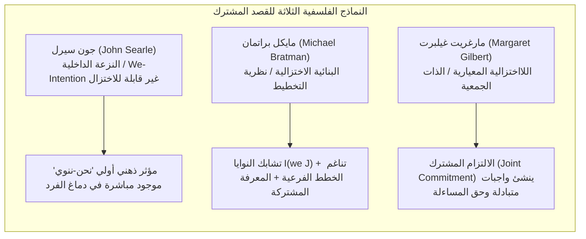
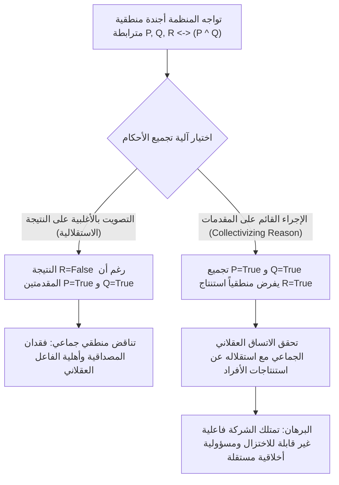
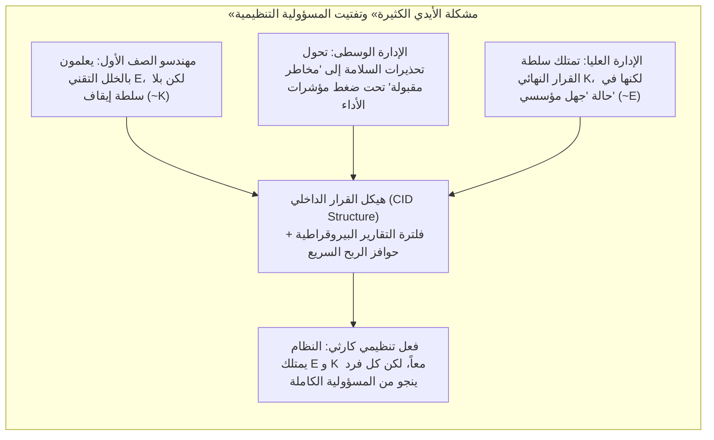

## مقدمة: «لا روح تُلعن، ولا جسد يُركل»

في القرن الثامن عشر، أطلق اللورد المستشار البريطاني البارون إدوارد ثيرلو مقولته الشهيرة: «هل توقعتم يوماً أن يكون لشركة ما ضمير، وهي لا تملك روحاً يمكن أن تُلعن، ولا جسداً يمكن أن يُركل (*no soul to be damned, and no body to be kicked*)؟». طوال قرون، ظل هذا القول المأثور يؤرق فلسفة القانون، والأخلاقيات المعيارية، وعلم اجتماع المنظمات.

عندما تقع كوارث تنظيمية كبرى — مثل غرق عبّارة *Herald of Free Enterprise* عام 1987، أو حوادث تحطم طائرات بوينغ 737 MAX جراء عيوب نظام MCAS والالتفاف على الرقابة، أو انفجار منصة *Deepwater Horizon* التابعة لشركة BP عام 2010، أو الحوادث المميتة للمركبات ذاتية القيادة — تواجه المحاكم والرأي العام مفارقة مقلقة: <strong>لقد وقع ضرر أخلاقي كارثي، ولكن لا يوجد فرد واحد بعينه يجمع في شخصه بشكل كامل بين القصد الجنائي/المعرفي الكامل (mens rea) والسيطرة السببية الكاملة على الفعل (actus reus) كما يشترط القانون الجنائي والأخلاقيات الفردية التقليدية.</strong>

إذا اختزلنا المسؤولية الأخلاقية حصراً في الأخطاء المتعمدة للأفراد المعزولين، فإن الشر البنيوي يتبخر في شقوق تقسيم العمل البيروقراطي. وفي المقابل، إذا قلنا إن «الشركة ذاتها مذنبة أخلاقياً»، يتساءل المتشككون فوراً: كيف يمكن لافتراض قانوني مجرد يتألف من لوائح ومجالس إدارة وخوارزميات أن يمتلك حالات ذهنية أو نوايا أو فاعلية أخلاقية (*moral agency*)؟

يفحص هذا المقال، عند تقاطع الأنطولوجيا الاجتماعية (*Social Ontology*) وفلسفة الفعل ونظرية الاختيار الاجتماعي (*Social Choice Theory*)، الركائز النظرية الخمس للفاعلية الجماعية والمسؤولية الأخلاقية للمؤسسات.

---

## 1. الفردانية المنهجية في مواجهة الواقعية غير الاختزالية

قبل أن نفسر كيف يتصرف الجمع، علينا الإجابة عن سؤال ميتافيزيقي جوهري: هل الجماعات فاعلون حقيقيون في الواقع؟

### 1.1 الفردانية المنهجية والإقصائية (Eliminativism)
من ماكس فيبر وفريدريش هايك إلى فلاسفة الأخلاق التحليليين مثل إتش. دي. لويس ومانويل فيلاسكيز، تصر <strong>الفردانية المنهجية</strong> على أن الأفراد البشريين البيولوجيين وحدهم يمتلكون الوعي والضمير وحرية الإرادة. ويرى فيلاسكيز أن القول بأن «شركة ما قصدت خداع المستهلكين» ليس سوى مجاز بلاغي أو اختصار يعني أن بعض المديرين أو الموظفين داخل الشركة قصدوا ذلك. إن إسناد الذنب الأخلاقي إلى منظمة تفتقر إلى الخبرة الذاتية الشعورية (*qualia*) يمثل <strong>خطأً مقولياً (*Category Mistake*)</strong> بالمعنى الذي قصده غيلبرت رايل، ويؤدي إلى ظلم العقاب الجماعي.

### 1.2 الواقعية غير الاختزالية لفاعلية الجماعة
في المقابل، طوّر بيتر فرينش، ومارغريت غيلبرت، وكريستيان ليست وفيليب بيتيت <strong>واقعية غير اختزالية حول فاعلية الجماعة (*Non-Reductive Realism about Group Agency*)</strong>. وفي كتابهما *Group Agency* (2011)، يبرهن ليست وبيتيت على أن كون الكيان «فاعلاً» (*agent*) لا يتطلب دماغاً بيولوجياً، بل يعتمد على استيفاء ثلاثة شروط <strong>وظيفية (*functionalist*)</strong> دنيا:
1. <strong>حالات تمثيلية (*Representational states*)</strong>: القدرة على تكوين معتقدات أو أحكام حول وقائع البيئة؛
2. <strong>حالات دافعية (*Motivational states*)</strong>: القدرة على تحديد أهداف أو تفضيلات أو غايات معيارية؛
3. <strong>القدرة على التدخل العقلاني (*Capacity to intervene*)</strong>: القدرة على الفعل في العالم بناءً على تلك المعتقدات والأهداف مع الالتزام بمعايير الاتساق العقلاني.

| بُعد المقارنة | الفردانية المنهجية / الإقصائية (Weber, Velasquez) | الواقعية غير الاختزالية / الوظيفية (French, List & Pettit) |
| :--- | :--- | :--- |
| <strong>الوضع الأنطولوجي للجماعة</strong> | مجاز قانوني، استعارة بلاغية، مجرد مجموع لأفعال الأفراد | نظام فاعل مستقل يترتب فوق الأفراد (*supervenes*) لكنه غير قابل للاختزال إليهم |
| <strong>إسناد النوايا والمعتقدات</strong> | يوجد فقط في العقول البيولوجية؛ «نية الشركة» تعبير مجازي | يتحقق فعلياً على مستوى النظام عبر هيكل القرار الداخلي (CID) أو تجميع الأحكام |
| <strong>حامل المسؤولية الأخلاقية</strong> | يقتصر على المديرين أو المهندسين أو المشغلين ذوي الخطأ المباشر | الكيان المؤسسي ذاته يتحمل مسؤولية جماعية غير قابلة للاختزال (دون إعفاء الأفراد المتواطئين) |
| <strong>القدرة التفسيرية في الأزمات</strong> | يسقط في «فراغ المسؤولية» عندما لا يمتلك أي فرد وحده القصد الكامل | يلتقط بدقة الحوافز البنيوية وثقافة المؤسسة وعيوب التصميم المؤسسي |

---

## 2. الأسس الجزئية: القصد المشترك (Shared Intention) والفعل المشترك

عندما يركض شخصان مصادفةً في اللحظة نفسها للاحتماء تحت سقف واحد من مطر مفاجئ، فنحن أمام <strong>مجموع أفعال فردية متوازية</strong> فحسب. أما حين يؤدي راقصان رقصة تانغو معاً، أو يتعاون فريق مهندسين لبناء محطة فضائية، فهذا <strong>فعل مشترك (*Joint Action*)</strong>. ما الذي يحوّل السلوك المتوازي إلى «فعل جماعي» حقيقي؟ قدمت الفلسفة التحليلية المعاصرة ثلاثة نماذج كلاسيكية:

### 2.1 جون سيرل: «نوايا-نحن» غير القابلة للاختزال (We-Intentions)
في كتابه *بناء الواقع الاجتماعي* (1995)، يرفض جون سيرل أي محاولة لاختزال «نحن ننوي فعل $J$» إلى «أنا أنوي فعل حصتي + أعتقد أنك تنوي فعل حصتك». فبدون روح تعاون حقيقية، يظل التنسيق المتبادل بين متنافسين فعلاً فردياً. لذلك يفترض سيرل وجود مؤثر ذهني أولي غير قابل للاختزال مزروع بيولوجياً في ذهن الفرد هو <strong>«نية-نحن» (*We-intention*)</strong>:

$$\text{We-intend}(J) \xrightarrow{\text{causes}} \text{Individual My-part}(A_i)$$

### 2.2 مايكل براتمان: نظرية التخطيط للقصد المشترك (Planning Theory)
يرى مايكل براتمان أن المؤثر الأولي الغامض عند سيرل غير ضروري. فبحسب *نظرية التخطيط* الخاصة به، ينشأ القصد المشترك عندما تشكل النوايا التخطيطية العادية للأفراد <strong>شبكة متشابكة ذات خطط فرعية متناغمة (*interlocking and meshing subplans*)</strong>. يتشارك الفاعلان $A$ و$B$ القصد $I(\text{we } J)$ إذا وفقط إذا:

$$I(\text{we } J) \iff \begin{cases} \text{(1a) } A \text{ intends that we } J, \text{ and (1b) } B \text{ intends that we } J \\ \text{(2) } A \text{ and } B \text{ intend that we } J \text{ by way of each other's intentions and meshing subplans} \\ \text{(3) Conditions (1) and (2) are Common Knowledge between } A \text{ and } B \end{cases}$$

ويعني «تناغم الخطط الفرعية (*meshing subplans*)» التزام الطرفين بالتفاوض لمنع تضارب خططهما الجزئية ومساعدة كل منهما للآخر عند مواجهة العقبات.

### 2.3 مارغريت غيلبرت: نظرية الذات الجمعية (Plural Subject Theory) والالتزام المشترك
تكشف مارغريت غيلبرت عن نقطة عمياء في نموذج براتمان: <strong>الالتزام المعياري (*Normative Obligation*)</strong>. فإذا اتفقنا على التنزه معاً، وفي منتصف الطريق استدرتَ فجأة وغادرت دون كلمة، فإن ما حدث ليس مجرد فشل لتوقعي، بل يثبت لي <strong>الحق المعياري في توبيخك (*standing to rebuke*)</strong>. ترى غيلبرت أن جوهر الفعل المشترك هو <strong>التزام مشترك (*Joint Commitment*)</strong> يصهر عدة أفراد في <strong>ذات جمعية (*Plural Subject*)</strong> واحدة.

---

## 3. المعضلة الاستدلالية ومبرهنة استحالة تجميع الأحكام

إذا كان التنزه بين شخصين يفسره نموذج براتمان، فكيف يمكن لشركة متعددة الجنسيات أو محكمة استئناف أن تصدر <strong>حكماً جماعياً عقلانياً يناقض بشكل مباشر النتيجة الشخصية التي توصل إليها غالبية أعضائها أنفسهم</strong>؟

اكتشف عالما القانون لويس كورنهاوزر ولورنس سيغر هذه الظاهرة تحت اسم <strong>«المفارقة الفقهية» (*Doctrinal Paradox*)</strong>، ثم عممها فيليب بيتيت في الفلسفة تحت اسم <strong>«المعضلة الاستدلالية» (*Discursive Dilemma*)</strong>.

### 3.1 مصفوفة $3 \times 3$ للمعضلة الاستدلالية
لنفترض أن لجنة سلامة طيران مكونة من ثلاثة خبراء (العضو 1، والعضو 2، والعضو 3) تصوّت على قرار السماح لطائرة بالعودة إلى الخدمة (النتيجة $R$). وبموجب لائحة السلامة، يُمنح الترخيص $R$ إذا وفقط إذا تحققت مقدمتان معاً:
* <strong>المقدمة $P$</strong>: اجتاز برنامج التحكم في الطيران اختبارات الأمان الاحتياطية.
* <strong>المقدمة $Q$</strong>: أتم الطيارون التدريب الكامل على أجهزة المحاكاة للظروف القصوى.
* <strong>القاعدة المنطقية</strong>: $R \leftrightarrow (P \land Q)$.

يُدلي الخبراء الثلاثة بأحكامهم الفردية المتسقة منطقياً على النحو التالي:

| عضو اللجنة | المقدمة $P$ (البرنامج آمن) | المقدمة $Q$ (التدريب مكتمل) | القاعدة المنطقية $R \leftrightarrow (P \land Q)$ | النتيجة $R$ (الموافقة على الطيران) |
| :--- | :---: | :---: | :---: | :---: |
| <strong>العضو 1</strong> | صواب (True) | صواب (True) | صواب (True) | <strong>صواب (True)</strong> |
| <strong>العضو 2</strong> | صواب (True) | خطأ (False) | صواب (True) | <strong>خطأ (False)</strong> |
| <strong>العضو 3</strong> | خطأ (False) | صواب (True) | صواب (True) | <strong>خطأ (False)</strong> |
| <strong>حكم الأغلبية (Majority)</strong> | <strong>صواب (2/3 True)</strong> | <strong>صواب (2/3 True)</strong> | <strong>صواب (3/3 True)</strong> | <strong>خطأ (1/3 True) / مفارقة!</strong> |

تأمل السطر الأخير المذهل:
* <strong>الإجراء القائم على النتيجة (*Conclusion-Based Procedure*)</strong>: إذا صوّتت اللجنة مباشرة على النتيجة النهائية $R$، فإن الترخيص <strong>يُرفض بأغلبية صوتين مقابل صوت واحد ($R = \text{False}$)</strong>.
* <strong>الإجراء القائم على المقدمات (*Premise-Based Procedure*)</strong>: إذا صوّتت اللجنة أولاً بشكل منفصل على المقدمتين $P$ و$Q$، فإن $P$ تُقرّ بأغلبية 2:1 (صواب) و$Q$ تُقرّ أيضاً بأغلبية 2:1 (صواب). وبتطبيق القاعدة المنطقية المتفق عليها بالإجماع $R \leftrightarrow (P \land Q)$، تستنتج اللجنة حتماً القرار الجماعي: <strong>الموافقة على الطيران ($R = \text{True}$)</strong> — رغم أن ثلثي الأعضاء يعارضون ذلك شخصياً!

### 3.2 مبرهنة الاستحالة لليست وبيتيت (List-Pettit Theorem)
برهن كريستيان ليست وفيليب بيتيت (2002) على أن هذه المعضلة تمثل تعميماً عميقاً لمبرهنة الاستحالة لكينيث آرو في مجال تجميع الأحكام المنطقية. ليكن $N = \{1, 2, \dots, n\}$ ($n \ge 3$) مجموعة الأفراد و$X$ أجندة من القضايا المترابطة منطقياً. لا توجد أي دالة لتجميع الأحكام

$$F: \{0, 1\}^{n \times |X|} \to \{0, 1\}^{|X|}$$

يمكنها <strong>تحقيق البديهيات الأربع التالية في آن واحد</strong>:
1. <strong>المجال الشامل (*Universal Domain*)</strong>: قبول جميع ملفات الأحكام الفردية المتسقة والكاملة كمدخلات؛
2. <strong>العقلانية الجماعية (*Collective Rationality*)</strong>: إنتاج حكم جماعي متسق وكامل منطقياً كمخرجات؛
3. <strong>عدم التمييز / الإغفال (*Anonymity*)</strong>: تساوي وزن جميع الأفراد (عدم وجود دكتاتور)؛
4. <strong>المنهجية / الاستقلالية (*Systematicity / Independence*)</strong>: يعتمد الحكم الجماعي حول أي قضية $\phi$ حصراً على أصوات الأفراد حول $\phi$ ذاتها وبنفس القاعدة لجميع القضايا.

### 3.3 لماذا يجب «جَمعَنة العقل» (Collectivizing Reason)؟
يبين بيتيت أنه لكي تعمل المنظمة في المجتمع كفاعل عقلاني جدير بالثقة (*conversable agent*)، لا يمكنها الإقرار علناً بصدق $P$ و$Q$ وفي الوقت نفسه إنكار نتيجتهما المنطقية $P \land Q$. لذا يتعين عليها التخلي عن بديهية الاستقلالية وتبني <strong>الإجراء القائم على المقدمات</strong> — أي <strong>«جَمعَنة العقل» (*collectivize reason*)</strong>.

والنتيجة الأنطولوجية لذلك حاسمة: فبمجرد أن تقوم المنظمة بجمعنة العقل على مستوى المقدمات، <strong>ينبثق عقل مؤسسي مستقل لا يمكن اختزال أحكامه ونواياه إلى مجموع الآراء الفردية لأعضائه</strong>. ولأن الشركة تمتلك عقلاً عقلانياً مستقلاً، فإنها تصبح ذاتاً مستقلة تتحمل المسؤولية الأخلاقية.

---

## 4. هيكل القرار الداخلي للشركة (CID) و«مشكلة الأيدي الكثيرة»

### 4.1 هيكل القرار الداخلي (CID) عند بيتر فرينش
منذ عام 1979، جادل بيتر فرينش في مقاله *The Corporation as a Moral Person* بأن الشركات أشخاص أخلاقيون كاملو الأهلية بفضل امتلاكها <strong>هيكل قرار داخلي للشركة (*CID Structure*)</strong> يتكون من عنصرين:
1. <strong>مخطط التدفق التنظيمي للمسؤوليات (*Organizational Flow Chart*)</strong>: البنية النحوية التي تحدد المستويات الإدارية ومسارات المعلومات وسلاسل الاعتماد؛
2. <strong>قواعد الاعتراف بسياسة الشركة (*Corporate Decision Recognition Rules*)</strong>: على غرار «قاعدة الاعتراف» عند هارت، تحدد متى يتم دمج القرارات الفردية المتخذة لأسباب مؤسسية لتصبح رسمياً «قرارات للشركة».

يعمل هيكل CID كمحوّل منطقي يُخضع النوايا البيولوجية المتفرقة للموظفين ويصهرها في <strong>قصدية مؤسسية (*Corporate Intentionality*)</strong> خالصة.

### 4.2 «مشكلة الأيدي الكثيرة» عند دينيس طومسون (Problem of Many Hands)
غير أن هذا التقسيم البيروقراطي الدقيق للعمل يولّد المعضلة الشهيرة التي صاغها دينيس طومسون (1980) باسم <strong>«مشكلة الأيدي الكثيرة» (*The Problem of Many Hands*)</strong>.

في الأخلاقيات التقليدية والقانون الجنائي، تتطلب الإدانة الأخلاقية الكاملة ($C$) أن يجتمع في الفاعل نفسه $x$ كلٌّ من <strong>الشرط المعرفي / القصدي ($E$)</strong> و<strong>شرط السيطرة السببية ($K$)</strong>:

$$C(x) \iff E(x) \land K(x)$$

ولكن في الشركات الكبرى، يؤدي التخصص إلى فصل منهجي بين المعرفة والسيطرة:
* مهندس البرمجيات في المستوى الأدنى يعلم بوجود ثغرة في الكود عند تعطل المستشعر (يمتلك المعرفة الجزئية $E$)، لكنه لا يملك سلطة تعديل البنية العامة أو إيقاف الإطلاق التجاري (يفتقر إلى السيطرة $K$)؛
* الرئيس التنفيذي يمتلك السلطة العليا للتوقيع على الإطلاق (يمتلك السيطرة الكلية $K$)، لكن فلاتر التقارير البيروقراطية ومؤشرات الأداء تحجب عنه التحذيرات التقنية التفصيلية («جهل مؤسسي»، $\neg E$).

ونتيجة لذلك، يتحقق لكل فرد $i \in \{1, \dots, n\}$ داخل المنظمة الشرط $\neg(E(i) \land K(i))$، بينما يمتلك النظام المؤسسي ككل المعرفة والسيطرة معاً! وإذا أنكرنا المسؤولية الأخلاقية الجماعية للشركة، فإن الكوارث النظامية تتحول إلى <strong>انعدام مسؤولية منظم</strong>.

---

## 5. الفاعلية الخوارزمية، فجوة مسؤولية الذكاء الاصطناعي، و«مناطق التهشم الأخلاقي»

في القرن الحادي والعشرين، مع استبدال عقد القرار البيروقراطية بنماذج التعلم العميق والخوارزميات المستقلة، تتطور «مشكلة الأيدي الكثيرة» إلى أزمتين جديدتين في أخلاقيات التكنولوجيا:

### 5.1 «فجوة المسؤولية» (Responsibility Gap) عند أندرياس ماتياس
أشار أندرياس ماتياس (2004) إلى أن مسؤولية المنتج أو المشغل التقليدية تفترض إمكانية التنبؤ بسلوك الآلة بناءً على قواعد تصميمها. غير أن أنظمة التعلم المعزز العميق والنماذج اللغوية الكبيرة الحديثة تعدل أوزانها الداخلية أثناء التشغيل وتتسم بـ<strong>العتامة المعرفية (*opacity*)</strong>. فعندما يتخذ ذكاء اصطناعي طبي أو نظام قيادة ذاتية قراراً قاتلاً لم يكن بوسع حتى مصمميه التنبؤ به، يكون من الظلم تحميل المبرمج ذنباً أخلاقياً شخصياً، في حين لا تملك الآلة وعياً يتألم ولا ذمة مالية تُعاقب — فتنشأ <strong>«فجوة المسؤولية» (*Responsibility Gap*)</strong>.

### 5.2 «مناطق التهشم الأخلاقي» (Moral Crumple Zones) عند مادلين كلير إليش
كشفت عالمة الأنثروبولوجيا مادلين كلير إليش (2019)، من خلال دراسة حوادث الطيران الآلي وأنظمة مساعدة السائق، عن ظاهرة مؤسسية شديدة النفاق هي <strong>«مناطق التهشم الأخلاقي» (*Moral Crumple Zones*)</strong>.

في هندسة السيارات، تُصمم منطقة التهشم الميكانيكية (*crumple zone*) في مقدمة المركبة لكي تنبعج عند الاصطدام وتمتص الطاقة الحركية لحماية الركاب بالداخل. أما في الأنظمة التقنية-الاجتماعية الهجينة (*Human-in-the-Loop*)، فإن <strong>المشغل البشري الموجود في الحلقة الأخيرة (سائق الأمان، الممرضة المناوبة، مساعد الطيار) يُستخدم مؤسسياً بوصفه «منطقة تهشم أخلاقي» تمتص كامل الصدمة القانونية والأخلاقية لحماية شركة التكنولوجيا وبنيتها الخوارزمية المعيبة</strong>. فالشركة تجني ثمار الكفاءة والسمعة التجارية للأتمتة، لكنها تشترط في عقودها أن يتدخل الإنسان لاستعادة السيطرة على خوارزمية معقدة خرجت عن المسار خلال نصف ثانية؛ وعند وقوع الكارثة، يُلقى اللوم كله على «الخطأ البشري» للمشغل الميداني.

### 5.3 «نموذج الترابط الاجتماعي» (Social Connection Model) عند إيريس ماريون يونغ
لتجاوز مأزق الأيدي الكثيرة ومناطق التهشم الأخلاقي، تميز الفيلسوفة السياسية إيريس ماريون يونغ في كتابها *Responsibility for Justice* (2011) بين نموذجين للمسؤولية:
1. <strong>نموذج المساءلة التراجعي (*Backward-Looking Liability Model*)</strong>: يبحث عن الجاني السببي في الماضي لمعاقبته، لكنه يعجز أمام المظالم البنيوية أو يحول الحلقات الأضعف إلى أكباش فداء؛
2. <strong>نموذج الترابط الاجتماعي المستقبلي (*Forward-Looking Social Connection Model*)</strong>: جميع الفاعلين الذين يشاركون في العمليات المؤسسية والخوارزمية ويستفيدون منها يتقاسمون <strong>واجباً سياسياً وأخلاقياً موجهاً نحو المستقبل</strong> لإصلاح هياكل صنع القرار (CID) المنتجة للضرر بصورة جماعية.

---

## خاتمة: إعادة بناء المساءلة الدستورية للتجمعات الهجينة

من سخرية البارون ثيرلو من الشركة «عديمة الروح»، مروراً بتحليلات سيرل وبراتمان وغيلبرت للقصد المشترك، وصولاً إلى المعضلة الاستدلالية عند بيتيت وهيكل CID عند فرينش، أثبتت الفلسفة المعاصرة بما لا يدع مجالاً للشك أن <strong>الشركات والمنظمات المعقدة ليست مجرد مجاميع حسابية للأفراد، بل هي فاعلون جماعيون منبثقون يمتلكون منطقاً عقلانياً مستقلاً وقدرة سببية هائلة</strong>.

واليوم، حيث يتشابك البشر والخوارزميات المستقلة لتشكيل <strong>«تجمعات هجينة» (*Hybrid Collectives*)</strong>، فإن الاعتراف بالمسؤولية الأخلاقية غير القابلة للاختزال للمنظمات لا يهدف إطلاقاً إلى تبرئة المديرين الفاسدين، بل إلى تحطيم درع الإفلات من العقاب المتمثل في «مشكلة الأيدي الكثيرة» وآلية كبش الفداء في «مناطق التهشم الأخلاقي» — وإخضاع الدستور المؤسسي وحوكمة الخوارزميات ذاتها لميزان العدالة.
