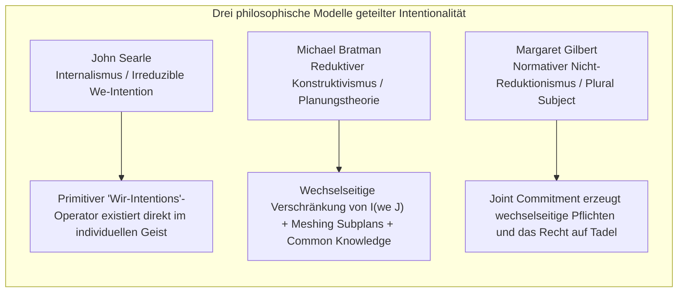
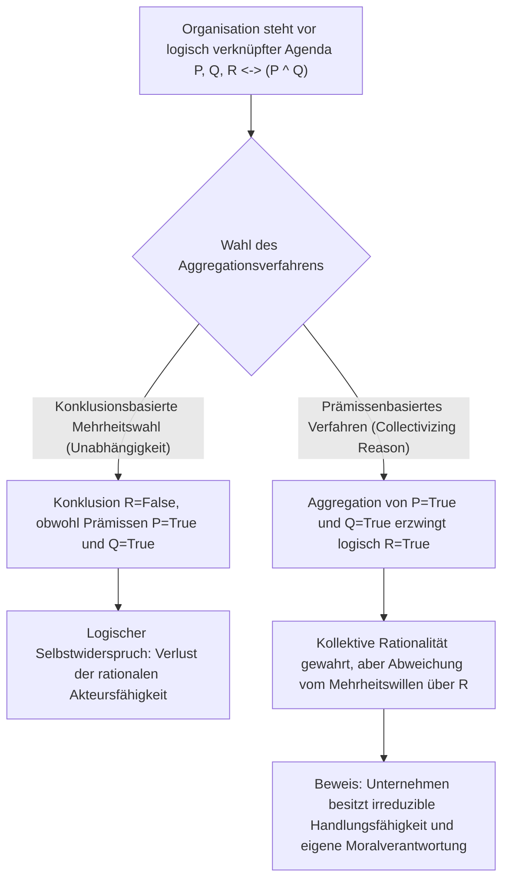
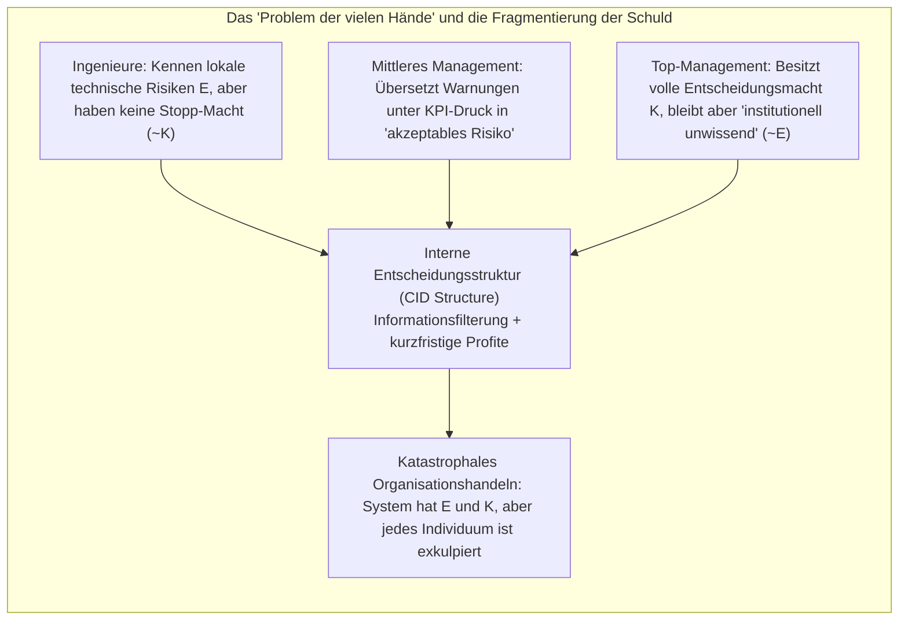

## Einleitung: „Keine Seele, die verdammt, und kein Körper, der getreten werden kann“

Im 18. Jahrhundert prägte der britische Lordkanzler Baron Edward Thurlow ein berühmtes Bonmot: „Haben Sie jemals erwartet, dass eine Kapitalgesellschaft ein Gewissen hat, wo sie doch keine Seele besitzt, die verdammt, und keinen Körper, der getreten werden kann (*no soul to be damned, and no body to be kicked*)?“ Seit Jahrhunderten verfolgt dieses Diktum die Rechtsphilosophie, die normative Ethik und die Organisationssoziologie.

Wenn katastrophale Organisationsversagen eintreten – wie das Kentern der Fähre *Herald of Free Enterprise* (1987), die Abstürze der Boeing 737 MAX infolge fehlerhafter MCAS-Architektur und regulatorischer Täuschung, die Explosion der Bohrinsel *Deepwater Horizon* (2010) oder tödliche Unfälle mit autonomen Fahrzeugen –, stehen Gerichte und Öffentlichkeit vor einem beunruhigenden Paradoxon: <strong>Es wurde ein massiver moralischer Schaden verursacht, doch kein einzelnes menschliches Individuum vereint in sich vollständig sowohl die subjektive Schuld (mens rea / Wissen und Absicht) als auch die kausale Tatherrschaft (actus reus), die das klassische Strafrecht und die Individualethik für eine volle Schuldzuschreibung verlangen.</strong>

Reduzieren wir moralische Verantwortung ausschließlich auf das vorsätzliche oder fahrlässige Handeln isolierter Einzelpersonen, verdampft systemisches Unrecht in den Zwischenräumen arbeitsteiliger Bürokratien. Behaupten wir hingegen, „der Konzern selbst ist moralisch schuldig“, fragen Skeptiker sofort: Wie kann eine abstrakte juristische Fiktion aus Satzungen, Vorstandsbeschlüssen und Algorithmen mentale Zustände, Intentionen oder moralische Handlungsfähigkeit (*moral agency*) besitzen?

Dieser Beitrag untersucht aus der Perspektive der Sozialontologie (*Social Ontology*), der Handlungstheorie und der Sozialwahltheorie (*Social Choice Theory*) die fünf zentralen Säulen kollektiver Handlungsfähigkeit und korporativer Verantwortung.

---

## 1. Methodologischer Individualismus versus nicht-reduktiver Realismus

Bevor wir klären können, wie Kollektive handeln, müssen wir eine grundlegende metaphysische Frage beantworten: Sind Kollektive überhaupt reale Akteure?

### 1.1 Methodologischer Individualismus und Eliminativismus
Von Max Weber und Friedrich August von Hayek bis zu analytischen Ethikern wie H. D. Lewis und Manuel Velasquez vertritt der <strong>methodologische Individualismus</strong> die These, dass ausschließlich biologische menschliche Individuen Bewusstsein, Gewissen und Willensfreiheit besitzen. Velasquez argumentiert, die Aussage „Unternehmen X beabsichtigte, Verbraucher zu täuschen“ sei lediglich eine rhetorische Metapher oder Abkürzung für den Sachverhalt, dass bestimmte Manager oder Ingenieure innerhalb des Unternehmens täuschen wollten. Organisationen ohne phänomenales Bewusstsein (*Qualia*) moralische Schuld zuzuschreiben, begehe einen <strong>Kategorienfehler (Category Mistake)</strong> im Sinne Gilbert Ryles und führe zu ungerechter Kollektivhaftung.

### 1.2 Nicht-reduktiver Realismus kollektiver Akteure
Demgegenüber haben Peter French, Margaret Gilbert sowie Christian List und Philip Pettit einen <strong>nicht-reduktiven Realismus über Gruppenakteure (*Non-Reductive Realism about Group Agency*)</strong> entwickelt. In *Group Agency* (2011) zeigen List und Pettit, dass der Status eines Akteurs (*agent*) kein biologisches Gehirn voraussetzt, sondern auf drei <strong>funktionalistischen</strong> Mindestbedingungen beruht:
1. <strong>Repräsentationale Zustände (Representational states)</strong>: Die Fähigkeit, Überzeugungen oder Urteile über Tatsachen in der Umwelt zu bilden.
2. <strong>Motivationale Zustände (Motivational states)</strong>: Die Fähigkeit, Ziele, Präferenzen oder normative Vorgaben zu verfolgen.
3. <strong>Rationale Interventionsfähigkeit (Capacity to intervene)</strong>: Die Fähigkeit, auf Basis dieser Überzeugungen und Ziele unter Wahrung rationaler Konsistenz in die Welt einzugreifen.

| Vergleichsdimension | Methodologischer Individualismus / Eliminativismus (Weber, Velasquez) | Nicht-reduktiver Realismus / Funktionalismus (French, List & Pettit) |
| :--- | :--- | :--- |
| <strong>Ontologischer Status der Gruppe</strong> | Juristische Fiktion, bloße Metapher, Aggregat individueller Handlungen | Auf Individuen supervenierendes, aber irreduzibles autonomes Handlungssystem |
| <strong>Zuschreibung von Intentionen</strong> | Existiert nur in biologischen Köpfen; „Unternehmensabsicht“ ist figurativ | Wird durch interne Entscheidungsstrukturen (CID) oder Urteilsaggregation real instanziiert |
| <strong>Träger moralischer Verantwortung</strong> | Ausschließlich direkt schuldhafte Manager, Ingenieure oder Operatoren | Die Korporation selbst trägt irreduzible Kollektivschuld (neben individueller Mitschuld) |
| <strong>Erklärungskraft bei Systemkrisen</strong> | Führt oft zu „Verantwortungslücken“, da kein Einzelner den vollen Vorsatz hat | Erfasst strukturelle Fehlanreize, Unternehmenskultur und institutionelles Design präzise |

---

## 2. Mikrofundierung: Geteilte Intentionalität (Shared Intention) und gemeinsames Handeln

Wenn zwei Passanten bei plötzlichem Platzregen zufällig gleichzeitig unter dasselbe Vordach rennen, liegt lediglich eine <strong>Summe paralleler Einzelhandlungen</strong> vor. Wenn jedoch zwei Menschen gemeinsam Tango tanzen oder ein Ingenieurteam ein Flugzeug baut, handelt es sich um <strong>gemeinsames Handeln (*Joint Action*)</strong>. Was unterscheidet paralleles Verhalten von echtem „Wir-Handeln“? Die zeitgenössische analytische Philosophie hat hierzu drei klassische Modelle entworfen:

### 2.1 John Searle: Irreduzible „Wir-Intentionen“ (We-Intentions)
In *The Construction of Social Reality* (1995) weist John Searle jeden Versuch zurück, „Wir beabsichtigen $J$“ auf eine Kombination aus „Ich beabsichtige meinen Teil“ plus wechselseitige Erwartungen zu reduzieren. Selbst wenn zwei Konkurrenten das Verhalten des jeweils anderen exakt kennen und einplanen, fehlt ohne echten Kooperationsgeist das gemeinsame Handeln. Searle postuliert daher einen biologisch verankerten, irreduziblen mentalen Operator im individuellen Geist – die <strong>Wir-Intention (*We-intention*)</strong>:

$$\text{We-intend}(J) \xrightarrow{\text{causes}} \text{Individual My-part}(A_i)$$

### 2.2 Michael Bratman: Die Planungstheorie geteilter Intentionalität (Planning Theory)
Michael Bratman hält Searles „mysteriösen primitiven Operator“ für überflüssig. Nach seiner *Planning Theory of Intention* entsteht geteilte Intentionalität durch ein spezifisches <strong>ineinandergreifendes Netzwerk individueller Planungsintentionen (*interlocking and meshing web of intentions*)</strong>. Zwei Akteure $A$ und $B$ teilen die Intention $I(\text{we } J)$ genau dann, wenn gilt:

$$I(\text{we } J) \iff \begin{cases} \text{(1a) } A \text{ intends that we } J, \text{ and (1b) } B \text{ intends that we } J \\ \text{(2) } A \text{ and } B \text{ intend that we } J \text{ by way of each other's intentions and meshing subplans} \\ \text{(3) Conditions (1) and (2) are Common Knowledge between } A \text{ and } B \end{cases}$$

„Ineinandergreifende Teilpläne (*meshing subplans*)“ bedeuten dabei, dass die Beteiligten sich verpflichten, ihre jeweiligen Ausführungsschritte widerspruchsfrei aufeinander abzustimmen und sich bei Hindernissen gegenseitig zu unterstützen.

### 2.3 Margaret Gilbert: Die Theorie des pluralen Subjekts (Plural Subject Theory)
Margaret Gilbert deckt einen blinden Fleck in Bratmans Modell auf: die <strong>normative Bindung (*Normative Obligation*)</strong>. Wenn zwei Personen vereinbaren, gemeinsam spazieren zu gehen, und eine Person plötzlich wortlos umdreht, ist nicht bloß eine prognostische Erwartung enttäuscht – der andere hat das <strong>Recht zum Tadel (*standing to rebuke*)</strong>. Für Gilbert beruht geteilte Intentionalität auf einer <strong>gemeinsamen Selbstverpflichtung (*Joint Commitment*)</strong>, durch die mehrere Individuen zu einem <strong>pluralen Subjekt (*Plural Subject*)</strong> verschmelzen, aus dem kein Einzelner ohne Zustimmung der anderen einseitig austreten darf.

---

## 3. Das diskursive Dilemma und das Unmöglichkeitstheorem der Urteilsaggregation

Während ein Spaziergang zu zweit noch mit Bratmans Planungstheorie erklärbar ist, stellt sich bei großen Kapitalgesellschaften, Zentralbanken oder Berufungsgerichten eine radikalere Frage: Wie kann eine Organisation zu einem rationalen <strong>kollektiven Urteil gelangen, das den persönlichen Schlussfolgerungen der Mehrheit ihrer eigenen Mitglieder direkt widerspricht</strong>?

Dieses Phänomen wurde in der Rechtswissenschaft von Lewis Kornhauser und Lawrence Sager als <strong>„doktrinales Paradoxon“ (*Doctrinal Paradox*)</strong> entdeckt und von Philip Pettit als <strong>„diskursives Dilemma“ (*Discursive Dilemma*)</strong> verallgemeinert.

### 3.1 Die $3 \times 3$-Matrix des diskursiven Dilemmas
Nehmen wir an, ein dreiköpfiges Sicherheitskomitee einer Fluggesellschaft (Mitglied 1, 2 und 3) muss entscheiden, ob ein Flugzeugtyp nach einem Zwischenfall wieder für den Flugbetrieb freigegeben wird (Konklusion $R$). Nach den Sicherheitsstatuten gilt die logische Regel, dass die Freigabe $R$ genau dann erfolgt, wenn zwei Prämissen zugleich erfüllt sind:
* <strong>Prämisse $P$</strong>: Die Flugsteuerungssoftware hat alle Redundanztests bestanden.
* <strong>Prämisse $Q$</strong>: Die Piloten haben das vollständige Simulatortraining für Extremszenarien absolviert.
* <strong>Logische Verknüpfung</strong>: $R \leftrightarrow (P \land Q)$.

Die drei Experten geben nun folgende individuell vollkommen konsistente Urteile ab:

| Komiteemitglied | Prämisse $P$ (Software sicher) | Prämisse $Q$ (Training erfüllt) | Logische Regel $R \leftrightarrow (P \land Q)$ | Konklusion $R$ (Flugfreigabe erteilen) |
| :--- | :---: | :---: | :---: | :---: |
| <strong>Mitglied 1</strong> | Wahr (True) | Wahr (True) | Wahr (True) | <strong>Wahr (True)</strong> |
| <strong>Mitglied 2</strong> | Wahr (True) | Falsch (False) | Wahr (True) | <strong>Falsch (False)</strong> |
| <strong>Mitglied 3</strong> | Falsch (False) | Wahr (True) | Wahr (True) | <strong>Falsch (False)</strong> |
| <strong>Mehrheitsvotum (Majority)</strong> | <strong>Wahr (2/3 True)</strong> | <strong>Wahr (2/3 True)</strong> | <strong>Wahr (3/3 True)</strong> | <strong>Falsch (1/3 True) / Paradoxon!</strong> |

Betrachten wir die letzte Zeile:
* <strong>Konklusionsbasiertes Verfahren (*Conclusion-Based Procedure*)</strong>: Stimmt das Gremium direkt über die Konklusion $R$ ab, wird die Flugfreigabe mit 1:2 Stimmen <strong>abgelehnt ($R = \text{False}$)</strong>.
* <strong>Prämissenbasiertes Verfahren (*Premise-Based Procedure*)</strong>: Stimmt das Gremium zuerst separat über die Prämissen $P$ und $Q$ ab, wird $P$ mit 2:1 als wahr und $Q$ ebenfalls mit 2:1 als wahr festgestellt. Aus der einstimmig akzeptierten Regel $R \leftrightarrow (P \land Q)$ folgt dann zwingend die kollektive Entscheidung: <strong>Die Flugfreigabe wird erteilt ($R = \text{True}$)</strong> – obwohl zwei Drittel der Mitglieder persönlich gegen die Freigabe sind!

### 3.2 Das List-Pettit-Unmöglichkeitstheorem der Urteilsaggregation
Christian List und Philip Pettit (2002) haben bewiesen, dass dieses Dilemma kein Zufall ist, sondern eine logische Verallgemeinerung von Kenneth Arrows Unmöglichkeitstheorem darstellt. Sei $N = \{1, 2, \dots, n\}$ ($n \ge 3$) die Menge der Individuen und $X$ eine logisch verknüpfte Agenda von Aussagen. Eine Urteilsaggregationsfunktion

$$F: \{0, 1\}^{n \times |X|} \to \{0, 1\}^{|X|}$$

kann <strong>niemals gleichzeitig die folgenden vier Axiome erfüllen</strong>:
1. <strong>Universeller Definitionsbereich (*Universal Domain*)</strong>: Alle logisch konsistenten und vollständigen individuellen Urteilsprofile sind als Input zulässig.
2. <strong>Kollektive Rationalität (*Collective Rationality*)</strong>: Das aggregierte kollektive Urteil muss selbst logisch konsistent und vollständig sein.
3. <strong>Anonymität (*Anonymity*)</strong>: Alle Individuen haben gleiches Stimmgewicht (kein Diktator).
4. <strong>Systematizität / Unabhängigkeit (*Systematicity / Independence*)</strong>: Das kollektive Urteil über eine Aussage $\phi$ hängt ausschließlich von den individuellen Urteilen über $\phi$ ab, nach derselben Regel für alle Aussagen.

### 3.3 Die „Kollektivierung der Vernunft“ (Collectivizing Reason)
Pettit zeigt: Um als glaubwürdiger, ansprechbarer Akteur (*conversable agent*) im öffentlichen Raum zu bestehen, darf eine Organisation sich nicht in logische Selbstwidersprüche verwickeln. Sie muss daher das Axiom der Systematizität aufgeben und das <strong>prämissenbasierte Verfahren</strong> wählen – sie muss <strong>„die Vernunft kollektivieren“ (*collectivize reason*)</strong>.

Dies hat eine fundamentale ontologische Konsequenz: Sobald eine Organisation ihre Vernunft auf der Ebene der Prämissen kollektiviert, <strong>emergiert ein autonomer korporativer Geist, dessen Urteile und Absichten sich radikal von den individuellen Meinungen seiner Mitglieder abkoppeln können</strong>. Und genau weil die Korporation einen solchen irreduziblen Willen besitzt, ist sie ein eigenständiges Subjekt moralischer Verantwortung.

---

## 4. Interne Entscheidungsstrukturen (CID) und das „Problem der vielen Hände“

### 4.1 Peter Frenchs CID-Struktur (Corporate Internal Decision Structure)
Bereits 1979 argumentierte Peter French in *The Corporation as a Moral Person*, dass Unternehmen vollwertige moralische Personen sind, weil sie über eine <strong>Corporate Internal Decision (CID) Structure</strong> verfügen. Diese besteht aus zwei Komponenten:
1. <strong>Organisationsablaufplan (*Organizational Flow Chart*)</strong>: Die syntaktische Struktur der Kompetenzebenen, Berichtswege und Prüfschleifen.
2. <strong>Anerkennungsregeln der Unternehmenspolitik (*Corporate Decision Recognition Rules*)</strong>: In Anlehnung an H. L. A. Harts *Rule of Recognition* legen diese Regeln fest, wann Einzelentscheidungen als Ausdruck der Unternehmensziele gelten und zu einer offiziellen „Entscheidung des Unternehmens“ synthetisiert werden.

Durch die CID-Struktur werden die biologischen Einzelabsichten der Mitarbeiter transformiert, untergeordnet und zu einer eigenständigen <strong>korporativen Intentionalität</strong> verschmolzen.

### 4.2 Dennis Thompsons „Problem der vielen Hände“ (Problem of Many Hands)
Gleichzeitig erzeugt diese arbeitsteilige Bürokratie jedoch ein tiefes ethisches Dilemma, das Dennis Thompson (1980) als <strong>„Problem der vielen Hände“ (*The Problem of Many Hands*)</strong> bezeichnet hat.

In der klassischen Ethik und im Strafrecht setzt volle moralische Schuld ($C$) voraus, dass ein und derselbe Akteur $x$ sowohl die <strong>epistemische Bedingung / Wissen und Vorsatz ($E$)</strong> als auch die <strong>kausale Kontrollbedingung ($K$)</strong> erfüllt:

$$C(x) \iff E(x) \land K(x)$$

In komplexen Großorganisationen spaltet die Arbeitsteilung diese beiden Bedingungen systematisch auf:
* Der Softwareingenieur auf der unteren Ebene kennt die spezifische Verwundbarkeit eines Algorithmus bei Sensorausfall (besitzt lokales Wissen $E$), hat aber keinerlei Befugnis, das Systemdesign zu ändern oder den Marktstart zu stoppen (keine Kontrolle $K$).
* Der Vorstandsvorsitzende besitzt die volle Entscheidungsmacht über die Markteinführung (globale Kontrolle $K$), wird jedoch durch bürokratische Filtermechanismen und KPI-Berichte von den technischen Warnungen abgeschirmt („institutionelle Unwissenheit“, $\neg E$).

Folglich gilt für jedes einzelne Individuum $i \in \{1, \dots, n\}$ innerhalb der Organisation $\neg(E(i) \land K(i))$, während das Gesamtsystem sowohl über das Wissen als auch über die Handlungsmacht verfügte! Ohne ein Konzept korporativer Kollektivverantwortung entsteht eine fatale <strong>organisierte Unverantwortlichkeit</strong>.

---

## 5. Algorithmische Akteure, KI-Verantwortungslücken und „Moralische Knautschzonen“

Im 21. Jahrhundert, in dem bürokratische Entscheidungsknoten zunehmend durch Deep-Learning-Modelle und autonome Algorithmen ersetzt werden, verschärft sich das Problem der vielen Hände zu zwei neuen technikethischen Krisen:

### 5.1 Andreas Matthias’ „Verantwortungslücke“ (Responsibility Gap)
Andreas Matthias (2004) wies darauf hin, dass traditionelle Produkthaftung und Bedienerverantwortung voraussetzen, dass das Systemverhalten anhand der Konstruktionsregeln vorhersehbar ist. Moderne selbstlernende KI-Systeme (wie Deep Reinforcement Learning oder große Sprachmodelle) verändern jedoch ihre internen Gewichtungen im laufenden Betrieb und zeichnen sich durch <strong>epistemische Opazität (Black-Box-Charakter)</strong> aus. Trifft ein autonomes Waffensystem oder ein medizinisches Diagnose-KI-System eine tödliche Fehlentscheidung, die selbst für die Programmierer unvorhersehbar war, lässt sich die Schuld weder gerecht auf den Entwickler noch auf die empfindungsunfähige Maschine übertragen – es klafft eine <strong>Verantwortungslücke (*Responsibility Gap*)</strong>.

### 5.2 Madeleine Clare Elishs „Moralische Knautschzonen“ (Moral Crumple Zones)
Die Anthropologin Madeleine Clare Elish (2019) hat anhand von Flugzeugabstürzen und Unfällen mit Fahrerassistenzsystemen ein hochgradig heuchlerisches Muster aufgedeckt: <strong>„Moralische Knautschzonen“ (*Moral Crumple Zones*)</strong>.

In der Automobiltechnik dient die mechanische Knautschzone dazu, sich beim Aufprall zu verformen und die Energie zu absorbieren, um die Insassen zu schützen. In komplexen Mensch-Maschine-Systemen (*Human-in-the-Loop*) hingegen <strong>fungiert der menschliche Operator am Ende der Kette (der Sicherheitsfahrer, die Krankenschwester, der Copilot) als „moralische Knautschzone“, die den gesamten rechtlichen und moralischen Aufprall absorbiert, um das Technologieunternehmen und dessen fehlerhafte Systemarchitektur zu schützen</strong>. Unternehmen verbuchen die Effizienzgewinne der Automatisierung für sich, verlangen aber in ihren Nutzungsbedingungen, dass der Mensch ein plötzlich versagendes System innerhalb von Sekundenbruchteilen übernimmt. Scheitert dies, wird der Unfall als „menschliches Versagen“ deklariert, während das strukturelle Systemdesign unangetastet bleibt.

### 5.3 Iris Marion Youngs „Modell sozialer Verbundenheit“ (Social Connection Model)
Um das Problem der vielen Hände und die Falle der moralischen Knautschzonen zu überwinden, unterscheidet die politische Philosophin Iris Marion Young in *Responsibility for Justice* (2011) zwei Modelle von Verantwortung:
1. <strong>Rückwärtsgewandtes Haftungsmodell (*Backward-Looking Liability Model*)</strong>: Sucht nach dem einzelnen kausalen Schuldigen in der Vergangenheit – und versagt regelmäßig bei strukturellem Unrecht oder opfert schwache Glieder in der Kette als Sündenböcke.
2. <strong>Vorwärtsgewandtes Modell sozialer Verbundenheit (*Forward-Looking Social Connection Model*)</strong>: Alle Akteure, die durch Institutionen, Lieferketten oder technologische Architekturen an einem strukturellen Prozess teilhaben und von ihm profitieren, tragen eine <strong>gemeinsame, zukunftsgerichtete Pflicht</strong>, die schadenserzeugenden Entscheidungsstrukturen (CID) selbst kollektiv umzugestalten.

---

## Fazit: Konstitutionelle Rechenschaftspflicht für hybride Kollektive

Von Baron Thurlows Spott über die „seelenlose Korporation“ über Searles, Bratmans und Gilberts Analysen geteilter Intentionalität bis hin zu Pettits diskursivem Dilemma und Frenchs CID-Struktur hat die moderne Philosophie unwiderlegbar gezeigt: <strong>Unternehmen und hochgradig vernetzte Organisationen sind keine bloßen Summen von Einzelpersonen, sondern emergente kollektive Akteure mit eigener Rationalitätslogik und enormer kausaler Macht.</strong>

In einer Welt, in der Menschen und autonome Algorithmen zu <strong>hybriden Kollektiven (*Hybrid Collectives*)</strong> verschmelzen, dient die Anerkennung irreduzibler korporativer Verantwortung nicht dazu, verantwortungslose Manager zu entlasten. Sie ist vielmehr das unverzichtbare Instrument, um den Schutzschild des „Problems der vielen Hände“ und den Sündenbock-Mechanismus „moralischer Knautschzonen“ zu durchbrechen – und die Unternehmensverfassung sowie das Design soziotechnischer Systeme selbst unter moralische Rechenschaftspflicht zu stellen.
