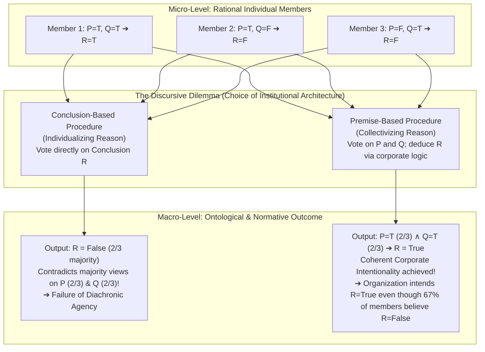

## Introduction: "No Soul to Be Damned, and No Body to Be Kicked"

In the late eighteenth century, Edward Thurlow, 1st Baron Thurlow and Lord Chancellor of Great Britain, delivered a blistering epigram regarding the moral status of corporations that continues to haunt legal theory, business ethics, and analytic metaphysics to this day:

> <strong>"Did you ever expect a corporation to have a conscience, when it has no soul to be damned, and no body to be kicked?"</strong>

Most of the gravest catastrophes of the modern world are not perpetrated by lone villains acting out of unified, cold-blooded malice. Consider the capsizing of the roll-on/roll-off ferry *Herald of Free Enterprise* off the port of Zeebrugge in 1987, which killed 193 passengers and crew in ninety seconds after departing with its bow doors wide open; the 2010 *Deepwater Horizon* blowout in the Gulf of Mexico; the Boeing 737 MAX crashes of 2018 and 2019 involving the Maneuvering Characteristics Augmentation System (MCAS); or systemic financial fraud and anthropogenic ecological devastation. At the epicenter of each catastrophe stands a <strong>complex formal organization</strong>.

Yet whenever public inquiries, parliamentary commissions, or criminal trials convene in the aftermath of such organizational disasters, a deeply unsettling paradox emerges. Frontline operators testify that they were merely following tightly coupled standard operating procedures under relentless scheduling pressures imposed from above. Middle managers explain that hazard reports never crossed their desks in the prescribed bureaucratic format. Specialized engineers demonstrate that their isolated software or hardware modules functioned strictly within the formal specifications provided to them. And corporate executives and boards of directors insist that they consistently promulgated high-level safety policies and could not possibly micro-manage every technical detail across tens of thousands of employees. Crucially, in many instances, none of these individuals are lying. Within a massively differentiated bureaucratic hierarchy, it frequently happens that <strong>no single human being intended the catastrophic outcome, and no single human being simultaneously possessed both the complete epistemic foresight (*mens rea*) and the unilateral causal control (*actus reus*) required to bear full moral blame for the tragedy.</strong>

This confronts contemporary philosophy with a foundational puzzle at the intersection of <strong>Social Ontology</strong>, <strong>Action Theory</strong>, <strong>Social Choice Theory</strong>, and <strong>Normative Ethics</strong>: <strong>How can an organization be held morally and legally responsible as an autonomous agent when no single individual decided alone?</strong>

In this article, we subject this question to rigorous philosophical and mathematical analysis. In Section 1, we examine the classical clash between <strong>Methodological Individualism / Eliminativism</strong> (Max Weber, Friedrich Hayek, H.D. Lewis, Manuel Velasquez) and <strong>Non-Reductive Corporate Moral Agency</strong> (Peter French, Margaret Gilbert, Christian List, and Philip Pettit). In Section 2, we investigate the micro-foundations of acting together by comparing the three monumental theories of <strong>Shared Intention and Joint Action</strong> developed by <strong>John Searle</strong>, <strong>Michael Bratman</strong>, and <strong>Margaret Gilbert</strong>. In Section 3, we present the mathematical centerpiece of contemporary social ontology: the <strong>Doctrinal Paradox</strong> (Kornhauser & Sager, 1986), Philip Pettit's <strong>Discursive Dilemma</strong> (2001), and the <strong>List-Pettit Judgment Aggregation Impossibility Theorem</strong> (2002). Using formal truth-table matrices, we demonstrate why a rational organization must *"collectivize reason"* via premise-based aggregation—and why this inevitably creates situations where <strong>an organization rationally forms a collective intention or belief that a two-thirds majority (or even 100%) of its own individual members personally reject</strong>. In Section 4, we analyze <strong>Peter French's Corporate Internal Decision (CID) Structure</strong> alongside <strong>Dennis Thompson's Problem of Many Hands</strong>, illustrating their real-world mechanics through the *Herald of Free Enterprise* inquiry. Finally, in Section 5, we examine how corporate responsibility interacts with individual responsibility, extending our framework to <strong>Andreas Matthias's AI Responsibility Gap</strong>, Madeleine Clare Elish's <strong>"Moral Crumple Zones,"</strong> and <strong>Iris Marion Young's Social Connection Model</strong> of forward-looking responsibility.

---

## 1. Methodological Individualism vs. Corporate Moral Agency

Whenever we speak of a corporation "knowing" about a defect, a central bank "intending" to curb inflation, or a government "owing" an apology, we attribute intentional states and moral agency to a group. The first philosophical question is whether such attributions are literal truths or mere figures of speech.

### 1.1 Methodological Individualism and Moral Eliminativism

Throughout much of the nineteenth and twentieth centuries, the orthodox stance in Anglo-American philosophy and social science was <strong>Methodological Individualism</strong>, coupled with <strong>Ontological Eliminativism</strong> about group minds. According to this view, only individual biological human beings possess consciousness, beliefs, desires, intentions, and free will; consequently, only individuals can perform genuine actions and bear authentic moral responsibility.

In the opening chapter of *Economy and Society* (1922), Max Weber laid down the foundational maxim of interpretive sociology: social collectivities such as states, corporations, joint-stock companies, and foundations must be treated solely as the resultant modes of organization of the particular acts of individual persons, since <strong>only individuals can be treated as agents in a course of subjectively understandable action</strong>. Friedrich Hayek and Karl Popper similarly championed methodological individualism as an indispensable bulwark against Hegelian or collectivist metaphysics, warning that reifying "society," "the class," or "the state" into a conscious super-person paves the road to totalitarianism.

In moral philosophy, H.D. Lewis gave this individualist ontology its sharpest ethical edge in his classic 1948 essay *"Collective Responsibility."* Lewis argued that moral guilt cannot be shared out or attributed to an abstract collectivity without reverting to tribal <strong>barbarism</strong>:

> *"Value belongs to the individual and it is the individual alone that is morally responsible... No one can be responsible, in the properly ethical sense, for the conduct of another."*

In contemporary business ethics, theorists such as Manuel Velasquez (1983, 2003) and John Hasnas have defended this <strong>reductive / fiction theory of the corporation</strong>. For Velasquez, a corporation is merely a nexus of contracts and legal rules among human individuals. While we may metaphorically say "Corporation $X$ polluted the river," this statement is strictly elliptical for a conjunction of statements about specific corporate officers, managers, and workers. Because intentionality and causal agency originate solely inside human minds and bodies, attributing irreducible moral blame to the corporate entity itself either commits a category mistake (reifying a legal fiction into a ghost-like super-entity) or dangerously allows guilty executives to hide behind an abstract corporate veil.

### 1.2 Why Individualist Reduction Collapses in Complex Organizations

Despite its parsimony, reductive individualism suffers from three fatal explanatory and normative failures when confronted with modern institutional reality:

1. <strong>Diachronic Identity Across Membership Replacement</strong>: A university, sovereign state, or corporation retains its numerical identity, its contractual obligations, and its moral duties of reparation across decades or centuries even after 100% of its original shareholders, directors, and employees have retired or died. If a corporation were nothing more than the extensional sum of its current human members, its obligations would vanish with personnel turnover.
2. <strong>Procedural Divergence Between Individual Minds and Institutional Decisions</strong>: Inside structured organizations, collective beliefs and intentions are generated via formal aggregation procedures, voting rules, committee hierarchies, and standard operating protocols. As we shall prove rigorously in Section 3 via the <strong>Discursive Dilemma</strong>, rational institutional procedures regularly yield collective judgments that <strong>do not correspond to the mental states of the majority—or even any single one—of the participating individuals</strong>.
3. <strong>The Evaporation of Responsibility (The Structural Deficit)</strong>: Traditional Anglo-American criminal law and individualist ethics require the <strong>concurrence principle</strong>: to hold an agent morally or criminally culpable for a grave harm, both <strong>culpable mental state (*mens rea*: intention, knowledge, or reckless foresight)</strong> and <strong>wrongful causal execution (*actus reus*)</strong> must coincide within the *same individual person*. Yet in complex organizations, epistemic labor (who knows what) and operational labor (who pushes which button) are systematically fragmented across departments. Those who act often lack the systemic knowledge to foresee the catastrophe, while those who possess high-level authority lack direct causal involvement in the operational failure. If moral responsibility can *only* attach to individuals who personally satisfy both *mens rea* and *actus reus*, then the most destructive organizational disasters become <strong>moral black holes</strong>—treated as blameless "accidents" akin to lightning strikes or earthquakes.

We can summarize the structural opposition between these two paradigms in the following comparative table:

| Dimension of Comparison | Methodological Individualism & Eliminativism (Weber, Lewis, Velasquez) | Non-Reductive Corporate Moral Agency (French, Gilbert, List & Pettit) |
| :--- | :--- | :--- |
| <strong>Ontological Status of Groups</strong> | Legal fictions, shorthand aggregations, or nexuses of contracts among individuals | Real, institutional agents that <strong>supervene</strong> on individuals and rules without being reducible to them |
| <strong>Locus of Intentionality</strong> | Exclusively within the biological brains and psychological states of individual human beings | Realized in joint commitments, Corporate Internal Decision (CID) structures, and judgment aggregation procedures |
| <strong>Standard of Rationality</strong> | Internal consistency of each individual member's personal beliefs and desires | Diachronic, system-level coherence of the organization's commitments (<strong>Collectivizing Reason</strong>) |
| <strong>Attribution of Moral Blame</strong> | Must always be decomposed without remainder into the personal *mens rea* and *actus reus* of identifiable individuals | Admits autonomous <strong>Corporate Moral Responsibility</strong> even when individual culpability is fragmented or absent |
| <strong>Diagnosis of Systemic Disasters</strong> | If no single person had full foresight and control, the outcome is an unblameworthy tragedy or mere misfortune | Defective institutional design, flawed CID structures, and toxic corporate cultures constitute genuine corporate culpability |

To overcome reductive individualism without lapsing into spooky Hegelian metaphysics (an ethereal "Group Mind" floating free of human beings), analytic philosophers first had to answer a foundational question at the small-scale level: <strong>What distinguishes a mere collection of individuals acting in parallel from a group performing a genuine joint action?</strong>

---

## 2. Acting Together: Three Foundational Theories of Shared Intention

Consider a famous puzzle posed by Margaret Gilbert and John Searle. Imagine two scenes in a public park:
- <strong>Scene A (Strategic Parallel Action)</strong>: Two complete strangers happen to be walking side by side along the same path at the same pace. Suddenly, a torrential downpour begins, and both simultaneously sprint into a nearby gazebo for shelter. Each person has a purely individual intention (*"I intend to get out of the rain"*), viewing the other person merely as a moving physical obstacle to avoid colliding with.
- <strong>Scene B (Genuine Joint Action)</strong>: Two friends are *taking a walk together* (or performing a duet, or executing a pass play in football). When the rain starts, they exchange a glance and run to the gazebo *together*.

Externally—at the level of physical kinematics and bodily trajectories—Scene A and Scene B might look identical on a surveillance camera. Yet ontologically and normatively, they belong to entirely different categories. What is the precise structure of <strong>Shared Intention (Collective Intentionality)</strong> that transforms parallel individual movements into a <strong>Joint Action</strong>? Three major theories define the contemporary landscape.

### 2.1 John Searle: Biologically Primitive "We-Intentions"

In his influential paper *"Collective Intentions and Actions"* (1990) and his book *The Construction of Social Reality* (1995), <strong>John Searle</strong> attacked reductive attempts to analyze collective intention into stacks of individual intentions (*"I intend to do $X$"*) plus mutual beliefs (*"I believe that you intend to do $Y$, and I believe that you believe that I believe..."*). Searle demonstrated that no matter how many layers of mutual belief and common knowledge we pile onto self-interested individual intentions, we never escape the logic of strategic manipulation or game-theoretic coordination: each person is still merely acting alone while treating the other person as an environmental parameter.

Searle's alternative is bold: <strong>Collective Intentionality ("We-intentionality") is a biologically primitive phenomenon in the human (and animal) brain that cannot be reduced to or eliminated in favor of first-person singular intentionality ("I-intentionality").</strong>
When two violinists play a duet or two forwards execute a give-and-go pass, the psychological state inside each player's head does not have the form *"I intend to do my part $A$ on condition that you do your part $B$."* Rather, each agent directly entertains an irreducibly plural mental state: <strong>$\text{We intend to perform the duet } J$</strong>. Individual bodily actions are then generated instrumentally as the means by which the collective intention is realized:

$$\text{We-intend}(J) \quad \xrightarrow{\text{by means of}} \quad \text{I-intend}(\text{my individual contribution } A)$$

Crucially, Searle rejects any mysterious "group mind" floating outside individual skulls. For Searle, all intentionality resides strictly inside individual brains (so that even a brain in a vat could hallucinate having a *We-intention*). Yet the *mode* of that mental state is irreducibly first-person plural. Furthermore, Searle showed how collective intentionality serves as the building block of all human civilization: when a community collectively imposes a <strong>status function</strong> on a physical object according to the constitutive rule <strong>"$X$ counts as $Y$ in context $C$"</strong> (for example, *"These slips of paper count as legal tender money in the United States,"* or *"This corporation counts as a legal person under corporate law"*), objective <strong>Institutional Facts</strong> are brought into existence out of collective recognition.

### 2.2 Michael Bratman: The Interlocking Planning Theory of Shared Agency

While Searle's account captures the phenomenology of teamwork, <strong>Michael Bratman</strong> argued that postulating an unanalyzable "We-intention" inside the head leaves the actual cognitive and social machinery of cooperation unexplained. Building on his celebrated <strong>Planning Theory of Intention</strong> (*Intention, Plans, and Practical Reason*, 1987), Bratman developed a deeply influential reductionist-constructive account in *"Shared Cooperative Activity"* (1992) and *Shared Agency: A Planning Theory of Acting Together* (2014).

For Bratman, intentions are not mere momentary urges or muscle commands; they are <strong>conduct-controlling pro-attitudes embedded in larger plans</strong> that are governed by norms of consistency, means-end coherence, and stability over time. We do not need a radically new psychological primitive to explain shared agency. Instead, shared intention is a <strong>public, interlocking web of attitudes</strong> distributed across individual planning agents. Specifically, for you and me to share an intention to paint a house together ($J$), the following functional structure must hold:

1. <strong>Participatory Planning Intentions</strong>:
   - (a) <strong>I intend that we $J$</strong>, and (b) <strong>You intend that we $J$</strong>.
   *(Against critics who claim one can only intend one's own actions, Bratman shows that once intentions are understood as planning states that guide coordination and filter options, it is entirely coherent for me to include our joint activity "that we $J$" as the target of my planning, mediated through your predictable responsiveness).*
2. <strong>Interlocking and Reflexive Dependence</strong>:
   - I intend that we $J$ *by way of* your intention that we $J$ (and vice versa), so that each person's intention explicitly references and depends upon the efficacy of the other's intention.
3. <strong>Meshing Subplans</strong>:
   - I intend that we $J$ by way of <strong>mutually compatible (meshing) subplans</strong> of each of our intentions, and so do you. We do not need identical subplans in advance, but if my subplan is to paint the house red and yours is to paint it blue, our subplans fail to mesh, and rational shared intention requires us to negotiate until they align.
4. <strong>Mutual Responsiveness in Action and Intention</strong>:
   - Each agent is disposed to track the other's intentions and actions in real time, adjusting subplans and providing mutual support without coercion or deception.
5. <strong>Common Knowledge</strong>:
   - All of the above conditions (1–4) are out in the open between us as <strong>common knowledge</strong>.

Bratman's brilliance lies in showing how <strong>social emergence</strong> works without ontological mysticism: just as a computer network exhibits emergent computational properties through the protocol-governed wiring of individual processors, a <strong>Shared Intention</strong> emerges when individual planning structures are wired together via interlocking cross-references, meshing subplans, and common knowledge.

### 2.3 Margaret Gilbert: Plural Subjects and the Normativity of Joint Commitment

<strong>Margaret Gilbert</strong> (*On Social Facts*, 1989; *Walking Together*, 1990; *Joint Commitment*, 2014) identified a profound dimension of joint action that neither Searle's internal brain states nor Bratman's psychological planning web can adequately explain: <strong>intrinsic mutual obligation and the standing to rebuke</strong>.

Return to Alice and Bob, who have agreed to take a walk together. Halfway through the walk, Bob suddenly accelerates and walks off alone without a word of explanation or request for permission. How does Alice react? As Gilbert observes, Alice does not merely experience surprise at a failed prediction, nor does she merely note a hitch in her personal planning subplans. Rather, Alice immediately possesses the <strong>normative standing (entitlement) to rebuke Bob</strong>: *"Hey! Where are you going? We are supposed to be walking together!"* Moreover, Bob himself recognizes that Alice has a right to demand an explanation, because he has violated an obligation he owed directly to her.

Why is this crucial? Because under Bratman's purely psychological planning theory, an individual intention is always unilaterally revocable by the agent who holds it (if I personally intend to go to the gym alone, and halfway there I change my mind, nobody has the moral or normative standing to rebuke me for breaking an obligation to them). If shared intention were nothing more than an interlocking network of individual psychological intentions, either party could unilaterally abandon their intention at any moment, extinguishing the shared intention without violating any intrinsic right of the partner.

To explain this normative bond, Gilbert argues that genuine shared agency requires a <strong>Joint Commitment</strong>. When two or more individuals openly express to one another their conditional readiness to be jointly committed to espousing a goal or belief *as a body*, they thereby constitute a <strong>Plural Subject ("Us" / "We")</strong>:
- A joint commitment is <strong>not</strong> a conjunction of two personal commitments; it is a single, indivisible normative structure authored jointly by all parties.
- Because all parties co-authored the joint commitment, <strong>no single individual has the authority to rescind it unilaterally</strong>—it can only be dissolved together.
- Directly from the creation of a joint commitment flows a package of <strong>directed obligations and correlative rights (entitlements)</strong>: each participant owes the others performance in accordance with the collective goal, and each has the standing to demand compliance and rebuke defection.

Gilbert's Plural Subject Theory bridges the gap between small-scale interpersonal action and large-scale social institutions: whether in a two-person walk, a trade union, a corporate board, or a political commonwealth, collective agency is fundamentally grounded in <strong>normative joint commitment</strong>.

---

## 3. The Mathematical Core: The Doctrinal Paradox, the Discursive Dilemma, and the List-Pettit Impossibility Theorem

The theories of Searle, Bratman, and Gilbert illuminate how small groups coordinate around a single shared goal. Yet when we scale up to formal organizations—courts, corporate boards, regulatory agencies, central bank committees, and scientific panels—an organization cannot merely hold a single isolated intention. An organization must act as a <strong>reason-guided agent over time</strong>: it must form judgments about complex factual and normative <strong>premises</strong>, deduce logically connected <strong>conclusions</strong>, and maintain consistency across its decisions.

Here we encounter one of the most profound mathematical discoveries in modern philosophy and social choice theory: the <strong>Doctrinal Paradox</strong> discovered in jurisprudence by <strong>Lewis Kornhauser and Lawrence Sager (1986)</strong>, generalized into the <strong>Discursive Dilemma</strong> by <strong>Philip Pettit (2001)</strong>, and proved as a universal mathematical theorem by <strong>Christian List and Philip Pettit (2002)</strong>.

### 3.1 Formal Construction of the Discursive Dilemma ($3 \times 3$ Truth-Table Matrix)

Suppose a three-member Corporate Safety & Ethics Committee (or a three-judge appellate court) composed of three completely rational, conscientious, and honest individuals—<strong>Member 1, Member 2, and Member 3</strong>—must decide on a critical corporate action $R$ (for instance, *"Approve the immediate commercial launch of an autonomous aircraft"* or, in contract law, *"Hold the defendant liable for breach of contract"*).

According to established corporate safety doctrine (or legal doctrine), the conclusion $R$ is true (approved/liable) <strong>if and only if</strong> two independent prerequisite premises, $P$ and $Q$, are <strong>both</strong> true:

$$R \;\leftrightarrow\; (P \land Q)$$

Specifically, let the propositions be defined as follows:
- <strong>Premise $P$</strong>: *"The hardware flight-control architecture satisfies all fault-tolerance safety thresholds."* (In contract law: *"A valid contract existed."*)
- <strong>Premise $Q$</strong>: *"The software override and pilot-training protocols satisfy all operational safety thresholds."* (In contract law: *"The defendant breached the contract."*)
- <strong>Conclusion $R$</strong>: *"The aircraft is safe and approved for immediate commercial deployment ($R \leftrightarrow P \land Q$)."* (In contract law: *"The defendant is legally liable."*)

Each committee member independently evaluates the evidence while strictly respecting the logical rule $R \leftrightarrow (P \land Q)$. Their individual judgments are recorded in the following $3 \times 3$ matrix:

| Agent / Aggregation Rule | Premise $P$ (Hardware Safe) | Premise $Q$ (Software/Training Safe) | Logical Rule $R \leftrightarrow (P \land Q)$ | Conclusion $R$ (Approve Launch) |
| :--- | :---: | :---: | :---: | :---: |
| <strong>Member 1</strong> | <strong>True</strong> | <strong>True</strong> | Consistent ($\text{T} \land \text{T} \leftrightarrow \text{T}$) | <strong>True</strong> |
| <strong>Member 2</strong> | <strong>True</strong> | <strong>False</strong> | Consistent ($\text{T} \land \text{F} \leftrightarrow \text{F}$) | <strong>False</strong> |
| <strong>Member 3</strong> | <strong>False</strong> | <strong>True</strong> | Consistent ($\text{F} \land \text{T} \leftrightarrow \text{F}$) | <strong>False</strong> |
| <strong>Proposition-Wise Majority Vote</strong> | <strong>True (2/3 Majority)</strong> | <strong>True (2/3 Majority)</strong> | <strong>LOGICAL CONTRADICTION! ($\text{T} \land \text{T} \nleftrightarrow \text{F}$)</strong> | <strong>False (1/3 Minority; 2/3 Reject!)</strong> |

Examine this matrix carefully. Every single individual member is 100% logically consistent:
- <strong>Member 1</strong> judges both $P$ and $Q$ to be True, and therefore votes <strong>True</strong> on $R$.
- <strong>Member 2</strong> judges $P$ to be True but finds a fatal flaw in $Q$ (False), and therefore logically votes <strong>False</strong> on $R$.
- <strong>Member 3</strong> finds a fatal flaw in $P$ (False) though judging $Q$ to be True, and therefore logically votes <strong>False</strong> on $R$.

Now, how should the committee as a whole determine its <strong>collective corporate judgment</strong>? Two seemingly natural aggregation procedures yield diametrically opposite outcomes:

1. <strong>The Conclusion-Based Procedure (Individualizing Reason)</strong>:
   Each member privately reasons from their own views on $P$ and $Q$ to their personal verdict on $R$, and the committee simply takes a majority vote on the final conclusion $R$. Looking at the rightmost column, only Member 1 votes True, while Members 2 and 3 (a <strong>2/3 majority</strong>) vote False. Thus, under the Conclusion-Based Procedure, the corporate decision is <strong>$R = \text{False}$ (Launch Rejected)</strong>.
2. <strong>The Premise-Based Procedure (Collectivizing Reason)</strong>:
   The committee first takes a formal majority vote on each constitutive premise ($P$ and $Q$) to establish the organization's official findings of fact, and then lets logic ($R \leftrightarrow P \land Q$) dictate the conclusion. Looking at the premise columns:
   - On Premise $P$, Members 1 and 2 vote True (<strong>2/3 majority</strong>), so the corporation judges <strong>$P = \text{True}$</strong>.
   - On Premise $Q$, Members 1 and 3 vote True (<strong>2/3 majority</strong>), so the corporation judges <strong>$Q = \text{True}$</strong>.
   - Because all three members (3/3) endorse the rule $R \leftrightarrow (P \land Q)$, and the corporation has officially affirmed both $P$ and $Q$, deductive consistency forces the corporate decision to be <strong>$R = \text{True}$ (Launch Approved)</strong>!

If the committee instead attempts to apply democratic <strong>proposition-wise majority voting</strong> across the board ($P$, $Q$, the rule $R \leftrightarrow P \land Q$, and $R$), the organization as a whole endorses the logically incoherent set $\{\text{True}(P),\; \text{True}(Q),\; \text{True}(R \leftrightarrow P \land Q),\; \text{False}(R)\}$—a blatant violation of rationality!

### 3.2 The List-Pettit Judgment Aggregation Impossibility Theorem (2002)

Can we escape the Discursive Dilemma by inventing a cleverer voting rule than simple majority voting? In their landmark 2002 paper *"Aggregating Sets of Judgments: An Impossibility Result,"* <strong>Christian List and Philip Pettit</strong> proved mathematically that the dilemma is not an artifact of majority rule; it is an inescapable structural feature of aggregating logically interconnected judgments.

Let $N = \{1, 2, \dots, n\}$ ($n \ge 3$) be a set of individuals, and let the <strong>agenda</strong> $X$ be a set of propositions closed under negation that contains at least two independent atomic propositions and their conjunction (or conditional connection), such as $\{P, \neg P, Q, \neg Q, P \land Q, \neg(P \land Q)\}$. Each individual $i$'s judgment set $J_i \subseteq X$ is a complete and logically consistent subset of $X$. A <strong>judgment aggregation function</strong> $F$ maps any profile of individual judgment sets $(J_1, \dots, J_n)$ to a single collective judgment set $J = F(J_1, \dots, J_n) \subseteq X$.

List and Pettit proved that <strong>there exists no aggregation function $F$</strong> that simultaneously satisfies the following four axioms:

1. <strong>Universal Domain (UD)</strong>: The domain of $F$ includes *all* possible profiles $(J_1, \dots, J_n)$ of complete and logically consistent individual judgment sets.
2. <strong>Collective Rationality (CR)</strong>: For every profile in the domain, the resulting collective judgment set $J = F(J_1, \dots, J_n)$ is itself <strong>complete</strong> (decides every proposition $\varphi \in X$) and <strong>logically consistent</strong>.
3. <strong>Anonymity (A)</strong> *(or Weak Non-Dictatorship)*: All individuals are treated symmetrically; no single individual $d \in N$ acts as a dictator whose personal judgment set automatically becomes the collective judgment set.
4. <strong>Systematicity (S)</strong> *(Independence + Neutrality)*: For any proposition $\varphi \in X$, whether $\varphi \in J$ depends <strong>solely</strong> on the pattern of individual judgments on $\varphi$ itself (Independence), and the same aggregation rule is applied identically across all propositions in $X$ (Neutrality).

$$\text{Theorem (List \& Pettit, 2002):} \quad \text{UD} \land \text{CR} \land \text{A} \land \text{S} \implies \bot \quad (\text{Mathematical Impossibility})$$

Just as Kenneth Arrow's Impossibility Theorem (1951) revolutionized welfare economics by proving that preference rankings cannot be aggregated without either a dictator or irrational cycling, the <strong>List-Pettit Theorem</strong> revolutionized social ontology by proving that any non-dictatorial group facing an interconnected agenda must choose between two radically different organizational architectures:
- <strong>Drop Collective Rationality (CR)</strong>: Retain proposition-wise voting (Systematicity), resulting in an incoherent group that contradicts itself across premises and conclusions (or refuses to take a stand on premises).
- <strong>Drop Systematicity (S) and "Collectivize Reason"</strong>: Enforce Collective Rationality by prioritizing <strong>Premise-Based Aggregation</strong> (or sequential priority procedures), allowing earlier collective commitments on premises to override the majority's personal votes on the conclusion.

### 3.3 Why Organizations Must "Collectivize Reason"—and How Corporate Minds Gain Autonomy

Why does the Discursive Dilemma establish <strong>Non-Reductive Corporate Realism</strong>? Follow Philip Pettit's argument in *A Theory of Freedom* (2001) and *Group Agency* (List & Pettit, 2011):

To function as a credible, purposeful agent in society—whether as a commercial enterprise signing binding contracts, a court issuing precedent-setting rulings, a political party defending a platform, or a scientific body issuing safety guidelines—an organization <strong>cannot afford to be logically inconsistent over time</strong>. If a corporation publicly declares on Monday that *"Premise $P$ is true"* (voted by Members 1 & 2), declares on Tuesday that *"Premise $Q$ is true"* (voted by Members 1 & 3), and acknowledges the inescapable logical entailment $(P \land Q) \to R$, it cannot turn around on Wednesday and act on $\neg R$ without destroying its epistemic credibility, violating legal coherence, and rendering itself incapable of predictable agency.

To survive and act as an agent over time, a purposive organization is forced to <strong>collectivize reason</strong>—instituting a Premise-Based Procedure (or a functional organizational equivalent where sub-committees decide specialized premises $P$ and $Q$ that are then fed into an overarching corporate rule).

Now observe the explosive philosophical consequence of Collectivizing Reason:
1. <strong>Failure of Naive Propositional Reduction</strong>: Under the Premise-Based Procedure, the corporate agent forms the institutional belief and intention <strong>$R = \text{True}$</strong>, even though <strong>two-thirds (67%) of its individual members personally believe $R = \text{False}$</strong>! Even more strikingly, if a conclusion $R$ depends on the conjunction of four premises ($R \leftrightarrow P_1 \land P_2 \land P_3 \land P_4$) across four committee members, each of whom rejects a *different* single premise, then every premise passes by a <strong>75% (3/4) supermajority</strong>, forcing the organization to affirm <strong>$R = \text{True}$</strong> when <strong>100% (4 out of 4) of the individual human beings in the room personally believe $R = \text{False}$</strong>!
2. <strong>Holistic Supervenience Without Reduction</strong>: There is nothing ghostly or supernatural here. The corporate judgment $R=\text{True}$ <strong>supervenes holistically</strong> on the totality of individual states plus the institutional aggregation structure (no change in the corporate state without some change at the individual/procedural level). Yet you <strong>cannot</strong> read off the organization's attitude toward $R$ from the individuals' attitudes toward $R$. The corporate agent possesses a genuinely <strong>autonomous intentional profile</strong>—a "mind of its own."
3. <strong>Irreducible Corporate Responsibility</strong>: Suppose the corporate decision $R = \text{True}$ (launching the product or executing the policy) causes a massive catastrophe. If prosecutors or ethicists look only for individuals who intended or endorsed $R$, they will find that two-thirds (or even 100%) of the decision-makers opposed $R$! Yet the disaster was not a natural accident: it was the direct causal product of a rational, rule-governed <strong>corporate intention</strong> generated by the organization's decision architecture.

---

## 4. Peter French's CID Structure and Dennis Thompson's "Problem of Many Hands"

While List and Pettit formalized the mathematical impossibility of reducing group judgments to individual judgments, <strong>Peter A. French</strong> (*"The Corporation as a Moral Person,"* 1979; *Collective and Corporate Responsibility*, 1984) and <strong>Dennis F. Thompson</strong> (*"Moral Responsibility of Public Officials: The Problem of Many Hands,"* 1980) revealed how real-world corporate bureaucracies operationalize collective agency—and how they systematically disperse individual blame.

### 4.1 Peter French's Corporate Internal Decision (CID) Structure

Peter French drew a fundamental ontological boundary between two types of human collectivities:
- <strong>Aggregate Collectivities</strong>: Loosely bounded collections of people—such as commuters waiting at a bus stop, bystanders on a beach, or a spontaneous mob—whose identity changes whenever a member joins or leaves, and whose actions are merely the sum of individual actions. Moral responsibility in an aggregate collectivity is purely distributive (if a mob riots, we trace what each individual threw or broke).
- <strong>Conglomerate Collectivities (Corporations / Formal Organizations)</strong>: Structured institutions whose identity is invariant across changes in personnel and which possess an explicit <strong>Corporate Internal Decision (CID) Structure</strong>.

According to French, a corporation's <strong>CID Structure</strong> consists of two normative and architectural elements:
1. <strong>An Organizational Flow Chart</strong>: The hierarchical grammar of stations, offices, departments, and reporting lines that defines how epistemic inputs (data, hazard reports, market signals) and operational subtasks are routed across roles.
2. <strong>Procedural and Policy Recognition Rules</strong>: The corporate constitution, bylaws, standard operating procedures (SOPs), and ingrained corporate policies that stipulate when the dispersed decisions and bodily movements of individual role-occupants <strong>count as an official decision and intentional action of the corporation itself</strong>.

Borrowing from Donald Davidson's philosophy of action, French shows that the CID structure functions as a <strong>semantic and causal transformer (redescription mechanism)</strong>. When Engineer $A$ signs off on Premise $P$ in Division 1, Manager $B$ signs off on Premise $Q$ in Division 2, and Executive $C$ executes the automated synthesis rule $R \leftrightarrow (P \land Q)$, the CID structure <strong>subordinates and synthesizes</strong> these disparate micro-events into a single macro-level intentional action: *"Corporation $X$ intentionally deployed the system in order to maximize quarterly market share."* Crucially, the <strong>corporate reason</strong> embedded in the CID structure's policy rules need not exist as the dominant psychological motive inside any single employee's head (Engineer $A$ may only care about solving a math puzzle; Manager $B$ may only care about going home at 5:00 PM). Because the CID structure itself processes information, weighs reasons against corporate goals, and executes actions, <strong>the corporation is a full-fledged member of the moral community</strong>.

### 4.2 Dennis Thompson's "Problem of Many Hands" and the *Herald of Free Enterprise* Disaster

When a CID structure becomes vast and departmentalized, it triggers what <strong>Dennis Thompson (1980)</strong> famously termed <strong>The Problem of Many Hands</strong>: because so many different officials and employees contribute in small, fragmented ways to organizational decisions and policies, it becomes exceedingly difficult—and often structurally impossible—to identify any single person who is individually morally responsible for the final outcome.

No historical case illustrates the convergence of the Discursive Dilemma, French's CID Structure, and the Problem of Many Hands more starkly than the 1987 capsizing of the roll-on/roll-off car ferry <strong>*Herald of Free Enterprise</strong>*, operated by Townsend Thoresen (a subsidiary of P&O European Ferries):

- <strong>The Operational Fragmentation</strong>: On March 6, 1987, in Zeebrugge harbor, the assistant bosun (whose specific duty was to close the bow doors before departure) had fallen asleep in his cabin after exhausting cleaning duties. The first officer, responsible for verifying that the doors were shut, was simultaneously pressured by company schedules to hurry to his harbor station on the bridge; seeing another deckhand near the controls, he assumed that man would close them.
- <strong>The Defective Institutional Rule (Negative Reporting)</strong>: Up on the bridge, the captain had an obstructed view and could not see the bow doors directly. Crucially, the company's CID structure operated under a <strong>negative reporting protocol</strong>: the captain was instructed to assume that everything was secure unless someone actively reported a problem (*"no news is good news"*), coupled with fierce management pressure from ashore to shave fifteen minutes off turnaround times.
- <strong>The Epistemic Siloing on the Board</strong>: Years before the disaster, multiple captains had written memos to shore management urgently requesting the installation of a cheap, simple <strong>bridge indicator warning light</strong> that would glow red if the bow doors were open. One shore manager dismissed the request with contempt (*"Do we really need to spend money on lights just because the assistant bosun isn't doing his job?"*), while senior directors on the board—each overseeing separate financial, marketing, or operational silos—never aggregated these warnings into a corporate risk assessment.

When British prosecutors charged the company and seven individuals with corporate manslaughter, the trial collapsed in 1990. Why? Because English criminal law at the time adhered strictly to the <strong>Identification Doctrine</strong> (an individualistic reduction principle requiring prosecutors to find at least one senior "directing mind and will" of the company who *personally* possessed both the entire guilty act and the entire reckless *mens rea* for manslaughter). Because knowledge and causal action were fragmented across the assistant bosun, the first officer, the captain, shore managers, and individual directors, <strong>no single individual satisfied the full legal criteria for manslaughter</strong>!

Yet in his landmark public inquiry report, <strong>Mr. Justice Sheen</strong> delivered a devastating indictment of the corporate organism itself:

> *"At first sight the faults which led to this disaster were the aforesaid errors of omission on the part of the Master, the Chief Officer and the assistant bosun... But a full investigation into the circumstances of the disaster leads inexorably to the conclusion that the underlying or cardinal faults lay higher up in the Company... From top to bottom the body corporate was infected with the disease of sloppiness."*

Mr. Justice Sheen's diagnosis is a textbook application of non-reductive corporate responsibility: even where no single human head contains the complete *mens rea* of recklessness, a corporation's <strong>CID structure and organizational culture</strong> can systematically manufacture catastrophe by combining aggressive turnaround targets, negative reporting protocols, and silenced safety warnings. (This exact philosophical insight eventually led the UK Parliament to enact the <strong>Corporate Manslaughter and Corporate Homicide Act 2007</strong>, abolishing the individualistic Identification Doctrine and allowing courts to convict a corporation based on the collective way its activities are managed or organized by senior management as a whole.)

---

## 5. Individual Complicity, the AI Responsibility Gap, and Forward-Looking Responsibility

Recognizing irreducible <strong>Corporate Moral Responsibility</strong> does not mean letting human individuals off the hook. If corporate blame merely replaced individual blame, unethical executives would happily treat corporate fines as a routine cost of doing business. How, then, do collective and individual responsibilities interact, and how does this framework apply to emerging <strong>Artificial Intelligence</strong> systems?

### 5.1 Why Collective Responsibility Does Not Absolve Individuals: Enactors, Designers, and Complicity

As Philip Pettit (2007) and Dennis Thompson emphasize, holding the corporate entity responsible as a *developmental and institutional agent* operates alongside—not in place of—holding human individuals responsible across three distinct dimensions:

1. <strong>Responsibility as Designers and Governors of the CID Structure</strong>: Even if Senior Executives $A, B,$ and $C$ did not personally intend the specific disaster $R$ (or were caught in a Discursive Dilemma on the day of the vote), they bear direct personal moral responsibility for <strong>designing, maintaining, or failing to reform a pathological CID structure</strong>—such as a reporting system that incentivizes speed over safety, silences whistleblowers, or fragments safety oversight so that premises $P$ and $Q$ are never critically cross-checked.
2. <strong>Responsibility as Enactors and Role Occupants</strong>: Frontline engineers, operators, and mid-level managers cannot hide behind the Eichmann-style defense (*"I was merely a cog evaluating Premise $P$"*). As <strong>Christopher Kutz</strong> demonstrates in *Complicity: Ethics and Law for a Collective Age* (2000), moral accountability in structured groups does not require that my individual action be the *but-for* causal difference-maker to the final catastrophe. Under Kutz's <strong>Complicity Principle</strong>, whenever I intentionally participate in a collective venture (holding a *participatory intention* to do my part of a corporate project) and know—or ought to know—that the venture's institutional architecture imposes grave, unjustified risks on others, I share moral accountability for the collective harm unless I actively exercise voice, dissent, or whistleblowing.
3. <strong>Preventing the "Deficit in the Balance Sheet of Blame"</strong>: In cases where structural complexity genuinely limits what any single employee could foresee, there remains a <strong>moral residue (responsibility gap)</strong> between the massive magnitude of the harm caused by the organization and the sum of fair individual blame attributable to its human members. Attributing irreducible moral and legal responsibility to the <strong>corporation itself</strong> (requiring corporate restitution, structural receivership, charter revocation, or mandatory overhaul of its CID structure) ensures that this moral deficit is not dumped onto innocent victims as "bad luck."

### 5.2 Andreas Matthias's "AI Responsibility Gap" and Moral Crumple Zones

In the twenty-first century, the Problem of Many Hands has evolved into an even more formidable challenge: <strong>hybrid human-AI agency</strong>.

In a prophetic 2004 paper, *"The Responsibility Gap: Ascribing Responsibility for the Actions of Learning Automata,"* philosopher <strong>Andreas Matthias</strong> observed that traditional moral and legal responsibility presupposes that either the manufacturer/programmer or the human operator can foresee and control the behavior of a machine. With deterministic software, if a system fails, we trace the bug back to the human coder's specification or the user's misuse. However, modern <strong>deep neural networks, reinforcement learning agents, and foundation models</strong> are specifically engineered to modify their own internal parameters (billions of weights) in response to training data and real-time environmental feedback in ways that are mathematically opaque even to their creators.

Consequently, when an autonomous vehicle strikes a pedestrian, an algorithmic trading swarm triggers a flash crash, an automated healthcare triage algorithm denies life-saving care, or a Lethal Autonomous Weapon System (LAWS) engages a target, a profound <strong>Responsibility Gap</strong> opens up:
- <strong>The AI Engineers and Data Scientists</strong> did not write explicit symbolic rules dictating the fatal output $R$; they designed a statistical learning architecture that updated its own weights across millions of iterations. They lack direct *mens rea* for the specific runtime decision.
- <strong>The Human-in-the-Loop Operator</strong> (such as a safety driver in a semi-autonomous car, a nurse overseeing a clinical decision support AI, or a pilot wrestling with Boeing's MCAS) often has less than a second to diagnose and override a complex socio-technical failure they did not design. As anthropologist <strong>Madeleine Clare Elish (2019)</strong> powerfully documented, organizations systematically exploit these human operators as <strong>"Moral Crumple Zones"</strong>: just as the physical crumple zone of a car is engineered to crush upon impact to protect the passenger cabin, the nominal "human-in-the-loop" is positioned at the end of an automated chain not because they possess genuine causal control, but so that <strong>their legal and moral personhood can absorb the full shock of blame</strong>, shielding the corporation and its executives from liability!
- <strong>The AI System Itself</strong> is not a conscious moral person: it literally has "no soul to be damned, and no body to be kicked."

How do we solve the AI Responsibility Gap without turning human operators into sacrificial Moral Crumple Zones? By applying the exact social ontology of <strong>Corporate Agency and CID Structures</strong> developed in this article. An autonomous AI algorithm deployed by an enterprise is <strong>not</strong> an external force of nature; it is an <strong>automated component embedded directly inside the corporation's CID structure</strong> (functioning as an automated premise-evaluator or conclusion-aggregator). As <strong>Filippo Santoni de Sio and Jeroen van den Hoven (2018)</strong> argue in their theory of <strong>Meaningful Human Control (MHC)</strong>, responsibility for autonomous systems requires two institutional conditions:
1. <strong>Tracking</strong>: The socio-technical system as a whole (human teams + AI models + oversight protocols) must be designed to track relevant human moral reasons and safety boundaries across all operating environments.
2. <strong>Tracing</strong>: The deployment architecture must always allow outcomes to be traced back to the <strong>corporate agent and institutional governance structure</strong> that chose to deploy an opaque or unverified model, rather than scapegoating the frontline human operator.

### 5.3 From Backward-Looking Blame to Iris Marion Young's Forward-Looking Responsibility

Finally, our inquiry reveals that responsibility itself has two distinct temporal orientations. Everything we have analyzed under the rubric of criminal law, tort liability, and moral blame belongs to <strong>Backward-Looking Responsibility (The Liability Model)</strong>: looking back at a completed harm to identify which individual or corporate agent caused it and deserves blame or punishment.

Yet as political theorist <strong>Iris Marion Young</strong> argued in her posthumous masterpiece *Responsibility for Justice* (2011), some of the most pervasive collective harms in the modern world—such as global sweatshop labor across multi-tiered supply chains, structural economic inequality, and anthropogenic climate change—cannot be fully captured even by holding individual corporations liable. These are cases of <strong>Structural Injustice</strong>: millions of consumers buying affordable garments, thousands of competing retail brands, local factory contractors, and states competing for foreign investment all act within legally permitted market rules, yet the cumulative, unintended macro-outcome is systematic human deprivation.

To address structural injustice without either letting everyone off the hook or absurdly accusing every consumer of being a criminal perpetrator, Young contrasted the traditional <strong>Liability Model</strong> with her <strong>Social Connection Model of Political Responsibility</strong>:

| Analytical Dimension | The Liability Model (Backward-Looking) | The Social Connection Model (Forward-Looking) |
| :--- | :--- | :--- |
| <strong>Temporal Orientation</strong> | <strong>Backward-Looking</strong>: Isolates past causal chains to assign blame, guilt, and compensatory damages | <strong>Forward-Looking</strong>: Focuses on transforming ongoing structural processes to achieve future justice |
| <strong>Primary Target</strong> | Discrete wrongful acts or defective CID structures of specific individuals or corporations | Systemic <strong>Structural Injustice</strong> produced by the normal, legal interaction of millions of actors |
| <strong>Ground of Responsibility</strong> | Direct causal contribution (*actus reus*) + culpable intent/recklessness (*mens rea*) or corporate policy | <strong>Structural participation and connection</strong> within the institutional processes that produce unjust outcomes |
| <strong>Moral Stance</strong> | Isolates and condemns the blameworthy perpetrator ("You are guilty; others are innocent") | <strong>Shared without being isolating</strong>: does not label ordinary participants as "criminals," removing defensive denial |
| <strong>Mode of Discharge</strong> | Individual or corporate punishment, fines, and legal restitution | <strong>Collective Action</strong>: joining with others to reform institutional rules, supply chains, and governance structures |

Young's Social Connection Model completes the philosophical arc of collective agency. When an organization's internal architecture causes harm, <strong>Peter French's CID theory and List & Pettit's theory of Group Agency</strong> give us the rigorous tools to hold the <strong>corporation itself</strong> backward-lookingly accountable, piercing the excuse that "no single individual decided alone." And when the broader rules of our economic and technological systems generate harms that transcend any single corporation, <strong>Iris Marion Young's Social Connection Model</strong> explains why every connected participant bears a <strong>forward-looking moral responsibility</strong> to forge new shared intentions (Bratman) and joint commitments (Gilbert)—acting together to redesign the institutions that govern our collective life.

---

## Conclusion: Engineering the Corporate Conscience

We can now answer Baron Thurlow's famous challenge with mathematical and philosophical precision.
It is true that an organization has no biological soul to be damned and no flesh-and-blood body to be kicked. Yet when human beings interlace their plans (Bratman), bind themselves through normative joint commitments (Gilbert), and institute a Corporate Internal Decision structure (French) that collectivizes reason across interconnected premises (List & Pettit), they bring into existence a <strong>real, irreducible collective agent</strong>.

Because an organization must collectivize reason to function as a coherent agent over time, its institutional beliefs and intentions can systematically diverge from the personal views of the majority—or even all—of its individual members. Consequently, <strong>moral responsibility cannot be reduced to a hunt for a single villainous brain</strong>. A corporation's "conscience" is not a ghostly vapor inside a boardroom; <strong>it is the ethical and epistemic architecture of its decision-making procedures</strong>—how it aggregates premises, whether it empowers dissenting safety signals to halt operations, how it prevents frontline workers and AI operators from becoming Moral Crumple Zones, and how its members join together to reform the structures they inhabit.

---

## References

- <strong>Arrow, Kenneth J.</strong> (1951). *Social Choice and Individual Values*. Yale University Press.
- <strong>Bratman, Michael E.</strong> (1992). "Shared Cooperative Activity." *The Philosophical Review*, 101(2), 327–341.
- <strong>Bratman, Michael E.</strong> (2014). *Shared Agency: A Planning Theory of Acting Together*. Oxford University Press.
- <strong>Elish, Madeleine Clare</strong> (2019). "Moral Crumple Zones: Cautionary Tales in Human-Robot Interaction." *Engaging Science, Technology, and Society*, 5, 40–60.
- <strong>French, Peter A.</strong> (1979). "The Corporation as a Moral Person." *American Philosophical Quarterly*, 16(3), 207–215.
- <strong>French, Peter A.</strong> (1984). *Collective and Corporate Responsibility*. Columbia University Press.
- <strong>Gilbert, Margaret</strong> (1989). *On Social Facts*. Princeton University Press.
- <strong>Gilbert, Margaret</strong> (1990). "Walking Together: A Paradigmatic Social Phenomenon." *Midwest Studies in Philosophy*, 15(1), 1–14.
- <strong>Kornhauser, Lewis A., & Sager, Lawrence G.</strong> (1986). "Unpacking the Court." *The Yale Law Journal*, 96(1), 82–117.
- <strong>Kutz, Christopher</strong> (2000). *Complicity: Ethics and Law for a Collective Age*. Cambridge University Press.
- <strong>Lewis, H. D.</strong> (1948). "Collective Responsibility." *Philosophy*, 23(84), 3–18.
- <strong>List, Christian, & Pettit, Philip</strong> (2002). "Aggregating Sets of Judgments: An Impossibility Result." *Economics and Philosophy*, 18(1), 89–110.
- <strong>List, Christian, & Pettit, Philip</strong> (2011). *Group Agency: The Possibility, Design, and Status of Corporate Agents*. Oxford University Press.
- <strong>Matthias, Andreas</strong> (2004). "The Responsibility Gap: Ascribing Responsibility for the Actions of Learning Automata." *Ethics and Information Technology*, 6(3), 175–183.
- <strong>Pettit, Philip</strong> (2001). *A Theory of Freedom: From the Psychology to the Politics of Agency*. Oxford University Press.
- <strong>Pettit, Philip</strong> (2007). "Responsibility Incorporated." *Ethics*, 117(2), 171–201.
- <strong>Santoni de Sio, Filippo, & van den Hoven, Jeroen</strong> (2018). "Meaningful Human Control over Autonomous Systems: A Philosophical Account." *Frontiers in Robotics and AI*, 5, 15.
- <strong>Searle, John R.</strong> (1990). "Collective Intentions and Actions." In P. R. Cohen, J. Morgan, & M. E. Pollack (Eds.), *Intentions in Communication* (pp. 401–415). MIT Press.
- <strong>Searle, John R.</strong> (1995). *The Construction of Social Reality*. Free Press.
- <strong>Thompson, Dennis F.</strong> (1980). "Moral Responsibility of Public Officials: The Problem of Many Hands." *American Political Science Review*, 74(4), 905–916.
- <strong>Velasquez, Manuel G.</strong> (1983). "Why Corporations Are Not Morally Responsible for Anything They Do." *Business & Professional Ethics Journal*, 2(3), 1–18.
- <strong>Young, Iris Marion</strong> (2011). *Responsibility for Justice*. Oxford University Press.
