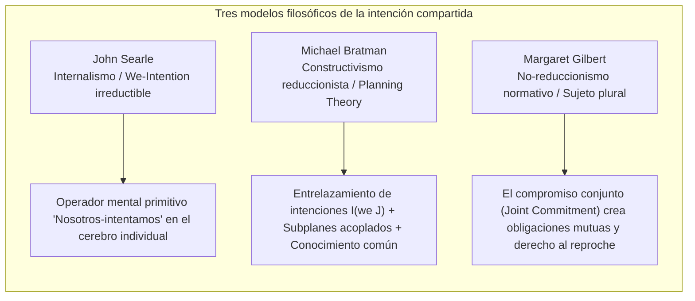
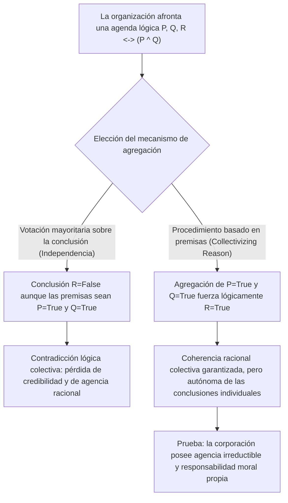
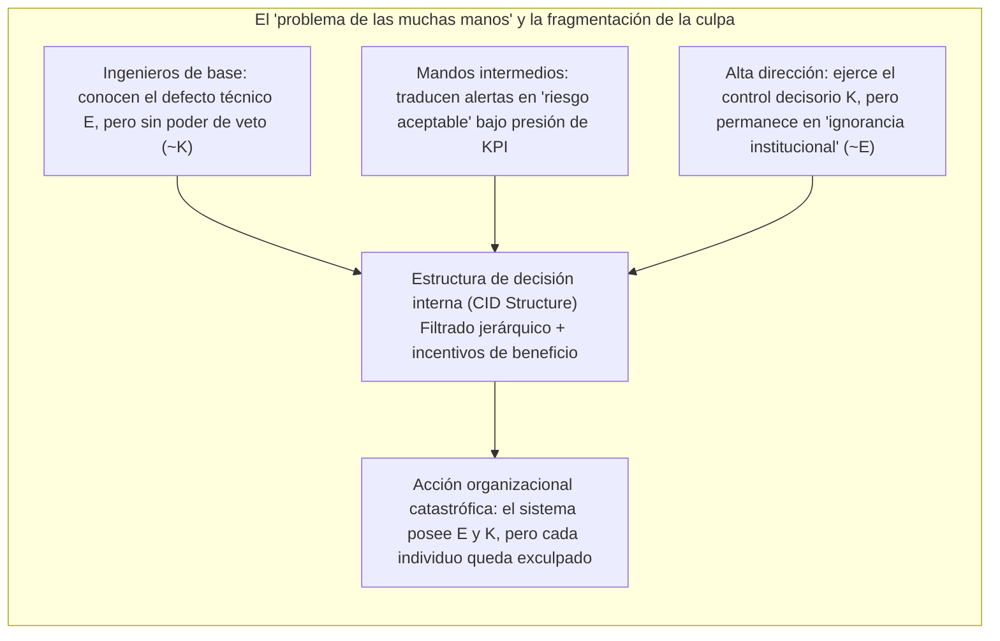

## Introducción: «Sin alma que condenar, ni cuerpo que patear»

En el siglo XVIII, el Lord Canciller británico Edward Thurlow pronunció una frase célebre: «¿Acaso esperabais que una corporación tuviera conciencia, cuando no tiene alma que pueda ser condenada ni cuerpo que pueda ser pateado (*no soul to be damned, and no body to be kicked*)?». Durante siglos, este aforismo ha perseguido a la filosofía del derecho, la ética normativa y la sociología de las organizaciones.

Cuando ocurren grandes catástrofes organizacionales —como el hundimiento del transbordador *Herald of Free Enterprise* en 1987, los accidentes del Boeing 737 MAX provocados por fallos de diseño del sistema MCAS y la elusión regulatoria, la explosión de la plataforma *Deepwater Horizon* de BP en 2010, o los accidentes mortales con vehículos autónomos—, los tribunales y la opinión pública se enfrentan a una inquietante paradoja: <strong>se ha producido un daño moral devastador, pero ningún individuo aislado reúne por completo tanto la intención culpable (mens rea) como el control causal del acto (actus reus) que el derecho penal y la ética tradicional exigen para atribuir plena culpabilidad.</strong>

Si reducimos la responsabilidad únicamente a las faltas intencionales de individuos aislados, el mal sistémico se evapora en las grietas de la división burocrática del trabajo. Por el contrario, si afirmamos que «la corporación misma es moralmente culpable», los escépticos preguntan de inmediato: ¿cómo puede una ficción jurídica abstracta compuesta por estatutos, juntas directivas y algoritmos poseer estados mentales, intenciones o agencia moral (*moral agency*)?

Este artículo examina, en la intersección de la ontología social (*Social Ontology*), la filosofía de la acción y la teoría de la elección social (*Social Choice Theory*), los cinco pilares teóricos que sustentan la agencia colectiva y la responsabilidad moral corporativa.

---

## 1. Individualismo metodológico frente a realismo no reduccionista

Antes de explicar cómo actúa un colectivo, debemos responder a una pregunta metafísica fundamental: ¿son los colectivos verdaderos agentes reales?

### 1.1 Individualismo metodológico y eliminativismo
Desde Max Weber y Friedrich Hayek hasta filósofos analíticos como H. D. Lewis y Manuel Velasquez, el <strong>individualismo metodológico</strong> sostiene que solo los seres humanos biológicos poseen conciencia, libre albedrío e intencionalidad. Según Velasquez, decir que «una empresa intentó engañar a los consumidores» no es más que una metáfora retórica o una abreviatura que significa que ciertos directivos o empleados actuaron con esa intención. Atribuir culpa moral a una organización carente de experiencia subjetiva (*qualia*) sería cometer un <strong>error categorial (*Category Mistake*)</strong> en el sentido de Gilbert Ryle y conduciría a la injusticia del castigo colectivo.

### 1.2 Realismo no reduccionista de la agencia grupal
En contraposición, Peter French, Margaret Gilbert, así como Christian List y Philip Pettit, han desarrollado un <strong>realismo no reduccionista sobre la agencia de grupo (*Non-Reductive Realism about Group Agency*)</strong>. En *Group Agency* (2011), List y Pettit demuestran que ser un «agente» no requiere un cerebro biológico, sino satisfacer tres condiciones <strong>funcionalistas</strong> mínimas:
1. <strong>Estados representacionales (*Representational states*)</strong>: capacidad de formar creencias o juicios sobre hechos del entorno;
2. <strong>Estados motivacionales (*Motivational states*)</strong>: capacidad de establecer metas, preferencias o valores normativos;
3. <strong>Capacidad de intervención racional (*Capacity to intervene*)</strong>: capacidad de actuar en el mundo de acuerdo con dichas creencias y metas respetando normas de coherencia racional.

| Dimensión comparativa | Individualismo metodológico / Eliminativismo (Weber, Velasquez) | Realismo no reduccionista / Funcionalismo (French, List y Pettit) |
| :--- | :--- | :--- |
| <strong>Estatus ontológico del grupo</strong> | Ficción jurídica, metáfora retórica, mera suma de acciones individuales | Sistema de acción autónomo que superviene (*supervenes*) sobre los individuos pero es irreductible |
| <strong>Atribución de intenciones</strong> | Solo existe en mentes biológicas; la «intención corporativa» es figurada | Se instancia realmente a nivel sistémico mediante la estructura CID o la agregación de juicios |
| <strong>Sujeto de responsabilidad moral</strong> | Limitado únicamente a directivos, ingenieros u operadores con culpa directa | La entidad organizacional asume una responsabilidad irreductible (sin eximir la complicidad individual) |
| <strong>Poder explicativo ante crisis</strong> | Cae en un «vacío de responsabilidad» cuando ningún individuo tiene dolo completo | Captura con precisión los incentivos estructurales, la cultura corporativa y el diseño institucional |

---

## 2. Microfundamentos: intención compartida (Shared Intention) y acción conjunta

Cuando dos transeúntes corren simultáneamente hacia el mismo techo bajo un aguacero repentino, solo tenemos una <strong>suma de acciones individuales paralelas</strong>. Pero cuando dos bailarines interpretan un tango o un equipo de ingenieros construye una estación espacial, estamos ante una <strong>acción conjunta (*Joint Action*)</strong>. ¿Qué transforma el comportamiento paralelo en un auténtico «actuar juntos»? La filosofía analítica contemporánea propone tres grandes modelos:

### 2.1 John Searle: las «intenciones-Nosotros» irreductibles (We-Intentions)
En *La construcción de la realidad social* (1995), John Searle rechaza todo intento de reducir «Nosotros tenemos la intención de hacer $J$» a «Yo tengo la intención de hacer mi parte + creo que tú tienes la intención de hacer la tuya». Sin un verdadero espíritu cooperativo, incluso la coordinación perfecta entre competidores sigue siendo individual. Searle postula, por tanto, un operador mental biológicamente primitivo e irreductible en la mente individual: la <strong>intención-Nosotros (*We-intention*)</strong>:

$$\text{We-intend}(J) \xrightarrow{\text{causes}} \text{Individual My-part}(A_i)$$

### 2.2 Michael Bratman: la teoría planificadora de la intención compartida (Planning Theory)
Michael Bratman considera innecesario el operador primitivo de Searle. Según su *Planning Theory*, la intención compartida surge cuando las intenciones planificadoras ordinarias de los individuos forman una <strong>red entrelazada con subplanes acoplados (*interlocking and meshing subplans*)</strong>. Dos agentes $A$ y $B$ comparten la intención $I(\text{we } J)$ si y solo si:

$$I(\text{we } J) \iff \begin{cases} \text{(1a) } A \text{ intends that we } J, \text{ and (1b) } B \text{ intends that we } J \\ \text{(2) } A \text{ and } B \text{ intend that we } J \text{ by way of each other's intentions and meshing subplans} \\ \text{(3) Conditions (1) and (2) are Common Knowledge between } A \text{ and } B \end{cases}$$

El «acoplamiento de subplanes (*meshing subplans*)» implica que ambos se comprometen a negociar para evitar que sus planes parciales entren en conflicto y a ayudarse mutuamente ante obstáculos.

### 2.3 Margaret Gilbert: la teoría del sujeto plural (Plural Subject Theory) y el compromiso conjunto
Margaret Gilbert señala un punto ciego crucial en Bratman: la <strong>obligación normativa (*Normative Obligation*)</strong>. Si acordamos dar un paseo juntos y a mitad de camino usted se da la vuelta sin decir palabra, no solo falla mi predicción: tengo el <strong>derecho legítimo a reprochárselo (*standing to rebuke*)</strong>. Para Gilbert, la acción conjunta descansa en un <strong>compromiso conjunto (*Joint Commitment*)</strong> que funde a varios individuos en un <strong>sujeto plural (*Plural Subject*)</strong> normativamente vinculado.

---

## 3. El dilema discursivo y el teorema de imposibilidad de agregación de juicios

Si un paseo entre dos se explica mediante Bratman, ¿cómo puede una corporación multinacional o un tribunal colegiado formar un <strong>juicio colectivo racional que contradice directamente la conclusión personal de la mayoría de sus propios miembros</strong>?

Este fenómeno fue identificado en la teoría jurídica por Lewis Kornhauser y Lawrence Sager como la <strong>«paradoja doctrinal» (*Doctrinal Paradox*)</strong> y generalizado en filosofía por Philip Pettit como el <strong>«dilema discursivo» (*Discursive Dilemma*)</strong>.

### 3.1 La matriz $3 \times 3$ del dilema discursivo
Supongamos que un comité de seguridad aeronáutica de tres miembros (Miembros 1, 2 y 3) debe votar si autoriza el regreso al servicio de un avión (conclusión $R$). Según el reglamento de seguridad, la autorización $R$ procede si y solo si se cumplen simultáneamente dos premisas:
* <strong>Premisa $P$</strong>: El software de control de vuelo ha superado las pruebas de redundancia.
* <strong>Premisa $Q$</strong>: Los pilotos han completado el entrenamiento extremo en simulador.
* <strong>Regla lógica</strong>: $R \leftrightarrow (P \land Q)$.

Los tres expertos emiten los siguientes juicios individuales, cada uno lógicamente consistente:

| Miembro del comité | Premisa $P$ (Software seguro) | Premisa $Q$ (Entrenamiento completo) | Regla lógica $R \leftrightarrow (P \land Q)$ | Conclusión $R$ (Autorizar el vuelo) |
| :--- | :---: | :---: | :---: | :---: |
| <strong>Miembro 1</strong> | Verdadero (True) | Verdadero (True) | Verdadero (True) | <strong>Verdadero (True)</strong> |
| <strong>Miembro 2</strong> | Verdadero (True) | Falso (False) | Verdadero (True) | <strong>Falso (False)</strong> |
| <strong>Miembro 3</strong> | Falso (False) | Verdadero (True) | Verdadero (True) | <strong>Falso (False)</strong> |
| <strong>Mayoría (Majority)</strong> | <strong>Verdadero (2/3 True)</strong> | <strong>Verdadero (2/3 True)</strong> | <strong>Verdadero (3/3 True)</strong> | <strong>Falso (1/3 True) / ¡Paradoja!</strong> |

Obsérvese la última fila:
* <strong>Procedimiento basado en la conclusión (*Conclusion-Based Procedure*)</strong>: Si el comité vota directamente sobre la conclusión $R$, la autorización es <strong>rechazada por 1 voto contra 2 ($R = \text{False}$)</strong>.
* <strong>Procedimiento basado en las premisas (*Premise-Based Procedure*)</strong>: Si el comité vota primero por separado sobre $P$ y sobre $Q$, tanto $P$ como $Q$ se aprueban por 2 a 1 (Verdadero). Aplicando entonces la regla lógica unánime $R \leftrightarrow (P \land Q)$, el comité deduce necesariamente la conclusión colectiva: <strong>¡se autoriza el vuelo ($R = \text{True}$)!</strong>, ¡aunque dos tercios de los miembros se opongan personalmente!

### 3.2 El teorema de imposibilidad de List y Pettit
Christian List y Philip Pettit (2002) demostraron que este dilema es una generalización profunda del teorema de imposibilidad de Kenneth Arrow al ámbito de la agregación de juicios lógicos. Sea $N = \{1, 2, \dots, n\}$ ($n \ge 3$) el conjunto de individuos y $X$ una agenda de proposiciones lógicamente conectadas. Ninguna función de agregación

$$F: \{0, 1\}^{n \times |X|} \to \{0, 1\}^{|X|}$$

puede <strong>satisfacer simultáneamente los cuatro axiomas siguientes</strong>:
1. <strong>Dominio universal (*Universal Domain*)</strong>: admite como entrada cualquier perfil de juicios individuales consistentes y completos;
2. <strong>Racionalidad colectiva (*Collective Rationality*)</strong>: produce como salida un juicio colectivo lógicamente consistente y completo;
3. <strong>Anonimato (*Anonymity*)</strong>: todos los individuos tienen igual peso (no hay dictador);
4. <strong>Sistematicidad / Independencia (*Systematicity / Independence*)</strong>: el juicio colectivo sobre cualquier proposición $\phi$ depende únicamente de los votos individuales sobre $\phi$, aplicando la misma regla a todas las proposiciones.

### 3.3 ¿Por qué es necesario «colectivizar la razón» (Collectivizing Reason)?
Pettit demuestra que para que una organización funcione en la sociedad como un agente racional creíble (*conversable agent*), no puede afirmar públicamente $P$ y $Q$ mientras niega su conjunción lógica $P \land Q$. Debe, por tanto, abandonar el axioma de sistematicidad y adoptar el <strong>procedimiento basado en las premisas</strong>, es decir, <strong>«colectivizar la razón» (*collectivize reason*)</strong>.

La consecuencia ontológica es decisiva: en cuanto la organización colectiviza la razón en el nivel de las premisas, <strong>emerge una mente corporativa autónoma cuyos juicios e intenciones son irreductibles a la suma de las opiniones individuales de sus miembros</strong>. Y al poseer una mente racional propia, la corporación es un sujeto autónomo de responsabilidad moral.

---

## 4. Estructura de decisión interna (CID) y el «problema de las muchas manos»

### 4.1 La estructura CID de Peter French (Corporate Internal Decision Structure)
Ya en 1979, en *The Corporation as a Moral Person*, Peter French argumentó que las empresas son personas morales de pleno derecho gracias a su <strong>estructura de decisión interna (*CID Structure*)</strong>, compuesta por:
1. <strong>El organigrama procedimental (*Organizational Flow Chart*)</strong>: la sintaxis organizativa que define niveles jerárquicos, flujos de información y cadenas de aprobación;
2. <strong>Las reglas de reconocimiento de la política corporativa (*Corporate Decision Recognition Rules*)</strong>: análogas a la «regla de reconocimiento» de H. L. A. Hart, determinan cuándo las decisiones tomadas por razones corporativas se sintetizan oficialmente como «decisiones de la corporación».

La estructura CID subordina y transforma las intenciones biológicas dispersas de los empleados en una <strong>intencionalidad corporativa (*Corporate Intentionality*)</strong> genuina.

### 4.2 El «problema de las muchas manos» de Dennis Thompson (Problem of Many Hands)
Sin embargo, esta compleja división burocrática del trabajo genera el famoso <strong>«problema de las muchas manos» (*The Problem of Many Hands*)</strong> formulado por Dennis Thompson (1980).

En la ética tradicional y el derecho penal, la plena culpabilidad moral ($C$) exige que un mismo agente $x$ reúna simultáneamente la <strong>condición epistémica / intencional ($E$)</strong> y la <strong>condición de control causal ($K$)</strong>:

$$C(x) \iff E(x) \land K(x)$$

Pero en una gran corporación, la especialización escinde sistemáticamente el conocimiento y el control:
* El ingeniero de software conoce el fallo potencial de una rutina ante un error de sensores (posee conocimiento local $E$), pero carece de autoridad para cambiar la arquitectura o detener el lanzamiento (carece de control $K$);
* El director ejecutivo tiene el poder supremo de autorizar el lanzamiento comercial (posee control global $K$), pero los filtros burocráticos y los informes de KPI le ocultan las advertencias técnicas («ignorancia institucional», $\neg E$).

En consecuencia, para cada individuo $i \in \{1, \dots, n\}$ se cumple $\neg(E(i) \land K(i))$, ¡mientras que el sistema organizacional en su conjunto poseía tanto el conocimiento como el control! Si negamos la responsabilidad moral corporativa, las catástrofes sistémicas quedan impunes bajo una <strong>irresponsabilidad organizada</strong>.

---

## 5. Agencia algorítmica, brecha de responsabilidad en la IA y «zonas de deformación moral»

En el siglo XXI, al sustituirse los nodos burocráticos por modelos de aprendizaje profundo y algoritmos autónomos, el problema de las muchas manos deriva en dos nuevas crisis éticas:

### 5.1 La «brecha de responsabilidad» (Responsibility Gap) de Andreas Matthias
Andreas Matthias (2004) advirtió que la responsabilidad tradicional del fabricante o del operador presupone que el comportamiento de la máquina es predecible a partir de sus reglas de diseño. Sin embargo, los sistemas modernos de aprendizaje por refuerzo profundo y los grandes modelos lingüísticos modifican sus pesos internos durante la ejecución y presentan <strong>opacidad epistémica</strong>. Cuando una IA médica o un vehículo autónomo toma una decisión letal impredecible incluso para sus creadores, resulta injusto culpar moralmente al programador, mientras que la máquina carece de conciencia o patrimonio para ser castigada: surge así una <strong>«brecha de responsabilidad» (*Responsibility Gap*)</strong>.

### 5.2 Las «zonas de deformación moral» (Moral Crumple Zones) de Madeleine Clare Elish
La antropóloga Madeleine Clare Elish (2019), analizando accidentes de aviación automatizada y conducción asistida, reveló el fenómeno de las <strong>«zonas de deformación moral» (*Moral Crumple Zones*)</strong>.

En ingeniería automotriz, la zona de deformación mecánica (*crumple zone*) está diseñada para aplastarse en un choque y absorber la energía cinética protegiendo a los pasajeros. En los sistemas sociotécnicos (*Human-in-the-Loop*), en cambio, <strong>el operador humano situado al final de la cadena (el conductor de seguridad, la enfermera de guardia, el copiloto) es utilizado institucionalmente como «zona de deformación moral» para absorber todo el impacto legal y mediático, protegiendo a la corporación tecnológica y a su defectuosa arquitectura algorítmica</strong>. La empresa acapara el prestigio y los beneficios de la automatización, pero exige contractualmente que el humano tome el control de un algoritmo complejo en medio segundo; cuando ocurre la tragedia, todo se atribuye al «error humano» del operador de primera línea.

### 5.3 El «modelo de conexión social» (Social Connection Model) de Iris Marion Young
Para superar el problema de las muchas manos y las zonas de deformación moral, la filósofa política Iris Marion Young (*Responsibility for Justice*, 2011) distingue entre:
1. <strong>El modelo retrospectivo de culpabilidad (*Backward-Looking Liability Model*)</strong>: busca aislar a un culpable causal pasado, pero fracasa ante injusticias estructurales o convierte a los eslabones más débiles en chivos expiatorios;
2. <strong>El modelo prospectivo de conexión social (*Forward-Looking Social Connection Model*)</strong>: todos los agentes que participan y se benefician de un proceso estructural o algorítmico comparten una <strong>obligación política y moral orientada al futuro</strong> para reformar colectivamente las estructuras de decisión (CID) que producen daño.

---

## Conclusión: Reconstruir la responsabilidad constitucional de los colectivos híbridos

Desde el sarcasmo del barón Thurlow sobre la corporación «sin alma», pasando por las teorías de la intención compartida de Searle, Bratman y Gilbert, hasta el dilema discursivo de Pettit y la estructura CID de French, la filosofía contemporánea ha demostrado de forma irrefutable que <strong>las corporaciones y los sistemas altamente organizados no son meras sumas aritméticas de individuos, sino agentes colectivos emergentes con lógica racional propia y enorme poder causal</strong>.

Hoy, cuando humanos y algoritmos autónomos se entrelazan formando <strong>«colectivos híbridos» (*Hybrid Collectives*)</strong>, reconocer la responsabilidad moral irreductible de las organizaciones no busca exonerar a los ejecutivos negligentes, sino demoler el escudo de impunidad del «problema de las muchas manos» y el mecanismo de chivo expiatorio de las «zonas de deformación moral», sometiendo la constitución misma de las corporaciones y la gobernanza algorítmica al escrutinio de la justicia.
