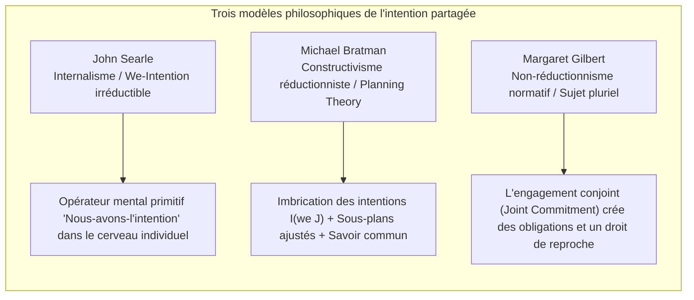
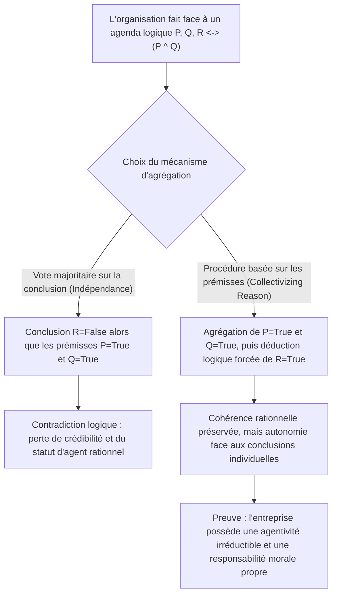
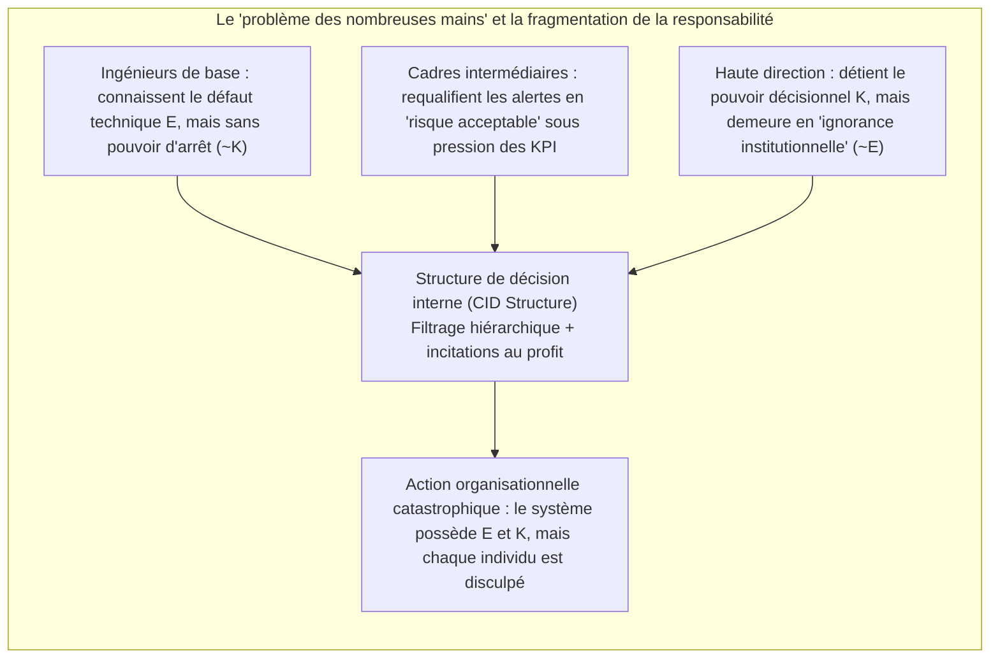

## Introduction : « Ni âme à damner, ni corps à frapper »

Au XVIIIe siècle, le Lord Chancelier britannique Edward Thurlow lançait cette célèbre boutade : « Avez-vous jamais espéré qu'une société commerciale ait une conscience, alors qu'elle n'a ni âme à damner, ni corps à frapper (*no soul to be damned, and no body to be kicked*) ? » Depuis des siècles, cet aphorisme hante la philosophie du droit, l'éthique normative et la sociologie des organisations.

Lorsque surviennent des catastrophes organisationnelles majeures — le naufrage du ferry *Herald of Free Enterprise* en 1987, les crashs du Boeing 737 MAX liés au système MCAS et au contournement des régulateurs, l'explosion de la plateforme *Deepwater Horizon* de BP en 2010, ou encore les accidents mortels impliquant des véhicules autonomes —, les tribunaux et le public se heurtent à un paradoxe troublant : <strong>un préjudice moral massif a été causé, mais aucun individu isolé ne réunit pleinement à la fois l'intention coupable (mens rea) et la maîtrise causale de l'acte (actus reus) exigées par le droit pénal et l'éthique individuelle classique.</strong>

Si nous réduisons la responsabilité morale aux seules fautes intentionnelles d'individus isolés, le mal systémique s'évapore dans les interstices de la division bureaucratique du travail. Inversement, si nous affirmons que « l'entreprise elle-même est moralement coupable », les sceptiques répliquent : comment une fiction juridique abstraite composée de statuts, de conseils d'administration et d'algorithmes pourrait-elle posséder des états mentaux, des intentions ou une agentivité morale (*moral agency*) ?

Cet article explore, au croisement de l'ontologie sociale (*Social Ontology*), de la philosophie de l'action et de la théorie du choix social (*Social Choice Theory*), les cinq piliers théoriques de l'agentivité collective et de la responsabilité morale des organisations.

---

## 1. Individualisme méthodologique contre réalisme non réductionniste

Avant de comprendre comment un collectif agit, il faut répondre à une question métaphysique fondamentale : les collectifs sont-ils de véritables agents ?

### 1.1 Individualisme méthodologique et éliminativisme
De Max Weber et Friedrich Hayek jusqu'aux éthiciens analytiques comme H. D. Lewis et Manuel Velasquez, <strong>l'individualisme méthodologique</strong> soutient que seuls les êtres humains biologiques possèdent une conscience, un libre arbitre et une intentionnalité. Selon Velasquez, dire qu'« une entreprise a cherché à tromper les consommateurs » n'est qu'une métaphore rhétorique ou une abréviation signifiant simplement que certains dirigeants ou employés ont agi ainsi. Attribuer une culpabilité morale à une organisation dépourvue d'expérience subjective (*qualia*) reviendrait à commettre une <strong>erreur de catégorie (*Category Mistake*)</strong> au sens de Gilbert Ryle et conduirait à l'injustice de la punition collective.

### 1.2 Le réalisme non réductionniste de l'agentivité de groupe
À l'opposé, Peter French, Margaret Gilbert, ainsi que Christian List et Philip Pettit ont développé un <strong>réalisme non réductionniste de l'agentivité collective (*Non-Reductive Realism about Group Agency*)</strong>. Dans *Group Agency* (2011), List et Pettit démontrent qu'être un « agent » ne requiert pas de cerveau biologique, mais repose sur trois conditions <strong>fonctionnalistes</strong> minimales :
1. <strong>États représentationnels (*Representational states*)</strong> : la capacité de former des croyances ou des jugements sur l'environnement ;
2. <strong>États motivationnels (*Motivational states*)</strong> : la capacité de fixer des objectifs, des préférences ou des valeurs ;
3. <strong>Capacité d'intervention rationnelle (*Capacity to intervene*)</strong> : la capacité d'agir dans le monde conformément à ces croyances et objectifs tout en respectant des normes de cohérence rationnelle.

| Dimension de comparaison | Individualisme méthodologique / Éliminativisme (Weber, Velasquez) | Réalisme non réductionniste / Fonctionnalisme (French, List & Pettit) |
| :--- | :--- | :--- |
| <strong>Statut ontologique du groupe</strong> | Fiction juridique, métaphore rhétorique, simple somme d'actions individuelles | Système d'action autonome survenant (*supervening*) sur les individus mais irréductible |
| <strong>Attribution d'intentions</strong> | N'existe que dans les esprits biologiques ; « l'intention d'entreprise » est figurée | Instanciée réellement au niveau systémique via la structure CID ou l'agrégation de jugements |
| <strong>Sujet de la responsabilité morale</strong> | Limité aux seuls cadres, ingénieurs ou opérateurs directement fautifs | L'entité organisationnelle porte une responsabilité irréductible (sans exclure la complicité individuelle) |
| <strong>Portée explicative face aux crises</strong> | Conduit à un « vide de responsabilité » lorsqu'aucun individu n'a l'intention complète | Capture avec précision les incitations structurelles, la culture d'entreprise et le design institutionnel |

---

## 2. Les micro-fondations : intention partagée (Shared Intention) et action conjointe

Lorsque deux passants courent simultanément sous le même abri sous une averse soudaine, il ne s'agit que d'une <strong>somme d'actions individuelles parallèles</strong>. Mais lorsque deux danseurs exécutent un tango ou qu'une équipe d'ingénieurs construit une fusée, il s'agit d'une <strong>action conjointe (*Joint Action*)</strong>. Qu'est-ce qui distingue la simple coordination parallèle du véritable « agir-ensemble » ? La philosophie analytique contemporaine propose trois grands modèles :

### 2.1 John Searle : les « intentions-Nous » irréductibles (We-Intentions)
Dans *La Construction de la réalité sociale* (1995), John Searle rejette toute tentative de réduire « Nous avons l'intention de faire $J$ » à « J'ai l'intention de faire ma part + je crois que tu as l'intention de faire la tienne ». Sans un véritable esprit de coopération, même une coordination parfaite entre rivaux reste individuelle. Searle postule donc l'existence biologique, dans l'esprit de chaque individu, d'un opérateur mental primitif et irréductible — <strong>l'intention-Nous (*We-intention*)</strong> :

$$\text{We-intend}(J) \xrightarrow{\text{causes}} \text{Individual My-part}(A_i)$$

### 2.2 Michael Bratman : la théorie planificatrice de l'intention partagée (Planning Theory)
Michael Bratman juge inutile le recours à l'opérateur primitif mystérieux de Searle. Selon sa *Planning Theory*, l'intention partagée émerge dès lors que les intentions planificatrices ordinaires des individus forment une <strong>structure d'imbrication et d'ajustement mutuel (*interlocking and meshing subplans*)</strong>. Deux agents $A$ et $B$ partagent l'intention $I(\text{we } J)$ si et seulement si :

$$I(\text{we } J) \iff \begin{cases} \text{(1a) } A \text{ intends that we } J, \text{ and (1b) } B \text{ intends that we } J \\ \text{(2) } A \text{ and } B \text{ intend that we } J \text{ by way of each other's intentions and meshing subplans} \\ \text{(3) Conditions (1) and (2) are Common Knowledge between } A \text{ and } B \end{cases}$$

L'« ajustement des sous-plans (*meshing subplans*) » signifie que chacun s'engage à rendre ses moyens d'exécution compatibles avec ceux de l'autre et à lui prêter assistance en cas d'obstacle.

### 2.3 Margaret Gilbert : la théorie du sujet pluriel (Plural Subject Theory) et l'engagement conjoint
Margaret Gilbert met en lumière l'angle mort du modèle de Bratman : <strong>l'obligation normative (*Normative Obligation*)</strong>. Si nous convenons de faire une promenade ensemble et qu'à mi-chemin vous faites demi-tour sans un mot, vous ne déjouez pas seulement ma prévision : j'ai une <strong>légitimité à vous adresser un reproche (*standing to rebuke*)</strong>. Pour Gilbert, l'action conjointe repose sur un <strong>engagement conjoint (*Joint Commitment*)</strong> qui fusionne plusieurs individus en un <strong>sujet pluriel (*Plural Subject*)</strong> normativement lié.

---

## 3. Le dilemme discursif et le théorème d'impossibilité de l'agrégation des jugements

Si la promenade à deux s'explique par Bratman, comment une multinationale ou une cour d'appel peut-elle former un <strong>jugement collectif rationnel qui contredit directement la conclusion personnelle de la majorité de ses propres membres</strong> ?

C'est ce qu'ont découvert les juristes Lewis Kornhauser et Lawrence Sager sous le nom de <strong>« paradoxe doctrinal » (*Doctrinal Paradox*)</strong>, généralisé ensuite par Philip Pettit sous le nom de <strong>« dilemme discursif » (*Discursive Dilemma*)</strong>.

### 3.1 La matrice $3 \times 3$ du dilemme discursif
Imaginons qu'un comité de sécurité aéronautique de trois experts (Membres 1, 2 et 3) doive voter sur l'autorisation de remise en service d'un avion (conclusion $R$). Selon le règlement de sécurité, l'autorisation $R$ est accordée si et seulement si deux prémisses sont simultanément vraies :
* <strong>Prémisse $P$</strong> : Le logiciel de commandes de vol a passé tous les tests de redondance.
* <strong>Prémisse $Q$</strong> : Les pilotes ont suivi la formation complète sur simulateur.
* <strong>Règle logique</strong> : $R \leftrightarrow (P \land Q)$.

Voici les jugements individuels, parfaitement cohérents, des trois membres :

| Membre du comité | Prémisse $P$ (Logiciel sûr) | Prémisse $Q$ (Formation complète) | Règle logique $R \leftrightarrow (P \land Q)$ | Conclusion $R$ (Autoriser le vol) |
| :--- | :---: | :---: | :---: | :---: |
| <strong>Membre 1</strong> | Vrai (True) | Vrai (True) | Vrai (True) | <strong>Vrai (True)</strong> |
| <strong>Membre 2</strong> | Vrai (True) | Faux (False) | Vrai (True) | <strong>Faux (False)</strong> |
| <strong>Membre 3</strong> | Faux (False) | Vrai (True) | Vrai (True) | <strong>Faux (False)</strong> |
| <strong>Vote majoritaire (Majority)</strong> | <strong>Vrai (2/3 True)</strong> | <strong>Vrai (2/3 True)</strong> | <strong>Vrai (3/3 True)</strong> | <strong>Faux (1/3 True) / Paradoxe !</strong> |

Observons la dernière ligne :
* <strong>Procédure basée sur la conclusion (*Conclusion-Based Procedure*)</strong> : Si le comité vote directement sur la conclusion $R$, l'autorisation est <strong>rejetée par 1 voix contre 2 ($R = \text{False}$)</strong>.
* <strong>Procédure basée sur les prémisses (*Premise-Based Procedure*)</strong> : Si le comité vote d'abord séparément sur $P$ et sur $Q$, $P$ est validée à 2 contre 1 (Vrai) et $Q$ est validée à 2 contre 1 (Vrai). En appliquant la règle logique unanime $R \leftrightarrow (P \land Q)$, le comité déduit nécessairement la conclusion collective : <strong>l'autorisation de vol est accordée ($R = \text{True}$)</strong> — alors même que deux tiers des membres y sont personnellement opposés !

### 3.2 Le théorème d'impossibilité de List et Pettit
Christian List et Philip Pettit (2002) ont démontré que ce dilemme constitue une généralisation profonde du théorème d'impossibilité de Kenneth Arrow au domaine des jugements logiques. Soit $N = \{1, 2, \dots, n\}$ ($n \ge 3$) l'ensemble des individus et $X$ un agenda de propositions logiquement liées. Aucune fonction d'agrégation de jugements

$$F: \{0, 1\}^{n \times |X|} \to \{0, 1\}^{|X|}$$

ne peut <strong>satisfaire simultanément les quatre axiomes suivants</strong> :
1. <strong>Domaine universel (*Universal Domain*)</strong> : accepte en entrée tout profil de jugements individuels cohérents et complets ;
2. <strong>Rationalité collective (*Collective Rationality*)</strong> : produit en sortie un jugement collectif logiquement cohérent et complet ;
3. <strong>Anonymat (*Anonymity*)</strong> : accorde un poids égal à chaque individu (absence de dictateur) ;
4. <strong>Systématicité / Indépendance (*Systematicity / Independence*)</strong> : le jugement collectif sur toute proposition $\phi$ ne dépend que des votes individuels sur $\phi$, selon une règle identique pour toutes les propositions.

### 3.3 Pourquoi faut-il « collectiviser la raison » (Collectivizing Reason) ?
Pettit souligne qu'une organisation qui veut exister dans l'espace social comme un agent rationnel crédible (*conversable agent*) ne peut pas affirmer publiquement $P$ et $Q$ tout en niant $P \land Q$. Elle doit donc renoncer à l'axiome de systématicité et adopter la <strong>procédure basée sur les prémisses</strong> — c'est-à-dire <strong>« collectiviser la raison » (*collectivize reason*)</strong>.

La conséquence ontologique est décisive : dès lors que l'organisation collectivise la raison au niveau des prémisses, <strong>son esprit collectif émerge de manière autonome et irréductible par rapport aux états mentaux de ses membres</strong>. Puisqu'elle possède une volonté rationnelle propre, elle devient un sujet autonome de responsabilité morale.

---

## 4. Structure de décision interne (CID) et « problème des nombreuses mains »

### 4.1 La structure CID de Peter French (Corporate Internal Decision Structure)
Dès 1979, dans *The Corporation as a Moral Person*, Peter French soutenait que les entreprises sont des personnes morales à part entière grâce à leur <strong>structure de décision interne (*CID Structure*)</strong>, qui comprend deux éléments :
1. <strong>L'organigramme procédural (*Organizational Flow Chart*)</strong> : la syntaxe organisationnelle définissant la hiérarchie, la circulation de l'information et les chaînes de validation ;
2. <strong>Les règles de reconnaissance de la politique d'entreprise (*Corporate Decision Recognition Rules*)</strong> : analogues à la « règle de reconnaissance » de H. L. A. Hart, elles déterminent quelles décisions prises pour des raisons propres à l'entreprise sont synthétisées en « décisions de l'entreprise ».

La structure CID opère comme un transformateur logique qui subordonne et synthétise les intentions biologiques dispersées des employés en une <strong>intentionnalité corporative (*Corporate Intentionality*)</strong> distincte.

### 4.2 Le « problème des nombreuses mains » de Dennis Thompson (Problem of Many Hands)
Toutefois, cette division bureaucratique engendre le célèbre <strong>« problème des nombreuses mains » (*The Problem of Many Hands*)</strong> formulé par Dennis Thompson (1980).

Dans l'éthique individuelle et le droit pénal, la culpabilité morale complète ($C$) exige qu'un même agent $x$ réunisse à la fois la <strong>condition épistémique / intentionnelle ($E$)</strong> et la <strong>condition de contrôle causal ($K$)</strong> :

$$C(x) \iff E(x) \land K(x)$$

Or, dans une grande organisation, la spécialisation dissocie systématiquement la connaissance et le pouvoir :
* L'ingénieur de terrain connaît la faille spécifique d'un capteur (possède $E$ localement), mais n'a aucun pouvoir pour modifier l'architecture ou retarder la commercialisation (absence de $K$) ;
* Le PDG détient le pouvoir souverain d'autoriser le lancement (possède $K$ globalement), mais les filtres hiérarchiques et les indicateurs financiers lui masquent les alertes techniques (« ignorance institutionnelle », $\neg E$).

Ainsi, pour chaque individu $i \in \{1, \dots, n\}$, on a $\neg(E(i) \land K(i))$, alors même que l'organisation dans son ensemble savait et a agi ! Sans responsabilité morale collective de l'entreprise, les pires catastrophes industrielles sombrent dans une <strong>irresponsabilité organisée</strong>.

---

## 5. Agentivité algorithmique, fossé de responsabilité de l'IA et « zones de déformation morale »

Au XXIe siècle, lorsque les nœuds de décision bureaucratiques sont remplacés par des réseaux de neurones profonds et des algorithmes autonomes, le problème des nombreuses mains mute en deux crises éthiques majeures :

### 5.1 Le « fossé de responsabilité » (Responsibility Gap) d'Andreas Matthias
Andreas Matthias (2004) montre que la responsabilité traditionnelle du fabricant ou de l'opérateur suppose que le comportement de la machine soit rationnellement prévisible à partir de ses règles de conception. Or, les systèmes d'apprentissage par renforcement profond et les grands modèles de langage modifient leurs paramètres en cours d'exécution et présentent une <strong>opacité épistémique</strong>. Lorsqu'une IA médicale ou un véhicule autonome prend une décision fatale imprévisible même pour ses concepteurs, il est injuste de blâmer moralement le programmeur, tandis que l'algorithme lui-même ne peut ni souffrir ni payer d'amende — d'où l'ouverture d'un <strong>« fossé de responsabilité » (*Responsibility Gap*)</strong>.

### 5.2 Les « zones de déformation morale » (Moral Crumple Zones) de Madeleine Clare Elish
L'anthropologue Madeleine Clare Elish (2019) a identifié, dans les accidents d'aviation automatisée et de conduite assistée, le phénomène pervers des <strong>« zones de déformation morale » (*Moral Crumple Zones*)</strong>.

En ingénierie automobile, la zone de déformation mécanique (*crumple zone*) est conçue pour s'écraser lors d'un choc afin d'absorber l'énergie cinétique et de protéger l'habitacle. Dans les systèmes sociotechniques (*Human-in-the-Loop*), en revanche, <strong>c'est l'opérateur humain situé tout au bout de la chaîne (le conducteur de sécurité, l'infirmière de garde, le copilote) qui sert de « zone de déformation morale » pour absorber l'intégralité du blâme juridique et médiatique afin de protéger l'entreprise technologique et son architecture algorithmique</strong>. L'entreprise récolte les lauriers de l'automatisation mais exige contractuellement que l'humain reprenne le contrôle d'un système complexe en une demi-seconde ; en cas de drame, la faute est imputée à « l'erreur humaine » de l'opérateur, exonérant la conception systémique.

### 5.3 Le « modèle de connexion sociale » (Social Connection Model) d'Iris Marion Young
Pour dépasser l'impasse du problème des nombreuses mains et des zones de déformation morale, la philosophe politique Iris Marion Young (*Responsibility for Justice*, 2011) distingue :
1. <strong>Le modèle rétrospectif de la culpabilité (*Backward-Looking Liability Model*)</strong> : cherche à isoler un coupable causal passé, mais échoue face aux injustices structurelles ou transforme les lampistes en boucs émissaires ;
2. <strong>Le modèle prospectif de connexion sociale (*Forward-Looking Social Connection Model*)</strong> : tous les acteurs qui participent aux structures institutionnelles et algorithmiques et en tirent profit partagent une <strong>obligation politique et morale tournée vers l'avenir</strong> : réformer collectivement les structures de décision (CID) génératrices de dommages.

---

## Conclusion : Refonder la responsabilité constitutionnelle des collectifs hybrides

De l'ironie du baron Thurlow sur l'entreprise « sans âme » aux analyses de Searle, Bratman et Gilbert sur l'intention partagée, jusqu'au dilemme discursif de Pettit et à la structure CID de French, la philosophie contemporaine a établi que <strong>les entreprises et les organisations complexes ne sont pas de simples agrégats d'individus, mais de véritables agents collectifs dotés d'une rationalité autonome et d'une puissance causale propre</strong>.

À l'heure où humains et algorithmes autonomes forment des <strong>« collectifs hybrides » (*Hybrid Collectives*)</strong>, reconnaître la responsabilité morale irréductible des organisations ne vise nullement à absoudre les dirigeants corrompus, mais à briser le bouclier d'impunité du « problème des nombreuses mains » et le mécanisme sacrificiel des « zones de déformation morale », afin de soumettre l'architecture même des systèmes corporatifs et algorithmiques à l'exigence de la justice.
