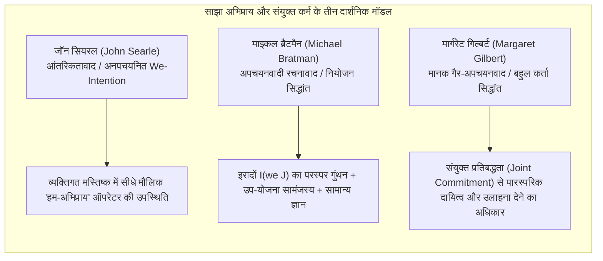
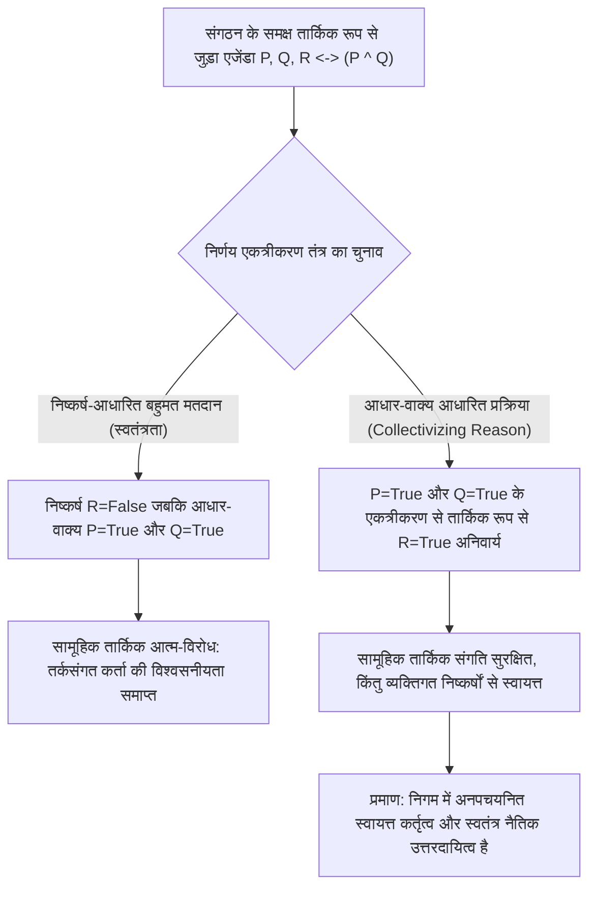
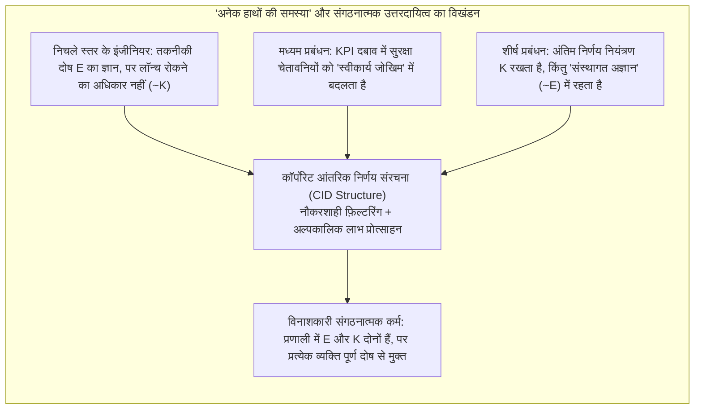

## प्रस्तावना: “न शाप देने के लिए आत्मा, न ठोकर मारने के लिए शरीर”

18वीं शताब्दी में ब्रिटिश लॉर्ड चांसलर बैरन एडवर्ड थर्लो (Baron Edward Thurlow) ने एक प्रसिद्ध टिप्पणी की थी: “क्या आपने कभी किसी निगम (corporation) से अंतरात्मा की अपेक्षा की है, जबकि उसके पास न तो शाप दिए जाने के लिए कोई आत्मा है और न ही ठोकर मारे जाने के लिए कोई शरीर (*no soul to be damned, and no body to be kicked*)?” सदियों से यह सूक्ति विधि-दर्शन, नीतिशास्त्र और संगठनात्मक समाजशास्त्र को झकझोरती रही है।

जब बड़ी संगठनात्मक त्रासदियाँ घटित होती हैं — जैसे 1987 में *Herald of Free Enterprise* फेरी का डूबना, MCAS प्रणाली के दोष और नियामक अनदेखी के कारण बोइंग 737 MAX दुर्घटनाएँ, 2010 में ब्रिटिश पेट्रोलियम (BP) के *Deepwater Horizon* रिग में विस्फोट, या स्वायत्त वाहनों (autonomous vehicles) से होने वाली घातक दुर्घटनाएँ — तब न्यायालय और समाज एक बेचैन कर देने वाले विरोधाभास का सामना करते हैं: <strong>भयावह नैतिक क्षति तो हुई है, किंतु किसी भी एक अकेले व्यक्ति में वह पूर्ण 'दोषपूर्ण आशय' (mens rea) और 'कारणात्मक नियंत्रण' (actus reus) एक साथ नहीं मिलता जिसकी माँग पारंपरिक दंड विधि और व्यक्तिगत नीतिशास्त्र पूर्ण दोषारोपण के लिए करते हैं।</strong>

यदि हम नैतिक उत्तरदायित्व को केवल अलग-थलग व्यक्तियों की जानबूझकर की गई गलती तक सीमित कर दें, तो संरचनात्मक बुराई नौकरशाही श्रम-विभाजन की दरारों में भाप बनकर उड़ जाती है। इसके विपरीत, यदि हम कहते हैं कि “निगम स्वयं नैतिक रूप से दोषी है”, तो संशयवादी तुरंत पूछते हैं: नियमों, निदेशक मंडल के प्रस्तावों और एल्गोरिदम से बनी एक अमूर्त कानूनी कल्पना (legal fiction) में मानसिक अवस्थाएँ, इरादे या नैतिक कर्तृत्व (*moral agency*) कैसे हो सकता है?

यह लेख सामाजिक सत्तामीमांसा (*Social Ontology*), कर्म-दर्शन और सामाजिक चयन सिद्धांत (*Social Choice Theory*) के संगम पर सामूहिक कर्तृत्व (Collective Agency) और कॉर्पोरेट नैतिक उत्तरदायित्व के पाँच प्रमुख सैद्धांतिक स्तंभों का विश्लेषण करता है।

---

## 1. पद्धतिगत व्यक्तिवाद बनाम गैर-अपचयनवादी कॉर्पोरेट यथार्थवाद

यह समझने से पहले कि कोई समूह कैसे कार्य करता है, हमें एक मूलभूत तत्वमीमांसीय प्रश्न का उत्तर देना होगा: क्या समूह वास्तव में वास्तविक कर्ता (real agents) हैं?

### 1.1 पद्धतिगत व्यक्तिवाद और उन्मूलनवाद (Eliminativism)
मैक्स वेबर (Max Weber) और फ्रेडरिक हायेक (Friedrich Hayek) से लेकर विश्लेषणात्मक नीतिशास्त्री एच. डी. लुईस और मैनुअल वेलास्केज़ (Manuel Velasquez) तक, <strong>पद्धतिगत व्यक्तिवाद (Methodological Individualism)</strong> का आग्रह है कि केवल जैविक मानव व्यक्तियों में ही चेतना, अंतरात्मा और इच्छा-स्वातंत्र्य होता है। वेलास्केज़ के अनुसार, यह कहना कि “किसी कंपनी ने उपभोक्ताओं को धोखा देने का इरादा किया”, केवल एक अलंकारिक रूपक या संक्षिप्त कथन है जिसका वास्तविक अर्थ बस इतना है कि कंपनी के कुछ अधिकारियों या कर्मचारियों ने ऐसा इरादा किया। व्यक्तिपरक अनुभूति (*qualia*) से रहित संगठन पर नैतिक दोष मढ़ना गिल्बर्ट राइल (Gilbert Ryle) के शब्दों में <strong>श्रेणी-भ्रम (*Category Mistake*)</strong> करना है और इससे सामूहिक दंड का अन्याय पैदा होता है।

### 1.2 सामूहिक कर्तृत्व का गैर-अपचयनवादी यथार्थवाद
इसके विपरीत, पीटर फ्रेंच (Peter French), मार्गरेट गिल्बर्ट (Margaret Gilbert), तथा क्रिश्चियन लिस्ट (Christian List) और फिलिप पेटिट (Philip Pettit) ने <strong>सामूहिक कर्तृत्व के गैर-अपचयनवादी यथार्थवाद (*Non-Reductive Realism about Group Agency*)</strong> का विकास किया। अपनी पुस्तक *Group Agency* (2011) में लिस्ट और पेटिट सिद्ध करते हैं कि 'कर्ता' (*agent*) होने के लिए जैविक मस्तिष्क की आवश्यकता नहीं है, बल्कि तीन न्यूनतम <strong>प्रकार्यवाद (Functionalist)</strong> शर्तों को पूरा करना पर्याप्त है:
1. <strong>प्रतिनिधित्ववादी अवस्थाएँ (*Representational states*)</strong>: परिवेश के तथ्यों के बारे में विश्वास या निर्णय निर्मित करने की क्षमता;
2. <strong>प्रेरक अवस्थाएँ (*Motivational states*)</strong>: लक्ष्य, प्राथमिकताएँ या मानक मूल्य निर्धारित करने की क्षमता;
3. <strong>तर्कसंगत हस्तक्षेप की क्षमता (*Capacity to intervene*)</strong>: तार्किक संगति के मानकों का पालन करते हुए उन विश्वासों और लक्ष्यों के अनुसार संसार में कार्य करने की क्षमता।

| तुलनात्मक आयाम | पद्धतिगत व्यक्तिवाद / उन्मूलनवाद (Weber, Velasquez) | गैर-अपचयनवादी यथार्थवाद / प्रकार्यवाद (French, List & Pettit) |
| :--- | :--- | :--- |
| <strong>समूह की सत्तामीमांसीय स्थिति</strong> | कानूनी कल्पना, अलंकारिक रूपक, व्यक्तिगत कार्यों का मात्र जोड़ | व्यक्तियों पर अध्यरोपित (*supervening*) किंतु अनपचयनित स्वायत्त कार्य-प्रणाली |
| <strong>अभिप्राय और विश्वास का आरोपण</strong> | केवल जैविक मन में विद्यमान; 'कॉर्पोरेट इरादा' केवल लाक्षणिक है | CID संरचना या निर्णय एकत्रीकरण प्रक्रिया द्वारा प्रणाली स्तर पर वास्तविक रूप से घटित |
| <strong>नैतिक उत्तरदायित्व का वाहक</strong> | केवल प्रत्यक्ष गलती करने वाले प्रबंधक, इंजीनियर या ऑपरेटर तक सीमित | संगठनात्मक इकाई स्वयं अनपचयनित सामूहिक उत्तरदायित्व वहन करती है (व्यक्तिगत सह-अपराध के साथ) |
| <strong>प्रणालीगत संकटों की व्याख्या</strong> | जब किसी एक व्यक्ति में पूर्ण दुर्भावना न हो तो 'उत्तरदायित्व शून्यता' पैदा होती है | संरचनात्मक प्रोत्साहनों, कॉर्पोरेट संस्कृति और संस्थागत डिज़ाइन के दोषों को सटीक पकड़ता है |

---

## 2. सूक्ष्म-आधार: साझा अभिप्राय (Shared Intention) और संयुक्त कर्म

जब अचानक बारिश होने पर दो राहगीर संयोगवश एक ही समय पर एक ही छत के नीचे दौड़ते हैं, तो यह केवल <strong>समानांतर व्यक्तिगत कार्यों का योग</strong> है। किंतु जब दो नर्तक एक साथ टैंगो नृत्य करते हैं या इंजीनियरों की एक टीम अंतरिक्ष स्टेशन बनाती है, तो वह <strong>संयुक्त कर्म (*Joint Action*)</strong> है। समानांतर व्यवहार में ऐसा क्या जुड़ता है जो उसे सच्चा 'हम-कर्म' बनाता है? समकालीन विश्लेषणात्मक दर्शन ने इसके तीन शास्त्रीय मॉडल प्रस्तुत किए हैं:

### 2.1 जॉन सियरल (John Searle): अनपचयनित 'हम-अभिप्राय' (We-Intentions)
*The Construction of Social Reality* (1995) में जॉन सियरल “हम $J$ करने का इरादा रखते हैं” को “मैं अपना हिस्सा करने का इरादा रखता हूँ + मुझे विश्वास है कि तुम अपना हिस्सा करने का इरादा रखते हो” में अपचयित करने के हर प्रयास को अस्वीकार करते हैं। सच्ची सहयोगात्मक भावना के बिना दो व्यापारिक प्रतिद्वंद्वियों के बीच का समन्वय भी व्यक्तिगत ही रहता है। इसलिए सियरल व्यक्तिगत मस्तिष्क में जैविक रूप से विद्यमान एक मौलिक, अनपचयनित मानसिक ऑपरेटर — <strong>'हम-अभिप्राय' (*We-intention*)</strong> — की स्थापना करते हैं:

$$\text{We-intend}(J) \xrightarrow{\text{causes}} \text{Individual My-part}(A_i)$$

### 2.2 माइकल ब्रैटमैन (Michael Bratman): साझा अभिप्राय का नियोजन सिद्धांत (Planning Theory)
माइकल ब्रैटमैन सियरल के 'रहस्यमय मौलिक ऑपरेटर' को अनावश्यक मानते हैं। उनके *Planning Theory* के अनुसार, साझा अभिप्राय तब उत्पन्न होता है जब व्यक्तियों के सामान्य नियोजन-इरादों के बीच <strong>परस्पर गुंथे हुए और सामंजस्यपूर्ण उप-योजनाओं का जाल (*interlocking and meshing subplans*)</strong> बन जाता है। दो कर्ताओं $A$ और $B$ में साझा अभिप्राय $I(\text{we } J)$ तब और केवल तब होता है जब:

$$I(\text{we } J) \iff \begin{cases} \text{(1a) } A \text{ intends that we } J, \text{ and (1b) } B \text{ intends that we } J \\ \text{(2) } A \text{ and } B \text{ intend that we } J \text{ by way of each other's intentions and meshing subplans} \\ \text{(3) Conditions (1) and (2) are Common Knowledge between } A \text{ and } B \end{cases}$$

यहाँ 'उप-योजनाओं का सामंजस्य (*meshing subplans*)' का अर्थ है कि दोनों पक्ष अपनी उप-योजनाओं को परस्पर टकराने से बचाने और बाधा आने पर एक-दूसरे की सहायता करने के लिए प्रतिबद्ध हैं।

### 2.3 मार्गरेट गिल्बर्ट (Margaret Gilbert): बहुल कर्ता सिद्धांत (Plural Subject Theory) और संयुक्त प्रतिबद्धता
मार्गरेट गिल्बर्ट ब्रैटमैन के मॉडल की एक बड़ी कमी की ओर संकेत करती हैं: <strong>मानक दायित्व (*Normative Obligation*)</strong>। यदि हम साथ टहलने का वादा करके चलें और आधे रास्ते में आप बिना कुछ कहे अचानक मुड़कर चले जाएँ, तो केवल मेरा पूर्वानुमान ही गलत नहीं हुआ — मुझे <strong>आपको टोकने और उलाहना देने का अधिकार (*standing to rebuke*)</strong> प्राप्त होता है। गिल्बर्ट के अनुसार संयुक्त कर्म के केंद्र में एक <strong>संयुक्त प्रतिबद्धता (*Joint Commitment*)</strong> होती है जो अनेक व्यक्तियों को एक <strong>बहुल कर्ता (*Plural Subject*)</strong> में पिरो देती है।

---

## 3. विमर्शात्मक दुविधा (Discursive Dilemma) और निर्णय एकत्रीकरण असंभवता प्रमेय

यदि दो लोगों के टहलने को ब्रैटमैन के सिद्धांत से समझाया जा सकता है, तो एक बहुराष्ट्रीय कंपनी या अपीलीय न्यायालय ऐसा <strong>तर्कसंगत सामूहिक निर्णय कैसे ले सकता है जो उसके अपने ही अधिकांश सदस्यों के व्यक्तिगत निष्कर्ष के ठीक विपरीत हो</strong>?

विधि-शास्त्र में लुईस कॉर्नहाउज़र और लॉरेंस सेगर ने इसे <strong>'सैद्धांतिक विरोधाभास' (*Doctrinal Paradox*)</strong> के रूप में पहचाना और फिलिप पेटिट ने इसे दर्शनशास्त्र में <strong>'विमर्शात्मक दुविधा' (*Discursive Dilemma*)</strong> के रूप में सामान्यीकृत किया।

### 3.1 विमर्शात्मक दुविधा का $3 \times 3$ आव्यूह (Matrix)
मान लीजिए कि तीन विशेषज्ञों (सदस्य 1, 2 और 3) की एक विमानन सुरक्षा समिति को यह मतदान करना है कि किसी विमान को पुनः उड़ान की अनुमति दी जाए या नहीं (निष्कर्ष $R$)। सुरक्षा नियमों के अनुसार, अनुमति $R$ तभी दी जाएगी जब दो आधार-वाक्य (premises) एक साथ सत्य हों:
* <strong>आधार-वाक्य $P$</strong>: उड़ान नियंत्रण सॉफ्टवेयर ने सभी सुरक्षा परीक्षण पूरे कर लिए हैं।
* <strong>आधार-वाक्य $Q$</strong>: पायलटों ने सिम्युलेटर में चरम परिस्थितियों का पूर्ण प्रशिक्षण प्राप्त कर लिया है।
* <strong>तार्किक नियम</strong>: $R \leftrightarrow (P \land Q)$.

तीनों विशेषज्ञ अपने-अपने स्तर पर पूर्णतः तर्कसंगत व्यक्तिगत निर्णय इस प्रकार देते हैं:

| समिति सदस्य | आधार-वाक्य $P$ (सॉफ्टवेयर सुरक्षित) | आधार-वाक्य $Q$ (प्रशिक्षण पूर्ण) | तार्किक नियम $R \leftrightarrow (P \land Q)$ | निष्कर्ष $R$ (उड़ान की अनुमति) |
| :--- | :---: | :---: | :---: | :---: |
| <strong>सदस्य 1</strong> | सत्य (True) | सत्य (True) | सत्य (True) | <strong>सत्य (True)</strong> |
| <strong>सदस्य 2</strong> | सत्य (True) | असत्य (False) | सत्य (True) | <strong>असत्य (False)</strong> |
| <strong>सदस्य 3</strong> | असत्य (False) | सत्य (True) | सत्य (True) | <strong>असत्य (False)</strong> |
| <strong>बहुमत एकत्रीकरण (Majority)</strong> | <strong>सत्य (2/3 True)</strong> | <strong>सत्य (2/3 True)</strong> | <strong>सत्य (3/3 True)</strong> | <strong>असत्य (1/3 True) / विरोधाभास!</strong> |

अंतिम पंक्ति के चौंकाने वाले परिणाम को देखिए:
* <strong>निष्कर्ष-आधारित प्रक्रिया (*Conclusion-Based Procedure*)</strong>: यदि समिति सीधे अंतिम निष्कर्ष $R$ पर बहुमत से मतदान करती है, तो 1 के मुकाबले 2 मतों से उड़ान की अनुमति <strong>अस्वीकार कर दी जाती है ($R = \text{False}$)</strong>।
* <strong>आधार-वाक्य आधारित प्रक्रिया (*Premise-Based Procedure*)</strong>: यदि समिति पहले आधार-वाक्य $P$ और $Q$ पर अलग-अलग मतदान करती है, तो $P$ भी 2:1 से सत्य पारित होता है और $Q$ भी 2:1 से सत्य पारित होता है। तब सर्वसम्मत नियम $R \leftrightarrow (P \land Q)$ के अनुसार समिति अनिवार्य रूप से सामूहिक निष्कर्ष निकालती है: <strong>उड़ान की अनुमति दी जाती है ($R = \text{True}$)</strong> — भले ही दो-तिहाई सदस्य व्यक्तिगत रूप से इसके विरुद्ध हों!

### 3.2 लिस्ट-पेटिट निर्णय एकत्रीकरण असंभवता प्रमेय
क्रिश्चियन लिस्ट और फिलिप पेटिट (2002) ने सिद्ध किया कि यह दुविधा केनेथ एरो (Kenneth Arrow) के असंभवता प्रमेय का तार्किक निर्णयों के क्षेत्र में गहरा विस्तार है। यदि $N = \{1, 2, \dots, n\}$ ($n \ge 3$) व्यक्तियों का समुच्चय हो और $X$ तार्किक रूप से जुड़े प्रस्तावों का एजेंडा हो, तो कोई भी निर्णय एकत्रीकरण फलन

$$F: \{0, 1\}^{n \times |X|} \to \{0, 1\}^{|X|}$$

<strong>निम्नलिखित चार स्वयंसिद्धों (axioms) को एक साथ संतुष्ट नहीं कर सकता</strong>:
1. <strong>सार्वभौमिक प्रांत (*Universal Domain*)</strong>: सभी तार्किक रूप से संगत और पूर्ण व्यक्तिगत निर्णय प्रोफाइलों को इनपुट के रूप में स्वीकार करना;
2. <strong>सामूहिक तर्कसंगतता (*Collective Rationality*)</strong>: आउटपुट के रूप में तार्किक रूप से संगत और पूर्ण सामूहिक निर्णय प्रदान करना;
3. <strong>अनामता (*Anonymity*)</strong>: सभी व्यक्तियों का समान भार होना (कोई तानाशाह नहीं);
4. <strong>क्रमबद्धता / स्वतंत्रता (*Systematicity / Independence*)</strong>: किसी भी प्रस्ताव $\phi$ पर सामूहिक निर्णय केवल $\phi$ पर सदस्यों के मतों पर निर्भर हो और सभी प्रस्तावों पर एक ही नियम लागू हो।

### 3.3 'बुद्धि का सामूहिकीकरण' (Collectivizing Reason) क्यों आवश्यक है?
पेटिट बताते हैं कि समाज में एक विश्वसनीय और संवाद-योग्य तर्कसंगत कर्ता (*conversable agent*) के रूप में बने रहने के लिए कोई संगठन सार्वजनिक रूप से $P$ और $Q$ को सत्य मानकर उनके तार्किक निष्कर्ष $P \land Q$ को नकार नहीं सकता। इसलिए संगठन को क्रमबद्धता/स्वतंत्रता की शर्त छोड़कर <strong>आधार-वाक्य आधारित प्रक्रिया</strong> — अर्थात् <strong>'बुद्धि का सामूहिकीकरण' (*collectivize reason*)</strong> — अपनाना ही पड़ता है।

इसका सत्तामीमांसीय परिणाम युगांतरकारी है: जैसे ही संगठन आधार-वाक्यों के स्तर पर बुद्धि का सामूहिकीकरण करता है, <strong>संगठन का एक स्वायत्त सामूहिक मन उभरता (*emerge*) है जिसके निर्णय और इरादे सदस्यों की व्यक्तिगत मनोदशाओं के जोड़ से पूरी तरह स्वतंत्र होते हैं</strong>। और चूँकि निगम के पास ऐसा स्वायत्त मन है, इसलिए वह नैतिक उत्तरदायित्व का एक स्वतंत्र पात्र है!

---

## 4. कॉर्पोरेट आंतरिक निर्णय संरचना (CID) और 'अनेक हाथों की समस्या'

### 4.1 पीटर फ्रेंच की CID संरचना (Corporate Internal Decision Structure)
1979 में *The Corporation as a Moral Person* में पीटर फ्रेंच ने तर्क दिया कि निगम पूर्ण नैतिक व्यक्ति हैं क्योंकि उनके पास <strong>कॉर्पोरेट आंतरिक निर्णय संरचना (*CID Structure*)</strong> होती है, जिसके दो घटक हैं:
1. <strong>संगठनात्मक उत्तरदायित्व प्रवाह चार्ट (*Organizational Flow Chart*)</strong>: पदानुक्रम, सूचना प्रवाह और अनुमोदन श्रृंखला का वाक्य-विन्यास;
2. <strong>कॉर्पोरेट नीति मान्यता नियम (*Corporate Decision Recognition Rules*)</strong>: एच. एल. ए. हार्ट के 'मान्यता नियम' की भाँति, यह निर्धारित करते हैं कि कॉर्पोरेट उद्देश्यों से लिए गए व्यक्तिगत निर्णय कब आधिकारिक रूप से 'निगम के निर्णय' में संश्लेषित होते हैं।

CID संरचना कर्मचारियों के बिखरे हुए जैविक इरादों को अधीनस्थ और संश्लेषित करके विशुद्ध <strong>कॉर्पोरेट साभिप्रायता (*Corporate Intentionality*)</strong> में बदल देती है।

### 4.2 डेनिस थॉम्पसन की 'अनेक हाथों की समस्या' (Problem of Many Hands)
किंतु यही जटिल नौकरशाही श्रम-विभाजन डेनिस थॉम्पसन (Dennis Thompson, 1980) की प्रसिद्ध <strong>'अनेक हाथों की समस्या' (*The Problem of Many Hands*)</strong> को जन्म देता है।

पारंपरिक नीतिशास्त्र और दंड विधि में पूर्ण नैतिक दोष ($C$) के लिए आवश्यक है कि एक ही कर्ता $x$ में <strong>ज्ञानात्मक / आशय शर्त ($E$)</strong> और <strong>कारणात्मक नियंत्रण शर्त ($K$)</strong> दोनों एक साथ हों:

$$C(x) \iff E(x) \land K(x)$$

परंतु विशाल संगठनों में श्रम-विभाजन ज्ञान और नियंत्रण को व्यवस्थित रूप से अलग कर देता है:
* निचले स्तर का सॉफ्टवेयर इंजीनियर जानता है कि सेंसर फेल होने पर कोड में जोखिम है (स्थानीय ज्ञान $E$ है), किंतु उसके पास आर्किटेक्चर बदलने या लॉन्च रोकने का अधिकार नहीं है (नियंत्रण $K$ का अभाव);
* शीर्ष सीईओ के पास उत्पाद लॉन्च करने की सर्वोच्च शक्ति है (वैश्विक नियंत्रण $K$ है), किंतु बहु-स्तरीय रिपोर्टिंग फ़िल्टर और KPI दबावों के कारण तकनीकी चेतावनियाँ उस तक नहीं पहुँचतीं ('संस्थागत अज्ञान', $\neg E$)।

परिणामस्वरूप, संगठन के प्रत्येक व्यक्ति $i \in \{1, \dots, n\}$ के लिए $\neg(E(i) \land K(i))$ सत्य होता है, जबकि समग्र प्रणाली के पास ज्ञान और नियंत्रण दोनों मौजूद थे! यदि हम कॉर्पोरेट सामूहिक उत्तरदायित्व को नकारते हैं, तो सभी संरचनात्मक आपदाएँ <strong>संगठित गैर-जिम्मेदारी</strong> बनकर रह जाएँगी।

---

## 5. एल्गोरिदमिक कर्तृत्व, AI उत्तरदायित्व अंतराल और 'मोरल क्रम्पल ज़ोन'

21वीं सदी में जब नौकरशाही निर्णय-केंद्रों का स्थान डीप लर्निंग मॉडल और स्वायत्त एल्गोरिदम ले रहे हैं, तब 'अनेक हाथों की समस्या' दो नए तकनीकी-नैतिक संकटों में बदल जाती है:

### 5.1 एंड्रियास मैथियास का 'उत्तरदायित्व अंतराल' (Responsibility Gap)
एंड्रियास मैथियास (2004) ने दिखाया कि निर्माता या ऑपरेटर का पारंपरिक उत्तरदायित्व इस पूर्वधारणा पर टिका है कि मशीन के व्यवहार का उसके डिज़ाइन नियमों से पूर्वानुमान लगाया जा सकता है। किंतु आधुनिक डीप रिइनफोर्समेंट लर्निंग और बड़े भाषा मॉडल (LLMs) संचालन के दौरान अपने आंतरिक भार (weights) बदलते हैं और उनमें <strong>ज्ञानात्मक अपारदर्शिता (*opacity*)</strong> होती है। जब कोई मेडिकल AI या सेल्फ-ड्राइविंग सिस्टम ऐसा घातक निर्णय लेता है जिसकी कल्पना उसके निर्माता भी नहीं कर सकते थे, तो प्रोग्रामर को व्यक्तिगत रूप से दोषी ठहराना अन्यायपूर्ण है, जबकि स्वयं AI में न तो कष्ट सहने की चेतना है और न ही दंड भरने की संपत्ति — इससे एक <strong>'उत्तरदायित्व अंतराल' (*Responsibility Gap*)</strong> पैदा होता है।

### 5.2 मैडलिन क्लेयर एलिश के 'मोरल क्रम्पल ज़ोन' (Moral Crumple Zones)
मानवविज्ञानी मैडलिन क्लेयर एलिश (2019) ने स्वचालित विमानन और ड्राइवर-सहायता दुर्घटनाओं के अध्ययन से एक अत्यंत पाखंडपूर्ण संस्थागत प्रवृत्ति उजागर की: <strong>'मोरल क्रम्पल ज़ोन' (*Moral Crumple Zones* / नैतिक आघात-अवशोषक क्षेत्र)</strong>।

ऑटोमोबाइल इंजीनियरिंग में यांत्रिक 'क्रम्पल ज़ोन' (*crumple zone*) कार के अगले हिस्से को इस प्रकार बनाया जाता है कि टक्कर होने पर वह स्वयं पिचक कर गतिज ऊर्जा सोख ले और भीतर बैठे यात्रियों को बचा ले। इसके विपरीत, मानव-मशीन मिश्रित प्रणालियों (*Human-in-the-Loop*) में <strong>श्रृंखला के सबसे निचले छोर पर बैठे मानव ऑपरेटर (सेफ्टी ड्राइवर, ड्यूटी नर्स, सह-पायलट) को विशाल तकनीकी कंपनी और उसके दोषपूर्ण एल्गोरिदमिक आर्किटेक्चर को बचाने के लिए समस्त कानूनी और नैतिक आघात सोखने वाले 'मोरल क्रम्पल ज़ोन' की तरह इस्तेमाल किया जाता है</strong>। कंपनी स्वचालन का सारा श्रेय और मुनाफा बटोरती है, किंतु अनुबंध में शर्त रखती है कि नियंत्रण खोते जटिल एल्गोरिदम को मानव ऑपरेटर 0.5 सेकंड में संभाल ले; दुर्घटना होते ही सारा दोष ऑपरेटर की 'मानवीय भूल' पर मढ़ दिया जाता है।

### 5.3 आइरिस मैरियन यंग का 'सामाजिक जुड़ाव मॉडल' (Social Connection Model)
'अनेक हाथों की समस्या' और 'मोरल क्रम्पल ज़ोन' से पार पाने के लिए राजनीतिक दार्शनिक आइरिस मैरियन यंग (*Responsibility for Justice*, 2011) उत्तरदायित्व के दो मॉडलों में भेद करती हैं:
1. <strong>अतीत-उन्मुख दायित्व मॉडल (*Backward-Looking Liability Model*)</strong>: अतीत के प्रत्यक्ष कारणात्मक दोषी को खोजकर दंडित करता है, किंतु संरचनात्मक अन्याय और जटिल मानव-AI प्रणालियों में यह विफल हो जाता है या निचले कर्मचारियों को बलि का बकरा बनाता है;
2. <strong>भविष्य-उन्मुख सामाजिक जुड़ाव मॉडल (*Forward-Looking Social Connection Model*)</strong>: जो भी कर्ता संस्थागत और एल्गोरिदमिक प्रक्रियाओं में भाग लेते हैं और उनसे लाभान्वित होते हैं, वे सभी नुकसान पहुँचाने वाली निर्णय संरचनाओं (CID) को सामूहिक रूप से सुधारने का <strong>भविष्य-उन्मुख राजनीतिक और नैतिक दायित्व</strong> साझा करते हैं।

---

## निष्कर्ष: संकर समूहों (Hybrid Collectives) की संवैधानिक जवाबदेही का पुनर्निर्माण

बैरन थर्लो के 'आत्माहीन निगम' के व्यंग्य से लेकर सियरल, ब्रैटमैन और गिल्बर्ट के साझा अभिप्राय विश्लेषण, तथा पेटिट की विमर्शात्मक दुविधा से लेकर फ्रेंच की CID संरचना तक, आधुनिक दर्शन ने अकाट्य रूप से सिद्ध कर दिया है कि <strong>निगम और जटिल संगठन व्यक्तियों का मात्र अंकगणितीय जोड़ नहीं हैं, बल्कि स्वायत्त तार्किक बुद्धि और प्रचंड कारणात्मक शक्ति से युक्त उभरते हुए सामूहिक कर्ता (collective agents) हैं</strong>।

आज जब मनुष्य और स्वायत्त एल्गोरिदम मिलकर <strong>'संकर समूह' (*Hybrid Collectives*)</strong> बना रहे हैं, तब संगठनों के अनपचयनित नैतिक उत्तरदायित्व को स्वीकार करना भ्रष्ट अधिकारियों को बचाने के लिए नहीं है, बल्कि 'अनेक हाथों की समस्या' के बचाव-कवच और 'मोरल क्रम्पल ज़ोन' की बलि-प्रथा को तोड़कर स्वयं कॉर्पोरेट संविधान और एल्गोरिदमिक शासन-प्रणाली को न्याय के कटघरे में खड़ा करने के लिए अनिवार्य है।
