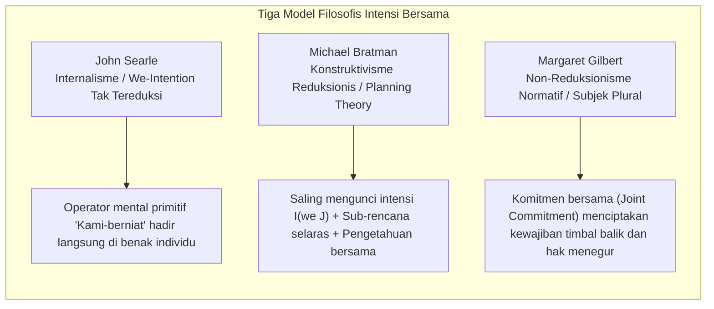
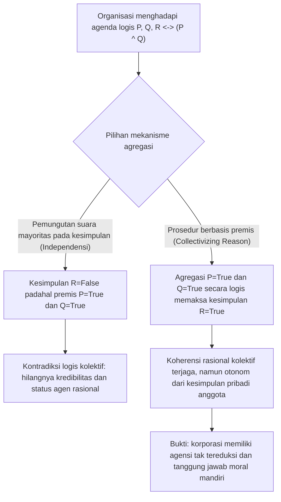
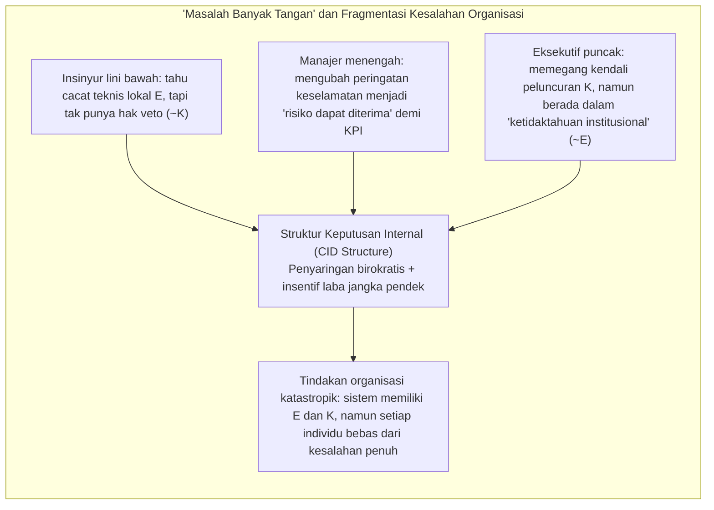

## Pendahuluan: “Tak Punya Jiwa untuk Dikutuk, Tak Punya Tubuh untuk Ditendang”

Pada abad ke-18, Lord Chancellor Inggris Baron Edward Thurlow melontarkan sebuah ungkapan terkenal: “Apakah Anda pernah mengharapkan sebuah korporasi memiliki hati nurani, padahal ia tidak memiliki jiwa untuk dikutuk maupun tubuh untuk ditendang (*no soul to be damned, and no body to be kicked*)?” Selama berabad-abad, aforisme ini terus membayangi filsafat hukum, etika normatif, dan sosiologi organisasi.

Ketika bencana organisasi berskala besar terjadi — seperti tenggelamnya kapal feri *Herald of Free Enterprise* pada tahun 1987, kecelakaan pesawat Boeing 737 MAX akibat cacat desain sistem MCAS dan penghindaran regulasi, ledakan anjungan *Deepwater Horizon* milik BP pada tahun 2010, atau kecelakaan fatal kendaraan otonom — pengadilan dan publik dihadapkan pada paradoks yang menggelisahkan: <strong>kerusakan moral yang masif telah terjadi, namun tidak ada satu pun individu tunggal yang secara utuh memenuhi gabungan antara niat jahat/kesadaran (mens rea) dan kendali kausal tindakan (actus reus) sebagaimana dituntut oleh hukum pidana dan etika individual tradisional.</strong>

Jika kita mereduksi tanggung jawab moral semata-mata pada kesalahan sengaja individu yang terisolasi, kejahatan sistemik akan menguap di celah-celah pembagian kerja birokratis. Sebaliknya, jika kita menyatakan bahwa “korporasi itu sendiri bersalah secara moral”, kaum skeptis segera bertanya: bagaimana mungkin sebuah fiksi hukum abstrak yang terdiri dari anggaran dasar, rapat dewan direksi, dan algoritma dapat memiliki keadaan mental, intensi, atau agensi moral (*moral agency*)?

Artikel ini mengkaji secara sistematis lima pilar teoretis utama agensi kolektif dan tanggung jawab moral korporat dari persimpangan ontologi sosial (*Social Ontology*), filsafat tindakan, dan teori pilihan sosial (*Social Choice Theory*).

---

## 1. Individualisme Metodologis versus Realisme Non-Reduksionis

Sebelum menjelaskan bagaimana sebuah kolektif bertindak, kita harus menjawab pertanyaan metafisik mendasar: apakah kolektif itu benar-benar agen yang nyata?

### 1.1 Individualisme Metodologis dan Eliminativisme
Mulai dari Max Weber dan Friedrich Hayek hingga filsuf etika analitik seperti H. D. Lewis dan Manuel Velasquez, <strong>individualisme metodologis</strong> berpendapat bahwa hanya individu manusia biologis yang memiliki kesadaran, hati nurani, dan kehendak bebas. Menurut Velasquez, mengatakan bahwa “perusahaan berniat menipu konsumen” hanyalah metafora retoris atau singkatan yang berarti bahwa sejumlah eksekutif atau karyawan tertentu di dalam perusahaan berniat menipu. Membebankan kesalahan moral kepada organisasi yang tidak memiliki pengalaman subjektif (*qualia*) sama saja dengan melakukan <strong>kesalahan kategori (*Category Mistake*)</strong> dalam pengertian Gilbert Ryle dan memicu ketidakadilan hukuman kolektif.

### 1.2 Realisme Non-Reduksionis tentang Agensi Kelompok
Sebaliknya, Peter French, Margaret Gilbert, serta Christian List dan Philip Pettit mengembangkan <strong>realisme non-reduksionis tentang agensi kelompok (*Non-Reductive Realism about Group Agency*)</strong>. Dalam *Group Agency* (2011), List dan Pettit membuktikan bahwa untuk menjadi seorang “agen” tidak diperlukan otak biologis, melainkan pemenuhan tiga syarat minimal <strong>fungsionalis</strong>:
1. <strong>Keadaan representasional (*Representational states*)</strong>: kapasitas untuk membentuk keyakinan atau penilaian tentang fakta lingkungan;
2. <strong>Keadaan motivasional (*Motivational states*)</strong>: kapasitas untuk menetapkan tujuan, preferensi, atau nilai normatif;
3. <strong>Kapasitas intervensi rasional (*Capacity to intervene*)</strong>: kapasitas untuk bertindak di dunia berdasarkan keyakinan dan tujuan tersebut sembari mematuhi norma konsistensi rasional.

| Dimensi Perbandingan | Individualisme Metodologis / Eliminativisme (Weber, Velasquez) | Realisme Non-Reduksionis / Fungsionalisme (French, List & Pettit) |
| :--- | :--- | :--- |
| <strong>Status ontologis kelompok</strong> | Fiksi hukum, metafora retoris, sekadar penjumlahan tindakan individu | Sistem tindakan otonom yang supervenien (*supervenes*) pada individu namun tak tereduksi |
| <strong>Atribusi intensi dan keyakinan</strong> | Hanya ada di benak biologis; “intensi korporat” bersifat kiasan | Diinstansiasi secara nyata di tingkat sistem melalui struktur CID atau agregasi penilaian |
| <strong>Subjek tanggung jawab moral</strong> | Terbatas hanya pada eksekutif, insinyur, atau operator yang bersalah langsung | Entitas organisasi sendiri memikul tanggung jawab tak tereduksi (tanpa menghapus keterlibatan individu) |
| <strong>Daya jelaskan atas krisis sistemik</strong> | Mudah jatuh ke dalam “kekosongan tanggung jawab” saat tak ada individu berniat utuh | Menangkap secara presisi insentif struktural, budaya perusahaan, dan cacat desain institusional |

---

## 2. Fondasi Mikro: Intensi Bersama (Shared Intention) dan Tindakan Bersama

Ketika dua pejalan kaki secara kebetulan berlari bersamaan ke bawah halte yang sama saat hujan deras, itu hanyalah <strong>penjumlahan tindakan individu yang paralel</strong>. Namun ketika dua penari menarikan tango bersama atau tim insinyur membangun stasiun luar angkasa, itu adalah <strong>tindakan bersama (*Joint Action*)</strong>. Apa yang membedakan perilaku paralel dari “tindakan kita bersama” yang sejati? Filsafat analitik kontemporer mengajukan tiga model klasik:

### 2.1 John Searle: “Intensi-Kami” yang Tak Tereduksi (We-Intentions)
Dalam *The Construction of Social Reality* (1995), John Searle menolak setiap upaya mereduksi “Kami berniat melakukan $J$” menjadi “Saya berniat melakukan bagian saya + saya percaya Anda berniat melakukan bagian Anda”. Tanpa semangat kerja sama yang sejati, koordinasi sempurna di antara dua pesaing bisnis tetaplah tindakan individual. Oleh karena itu, Searle mempostulatkan adanya operator mental primitif yang tak tereduksi di dalam otak biologis individu — <strong>intensi-Kami (*We-intention*)</strong>:

$$\text{We-intend}(J) \xrightarrow{\text{causes}} \text{Individual My-part}(A_i)$$

### 2.2 Michael Bratman: Teori Perencanaan tentang Intensi Bersama (Planning Theory)
Michael Bratman menganggap operator primitif Searle tidak diperlukan. Menurut *Planning Theory* miliknya, intensi bersama muncul ketika intensi perencanaan biasa dari masing-masing individu membentuk <strong>jaringan yang saling mengunci dan menyelaraskan sub-rencana (*interlocking and meshing subplans*)</strong>. Dua agen $A$ dan $B$ memiliki intensi bersama $I(\text{we } J)$ jika dan hanya jika:

$$I(\text{we } J) \iff \begin{cases} \text{(1a) } A \text{ intends that we } J, \text{ and (1b) } B \text{ intends that we } J \\ \text{(2) } A \text{ and } B \text{ intend that we } J \text{ by way of each other's intentions and meshing subplans} \\ \text{(3) Conditions (1) and (2) are Common Knowledge between } A \text{ and } B \end{cases}$$

“Penyelarasan sub-rencana (*meshing subplans*)” berarti kedua pihak berkomitmen untuk bernegosiasi agar sub-rencana mereka tidak saling bertabrakan serta saling membantu ketika menghadapi kendala.

### 2.3 Margaret Gilbert: Teori Subjek Plural (Plural Subject Theory) dan Komitmen Bersama
Margaret Gilbert menunjukkan titik buta dalam model Bratman: <strong>kewajiban normatif (*Normative Obligation*)</strong>. Jika kita berjanji berjalan-jalan bersama lalu di tengah jalan Anda tiba-tiba berbalik pergi tanpa sepatah kata pun, bukan hanya prediksi saya yang meleset — saya memiliki <strong>hak normatif untuk menegur Anda (*standing to rebuke*)</strong>. Bagi Gilbert, inti dari tindakan bersama adalah <strong>komitmen bersama (*Joint Commitment*)</strong> yang meleburkan banyak individu menjadi satu <strong>subjek plural (*Plural Subject*)</strong>.

---

## 3. Dilema Diskursif dan Teorema Ketidakmungkinan Agregasi Penilaian

Jika berjalan berdua dapat dijelaskan oleh Bratman, bagaimana mungkin sebuah perusahaan multinasional atau majelis hakim agung dapat membentuk <strong>penilaian kolektif rasional yang secara langsung bertentangan dengan kesimpulan pribadi mayoritas anggotanya sendiri</strong>?

Fenomena ini ditemukan dalam teori hukum oleh Lewis Kornhauser dan Lawrence Sager sebagai <strong>“paradoks doktrinal” (*Doctrinal Paradox*)</strong> dan digeneralisasi oleh Philip Pettit sebagai <strong>“dilema diskursif” (*Discursive Dilemma*)</strong>.

### 3.1 Matriks $3 \times 3$ Dilema Diskursif
Misalkan komite keselamatan penerbangan yang terdiri dari tiga pakar (Anggota 1, 2, dan 3) harus memilih apakah akan mengizinkan pesawat terbang kembali beroperasi (kesimpulan $R$). Menurut aturan keselamatan perusahaan, izin $R$ diberikan jika dan hanya jika dua premis terpenuhi sekaligus:
* <strong>Premis $P$</strong>: Perangkat lunak kendali terbang telah lulus uji redundansi keselamatan.
* <strong>Premis $Q$</strong>: Para pilot telah menyelesaikan pelatihan simulator kondisi ekstrem secara penuh.
* <strong>Aturan logis</strong>: $R \leftrightarrow (P \land Q)$.

Ketiga pakar tersebut memberikan penilaian individual yang masing-masing konsisten secara logis sebagai berikut:

| Anggota Komite | Premis $P$ (Perangkat lunak aman) | Premis $Q$ (Pelatihan lengkap) | Aturan Logis $R \leftrightarrow (P \land Q)$ | Kesimpulan $R$ (Izinkan terbang) |
| :--- | :---: | :---: | :---: | :---: |
| <strong>Anggota 1</strong> | Benar (True) | Benar (True) | Benar (True) | <strong>Benar (True)</strong> |
| <strong>Anggota 2</strong> | Benar (True) | Salah (False) | Benar (True) | <strong>Salah (False)</strong> |
| <strong>Anggota 3</strong> | Salah (False) | Benar (True) | Benar (True) | <strong>Salah (False)</strong> |
| <strong>Suara Mayoritas (Majority)</strong> | <strong>Benar (2/3 True)</strong> | <strong>Benar (2/3 True)</strong> | <strong>Benar (3/3 True)</strong> | <strong>Salah (1/3 True) / Paradoks!</strong> |

Perhatikan baris terakhir yang mengejutkan:
* <strong>Prosedur Berbasis Kesimpulan (*Conclusion-Based Procedure*)</strong>: Jika komite melakukan pemungutan suara langsung pada kesimpulan akhir $R$, izin terbang <strong>ditolak dengan suara 1 lawan 2 ($R = \text{False}$)</strong>.
* <strong>Prosedur Berbasis Premis (*Premise-Based Procedure*)</strong>: Jika komite melakukan pemungutan suara terlebih dahulu secara terpisah pada premis $P$ dan $Q$, maka $P$ disetujui 2:1 (Benar) dan $Q$ juga disetujui 2:1 (Benar). Dengan menerapkan aturan logis bulat $R \leftrightarrow (P \land Q)$, komite secara niscaya menurunkan kesimpulan kolektif: <strong>izin terbang diberikan ($R = \text{True}$)</strong> — meskipun dua pertiga anggota komite secara pribadi menolaknya!

### 3.2 Teorema Ketidakmungkinan List-Pettit
Christian List dan Philip Pettit (2002) membuktikan bahwa dilema ini merupakan generalisasi mendalam dari teorema ketidakmungkinan Kenneth Arrow ke ranah penilaian logis. Misalkan $N = \{1, 2, \dots, n\}$ ($n \ge 3$) adalah himpunan individu dan $X$ adalah agenda proposisi yang saling terhubung secara logis. Tidak ada fungsi agregasi penilaian

$$F: \{0, 1\}^{n \times |X|} \to \{0, 1\}^{|X|}$$

yang dapat <strong>memenuhi keempat aksioma berikut secara bersamaan</strong>:
1. <strong>Domain Universal (*Universal Domain*)</strong>: menerima semua profil penilaian individual yang konsisten dan lengkap sebagai input;
2. <strong>Rasionalitas Kolektif (*Collective Rationality*)</strong>: menghasilkan output berupa penilaian kolektif yang konsisten dan lengkap secara logis;
3. <strong>Anonimitas (*Anonymity*)</strong>: semua individu memiliki bobot suara yang setara (tanpa diktator);
4. <strong>Sistematisitas / Independensi (*Systematicity / Independence*)</strong>: penilaian kolektif atas proposisi $\phi$ hanya bergantung pada suara individu atas $\phi$, dengan aturan yang sama untuk semua proposisi.

### 3.3 Mengapa Harus “Mengolektifkan Nalar” (Collectivizing Reason)?
Pettit menunjukkan bahwa agar sebuah organisasi dapat bertahan di masyarakat sebagai agen rasional yang kredibel (*conversable agent*), ia tidak boleh mengakui kebenaran $P$ dan $Q$ di depan umum sambil mengingkari konsekuensi logisnya $P \land Q$. Oleh sebab itu, organisasi harus melepaskan aksioma sistematisitas dan mengadopsi <strong>prosedur berbasis premis</strong> — yakni <strong>“mengolektifkan nalar” (*collectivize reason*)</strong>.

Konsekuensi ontologisnya sangat фундаментаl: begitu organisasi mengolektifkan nalar pada tingkat premis, <strong>muncullah (*emerge*) pikiran korporat otonom yang penilaian dan intensinya tidak lagi dapat direduksi menjadi sekadar penjumlahan opini pribadi para anggotanya</strong>. Dan karena memiliki pikiran rasional yang otonom, korporasi wajib memikul tanggung jawab moral sebagai subjek mandiri.

---

## 4. Struktur Keputusan Internal Korporat (CID) dan “Masalah Banyak Tangan”

### 4.1 Struktur CID Peter French (Corporate Internal Decision Structure)
Sejak tahun 1979, dalam *The Corporation as a Moral Person*, Peter French berargumen bahwa korporasi adalah subjek moral penuh karena memiliki <strong>Struktur Keputusan Internal Korporat (*CID Structure*)</strong> yang terdiri atas dua elemen:
1. <strong>Bagan Alir Tanggung Jawab Organisasi (*Organizational Flow Chart*)</strong>: sintaksis organisasi yang mengatur hierarki, aliran informasi, dan rantai persetujuan;
2. <strong>Aturan Pengakuan Kebijakan Korporat (*Corporate Decision Recognition Rules*)</strong>: serupa dengan “aturan pengakuan” H. L. A. Hart, aturan ini menentukan kapan keputusan individual disintesis secara resmi menjadi “keputusan korporasi”.

Struktur CID bekerja layaknya transformator logis yang mensubordinasikan dan menyintesis intensi biologis para karyawan yang tersebar menjadi <strong>intensionalitas korporat (*Corporate Intentionality*)</strong>.

### 4.2 “Masalah Banyak Tangan” Dennis Thompson (Problem of Many Hands)
Namun, pembagian kerja birokratis yang rumit ini juga melahirkan <strong>“masalah banyak tangan” (*The Problem of Many Hands*)</strong> yang dirumuskan oleh Dennis Thompson (1980).

Dalam etika tradisional dan hukum pidana, kesalahan moral penuh ($C$) menuntut agar satu agen yang sama $x$ memenuhi sekaligus <strong>syarat epistemik / niat ($E$)</strong> dan <strong>syarat kendali kausal ($K$)</strong>:

$$C(x) \iff E(x) \land K(x)$$

Namun di dalam korporasi raksasa, spesialisasi memisahkan pengetahuan dan kendali secara sistematis:
* Insinyur perangkat lunak di lini bawah mengetahui kerentanan kode saat sensor gagal (memiliki pengetahuan lokal $E$), tetapi tidak punya wewenang mengubah arsitektur atau menunda peluncuran produk (tidak memiliki kendali $K$);
* CEO memegang kekuasaan tertinggi untuk mengesahkan peluncuran komersial (memiliki kendali global $K$), tetapi penyaringan laporan birokratis dan target KPI menutupinya dari peringatan teknis spesifik (“ketidaktahuan institusional”, $\neg E$).

Akibatnya, bagi setiap individu $i \in \{1, \dots, n\}$ berlaku $\neg(E(i) \land K(i))$, padahal sistem organisasi secara keseluruhan memiliki baik pengetahuan maupun kendali! Tanpa konsep tanggung jawab moral korporat, bencana sistemik akan berakhir menjadi <strong>ketidakbertanggungjawaban yang terorganisasi</strong>.

---

## 5. Agensi Algoritmik, Kesenjangan Tanggung Jawab AI, dan “Zona Remuk Moral”

Memasuki abad ke-21, ketika simpul pengambilan keputusan birokratis digantikan oleh model *deep learning* dan algoritma otonom, “masalah banyak tangan” berkembang menjadi dua krisis etika teknologi baru:

### 5.1 “Kesenjangan Tanggung Jawab” (Responsibility Gap) Andreas Matthias
Andreas Matthias (2004) menunjukkan bahwa tanggung jawab produsen atau operator tradisional bertumpu pada asumsi bahwa perilaku mesin dapat diprediksi berdasarkan aturan desainnya. Akan tetapi, sistem *deep reinforcement learning* dan model bahasa besar modern mengubah bobot internalnya saat beroperasi dan memiliki <strong>opasitas epistemik</strong>. Ketika AI medis atau sistem kemudi otonom mengambil keputusan mematikan yang tak terprediksi bahkan oleh perancangnya, tidaklah adil menyalahkan pemrogram secara pribadi, sementara mesin itu sendiri tidak memiliki kesadaran atau harta untuk dihukum — maka mengangalah <strong>“kesenjangan tanggung jawab” (*Responsibility Gap*)</strong>.

### 5.2 “Zona Remuk Moral” (Moral Crumple Zones) Madeleine Clare Elish
Antropolog Madeleine Clare Elish (2019), melalui studi kecelakaan penerbangan otomatis dan kemudi berbantuan, mengungkap fenomena institusional yang sangat munafik: <strong>“zona remuk moral” (*Moral Crumple Zones*)</strong>.

Dalam teknik otomotif, zona remuk mekanis (*crumple zone*) dirancang untuk penyok saat tabrakan guna menyerap energi kinetik dan melindungi penumpang di dalam kabin. Sebaliknya, dalam sistem sosioteknis (*Human-in-the-Loop*), <strong>operator manusia yang berada di ujung paling bawah rantai (pengemudi keselamatan, perawat jaga, kopilot) justru dikorbankan secara institusional sebagai “zona remuk moral” untuk menyerap seluruh hantaman hukum dan kecaman publik demi melindungi korporasi teknologi beserta arsitektur algoritmiknya yang cacat</strong>. Perusahaan menikmati seluruh keuntungan efisiensi otomatisasi, namun secara kontraktual menuntut manusia mengambil alih kendali algoritma rumit yang gagal hanya dalam waktu setengah detik; saat tragedi terjadi, seluruh kesalahan dilimpahkan pada “kesalahan manusia” operator lini depan.

### 5.3 “Model Koneksi Sosial” (Social Connection Model) Iris Marion Young
Untuk melampaui kebuntuan masalah banyak tangan dan zona remuk moral, filsuf politik Iris Marion Young (*Responsibility for Justice*, 2011) membedakan dua model tanggung jawab:
1. <strong>Model Liabilitas Berorientasi Masa Lalu (*Backward-Looking Liability Model*)</strong>: mencari pelaku kausal masa lalu untuk dihukum, namun kerap gagal menghadapi ketidakadilan struktural atau justru mengorbankan pekerja tingkat bawah sebagai kambing hitam;
2. <strong>Model Koneksi Sosial Berorientasi Masa Depan (*Forward-Looking Social Connection Model*)</strong>: semua agen yang berpartisipasi dan mengambil manfaat dari suatu proses struktural atau algoritmik berbagi <strong>kewajiban politik dan moral ke masa depan</strong> untuk secara kolektif mereformasi struktur pengambilan keputusan (CID) yang melahirkan kerusakan tersebut.

---

## Kesimpulan: Membangun Kembali Akuntabilitas Konstitusional Kolektif Hibrida

Dari sindiran Baron Thurlow tentang korporasi “tanpa jiwa”, analisis intensi bersama oleh Searle, Bratman, dan Gilbert, hingga dilema diskursif Pettit dan struktur CID French, filsafat modern telah membuktikan secara tak terbantahkan bahwa <strong>korporasi dan organisasi kompleks bukanlah sekadar penjumlahan aritmetika individu, melainkan agen kolektif emergen dengan logika rasional otonom dan daya kausal yang luar biasa</strong>.

Di era ketika manusia dan algoritma otonom saling berkelindan membentuk <strong>“kolektif hibrida” (*Hybrid Collectives*)</strong>, mengakui tanggung jawab moral tak tereduksi di tingkat organisasi sama sekali bukan untuk membebaskan eksekutif yang korup, melainkan untuk menghancurkan perisai impunitas “masalah banyak tangan” dan mekanisme kambing hitam “zona remuk moral” — memaksa kita mereformasi konstitusi korporat dan tata kelola algoritmik demi keadilan.
