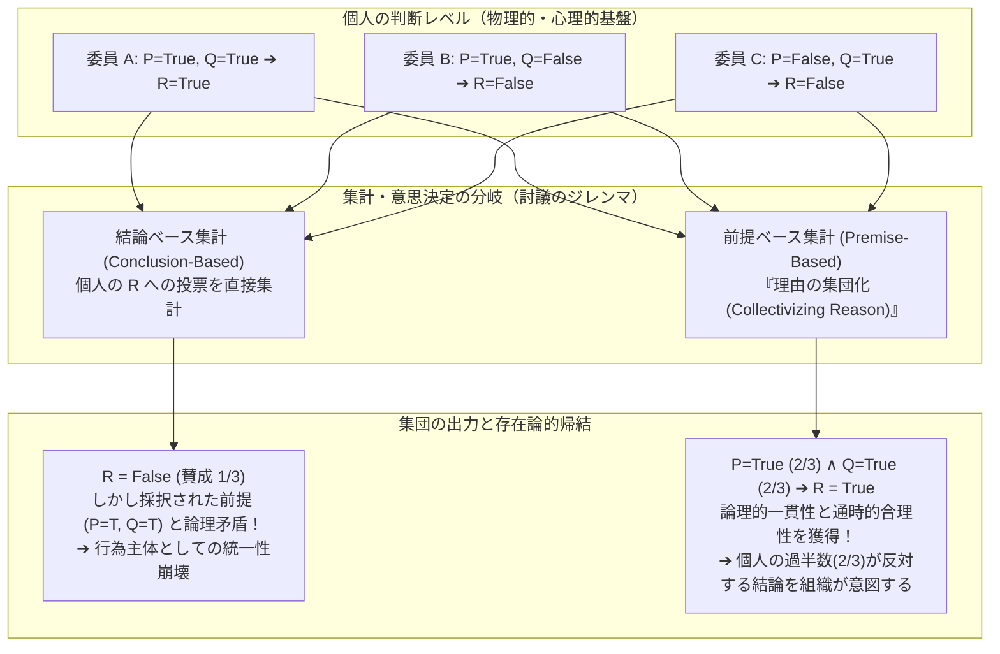

## 序論：「呪われるべき魂も、蹴飛ばされるべき肉体もない」存在は罪を犯せるか？

18世紀イギリスの大法官エドワード・サーロウ男爵（Baron Edward Thurlow）は、法人（corporation）という存在の道徳的地位について、法哲学および倫理学の歴史に残る痛烈な警句を遺した。

> <strong>「呪われるべき魂（soul to be damned）も、蹴飛ばされるべき肉体（body to be kicked）も持たない企業に、良心（conscience）があるなどと本当に期待したのか？」</strong>

現代社会において、私たちが直面する最も深刻な惨事の多くは、単独の悪漢が明確な悪意（犯意）をもって引き起こすものではない。1987年にベルギーのゼーブルッヘ港沖で船首扉を開けたまま出港し、わずか90秒で転覆して193名の犠牲者を出したフェリー「ヘラルド・オブ・フリー・エンタープライズ（*Herald of Free Enterprise*）号」沈没事故、2010年のメキシコ湾ディープウォーター・ホライズン原油流出事故、2018年から2019年にかけて346名の命を奪ったボーイング737 MAXのMCAS（操縦特性補助システム）墜落事故、さらには巨大金融機関による構造的な市場操作や地球規模の環境破壊に至るまで、その中心には常に<strong>「巨大な組織（organization / corporation）」</strong>が存在する。

しかし、こうした惨事の後に刑事裁判や公聴会が開かれると、奇妙な現象が浮かび上がる。現場の作業員は「上層部が定めた過密な運航スケジュールと標準手順に従っただけだ」と証言し、中間管理職は「現場からの危険報告が所定のフォーマットで上がってこなかった」と釈明し、エンジニアは「自分が担当したモジュール単体は仕様書通りに動作していた」と主張し、経営陣や取締役会は「安全を最優先せよという基本方針は常に通達しており、個別の技術的細部は把握し得なかった」と弁明する。しかも、彼らの多くは嘘をついているわけではない。分業化された巨大組織の内部では、<strong>「誰一人として惨事の全体像を意図しておらず、誰一人として単独で結果を回避する十全な権限と知識を同時に持っていなかった」</strong>という事態が実際に成立してしまうのである。

ここに、現代の分析哲学・社会存在論（Social Ontology）・応用倫理学・社会的選択理論（Social Choice Theory）が交差する核心的アポリアがある。<strong>「誰も一人では決めていない（あるいは誰も単独では犯意と因果的支配を完結させていない）のに、組織そのものが一個の行為主体（Agent）として道徳的・法的責任を負うことはいかにして可能なのか？」</strong>

本稿では、この問いを単なる比喩や感情論としてではなく、厳密な論理と数理モデルを用いて徹底的に解剖する。第1節では、マックス・ヴェーバーやハイエクらの<strong>方法論的個人主義（Methodological Individualism）</strong>と、集団の道徳的主体性を認める<strong>非還元主義的実在論（Non-Reductive Realism）</strong>の対立軸を整理する。第2節では、そもそも複数の個人が「ともに何かをする」とはどういうことかというミクロな基礎づけとして、ジョン・サール（John Searle）、マイケル・ブラットマン（Michael Bratman）、マーガレット・ギルバート（Margaret Gilbert）による<strong>共同意図（Shared Intention）と共同行為（Joint Action）</strong>の3大理論を比較検討する。第3節では、本稿の数理的中核として、法学における「法理のパラドックス（Doctrinal Paradox）」を一般化したフィリップ・ペティット（Philip Pettit）の<strong>「討議のジレンマ（Discursive Dilemma）」</strong>と、クリスチャン・リスト（Christian List）＆ペティットの<strong>判決集計の不可能性定理（Judgment Aggregation Impossibility Theorem）</strong>を定式化する。そこでは、<strong>「組織が時間を通じて合理的な主体として振る舞うためには、構成員の過半数が反対している結論をあえて組織の意思として採用しなければならない場合がある」</strong>という驚愕すべき数理的事実が証明される。第4節では、ピーター・フレンチ（Peter French）の<strong>企業内部意思決定構造（CID構造）</strong>とデニス・トンプソン（Dennis Thompson）の<strong>「多数の手の問題（Problem of Many Hands）」</strong>を分析し、最後の第5節では、マティアス（Andreas Matthias）が提起した<strong>自律型AIの「責任の空白（Responsibility Gap）」</strong>とアイリス・マリオン・ヤング（Iris Marion Young）の<strong>社会的つながりモデル（Social Connection Model）</strong>へと議論を拡張する。

---

## 1. 方法論的個人主義 vs. 集団的道徳主体（Corporate Moral Agency）

組織の責任を問う際、まず立ちふさがるのは「そもそも集団や組織に『心（信念・欲求・意図）』や『行為主体性（agency）』など存在するのか」という存在論的（ontological）な懐疑である。

### 1.1 方法論的個人主義と消去主義（Eliminativism）

近代社会科学および自由主義哲学の正統派であった<strong>方法論的個人主義（Methodological Individualism）</strong>は、あらゆる社会現象・制度・集団的行為は、究極的には「個人の信念・欲求・行為、および個人間の相互作用」へと還元して説明されなければならないと主張する。

社会学者マックス・ヴェーバー（Max Weber）は主著『経済と社会』（1922年）の冒頭において、国家、協同組合、株式会社といった社会集団について次のように断言した。すなわち、理解社会学の観点からは、これらの団体をあたかも一個の「人格」であるかのように扱うことは便宜的な擬制（フィクション）にすぎず、厳密な意味で主観的な意味を付与して「行為」し得るのは<strong>個々の生身の人間だけ</strong>である、と。同様に、フリードリヒ・ハイエク（Friedrich Hayek）やカール・ポパー（Karl Popper）も、集団に独自の精神や目的を帰属させる全体論（Holism）を、全体主義イデオロギーの温床となる形而上学的迷信として厳しく批判した。

この存在論的立場を倫理学における「集団的責任（Collective Responsibility）」の否定へと直結させたのが、イギリスの哲学者 H.D. ルイス（H.D. Lewis）である。ルイスは1948年の著名な論文「集団的責任（Collective Responsibility）」において、<strong>「責任とは本質的に個人のものであり、自分が為していないこと、自分が制御し得なかったことに対して道徳的責任（moral guilt）を負わされるのは、道徳そのものの破壊であり野蛮（barbarism）への退行である」</strong>と論じた。この消去主義的・還元主義的アプローチ（マニュアル・ベラスケス Manuel Velasquez らが企業倫理学で擁護した立場）に従えば、「A社が環境を汚染した」「B銀行が不正を働いた」という言明は、常に「A社の役員 $x_1$ と技術者 $x_2$ がしかじかの行為をした」という個人に関する言明の束へと翻訳（還元）可能でなければならず、個人へと還元し尽くした後に残る「企業そのものの道徳的責任」などは存在しないことになる。

### 1.2 なぜ個人主義的還元は破綻するのか？

しかし、この素朴な還元主義は、現代の高度に制度化された組織の前で深刻な理論的・実践的破綻をきたす。なぜなら、組織の意思決定と行為には、以下の3つの決定的な非還元性（irreducibility）が存在するからである。

1. <strong>構成員の入れ替わりに対する同一性（Identity across membership change）</strong>：株式会社や国家、大学といった組織は、当時の経営陣や従業員が全員退職・死去して構成員が100%入れ替わった後も、同一の主体として契約上の義務や過去の不法行為に対する賠償責任・謝罪の義務を負い続ける。
2. <strong>制度的手続きによる創発（Procedural Emergence）</strong>：取締役会の多数決や社内稟議規定、アルゴリズム的承認フローを通じて形成された「組織の決定」は、特定の個人の心理状態（脳内の意図）と一対一に対応するとは限らない。後述する「討議のジレンマ」が数学的に示す通り、<strong>構成員の誰一人として個人的には信じていない（あるいは過半数が拒絶している）命題が、合理的な集計ルールによって「組織の公式見解・意図」として成立する</strong>ことがある。
3. <strong>責任の蒸発（Evaporation of Responsibility）</strong>：伝統的な個人の道徳的・刑事的責任が成立するためには、行為者個人において<strong>因果的寄与・行為（*actus reus*：客観的構成要件）</strong>と<strong>故意または過失（*mens rea*：主観的帰責要件）</strong>が同一人物の内部で結合していなければならない。ところが、複雑に分業化された組織では、知識の断片化と権限の分散により、「行為した者は知らず、知っていた者は行為していない」という構造的乖離が生じる。もし「責任は個人にしか帰属できない」というドグマに固執すれば、組織がどれほど巨大な害悪を生み出しても、<strong>「誰にも道徳的責任がない（単なる自然災害と同じ不運である）」</strong>という結論を呑み込まざるを得なくなる。

この二つの立場の根本的な対立構造を整理すると、以下の表のようになる。

| 比較の次元 | 方法論的個人主義・還元主義 (Weber, Lewis, Velasquez) | 集団的道徳主体論・非還元的実在論 (French, Gilbert, List & Pettit) |
| :--- | :--- | :--- |
| <strong>存在論的地位</strong> | 組織は個人の集合・契約の束（法的擬制）にすぎない | 組織は個人にスーパーヴィーン（付随）しつつも自律的な実在的主体である |
| <strong>意図の所在</strong> | 生身の個人の脳内・心理状態（信念と欲求）のみに宿る | 共同コミットメントや内部意思決定構造（CID構造）・集計手続きに宿る |
| <strong>合理性の基準</strong> | 個々のメンバーの個人的推論の整合性 | 組織全体としての通時的・論理的整合性（理由の集団化） |
| <strong>道徳的責任の帰属</strong> | 常に特定可能な個人の *mens rea* と *actus reus* に分解される | 個人の責任に解消されない「組織固有の責任（Corporate Responsibility）」が成立する |
| <strong>「多数の手の問題」への応答</strong> | 誰も要件を満たさないなら、それは「事故・不運」であり道徳的罪ではない | 個人に悪意がなくとも、制度設計や組織文化の欠陥自体が組織の道徳的過失となる |

では、神秘的な「集団精神（Group Mind）」やヘーゲル的な「絶対精神」といったオカルト的形而上学に陥ることなく、すなわち<strong>「物理主義・個体主義的な存在論（世界には個々の人間と物理的環境しか存在しないという前提）」を維持したまま、いかにして還元不可能な「共同の意図」や「組織の主体性」を基礎づけることができるのか</strong>。この難問に挑んだのが、1980年代末から急速に発展した「共同意図（Shared Intention）」の分析哲学である。

---

## 2. 「ともに歩く」とはどういうことか：共同意図（Shared Intention）の3大理論

最小単位の集合的行為を考えてみよう。公園の遊歩道を2人の人間が並んでいる。
- <strong>ケースA（群衆の偶発的並行）</strong>：見知らぬ2人の通行人が、たまたま同じ方向に同じペースで歩いていたところ、突然夕立が降ってきたため、2人とも同時に走って東屋（あずまや）へ駆け込んだ。このとき、各人は「自分が雨宿りをする」という個人的意図（I-intention）を持っており、他方の存在を単なる物理的環境の一部（ぶつからないように避けるべき対象）として認識しているにすぎない。
- <strong>ケースB（共同行為 Joint Action）</strong>：2人の友人（あるいは恋人）が「一緒に散歩をする」という約束のもとで並歩し、雨が降ってきたので互いに目配せをして「一緒に東屋へ駆け込む」。

身体の物理的な運動軌跡（運動学的記述）としては、ケースAとケースBは外部のカメラから見て全く区別がつかないかもしれない。しかし、行為論的・社会存在論的には両者の間には決定的な断絶がある。ケースAは「単なる個人的行為の総和（strategic aggregation）」であるのに対し、ケースBは<strong>「共同行為（Joint Action）」</strong>である。この差を生み出している<strong>「共同意図（Shared Intention / Collective Intentionality）」</strong>の本性をめぐって、現代哲学では3つの記念碑的なモデルが競い合っている。

### 2.1 ジョン・サール（John Searle）：生物学的プリミティブとしての「われわれ意図（We-Intention）」

心の哲学者であり言語行為論の大家であるジョン・サールは、論文「集団的志向性と思考（Collective Intentions and Actions）」（1990年）および著書『社会的現実の構築（*The Construction of Social Reality*）』（1995年）において、従来の還元主義的アプローチを根本から批判した。

当時、多くの哲学者は「私たちが $J$ するつもりだ（We intend to $J$）」という集団的意図を、「私が自分のパート $x$ をするつもりであり、君が君のパート $y$ をするだろうと私が信じており、かつそのことが互いの共有知識（common knowledge）になっている」といった具合に、<strong>「私意図（I-intention）＋相互信念（Mutual Beliefs）」</strong>の無限階層へと還元しようと試みていた。しかしサールは、どれほど複雑な相互信念の階層を積み重ねても、それは依然として「他者の行動を予測して利用し合う利己的・個人的な行為者たちの並存（ゲーム理論的なナッシュ均衡）」にとどまり、真の協力行為には到達しないと指摘した。

サールの解決策は大胆である。彼は、<strong>「われわれ意図（We-intentionality）」とは、「私意図（I-intentionality）」へと決して還元できない、人間の脳に生まれつき備わった生物学的に根源的な（biologically primitive）精神現象である</strong>と主張した。
サールによれば、オーケストラで交響曲を演奏する音楽家や、パス回しをするサッカー選手の頭の中には、最初から一人称複数形の形式を持つ意図が存在する。その論理構造は以下のようになる。

$$\text{We-intend}(J) \quad \xrightarrow{\text{by means of}} \quad \text{I-intend}(\text{my part } A \text{ of } J)$$

つまり、「私が自分のパート $A$（たとえばヴァイオリンを弾くこと、パスを出すこと）を行う」という個人的意図は、独立した出発点なのではなく、「<strong>われわれが</strong>交響曲を演奏する／ゴールを決める」という根源的な「われわれ意図」を達成するための<strong>手段（by means of）</strong>として派生的に形成されるのである。ここで決定的に重要なのは、サールがこの「われわれ意図」を、個人を超越した空中に浮かぶ神秘的な「集団の心」の中に置いたのではなく、<strong>あくまで個々の生身の脳内（in the heads of individual agents）に完全に内在する心理状態として位置づけた</strong>点である。この「内的実在論」によって、サールは「貨幣」「所有権」「政府」「結婚」といったあらゆる制度的事実（Institutional Facts）が、<strong>「文脈 $C$ において、対象 $X$ を地位機能 $Y$ としてみなす（$X \text{ counts as } Y \text{ in } C$）」</strong>という集団的志向性の賦課によって創出されるメカニズムを鮮やかに説明した。

### 2.2 マイケル・ブラットマン（Michael Bratman）：意図の計画理論と「相互に噛み合う下位計画」

サールの理論は直観的に魅力的であるが、「われわれ意図はそれ以上分析不可能な生物学的プリミティブである」と宣言してしまうため、それが具体的にどのような認知メカニズムによって機能するのかがブラックボックス化してしまうという難点があった。これに対し、行為の哲学における「意図の計画理論（Planning Theory of Intention）」の提唱者であるマイケル・ブラットマンは、論文「共有された協力的活動（Shared Cooperative Activity）」（1992年）や主著『共有された主体性（*Shared Agency*）』（2014年）において、新しい種類の特殊な心理状態を導入することなく、通常の個人の計画的意図の<strong>「相互的な結びつき構造（Interlocking Structure）」</strong>だけで共同意図を完全に構成できることを示した。

ブラットマンによれば、2人の主体（私とあなた）が「ともに $J$ する（たとえば、一緒に家にペンキを塗る）」という共同意図を持つとは、以下の条件群（機能的ネットワーク）が満たされることにほかならない。

1. <strong>相互連結された意図（Interlocking Intentions）</strong>：
   - （a）<strong>私は「私たちが $J$ すること」を意図している</strong>（$\text{I intend that we } J$）。
   - （b）<strong>あなたは「私たちが $J$ すること」を意図している</strong>（$\text{You intend that we } J$）。
   （※サールに対して、「私が『私たちが $J$ すること』を意図する」のは自己矛盾ではないかと批判されることがあるが、ブラットマンは、意図とは単なる筋肉運動の指令ではなく「将来の行動を方向づけ調整する計画的状態（planning state）」であるため、他者の計画と連動することを前提に「私たちが $J$ すること」を自分の計画の目標に据えることは完全に整合的であると論じる。）
2. <strong>意図の相互依存性と下位計画の噛み合い（Meshing Subplans）</strong>：
   - 私は、あなたが「私たちが $J$ すること」を意図しているがゆえにそれを意図しており、かつ、私たちが $J$ するための<strong>互いの下位計画（subplans：たとえば、どちらが何色のペンキを買い、どちらがハシゴを支えるか）が矛盾せず噛み合う（mesh）こと</strong>を意図している。あなたも同様である。
3. <strong>非強制的・相互応答的な遂行（Mutual Responsiveness）</strong>：
   - 双方が相手を脅迫したり騙したりして操るのではなく、計画の策定と実行の各段階において、相手の行動やトラブルに対して相互に応答し助け合う（もし相手のハシゴがぐらついたら支えに行く）態勢をとっている。
4. <strong>共有知識（Common Knowledge）</strong>：
   - 上記の（1）〜（3）が成立していることが、私たち2人の間で完全に開かれた共有知識となっている。

ブラットマンの「計画理論」の最大の功績は、<strong>「心（意図）そのものに特殊な集団的性質を持ち込まなくても、計画的合理性を持つ個人同士の意図が網の目のように相互参照し、下位計画をすり合わせる構造（social network of planning states）を形成したとき、そこに集団的主体性が創発する」</strong>ことを、構成的（constructive）に解明した点にある。

### 2.3 マーガレット・ギルバート（Margaret Gilbert）：複数主語（Plural Subject）と共同コミットメントの規範性

しかし、サールの「脳内のわれわれ意図」も、ブラットマンの「噛み合う計画ネットワーク」も、重大な側面を見落としていると鋭く批判したのが、マーガレット・ギルバートである。ギルバートは主著『社会的事実について（*On Social Facts*）』（1989年）や『ともに歩くこと（*Walking Together: A Paradigmatic Social Phenomenon*）』（1990年）において、有名な<strong>「ともに歩く2人（アリスとボブ）」の思考実験</strong>を提示した。

いま、アリスとボブが「一緒に駅まで歩こう」と合意して歩き始めたとする。ところが途中で、ボブが何の断りも謝罪もなく、突然歩調を猛烈に速めて一人で100メートル先へスタスタと歩いて行ってしまったとしよう。このとき、アリスはどう反応するか？ アリスは単に「ああ、ボブの脳内の計画（下位計画）が変化したのだな」と価値中立的に観察して計画を修正するだけだろうか？ 断じて違う。アリスはボブに向かって<strong>「ちょっと、待ってよ！ 一緒に歩くんじゃなかったの！？」と非難・叱責（rebuke）する固有の権利（standing / entitlement）</strong>を持っていると感じるはずであり、ボブ自身も「自分が何か不当な裏切りを働いた」という規範的な後ろめたさを認識するはずである。

もし共同意図がブラットマンの言うような「各人の個人的な計画的意図の束」にすぎないならば、各人は自分の気が変わった瞬間にいつでも一方的に自分の意図を取り下げてよいはずである（私が一人で散歩するつもりだったが、気が変わって引き返すことに何の道徳的・規範的問題もないのと同じように）。それにもかかわらず、共同行為においては<strong>「相手の一方的な離脱（unilateral defection）を叱責する権利と、離脱してはならないという相互の義務」</strong>が直ちに発生する。

ギルバートによれば、この規範的拘束力の源泉こそが<strong>「共同コミットメント（Joint Commitment）」</strong>である。複数の個人が、互いの「ともに $X$ しようという用意（readiness）」を公然と表明し合った瞬間、彼らは個別の意思を超えた単一の<strong>「複数主語（Plural Subject）」</strong>を形成する。共同コミットメントは、部分へと分割することができない単一の結合体であり、それを結成した全員の合意によってのみ解消（rescind）され得る。ギルバートの理論は、小規模な2人の散歩から、企業・労働組合・国家の社会契約に至るまで、集団的主体性の核心には単なる「心理的計画の調整」を超えた<strong>「規範的な相互拘束（normative binding）」</strong>が存在することを暴き出したのである。

---

## 3. 数理的中核：『討議のジレンマ（Discursive Dilemma）』と判決集計の不可能性定理

サール、ブラットマン、ギルバートの議論は、数人のグループがいかにして共同の意図やコミットメントを形成するかを明らかにした。しかし、私たちが企業、裁判所、中央銀行の政策委員会、議会、学会といった<strong>「制度化された組織（Institutionalized Collectives）」</strong>へと目を向けるとき、さらに深刻かつ逃れがたい数理的パラドックスが出現する。

私たちは素朴に、「民主的で合理的な組織の意思とは、合理的なメンバーたちの多数決（過半数の意見）をまとめたものだろう」と考えがちである。しかし、18世紀のコンドルセの投票パラドックス（Condorcet Paradox）や20世紀のケネス・アローの一般不可能性定理（Arrow's Impossibility Theorem）が「選好（Preferences）の集計」における矛盾を暴いたように、1980年代末から2000年代にかけて、法学者ルイス・コーンハウザー（Lewis Kornhauser）＆ローレンス・セイガー（Lawrence Sager）、哲学者フィリップ・ペティット（Philip Pettit）、そして数理哲学者クリスチャン・リスト（Christian List）によって、<strong>「論理的に連関した命題群に対する判断（Judgments / Beliefs）の集計」</strong>における決定的なパラドックスが発見された。これが法学における<strong>「法理のパラドックス（Doctrinal Paradox, 1986）」</strong>、およびペティットが社会存在論の一般原理として定式化した<strong>「討議のジレンマ（Discursive Dilemma, 2001）」</strong>である。

### 3.1 3人の裁判官／取締役による『討議のジレンマ』の厳密な構成

具体例で考えよう。ある企業の安全審査委員会（あるいは合議制裁判所）が、<strong>3名の完全に合理的で誠実な委員（委員A、委員B、委員C）</strong>で構成されているとする。彼らは今、ある新型航空機（または化学プラント）の運航認可、あるいは契約違反による損害賠償責任の有無という重大な結論 $R$ について意思決定を行わなければならない。

組織のルール（あるいは法理・工学基準）によれば、結論 $R$（「運航を認可する」あるいは「被告は賠償責任を負う」）が真（$\text{True}$）となるための必要十分条件は、以下の2つの独立した前提命題 $P$ と $Q$ の<strong>両方が同時に真であること</strong>（論理積：連言）であると定められている。

$$R \;\leftrightarrow\; (P \land Q)$$

たとえば、企業倫理・安全管理の文脈であれば以下のように読み替えることができる。
- <strong>前提 $P$</strong>：「システムの第1安全機構（ハードウェア設計）に重大な欠陥がない（安全基準を満たしている）」
- <strong>前提 $Q$</strong>：「システムの運用体制（パイロットの訓練およびマニュアル）に重大な欠陥がない（安全基準を満たしている）」
- <strong>結論 $R$</strong>：「この航空機の商業運航を直ちに開始してよい（$R \leftrightarrow P \land Q$）」

（あるいは契約法における本来の「法理のパラドックス」の定式化であれば、$P=$「有効な契約が存在した」、$Q=$「その契約の不履行（違反）があった」、$R=$「被告は原告に対して損害賠償責任を負う（$R \leftrightarrow P \land Q$）」となる。）

いま、3人の委員 A, B, C がそれぞれ専門的知見に基づいて調査を行い、個々人としては論理法則 $R \leftrightarrow (P \land Q)$ を100%厳密に遵守して、以下のように判断を下したとしよう。

| 判断主体 | 前提 $P$（設計の安全性／契約の有効性） | 前提 $Q$（運用の安全性／違反の事実） | 論理規則 $R \leftrightarrow (P \land Q)$ | 結論 $R$（運航認可／賠償責任あり） |
| :--- | :---: | :---: | :---: | :---: |
| <strong>委員 A</strong> | <strong>True</strong> (賛成) | <strong>True</strong> (賛成) | 整合的 ($\text{T} \land \text{T} = \text{T}$) | <strong>True</strong> (認可／有責) |
| <strong>委員 B</strong> | <strong>True</strong> (賛成) | <strong>False</strong> (反対) | 整合的 ($\text{T} \land \text{F} = \text{F}$) | <strong>False</strong> (却下／無責) |
| <strong>委員 C</strong> | <strong>False</strong> (反対) | <strong>True</strong> (賛成) | 整合的 ($\text{F} \land \text{T} = \text{F}$) | <strong>False</strong> (却下／無責) |
| <strong>【多数決集計】</strong> | <strong>True (2/3：過半数)</strong> | <strong>True (2/3：過半数)</strong> | <strong>論理的破綻！ ($\text{T} \land \text{T} \neq \text{F}$)</strong> | <strong>False (1/3：少数派！)</strong> |

この $3 \times 3$ の真理値表（集計マトリクス）を注意深く観察してほしい。ここには驚くべき事態が生じている。

- <strong>委員A</strong>は、$P$ も $Q$ も真であると判断したため、論理的に $R$ も<strong>真（True）</strong>であると判断した。完全に合理的である。
- <strong>委員B</strong>は、$P$ は真だが $Q$ は偽であると判断したため、論理法則 $P \land Q$ に従って $R$ は<strong>偽（False）</strong>であると判断した。完全に合理的である。
- <strong>委員C</strong>は、$P$ は偽だが $Q$ は真であると判断したため、やはり論理法則に従って $R$ は<strong>偽（False）</strong>であると判断した。完全に合理的である。

では、<strong>「この委員会（組織）全体の判断」</strong>はどうなるだろうか？ ここで意思決定の方法として、一見するとどちらももっともらしい2つの手続きが真っ向から衝突する。

1. <strong>結論ベースの手続き（Conclusion-Based Procedure）</strong>：
   前提の議論は各人の頭の中に留め、「結局、結論 $R$ に賛成か反対か？」だけについて多数決をとる方法である。表の最右列を見ると、賛成（True）は委員Aの1票のみであり、委員Bと委員Cの2名（3分の2）が反対（False）に投じている。したがって、結論ベースの多数決によれば、組織の決定は <strong>$R = \text{False}$（却下／無責）</strong> となる。
2. <strong>前提ベースの手続き（Premise-Based Procedure）</strong>：
   まず、理由となる各前提命題 $P$ と $Q$ について順番に多数決をとり、そこで確定した「組織としての前提判断」から論理法則 $R \leftrightarrow (P \land Q)$ によって自動的に結論を導き出す方法である。表の中央の列を見ると、前提 $P$ については委員AとBが賛成しているため <strong>3分の2（2/3）の多数決で $P = \text{True}$</strong> が組織の見解として採択される。次に前提 $Q$ については委員AとCが賛成しているため、やはり <strong>3分の2（2/3）の多数決で $Q = \text{True}$</strong> が採択される。そして組織の規則 $R \leftrightarrow (P \land Q)$ に従えば、$P=\text{True}$ かつ $Q=\text{True}$ である以上、組織としての結論は必然的に <strong>$R = \text{True}$（認可／有責）</strong> となる！

もし組織が「すべての命題（$P, Q, R$）について個別命題ごとの多数決（proposition-wise majority voting）を行う」という素朴な民主主義ルールを採用すれば、組織全体としては <strong>「$P$ は真である（2/3）」「$Q$ は真である（2/3）」「『$P$ かつ $Q$ ならば $R$』も真である（3/3：全員一致）」「しかし $R$ は偽である（2/3）」</strong> という、<strong>完全に論理矛盾した（非合理で支離滅裂な）集団的信念体系</strong>を抱え込むことになってしまうのである。

### 3.2 リスト＆ペティットの判決集計不可能性定理（List-Pettit Impossibility Theorem, 2002）

「それはたまたま多数決（過半数ルール）を使ったから起きたのであって、もっと巧妙な集計関数（重み付き投票や全会一致ルールなど）を設計すれば、個人の判断への忠実さと集団の論理的整合性を両立できるのではないか？」と考える読者もいるだろう。

しかし、クリスチャン・リストとフィリップ・ペティットは2002年の記念碑的論文「判決の集計と討議のジレンマ（Aggregating Sets of Judgments: An Impossibility Result）」（*Economics and Philosophy* 誌）において、その希望を数学的に打ち砕く<strong>「判決集計の不可能性定理」</strong>を証明した。

個人の集合を $N = \{1, 2, \dots, n\}$（ただし $n \ge 3$）、論理的に相互連関した命題とその否定からなるアジェンダ（議題集合）を $X$（たとえば $\{P, \neg P, Q, \neg Q, R, \neg R, (P \land Q) \leftrightarrow R, \dots\}$）とする。各個人 $i \in N$ の判断集合 $J_i \subseteq X$ のプロファイル $(J_1, \dots, J_n)$ を入力として、集団全体の単一の判断集合 $J = F(J_1, \dots, J_n) \subseteq X$ を出力する集計関数（Aggregation Function） $F$ を考えよう。リストとペティットは、以下の4つの極めて穏当に見える公理（条件）を同時に満たす集計関数 $F$ は<strong>数学的にただの一つも存在しない</strong>ことを証明した。

1. <strong>普遍的定義域（Universal Domain）</strong>：集計関数 $F$ は、論理的に無矛盾で完備な個人の判断集合の<strong>あらゆる可能な組み合わせ（プロファイル）</strong>を入力として受け入れることができる（特定の意見の組み合わせをあらかじめ排除しない）。
2. <strong>集団的合理性（Collective Rationality：完備性と無矛盾性）</strong>：出力される集団の判断集合 $J$ もまた、アジェンダ $X$ 内のすべての命題について真偽を決定しており（<strong>完備性 Completeness</strong>）、かつ論理的に一切矛盾を含まない（<strong>論理的無矛盾性 Consistency</strong>）。
3. <strong>匿名性（Anonymity）</strong>：すべての個人の判断は平等な重みを持つ（特定の1人の判断が常にそのまま集団の判断になるような<strong>「独裁者（Dictator）」が存在しない</strong>）。
4. <strong>体系性／命題別独立性（Systematicity / Independence）</strong>：任意の命題 $\varphi \in X$ に対する集団の判断（$\varphi \in J$ か否か）は、その命題 $\varphi$ 自身に対する各個人の判断だけに依存し、かつその集計ルールはすべての命題にわたって同一である。

<strong>【定理の帰結】</strong>：これら4つの条件を同時に満たす関数 $F$ は存在しない（$\text{Impossibility}$）。したがって、独裁制（条件3の放棄）や検閲・思想統制（条件1の放棄）をとらない限り、いかなる組織も、以下のどちらか一方を犠牲にするという苦渋の選択を迫られる。
- <strong>選択肢A（集団的合理性の放棄）</strong>：条件4（命題ごとの多数決）を維持する代わりに、条件2（集団としての論理的無矛盾性や完備性）を諦める。この場合、組織は矛盾した決定を下すため、外部から見て支離滅裂な存在となる。
- <strong>選択肢B（体系性／命題別多数決の放棄）</strong>：条件2（集団としての論理的合理性）を守り抜くために、条件4を放棄し、<strong>「前提ベースの手続き（Premise-Based Procedure）」</strong>を採用する。すなわち、前提 $P$ と $Q$ には多数決を適用するが、結論 $R$ については個人の投票を無視して、組織が採択した前提から論理的に演繹する。

### 3.3 「理由の集団化（Collectivizing Reason）」と組織の自律的存在論

ペティットとリスト（共著『グループ・エージェンシー *Group Agency: The Possibility, Design, and Status of Corporate Agents*』2011年）は、この数理的定理から社会存在論における革命的な結論を導き出した。

単なる烏合の衆や一過性の世論調査とは異なり、企業・裁判所・政府・政党・研究機関といった<strong>「目的を持った組織（Purposive Organization）」</strong>が社会の中で他者と契約を結び、約束を守り、説明責任（accountability）を果たす一個の行為主体（Agent）として機能するためには、<strong>通時的な論理的整合性（集団的合理性）を維持すること（＝「理由の集団化 Collectivizing Reason」）が絶対の生存条件</strong>となる。もし裁判所が「契約は有効であり、被告は契約に違反した。ゆえに被告は無罪である」という判決文を書けば、裁判所としての正当性は崩壊する。もし企業が昨日採択した安全基準の前提と真っ向から矛盾する製品出荷決定を今日下せば、その企業は合理的な取引相手として扱われなくなる。

したがって、持続的な組織は必然的に<strong>「前提ベースの手続き（あるいはそれに類する、個人の投票結果にフィードバック修正を加える組織的推論手続き）」</strong>を採用して「理由の集団化」を行わざるを得ない。そして、その瞬間、次のような劇的な現象が起きる。

先ほどの表をもう一度見てみよう。前提ベースの手続きをとった委員会は、$P=\text{True}$ (2/3)、$Q=\text{True}$ (2/3) から論理的に演繹して、<strong>組織の最終決定として $R = \text{True}$（運航認可／有責）を採択する</strong>。ところが、メンバー個人の内面を見ると、結論 $R=\text{True}$ を支持していたのは委員A（たった3分の1）だけであり、<strong>構成員の過半数（委員Bと委員Cの3分の2＝約67%）は、結論 $R$ に対して明確に「False（反対）」と判断していた</strong>のである！

さらに驚くべきことに、もし前提が3つ（$P_1 \land P_2 \land P_3 \leftrightarrow R$）や4つ（$P_1 \land P_2 \land P_3 \land P_4 \leftrightarrow R$）に増えれば、<strong>「メンバー全員（100%）が個人的には結論 $R$ は偽（False）であると信じているにもかかわらず、各前提 $P_k$ がそれぞれ過半数の支持を得た結果、組織全体としては $R$ を真（True）として意思決定し行動する」</strong>というケースすら容易に構成できる（たとえば4人のメンバーがそれぞれ異なる1つの前提だけを偽だと考えている場合、各前提は3/4の賛成で可決され、組織としては $R=\text{True}$ となるが、個人としては4人全員が $R=\text{False}$ と考えている！）。

これが意味する哲学的なインパクトは計り知れない。
第一に、組織の信念や意図（$R=\text{True}$）は、個人の信念や意図の単純な足し算や多数決（そこでは $R=\text{False}$ が多数派である）へと<strong>直接還元することは不可能（irreducible）</strong>である。組織の心（Corporate Mind）は、構成員の個人的な心理状態に対して<strong>「付随（supervene：個人の状態と組織構造がすべて決まれば組織の状態も一意に決まるという非神秘的な依存関係）」</strong>してはいるものの、概念的・説明的には個人の態度から切り離された<strong>固有の自律性（holistic supervenience and epistemic autonomy）</strong>を獲得しているのである。
第二に、この組織の決定 $R=\text{True}$ によって外部世界に重大な損害が生じたとき、「誰が $R$ を意図したのか？」と個人レベルで犯人探しをしても、委員Bも委員Cも「私は $R$ には反対だった！」と真実を述べることができる。にもかかわらず、<strong>「組織そのもの」は自らの合理的推論手続き（前提ベースの集計）を通じて明確に $R=\text{True}$ を意図し、実行した</strong>のである。ここに、個人には還元できない「組織固有の責任」が成立する数理的・存在論的根拠がある。

---

## 4. 企業の内部意思決定構造（CID構造）と「多数の手の問題（Problem of Many Hands）」

ペティットとリストが数理モデルによって基礎づけた「組織の自律的主体性」を、企業倫理学および法哲学の文脈で先駆的に定式化していたのが、ピーター・フレンチ（Peter A. French）である。

### 4.1 ピーター・フレンチの「企業内部意思決定構造（CID Structure）」

フレンチは1979年の古典的論文「道徳的人格としての企業（The Corporation as a Moral Person）」および著書『集団的および企業的責任（*Collective and Corporate Responsibility*）』（1984年）において、企業が単なる「個人の集合体（Aggregate Collectivity：たまたま同じバスに乗り合わせた乗客や、暴徒の群れ）」ではなく、完全な意味での<strong>「道徳的人格（Moral Person / Moral Agent）」</strong>として責任を負うための条件を解明した。

その鍵となる装置が<strong>「企業内部意思決定構造（Corporate Internal Decision Structure: CID構造）」</strong>である。フレンチによれば、あらゆる形式的組織（企業、官庁、軍隊、病院など）のCID構造は、以下の2つの構成要素から成り立っている。
1. <strong>組織図と権限のフローチャート（Organizational Flow Chart）</strong>：誰がどの情報を処理し、どのレベルの決定を行い、誰に報告・承認を求めるかという役職・権限の階層的ネットワーク。
2. <strong>企業意思の承認規則（Corporate Decision Recognition Rules）</strong>：通常は「社是」「定款」「コンプライアンス規程」「標準業務手順書（SOP）」「予算承認基準」などの形で成文化（あるいは組織文化として定着）しているルール群であり、個々の従業員や取締役が行った行為や判断が、いかなる条件を満たしたときに<strong>「企業そのものの公式な意思決定（Corporate Decision）」として認定されるか</strong>を規定する文法規則。

フレンチは、ドナルド・デイヴィッドソン（Donald Davidson）の行為論を援用しつつ、CID構造が果たす機能を<strong>「再記述と従属的統合（Redescription and Subordination）」</strong>として説明する。たとえば、ある自動車メーカーの経理部長 $X$ が書類に署名し、購買部長 $Y$ がサプライヤーに発注メールを送り、工場長 $Z$ がラインを稼働させたとする。生物学的・個人的な記述レベルでは、これらは「$X$ がペンを動かした」「$Y$ がキーボードを叩いた」という別々の個人の断片的な身体行為にすぎない。しかし、それらの行為が当該企業の<strong>CID構造（稟議規程と事業計画）に合致して遂行された瞬間</strong>、CID構造というフィルター（変換関数）を通すことによって、それらの無数の個別行為は<strong>「当該自動車メーカーが、コスト削減のために安全基準の低い部品を採用して新型車を製造することを意図し、実行した」</strong>という単一の「企業の意図的行為（Corporate Intentional Action）」として統合・再記述されるのである。

ここでフレンチが強調するのは、<strong>「企業の意図（Corporate Intentionality）は、特定の社長や役員の頭の中にある私的な動機（たとえば出世欲や保身）とは全く独立に、CID構造そのものの中に制度化されている」</strong>という事実である。だからこそ、ある不祥事が起きた際、企業は「あれは現場の担当者が勝手にやったことだ」と言い逃れすることはできない（もしその行為が、企業の予算・評価制度・承認フローというCID構造の通常の作動から生み出されたものであるならば、それは紛れもなく「企業自身の意図的行為」なのである）。

### 4.2 デニス・トンプソンの「多数の手の問題（Problem of Many Hands）」と構造的過失

フレンチのCID構造論と、ペティット＆リストの討議のジレンマを組み合わせるとき、政治哲学者デニス・トンプソン（Dennis F. Thompson）が1980年の論文「公職者の道徳的責任（Moral Responsibility of Public Officials: The Problem of Many Hands）」で定式化した<strong>「多数の手の問題（The Problem of Many Hands）」</strong>の真の姿が浮かび上がる。

トンプソンは、現代の巨大官僚機構や大企業において政策や製品が作られる際、あまりにも多くの人々の「手（情報提供、部分的判断、承認、実務遂行）」を経由するため、いざ破局的な結果が生じたときに<strong>「誰が本当にその決定を下したのかを特定することが構造的に不可能になる（責任の所在が霧散する）」</strong>という病理を指摘した。

この問題を最も劇的に例証する歴史的事例が、序論でも触れた1987年3月6日のカーフェリー<strong>「ヘラルド・オブ・フリー・エンタープライズ号（*Herald of Free Enterprise*）」転覆事故</strong>である。
この事故の直接の物理的原因は、車両甲板の船首扉（バウ・ドア）が開いたままの状態で港を出港し、加速したことで大量の海水が車両甲板に流入し、わずか90秒で船体が横転したことだった。では、なぜ船首扉は閉められなかったのか？ イギリスの海難審判所（シーン判事による調査報告書）が明らかにした事実は、組織論と倫理学に衝撃を与えた。

- <strong>甲板手（Assistant Bosun）のマーク・スタンリー</strong>：扉を閉める直接の当番だったが、直前の清掃作業で疲れ果てて自室で眠り込んでしまい、出港の放送に気づかなかった（個人の過失はあるが、彼一人に193名死亡の全責任を負わせることはできない）。
- <strong>一等航海士（Chief Officer）のレスリー・サベル</strong>：扉が閉まったことを確認する監督責任があったが、同時に出港配置（ハーバー・ステーション）につく時刻が迫っており、甲板に別の作業員の姿が見えたため「彼が閉めるだろう」と思い込んでブリッジへ向かった（会社が定めた過密なスケジュールと二重任務の強制）。
- <strong>船長（Captain）のデイヴィッド・リュリー</strong>：ブリッジ（操舵室）から船首扉は構造上見えず、また<strong>「異常がない限り報告しない（ネガティブ・レポーティング：問題があるときだけ報告し、報告がなければ『すべて正常（扉は閉まっている）』とみなして出港せよ）」</strong>という会社の運航規定に従っていた。
- <strong>運航会社（タウンゼント・ソーレセン社）の経営陣と陸上管理部門</strong>：実はこの事故の数年前から、複数の船長たちが「ブリッジに船首扉の開閉状態を示す警告灯（インジケーター・ライト）をわずか数千ポンドで設置してほしい」という要望書を陸上管理部門に提出していた。しかし、ある役員は「甲板手が自分の仕事をサボらないように見張るためのライトなど不要だ」と一蹴し、他の取締役たちはそれぞれ別の部門（営業、財務、労務）を担当していたため、その要望書が安全上の致命的リスクを示していることを誰も組織として共有・処理しなかった。

後にイギリスの検察当局は、運航会社（P&Oヨーロピアン・フェリーズ社）および7名の個人を「法人故殺罪（Corporate Manslaughter）」で起訴したが、1990年、刑事裁判所はこの起訴を<strong>棄却</strong>せざるを得なかった。なぜなら、当時のイギリス刑法が依拠していた<strong>「同一化原則（Identification Doctrine：企業の『指導的精神と意思 directing mind and will』たる特定の最高経営幹部1人以上の内部に、故殺罪の主観的要件 *mens rea* が完全に成立していなければ、企業自体も有罪にできないという還元主義的法理）」</strong>のもとでは、取締役の誰一人として単独では「重過失致死のすべての構成要件（危険の認識と放置の意図）」を満たしていなかったからである！

しかし、シーン判事は報告書の中で、この還元主義的免責の欺瞞を突き、今や企業倫理学の古典となった次の一節を記した。

> <strong>「最上層の取締役会から現場のジュニア・マネージャーに至るまで、肩を並べる長い列の全員が責任を分かち合わなければならない。なぜなら、この会社の『てっぺんからつま先まで（from top to bottom）』、企業全体が『だらしなさ（sloppiness）と無関心という病』に感染していたからである。」</strong>

これをペティットやフレンチの理論で分析すれば、事態は明快である。タウンゼント・ソーレセン社のCID構造（意思決定ルールと情報伝達網）は、まさに「討議のジレンマ」の悪しき変種を生み出していた。「時間通りの迅速な出港を最優先する」「ネガティブ・レポーティングを採用する」「現場からの警告灯設置要求を各部署で握りつぶす」という個々のルールや判断がCID構造の中で結合した結果、<strong>取締役の誰一人として「乗客を危険にさらそう」と意図していなかったにもかかわらず、企業システム全体としては「安全確認を構造的に省略して航海を強行する」という集団的意図（あるいは組織的重過失）を形成していた</strong>のである。（この事件の反省から、イギリスでは後に2007年「法人故殺および法人殺人法 Corporate Manslaughter and Corporate Homicide Act 2007」が制定され、特定の個人1人の犯意を特定できなくても、シニア・マネジメント全体の業務管理・組織化のあり方に重大な欠陥があれば法人自体を処罰できるよう法改正が行われた。）

---

## 5. 集団的責任は個人の責任を「免除」するか？——分配・設計・そしてAIの責任の空白へ

ここで、もう一つの極めて重要な実践的問いに答えなければならない。もし「組織そのものが固有の道徳的・法的責任を負う」ことを認めた場合、それは組織の背後に隠れている<strong>生身の経営者や従業員の「個人的責任」を希薄化させ、免罪符を与えてしまう（企業が罰金を払って終わりになる）危険</strong>はないのか？

結論から言えば、<strong>集団的責任（Corporate Responsibility）と個人的責任（Individual Responsibility）はゼロサム・ゲーム（一方が増えれば他方が減るパイの奪い合い）ではない</strong>。両者は異なる存在論的レベル（マクロな制度レベルとミクロな行為者レベル）で同時に成立し、相互に補完し合う。

### 5.1 個人に残される「制度設計と役割遂行の責任（Design and Role Responsibility）」

フィリップ・ペティットやデニス・トンプソンが強調するように、たとえ特定の惨事の最終結果 $R$ について「討議のジレンマ」や「多数の手の問題」が生じていたとしても、組織を構成する個人は、以下の<strong>メタレベルの個人的道徳責任</strong>から決して逃れることはできない。

1. <strong>制度設計および組織改編の責任（Responsibility as Enactors and Designers）</strong>：
   なぜその組織のCID構造は、現場の危険信号（たとえば737 MAXにおけるテストパイロットの懸念や、フェリーの警告灯設置要求）が経営判断に反映されないような欠陥構造になっていたのか？ 経営陣や管理職は、最終的な事故そのものを直接意図していなかったとしても、<strong>「そのような欠陥のある意思決定構造（CID構造）を設計・維持し、改善を怠ったこと」</strong>に対して、言い逃れのできない個人的責任を負う。
2. <strong>認識論的徳と内部告発・異議申し立ての義務（Epistemic Virtue and Complicity）</strong>：
   クリストファー・クッツ（Christopher Kutz）が著書『共犯性（*Complicity: Ethics and Law for a Collective Age*）』（2000年）で論じたように、たとえ自分の行為が全体の害悪に対して限界的な因果的寄与（marginal causal contribution）しか持たないとしても、有害な共同プロジェクトに「参加する意図（participatory intention）」を持って役割を遂行した個人は、その集団的害悪に対して<strong>共犯的説明責任（complicitous accountability）</strong>を負う。「自分は歯車にすぎなかった」「自分のパート（前提 $P$ のみ）しか見ていなかった」という言い訳（アイヒマン的弁明）は、自らの職務が組織全体のどの結論 $R$ に結びつくかを問い直す義務（ロール・レスポンシビリティの批判的省察）の放棄として道徳的に非難される。

### 5.2 アンドレアス・マティアスの「AIによる責任の空白（Responsibility Gap）」

さらに21世紀の今日、この「誰も一人では決めていないのに責任が生じるか」という問題は、人間の組織を超えて<strong>「人間と自律型AI（機械学習アルゴリズム）のハイブリッド・システム」</strong>へと急激に拡大している。

哲学者アンドレアス・マティアス（Andreas Matthias）は、2004年の先駆的論文「責任の空白：学習するオートマトンの責任帰属（The Responsibility Gap: Ascribing Responsibility for the Actions of Learning Automata）」において、深層学習（ディープラーニング）や強化学習を備えた自律型システム（自動運転車、アルゴリズム高速取引、医療診断AI、自律型致死兵器システム LAWS など）が伝統的な責任概念を根底から突き崩すことを指摘した。

従来の機械（決定論的なプログラム）であれば、機械が誤作動を起こした際の責任は、設計仕様を誤った<strong>プログラマー／メーカー</strong>か、操作を誤った<strong>ユーザー（オペレーター）</strong>のいずれかに帰属できた。ところが、自己学習するニューラルネットワークにおいては、システム自身が稼働環境の中で何百万ものパラメータ（重み行列）を動的に書き換えながら意思決定を行うため、以下の事態が生じる。
- <strong>開発者・エンジニア</strong>は、学習アルゴリズムのアーキテクチャは設計したが、特定の瞬間にそのAIがなぜその特定の出力（たとえば自動運転中の急ハンドルや、特定の人種に対する与信拒否）を下したのかを事前に予測することも、事後的に完全に制御することもできない（<strong>予見可能性と制御可能性の喪失</strong>）。
- <strong>現場のオペレーター（人間の監視者）</strong>は、ミリ秒単位で下されるAIの推論プロセスを理解する認知能力も時間的余裕も持たないにもかかわらず、事故が起きた瞬間だけ「最終確認ボタンを押した人間」として法的・道徳的責任を押し付けられる。人類学者マデリン・エリシュ（Madeleine Clare Elish）は、このように複雑な自動システムの欠陥の責任だけを不当に吸収させられる現場の人間を<strong>「道徳的クランプルゾーン（Moral Crumple Zone：自動車の衝突時に潰れて衝撃を吸収するバンパーのように、組織と技術システムの責任を吸収して潰される生身の人間）」</strong>と呼んで批判した。
- そしてもちろん、<strong>AIアルゴリズム自身</strong>には「呪われるべき魂も、苦痛を感じる意識も、道徳的理由に応答する自律的人格も」存在しないため、AI自体を道徳的に非難したり処罰したりすることは無意味である。

ここに生じるのが<strong>「AIの責任の空白（Responsibility Gap）」</strong>である。この空白を埋める唯一の方法は、人間とAIアルゴリズムを切り離された別個の個体として見るのではなく、<strong>「人間の設計者・運用組織・監査プロセス・そしてAIモデル全体が一体となって構成するソシオ・テクニカルなCID構造（Socio-Technical Corporate Agency）」</strong>として捉え直すことである。サンタナ（Filippo Santoni de Sio）とファン・デン・ホーヴェン（Jeroen van den Hoven）が提唱する<strong>「意味のある人間による制御（Meaningful Human Control: MHC）」</strong>の理論が示す通り、個別の推論ステップを人間がリアルタイムで操作できなくても、システム全体が人間の道徳的理由と安全規範に追跡・応答（track and respond）するよう組織的・技術的ガバナンスを構築する<strong>集団的・制度的責任</strong>は、常にそのシステムを配備した企業・組織全体に帰属するのである。

### 5.3 後ろ向きの責任（Blame）から前向きな政治的責任（Forward-Looking Responsibility）へ

最後に、集団的責任の時間的ベクトルについて重要な区別を導入しよう。私たちが「誰のせいか？」を問うとき、通常は過去に起きた害悪の原因者を特定して非難・処罰・賠償を科す<strong>「後ろ向きの責任（Backward-Looking Responsibility：帰責モデル Liability Model）」</strong>を念頭に置いている。

しかし、地球温暖化、グローバル・サプライチェーンにおける児童労働や過酷な搾取（スウェットショップ）、SNSプラットフォームのアルゴリズムによる社会の分断といった<strong>「構造的不正義（Structural Injustice）」</strong>においては、そもそも「特定の企業1社」や「特定の組織のCID構造1つ」にすら因果関係を限定できない場合がある。何億人もの消費者、何万もの下請け工場、投資家、各国の規制緩和政策が、それぞれ「合法で日常的なルール」に従って行動した結果、誰一人として意図しない巨大な構造的抑圧が再生産されるからである。

政治哲学者アイリス・マリオン・ヤング（Iris Marion Young）は、遺作『正義への責任（*Responsibility for Justice*）』（2011年）において、こうした構造的不正義に対して従来の「犯人探し（帰責モデル）」だけを適用しようとすると、全員が「自分は悪くない（法を犯していない）」と自己防衛に走り、問題が永遠に解決されないことを指摘した。ヤングはこれに代わる概念として<strong>「社会的つながりモデル（Social Connection Model）」</strong>を提唱した。

| 比較軸 | 帰責モデル (Liability Model) | 社会的つながりモデル (Social Connection Model) |
| :--- | :--- | :--- |
| <strong>時間的焦点</strong> | <strong>後ろ向き（Backward-Looking）</strong>：過去の特定の行為と損害の因果関係を特定する | <strong>前向き（Forward-Looking）</strong>：現在進行形の構造的プロセスを将来に向けて変革する |
| <strong>対象となる問題</strong> | 特定の個人または特定企業のCID構造による不法行為・過失・犯罪 | グローバルなサプライチェーン搾取、気候変動、構造的差別などの「構造的不正義」 |
| <strong>責任の根拠</strong> | 行為者の悪意・過失（*mens rea*）および直接的・制度的因果寄与（*actus reus*） | 不正義を生み出す社会的・経済的制度プロセスに<strong>構造的に参加・関与しているという事実そのもの</strong> |
| <strong>非難と罪悪感</strong> | 特定された加害者を道徳的・法的に「有罪（Guilty / Blameworthy）」として断罪する | 個々人を「犯罪者」として断罪するのではなく、<strong>「ともに制度を書き換える政治的義務」</strong>を課す |
| <strong>実現の手段</strong> | 単独の行為者・法人に対する処罰、損害賠償、制裁 | 関与する多様な主体が連帯して行う<strong>「集合的行為（Collective Action）」</strong>による制度改革 |

ヤングの洞察は、本稿の議論を鮮やかな円環として閉じさせる。「誰も一人では決めていない」がゆえに生まれた構造的な害悪に対して、私たちは一方では、ピーター・フレンチやフィリップ・ペティットが解明した通り、意思決定の主体となった<strong>企業・組織のCID構造と『理由の集団化』のプロセスに対して厳格な後ろ向きの道徳的・法的説明責任（Corporate Accountability）</strong>を追及しなければならない。そして同時に、既存の組織や市場のルールそのものが「多数の手の問題」や「構造的不正義」を不可避に生み出しているのであれば、その構造の内部で生き、働き、恩恵を受けている私たち一人ひとりが、<strong>「新しい共同意図（Shared Intention）と共同コミットメントを結成し、集合的行為を通じて組織と制度のルール（CID構造）そのものを作り変える」という前向きの責任（Forward-Looking Responsibility）</strong>を引き受けなければならないのである。

---

## 結論：組織に「良心」を実装するということ

エドワード・サーロウ男爵の問いに、21世紀の社会存在論と倫理学は明確な答えを与えることができる。
たしかに企業や組織には、生物学的な意味での「呪われるべき魂」も「蹴飛ばされるべき肉体」も存在しない。しかし、人間の個人たちが共同の計画を編み上げ（ブラットマン）、相互の規範的コミットメントによって複数主語を形成し（ギルバート）、通時的な論理的整合性を保つために「理由の集団化（前提ベースの意思決定）」を行う制度的構造（ペティット＆リスト、フレンチのCID構造）を立ち上げたとき、そこには<strong>個人の意識の単純な総和には決して還元されない、真正の「集合的行為主体（Collective Agent）」が誕生する</strong>。

組織が一個の合理的主体として契約を結び、利益を享受し、社会に巨大な因果的力を及ぼす以上、その組織は「誰か一人の頭の中にすべての犯意が揃っていなかったから」という理由で道徳的責任を免れることはできない。<strong>組織の「良心（Conscience）」とは、神秘的な魂のことではない。それは、いかなる前提が採択されたときに警告を発し、いかなるリスクが報告されたときに歩みを止め、いかに「多数の手の問題」や「道徳的クランプルゾーン」の発生を防ぐかという、組織の内部意思決定構造（CID構造）と討議のアーキテクチャそのものの倫理的品質のことなのである。</strong>

---

## 主要参考文献（Key References）

- <strong>Bratman, Michael E.</strong> (1992). "Shared Cooperative Activity." *The Philosophical Review*, 101(2), 327–341.
- <strong>Bratman, Michael E.</strong> (2014). *Shared Agency: A Planning Theory of Acting Together*. Oxford University Press.
- <strong>Elish, Madeleine Clare</strong> (2019). "Moral Crumple Zones: Cautionary Tales in Human-Robot Interaction." *Engaging Science, Technology, and Society*, 5, 40–60.
- <strong>French, Peter A.</strong> (1979). "The Corporation as a Moral Person." *American Philosophical Quarterly*, 16(3), 207–215.
- <strong>French, Peter A.</strong> (1984). *Collective and Corporate Responsibility*. Columbia University Press.
- <strong>Gilbert, Margaret</strong> (1989). *On Social Facts*. Princeton University Press.
- <strong>Gilbert, Margaret</strong> (1990). "Walking Together: A Paradigmatic Social Phenomenon." *Midwest Studies in Philosophy*, 15(1), 1–14.
- <strong>Kornhauser, Lewis A., & Sager, Lawrence G.</strong> (1986). "Unpacking the Court." *The Yale Law Journal*, 96(1), 82–117.
- <strong>Kutz, Christopher</strong> (2000). *Complicity: Ethics and Law for a Collective Age*. Cambridge University Press.
- <strong>Lewis, H. D.</strong> (1948). "Collective Responsibility." *Philosophy*, 23(84), 3–18.
- <strong>List, Christian, & Pettit, Philip</strong> (2002). "Aggregating Sets of Judgments: An Impossibility Result." *Economics and Philosophy*, 18(1), 89–110.
- <strong>List, Christian, & Pettit, Philip</strong> (2011). *Group Agency: The Possibility, Design, and Status of Corporate Agents*. Oxford University Press.
- <strong>Matthias, Andreas</strong> (2004). "The Responsibility Gap: Ascribing Responsibility for the Actions of Learning Automata." *Ethics and Information Technology*, 6(3), 175–183.
- <strong>Pettit, Philip</strong> (2001). *A Theory of Freedom: From the Psychology to the Politics of Agency*. Oxford University Press.
- <strong>Searle, John R.</strong> (1990). "Collective Intentions and Actions." In P. R. Cohen, J. Morgan, & M. E. Pollack (Eds.), *Intentions in Communication* (pp. 401–415). MIT Press.
- <strong>Searle, John R.</strong> (1995). *The Construction of Social Reality*. Free Press.
- <strong>Thompson, Dennis F.</strong> (1980). "Moral Responsibility of Public Officials: The Problem of Many Hands." *American Political Science Review*, 74(4), 905–916.
- <strong>Young, Iris Marion</strong> (2011). *Responsibility for Justice*. Oxford University Press.
